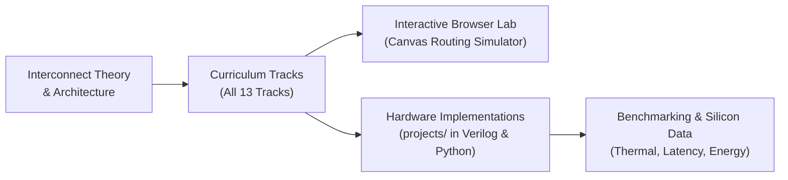

  
✨ Open-Source Curriculum & Research Lab

  <h1>Network-on-Chip Learning Hub</h1>
  

    An interactive, scholarly curriculum bridging theoretical computer architecture, silicon router microarchitecture, and open-source reproducible research. Grounded in 12 definitive textbook chapters, hands-on hardware simulations, and verified silicon research.
  

  

    <a href="textbook/" class="noc-sim-btn" style="text-decoration: none; background: #2563eb;">📖 Read Official Textbook (12 Chaps)</a>
    <a href="tracks/" class="noc-sim-btn" style="text-decoration: none; background: #7c3aed;">📚 All 13 Curriculum Tracks</a>
    <a href="assets/book.pdf?v=266" target="_blank" class="noc-sim-btn" style="text-decoration: none; background: #0284c7;">📥 Download PDF (266 Pages)</a>
    <a href="interactive/terminal/" class="noc-sim-btn" style="text-decoration: none; background: #059669;">💻 Web EDA Terminal</a>
    <a href="track1-interconnect-crisis/" class="noc-sim-btn secondary" style="text-decoration: none;">🚀 Start Curriculum</a>
    <a href="quiz/" class="noc-sim-btn secondary" style="text-decoration: none;">🎯 Certification Quiz</a>
    <a href="interactive/game/" class="noc-sim-btn" style="text-decoration: none; background: #ea580c;">🔒 Deadlock Verifier</a>
    <a href="interactive/visualizer/" class="noc-sim-btn secondary" style="text-decoration: none;">🎮 2D Mesh Simulator</a>
    <a href="leaderboard/" class="noc-sim-btn secondary" style="text-decoration: none;">🏆 Leaderboard</a>
    <a href="glossary/" class="noc-sim-btn secondary" style="text-decoration: none;">📖 Glossary</a>
  

  

    12
    Core Textbook Chapters
  

  

    266
    Monograph Pages
  

  

    13
    Curriculum Tracks
  

  

    53
    Lessons &amp; RTL Cores
  

---

## 📖 Official Open Textbook (12 Chapters)

Explore the definitive 12-chapter textbook **"Network-on-Chip and Advanced Interconnects: Architecture, Co-Design & Emerging Frontiers"**, published under open access and designed to be accessible from engineering students to research architects.

  

    

      📘 Camera-Ready Monograph PDF Available
    

    

      Formatted in Springer Nature <code>svmono</code> layout (266 camera-ready pages). Covers Elmore RC wire delays, router pipelines, high-radix topologies, turn model deadlock freedom, dark silicon DVFS, HotSpot thermal models, 3D TSVs, UCIe chiplets, silicon nanophotonics, zero-trust hardware security, and AI/LLM collective accelerators.
    

  

  

    <a href="textbook/" style="display: inline-flex; align-items: center; gap: 6px; background: #2563eb; color: #ffffff; padding: 10px 18px; border-radius: 8px; font-weight: 600; font-size: 0.9rem; text-decoration: none;">
      Read Online Hub →
    </a>
    <a href="assets/book.pdf?v=266" target="_blank" style="display: inline-flex; align-items: center; gap: 6px; background: #0284c7; color: #ffffff; padding: 10px 18px; border-radius: 8px; font-weight: 600; font-size: 0.9rem; text-decoration: none;">
      Download PDF (266 Pages) ↓
    </a>
  

  

    

      Part I • Ch 1
      
Interconnect Crisis &amp; Wire Physics

      

        Why shared buses failed. Dennard scaling collapse, quantum tunneling, RC wire delays, Mayadas-Shatzkes scattering, and optimal repeater spacing.
      

    

    <a href="textbook/ch01-interconnect-crisis/" class="noc-track-link">Read Chapter 1 →</a>
  

  

    

      Part I • Ch 2
      
Switching, Flow Control &amp; Buffers

      

        Wormhole vs VCT switching, flits/phits, credit turnaround latency loops ($RTT$), Virtual Channel buffers, and AXI4/TileLink NI packetization.
      

    

    <a href="textbook/ch02-switching-flow-control/" class="noc-track-link">Read Chapter 2 →</a>
  

  

    

      Part I • Ch 3
      
Router Microarchitecture &amp; Arbitration

      

        Canonical 4-stage pipeline, speculative parallel VA/SA allocation, matrix &amp; wavefront arbiters (sub-200ps LRU), and SMART bypass routers.
      

    

    <a href="textbook/ch03-router-microarchitecture/" class="noc-track-link">Read Chapter 3 →</a>
  

  

    

      Part II • Ch 4
      
Direct, Indirect &amp; High-Radix Topologies

      

        Graph metrics, 2D Mesh, Torus, Folded Torus, cMesh, Clos networks, Fat-Trees, Flattened Butterfly, and Dragonfly exascale topologies.
      

    

    <a href="textbook/ch04-topologies-and-metrics/" class="noc-track-link">Read Chapter 4 →</a>
  

  

    

      Part II • Ch 5
      
Deadlock Theory, Turn Models &amp; Routing

      

        Channel Dependency Graphs (CDG), Dally-Seitz theorem, Glass-Ni turn models, Chiu's Odd-Even, Duato's escape VCs, and coherence VNET isolation.
      

    

    <a href="textbook/ch05-routing-deadlock-theory/" class="noc-track-link">Read Chapter 5 →</a>
  

  

    

      Part III • Ch 6
      
Low-Power Architectures &amp; Dark Silicon

      

        Dynamic switching power, sub-threshold leakage, dark silicon budget ($>20\%$), Voltage-Frequency Islands (VFIs), and lookahead power gating.
      

    

    <a href="textbook/ch06-low-power-dark-silicon/" class="noc-track-link">Read Chapter 6 →</a>
  

  

    

      Part III • Ch 7
      
Thermal Modeling &amp; Fault Tolerance

      

        Fourier heat equation, compact RC ladders (HotSpot), thermal throttling, Gaussian-Sum Filter (GSF) sensor placement, and bypass fault detours.
      

    

    <a href="textbook/ch07-thermal-fault-tolerance/" class="noc-track-link">Read Chapter 7 →</a>
  

  

    

      Part IV • Ch 8
      
Three-Dimensional NoC (3D-NoC) &amp; TSVs

      

        Vertical TSVs, capacitive parasitics, Keep-Out Zones, 7-port 3D crossbars, arbitration-free vertical fast-paths, and vertical heat dissipation.
      

    

    <a href="textbook/ch08-3d-noc-tsvs/" class="noc-track-link">Read Chapter 8 →</a>
  

  

    

      Part IV • Ch 9
      
Multi-Chiplet Interconnects &amp; UCIe

      

        Optical reticle limit, Murphy yield economics (the Giant Pizza Problem), 2.5D interposers, the UCIe stack, and In/Outbound Swap deadlock recovery.
      

    

    <a href="textbook/ch09-chiplets-ucie/" class="noc-track-link">Read Chapter 9 →</a>
  

  

    

      Part V • Ch 10
      
Optical &amp; Wireless Networks-on-Chip

      

        Silicon nanophotonics, micro-ring resonators (MRRs), PSE/CSE switching, thermo-optic drift ($0.10\text{ nm/}^\circ\text{C}$), and 60 GHz on-chip wireless RF transceivers.
      

    

    <a href="textbook/ch10-optical-wireless/" class="noc-track-link">Read Chapter 10 →</a>
  

  

    

      Part V • Ch 11
      
Hardware Security &amp; Trust in NoCs

      

        Zero-trust interconnect security, thermal Hardware Trojans, Weighted Moving Average (WMA) anomaly detection, intrinsic delay PUFs, and timing covert channel jitter masking.
      

    

    <a href="textbook/ch11-security/" class="noc-track-link">Read Chapter 11 →</a>
  

  

    

      Part V • Ch 12
      
Domain-Specific NoCs for LLMs &amp; SNNs

      

        Generative AI communication collectives, in-network reduction crossbars, wafer-scale defect bypass, 2,048-core Ruche express links, 3D hybrid bonding memory silos, and SNN spike multicasting.
      

    

    <a href="textbook/ch12-ai-llm-snn/" class="noc-track-link">Read Chapter 12 →</a>
  

---

## 📚 Curriculum Tracks

Explore our structured learning pathways designed for undergraduate and graduate students, computer architects, and hardware designers.

  

    

      Track 1
      
Interconnect Crisis &amp; Wire Physics

      

        Why shared buses failed. Wire scaling, Elmore RC delay modeling, optimal repeater insertion, and fundamental limits of on-chip energy and latency.
      

      

        ⚡ 4 Lessons • Synthesizable Elmore Verilog • Interactive Wire Simulator
      

    

    <a href="track1-interconnect-crisis/" class="noc-track-link">Explore Track 1 →</a>
  

  

    

      Track 2
      
Switching, Flow Control &amp; Buffers

      

        Packets, flits, and phits. Store-and-Forward vs Virtual Cut-Through vs Wormhole switching, credit turnaround latency loops, and Network Interface (NI) AXI packetization.
      

      

        ⚡ 4 Lessons • Credit Counter RTL • Credit-Based Flow Control & Buffer Sizing CAD
      

    

    <a href="track2-switching-flow-control/" class="noc-track-link">Explore Track 2 →</a>
  

  

    

      Track 3
      
Router Microarchitecture &amp; Arbitration

      

        Canonical 5-stage router pipelines (BW-RC-VA-SA-ST), Virtual Channel allocation, sub-200ps LRU matrix arbiters, and SMART single-cycle multi-hop bypass routers.
      

      

        ⚡ 4 Lessons • 5-Stage SystemVerilog Router • Crossbar Switch Allocator & Arbiter Simulator
      

    

    <a href="track3-router-microarchitecture/" class="noc-track-link">Explore Track 3 →</a>
  

  

    

      Track 4
      
Direct, Indirect &amp; High-Radix Topologies

      

        Direct (Mesh, Torus, Folded Torus), Indirect (Clos, Fat-Tree, cMesh), and High-Radix (Dragonfly, Flattened Butterfly). Mathematical derivations of $T_0$, $\Theta_{sat}$, and UGAL routing.
      

      

        ⚡ 4 Lessons • Topology Graph Metrics RTL • Interactive Topology Architect
      

    

    <a href="track4-topologies-and-metrics/" class="noc-track-link">Explore Track 4 →</a>
  

  

    

      Track 5
      
Deadlock Theory, Turn Models &amp; Routing

      

        Deterministic Dimension-Order Routing (DOR), Glass &amp; Ni's Turn Model, Chiu's Odd-Even algorithm, Duato's Escape Channels, CDG acyclic proofs, and VNET isolation.
      

      

        ⚡ 4 Lessons • SMT CDG Verifier • Deadlock Verification & CDG Escape Engine
      

    

    <a href="track5-routing-deadlock/" class="noc-track-link">Explore Track 5 →</a>
  

  

    

      Track 6
      
Low-Power Architectures &amp; Dark Silicon

      

        Dark silicon physics, Thermal Design Power (TDP), multiple V/F islands, microarchitectural power gating, sleep state wakeups, and inductive $L\cdot di/dt$ emergencies.
      

      

        ⚡ 4 Lessons • Power Gating FSM RTL • Dark Silicon Physics & Power Gating CAD
      

    

    <a href="track6-low-power-dark-silicon/" class="noc-track-link">Explore Track 6 →</a>
  

  

    

      Track 7
      
Thermal Modeling &amp; Fault Tolerance

      

        Fourier heat diffusion, compact RC ladder models, Regional Congestion Awareness (RCA), source quenching, proactive ML hotspot forecasting, and sparse sensor reconstruction.
      

      

        ⚡ 4 Lessons • Thermal Deflection RTL • Silicon Thermal & Resilient Fault Routing CAD
      

    

    <a href="track7-thermal-fault-tolerance/" class="noc-track-link">Explore Track 7 →</a>
  

  

    

      Track 8
      
3D Networks-on-Chip (3D-NoC) &amp; TSVs

      

        Through-Silicon Vias (TSVs), Keep-Out Zones (KOZ), thermo-mechanical stress, 7-port 3D crossbars, vertical serialization, and 3D thermal stacking mitigation.
      

      

        ⚡ 4 Lessons • 7-Port 3D Crossbar RTL • TSV Titan Simulator
      

    

    <a href="track8-3d-noc-tsvs/" class="noc-track-link">Explore Track 8 →</a>
  

  

    

      Track 9
      
Multi-Chiplet Interconnects &amp; UCIe

      

        2.5D packaging economics, negative binomial yield, UCIe standard physical &amp; D2D adapter stacks, In/Outbound Swap deadlock recovery, and multi-chiplet bypassing.
      

      

        ⚡ 4 Lessons • In/Outbound Swap RTL • 2.5D/3D Multi-Die Chiplet CAD
      

    

    <a href="track9-chiplets-ucie/" class="noc-track-link">Explore Track 9 →</a>
  

  

    

      Track 10
      
Optical &amp; Wireless Networks-on-Chip

      

        Silicon nanophotonic microring resonators (MRRs), wavelength-routed ONoCs (WRONoCs), laser power gating with APC loops, and on-chip mmWave/THz fabrics.
      

      

        ⚡ 4 Lessons • Photonic MRR Switch RTL • Optical NoC CAD &amp; On-Chip Wireless NoC Simulator
      

    

    <a href="track10-optical-wireless/" class="noc-track-link">Explore Track 10 →</a>
  

  

    

      Track 11
      
Hardware Security &amp; Trust in NoCs

      

        On-chip threat models: eavesdropping, spoofing, and DoS. Timing, buffer, and thermal covert channels. HeatSense zero-multiplier EWMA thermal Trojan detection.
      

      

        ⚡ 4 Lessons • HeatSense EWMA Verilog • NoC Hardware Security CAD
      

    

    <a href="track11-security/" class="noc-track-link">Explore Track 11 →</a>
  

  

    

      Track 12
      
Domain-Specific NoCs for AI &amp; LLMs

      

        Large Language Models &amp; Collective Communication (AllReduce, AllGather). In-Network Reduction Routers, ultra-dense wafer-scale Ruche fabrics, and SNN multicasting.
      

      

        ⚡ 4 Lessons • In-Network Reduction SystemVerilog • Distributed LLM Collective Accelerator Simulator Lab
      

    

    <a href="track12-ai-llm-snn/" class="noc-track-link">Explore Track 12 →</a>
  

  

    

      Track 13 • Capstone
      
Capstone: Landmark Systems &amp; MoE Synthesis

      

        Walkthroughs of seminal chips (Intel SCC 48-Core, NVIDIA Simba 36-Chiplet, 3D Optical NoC, In-Network TVLSI) culminating in the Grand Capstone: Zero-Trust Multi-Chiplet MoE Accelerator.
      

      

        ⚡ 5 Lessons • Full SystemVerilog SoC RTL • Web EDA Auto-Grader Verification
      

    

    <a href="track13-capstone/" class="noc-track-link">Explore Capstone Track 13 →</a>
  

  

    

      Deadlock Verification
      
Deadlock Verification &amp; CDG Escape Engine

      

        Construct Channel Dependency Graphs (CDG) and compute Tarjan Strongly Connected Components (SCC) to detect circular wait deadlocks and verify Duato escape channels.
      

    

    <a href="interactive/game/" class="noc-track-link">Launch Deadlock Engine →</a>
  

  

    

      Turn-Model Optimizer
      
Turn-Model Routing Restrictions &amp; Path Optimizer

      

        Explore Glass &amp; Ni turn models (West-First, North-Last, Negative-First) and Chiu Odd-Even column-parity restrictions. Evaluate legal routing cones and defect detours.
      

    

    <a href="interactive/puzzle/" class="noc-track-link">Launch Turn-Model Optimizer →</a>
  

  

    

      Thermal Physics
      
Silicon Thermal &amp; DTM Finite-Difference Solver

      

        Model 2D transient Fourier heat diffusion coupled with exponential leakage runaway. Deploy closed-loop PI-DVFS and TAAR thermal-aware routing.
      

    

    <a href="interactive/hotspot/" class="noc-track-link">Launch Thermal Solver →</a>
  

  

    

      Packaging Architecture
      
2.5D/3D Multi-Die Chiplet CAD &amp; Yield Optimizer

      

        Model Murphy defect wafer yield, evaluate UCIe D2D physical latency and shoreline bandwidth density, and solve multi-die thermal coupling.
      

    

    <a href="interactive/chiplet/" class="noc-track-link">Launch Chiplet Optimizer →</a>
  

  

    

      Microarchitecture
      
Switch Allocation &amp; Crossbar Arbiter Simulator

      

        Arbitrate competing packet requests across 5x5 crossbar switches. Compare Strict Priority, Round-Robin, Matrix Arbiter, and McKeown iSLIP scheduling.
      

    

    <a href="interactive/arbiter/" class="noc-track-link">Launch Arbiter Simulator →</a>
  

  

    

      Graph Theory
      
Interconnect Topology CAD &amp; Spectral Graph Analyzer

      

        Compute Graph Laplacian eigenvalues, evaluate algebraic connectivity (Fiedler lambda_2), bisection bandwidth, and diameter across 2D Torus, Hypercubes, and Dragonfly.
      

    

    <a href="interactive/topology/" class="noc-track-link">Launch Topology CAD →</a>
  

  

    

      Nanophotonics
      
Silicon Photonic &amp; Optical NoC (ONoC) Waveguide CAD

      

        Model Lorentzian micro-ring resonator spectra, thermo-optic wavelength drift, micro-heater closed-loop tuning, optical insertion loss waterfall, and link BER.
      

    

    <a href="interactive/optical/" class="noc-track-link">Launch Optical CAD →</a>
  

  

    

      Flow Control
      
Credit-Based Flow Control &amp; Buffer Sizing CAD

      

        Simulate credit loop round-trip latency (B_min = ceil(RTT * BW)), space-time timing ladder progression, and credit bubble elimination.
      

    

    <a href="interactive/credits/" class="noc-track-link">Launch Credit CAD →</a>
  

  

    

      Bufferless Blitz
      
Bufferless Deflection Simulator NoC

      

        Eliminate input buffers entirely! Steer hot-potato flits, arbitrate deflection conflicts, unleash Golden Flit surges, and avoid livelock drops.
      

    

    <a href="interactive/deflection/" class="noc-track-link">Launch Deflection Simulator →</a>
  

  

    

      Silicon Resilience
      
Silicon Fault Tolerance CAD BIST

      

        Combat electromigration and cosmic ray strikes! Fire BIST radar pulses, establish Fault-Ring perimeter detours, and activate hot-spare interconnects.
      

    

    <a href="interactive/faults/" class="noc-track-link">Play Silicon Fault Tolerance CAD →</a>
  

  

    

      Real-Time QoS
      
Multi-VNET QoS Scheduler MCS

      

        Arbiter autonomous safety flits against bulk AI DMA transfers! Tune Weighted Fair Queuing (WFQ) and fire emergency preemption interrupts before deadlines expire.
      

    

    <a href="interactive/qos/" class="noc-track-link">Play Multi-VNET QoS Scheduler →</a>
  

  

    

      Dark Silicon
      
Dark Silicon Power Gating CAD Power

      

        Power-gate idle router corridors to slash leakage! Navigate wake-up penalties, fire rail power surges, and prevent exceeding thermal design power (TDP) envelopes.
      

    

    <a href="interactive/power/" class="noc-track-link">Play Dark Silicon Power Gating CAD →</a>
  

  

    

      Wireless NoC
      
On-Chip Wireless NoC Simulator WNoC

      

        Beam packets across silicon in 1 single cycle! Transmit on 60 GHz mmWave patch antennas, navigate FDMA channels, and avoid multi-access RF collisions.
      

    

    <a href="interactive/wireless/" class="noc-track-link">Play On-Chip Wireless NoC Simulator →</a>
  

  

    

      Neuromorphic SNN
      
Neuromorphic SNN Multicast Simulator

      

        Orchestrate event-driven bio-spikes (AER)! Build 1-to-N hardware multicast trees, integrate Leaky-Integrate-and-Fire membrane potentials, and trigger STDP surges.
      

    

    <a href="interactive/neuromorphic/" class="noc-track-link">Play Neuromorphic SNN Multicast Simulator →</a>
  

  

    

      Certification
      
Architecture Assessment &amp; Quiz

      

        Evaluate your knowledge across routing, microarchitecture, and deadlock theory. Download your official cryptographic SVG Certificate of Completion.
      

    

    <a href="quiz/" class="noc-track-link">Take Certification Quiz →</a>
  

  

    

      Hall of Fame
      
Leaderboard &amp; Verification

      

        Recognizing top scores from researchers and students globally. Features an instant cryptographic credential verification tool.
      

    

    <a href="leaderboard/" class="noc-track-link">View Leaderboard →</a>
  

  

    

      Encyclopedia
      
Architecture Glossary

      

        Instant searchable dictionary of 50+ NoC terms, from Flits and Wormhole Switching to Matrix Arbiters, TSVs, and UCIe interfaces.
      

    

    <a href="glossary/" class="noc-track-link">Browse Glossary →</a>
  

---

## 🔬 Bridging Theory, Silicon, and Code

Every concept in this curriculum is paired with concrete, reproducible artifacts from our verified research suite:

### Ready to Start?
Explore [All 13 Curriculum Tracks](tracks/index.md), dive directly into [Track 1: Interconnect Crisis & Wire Physics](track1-interconnect-crisis/index.md), or launch the [Web EDA Unix Terminal](interactive/terminal.md)!
