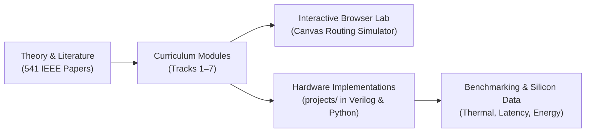

  
✨ Open-Source Curriculum & Research Lab

  <h1>Network-on-Chip Learning Hub</h1>
  

    An interactive, scholarly curriculum bridging theoretical computer architecture, silicon router microarchitecture, and open-source reproducible research. Grounded in 541 curated IEEE papers and verified hardware simulations.
  

  

    <a href="track1-fundamentals/" class="noc-sim-btn" style="text-decoration: none;">🚀 Start Learning</a>
    <a href="quiz/" class="noc-sim-btn" style="text-decoration: none; background: #0284c7;">🎯 Take Certification Quiz</a>
    <a href="interactive/game/" class="noc-sim-btn" style="text-decoration: none; background: #ea580c;">👾 Play Deadlock Buster</a>
    <a href="interactive/puzzle/" class="noc-sim-btn" style="text-decoration: none; background: #8b5cf6;">🧩 Packet Master Puzzle</a>
    <a href="interactive/visualizer/" class="noc-sim-btn secondary" style="text-decoration: none;">🎮 2D Mesh Simulator</a>
    <a href="leaderboard/" class="noc-sim-btn secondary" style="text-decoration: none;">🏆 Leaderboard</a>
    <a href="glossary/" class="noc-sim-btn secondary" style="text-decoration: none;">📖 Glossary</a>
  

  

    541
    Curated IEEE Papers
  

  

    37,400+
    Extracted Figures & RTL
  

  

    7
    Mastery Tracks
  

  

    100%
    Open & Reproducible
  

---

## 📚 Curriculum Tracks

Explore our structured learning pathways designed for undergraduate and graduate students, computer architects, and hardware designers.

  

    

      Track 1
      
Interconnect Fundamentals

      

        Why shared buses failed. Packets, flits, and phits. Store-and-Forward vs Virtual Cut-Through vs Wormhole switching, credit turnaround latency loops, and Network Interface (NI) AXI packetization.
      

      

        ⚡ 4 Interactive Simulators &amp; Calculators
      

    

    <a href="track1-fundamentals/" class="noc-track-link">Explore Track 1 →</a>
  

  

    

      Track 2
      
Router Microarchitecture

      

        Canonical 5-stage router pipelines (BW-RC-VA-SA-ST), Virtual Channel allocation, sub-200ps LRU matrix arbiters, and SMART single-cycle multi-hop bypass routers.
      

      

        ⚡ 4 Interactive Simulators &amp; Verilog RTL
      

    

    <a href="track2-router-architecture/" class="noc-track-link">Explore Track 2 →</a>
  

  

    

      Track 3
      
Topologies &amp; Interconnect Metrics

      

        Direct (Mesh, Torus, Folded Torus), Indirect (Clos, Fat-Tree, cMesh), and High-Radix (Dragonfly, Flattened Butterfly). Mathematical derivations of $T_0$, $\Theta_{sat}$, bisection bandwidth, and UGAL adaptive routing.
      

      

        ⚡ 4 Interactive Simulators &amp; High-Radix Analyzer
      

    

    <a href="track3-topologies/" class="noc-track-link">Explore Track 3 →</a>
  

  

    

      Track 4
      
Routing &amp; Deadlock Avoidance

      

        Deterministic Dimension-Order Routing (DOR), Glass &amp; Ni's Turn Model, Chiu's Odd-Even algorithm, Duato's Escape Channels, Up*/Down* tree routing, and Cache Coherence VNET isolation.
      

      

        ⚡ 4 Interactive Simulators &amp; Lookahead Verilog RTL
      

    

    <a href="track4-routing-deadlock/" class="noc-track-link">Explore Track 4 →</a>
  

  

    

      Track 5
      
Thermal &amp; Congestion Management

      

        Fourier heat diffusion, compact RC ladder models, Regional Congestion Awareness (RCA), source quenching, proactive ML hotspot forecasting, and sparse sensor reconstruction under non-Gaussian noise.
      

      

        ⚡ 4 Interactive Simulators &amp; In-Lab ML Research
      

    

    <a href="track5-congestion-thermal/" class="noc-track-link">Explore Track 5 →</a>
  

  

    

      Track 6
      
Chiplets, 3D NoC &amp; Frontiers

      

        Through-Silicon Vias (TSVs), 7-port 3D routers, negative binomial yield economics, 2.5D packaging (CoWoS, EMIB), the UCIe standard stack, 3D thermal stacking, Optical NoC (ONoC), and Wireless NoC (WNoC).
      

      

        ⚡ 4 Interactive Simulators &amp; UCIe Trade-Off Engine
      

    

    <a href="track6-chiplets-and-3d/" class="noc-track-link">Explore Track 6 →</a>
  

  

    

      Track 7
      
Landmark Paper Deep Dives

      

        Undergraduate-readable walkthroughs of seminal IEEE JSSC, TCAD, and TVLSI papers: Intel 48-Core SCC (2-TB/s DVFS Mesh), NVIDIA Simba (36-chiplet GRS MCM), 3D Optical NoC (TSVs + Micro-Rings), and In-Network Computing neuromorphic routers.
      

      

        ⚡ 4 Interactive Silicon Simulators &amp; Ground Truth Papers
      

    

    <a href="track7-paper-walkthroughs/" class="noc-track-link">Explore Track 7 →</a>
  

  

    

      Arcade Game
      
Deadlock Buster Challenge

      

        Act as the router arbiter under heavy traffic bursts. Flush escape channels using Duato's Theorem and prevent buffer lockups before time expires!
      

    

    <a href="interactive/game/" class="noc-track-link">Play Deadlock Buster →</a>
  

  

    

      Architect Puzzle
      
Packet Master Puzzle

      

        Configure turning preferences, resolve crossbar collisions, and route around faulty cores to solve 5 increasingly difficult routing puzzle levels!
      

    

    <a href="interactive/puzzle/" class="noc-track-link">Play Packet Master →</a>
  

  

    

      Certification
      
Architecture Assessment &amp; Quiz

      

        Evaluate your knowledge across routing, microarchitecture, and deadlock theory. Download your official cryptographic SVG Certificate of Completion.
      

    

    <a href="quiz/" class="noc-track-link">Take Certification Quiz →</a>
  

  

    

      Hall of Fame
      
Leaderboard &amp; Verification

      

        Recognizing top scores from researchers and students globally. Features an instant cryptographic credential verification tool.
      

    

    <a href="leaderboard/" class="noc-track-link">View Leaderboard →</a>
  

  

    

      Encyclopedia
      
Architecture Glossary

      

        Instant searchable dictionary of 50+ NoC terms, from Flits and Wormhole Switching to Matrix Arbiters, TSVs, and UCIe interfaces.
      

    

    <a href="glossary/" class="noc-track-link">Browse Glossary →</a>
  

---

## 🔬 Bridging Theory, Silicon, and Code

Every concept in this curriculum is paired with concrete, reproducible artifacts from our verified research suite:

### Ready to Start?
Begin your journey with [Track 1: Interconnect Fundamentals](track1-fundamentals/) or try out the [Interactive Simulator](interactive/visualizer/)!
