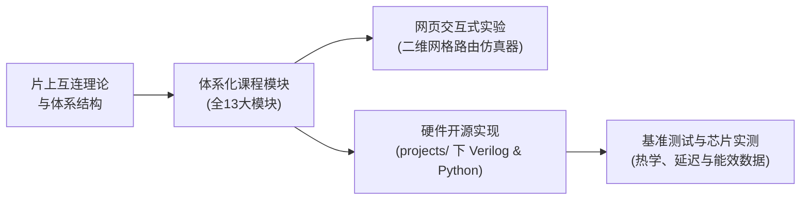

  
✨ 开源片上网络学术体系与实验平台

  <h1>片上网络学习与研究中心</h1>
  

    连接理论体系、硅基微架构与可复现工程的交互式片上网络（Network-on-Chip, NoC）学习平台。基于 12 章官方开源教材、端到端硬件仿真基准与可复现工程构建。
  

  

    <a href="textbook/" class="noc-sim-btn" style="text-decoration: none; background: #2563eb;">📖 阅读官方教材 (全十二章)</a>
    <a href="tracks/" class="noc-sim-btn" style="text-decoration: none; background: #7c3aed;">📚 系统化课程体系 (全13大模块)</a>
    <a href="../assets/book.pdf?v=266" target="_blank" class="noc-sim-btn" style="text-decoration: none; background: #0284c7;">📥 下载教材 PDF (266页)</a>
    <a href="interactive/terminal/" class="noc-sim-btn" style="text-decoration: none; background: #059669;">💻 网页 EDA 终端</a>
    <a href="track1-interconnect-crisis/" class="noc-sim-btn secondary" style="text-decoration: none;">🚀 开始系统学习</a>
    <a href="quiz/" class="noc-sim-btn secondary" style="text-decoration: none;">🎯 架构认证考核</a>
    <a href="interactive/game/" class="noc-sim-btn" style="text-decoration: none; background: #ea580c;">🔒 死锁验证引擎</a>
    <a href="interactive/visualizer/" class="noc-sim-btn secondary" style="text-decoration: none;">🎮 二维网格仿真器</a>
    <a href="leaderboard/" class="noc-sim-btn secondary" style="text-decoration: none;">🏆 荣誉排行榜</a>
  

  

    12
    教材核心章节
  

  

    266
    教材出版总页数
  

  

    20
    交互式实验与工程CAD仿真
  

  

    100%
    开源与可复现基准
  

---

## 📖 官方开源教材 (全十二章)

探索《片上网络与先进互连：架构、协同设计与前沿探索》（*Network-on-Chip and Advanced Interconnects*），全书涵盖五大部分共十二章，专为从初学者到芯片科研人员打造的高可读性教材：

  

    

      📘 完整出版排版 PDF 现已开放下载
    

    

      采用施普林格·自然（Springer Nature）<code>svmono</code> 专著版式编译（共 266 页），系统涵盖线物理延时、路由器微架构、高基数拓扑、转向模型死锁证明、暗硅低功耗、热敏建模、3D 硅通孔、UCIe 芯粒互连、纳米光子学、零信任硬件安全与面向大模型/类脑计算的领域专用互连。
    

  

  

    <a href="textbook/" style="display: inline-flex; align-items: center; gap: 6px; background: #2563eb; color: #ffffff; padding: 10px 18px; border-radius: 8px; font-weight: 600; font-size: 0.9rem; text-decoration: none;">
      在线阅读教材 →
    </a>
    <a href="../assets/book.pdf?v=266" target="_blank" style="display: inline-flex; align-items: center; gap: 6px; background: #0284c7; color: #ffffff; padding: 10px 18px; border-radius: 8px; font-weight: 600; font-size: 0.9rem; text-decoration: none;">
      下载 PDF 电子书 (266页) ↓
    </a>
  

  

    

      第一部分 • 第1章
      
多核通信危机与物理线互连

      

        共享总线为何失效？登纳德缩放定律破灭、量子隧穿、Elmore RC 导线延时、铜晶界散射及最佳中继器插入。
      

    

    <a href="textbook/ch01-interconnect-crisis/" class="noc-track-link">阅读第 1 章 →</a>
  

  

    

      第一部分 • 第2章
      
交换技术、流控与缓存管理

      

        虫洞交换 vs 虚拟直通、微元分片、信用往返延迟回路 ($RTT$)、虚拟通道线头阻塞消除与 AXI4 网络接口打包。
      

    

    <a href="textbook/ch02-switching-flow-control/" class="noc-track-link">阅读第 2 章 →</a>
  

  

    

      第一部分 • 第3章
      
路由器微架构与仲裁调度

      

        经典四级流水线、投机并行分配、矩阵仲裁器（亚 200 皮秒 LRU）、波前仲裁器与 SMART 单周期多跳旁路。
      

    

    <a href="textbook/ch03-router-microarchitecture/" class="noc-track-link">阅读第 3 章 →</a>
  

  

    

      第二部分 • 第4章
      
直接/间接与高基数互连拓扑

      

        图论互连评估、2D Mesh、Torus 环网、折叠环、cMesh、Clos 网络、Fat-Tree 胖树与 Dragonfly 蜻蜓拓扑。
      

    

    <a href="textbook/ch04-topologies-and-metrics/" class="noc-track-link">阅读第 4 章 →</a>
  

  

    

      第二部分 • 第5章
      
死锁理论、转向模型与路由

      

        通道依赖图（CDG）、Dally-Seitz 定理、Glass-Ni 转向模型、Odd-Even 奇偶路由、Duato 逃逸通道与一致性死锁消除。
      

    

    <a href="textbook/ch05-routing-deadlock-theory/" class="noc-track-link">阅读第 5 章 →</a>
  

  

    

      第三部分 • 第6章
      
低功耗架构与暗硅动态管理

      

        动态翻转功耗、亚阈值漏电、暗硅热预算约束（$>20\%$ 关断面积）、电压频率岛（VFI）与前瞻电源门控机制。
      

    

    <a href="textbook/ch06-low-power-dark-silicon/" class="noc-track-link">阅读第 6 章 →</a>
  

  

    

      第三部分 • 第7章
      
热学建模、热点防御与容错弹性

      

        傅里叶热传导方程、紧凑 RC 阶梯热模型（HotSpot）、热敏节流、高斯和滤波（GSF）传感器重建与硬件旁路容错。
      

    

    <a href="textbook/ch07-thermal-fault-tolerance/" class="noc-track-link">阅读第 7 章 →</a>
  

  

    

      第四部分 • 第8章
      
三维片上网络 (3D-NoC) 与硅通孔

      

        垂直 TSV 缩放物理、寄生电容、禁布区（KOZ）、7 端口 3D 交叉开关、无仲裁垂直快速通道与层间热堆叠管理。
      

    

    <a href="textbook/ch08-3d-noc-tsvs/" class="noc-track-link">阅读第 8 章 →</a>
  

  

    

      第四部分 • 第9章
      
多芯粒先进互连与 UCIe 接口规范

      

        光刻掩模版极限、墨菲良率模型（大比萨难题）、2.5D 中介层（CoWoS/EMIB）、UCIe 三层架构与出入境置换死锁恢复。
      

    

    <a href="textbook/ch09-chiplets-ucie/" class="noc-track-link">阅读第 9 章 →</a>
  

  

    

      第五部分 • 第10章
      
光子与无线片上网络前沿技术

      

        硅基纳米光子学、微环谐振腔（MRR）、PSE/CSE 光开关、热光漂移（$0.10\text{ nm/}^\circ\text{C}$）与 60 GHz 片上无线收发器。
      

    

    <a href="textbook/ch10-optical-wireless/" class="noc-track-link">阅读第 10 章 →</a>
  

  

    

      第五部分 • 第11章
      
片上网络硬件安全与零信任防御

      

        零信任互连威胁模型、热敏硬件木马防御、加权移动平均（WMA）异常过滤、纳秒级线延时物理不可克隆函数（PUF）与定时侧信道相位抖动掩蔽。
      

    

    <a href="textbook/ch11-security/" class="noc-track-link">阅读第 11 章 →</a>
  

  

    

      第五部分 • 第12章
      
大模型与类脑计算领域专用互连

      

        生成式 AI 全归约集合通信、网内计算归约交叉开关（PAC-NoC）、晶圆级缺陷旁路路由、2048 核 Ruche 极速快线、3D 混合键合垂直高密内存与类脑脉冲组播。
      

    

    <a href="textbook/ch12-ai-llm-snn/" class="noc-track-link">阅读第 12 章 →</a>
  

---

## 📚 课程模块导航

面向本科生、研究生、芯片架构师及硬件工程师量身打造的系统性进阶路径：

  

    

      第一模块
      
多核通信危机与物理线互连

      

        共享总线退役背后的物理根源。导线缩放效应、Elmore RC 延迟建模、最优中继器（Repeater）插入算法及片上能耗-延迟极限推导。
      

      

        ⚡ 4 节深度课时 • 可综合 Elmore Verilog • 导线物理仿真器
      

    

    <a href="track1-interconnect-crisis/" class="noc-track-link">进入模块一 →</a>
  

  

    

      第二模块
      
交换技术、流控与缓存管理

      

        数据包（Packet）、微元（Flit）与物理单元（Phit）。存储转发、虚拟直通与虫洞交换（Wormhole）对比，信用（Credit）回路与 AXI 网络接口。
      

      

        ⚡ 4 节深度课时 • 信用计数器 RTL • 信用指挥官仿真器
      

    

    <a href="track2-switching-flow-control/" class="noc-track-link">进入模块二 →</a>
  

  

    

      第三模块
      
路由器微架构与仲裁调度

      

        经典五级流水线路由器（BW-RC-VA-SA-ST）、虚通道（Virtual Channel）组织、亚 200ps 矩阵仲裁器与 SMART 单周期多跳旁路路由。
      

      

        ⚡ 4 节深度课时 • 五级流水线 SystemVerilog • 仲裁竞技场
      

    

    <a href="track3-router-microarchitecture/" class="noc-track-link">进入模块三 →</a>
  

  

    

      第四模块
      
直接/间接与高基数互连拓扑

      

        直接拓扑（Mesh, Torus）、间接集中拓扑（Clos, Fat-Tree, cMesh）与高基数超算互连（Dragonfly, 扁平蝶式）。深入推导 $T_0$、$\Theta_{sat}$ 与 UGAL 路由。
      

      

        ⚡ 4 节深度课时 • 拓扑图指标 RTL • 交互式拓扑架构师
      

    

    <a href="track4-topologies-and-metrics/" class="noc-track-link">进入模块四 →</a>
  

  

    

      第五模块
      
死锁理论、转向模型与自适应路由

      

        确定性 XY 路由、转向模型（西向优先、北向最后、奇偶路由）、杜阿托（Duato）逃逸信道定理、信道依赖图（CDG）证明与缓存一致性 VNET 隔离。
      

      

        ⚡ 4 节深度课时 • SMT CDG 形式化验证器 • 死锁验证与 CDG 逃逸引擎
      

    

    <a href="track5-routing-deadlock/" class="noc-track-link">进入模块五 →</a>
  

  

    

      第六模块
      
低功耗架构与暗硅动态管理

      

        暗硅物理极限、热设计功耗（TDP）、多电压频率岛（V/F 岛）、路由器微架构电源门控、唤醒状态机与电感性 $L\cdot di/dt$ 电压突降防护。
      

      

        ⚡ 4 节深度课时 • 电源门控 FSM RTL • 电压旋涡仿真器
      

    

    <a href="track6-low-power-dark-silicon/" class="noc-track-link">进入模块六 →</a>
  

  

    

      第七模块
      
热学建模、热点防御与容错弹性

      

        傅里叶热扩散定律、RC 紧凑热网、区域拥塞感知（RCA）、源端限流压制、机器学习热点预测与非高斯噪声下稀疏传感器重构。
      

      

        ⚡ 4 节深度课时 • 热偏斜 Verilog RTL • 硅温保卫战与故障防御
      

    

    <a href="track7-thermal-fault-tolerance/" class="noc-track-link">进入模块七 →</a>
  

  

    

      第八模块
      
三维片上网络 (3D-NoC) 与硅通孔

      

        三维硅通孔（TSV）寄生参数、热机械应力禁放区（KOZ）、七端口 3D 交叉开关、垂直串行化传输与 3D 纵向热沉陷抑制技术。
      

      

        ⚡ 4 节深度课时 • 7端口三维交叉开关 RTL • TSV 泰坦仿真器
      

    

    <a href="track8-3d-noc-tsvs/" class="noc-track-link">进入模块八 →</a>
  

  

    

      第九模块
      
多芯粒先进互连与 UCIe 规范

      

        2.5D 先进封装（CoWoS/EMIB）、负二项良率经济学、UCIe 标准物理与 D2D 适配层、跨芯粒 In/Outbound Swap 死锁回溯恢复与多芯粒旁路机制。
      

      

        ⚡ 4 节深度课时 • In/Outbound Swap RTL • 芯粒大亨实验室
      

    

    <a href="track9-chiplets-ucie/" class="noc-track-link">进入模块九 →</a>
  

  

    

      第十模块
      
光子与无线片上网络前沿

      

        硅基纳米光子微环谐振腔（MRR）、波长路由光互连（WRONoC）、激光器电源门控与闭环 APC 热微调控、毫米波/太赫兹片上无线互连。
      

      

        ⚡ 4 节深度课时 • 光子微环开关 RTL • 光子领航员与无线电波
      

    

    <a href="track10-optical-wireless/" class="noc-track-link">进入模块十 →</a>
  

  

    

      第十一模块
      
硬件安全与零信任防御

      

        片上威胁模型：窃听、欺骗与拒绝服务（DoS）。时间、缓存与物理热隐蔽信道。HeatSense 无乘法器 EWMA 热木马实时检测与硬件隔离区技术。
      

      

        ⚡ 4 节深度课时 • HeatSense EWMA Verilog • 硬件安全与威胁防御 CAD
      

    

    <a href="track11-security/" class="noc-track-link">进入模块十一 →</a>
  

  

    

      第十二模块
      
大模型与类脑计算领域专用互连

      

        大语言模型集合通信（AllReduce, AllGather）通信模式。网内归约路由器、超密晶圆级（Wafer-Scale）Ruche 织网与类脑脉冲（SNN）多播网络。
      

      

        ⚡ 4 节深度课时 • 网内归约 SystemVerilog • 大模型集体通信加速仿真器
      

    

    <a href="track12-ai-llm-snn/" class="noc-track-link">进入模块十二 →</a>
  

  

    

      第十三模块 • 毕业设计
      
毕业设计：经典芯片实测与全栈系统综合

      

        精读经典芯片（英特尔 SCC 48核、英伟达 Simba 36芯粒、三维光互连、网内计算TVLSI），挑战终极毕业设计：零信任多芯粒 MoE 混合专家加速器全栈综合。
      

      

        ⚡ 5 节深度课时 • 完整 SystemVerilog SoC RTL • 网页 EDA 终端自动评分
      

    

    <a href="track13-capstone/" class="noc-track-link">进入第十三模块毕业设计 →</a>
  

  

    

      死锁形式化验证
      
死锁验证与 CDG 逃逸虚通道转换引擎

      

        构建通道依赖图（CDG）并运行 Tarjan 强连通分量（SCC）循环死锁探测算法，验证 Dally &amp; Seitz 无环定理与 Duato 自适应逃逸虚通道恢复机制。
      

    

    <a href="interactive/game/" class="noc-track-link">启动死锁验证引擎 →</a>
  

  

    

      转向模型优化
      
转向模型限制与无死锁路径优化 CAD

      

        深入探索 Glass &amp; Ni 转向模型（西向先行、北向后行、负向先行）及邱氏（Chiu）奇偶空间变化转向模型，求解合法路由锥体并绕行硅片缺陷。
      

    

    <a href="interactive/puzzle/" class="noc-track-link">启动转向模型优化器 →</a>
  

  

    

      热力物理求解
      
硅片热传导与动态热管理（DTM）有限差分求解器

      

        实时求解二维傅里叶瞬态热扩散方程及亚阈值漏电正反馈热失控，部署闭环 PI-DVFS 调频与 TAAR 热感知自适应路由。
      

    

    <a href="interactive/hotspot/" class="noc-track-link">启动热分析求解器 →</a>
  

  

    

      先进封装架构
      
2.5D/3D 多芯粒先进封装 CAD 与良率优化器

      

        基于 Murphy 缺陷模型量化芯粒拆分良率优势，评估 UCIe D2D 物理延迟与岸线带宽密度，求解有源/无源中介层多芯片热耦合。
      

    

    <a href="interactive/chiplet/" class="noc-track-link">启动芯粒优化器 →</a>
  

  

    

      微架构仿真
      
开关分配与交叉开关仲裁微架构仿真器

      

        在时钟周期级别实时仲裁 5x5 交叉开关！对比严格优先级、轮询、矩阵仲裁器及 McKeown iSLIP 迭代匹配算法，验证 Karol 58.6% HOL 队头阻塞极限。
      

    

    <a href="interactive/arbiter/" class="noc-track-link">启动仲裁仿真器 →</a>
  

  

    

      图论拓扑分析
      
互连拓扑 CAD 与谱图分析器

      

        计算图拉普拉斯矩阵特征值谱，求解 Fiedler 向量代数连通度（lambda_2）、精确对分带宽与网络直径，支持 2D Torus、超立方体与 Dragonfly。
      

    

    <a href="interactive/topology/" class="noc-track-link">启动拓扑 CAD →</a>
  

  

    

      纳米光子学
      
硅基光电与光片上网络（ONoC）波导 CAD

      

        建立微环谐振腔（MRR）洛伦兹共振光谱模型，量化热光波长漂移与微加热器闭环补偿，分析级联插入损耗与误码率（BER）。
      

    

    <a href="interactive/optical/" class="noc-track-link">启动光网络 CAD →</a>
  

  

    

      流控理论
      
基于信用的流控与缓存尺寸规划 CAD

      

        精确仿真信用闭环往返延迟（B_min = ceil(RTT * BW)），渲染时空阶梯图，消除信用耗尽气泡，优化全线速吞吐。
      

    

    <a href="interactive/credits/" class="noc-track-link">启动信用流控 CAD →</a>
  

  

    

      无缓存对决
      
偏斜决斗：无缓存网络

      

        彻底移除路由器输入缓存！调控热土豆偏斜路由，仲裁端口竞争冲突，释放黄金微元（Golden Flit）并阻断活锁死循环丢包！
      

    

    <a href="interactive/deflection/" class="noc-track-link">进入偏斜决斗 →</a>
  

  

    

      硅片韧性
      
故障防御者：BIST自测

      

        抗击电迁移断路与高能粒子翻转！触发 BIST 雷达自测波束，构筑环形绕行容错环（Fault-Ring），激活冗余备份金属链路！
      

    

    <a href="interactive/faults/" class="noc-track-link">进入故障防御者 →</a>
  

  

    

      服务质量
      
服务质量角斗士：流量仲裁

      

        在车载关键安全流与大吞吐 AI DMA 间精细调度！调优加权公平排队（WFQ），在微秒倒计时耗尽前激发抢占中断！
      

    

    <a href="interactive/qos/" class="noc-track-link">进入流量仲裁 →</a>
  

  

    

      暗硅与电源
      
电压旋涡：电源门控

      

        对空闲路由器走廊实施休眠门控以削减漏电！驾驭唤醒延迟惩罚，触发瞬时电源轨浪涌，守卫芯片热设计功耗（TDP）红线！
      

    

    <a href="interactive/power/" class="noc-track-link">进入电压旋涡 →</a>
  

  

    

      片上无线网
      
无线电波：毫米波网络

      

        在单时钟周期内穿越整片芯片！利用 60 GHz 毫米波微天线广播，调控 FDMA 频分信道并避免射频多址冲突！
      

    

    <a href="interactive/wireless/" class="noc-track-link">进入无线电波 →</a>
  

  

    

      类脑脉冲
      
类脑联结：脉冲网络

      

        编排事件驱动的生物动作电位（AER）！构建 1-to-N 硬件组播树，积分漏电膜电位（LIF），激发 STDP 突触可塑性！
      

    

    <a href="interactive/neuromorphic/" class="noc-track-link">进入类脑联结 →</a>
  

  

    

      交互式仿真
      
二维网格路由仿真器

      

        在浏览器中动态观察数据包生成、微元逐跳转发、虚通道仲裁与拥塞排队，实时对比 XY 维序路由与自适应转向模型的流动行为。
      

    

    <a href="interactive/visualizer/" class="noc-track-link">启动仿真器 →</a>
  

---

## 🔬 贯通理论、芯片与代码

本课程中的每一个核心概念，均与我们验证过的学术研究成果及复现工件严密配对：

### 准备好开始了吗？
立即浏览 [全13大教学模块大纲](tracks/index.md)，开启 [第一模块：多核通信危机与物理线互连](track1-interconnect-crisis/index.md)，或前往体验 [网页 EDA Unix 仿真终端](interactive/terminal.md)！

