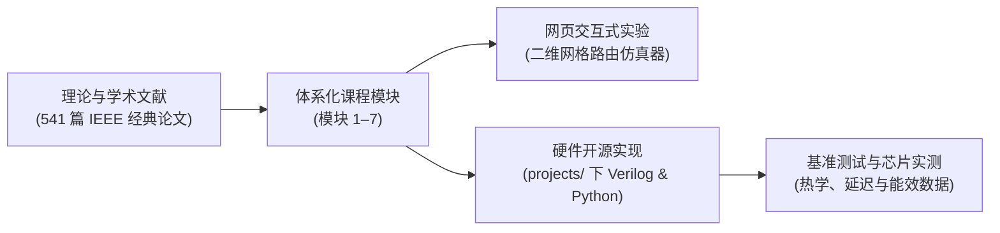

  
✨ 开源片上网络学术体系与实验平台

  <h1>片上网络学习与研究中心</h1>
  

    连接理论体系、硅基微架构与可复现工程的交互式片上网络（Network-on-Chip, NoC）学习平台。基于 541 篇 IEEE 顶刊论文与端到端硬件仿真基准构建。
  

    <a href="track1-fundamentals/" class="noc-sim-btn" style="text-decoration: none;">🚀 开始学习</a>
    <a href="quiz/" class="noc-sim-btn" style="text-decoration: none; background: #0284c7;">🎯 芯片架构认证考核</a>
    <a href="interactive/game/" class="noc-sim-btn" style="text-decoration: none; background: #ea580c;">👾 死锁大作战游戏</a>
    <a href="interactive/puzzle/" class="noc-sim-btn" style="text-decoration: none; background: #8b5cf6;">🧩 路由解密挑战</a>
    <a href="interactive/visualizer/" class="noc-sim-btn secondary" style="text-decoration: none;">🎮 启动二维网格仿真器</a>
    <a href="leaderboard/" class="noc-sim-btn secondary" style="text-decoration: none;">🏆 荣誉排行榜</a>

  

    541
    精选 IEEE 顶刊论文
  

  

    37,400+
    高精图表与架构图
  

  

    7
    进阶学习模块
  

  

    100%
    开源与可复现基准
  

---

## 📚 课程模块导航

面向本科生、研究生、芯片架构师及硬件工程师量身打造的系统性进阶路径：

  

    

      第一模块
      
片上互连基础

      

        从共享总线瓶颈到片上网络架构。数据包（Packet）、微元（Flit）与物理传输单元（Phit）。存储转发、虚拟直通与虫洞交换（Wormhole）、信用（Credit）回路与网络接口（NI）微架构。
      

      

        ⚡ 包含 4 大交互式仿真器与计算器
      

    

    <a href="track1-fundamentals/" class="noc-track-link">进入模块一 →</a>
  

  

    

      第二模块
      
路由器微架构

      

        标准五级流水线路由器（BW-RC-VA-SA-ST）、虚通道（Virtual Channel）管理、亚200ps矩阵仲裁器（Matrix Arbiter）与SMART单周期多跳旁路微架构。
      

      

        ⚡ 包含 4 大交互式仿真器与 Verilog RTL 实现
      

    

    <a href="track2-router-architecture/" class="noc-track-link">进入模块二 →</a>
  

  

    

      第三模块
      
拓扑结构与互连指标

      

        直接拓扑（Mesh, Torus, 折叠环）、间接与集中拓扑（Fat-Tree, cMesh）与高基数拓扑（Dragonfly, 扁平蝶式网络）。深入推导 $T_0$、$\Theta_{sat}$、对分带宽与 UGAL 自适应路由。
      

      

        ⚡ 包含 4 大可综合 Verilog RTL • 4 大交互式仿真器与高基数权衡分析仪
      

    

    <a href="track3-topologies/" class="noc-track-link">进入模块三 →</a>
  

  

    

      第四模块
      
路由算法与死锁避免

      

        确定性维序路由（XY 路由）、转向模型（西向优先、北向最后）、奇偶路由、杜阿托逃逸信道定理（Duato's Theorem）、生成树容错路由与缓存一致性协议死锁消除（VNET）。
      

      

        ⚡ 包含 4 大可综合 Verilog RTL 模块、4 大交互式仿真器与街机实战链接
      

    

    <a href="track4-routing-deadlock/" class="noc-track-link">进入模块四 →</a>
  

  

    

      第五模块
      
热管理与拥塞控制

      

        傅里叶热扩散定律、RC紧凑热网络、区域拥塞感知（RCA）、源端限流压制、机器学习热点前瞻预测与非高斯噪声下稀疏传感器重构（深度融合实验室开源复现成果）。
      

      

        ⚡ 包含 4 大可综合 Verilog RTL 模块、4 大交互式仿真器与街机实战链接
      

    

    <a href="track5-congestion-thermal/" class="noc-track-link">进入模块五 →</a>
  

  

    

      第六模块
      
芯粒与三维片上网络

      

        三维硅通孔（TSV）寄生与热应力禁放区（KOZ）、七端口三维路由器、负二项式良率经济学、先进封装（CoWoS/EMIB）、UCIe 协议栈、3D 堆叠热沉陷、光互连片上网络（ONoC）与无线射频（WNoC）前沿。
      

      

        ⚡ 包含 4 大交互式仿真器与 UCIe 权衡分析引擎
      

    

    <a href="track6-chiplets-and-3d/" class="noc-track-link">进入模块六 →</a>
  

  

    

      第七模块
      
经典论文深度精读

      

        顶刊论文精读手册：英特尔 48 核 SCC 处理器（2-TB/s DVFS 网格）、英伟达 Simba 36 芯粒 GRS 封装、三维光互连片上网络（3D ONoC）以及类脑网内计算路由器。
      

      

        ⚡ 包含 4 大真实芯片仿真器与 541 篇顶刊库溯源
      

    

    <a href="track7-paper-walkthroughs/" class="noc-track-link">进入模块七 →</a>
  

  

    

      街机游戏
      
死锁大作战挑战

      

        在高并发流量潮汐下担任芯片路由器仲裁者！基于杜阿托定理（Duato's Theorem）激活逃逸虚通道，在时钟冻结与过热熔毁前化解环形死锁！
      

    

    <a href="interactive/game/" class="noc-track-link">进入死锁大作战 →</a>
  

  

    

      架构解密
      
数据包路由解密挑战

      

        配置路由器转向偏好、规避介质击穿故障节点、化解交叉开关端口竞争，在限定周期内引导多色彩数据微元无碰撞送达！
      

    

    <a href="interactive/puzzle/" class="noc-track-link">进入路由解密挑战 →</a>
  

  

    

      热管理街机
      
硅温保卫战挑战

      

        控制动态电压频率调节（DVFS）、迁移沸腾算力负载、释放微流控低温脉冲，在热失控熔毁前守住硅片安全温区！
      

    

    <a href="interactive/hotspot/" class="noc-track-link">进入硅温保卫战 →</a>
  

  

    

      封装大亨
      
芯粒先进封装设计挑战

      

        基于 UCIe 与 3D TSV 在硅中介层上组装异构多芯粒超算芯片，权衡对分带宽、互连延迟、良率经济学与封装总成本！
      

    

    <a href="interactive/chiplet/" class="noc-track-link">进入芯粒封装挑战 →</a>
  

  

    

      微架构竞技
      
仲裁竞技场：交叉开关挑战

      

        在时钟周期级别实时仲裁 5×5 交叉开关！利用虚通道（VC）化解队头阻塞（HOL Blocking），部署 iSLIP 调度抵御队列溢出！
      

    

    <a href="interactive/arbiter/" class="noc-track-link">进入仲裁竞技场 →</a>
  

  

    

      图拓扑架构
      
拓扑巨人：超算图架构师

      

        亲手连线超算互连网络（超立方体、环形、蜻蜓 Dragonfly、胖树 Fat-Tree）！在引脚度数与线缆成本约束下压减网络直径与延迟！
      

    

    <a href="interactive/topology/" class="noc-track-link">进入拓扑巨人挑战 →</a>
  

  

    

      硅基光子学
      
光子领航员：光互连网络

      

        在硅基光波导上调度多波长激光（WDM）！热调谐微环谐振腔（MRR），动态补偿热漂移，以光速完成低损耗全光交叉路由！
      

    

    <a href="interactive/optical/" class="noc-track-link">进入光子领航员 →</a>
  

  

    

      流控与反压
      
信用指挥官：流控防御

      

        驾驭飞行延迟（RTT）环境下的信用机制（Credit-Based Flow Control）！精细调优信用批量回传与阈值反压，捍卫零丢包传输！
      

    

    <a href="interactive/credits/" class="noc-track-link">进入信用指挥官 →</a>
  

  

    

      无缓存对决
      
偏斜决斗：无缓存网络

      

        彻底移除路由器输入缓存！调控热土豆偏斜路由，仲裁端口竞争冲突，释放黄金微元（Golden Flit）并阻断活锁死循环丢包！
      

    

    <a href="interactive/deflection/" class="noc-track-link">进入偏斜决斗 →</a>
  

  

    

      硅片韧性
      
故障防御者：BIST自测

      

        抗击电迁移断路与高能粒子翻转！触发 BIST 雷达自测波束，构筑环形绕行容错环（Fault-Ring），激活冗余备份金属链路！
      

    

    <a href="interactive/faults/" class="noc-track-link">进入故障防御者 →</a>
  

  

    

      服务质量
      
服务质量角斗士：流量仲裁

      

        在车载关键安全流与大吞吐 AI DMA 间精细调度！调优加权公平排队（WFQ），在微秒倒计时耗尽前激发抢占中断！
      

    

    <a href="interactive/qos/" class="noc-track-link">进入流量仲裁 →</a>
  

  

    

      暗硅与电源
      
电压旋涡：电源门控

      

        对空闲路由器走廊实施休眠门控以削减漏电！驾驭唤醒延迟惩罚，触发瞬时电源轨浪涌，守卫芯片热设计功耗（TDP）红线！
      

    

    <a href="interactive/power/" class="noc-track-link">进入电压旋涡 →</a>
  

  

    

      片上无线网
      
无线电波：毫米波网络

      

        在单时钟周期内穿越整片芯片！利用 60 GHz 毫米波微天线广播，调控 FDMA 频分信道并避免射频多址冲突！
      

    

    <a href="interactive/wireless/" class="noc-track-link">进入无线电波 →</a>
  

  

    

      类脑脉冲
      
类脑联结：脉冲网络

      

        编排事件驱动的生物动作电位（AER）！构建 1-to-N 硬件组播树，积分漏电膜电位（LIF），激发 STDP 突触可塑性！
      

    

    <a href="interactive/neuromorphic/" class="noc-track-link">进入类脑联结 →</a>
  

  

    

      交互式仿真
      
二维网格路由仿真器

      

        在浏览器中动态观察数据包生成、微元逐跳转发、虚通道仲裁与拥塞排队，实时对比 XY 维序路由与自适应转向模型的流动行为。
      

    

    <a href="interactive/visualizer/" class="noc-track-link">启动仿真器 →</a>
  

---

## 🔬 贯通理论、芯片与代码

本课程中的每一个核心概念，均与我们验证过的学术研究成果及复现工件严密配对：

### 准备好开始了吗？
立即开启你的第一步：[第一模块：片上网络基础](track1-fundamentals/index.md)，或者前往体验 [交互式二维路由仿真器](interactive/visualizer.md)！

