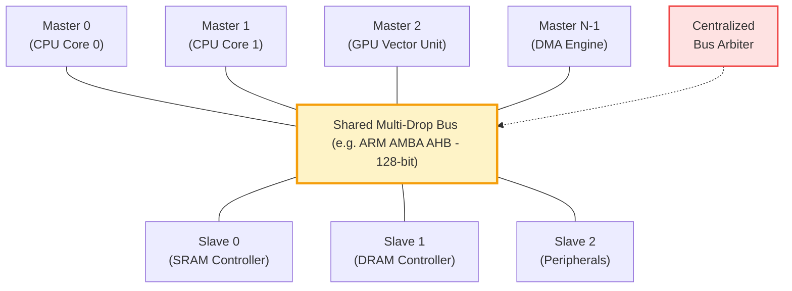
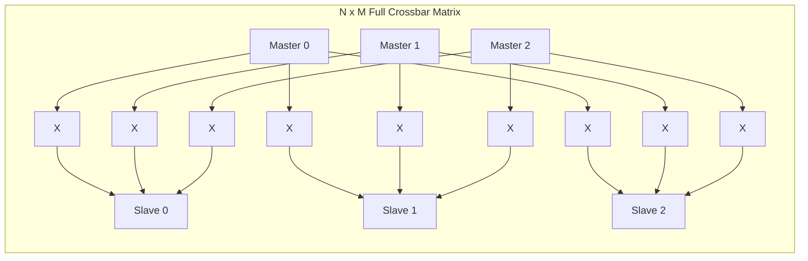
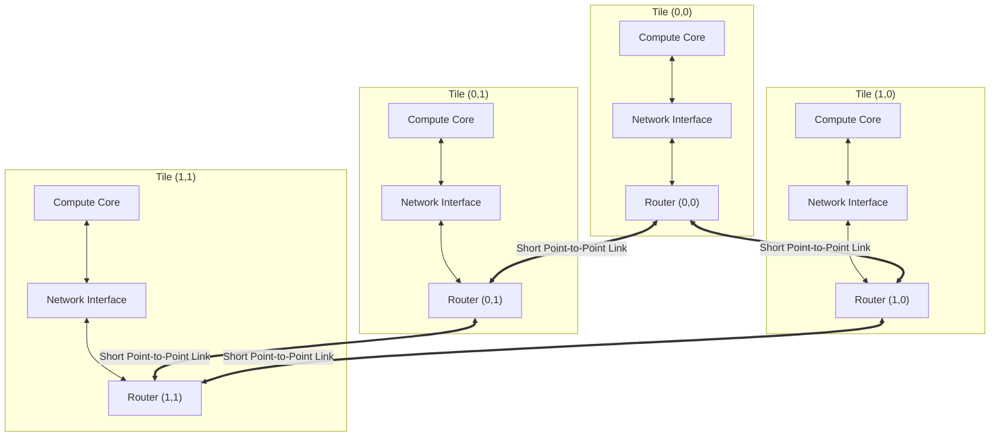

# Chapter 1: The Multi-Core Communication Crisis & Interconnect Physics

> **Authors**: NoC-Lab Research Consortium  
> **Grounding Corpus**: `papers/` (542+ peer-reviewed articles from IEEE TVLSI, TCAD, JSSC, TCAS-I, TCAS-II)  
> **Interactive Companion**: [NoC Learning Hub — Track 1: Fundamentals](https://network-on-chip.github.io/learning/track1-fundamentals/)  
> **Accompanying Code**: [`code/elmore_bus_vs_noc.py`](code/elmore_bus_vs_noc.py), [`code/bus_arbiter_contention.v`](code/bus_arbiter_contention.v)

---

## 1.1 The Breakdown of Dennard Scaling and the Multi-Core Pivot

For over three decades, the semiconductor industry advanced along the dual trajectories of **Moore's Law** (transistor density doubling approximately every 18–24 months) and **Dennard Scaling** (constant power density through proportional scaling of supply voltage $V_{dd}$, threshold voltage $V_{th}$, and physical oxide thickness $t_{ox}$). Under classical Dennard scaling:

$$\text{Power Density} = \frac{P_{active}}{\text{Area}} \propto \frac{C \cdot V_{dd}^2 \cdot f}{1 / s^2} \approx \text{Constant}$$

Where $s \approx 1.4$ is the per-generation linear scaling factor. Because operating frequency could be increased by $\approx 40\%$ each generation without increasing power dissipation per unit area, single-threaded performance grew exponentially without encountering thermal catastrophic failure.

Around 2004–2005, at the 90 nm and 65 nm process nodes, Dennard scaling suffered an irreversible collapse. As gate oxide thickness reached atomic dimensions ($\le 1.2\text{ nm}$, merely 4–5 silicon dioxide monolayers), **quantum mechanical direct tunneling** through the gate dielectric surged exponentially:

$$J_{tunnel} \approx A \cdot \left(\frac{V_{ox}}{t_{ox}}\right)^2 \exp\left(-\frac{B \cdot [1 - (1 - V_{ox}/\Phi_B)^{3/2}]}{V_{ox}/t_{ox}}\right)$$

At the same time, sub-threshold leakage current $I_{sub}$ prevented further aggressive reductions of the supply voltage $V_{dd}$, as the threshold voltage $V_{th}$ could not be reduced without causing unacceptable static standby power dissipation:

$$I_{sub} = \mu_0 C_{ox} \frac{W}{L} (m-1) V_T^2 \exp\left(\frac{V_{gs} - V_{th}}{m V_T}\right) \left(1 - \exp\left(-\frac{V_{ds}}{V_T}\right)\right)$$

Where $V_T = \frac{k_B T}{q} \approx 26\text{ mV}$ at 300 K, and $m$ is the sub-threshold swing factor ($m \approx 1.1\text{–}1.4$). Consequently, chip architects struck the unyielding **Power Wall** ($\approx 100\text{–}130\text{ W/cm}^2$ for air-cooled packaging). Increasing the clock frequency beyond 3.5–4.0 GHz became thermally untenable.

```
+-------------------------------------------------------------------------------+
|                    THE ARCHITECTURAL PARADIGM SHIFT                           |
|                                                                               |
|  Single-Core Era (1970–2004)              Multi-Core / MPSoC Era (2005–Present)|
|  - Drive Clock Frequencies (MHz -> GHz)   - Moderate Frequencies (~1.0–2.5 GHz)|
|  - Deep Pipelines & Out-of-Order Logic   - Horizontal Core Parallelism        |
|  - Monolithic Centralized Buses           - Spatial Point-to-Point NoC Fabrics |
|  - Bottleneck: Instruction-Level Par.     - Bottleneck: Interconnect Physics   |
+-------------------------------------------------------------------------------+
```

To maintain compute throughput growth, processor design executed a historic pivot from **frequency scaling** to **spatial concurrency**: multi-core processors, Chip Multiprocessors (CMPs), and Multi-Processor Systems-on-Chip (MPSoCs). However, scaling the number of processing elements from dual-core to tens, hundreds, and thousands of cores immediately triggered an existential crisis in **on-chip interconnect physical design**.

---

## 1.2 The Failure of Shared Multi-Drop Buses

In early Systems-on-Chip, intellectual property (IP) blocks (CPUs, DSPs, DMA engines, SRAM banks) communicated through shared multi-drop buses such as **ARM AMBA (AHB/APB)**, **IBM CoreConnect**, or **Wishbone**.



While shared buses are simple and cost-effective for small SoCs ($N \le 4\text{–}8$ masters), they collapse under severe physical and architectural bottlenecks as core counts grow:

### 1.2.1 Capacitive Loading & Elmore Wire Delay
A shared bus consists of long physical metal traces spanning across the entire silicon die. Every connected master and slave attaches an input/output transceiver tap to the shared wire. According to the **Elmore Delay Model**, the propagation delay $\tau_{bus}$ of a distributed $RC$ line loaded by $N$ capacitive taps is:

$$\tau_{bus} \approx 0.38 \cdot R_{wire} \cdot C_{wire} + R_{driver} \cdot \left( C_{wire} + \sum_{i=1}^{N} C_{tap, i} \right) + \sum_{i=1}^{N} R_{wire, i} \cdot C_{tap, i}$$

Where:
- $R_{wire} = r_{wire} \cdot L$ is the total resistance of the global metal wire across the die ($L \approx 10\text{–}20\text{ mm}$).
- $C_{wire} = c_{wire} \cdot L$ is the distributed wire capacitance (area capacitance to substrate + fringe capacitance).
- $C_{tap, i}$ is the input/output capacitance of the $i$-th master/slave transceiver tap.
- $R_{driver}$ is the equivalent output resistance of the driving transistor.

Because every attached core adds capacitive load ($C_{taps} = N \cdot C_{tap}$), the total capacitance scales linearly with core count ($C_{total} \propto N$). Furthermore, because the wire length $L$ scales with the die perimeter ($L \propto \sqrt{N}$), the intrinsic wire $RC$ product grows with the square of the die dimension:

$$\tau_{bus} \propto R_{wire} \cdot C_{total} \propto (\sqrt{N}) \cdot (N + \sqrt{N}) \propto N^{3/2}$$

Consequently, the maximum achievable bus clock frequency ($f_{max} \approx \frac{1}{2 \tau_{bus}}$) plunges precipitously. While local processor logic easily ran at 2.0–3.0 GHz, global shared buses were throttled to 200–400 MHz.

```
Table 1.1: Physical Interconnect Scaling Across Core Counts (Die Edge: 12 mm, Process: 12nm FinFET)
+-------+----------------+----------------+----------------+-------------------+---------------------+
| Cores | Bus Delay (ps) | Max Bus Freq   | Aggregate Bus  | Full Crossbar     | 2D Mesh NoC         |
| (N)   | (Elmore Model) | (f_max, MHz)   | Bandwidth      | Crosspoints (N^2) | Bisection Bandwidth |
+-------+----------------+----------------+----------------+-------------------+---------------------+
| 2     | 9,044 ps       | 55.3 MHz       | 0.88 GB/s      | 4                 | 128 GB/s            |
| 4     | 9,129 ps       | 54.8 MHz       | 0.88 GB/s      | 16                | 128 GB/s            |
| 8     | 9,298 ps       | 53.8 MHz       | 0.86 GB/s      | 64                | 192 GB/s            |
| 16    | 9,638 ps       | 51.9 MHz       | 0.83 GB/s      | 256               | 256 GB/s            |
| 32    | 10,316 ps      | 48.5 MHz       | 0.78 GB/s      | 1,024             | 384 GB/s            |
| 64    | 11,673 ps      | 42.8 MHz       | 0.69 GB/s      | 4,096             | 512 GB/s            |
| 128   | 14,386 ps      | 34.8 MHz       | 0.56 GB/s      | 16,384            | 768 GB/s            |
| 256   | 19,814 ps      | 25.2 MHz       | 0.40 GB/s      | 65,536            | 1,024 GB/s          |
+-------+----------------+----------------+----------------+-------------------+---------------------+
(Calculated via code/elmore_bus_vs_noc.py with r_wire = 800 Ohm/mm, c_wire = 0.18 pF/mm, c_tap = 8 fF)
```

### 1.2.2 The Serialization Contention Bottleneck
A shared bus is a **single shared transmission medium**. At any given clock cycle, the centralized bus arbiter can grant bus access to **exactly one master**.
- **Fixed Aggregate Bandwidth**:
  $$BW_{agg} = W \times f_{bus}$$
  where $W$ is the bus width (e.g., 64 or 128 bits) and $f_{bus}$ is the bus clock frequency.
- **Per-Core Bandwidth Starvation**:
  $$BW_{per\_core} \le \frac{W \times f_{bus}}{N}$$
  As core count $N$ increases, the bandwidth available to each processing element approaches zero.
- **Arbitration Latency Scalability**: Centralized round-robin or priority arbiters require $O(N)$ logic depth. Grant generation time becomes a critical path delay.

---

## 1.3 Sub-10nm Interconnect Physics & Wire Scaling

The physical crisis of global wiring is exacerbated by the physics of deep-submicron copper interconnects. In technology nodes below 14nm, 7nm, and 3nm, interconnect resistance does not scale inversely with cross-sectional area.


*Figure 1.1: Technology scaling of on-chip wire resources based on ITRS/IRDS reports for 2–14 nm and 22–65 nm. [Reproduced from: T. Fischer, M. Rogenmoser, T. Benz, F. K. Gürkaynak, and L. Benini, "FlooNoC: A 645-Gb/s/link 0.15-pJ/B/hop Open-Source NoC With Wide Physical Links and End-to-End AXI4 Parallel Multistream Support," IEEE Transactions on Very Large Scale Integration (VLSI) Systems, vol. 33, no. 4, pp. 1094–1107, Apr. 2025, DOI: 10.1109/TVLSI.2025.3527225. © 2025 IEEE]*

### 1.3.1 The Mayadas-Shatzkes & Fuchs-Sondheimer Scattering Models
In bulk copper at room temperature, the electron mean free path is:

$$\lambda_0 \approx 39.0\text{ nm}$$

When the physical width $w$ of an on-chip metal wire shrinks below $2 \lambda_0 \approx 80\text{ nm}$, two scattering mechanisms cause the effective resistivity $\rho_{eff}$ to surge dramatically above the bulk value ($\rho_{bulk} \approx 1.68 \times 10^{-8}\ \Omega\cdot\text{m}$):

1. **Surface Scattering (Fuchs-Sondheimer Model)**: Electrons reflect diffusely off the outer interfaces of the wire:
   $$\frac{\rho_{FS}}{\rho_{bulk}} = 1 + \frac{3}{8 \kappa} (1 - p)$$
   where $\kappa = \frac{w_{eff}}{\lambda_0}$ is the normalized wire dimension and $p \in [0, 1]$ is the specularity parameter ($p \approx 0.2$ for realistic barriers).

2. **Grain Boundary Scattering (Mayadas-Shatzkes Model)**: Nanoscale copper recrystallizes into small grains with average grain diameter $d \approx w_{eff}$. Electrons scatter at grain boundaries:
   $$\frac{\rho_{MS}}{\rho_{bulk}} = \frac{1}{3 \left[ \frac{1}{3} - \frac{\alpha}{2} + \alpha^2 - \alpha^3 \ln\left(1 + \frac{1}{\alpha}\right) \right]}$$
   where $\alpha = \frac{\lambda_0}{d} \frac{R}{1 - R}$, with $R \approx 0.3\text{–}0.5$ representing the grain boundary reflection coefficient.

3. **Diffusion Barrier Liner Encroachment**: Copper electromigration requires high-resistivity diffusion liners (Ta/TaN, Co, Ru) of thickness $t_{barrier} \approx 1.0\text{–}1.5\text{ nm}$. Because the liner does not scale down proportionally with the wire trench, the conductive copper cross-sectional area $A_{Cu}$ shrinks much faster than total wire trench area:
   $$A_{Cu} = (w - 2 t_{barrier}) \cdot (h - t_{barrier})$$
   $$\rho_{total} = \rho_{eff} \cdot \left(\frac{w \cdot h}{A_{Cu}}\right)$$

At the 3nm node ($w \approx 10\text{ nm}$), the effective copper resistivity exceeds $15\times$ bulk copper, turning long global wires into unbearable thermal, resistance, and latency bottlenecks.

---

## 1.4 The Monolithic Crossbar and Its Quadratic Area Explosion

To avoid the serialized contention of a single shared bus, architects initially considered a **full centralized crossbar switch** connecting $N$ masters directly to $M$ slaves.



While a crossbar allows non-interfering parallel communication between disjoint pairs of masters and slaves, its hardware complexity scales quadratically:

$$\text{Crosspoints} = N \times M \approx O(N^2)$$
$$\text{Wiring Tracks} = (N + M) \times W_{data\_width} \approx O(N)$$

For an MPSoC with $N = 64$ cores, a full crossbar requires:
- $64 \times 64 = 4,096$ crosspoint multiplexer switches.
- $128 \times 128 = 16,384$ wires crossing a central silicon layout area.
- Severe physical layout congestion, routing track starvation, and parasitic capacitive coupling crosstalk.

A full crossbar switch is physically viable only for small clusters ($N \le 4\text{–}8$ cores).

---

## 1.5 The Network-on-Chip Paradigm: Packet-Switched Modular Interconnects

In 2001, pioneering papers by Dally & Towles (*"Route Packets, Not Wires"*) and Benini & De Micheli (*"Networks on Chips: A New SoC Paradigm"*) introduced the definitive solution:

> **The Network-on-Chip (NoC) Principle**: Replace long, dedicated, unstructured global metal wires with a structured, packet-switched micro-network composed of modular routers and short point-to-point links.



### Key Advantages of NoC Architecture:
1. **Bounded Wire Lengths**: Every link connects strictly adjacent routers. The link wire length is fixed to the physical pitch of one compute tile ($L_{link} \approx 0.5\text{–}1.5\text{ mm}$), regardless of whether the chip contains 16 or 2,048 cores.
2. **Predictable Timing & Pipelining**: Because link wire delay is short and localized, routers and links can be clocked at high frequencies ($f_{clk} \approx 1.5\text{–}2.5\text{ GHz}$) without repeater insertion crises.
3. **Concurrent Multi-Hop Communication**: Multiple packets traverse non-overlapping segments of the network simultaneously, yielding aggregate throughput that scales proportionally with the network size:
   $$BW_{bisection} \propto \sqrt{N} \times W_{link} \times f_{clk}$$
4. **Modularity & Silicon Reuse**: Adding processing tiles does not require redesigning the global wiring tree.

---

## 1.6 Industrial Case Studies: From 48 Cores to 2,048 Cores

To understand the real-world execution of NoC architecture in modern silicon, we examine state-of-the-art implementations cataloged in our literature corpus:

### 1.6.1 The 2,048-Core HammerBlade Manycore SoC (12nm FinFET)

A landmark demonstration of extreme monolithic scaling is the **HammerBlade (HB)** processor developed by Gao et al. (IEEE TVLSI, 2026).


*Figure 1.2: Modern monolithic manycore scaling in 12nm silicon: (a) BGA 2116 flip-chip packaging, (b) 11 × 9-mm die photograph, and (c) chip floorplan of the 2,048-core HammerBlade SoC. [Reproduced from: P. Gao et al., "HammerBlade in Silicon: A 12-nm 2048-Core RISC-V Manycore SoC With Ruche Networks," IEEE Transactions on Very Large Scale Integration (VLSI) Systems, vol. 34, no. 7, pp. 2306–2310, July 2026, DOI: 10.1109/TVLSI.2026.3684311. © 2026 IEEE]*


*Figure 1.3: HammerBlade compute tile floorplan and physical area breakdown showing router cells (red) and core logic (pink). [Reproduced from: P. Gao et al., "HammerBlade in Silicon: A 12-nm 2048-Core RISC-V Manycore SoC With Ruche Networks," IEEE Transactions on Very Large Scale Integration (VLSI) Systems, vol. 34, no. 7, pp. 2306–2310, July 2026, DOI: 10.1109/TVLSI.2026.3684311. © 2026 IEEE]*

#### Key Architectural & Physical Metrics:
- **Silicon Area**: $99\text{ mm}^2$ in TSMC 12nm FinFET.
- **Compute Density**: 2,048 custom RISC-V cores organized into an array of $64 \times 32$ tiles.
- **Interconnect Topology**: **Ruche Network**, a wire-maximal topology overlaying nearest-neighbor 2D mesh links with long-distance multi-hop bypass express wires.
- **Clocking & Throughput**: Operating at **1.49 GHz at 0.8 V**, the NoC delivers a peak aggregate bandwidth of **2,572.6 Tb/s** and a bisection bandwidth of **53.2 Tb/s**.
- **Routing Density**: Achieves **4,289 bit/mm** across higher metal layers.
- **Integration**: Leverages **On-Chip Source-Synchronous Interconnect (OCSSI)** under a Globally Asynchronous Locally Synchronous (GALS) paradigm to eliminate chip-wide clock tree skew.

```
Table 1.2: Evolution of Silicon Landmark Network-on-Chip Processors
+--------------------+-----------+------------+------------+---------------+--------------------+
| Architecture       | Year /    | Process    | Tile Array | Peak Bisection| Interconnect       |
| & Citation         | Venue     | Node       | & Cores    | Bandwidth     | Topology           |
+--------------------+-----------+------------+------------+---------------+--------------------+
| Intel TeraFLOPS    | 2007 JSSC | 65nm Bulk  | 8x10 (80)  | 1.6 Tb/s      | 2D Mesh (5-port)   |
| Intel 48-Core SCC  | 2011 JSSC | 45nm Bulk  | 6x4 (48)   | 256 Gb/s      | 2D Mesh (e-cube)   |
| Kalray MPPA-256    | 2015 TVLSI| 28nm CMOS  | 16 Clusters| 384 Gb/s      | 2D Torus           |
| FlooNoC (Benini)   | 2025 TVLSI| 12nm FinFET| 8x4 (288)  | 103 Tb/s      | Wide AXI4 2D Mesh  |
| HammerBlade (Gao)  | 2026 TVLSI| 12nm FinFET| 64x32(2048)| 53.2 Tb/s     | Ruche Multi-Hop NoC|
+--------------------+-----------+------------+------------+---------------+--------------------+
```

---

## 1.7 Interactive Lab & Hands-on Challenges

To build an intuitive and experimental understanding of interconnect trade-offs, explore the interactive simulations on the **Companion Learning Platform**:

1. 🔬 **[2D Mesh Routing Visualizer](https://network-on-chip.github.io/learning/interactive/visualizer/)**:
   - Inject uniform random and hotspot traffic into a $4 \times 4$ and $8 \times 8$ mesh.
   - Observe how localized point-to-point links maintain continuous throughput without centralized bus stall bubbles.
2. 🎮 **[Topology Titans: Graph Architect](https://network-on-chip.github.io/learning/interactive/topology/)**:
   - Synthesize 2D Mesh, 2D Torus, and Hypercube topologies within strict wire length and pin degree constraints.
3. ⚔️ **[Arbiter Arena: Crossbar Clash](https://network-on-chip.github.io/learning/interactive/arbiter/)**:
   - Compete against matrix arbiters, round-robin, and wavefront arbiters under heavy contention.

---

## 1.8 Checkpoint Assessment

Test your mastery of Chapter 1 concepts. (These questions mirror the 3-Tier Exam Engine in [`share/learning/quiz.md`](https://network-on-chip.github.io/learning/quiz/)):

#### Question 1.1 (Tier 1: Fundamental)
*Why does the propagation delay of a shared multi-drop bus grow as $O(N^{3/2})$ to $O(N^2)$ as core count $N$ scales, rather than remaining constant?*
- **A)** Because clock jitter increases with core count.
- **B)** Because every attached core adds capacitive tap load ($C_{tap}$), and die dimensions increase wire length ($L \propto \sqrt{N}$), compounding both resistance and total capacitance in the Elmore delay model.
- **C)** Because copper wire melting points decrease at sub-micron scales.
- **D)** Because buses require optical fibers that slow down at high radix.
> **Correct Answer: B**. Elmore delay $\tau \approx R_{wire} C_{wire} + R_{driver} \sum C_{tap} + \sum R_{wire} C_{tap}$. As $N$ grows, capacitive loading taps scale linearly and wire length scales with $\sqrt{N}$.

#### Question 1.2 (Tier 2: Architectural Analysis)
*What is the Mayadas-Shatzkes effect, and why does it represent a critical barrier for on-chip global interconnects below 14nm?*
- **A)** It causes electromagnetic radiation that leaks secret cryptographic keys.
- **B)** It causes electrons to scatter diffusely off grain boundaries and wire sidewalls when wire dimensions approach the electron mean free path ($\approx 39\text{ nm}$ in Cu), causing effective resistivity to surge by $5\times\text{–}15\times$.
- **C)** It turns copper into a superconductor at room temperature.
- **D)** It forces routers to use store-and-forward switching.
> **Correct Answer: B**. Grain-boundary and surface scattering, combined with non-conducting barrier liners (Ta/TaN), dramatically increase the effective resistivity of copper wires in advanced FinFET nodes.

#### Question 1.3 (Tier 3: Design Trade-Off)
*Why is a centralized $N \times N$ crossbar switch unacceptable for a 128-core processor, despite offering non-blocking zero-hop communication between disjoint pairs?*
- **A)** Centralized crossbars require $N^2 = 16,384$ crosspoint multiplexers and dense global wiring tracks, causing catastrophic silicon area overhead and physical routing track starvation.
- **B)** Crossbars cannot transmit digital signals with parity bits.
- **C)** Crossbars cannot operate with virtual channels.
- **D)** Crossbars are restricted to single-core microcontrollers.
> **Correct Answer: A**. Quadratic $O(N^2)$ crosspoint complexity and dense routing tracks make full crossbars physically unroutable for high core counts ($N > 16$).

---

## References & Bibliography

1. **[Gao2026]** P. Gao, D. C. Jung, S. Davidson, D. Ruelas-Petrisko, Y.-M. Chueh, M. Ruttenberg, K. Li, F. Gilani, D. Richmond, M. Oskin, and M. B. Taylor, "HammerBlade in Silicon: A 12-nm 2048-Core RISC-V Manycore SoC With Ruche Networks," *IEEE Transactions on Very Large Scale Integration (VLSI) Systems*, vol. 34, no. 7, pp. 2306–2310, July 2026. [DOI: 10.1109/TVLSI.2026.3684311](https://doi.org/10.1109/TVLSI.2026.3684311).
2. **[Fischer2025]** T. Fischer, M. Rogenmoser, T. Benz, F. K. Gürkaynak, and L. Benini, "FlooNoC: A 645-Gb/s/link 0.15-pJ/B/hop Open-Source NoC With Wide Physical Links and End-to-End AXI4 Parallel Multistream Support," *IEEE Transactions on Very Large Scale Integration (VLSI) Systems*, vol. 33, no. 4, pp. 1094–1107, Apr. 2025. [DOI: 10.1109/TVLSI.2025.3527225](https://doi.org/10.1109/TVLSI.2025.3527225).
3. **[AlAlousi2026]** A. Al-Alousi, M. Li, and H. Meng, "Vendor-Independent Design Space Exploration and Resource Optimization Framework for 3-D Networks-on-Chip Using Hypergraph-Genetic Algorithm Integration," *IEEE Transactions on Computer-Aided Design of Integrated Circuits and Systems*, vol. 45, no. 5, pp. 2236–2248, May 2026. [DOI: 10.1109/TCAD.2025.3616073](https://doi.org/10.1109/TCAD.2025.3616073).
4. **[Zhu2025]** J. Zhu, C. Xue, Y. Chen, Z. Wang, C. Zhang, Y. Shen, Y. Chen, Z. Cheng, Y. Jiang, T. Wang, Y. Lin, W. Hu, B. Cui, R. Wang, Y. Liang, and G. Sun, "Theseus: Exploring Efficient Wafer-Scale Chip Design for Large Language Models," *IEEE Transactions on Computer-Aided Design of Integrated Circuits and Systems*, vol. 44, no. 11, pp. 3810–3823, Nov. 2025. [DOI: 10.1109/TCAD.2024.3496321](https://doi.org/10.1109/TCAD.2024.3496321).
5. **[Howard2011]** J. Howard et al., "A 48-Core IA-32 Message-Passing Processor with DVFS in 45nm CMOS," *IEEE Journal of Solid-State Circuits*, vol. 46, no. 1, pp. 173–183, Jan. 2011. [DOI: 10.1109/JSSC.2010.2079496](https://doi.org/10.1109/JSSC.2010.2079496).
6. **[Mayadas1970]** A. F. Mayadas and M. Shatzkes, "Electrical-Resistivity Model for Polycrystalline Films: the Case of Arbitrary Reflection at External Surfaces," *Physical Review B*, vol. 1, no. 4, pp. 1382–1389, 1970. [DOI: 10.1103/PhysRevB.1.1382](https://doi.org/10.1103/PhysRevB.1.1382).
7. **[Dally2001]** W. J. Dally and B. Towles, "Route Packets, Not Wires: On-Chip Interconnection Networks," in *Proceedings of the 38th Annual Design Automation Conference (DAC)*, 2001, pp. 684–689. [DOI: 10.1145/378239.379048](https://doi.org/10.1145/378239.379048).
8. **[Benini2002]** L. Benini and G. De Micheli, "Networks on Chips: A New SoC Paradigm," *IEEE Computer*, vol. 35, no. 1, pp. 70–78, Jan. 2002. [DOI: 10.1109/2.976921](https://doi.org/10.1109/2.976921).
