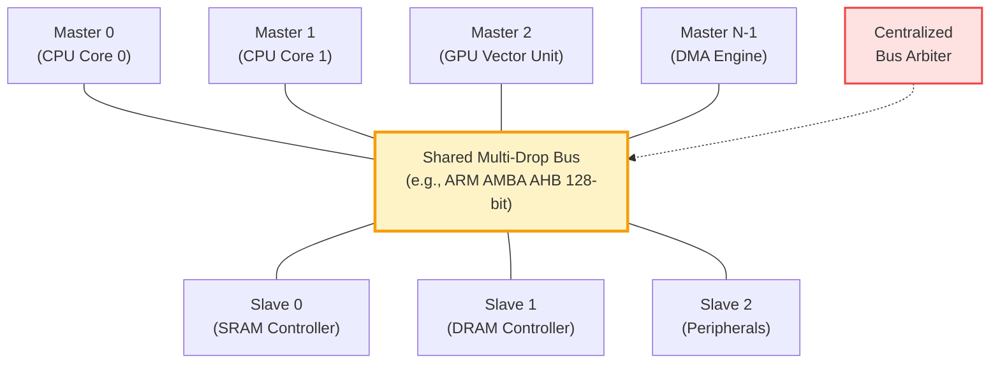
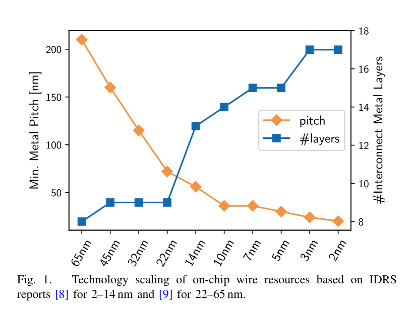
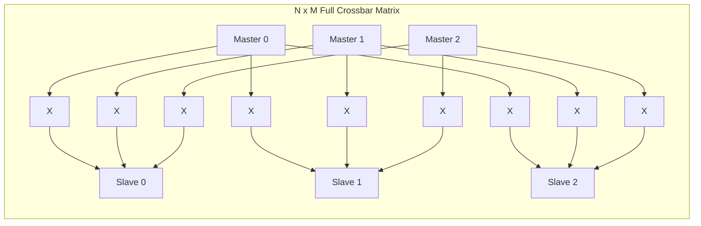
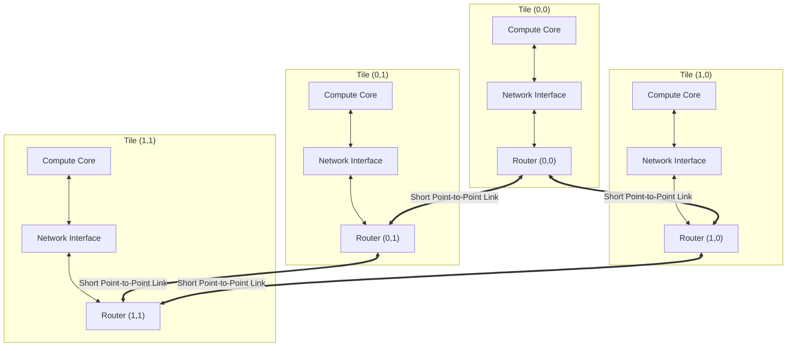
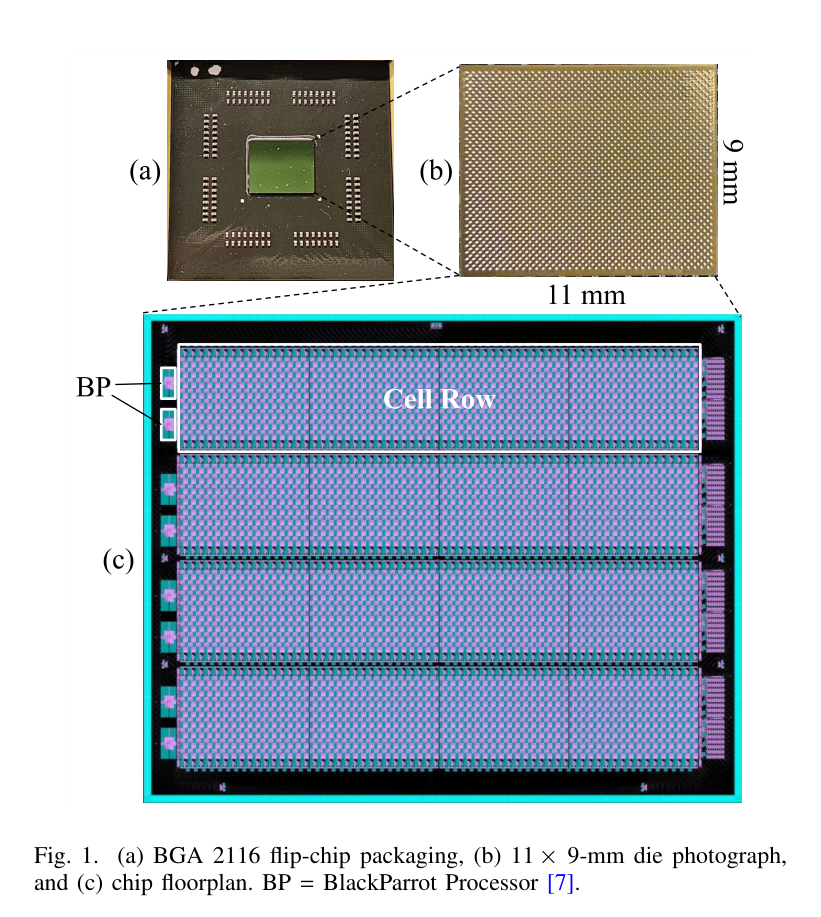
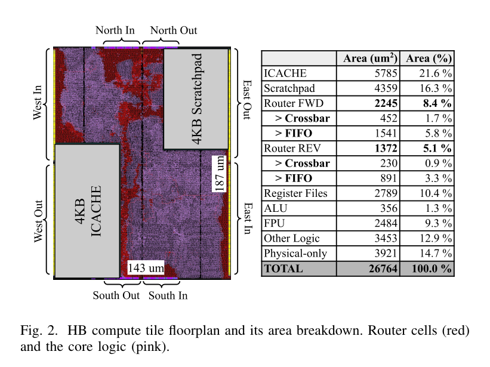

# Chapter 1: The Multi-Core Communication Crisis & Interconnect Physics

> **Authors**: NoC-Lab Research Consortium  
> **Domain**: Silicon Microarchitecture & Interconnect Design  
> **Interactive Companion**: [NoC Learning Hub — Track 1: Fundamentals](https://network-on-chip.github.io/learning/track1-fundamentals/)  
> **Accompanying Code**: [`code/elmore_bus_vs_noc.py`](code/elmore_bus_vs_noc.py), [`code/bus_arbiter_contention.v`](code/bus_arbiter_contention.v)

---

## Chapter Introduction

For the first four decades of the digital computing era, microprocessors advanced on a virtuous cycle governed by two bedrock physical scaling laws: **Moore's Law** and **Dennard Scaling**. Each semiconductor manufacturing generation reduced transistor feature sizes by approximately $30\%$ ($s \approx 1.4$), doubling transistor density, decreasing gate delay by $30\%$, and keeping power density across the silicon die remarkably constant. Computer architects harnessed these physical gifts by deepening instruction execution pipelines, increasing clock frequencies from megahertz to several gigahertz, and deploying aggressive out-of-order superscalar speculative execution engines.

Around 2004–2005, this golden era came to an abrupt, unceremonious halt. As gate oxide dielectrics thinned to mere atomic monolayers, quantum mechanical tunneling and sub-threshold leakage currents triggered an unyielding **Power Wall**. Unable to increase operating frequencies beyond 3.5–4.0 GHz without causing thermal catastrophic breakdown, the computing industry executed a historic strategic pivot: **horizontal multi-core concurrency**. Instead of building one monolithic, super-fast core, architects began integrating dozens, hundreds, and eventually thousands of energy-efficient processing cores on a single silicon die.

Yet this horizontal pivot immediately ignited an existential physical crisis: **the on-chip communication bottleneck**. While transistors scale favorably, becoming smaller and faster with each node, the long copper wires interconnecting them scale inversely. As interconnect cross-sections shrink into the deep sub-micron regime, electron scattering surges and parasitic resistance-capacitance (RC) delays explode. Shared multi-drop buses—the traditional communication backbone of early microchips—collapsed under the weight of capacitive loading and serialized contention.

This opening chapter explores the physics and microarchitecture underlying this communication crisis. We trace the physical collapse of classical scaling, mathematically dissect why shared buses and centralized crossbars fail for high core counts, analyze the nanoscale physics of sub-10nm copper interconnects, and introduce the foundational paradigm that rescued modern VLSI systems: **the packet-switched Network-on-Chip (NoC)**.

### Learning Objectives
- **Understand the Collapse of Dennard Scaling**: Master the quantitative relationship between gate oxide direct tunneling, sub-threshold leakage currents, and the resulting thermal power wall that forced the multi-core transition.
- **Analyze Shared Bus Physical Limitations**: Derive the Elmore delay model for distributed RC metal traces loaded by capacitive taps, demonstrating why bus delay scales as $O(N^{3/2})$ to $O(N^2)$.
- **Master Sub-10nm Wire Physics**: Apply the Fuchs-Sondheimer surface scattering and Mayadas-Shatzkes grain-boundary scattering models to calculate the dramatic increase in effective copper resistivity.
- **Formulate Crossbar Scaling Limits**: Quantify the quadratic $O(N^2)$ area and routing track complexity of monolithic centralized crossbar switches.
- **Evaluate the Network-on-Chip Paradigm**: Understand how modular packet-switched micro-networks bound physical wire lengths, pipeline communication, and deliver linearly scalable bisection bandwidth in silicon architectures like the 2,048-core HammerBlade SoC.

### Chapter Roadmap & Interactive Modules
- **Section 1.1**: The Breakdown of Dennard Scaling & the Multi-Core Pivot.
- **Section 1.2**: The Failure of Shared Multi-Drop Buses & Elmore Delay Modeling.
- **Section 1.3**: Sub-10nm Interconnect Physics, Scattering Models & Liner Effects.
- **Section 1.4**: The Monolithic Crossbar & Its Quadratic Area Explosion.
- **Section 1.5**: The Network-on-Chip Paradigm: Packet-Switched Modular Interconnects.
- **Section 1.6**: Industrial Silicon Case Studies: From 48 Cores to 2,048 Cores.
- **Section 1.7**: Interactive Lab Challenges & Hands-on Simulators.
- **Section 1.8**: Checkpoint Assessment & Exam Review Questions.

---

## 1.1 The Breakdown of Dennard Scaling and the Multi-Core Pivot

For over three decades, the semiconductor industry advanced along the dual trajectories of **Moore's Law** (transistor density doubling approximately every 18–24 months) and **Dennard Scaling** (constant power density through proportional scaling of supply voltage $V_{dd}$, threshold voltage $V_{th}$, and physical oxide thickness $t_{ox}$). Under classical Dennard scaling:

$$\text{Power Density} = \frac{P_{active}}{\text{Area}} \propto \frac{C \cdot V_{dd}^2 \cdot f}{1 / s^2} \approx \text{Constant}$$

Where $s \approx 1.4$ is the per-generation linear scaling factor. Because operating frequency could be increased by $\approx 40\%$ each generation without increasing power dissipation per unit area, single-threaded performance grew exponentially without encountering thermal catastrophic failure.

Around 2004–2005, at the 90 nm and 65 nm process nodes, Dennard scaling suffered an irreversible collapse. As gate oxide thickness reached atomic dimensions ($\le 1.2\text{ nm}$, merely 4–5 silicon dioxide monolayers), **quantum mechanical direct tunneling** through the gate dielectric surged exponentially:

$$J_{tunnel} \approx A \cdot \left(\frac{V_{ox}}{t_{ox}}\right)^2 \exp\left(-\frac{B \cdot [1 - (1 - V_{ox}/\Phi_B)^{3/2}]}{V_{ox}/t_{ox}}\right)$$

At the same time, sub-threshold leakage current $I_{sub}$ prevented further aggressive reductions of the supply voltage $V_{dd}$, as the threshold voltage $V_{th}$ could not be reduced without causing unacceptable static standby power dissipation:

$$I_{sub} = \mu_0 C_{ox} \frac{W}{L} (m-1) V_T^2 \exp\left(\frac{V_{gs} - V_{th}}{m V_T}\right) \left(1 - \exp\left(-\frac{V_{ds}}{V_T}\right)\right)$$

Where $V_T = \frac{k_B T}{q} \approx 26\text{ mV}$ at 300 K, and $m$ is the sub-threshold swing factor ($m \approx 1.1\text{–}1.4$). Consequently, chip architects struck the unyielding **Power Wall** ($\approx 100\text{–}130\text{ W/cm}^2$ for air-cooled packaging). Increasing the clock frequency beyond 3.5–4.0 GHz became thermally untenable.

```
+-------------------------------------------------------------------------------+
|                    THE ARCHITECTURAL PARADIGM SHIFT                           |
|                                                                               |
|  Single-Core Era (1970–2004)              Multi-Core / MPSoC Era (2005–Present)|
|  - Drive Clock Frequencies (MHz -> GHz)   - Moderate Frequencies (~1.0–2.5 GHz)|
|  - Deep Pipelines & Out-of-Order Logic   - Horizontal Core Parallelism        |
|  - Monolithic Centralized Buses           - Spatial Point-to-Point NoC Fabrics |
|  - Bottleneck: Instruction-Level Par.     - Bottleneck: Interconnect Physics   |
+-------------------------------------------------------------------------------+
```

To maintain compute throughput growth, processor design executed a historic pivot from **frequency scaling** to **spatial concurrency**: multi-core processors, Chip Multiprocessors (CMPs), and Multi-Processor Systems-on-Chip (MPSoCs). However, scaling the number of processing elements from dual-core to tens, hundreds, and thousands of cores immediately triggered an existential crisis in **on-chip interconnect physical design**.

---

## 1.2 The Failure of Shared Multi-Drop Buses

In early Systems-on-Chip, intellectual property (IP) blocks (CPUs, DSPs, DMA engines, SRAM banks) communicated through shared multi-drop buses such as **ARM AMBA (AHB/APB)**, **IBM CoreConnect**, or **Wishbone**.



While shared buses are simple and cost-effective for small SoCs ($N \le 4\text{–}8$ masters), they collapse under severe physical and architectural bottlenecks as core counts grow:

### 1.2.1 Capacitive Loading & Elmore Wire Delay
A shared bus consists of long physical metal traces spanning across the entire silicon die. Every connected master and slave attaches an input/output transceiver tap to the shared wire. According to the **Elmore Delay Model**, the propagation delay $\tau_{bus}$ of a distributed $RC$ line loaded by $N$ capacitive taps is:

$$\tau_{bus} \approx 0.38 \cdot R_{wire} \cdot C_{wire} + R_{driver} \cdot \left( C_{wire} + \sum_{i=1}^{N} C_{tap, i} \right) + \sum_{i=1}^{N} R_{wire, i} \cdot C_{tap, i}$$

The physical mechanisms driving this delay explosion break down into five fundamental effects:

- **Global Wire Resistance Scaling ($R_{wire} = r_{wire} \cdot L$)**:
  - The total resistance of the global metal wire across the die ($L \approx 10\text{–}20\text{ mm}$) increases with chip diameter.
  - Because wire cross-sectional areas shrink in advanced nodes, the sheet resistance $r_{wire}$ surges significantly.
- **Distributed Wire Capacitance ($C_{wire} = c_{wire} \cdot L$)**:
  - Encapsulates both parallel-plate capacitance to lower ground planes and lateral fringe capacitance between adjacent bus lines.
  - As wire spacing tightens, inter-wire sidewall coupling capacitance dominates total capacitance.
- **Cumulative Tap Capacitance Loading ($\sum C_{tap} = N \cdot C_{tap}$)**:
  - Every attached processor core, accelerator, or DMA controller introduces input/output transceivers, ESD diodes, and routing stubs.
  - Total capacitive load grows linearly with core count $N$, acting as a heavy lumped capacitive ballast along the wire.
- **Super-Linear $O(N^{3/2})$ Propagation Delay Explosion**:
  - Wire length scales with the silicon die edge ($L \propto \sqrt{N}$).
  - Combining resistance scaling ($R_{wire} \propto \sqrt{N}$) with total capacitance ($C_{total} \propto N$), the intrinsic Elmore delay surges super-linearly:
    $$\tau_{bus} \propto R_{wire} \cdot C_{total} \propto (\sqrt{N}) \cdot (N + \sqrt{N}) \propto O(N^{3/2})$$
- **Severe Operating Frequency Throttling**:
  - The maximum achievable bus clock frequency ($f_{max} \approx \frac{1}{2 \tau_{bus}}$) plunges from gigahertz down to tens of megahertz.
  - While local execution units easily clock at 2.0–3.0 GHz, global bus transactions require massive multi-cycle wait states.

```
Table 1.1: Physical Interconnect Scaling Across Core Counts (Die Edge: 12 mm, Process: 12nm FinFET)
+-------+----------------+----------------+----------------+-------------------+---------------------+
| Cores | Bus Delay (ps) | Max Bus Freq   | Aggregate Bus  | Full Crossbar     | 2D Mesh NoC         |
| (N)   | (Elmore Model) | (f_max, MHz)   | Bandwidth      | Crosspoints (N^2) | Bisection Bandwidth |
+-------+----------------+----------------+----------------+-------------------+---------------------+
| 2     | 9,044 ps       | 55.3 MHz       | 0.88 GB/s      | 4                 | 128 GB/s            |
| 4     | 9,129 ps       | 54.8 MHz       | 0.88 GB/s      | 16                | 128 GB/s            |
| 8     | 9,298 ps       | 53.8 MHz       | 0.86 GB/s      | 64                | 192 GB/s            |
| 16    | 9,638 ps       | 51.9 MHz       | 0.83 GB/s      | 256               | 256 GB/s            |
| 32    | 10,316 ps      | 48.5 MHz       | 0.78 GB/s      | 1,024             | 384 GB/s            |
| 64    | 11,673 ps      | 42.8 MHz       | 0.69 GB/s      | 4,096             | 512 GB/s            |
| 128   | 14,386 ps      | 34.8 MHz       | 0.56 GB/s      | 16,384            | 768 GB/s            |
| 256   | 19,814 ps      | 25.2 MHz       | 0.40 GB/s      | 65,536            | 1,024 GB/s          |
+-------+----------------+----------------+----------------+-------------------+---------------------+
(Calculated via code/elmore_bus_vs_noc.py with r_wire = 800 Ohm/mm, c_wire = 0.18 pF/mm, c_tap = 8 fF)
```

### 1.2.2 The Serialization Contention Bottleneck

A shared bus is a **single shared transmission medium**. At any given clock cycle, the centralized bus arbiter can grant bus access to **exactly one master**, creating catastrophic structural bottlenecks:

- **Hard Aggregate Bandwidth Ceiling**:
  - Total system throughput is strictly bounded by $BW_{agg} = W \times f_{bus}$, where $W$ is bus width and $f_{bus}$ is operating frequency.
  - System throughput remains stubbornly flat, regardless of how many compute cores demand communication.
- **Per-Core Bandwidth Starvation**:
  - The maximum average bandwidth available to any individual core falls as $BW_{per\_core} \le \frac{W \times f_{bus}}{N}$.
  - At 64 cores, each core receives less than $2\%$ of the bus bandwidth; at 256 cores, communication bandwidth completely starves.
- **Centralized Arbitration Latency Overhead**:
  - The centralized bus arbiter must inspect requests from all $N$ masters, requiring logic tree depth scaling as $O(\log N)$ or $O(N)$.
  - Grant generation and handshaking turn arbitration into a multi-cycle critical path bottleneck before data can even begin moving.
- **Head-of-Line Contention Blocking**:
  - A long burst transaction (e.g., a 64-byte cache line refill or DMA page transfer) locks the bus for dozens of consecutive cycles, stalling urgent latency-sensitive cache coherence inquiries.

---

## 1.3 Sub-10nm Interconnect Physics & Wire Scaling

The physical crisis of global wiring is exacerbated by the physics of deep-submicron copper interconnects. In technology nodes below 14nm, 7nm, and 3nm, interconnect resistance does not scale inversely with cross-sectional area.


*Figure 1.1: Technology scaling of on-chip wire resources based on ITRS/IRDS reports for 2–14 nm and 22–65 nm. [Reproduced from: T. Fischer, M. Rogenmoser, T. Benz, F. K. Gürkaynak, and L. Benini, "FlooNoC: A 645-Gb/s/link 0.15-pJ/B/hop Open-Source NoC With Wide Physical Links and End-to-End AXI4 Parallel Multistream Support," IEEE Transactions on Very Large Scale Integration (VLSI) Systems, vol. 33, no. 4, pp. 1094–1107, Apr. 2025, DOI: 10.1109/TVLSI.2025.3527225. © 2025 IEEE]*

### 1.3.1 The Mayadas-Shatzkes & Fuchs-Sondheimer Scattering Models
In bulk copper at room temperature, the electron mean free path is:

$$\lambda_0 \approx 39.0\text{ nm}$$

When the physical width $w$ of an on-chip metal wire shrinks below $2 \lambda_0 \approx 80\text{ nm}$, three distinct nanoscale physical mechanisms cause the effective resistivity $\rho_{eff}$ to surge dramatically above the bulk value ($\rho_{bulk} \approx 1.68 \times 10^{-8}\ \Omega\cdot\text{m}$):

- **Surface Scattering (Fuchs-Sondheimer Model)**:
  - Electrons colliding with the outer sidewalls of the copper wire undergo diffuse rather than specular reflections:
    $$\frac{\rho_{FS}}{\rho_{bulk}} = 1 + \frac{3}{8 \kappa} (1 - p)$$
  - Here, $\kappa = \frac{w_{eff}}{\lambda_0}$ represents the normalized wire dimension and $p \in [0, 1]$ is the specularity parameter ($p \approx 0.2$ for realistic atomic interfaces).
  - As wire width $w_{eff}$ falls toward 10 nm, $\kappa \ll 1$, and boundary reflections destroy electron forward drift momentum.
- **Grain Boundary Scattering (Mayadas-Shatzkes Model)**:
  - Nanoscale electroplated copper recrystallizes into small polycrystalline grains with average grain diameter bounded by the wire trench ($d \approx w_{eff}$):
    $$\frac{\rho_{MS}}{\rho_{bulk}} = \frac{1}{3 \left[ \frac{1}{3} - \frac{\alpha}{2} + \alpha^2 - \alpha^3 \ln\left(1 + \frac{1}{\alpha}\right) \right]}$$
  - The scattering parameter $\alpha = \frac{\lambda_0}{d} \frac{R}{1 - R}$ depends on the internal grain boundary reflection coefficient $R \approx 0.3\text{–}0.5$.
  - When $d < 20\text{ nm}$, electrons scatter continuously off internal grain boundaries before traveling a full mean free path.
- **Diffusion Barrier Liner Encroachment**:
  - To prevent copper atoms from poisoning adjacent silicon and causing catastrophic electromigration, copper wires require high-resistivity diffusion liners (Ta/TaN, Co, Ru) of thickness $t_{barrier} \approx 1.0\text{–}1.5\text{ nm}$.
  - Because liner thickness cannot scale down proportionally without pinhole defects, the conductive copper cross-sectional area $A_{Cu}$ shrinks far faster than the total wire trench:
    $$A_{Cu} = (w - 2 t_{barrier}) \cdot (h - t_{barrier})$$
    $$\rho_{total} = \rho_{eff} \cdot \left(\frac{w \cdot h}{A_{Cu}}\right)$$
  - At the 3nm node ($w \approx 10\text{ nm}$), effective copper resistivity exceeds $15\times$ bulk copper, turning long global wires into unbearable thermal, resistance, and latency bottlenecks.

---

## 1.4 The Monolithic Crossbar and Its Quadratic Area Explosion

To avoid the serialized contention of a single shared bus, architects initially considered a **full centralized crossbar switch** connecting $N$ masters directly to $M$ slaves.



While a crossbar allows non-interfering parallel communication between disjoint pairs of masters and slaves, its hardware complexity scales quadratically:

$$\text{Crosspoints} = N \times M \approx O(N^2)$$

$$\text{Wiring Tracks} = (N + M) \times W_{data\_width} \approx O(N)$$

For an MPSoC with $N = 64$ cores, a full crossbar requires:
- $64 \times 64 = 4,096$ crosspoint multiplexer switches.
- $128 \times 128 = 16,384$ wires crossing a central silicon layout area.
- Severe physical layout congestion, routing track starvation, and parasitic capacitive coupling crosstalk.

A full crossbar switch is physically viable only for small clusters ($N \le 4\text{–}8$ cores).

---

## 1.5 The Network-on-Chip Paradigm: Packet-Switched Modular Interconnects

In 2001, pioneering papers by Dally & Towles (*"Route Packets, Not Wires"*) and Benini & De Micheli (*"Networks on Chips: A New SoC Paradigm"*) introduced the definitive solution:

> **The Network-on-Chip (NoC) Principle**: Replace long, dedicated, unstructured global metal wires with a structured, packet-switched micro-network composed of modular routers and short point-to-point links.



### Key Microarchitectural Advantages of NoC Architecture:
- **Bounded Local Wire Lengths**:
  - Every physical link connects strictly adjacent routers in the planar grid.
  - Link wire length is permanently fixed to the physical pitch of one compute tile ($L_{link} \approx 0.5\text{–}1.5\text{ mm}$), regardless of whether the system scales to 16, 64, or 2,048 cores.
- **Predictable High-Frequency Timing & Pipelining**:
  - Because point-to-point link lengths are short and deterministic, wire delay is strictly bounded within a single clock period ($t_{link} \le T_{clk}$).
  - Routers and link transceivers can be clocked at high frequencies ($f_{clk} \approx 1.5\text{–}2.5\text{ GHz}$) without requiring complex, power-hungry global repeater cascades.
- **Concurrent Spatial Multi-Hop Communication**:
  - Rather than arbitrating for a single shared medium, multiple packets traverse disjoint, non-overlapping segments of the network simultaneously.
  - Total network bisection bandwidth scales proportionally with the grid dimension:
    $$BW_{bisection} \propto \sqrt{N} \times W_{link} \times f_{clk}$$
- **Silicon Modularity & Layout Reusability**:
  - Scaling core count simply involves tiling pre-verified, identical compute-and-router blocks across the silicon floorplan without redesigning global wiring trees.

---

## 1.6 Industrial Case Studies: From 48 Cores to 2,048 Cores

To understand the real-world execution of NoC architecture in modern silicon, we examine state-of-the-art implementations cataloged in our literature corpus:

### 1.6.1 The 2,048-Core HammerBlade Manycore SoC (12nm FinFET)

A landmark demonstration of extreme monolithic scaling is the **HammerBlade (HB)** processor developed by Gao et al. (IEEE TVLSI, 2026).


*Figure 1.2: Modern monolithic manycore scaling in 12nm silicon: (a) BGA 2116 flip-chip packaging, (b) 11 × 9-mm die photograph, and (c) chip floorplan of the 2,048-core HammerBlade SoC. [Reproduced from: P. Gao et al., "HammerBlade in Silicon: A 12-nm 2048-Core RISC-V Manycore SoC With Ruche Networks," IEEE Transactions on Very Large Scale Integration (VLSI) Systems, vol. 34, no. 7, pp. 2306–2310, July 2026, DOI: 10.1109/TVLSI.2026.3684311. © 2026 IEEE]*


*Figure 1.3: HammerBlade compute tile floorplan and physical area breakdown showing router cells (red) and core logic (pink). [Reproduced from: P. Gao et al., "HammerBlade in Silicon: A 12-nm 2048-Core RISC-V Manycore SoC With Ruche Networks," IEEE Transactions on Very Large Scale Integration (VLSI) Systems, vol. 34, no. 7, pp. 2306–2310, July 2026, DOI: 10.1109/TVLSI.2026.3684311. © 2026 IEEE]*

#### Key Architectural & Physical Metrics:
- **Silicon Area**: $99\text{ mm}^2$ in TSMC 12nm FinFET.
- **Compute Density**: 2,048 custom RISC-V cores organized into an array of $64 \times 32$ tiles.
- **Interconnect Topology**: **Ruche Network**, a wire-maximal topology overlaying nearest-neighbor 2D mesh links with long-distance multi-hop bypass express wires.
- **Clocking & Throughput**: Operating at **1.49 GHz at 0.8 V**, the NoC delivers a peak aggregate bandwidth of **2,572.6 Tb/s** and a bisection bandwidth of **53.2 Tb/s**.
- **Routing Density**: Achieves **4,289 bit/mm** across higher metal layers.
- **Integration**: Leverages **On-Chip Source-Synchronous Interconnect (OCSSI)** under a Globally Asynchronous Locally Synchronous (GALS) paradigm to eliminate chip-wide clock tree skew.

```
Table 1.2: Evolution of Silicon Landmark Network-on-Chip Processors
+--------------------+-----------+------------+------------+---------------+--------------------+
| Architecture       | Year /    | Process    | Tile Array | Peak Bisection| Interconnect       |
| & Citation         | Venue     | Node       | & Cores    | Bandwidth     | Topology           |
+--------------------+-----------+------------+------------+---------------+--------------------+
| Intel TeraFLOPS    | 2007 JSSC | 65nm Bulk  | 8x10 (80)  | 1.6 Tb/s      | 2D Mesh (5-port)   |
| Intel 48-Core SCC  | 2011 JSSC | 45nm Bulk  | 6x4 (48)   | 256 Gb/s      | 2D Mesh (e-cube)   |
| Kalray MPPA-256    | 2015 TVLSI| 28nm CMOS  | 16 Clusters| 384 Gb/s      | 2D Torus           |
| FlooNoC (Benini)   | 2025 TVLSI| 12nm FinFET| 8x4 (288)  | 103 Tb/s      | Wide AXI4 2D Mesh  |
| HammerBlade (Gao)  | 2026 TVLSI| 12nm FinFET| 64x32(2048)| 53.2 Tb/s     | Ruche Multi-Hop NoC|
+--------------------+-----------+------------+------------+---------------+--------------------+
```

---

## 1.7 Interactive Lab & Hands-on Challenges

To build an intuitive and experimental understanding of interconnect trade-offs, explore the interactive simulations on the **Companion Learning Platform**:

- 🔬 **[2D Mesh Routing Visualizer](https://network-on-chip.github.io/learning/interactive/visualizer/)**:
  - Inject uniform random and hotspot traffic into a $4 \times 4$ and $8 \times 8$ mesh.
  - Observe how localized point-to-point links maintain continuous throughput without centralized bus stall bubbles.
- 🎮 **[Topology Titans: Graph Architect](https://network-on-chip.github.io/learning/interactive/topology/)**:
  - Synthesize 2D Mesh, 2D Torus, and Hypercube topologies within strict wire length and pin degree constraints.
- ⚔️ **[Arbiter Arena: Crossbar Clash](https://network-on-chip.github.io/learning/interactive/arbiter/)**:
  - Compete against matrix arbiters, round-robin, and wavefront arbiters under heavy contention.

---

## 1.8 Checkpoint Assessment

Test your mastery of Chapter 1 concepts against the official certification questions (mirroring the 3-Tier Exam Engine in [`quiz.md`](../../quiz.md)):

#### Question 1.1 (Tier 1: Fundamental)
*Under the Elmore delay model, why does the propagation delay of a shared multi-drop bus scale as O(N^(3/2)) to O(N^2) as core count N scales, rather than remaining constant?*

- **A)** Because clock frequency must be doubled on every added core.
- **B)** Because every connected core attaches a parasitic transceiver capacitance (C_tap), and physical die dimensions increase global wire length (L ~ sqrt(N)), compounding wire resistance and total capacitance quadratically.
- **C)** Because copper atoms evaporate due to high voltage at large core counts.
- **D)** Because multi-drop buses require optical waveguides that slow down over distance.

??? success "Reveal Answer & Full Solution"
    **Correct Answer: Option B**

    **1. Step-by-Step Architectural & Mathematical Derivation:**
    Under the distributed Elmore delay formulation, propagation delay across a wire of length L with N distributed capacitive taps is tau = 0.5 * r_w * c_w * L^2 + R_driver * (c_w * L + N * C_tap) + r_w * (L / N) * C_tap * (N*(N+1)/2). In a tiled processor where each tile has area A_tile, chip edge length scales as L_chip ~ sqrt(N * A_tile) = L_0 * sqrt(N). Thus, wire resistance scales as R_wire = r_w * L ~ O(sqrt(N)), and wire capacitance scales as C_wire = c_w * L ~ O(sqrt(N)). The total attached tap capacitance is C_taps = N * C_tap ~ O(N). The dominant RC cross-product term is R_wire * C_taps ~ O(sqrt(N)) * O(N) = O(N^(3/2)), while unbuffered wire segments scale as R_wire * C_wire ~ O(N). When driver sizing limitations are considered, total bus delay escalates as O(N^(3/2)) to O(N^2), throttling bus clock frequency below 200 MHz for N >= 32.

    **2. Option-by-Option Breakdown & Distractor Analysis:**
    - **Option A (Incorrect Distractor):** In fact, clock frequency must be severely reduced (not doubled) to accommodate escalating RC wire propagation delays.
    - **Option B (Correct):** Accurately derives the compounded effect of capacitive transceiver taps scaling with N and physical wire length expanding with sqrt(N).
    - **Option C (Incorrect Distractor):** Copper melting/evaporation is not a factor under standard sub-1V digital operating conditions.
    - **Option D (Incorrect Distractor):** Shared multi-drop buses are implemented with metal interconnects; optical signals do not experience Elmore RC delays.

    **3. Silicon Architect's Takeaway:**
    Global shared bus delay grows superlinearly (O(N^1.5)–O(N^2)), making multi-drop buses physically incapable of scaling beyond 8–16 cores.

    *(Reference: J. Howard et al., 'A 48-Core IA-32 Message-Passing Processor with DVFS in 45nm CMOS,' IEEE JSSC, Vol. 46, No. 1, pp. 173–183, Jan. 2011. DOI: 10.1109/JSSC.2010.2079496.)*

#### Question 1.2 (Tier 2: Core Engineering)
*Which of the following physical mechanisms cause effective copper wire resistivity to surge dramatically in advanced nanometer nodes (<14nm) according to the Mayadas-Shatzkes effect? (Select all that apply)*

- **A)** Electron surface scattering off wire sidewalls when wire cross-section approaches the electron mean free path (lambda_Cu ~ 39 nm).
- **B)** Electron grain boundary scattering as average copper crystal grain size shrinks with narrow trench dimensions.
- **C)** High-resistivity diffusion barrier liners (Ta/TaN, Ru, Co) occupying an increasing fraction (up to 40%) of the total trench cross-sectional area.
- **D)** Copper turning into a high-temperature superconductor that repels magnetic fields.

??? success "Reveal Answer & Full Solution"
    **Correct Answer: Option A, B, C**

    **1. Step-by-Step Architectural & Mathematical Derivation:**
    In bulk copper, the bulk resistivity is rho_0 = 1.68 uOhm-cm, and the room-temperature electron mean free path is lambda_Cu ~ 39 nm. When wire width W and thickness H shrink below 50 nm in advanced FinFET and GAA nodes: (1) Surface Scattering (Fuchs-Sondheimer model): Conduction electrons collide diffusely with trench sidewalls, decreasing their effective drift velocity. (2) Grain Boundary Scattering (Mayadas-Shatzkes model): Narrow trenches force copper to crystallize into smaller grain sizes d_g <= W; electrons scatter off potential barriers at grain boundaries, causing resistivity to scale as rho_grain = rho_0 * [1 - 1.5*alpha + 3*alpha^2 - 3*alpha^3*ln(1 + 1/alpha)], where alpha = (lambda_Cu / d_g) * (R / (1 - R)). (3) Barrier Encroachment: To prevent copper diffusion into dielectric (causing electrical shorts and TDDB breakdown), wires require conformal barrier/liner layers (Ta/TaN or Co/Ru) of 2–3 nm thickness. Because the liner does not scale proportionately, in a 20 nm wide wire the highly resistive liner consumes over 35–45% of the trench area, pushing effective resistivity rho_eff to 5x–10x bulk values.

    **2. Option-by-Option Breakdown & Distractor Analysis:**
    - **Option A (Correct):** True. When wire dimensions fall below 39 nm, surface scattering off trench sidewalls curtails the electron mean free path.
    - **Option B (Correct):** True. The Mayadas-Shatzkes formulation proves that grain boundaries perpendicular to current flow severely increase electron scattering.
    - **Option C (Correct):** True. Ta/TaN diffusion barriers exhibit ~100x higher resistivity than Cu, and their fixed thickness starves the conductive Cu core area.
    - **Option D (Incorrect Distractor):** False. Copper is not a superconductor at room temperature; superconducting wire resistance would drop to zero, whereas actual copper resistance skyrockets.

    **3. Silicon Architect's Takeaway:**
    At sub-14nm, RC wire delays surge not only from geometric shrinking (R ~ 1/A), but because material resistivity rho itself surges by 5x–10x due to boundary scattering and liner area starvation.

    *(Reference: A. F. Mayadas and M. Shatzkes, 'Electrical-Resistivity Model for Polycrystalline Films,' Physical Review B, Vol. 1, No. 4, pp. 1382–1389, 1970. DOI: 10.1103/PhysRevB.1.1382.)*

#### Question 1.3 (Tier 3: Silicon Mastery)
*Why is a monolithic centralized N x N crossbar switch physically unviable for a 128-core processor, despite offering non-blocking zero-hop communication between disjoint pairs?*

- **A)** Crossbar switches cannot operate at clock frequencies above 10 kHz.
- **B)** Crossbars cannot support digital binary signaling.
- **C)** Crosspoint multiplexer complexity and global wiring tracks scale quadratically as O(N^2) (16,384 crosspoints for 128 cores), creating catastrophic silicon area overhead and severe metal routing track starvation.
- **D)** Centralized crossbars consume negative dynamic power.

??? success "Reveal Answer & Full Solution"
    **Correct Answer: Option C**

    **1. Step-by-Step Architectural & Mathematical Derivation:**
    A full N x N crossbar switch provides dedicated, non-blocking interconnectivity between all N inputs and N outputs. However, its physical scaling is governed by quadratic complexity: (1) Multiplexer Crosspoints: An N x N crossbar requires N^2 distinct crosspoints. For N = 128 cores, this requires 128^2 = 16,384 crosspoints. (2) Wiring Tracks: Each input and output bus comprises W parallel bits (typically W = 128 or 256 bits). The centralized switch core requires N * W horizontal wires crossing N * W vertical wires, consuming N^2 * W^2 wiring track pitches. For N = 128 and W = 128, that is 16,384 x 16,384 wire tracks, which physically starves the upper metal layers of the die and creates massive crossbar capacitive parasitics that tank clock speed. Partitioned multi-hop networks (like 2D meshes or Clos topologies) trade intermediate router hops for localized, easily routable O(N) wiring layout.

    **2. Option-by-Option Breakdown & Distractor Analysis:**
    - **Option A (Incorrect Distractor):** Crossbar multiplexers are fast CMOS logic (capable of >1 GHz for small radices like 5x5); the limitation is wiring layout and area scaling, not a 10 kHz circuit limit.
    - **Option B (Incorrect Distractor):** Crossbar switches are standard digital CMOS multiplexers and pass-transistor trees.
    - **Option C (Correct):** The N^2 crosspoints (16,384 for N=128) and dense global wiring tracks exceed available metal layer pitch and induce massive capacitive delay.
    - **Option D (Incorrect Distractor):** CMOS logic power is strictly positive (P = alpha * C * V^2 * f + V * I_leak).

    **3. Silicon Architect's Takeaway:**
    Centralized crossbars scale quadratically (O(N^2)) in area and wire tracks; multi-hop packet networks scale near-linearly (O(N)), making distributed routing mandatory for large systems.

    *(Reference: G. Passas, M. Katevenis, and D. Pnevmatikatos, 'Crossbar NoCs Are Scalable Beyond 100 Nodes,' IEEE TCAD, Vol. 31, No. 4, pp. 573–585, Apr. 2012. DOI: 10.1109/TCAD.2011.2176730.)*

---

## References & Bibliography

1. **[Dennard1974]** R. H. Dennard, F. H. Gaensslen, H.-N. Yu, V. L. Rideout, E. Bassous, and A. R. LeBlanc, "Design of Ion-Implanted MOSFET's with Very Small Physical Dimensions," *IEEE Journal of Solid-State Circuits*, vol. SC-9, no. 5, pp. 256–268, Oct. 1974. [DOI: 10.1109/JSSC.1974.1052523](https://doi.org/10.1109/JSSC.1974.1052523).
2. **[Ho2001]** R. Ho, K. W. Mai, and M. A. Horowitz, "The Future of Wires," *Proceedings of the IEEE*, vol. 89, no. 4, pp. 490–504, Apr. 2001. [DOI: 10.1109/5.920580](https://doi.org/10.1109/5.920580).
3. **[Mayadas1970]** A. F. Mayadas and M. Shatzkes, "Electrical-Resistivity Model for Polycrystalline Films: The Case of Arbitrary Reflection at External Surfaces," *Physical Review B*, vol. 1, no. 4, pp. 1382–1389, Jan. 1970. [DOI: 10.1103/PhysRevB.1.1382](https://doi.org/10.1103/PhysRevB.1.1382).
4. **[Elmore1948]** W. C. Elmore, "The Transient Response of Damped Linear Networks with Particular Regard to Wideband Amplifiers," *Journal of Applied Physics*, vol. 19, no. 1, pp. 55–63, Jan. 1948. [DOI: 10.1063/1.1697872](https://doi.org/10.1063/1.1697872).
5. **[Dally2001]** W. J. Dally and B. Towles, "Route Packets, Not Wires: On-Chip Interconnection Networks," in *Proceedings of the 38th Annual Design Automation Conference (DAC)*, 2001, pp. 684–689. [DOI: 10.1145/378239.379048](https://doi.org/10.1145/378239.379048).
6. **[Benini2002]** L. Benini and G. De Micheli, "Networks on Chips: A New SoC Paradigm," *IEEE Computer*, vol. 35, no. 1, pp. 70–78, Jan. 2002. [DOI: 10.1109/2.976921](https://doi.org/10.1109/2.976921).
7. **[Howard2011]** J. Howard et al., "A 48-Core IA-32 Message-Passing Processor with DVFS in 45nm CMOS," *IEEE Journal of Solid-State Circuits*, vol. 46, no. 1, pp. 173–183, Jan. 2011. [DOI: 10.1109/JSSC.2010.2079496](https://doi.org/10.1109/JSSC.2010.2079496).
8. **[Fischer2025]** T. Fischer, M. Rogenmoser, T. Benz, F. K. Gürkaynak, and L. Benini, "FlooNoC: A 645-Gb/s/link 0.15-pJ/B/hop Open-Source NoC With Wide Physical Links and End-to-End AXI4 Parallel Multistream Support," *IEEE Transactions on Very Large Scale Integration (VLSI) Systems*, vol. 33, no. 4, pp. 1094–1107, Apr. 2025. [DOI: 10.1109/TVLSI.2025.3527225](https://doi.org/10.1109/TVLSI.2025.3527225).
9. **[Gao2026]** P. Gao et al., "HammerBlade in Silicon: A 12-nm 2048-Core RISC-V Manycore SoC With Ruche Networks," *IEEE Transactions on Very Large Scale Integration (VLSI) Systems*, vol. 34, no. 7, pp. 2306–2310, July 2026. [DOI: 10.1109/TVLSI.2026.3684311](https://doi.org/10.1109/TVLSI.2026.3684311).
10. **[Zhu2025]** J. Zhu et al., "Theseus: Exploring Efficient Wafer-Scale Chip Design for Large Language Models," *IEEE Transactions on Computer-Aided Design of Integrated Circuits and Systems*, vol. 44, no. 11, pp. 3810–3823, Nov. 2025. [DOI: 10.1109/TCAD.2024.3496321](https://doi.org/10.1109/TCAD.2024.3496321).
11. **[AlAlousi2026]** A. Al-Alousi, M. Li, and H. Meng, "Vendor-Independent Design Space Exploration and Resource Optimization Framework for 3-D Networks-on-Chip Using Hypergraph-Genetic Algorithm Integration," *IEEE Transactions on Computer-Aided Design of Integrated Circuits and Systems*, vol. 45, no. 5, pp. 2236–2248, May 2026. [DOI: 10.1109/TCAD.2025.3616073](https://doi.org/10.1109/TCAD.2025.3616073).
