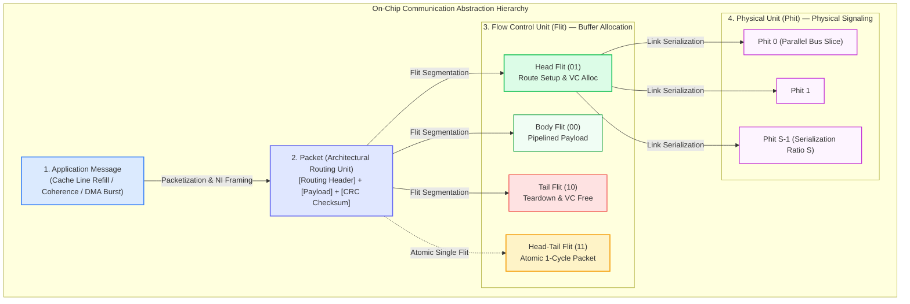
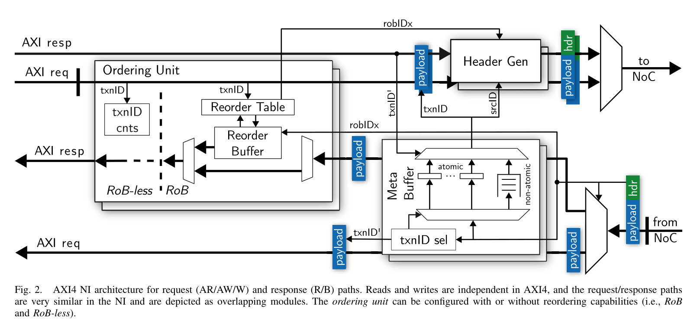
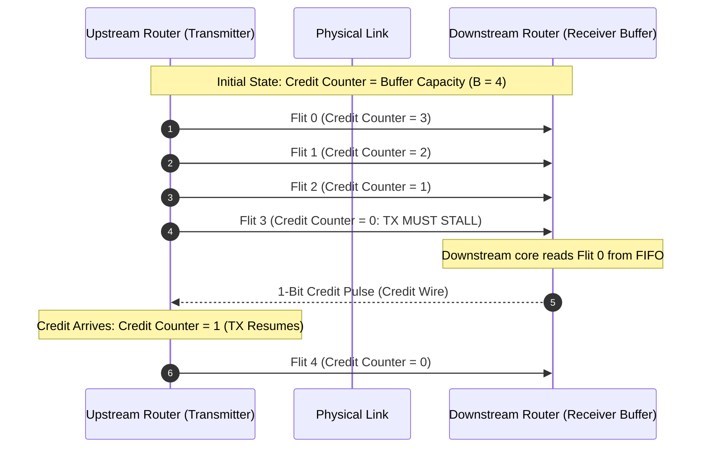
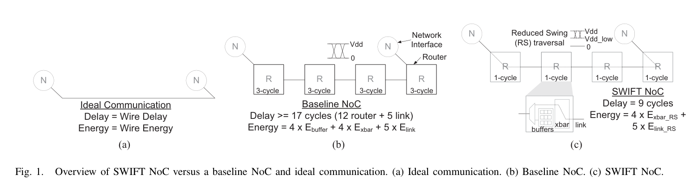
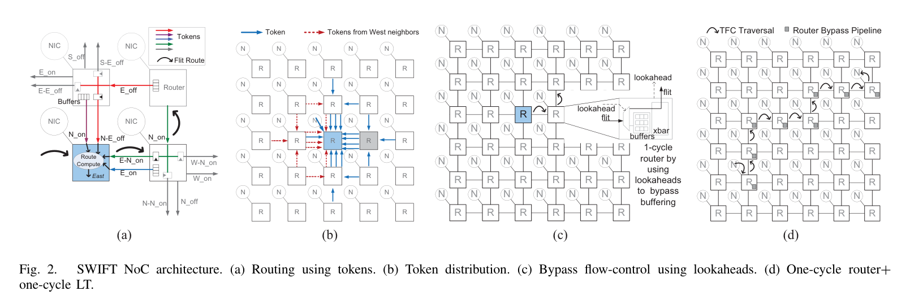

# Chapter 2: Switching Techniques, Flow Control & Buffer Management

> **Authors**: NoC-Lab Research Consortium  
> **Domain**: Silicon Microarchitecture & Interconnect Design  
> **Interactive Companion**: [NoC Learning Hub — Track 1: Lessons 1.2–1.3](https://network-on-chip.github.io/learning/track1-fundamentals/)  
> **Accompanying Code**: [`code/switching_techniques_sim.py`](code/switching_techniques_sim.py), [`code/credit_flow_control.v`](code/credit_flow_control.v)

---

## Chapter Introduction

In Chapter 1, we established that long global copper wires and centralized shared buses collapse under the physical realities of deep sub-micron silicon, necessitating a transition to modular, packet-switched micro-networks. However, recognizing the need for a Network-on-Chip is only the first step. A profound architectural question immediately arises: **how do we take arbitrary software communications—such as a 64-byte L2 cache line refill, an 8-byte cache coherence invalidation probe, or a 4-kilobyte streaming tensor burst—and physically transport them across silicon without exhausting the chip's strict buffer area and power budgets?**

In macro-scale networks (such as the Internet or local Ethernet), routers possess gigabytes of off-chip DRAM storage, and dropped packets can be recovered through software TCP retransmissions. On a silicon die, however, conditions invert completely. Router buffers are constructed from expensive SRAM macros or D-flip-flop register files that consume up to $65\%$ of the router's area and static leakage power. Dropping a packet on-chip is strictly intolerable, as it would instantly corrupt processor memory consistency and crash the operating system.

To navigate these harsh constraints, on-chip networks rely on three tightly coupled foundational pillars:
- **A Multi-Tier Data Granularity Hierarchy**: Decomposing abstract application transactions into architectural packets, flow control flits, and physical phits.
- **Microarchitectural Switching Paradigms**: Moving away from Store-and-Forward (SAF) and Virtual Cut-Through (VCT) toward **Wormhole Switching**, which slashes intermediate buffer storage requirements by over $90\%$ by streaming packets flit-by-flit across the silicon.
- **Hardware-Enforced Lossless Flow Control**: Operating ultra-low-latency credit-based feedback loops that dynamically throttle upstream transmitters before a single buffer slot can overflow.

This chapter provides a rigorous, end-to-end exploration of data transport and buffer microarchitecture. We trace the complete lifecycle of an on-chip transaction, derive the mathematical latency formulations across switching techniques, formalize the credit round-trip time ($RTT$) equation via Little's Law, and examine alternative flow control mechanisms including on/off signaling and token-based reservation protocols (SWIFT NoC).

### Learning Objectives
- **Master the Data Abstraction Hierarchy**: Distinguish the functional boundaries, framing overheads, and hardware roles of Messages, Packets, Flits (Head, Body, Tail, Head-Tail), and Phits.
- **Analyze Silicon Network Interfaces**: Understand how the Network Interface (NI) bridges standard core protocols (AXI4, TileLink) to on-chip packet formats with zero data loss.
- **Derive Mathematical Switching Latencies**: Formulate and contrast the zero-load latency models of Store-and-Forward ($H \cdot L$), Virtual Cut-Through ($H + L$), and Wormhole switching ($H + L$).
- **Quantify Credit Turnaround Timing**: Derive the credit Round-Trip Time ($RTT$) loop and prove the minimum downstream buffer depth theorem ($B_{min} \ge RTT$) required for $100\%$ wire-rate link utilization.
- **Evaluate Alternative Flow Control Paradigms**: Compare credit-based flow control with on/off hysteresis signaling and token flow control (SWIFT TVLSI 2013).

### Chapter Roadmap & Interactive Modules
- **Section 2.1**: The Data Granularity Hierarchy: Messages, Packets, Flits & Phits.
- **Section 2.2**: Silicon Network Interface: The AXI4 / NoC Protocol Translation.
- **Section 2.3**: Mathematical Latency Analysis of Switching Techniques.
- **Section 2.4**: Lossless Flow Control Mechanisms & The Credit Turnaround Loop.
- **Section 2.5**: Alternative Flow Control: On/Off & Token Flow Control (SWIFT).
- **Section 2.6**: End-to-End Walkthrough: Slicing a 64-Byte Cache Line Refill.
- **Section 2.7**: Interactive Lab Challenges & Hands-on Simulators.
- **Section 2.8**: Checkpoint Assessment & Problem Sets.

---

## 2.1 The Data Granularity Hierarchy: Messages, Packets, Flits & Phits

In on-chip networks, transmitting arbitrary software data structures across silicon requires bridging a fundamental architectural gap: abstract software communications (such as cache coherence requests or multi-kilobyte DMA bursts) must be translated down to physical voltage pulses driven over nanometer metal traces.

To optimize buffer area, minimize pipeline latency, and guarantee deadlock-free transmission, NoCs establish a rigorous four-layer data abstraction hierarchy: **Messages**, **Packets**, **Flits**, and **Phits** (Dally & Towles, *DAC 2001*; Benini & De Micheli, *IEEE Computer 2002*).



### 2.1.1 Architectural Motivation: Bridging the Semantic-Silicon Gap

In macro-scale wide-area and local-area networks (governed by the classical OSI or TCP/IP reference stacks), transmission spans meters to global distances. In these off-chip environments, physical pins and serial transceivers are scarce, transmission line delays are substantial, packet drops over noisy channels are accepted, and endpoint nodes have gigabytes of DRAM to buffer variable-length Ethernet frames (64 to 1,518 bytes).

On a monolithic silicon die or multi-die 2.5D/3D package, these physical constraints invert completely:

- **Buffer Area and Static Leakage Scarcity**:
  - On-chip router buffers (implemented with dual-ported SRAM macros or D-flip-flop register files) consume **35% to 65% of total router silicon area and static leakage power**.
  - Dedicating tens of kilobytes of buffer storage per input port severely cannibalizes silicon budget from compute cores, vector units, and cache arrays.
- **Abundant On-Chip Wiring Density**:
  - Modern deep-submicron and FinFET/GAAFET process nodes provide 10 to 16 back-end-of-line (BEOL) metal layers.
  - While off-chip package pins are tightly bounded, on-chip routers can deploy wide parallel buses (32 to 512 physical wires) across intermediate metal layers (M4–M6) with zero packaging penalty.
- **Sub-Nanosecond Single-Cycle Timing Invariants**:
  - Packet switching, credit processing, virtual channel allocation, and crossbar traversal must execute in 1 to 2 clock cycles (300 ps to 1 ns).
  - This strict timing ceiling precludes dynamic software intervention, complex variable-length frame reassembly, or multi-cycle header decoding.

To reconcile these physical realities, Network-on-Chip (NoC) architectures partition data transmission across four distinct hierarchical boundaries, as summarized in the comparison matrix below.

---

### 2.1.2 The Four Abstraction Tiers and Functional Boundaries

#### Tier 1: Application Messages (The Transaction Semantic Unit)
The **Application Message** is the software-level communication payload exchanged between processing cores, hardware accelerators (GPUs, TPUs, NPUs), and memory subsystem controllers (L2/L3 cache banks, HBM/DDR memory controllers). It encapsulates complete architectural semantics:
- **Cache Coherence Messages**: Short control messages such as Read Shared (`RdBlk`), Read Exclusive (`RdBlkMod`), Invalidate (`Inv`), or Writeback Acknowledgment (`WbAck`), typically spanning 8 to 16 bytes.
- **Cache Line Refills and Evictions**: 64-byte or 128-byte data payloads transferring an entire cache block between cache levels.
- **Direct Memory Access (DMA) Bursts**: Multi-kilobyte block transfers (e.g., 4 KB memory pages, large matrix weight tensors) generated by DMA engines or streaming accelerators.

> **Architectural Constraint**: Raw messages cannot be routed directly across the network fabric because their unbounded lengths would monopolize shared router buffers, triggering severe head-of-line (HOL) blocking and protocol-level deadlocks.

#### Tier 2: Packets (The Architectural Routing Unit)
The Network Interface (NI) decomposes or encapsulates application messages into one or more **Packets**. The packet constitutes the fundamental **routing unit** of the network: all path routing algorithms (e.g., Dimension-Order Routing, Turn Models, or Valiant Oblivious Routing), virtual network isolation, and deadlock-avoidance proofs operate at the packet granularity.

A packet is formally defined as the tuple:

$$\mathcal{P} = \left\{ H_{\text{meta}},\, D_{\text{payload}},\, T_{\text{check}} \right\}$$

where:
- $H_{\text{meta}}$ denotes the routing header metadata, encompassing destination coordinates $(X_{\text{dest}}, Y_{\text{dest}}, Z_{\text{dest}})$, source address $(X_{\text{src}}, Y_{\text{src}})$, Virtual Network identifier ($VN_{\text{ID}}$), transaction identifier, quality-of-service (QoS) class, and packet length $L_{\text{pkt}}$.
- $D_{\text{payload}}$ is the data payload slice, constrained by the maximum transmission unit of the network ($MTU_{\text{noc}}$).
- $T_{\text{check}}$ is an optional integrity trailer (e.g., 16-bit CRC or parity checksum).

The **Packetization Framing Efficiency** ($\eta_{\text{pkt}}$) measures the fraction of transmitted bits dedicated to useful application data:

$$\eta_{\text{pkt}} = \frac{|D_{\text{payload}}|}{|H_{\text{meta}}| + |D_{\text{payload}}| + |T_{\text{check}}|} = \frac{|D_{\text{payload}}|}{B_{\text{pkt}}}$$

For a 64-byte cache line refill ($|D_{\text{payload}}| = 512$ bits) accompanied by a 32-bit header and 16-bit CRC ($B_{\text{pkt}} = 560$ bits), $\eta_{\text{pkt}} = \frac{512}{560} \approx 91.4\%$. Conversely, for an 8-byte cache coherence invalidation ($|D_{\text{payload}}| = 64$ bits), $\eta_{\text{pkt}} = \frac{64}{112} \approx 57.1\%$.

!!! note "Why Routing Operates at Packet Granularity"
    Router Route Computation (RC) evaluates output port selection using combinational comparators or routing tables. If routing were evaluated per flit, every flit would require duplicate coordinate headers and pipeline stage overhead. Furthermore, flits belonging to different packets would interleave non-deterministically across physical links, causing corruption unless intermediate routers deployed expensive flit reassembly buffers. By enforcing packet-level routing, the leading flit establishes the path, and all subsequent flits trail along the reserved path without re-evaluating routing tables.

#### Tier 3: Flow Control Units (Flits) (The Buffering and Allocation Unit)
A packet is segmented into a sequenced stream of **Flow Control Units (Flits)**. The flit is the fundamental **atomic unit of buffer storage allocation and flow control credit accounting**.

Router input buffers, virtual channels (VCs), and credit counters track resources exclusively in integer multiples of flits. Flits are partitioned into four distinct microarchitectural types:

- **Head Flit (`Flit_Type = 2'b01`)**:
  - The opening flit of a multi-flit packet.
  - Encapsulates routing header coordinates ($H_{\text{meta}}$), destination address, and priority tags.
  - Arbitrates for downstream Virtual Channels during the Virtual Channel Allocation (VA) pipeline stage and reserves router channel state.
- **Body Flits (`Flit_Type = 2'b00`)**:
  - Intermediate flits carrying pure data payload bytes.
  - Do not contain destination coordinates; they stream through established crossbar connections following the reservation made by their Head flit.
  - Conserves dynamic switching power and eliminates redundant routing lookups.
- **Tail Flit (`Flit_Type = 2'b10`)**:
  - The terminal flit of a multi-flit packet carrying final payload fragments and optional checksum bits ($T_{\text{check}}$).
  - Crucially, as the Tail flit traverses the crossbar and departs, it triggers control logic to **deallocate the Virtual Channel**, returning the VC state to `IDLE`.
- **Head-Tail Flit (`Flit_Type = 2'b11`)**:
  - An atomic single-flit packet ($L = 1$) combining header metadata, payload, and termination markers within a single cycle.
  - Essential for ultra-short coherence transactions (invalidations, acknowledgments, credit returns), avoiding multi-flit serialization overhead.

Let $W_{\text{flit}}$ denote total flit width, $W_{\text{ctrl}}$ denote flit-type and VCID overhead, and $W_{\text{flit\_payload}} = W_{\text{flit}} - W_{\text{ctrl}}$ denote payload capacity per body flit. If the Head flit allocates $W_{\text{head\_hdr}}$ bits for addressing, leaving $W_{\text{head\_payload}} = W_{\text{flit\_payload}} - W_{\text{head\_hdr}}$ for data, the total packet length $L$ in flits is:

$$L = 1 + \left\lceil \frac{\max\left(0,\, |D_{\text{payload}}| + |T_{\text{check}}| - W_{\text{head\_payload}}\right)}{W_{\text{flit\_payload}}} \right\rceil$$

When the Head flit carries purely routing metadata ($W_{\text{head\_payload}} = 0$), this simplifies to:

$$L = 1 + \left\lceil \frac{|D_{\text{payload}}| + |T_{\text{check}}|}{W_{\text{flit\_payload}}} \right\rceil$$

#### Tier 4: Physical Units (Phits) (The Clock-Cycle Signaling Unit)
The **Physical Unit (Phit)** is the exact number of physical bits transferred across an inter-router link in **exactly one clock cycle**. The phit width equals the physical width of the physical link bus, $W_{\text{link}}$ (i.e., the count of conductive copper traces spanning between adjacent router ports).

The relationship between logical flits and physical phits is defined by the **Link Serialization Ratio** ($S$):

$$S = \left\lceil \frac{W_{\text{flit}}}{W_{\text{link}}} \right\rceil$$

The physical link latency per flit is given by $t_{\text{link}} = S \cdot t_{\text{cycle}}$. Three architectural regimes exist:
- **Unserialized Transport ($S = 1$, $W_{\text{link}} = W_{\text{flit}}$)**: 1 Flit = 1 Phit. The complete flit traverses the link in a single clock cycle. This maximizes link throughput, eliminates serialization delay, and eliminates the need for input/output gearbox registers.
- **Sub-Flit Serialization ($S > 1$, $W_{\text{link}} < W_{\text{flit}}$)**: A flit is time-multiplexed across $S$ consecutive clock cycles over a narrower physical bus (e.g., a 128-bit flit transmitted across a 32-bit physical link incurs $S = 4$ cycles/flit). While this reduces metal wiring track congestion and crossbar area by factor $S$, it inflates link transit latency by $(S - 1)$ cycles per flit and requires serializer/deserializer (gearbox) register logic.
- **Ultra-Wide Interconnects ($W_{\text{link}} \ge 512$ bits)**: Modern high-throughput accelerators and open-source architectures like **FlooNoC** (Fischer et al., *IEEE TVLSI 2025*) leverage upper metal layers to implement 512-bit physical links, matching an entire 64-byte cache line refill in a single flit and phit ($S = 1, L = 1$), completely eliminating multi-flit packet reassembly.

---

### 2.1.3 Microarchitectural Flit Anatomy & Field Encodings

```
Figure 2.1: Canonical Flit Formats in Modern Virtual-Channel NoCs
+--------------------------------------------------------------------------------------------------------------------+
| HEAD FLIT (Routing & Channel Allocation):                                                                          |
| [Type: 2b] [VC: 3b] [Dest: 8b] [Lookahead: 3b] [VN: 2b] [QoS: 2b] [Len: 6b] [Trans: 6b] [Payload: 32b] [P: 2b]   |
+--------------------------------------------------------------------------------------------------------------------+
| BODY FLIT (Pure Payload Streaming):                                                                                |
| [Type: 2b] [VC: 3b] [------------------------- Raw Payload Data: 57b ------------------------------------] [P: 2b] |
+--------------------------------------------------------------------------------------------------------------------+
| TAIL FLIT (Packet Teardown & Checksum):                                                                            |
| [Type: 2b] [VC: 3b] [CRC / Checksum: 16b] [---------------- Final Payload: 41b --------------------------] [P: 2b] |
+--------------------------------------------------------------------------------------------------------------------+
| HEAD-TAIL FLIT (Atomic Single-Flit Packet):                                                                        |
| [Type: 2b] [VC: 3b] [Dest: 8b] [Lookahead: 3b] [VN: 2b] [------------ Short Payload: 40b ---] [CRC: 12b] [P: 2b]  |
+--------------------------------------------------------------------------------------------------------------------+
```

Key microarchitectural fields include:
- **`Flit_Type` (2 bits)**: Differentiates Body (`2'b00`), Head (`2'b01`), Tail (`2'b10`), and Head-Tail (`2'b11`) formats.
- **`VC_ID` (2–4 bits)**: Directs incoming flits to the appropriate Virtual Channel buffer FIFO at the receiver port.
- **`Dest_Coord` (8–12 bits)**: Encodes destination coordinates $(X_{\text{dest}}, Y_{\text{dest}}, Z_{\text{dest}})$ for routing logic.
- **`Lookahead_Routing` (3 bits)**: In advanced low-latency routers (Peh & Dally, *HPCA 2001*), the upstream router pre-computes the routing decision for the *next downstream hop* and writes this direction (East, West, North, South, Local) into the Head flit. The downstream router reads this field immediately, allowing Virtual Channel Allocation (VA) and Switch Allocation (SA) to proceed in parallel with buffer write, shrinking zero-load router pipeline latency from 3–4 cycles down to a single cycle.
- **`VN_ID` (2 bits)**: Virtual Network identifier used to segregate request, response, and coherence invalidation streams to guarantee protocol-level deadlock freedom.
- **`QoS_Priority` (2 bits)**: Differentiates latency-sensitive control traffic from bulk throughput traffic.
- **`Trans_ID` (6–8 bits)**: Unique transaction identifier mapped to Network Interface Reorder Buffers (RoBs).

---

### 2.1.4 Comparison Matrix of the Four Abstraction Tiers

| Abstraction Level | Semantic Role | Operating Hardware | Allocation Horizon | Typical Sizing | Primary Architectural Constraints |
| :--- | :--- | :--- | :--- | :--- | :--- |
| **Application Message** | Transaction semantics (coherence, DMA) | Core, L2/L3 Cache, Memory Controller | End-to-end transaction lifecycle | 8 B to 4 KB | Unbounded length, bimodal traffic, protocol deadlock |
| **Packet** | Routing path & deadlock freedom | Network Interface (NI), Router Routing Unit | Path traversal duration | 16 B to 128 B | Head-of-line blocking, routing deadlock, out-of-order delivery |
| **Flit (Flow Control Unit)** | Buffer allocation & flow control credit | Router Virtual Channel (VC) Buffers | Hop-by-hop buffer credit loop | 32 b to 512 b | Silicon buffer area/leakage, credit turnaround round-trip time ($RTT$) |
| **Phit (Physical Unit)** | Physical clock-cycle signal transport | Physical Links, Repeaters, Crossbar | Single clock cycle edge | 32 b to 512 b | Wire pitch, crosstalk noise, Elmore $RC$ delay, clock skew |

---

### 2.1.5 End-to-End Walkthrough: Slicing a 64-Byte Cache Line Refill

To concretize how the four abstraction tiers interact, consider an L1 data cache miss on Core $(0, 0)$ requesting a 64-byte ($512\text{ bits}$) cache line from an L2 cache bank at tile $(3, 3)$ across a 2D mesh:

- **Message Tier**:
  - The L2 controller generates a 64-byte Read Response message containing the 512-bit cache line payload and a 32-bit transaction status header ($544\text{ bits}$ total).
- **Packet Tier**:
  - The Network Interface encapsulates the message into a Response Packet.
  - It prepends a 32-bit routing header ($H_{\text{meta}}$: destination $(0,0)$, source $(3,3)$, $VN = \text{Response}$, TransID $= 42$) and appends a 16-bit CRC checksum ($T_{\text{check}}$).
  - Total packet size $B_{\text{pkt}} = 32 + 512 + 16 = 560\text{ bits}$, achieving a framing efficiency of $\eta_{\text{pkt}} = \frac{512}{560} = 91.4\%$.
- **Flit Tier**:
  - The packet is segmented into flits according to the microarchitecture's flit width $W_{\text{flit}}$.
  - The table below compares three standard NoC design points (narrow 64-bit, balanced 128-bit, and wide 512-bit).
- **Phit Tier**:
  - Flits are clocked onto physical wire links.
  - Under a balanced 128-bit NoC, each 128-bit flit constitutes 1 phit ($S = 1$).
  - The 5-flit packet traverses each inter-router link in 5 clock cycles, requiring a minimum downstream buffer depth of $B \ge 5$ flits to prevent cut-through stalling.

| Metric / Parameter | Config A (Narrow 64-bit) | Config B (Balanced 128-bit) | Config C (Wide 512-bit FlooNoC) |
| :--- | :--- | :--- | :--- |
| **Flit Width ($W_{\text{flit}}$)** | 64 bits | 128 bits | 576 bits (512b data + 64b hdr) |
| **Link Width ($W_{\text{link}}$)** | 64 bits | 128 bits | 576 bits |
| **Serialization Ratio ($S$)** | 1 Phit/Flit | 1 Phit/Flit | 1 Phit/Flit |
| **Flit Composition ($L$)** | 10 flits (1 H, 8 B, 1 T) | 5 flits (1 H, 3 B, 1 T) | 1 flit (1 Head-Tail) |
| **Channel Busy Duration** | 10 clock cycles | 5 clock cycles | 1 clock cycle |
| **Downstream Buffer Sizing** | $\ge 10$ flits ($640\text{ bits}$) | $\ge 5$ flits ($640\text{ bits}$) | $\ge 1$ flit ($576\text{ bits}$) |
| **Crossbar Area Scaling** | Baseline ($1.0\times$) | $2.0\times$ baseline | $9.0\times$ baseline |
| **Head-of-Line Contention** | High (10 cycles/pkt) | Moderate (5 cycles/pkt) | Minimal (1 cycle/pkt) |

---

### 2.1.6 Silicon Trade-Offs: Wide vs. Narrow Interconnect Datapaths

Choosing the boundary between flit width $W_{\text{flit}}$ and link width $W_{\text{link}}$ represents one of the most critical trade-offs in on-chip interconnection design:

- **Routing Congestion and Metal Layer Stack**:
  - A 512-bit bidirectional physical link requires $2 \times 512 = 1,024$ physical wires.
  - With an intermediate metal pitch (M4–M6) of $80\,\mathrm{nm}$, routing 1,024 wires consumes $\approx 82\,\mu\mathrm{m}$ of silicon routing width per router tile.
  - If wire pitch cannot accommodate this density, designers must either insert multiplexed narrow links ($S > 1$) or dedicate upper global metal layers (M7–M9) with relaxed pitches and thick low-resistance copper traces.
- **Crosstalk and Dynamic Wire Energy**:
  - Running hundreds of parallel wires in close proximity creates severe inter-wire coupling capacitance ($C_c$).
  - When adjacent lines toggle in opposite directions, the effective Miller capacitance doubles ($C_{\text{eff}} = C_g + 2C_c$), inducing signal delay jitter.
  - To preserve signal integrity at gigahertz clock rates, wide links often interleave ground shield wires (`GND-Signal-Signal-GND`), increasing effective wire track consumption by 30% to 50%.
- **Crossbar Switch Complexity**:
  - The silicon area of a $P$-port crossbar switch scales quadratically with port count $P$ and linearly with flit width $W_{\text{flit}}$:
   
   $$\text{Area}_{\text{xbar}} \approx P^2 \cdot W_{\text{flit}} \cdot A_{\text{crosspoint}}$$
   
   where $A_{\text{crosspoint}}$ is the standard-cell area of a single multiplexer bit-cell. Doubling flit width doubles crossbar area and input buffer registers, but halves packet length $L$, reducing channel occupancy time and queuing contention.
- **Wire Energy Efficiency**:
  - Counterintuitively, wide parallel links often deliver superior energy efficiency compared to high-frequency serialized links.
  - A wide 512-bit link operating at a conservative $1.0\,\mathrm{GHz}$ eliminates power-dense phase-locked loops (PLLs) and serializer/deserializer (SerDes) transceivers.
  - Achieves energy consumption as low as **0.15 pJ/Byte/hop (0.019 pJ/bit/hop)** in modern FinFET processes (Fischer et al., *IEEE TVLSI 2025*).

---

## 2.2 Silicon Network Interface: The AXI4 / NoC Protocol Translation

At the boundary between processing cores and the on-chip network fabric, the **Network Interface (NI)** bridges the SoC protocol standard (such as ARM AMBA AXI4, OCP, or RISC-V TileLink) with the packetized NoC protocol.


*Figure 2.2: AXI4 Network Interface (NI) architecture for independent request (AR/AW/W) and response (R/B) paths, with reorder buffering (RoB) and direct DMA streaming. [Reproduced from: T. Fischer, M. Rogenmoser, T. Benz, F. K. Gürkaynak, and L. Benini, "FlooNoC: A 645-Gb/s/link 0.15-pJ/B/hop Open-Source NoC With Wide Physical Links and End-to-End AXI4 Parallel Multistream Support," IEEE Transactions on Very Large Scale Integration (VLSI) Systems, vol. 33, no. 4, pp. 1094–1107, Apr. 2025, DOI: 10.1109/TVLSI.2025.3527225. © 2025 IEEE]*

As demonstrated in **FlooNoC** (Fischer et al., *IEEE TVLSI 2025*), modern high-performance NIs decouple independent AXI4 channels onto dedicated physical or virtual channels to prevent protocol-level deadlock:
- **Request Network**: Translates Read Address (`AR`), Write Address (`AW`), and Write Data (`W`) channels into multi-flit request packets.
- **Response Network**: Translates Read Data (`R`) and Write Response (`B`) channels into separate response packets.
- **Reorder Buffer (RoB)**: Restores in-order AXI transaction completion when packets traverse adaptive, out-of-order routing paths.

---

## 2.3 Mathematical Latency Analysis of Switching Techniques

The switching technique dictates when and how an incoming flit is forwarded from an input port to an output port. We analyze three classical switching paradigms across path length $H$ (in hops), packet length $L$ (in flits), physical link bandwidth $W$ (bits/cycle), and router pipeline latency $t_r$ (cycles/hop).

```
Store-and-Forward (SAF):
Node 0: [Head][Body][Tail] --->
Node 1:                         Wait full packet ... [Head][Body][Tail] --->
Node 2:                                                                 Wait full packet ...

Virtual Cut-Through (VCT) & Wormhole (WH):
Node 0: [Tail][Body][Head] --->
Node 1:       [Tail][Body][Head] ---> (Immediate cut-through forwarding)
Node 2:             [Tail][Body][Head] --->
```

### 2.3.1 Store-and-Forward (SAF) Switching
In Store-and-Forward switching, a router must receive, buffer, and verify the **entire packet** before forwarding its first flit to the downstream router.

$$\text{Serialization Latency per Hop: } t_{serial} = \frac{L}{W}$$

$$\text{Total Zero-Load Latency: } T_{SAF} = H \cdot \left( t_r + \frac{L}{W} + t_{link} \right)$$

If $t_r + t_{link} \ll \frac{L}{W}$, the latency scales as:

$$T_{SAF} \approx H \cdot \frac{L}{W} \propto H \cdot L$$

- **Multiplicative Latency Penalty ($H \cdot L$)**: Total network latency scales with the product of network hop distance $H$ and packet length $L$. Every intermediate router completely halts forwarding until the terminal tail flit is written into memory.
- **Massive SRAM Silicon Overhead**: Intermediate routers must provision buffer depth for at least $L$ flits per port. For 64-byte cache lines with 32-bit links ($L = 16$ flits), input queue SRAMs monopolize the router die area.
- **Underutilized Downstream Bandwidth**: Downstream transmission links sit completely idle while upstream nodes accumulate flits, causing severe throughput collapse under bursty traffic.

### 2.3.2 Virtual Cut-Through (VCT) Switching
Introduced by Kermani & Kleinrock (1979), Virtual Cut-Through permits a router to forward the Head flit to the next hop **immediately** after route computation and arbitration, without awaiting the remainder of the packet, provided the downstream router has sufficient buffer space.

$$\text{Head Flit Arrival Time at Destination: } t_{head} = H \cdot (t_r + t_{link})$$

$$\text{Remaining Tail Flit Serialization: } t_{tail} = \frac{L - 1}{W}$$

$$\text{Total Zero-Load Latency: } T_{VCT} = H \cdot (t_r + t_{link}) + \frac{L - 1}{W}$$

- **Additive Latency Scaling ($H + L$)**: Forwarding begins as soon as the Head flit is decoded and granted access, decoupling network diameter $H$ from packet length $L$.
- **Full-Packet Buffer Allocation Constraint**: Even though transmission cuts through without waiting, the downstream router must still pre-allocate a full packet's worth of buffer storage ($B \ge L$) before granting admission.
- **Congestion Fallback to Store-and-Forward**: If downstream buffers become temporarily congested, cut-through is aborted and the entire packet stalls in local memory, degenerating to SAF latency.

### 2.3.3 Wormhole Switching: The Area-Efficient Silicon Standard
Proposed by William Dally and Charles Seitz (1987), **Wormhole Switching** revolutionized silicon interconnect design by decoupling the flow control unit from the packet size:

> **The Wormhole Principle**: The router buffers operate at the granularity of individual **flits**, rather than entire packets. Buffer depth per input virtual channel can be as small as **1 to 4 flits**, completely independent of packet length $L$.

The packet behaves like a train (or worm) winding across multiple physical router links simultaneously:

- **Decoupled Buffer Storage Granularity**: Router buffers operate exclusively on individual flits (1 to 4 flits per VC), completely decoupled from packet size $L$.
- **Pipelined Flit Streaming (The Train Metaphor)**:
  - **Head Flit**: Allocates router routing state and output virtual channels along the path.
  - **Body Flits**: Stream pipelined behind the head flit across established crossbar connections.
  - **Tail Flit**: Deallocates channel reservations, freeing the router ports for subsequent packets.
- **Additive Zero-Load Latency**: Delivers identical zero-load latency to VCT ($T_{WH} = H \cdot (t_r + t_{link}) + \frac{L - 1}{W}$) while slashing router buffer area by $75\%$ to $90\%$.
- **Link Contention & Head-of-Line Blocking**: When a Head flit blocks on downstream congestion, trailing body flits freeze in place across upstream links, tying up channel resources. This vulnerability directly motivates the invention of Virtual Channels (explored in Chapter 3).

$$\text{Zero-Load Latency: } T_{WH} = H \cdot (t_r + t_{link}) + \frac{L - 1}{W}$$

```
Table 2.1: Analytical Comparison of Switching Techniques across 8 Hops (t_r = 2 cycles, t_link = 1 cycle)
+---------------+--------------+----------------+----------------+-------------------+--------------------+
| Packet Length | Hop Count    | SAF Latency    | VCT / WH       | Speedup of        | Wormhole Buffer    |
| (Flits, L)    | (Hops, H)    | (Cycles)       | Latency (Cyc)  | VCT/WH over SAF   | Area Saving (%)    |
+---------------+--------------+----------------+----------------+-------------------+--------------------+
| 4 flits       | 4 hops       | 28 cycles      | 15 cycles      | 1.87x             | Baseline (4 flits) |
| 8 flits       | 4 hops       | 44 cycles      | 19 cycles      | 2.32x             | 50.0% saving       |
| 16 flits      | 4 hops       | 76 cycles      | 27 cycles      | 2.81x             | 75.0% saving       |
| 32 flits      | 4 hops       | 140 cycles     | 43 cycles      | 3.26x             | 87.5% saving       |
| 16 flits      | 8 hops       | 152 cycles     | 39 cycles      | 3.90x             | 75.0% saving       |
| 32 flits      | 8 hops       | 280 cycles     | 55 cycles      | 5.09x             | 87.5% saving       |
| 64 flits      | 8 hops       | 536 cycles     | 87 cycles      | 6.16x             | 93.8% saving       |
+---------------+--------------+----------------+----------------+-------------------+--------------------+
(Simulated via code/switching_techniques_sim.py)
```

**The Trade-off of Wormhole Switching**:
When a head flit is blocked by downstream congestion, the trailing body and tail flits remain stalled in place inside the small buffers of upstream routers along the path. This stalls multiple physical links, increasing contention. To prevent this blocking from paralyzing the network, **Virtual Channels (VCs)** are introduced (detailed in Chapter 3).

---

## 2.4 Lossless Flow Control Mechanisms

Because silicon buffers are finite, an on-chip network must implement **lossless flow control** to guarantee that flits are never dropped due to buffer overflow.



### 2.4.1 Credit-Based Flow Control
Credit-based flow control is the universal industry standard for high-speed NoCs:
- **Transmitter State**: Maintains an upstream `credit_counter` initialized to the total buffer capacity $B$ of the downstream receiver.
- **Transmission**: Whenever the transmitter sends a flit, it decrements `credit_counter` by 1. If `credit_counter == 0`, the transmitter stalls immediately.
- **Credit Feedback**: Whenever the downstream receiver pops a flit from its input FIFO, it sends a **1-bit credit pulse** back to the transmitter across a dedicated reverse wire.
- **Counter Increment**: When the transmitter receives a credit pulse, it increments `credit_counter` by 1.

### 2.4.2 The Credit Round-Trip Time (RTT) & Minimum Buffer Depth Equation
A fundamental physical constraint in credit-based flow control is the **Credit Turnaround Loop**:

```
Transmitter                  Forward Link                  Receiver
[ Flit Transmit ] --------> [ t_flight_fwd ] ---------> [ Buffer Write ]
      ^                                                         |
      |                                                         v
[ Credit Process ] <------- [ t_flight_cred ] <-------- [ Flit Read & Credit Gen ]
```

The total Round-Trip Time ($RTT$) of the credit loop is:

$$RTT = t_{tx\_proc} + t_{flight\_fwd} + t_{rx\_proc} + t_{flight\_credit}$$

Where:
- $t_{tx\_proc}$: Transmitter credit decrement and arbitration cycle ($1\text{ cycle}$).
- $t_{flight\_fwd}$: Forward wire flight latency ($1\text{ cycle}$).
- $t_{rx\_proc}$: Receiver buffer write, read, and credit pulse generation ($1\text{ cycle}$).
- $t_{flight\_credit}$: Reverse credit wire flight latency ($1\text{ cycle}$).

$$\text{Nominal RTT for Adjacent Routers: } RTT = 1 + 1 + 1 + 1 = 4\text{ cycles}$$

#### The Fundamental Throughput Theorem:
To sustain **100% wire-rate throughput** (injecting 1 flit every clock cycle without pipeline bubbles), the downstream buffer depth $B$ must satisfy:

$$B_{min} \ge RTT \times \text{Peak Injection Rate} = RTT \text{ flits}$$

```
Table 2.2: Buffer Depth vs. Achievable Link Utilization (RTT = 4 cycles, Simulated over 100 cycles)
+---------------------+-------------------+---------------------+------------------+-----------------------+
| Buffer Depth (B)    | RTT (Cycles)      | Link Utilization    | Flits Transferred| Pipeline Stall State  |
+---------------------+-------------------+---------------------+------------------+-----------------------+
| B = 1 flit          | 4 cycles          | 20.0%               | 20 flits         | Heavy Underflow Stall |
| B = 2 flits         | 4 cycles          | 40.0%               | 40 flits         | Heavy Underflow Stall |
| B = 3 flits         | 4 cycles          | 60.0%               | 60 flits         | Moderate Stall        |
| B = 4 flits         | 4 cycles          | 80.0%               | 80 flits         | Boundary Stall Bubble |
| B = 5 flits (>=RTT) | 4 cycles          | 100.0%              | 100 flits        | 100% Full Wire-Rate   |
| B = 8 flits         | 4 cycles          | 100.0%              | 100 flits        | 100% Wire-Rate (Safe) |
+---------------------+-------------------+---------------------+------------------+-----------------------+
```

If $B < B_{min}$, the transmitter exhausts its credits before the first credit pulse returns, forcing the physical link to sit idle while waiting for credits, causing severe bandwidth throttling.

---

## 2.5 Alternative Flow Control: On/Off and Token Flow Control

### 2.5.1 On/Off Flow Control
Instead of transmitting credit pulses for every flit, **On/Off Flow Control** transmits a continuous state bit:

- Sends an `OFF` signal when free buffer space falls below an upper threshold $T_{off}$.
- Sends an `ON` signal when free buffer space recovers above a lower threshold $T_{on}$.
- **Hysteresis Constraint**: To prevent buffer overflow during signal flight, the threshold must satisfy $T_{off} \ge t_{flight\_fwd} + t_{flight\_signal}$.

### 2.5.2 Token Flow Control: The SWIFT NoC (TVLSI 2013)

A major advance in low-power flow control is **Token Flow Control**, introduced in the **SWIFT NoC** by Postman, Krishna, Edmonds, Peh, and Chiang (*IEEE TVLSI 2013*).


*Figure 2.3: Overview of SWIFT NoC versus a baseline NoC and ideal communication: (a) Ideal single-cycle communication, (b) Baseline multi-stage NoC, and (c) SWIFT NoC with token-based flit buffer bypassing. [Reproduced from: J. Postman, T. Krishna, C. Edmonds, L.-S. Peh, and P. Chiang, "SWIFT: A Low-Power Network-On-Chip Implementing the Token Flow Control Router Architecture With Swing-Reduced Interconnects," IEEE Transactions on Very Large Scale Integration (VLSI) Systems, vol. 21, no. 8, pp. 1432–1446, Aug. 2013, DOI: 10.1109/TVLSI.2012.2211904. © 2013 IEEE]*


*Figure 2.4: SWIFT NoC microarchitecture: (a) Routing using tokens, (b) Token distribution, (c) Bypass flow-control using lookahead signals, and (d) 1-cycle router + 1-cycle link traversal. [Reproduced from: J. Postman et al., IEEE TVLSI, Aug. 2013, DOI: 10.1109/TVLSI.2012.2211904. © 2013 IEEE]*

#### Key Architectural Innovations in SWIFT:
- **Flit Buffer Bypassing**: Tokens travel ahead of payload flits. If an output port is granted via a token, incoming flits bypass the input FIFO buffers entirely, slicing directly into the crossbar.
- **Buffer Dynamic Power Reduction**: Because flits rarely write into SRAM cells under low-to-medium loads, dynamic buffer write energy is slashed by **38% at saturation and 25% at low load**.
- **Swing-Reduced Interconnect Links**: Integrates low-voltage differential/reduced-swing transceivers on the physical link wires to further cut datapath dynamic capacitive energy dissipation.

---

## 2.6 Interactive Lab & Hands-on Challenges

Deepen your understanding of flow control dynamics on the **Companion Learning Platform**:

- 🎮 **[Credit Commander: Flow Control](https://network-on-chip.github.io/learning/interactive/credits/)**:
  - Manually tune buffer depth $B$ and link latency $t_{flight}$ to balance credit loop stability against silicon area.
  - Trigger credit underflow stalls and observe pipeline bubbles in real time.
- 🧩 **[Packet Master: Routing Puzzle](https://network-on-chip.github.io/learning/interactive/puzzle/)**:
  - Solve multi-hop routing puzzles by coordinating Head, Body, and Tail flit movements across congested wormhole channels.

---

## 2.8 Checkpoint Assessment

Test your mastery of Chapter 2 concepts against the official certification questions (mirroring the 3-Tier Exam Engine in [`quiz.md`](../../quiz.md)):

#### Question 2.1 (Tier 1: Fundamental)
*Which of the following statements correctly describe the architectural advantages of Wormhole Switching over Store-and-Forward (SAF) and Virtual Cut-Through (VCT)? (Select all that apply)*

- **A)** Wormhole switching decouples buffer allocation from packet size by allocating buffers at the granularity of small flits rather than entire packets.
- **B)** Router input buffer SRAM area can be reduced by 75% to 90%, requiring only 1 to 4 flits of storage per Virtual Channel.
- **C)** Wormhole flits can begin traversing downstream routers as soon as the Head flit is forwarded, without waiting for trailing body flits to arrive.
- **D)** Wormhole switching completely eliminates the possibility of network deadlocks without needing virtual channels.

??? success "Reveal Answer & Full Solution"
    **Correct Answer: Option A, B, C**

    **1. Step-by-Step Architectural & Mathematical Derivation:**
    In Store-and-Forward (SAF) switching, a router must receive and store the entire packet before examining the header and forwarding flits. This causes latency to scale as t_SAF = H * (t_router + L_packet / BW), where H is hop count, and mandates huge router buffers equal to maximum packet size. Virtual Cut-Through (VCT) improves latency by forwarding flits immediately if downstream buffers are free, but still allocates buffer space in full packet quanta. Wormhole switching decouples the buffer allocation unit (the flit) from the transmission/routing unit (the packet). Flits stream pipelined across the network like a snake: when the Head flit clears a router, trailing Body and Tail flits immediately follow in subsequent cycles. Router buffers only need to be deep enough to cover credit round-trip latency (typically 2–4 flits per VC), slashing router SRAM area by up to 90%. However, when a Head flit is blocked, trailing flits stall in place across multiple routers, holding buffer resources and potentially creating cyclic deadlock dependencies if routing is not constrained.

    **2. Option-by-Option Breakdown & Distractor Analysis:**
    - **Option A (Correct):** True. Wormhole flow control allocates buffer slots per flit, eliminating the requirement to hold full multi-kilobyte packets.
    - **Option B (Correct):** True. Decoupling packet size from buffer size slashes input buffer SRAM footprints from hundreds of flits to just 2–4 flits per VC.
    - **Option C (Correct):** True. Flits pipeline across hops simultaneously, drastically cutting zero-load latency to t_WH = H * t_hop + (L_packet / BW).
    - **Option D (Incorrect Distractor):** False. In fact, wormhole switching exacerbates deadlock susceptibility because a blocked packet straddles multiple intermediate routers; routing constraints or virtual channels are required to prevent deadlocks.

    **3. Silicon Architect's Takeaway:**
    Wormhole switching enables ultra-compact router buffers and low pipelined latency, but requires strict deadlock-free routing algorithms.

    *(Reference: W. J. Dally and C. L. Seitz, 'Deadlock-Free Message Routing in Multiprocessor Interconnection Networks,' IEEE Transactions on Computers, Vol. C-36, No. 5, pp. 547–553, May 1987. DOI: 10.1109/TC.1987.1676939.)*

#### Question 2.2 (Tier 2: Core Engineering)
*In credit-based flow control, what is the exact physical condition for the input buffer depth B to guarantee 100% sustained link throughput without incurring stall bubbles?*

- **A)** B >= 1 flit, regardless of link distance or router clock frequency.
- **B)** B >= RTT * BW, where RTT is the total credit round-trip latency (in cycles) and BW is link bandwidth (1 flit/cycle).
- **C)** B must equal the total number of cores in the processor.
- **D)** B must be an odd prime number to prevent harmonic resonance.

??? success "Reveal Answer & Full Solution"
    **Correct Answer: Option B**

    **1. Step-by-Step Architectural & Mathematical Derivation:**
    Credit flow control operates in a closed loop: when the upstream transmitter sends a flit, it decrements its local credit counter. When the downstream receiver reads that flit out of its buffer and forwards it to the crossbar, it transmits a credit back to the sender, which increments its counter. The total round-trip time RTT consists of: RTT = t_forward_link + t_rx_read_credit + t_credit_link + t_tx_process. To sustain a continuous throughput of 1 flit per cycle without the transmitter stalling due to zero credits, the transmitter must have enough initial credits to keep sending while waiting for the first credit to return. By Little's Law, the required buffer depth is B_min = RTT * BW = RTT * (1 flit/cycle) = RTT flits. Any buffer capacity B < RTT will inevitably force the transmitter to stall once B flits are sent, introducing periodic pipeline bubbles and capping sustained throughput to B / RTT < 100%.

    **2. Option-by-Option Breakdown & Distractor Analysis:**
    - **Option A (Incorrect Distractor):** B=1 stalls immediately on cycle 2 if RTT > 1, capping throughput to 1/RTT.
    - **Option B (Correct):** B >= RTT * BW guarantees that the first returned credit arrives before the sender exhausts its buffer credits, preserving 100% throughput.
    - **Option C (Incorrect Distractor):** Core count N determines end-to-end network addressing, but local flow control buffer sizing depends strictly on link round-trip time.
    - **Option D (Incorrect Distractor):** Prime buffer depths have no relationship to harmonic resonance; digital FIFOs are typically sized as powers of 2 for circular pointer math.

    **3. Silicon Architect's Takeaway:**
    Always design credit buffers with depth B >= RTT = t_fwd + t_rx + t_credit + t_tx to prevent credit exhaustion stall bubbles.

    *(Reference: T. Fischer et al., 'FlooNoC: A 645-Gb/s/link 0.15-pJ/B/hop Open-Source NoC,' IEEE TVLSI, Vol. 33, No. 4, pp. 1094–1107, Apr. 2025. DOI: 10.1109/TVLSI.2025.3527225.)*

#### Question 2.3 (Tier 3: Silicon Mastery)
*How does Token Flow Control in the SWIFT NoC architecture (Peh et al., IEEE TVLSI 2013) achieve up to 38% power reduction compared to canonical wormhole routers?*

- **A)** By lowering router clock frequency to 10 MHz.
- **B)** By transmitting lightweight tokens ahead of data flits, allowing flits to bypass input FIFO buffers entirely and cut directly through the crossbar into the link when tokens are granted.
- **C)** By eliminating all virtual channels and replacing crossbars with single-bit shift registers.
- **D)** By converting electrical wires to liquid-cooled carbon nanotubes.

??? success "Reveal Answer & Full Solution"
    **Correct Answer: Option B**

    **1. Step-by-Step Architectural & Mathematical Derivation:**
    In a canonical wormhole router, dynamic power is dominated by input buffer SRAM read/write cycles (often accounting for 30–50% of total router dynamic energy), because every flit must be written into an input FIFO and later read out to traverse the crossbar. The SWIFT architecture (Postman, Krishna, Peh et al.) introduces Token Flow Control. Instead of flits driving arbitration upon arrival, lightweight control tokens (single-bit or narrow reservation flits) are launched ahead of data flits. These tokens arbitrate for crossbar switch traversal and downstream buffer reservations in advance. When the actual data flit arrives at the router, its crossbar path is already configured and validated. Consequently, the data flit completely bypasses the input buffer flip-flops/SRAM, streaming directly through the crossbar into the output link latch. This eliminates ~80% of buffer read/write operations under low-to-medium loads, yielding an aggregate 38% router power reduction while simultaneously shaving per-hop latency down to a single cycle.

    **2. Option-by-Option Breakdown & Distractor Analysis:**
    - **Option A (Incorrect Distractor):** SWIFT maintains high clock frequencies (~1 GHz) and low latency; it does not throttle clock frequency to 10 MHz.
    - **Option B (Correct):** Forward reservation tokens allow data flits to bypass input buffer SRAM arrays directly into the crossbar, slashing dynamic buffer energy.
    - **Option C (Incorrect Distractor):** SWIFT preserves virtual channels and full crossbar switches; it does not degrade to 1-bit shift registers.
    - **Option D (Incorrect Distractor):** SWIFT was fabricated and proven on standard 45nm bulk CMOS, not exotic carbon nanotubes.

    **3. Silicon Architect's Takeaway:**
    Bypassing input buffers via advance token reservation eliminates the largest component of dynamic router power (SRAM read/writes) under low and moderate traffic.

    *(Reference: J. Postman, T. Krishna, C. Edmonds, L.-S. Peh, and P. Chiang, 'SWIFT: A Low-Power Network-On-Chip Implementing Token Flow Control,' IEEE TVLSI, Vol. 21, No. 8, pp. 1432–1446, Aug. 2013. DOI: 10.1109/TVLSI.2012.2211904.)*

---

## References & Bibliography

1. **[Kermani1979]** P. Kermani and L. Kleinrock, "Virtual Cut-Through: A New Computer Communication Switching Technique," *Computer Networks*, vol. 3, no. 4, pp. 267–286, 1979. [DOI: 10.1016/0376-5075(79)90034-7](https://doi.org/10.1016/0376-5075(79)90034-7).
2. **[Dally1987]** W. J. Dally and C. L. Seitz, "Deadlock-Free Message Routing in Multiprocessor Interconnection Networks," *IEEE Transactions on Computers*, vol. C-36, no. 5, pp. 547–553, May 1987. [DOI: 10.1109/TC.1987.1676939](https://doi.org/10.1109/TC.1987.1676939).
3. **[Peh2001]** L.-S. Peh and W. J. Dally, "A Delay Model and Speculative Architecture for Pipelined Routers," in *Proceedings of the 7th International Symposium on High-Performance Computer Architecture (HPCA)*, 2001, pp. 255–266. [DOI: 10.1109/HPCA.2001.903268](https://doi.org/10.1109/HPCA.2001.903268).
4. **[Postman2013]** J. Postman, T. Krishna, C. Edmonds, L.-S. Peh, and P. Chiang, "SWIFT: A Low-Power Network-On-Chip Implementing the Token Flow Control Router Architecture With Swing-Reduced Interconnects," *IEEE Transactions on Very Large Scale Integration (VLSI) Systems*, vol. 21, no. 8, pp. 1432–1446, Aug. 2013. [DOI: 10.1109/TVLSI.2012.2211904](https://doi.org/10.1109/TVLSI.2012.2211904).
5. **[Fischer2025]** T. Fischer, M. Rogenmoser, T. Benz, F. K. Gürkaynak, and L. Benini, "FlooNoC: A 645-Gb/s/link 0.15-pJ/B/hop Open-Source NoC With Wide Physical Links and End-to-End AXI4 Parallel Multistream Support," *IEEE Transactions on Very Large Scale Integration (VLSI) Systems*, vol. 33, no. 4, pp. 1094–1107, Apr. 2025. [DOI: 10.1109/TVLSI.2025.3527225](https://doi.org/10.1109/TVLSI.2025.3527225).
6. **[Chao2013]** C.-H. Chao, K.-C. Chen, and A.-Y. Wu, "Routing-Based Traffic Migration and Buffer Allocation Schemes for 3-D Network-on-Chip Systems With Thermal Limit," *IEEE Transactions on Very Large Scale Integration (VLSI) Systems*, vol. 21, no. 11, pp. 2118–2131, Nov. 2013. [DOI: 10.1109/TVLSI.2012.2227852](https://doi.org/10.1109/TVLSI.2012.2227852).
7. **[Dally2001]** W. J. Dally and B. Towles, "Route Packets, Not Wires: On-Chip Interconnection Networks," in *Proceedings of the 38th Annual Design Automation Conference (DAC)*, 2001, pp. 684–689. [DOI: 10.1145/378239.379048](https://doi.org/10.1145/378239.379048).
