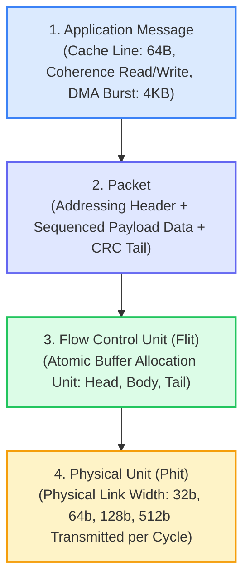
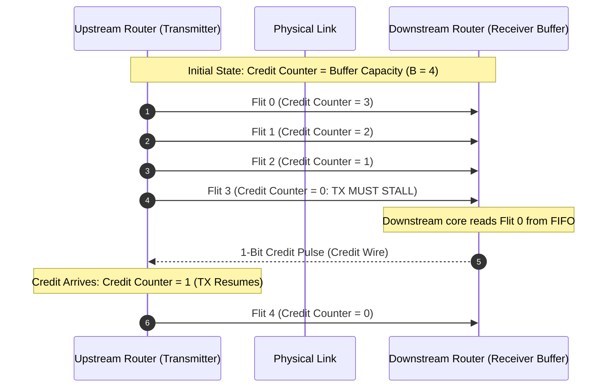

# Chapter 2: Switching Techniques, Flow Control & Buffer Management

> **Authors**: NoC-Lab Research Consortium  
> **Grounding Corpus**: `papers/` (542+ peer-reviewed articles from IEEE TVLSI, TCAD, JSSC, TCAS-I, TCAS-II)  
> **Interactive Companion**: [NoC Learning Hub — Track 1: Lessons 1.2–1.3](https://network-on-chip.github.io/learning/track1-fundamentals/)  
> **Accompanying Code**: [`code/switching_techniques_sim.py`](code/switching_techniques_sim.py), [`code/credit_flow_control.v`](code/credit_flow_control.v)

---

## 2.1 The Data Granularity Hierarchy: Messages, Packets, Flits & Phits

In on-chip networks, transmitting arbitrary software data structures across silicon requires decomposing raw application payloads into structured physical transmission units. To optimize buffer utilization, minimize pipeline latency, and guarantee deadlock-free routing, NoCs establish a rigorous four-layer data abstraction hierarchy:



### 2.1.1 Definitions and Functional Boundaries

1. **Application Message**: The software-level unit of communication generated by a processing element or memory subsystem. Examples include:
   - A 64-byte L2/L3 cache line refill.
   - An invalidation request in a MESI/MOESI cache coherence protocol (8–16 bytes).
   - An AXI4 direct memory access (DMA) block transfer (up to 4 KB).
2. **Packet**: The fundamental **routing unit** of the network. A packet encapsulates:
   - A destination node address $(X_{dest}, Y_{dest})$.
   - Virtual network / priority identifier.
   - Sequence numbering and transaction IDs.
   - Error detection checksums (CRC / parity).
3. **Flow Control Unit (Flit)**: The fundamental **buffering and flow control allocation unit**. Packet buffers inside on-chip routers allocate space strictly in integer multiples of flits. Flits are classified into three types:
   - **Head Flit**: Carries routing and destination metadata. It leads the packet through the network, reserving router output ports and virtual channels.
   - **Body Flits**: Carry pure data payload. They follow the reserved path established by the Head flit without re-evaluating routing tables.
   - **Tail Flit**: Signals the end of the packet. It releases virtual channels and state registers as it exits each router.
   - *(Single-Flit Packet)*: In short coherence transactions, a **Head-Tail Flit** carries both header and payload in a single cycle.
4. **Physical Unit (Phit)**: The number of physical bits transmitted across a router link in **exactly one clock cycle**.
   - If the link bus width equals the flit width ($W_{link} = W_{flit}$), 1 Flit = 1 Phit.
   - If the flit is wider than the physical link (e.g., 128-bit flit over a 32-bit physical link), a flit is serialized into $\frac{W_{flit}}{W_{link}} = 4$ phits.

```
Figure 2.1: Canonical Flit Format in Modern NoC Architectures
+-----------------------------------------------------------------------------------------+
|                               HEAD FLIT (Control & Setup)                               |
| [Flit_Type: 2b] [VC_ID: 3b] [Dest_X: 4b] [Dest_Y: 4b] [Packet_Len: 6b] [Payload: 45b]  |
+-----------------------------------------------------------------------------------------+
|                               BODY FLIT (Payload Data)                                  |
| [Flit_Type: 2b] [VC_ID: 3b] [---------------- Raw Payload Data: 59b -----------------]  |
+-----------------------------------------------------------------------------------------+
|                               TAIL FLIT (Teardown & Checksum)                           |
| [Flit_Type: 2b] [VC_ID: 3b] [CRC_Checksum: 16b] [--------- Tail Payload: 43b ---------] |
+-----------------------------------------------------------------------------------------+
```

---

## 2.2 Silicon Network Interface: The AXI4 / NoC Protocol Translation

At the boundary between processing cores and the on-chip network fabric, the **Network Interface (NI)** bridges the SoC protocol standard (such as ARM AMBA AXI4, OCP, or RISC-V TileLink) with the packetized NoC protocol.


*Figure 2.1: AXI4 Network Interface (NI) architecture for independent request (AR/AW/W) and response (R/B) paths, with reorder buffering (RoB) and direct DMA streaming. [Reproduced from: T. Fischer, M. Rogenmoser, T. Benz, F. K. Gürkaynak, and L. Benini, "FlooNoC: A 645-Gb/s/link 0.15-pJ/B/hop Open-Source NoC With Wide Physical Links and End-to-End AXI4 Parallel Multistream Support," IEEE Transactions on Very Large Scale Integration (VLSI) Systems, vol. 33, no. 4, pp. 1094–1107, Apr. 2025, DOI: 10.1109/TVLSI.2025.3527225. © 2025 IEEE]*

As demonstrated in **FlooNoC** (Fischer et al., *IEEE TVLSI 2025*), modern high-performance NIs decouple independent AXI4 channels onto dedicated physical or virtual channels to prevent protocol-level deadlock:
- **Request Network**: Translates Read Address (`AR`), Write Address (`AW`), and Write Data (`W`) channels into multi-flit request packets.
- **Response Network**: Translates Read Data (`R`) and Write Response (`B`) channels into separate response packets.
- **Reorder Buffer (RoB)**: Restores in-order AXI transaction completion when packets traverse adaptive, out-of-order routing paths.

---

## 2.3 Mathematical Latency Analysis of Switching Techniques

The switching technique dictates when and how an incoming flit is forwarded from an input port to an output port. We analyze three classical switching paradigms across path length $H$ (in hops), packet length $L$ (in flits), physical link bandwidth $W$ (bits/cycle), and router pipeline latency $t_r$ (cycles/hop).

```
Store-and-Forward (SAF):
Node 0: [Head][Body][Tail] --->
Node 1:                         Wait full packet ... [Head][Body][Tail] --->
Node 2:                                                                 Wait full packet ...

Virtual Cut-Through (VCT) & Wormhole (WH):
Node 0: [Tail][Body][Head] --->
Node 1:       [Tail][Body][Head] ---> (Immediate cut-through forwarding)
Node 2:             [Tail][Body][Head] --->
```

### 2.3.1 Store-and-Forward (SAF) Switching
In Store-and-Forward switching, a router must receive, buffer, and verify the **entire packet** before forwarding its first flit to the downstream router.

$$\text{Serialization Latency per Hop: } t_{serial} = \frac{L}{W}$$
$$\text{Total Zero-Load Latency: } T_{SAF} = H \cdot \left( t_r + \frac{L}{W} + t_{link} \right)$$

If $t_r + t_{link} \ll \frac{L}{W}$, the latency scales as:
$$T_{SAF} \approx H \cdot \frac{L}{W} \propto H \cdot L$$

**Critical Drawbacks**:
1. **Multiplicative Latency Penalty**: Latency is proportional to the product of network distance $H$ and packet length $L$.
2. **Massive SRAM Buffer Area**: Every intermediate router must provide at least $L$ flits of buffer storage per input port. For 64-byte packets with 32-bit links ($L = 16$ flits), buffer area dominates router silicon footprint.

### 2.3.2 Virtual Cut-Through (VCT) Switching
Introduced by Kermani & Kleinrock (1979), Virtual Cut-Through permits a router to forward the Head flit to the next hop **immediately** after route computation and arbitration, without awaiting the remainder of the packet, provided the downstream router has sufficient buffer space.

$$\text{Head Flit Arrival Time at Destination: } t_{head} = H \cdot (t_r + t_{link})$$
$$\text{Remaining Tail Flit Serialization: } t_{tail} = \frac{L - 1}{W}$$
$$\text{Total Zero-Load Latency: } T_{VCT} = H \cdot (t_r + t_{link}) + \frac{L - 1}{W}$$

Notice that distance $H$ and packet length $L$ are now **additive** rather than multiplicative ($H + L$ instead of $H \cdot L$).

**Limitation**: Although latency under low load is drastically reduced, VCT flow control still mandates that the receiver allocate an **entire packet's worth of buffer space** ($B \ge L$) before granting admission. If downstream buffers fill, the entire packet is buffered at the current node.

### 2.3.3 Wormhole Switching: The Area-Efficient Silicon Standard
Proposed by William Dally and Charles Seitz (1987), **Wormhole Switching** revolutionized silicon interconnect design by decoupling the flow control unit from the packet size:

> **The Wormhole Principle**: The router buffers operate at the granularity of individual **flits**, rather than entire packets. Buffer depth per input virtual channel can be as small as **1 to 4 flits**, completely independent of packet length $L$.

The packet behaves like a train (or worm) winding across multiple physical router links simultaneously:
- **Head Flit**: Allocates router routing state and output virtual channels along the path.
- **Body Flits**: Stream pipelined behind the head flit across established crossbar connections.
- **Tail Flit**: Deallocates channel reservations, freeing the router ports for subsequent packets.

$$\text{Zero-Load Latency: } T_{WH} = H \cdot (t_r + t_{link}) + \frac{L - 1}{W}$$

```
Table 2.1: Analytical Comparison of Switching Techniques across 8 Hops (t_r = 2 cycles, t_link = 1 cycle)
+---------------+--------------+----------------+----------------+-------------------+--------------------+
| Packet Length | Hop Count    | SAF Latency    | VCT / WH       | Speedup of        | Wormhole Buffer    |
| (Flits, L)    | (Hops, H)    | (Cycles)       | Latency (Cyc)  | VCT/WH over SAF   | Area Saving (%)    |
+---------------+--------------+----------------+----------------+-------------------+--------------------+
| 4 flits       | 4 hops       | 28 cycles      | 15 cycles      | 1.87x             | Baseline (4 flits) |
| 8 flits       | 4 hops       | 44 cycles      | 19 cycles      | 2.32x             | 50.0% saving       |
| 16 flits      | 4 hops       | 76 cycles      | 27 cycles      | 2.81x             | 75.0% saving       |
| 32 flits      | 4 hops       | 140 cycles     | 43 cycles      | 3.26x             | 87.5% saving       |
| 16 flits      | 8 hops       | 152 cycles     | 39 cycles      | 3.90x             | 75.0% saving       |
| 32 flits      | 8 hops       | 280 cycles     | 55 cycles      | 5.09x             | 87.5% saving       |
| 64 flits      | 8 hops       | 536 cycles     | 87 cycles      | 6.16x             | 93.8% saving       |
+---------------+--------------+----------------+----------------+-------------------+--------------------+
(Simulated via code/switching_techniques_sim.py)
```

**The Trade-off of Wormhole Switching**:
When a head flit is blocked by downstream congestion, the trailing body and tail flits remain stalled in place inside the small buffers of upstream routers along the path. This stalls multiple physical links, increasing contention. To prevent this blocking from paralyzing the network, **Virtual Channels (VCs)** are introduced (detailed in Chapter 3).

---

## 2.4 Lossless Flow Control Mechanisms

Because silicon buffers are finite, an on-chip network must implement **lossless flow control** to guarantee that flits are never dropped due to buffer overflow.



### 2.4.1 Credit-Based Flow Control
Credit-based flow control is the universal industry standard for high-speed NoCs:
- **Transmitter State**: Maintains an upstream `credit_counter` initialized to the total buffer capacity $B$ of the downstream receiver.
- **Transmission**: Whenever the transmitter sends a flit, it decrements `credit_counter` by 1. If `credit_counter == 0`, the transmitter stalls immediately.
- **Credit Feedback**: Whenever the downstream receiver pops a flit from its input FIFO, it sends a **1-bit credit pulse** back to the transmitter across a dedicated reverse wire.
- **Counter Increment**: When the transmitter receives a credit pulse, it increments `credit_counter` by 1.

### 2.4.2 The Credit Round-Trip Time (RTT) & Minimum Buffer Depth Equation
A fundamental physical constraint in credit-based flow control is the **Credit Turnaround Loop**:

```
Transmitter                  Forward Link                  Receiver
[ Flit Transmit ] --------> [ t_flight_fwd ] ---------> [ Buffer Write ]
      ^                                                         |
      |                                                         v
[ Credit Process ] <------- [ t_flight_cred ] <-------- [ Flit Read & Credit Gen ]
```

The total Round-Trip Time ($RTT$) of the credit loop is:

$$RTT = t_{tx\_proc} + t_{flight\_fwd} + t_{rx\_proc} + t_{flight\_credit}$$

Where:
- $t_{tx\_proc}$: Transmitter credit decrement and arbitration cycle ($1\text{ cycle}$).
- $t_{flight\_fwd}$: Forward wire flight latency ($1\text{ cycle}$).
- $t_{rx\_proc}$: Receiver buffer write, read, and credit pulse generation ($1\text{ cycle}$).
- $t_{flight\_credit}$: Reverse credit wire flight latency ($1\text{ cycle}$).

$$\text{Nominal RTT for Adjacent Routers: } RTT = 1 + 1 + 1 + 1 = 4\text{ cycles}$$

#### The Fundamental Throughput Theorem:
To sustain **100% wire-rate throughput** (injecting 1 flit every clock cycle without pipeline bubbles), the downstream buffer depth $B$ must satisfy:

$$B_{min} \ge RTT \times \text{Peak Injection Rate} = RTT \text{ flits}$$

```
Table 2.2: Buffer Depth vs. Achievable Link Utilization (RTT = 4 cycles, Simulated over 100 cycles)
+---------------------+-------------------+---------------------+------------------+-----------------------+
| Buffer Depth (B)    | RTT (Cycles)      | Link Utilization    | Flits Transferred| Pipeline Stall State  |
+---------------------+-------------------+---------------------+------------------+-----------------------+
| B = 1 flit          | 4 cycles          | 20.0%               | 20 flits         | Heavy Underflow Stall |
| B = 2 flits         | 4 cycles          | 40.0%               | 40 flits         | Heavy Underflow Stall |
| B = 3 flits         | 4 cycles          | 60.0%               | 60 flits         | Moderate Stall        |
| B = 4 flits         | 4 cycles          | 80.0%               | 80 flits         | Boundary Stall Bubble |
| B = 5 flits (>=RTT) | 4 cycles          | 100.0%              | 100 flits        | 100% Full Wire-Rate   |
| B = 8 flits         | 4 cycles          | 100.0%              | 100 flits        | 100% Wire-Rate (Safe) |
+---------------------+-------------------+---------------------+------------------+-----------------------+
```

If $B < B_{min}$, the transmitter exhausts its credits before the first credit pulse returns, forcing the physical link to sit idle while waiting for credits, causing severe bandwidth throttling.

---

## 2.5 Alternative Flow Control: On/Off and Token Flow Control

### 2.5.1 On/Off Flow Control
Instead of transmitting credit pulses for every flit, **On/Off Flow Control** transmits a continuous state bit:
- Sends an `OFF` signal when free buffer space falls below an upper threshold $T_{off}$.
- Sends an `ON` signal when free buffer space recovers above a lower threshold $T_{on}$.
- **Hysteresis Constraint**: To prevent buffer overflow during signal flight, the threshold must satisfy:
  $$T_{off} \ge t_{flight\_fwd} + t_{flight\_signal}$$

### 2.5.2 Token Flow Control: The SWIFT NoC (TVLSI 2013)

A major advance in low-power flow control is **Token Flow Control**, introduced in the **SWIFT NoC** by Postman, Krishna, Edmonds, Peh, and Chiang (*IEEE TVLSI 2013*).


*Figure 2.2: Overview of SWIFT NoC versus a baseline NoC and ideal communication: (a) Ideal single-cycle communication, (b) Baseline multi-stage NoC, and (c) SWIFT NoC with token-based flit buffer bypassing. [Reproduced from: J. Postman, T. Krishna, C. Edmonds, L.-S. Peh, and P. Chiang, "SWIFT: A Low-Power Network-On-Chip Implementing the Token Flow Control Router Architecture With Swing-Reduced Interconnects," IEEE Transactions on Very Large Scale Integration (VLSI) Systems, vol. 21, no. 8, pp. 1432–1446, Aug. 2013, DOI: 10.1109/TVLSI.2012.2211904. © 2013 IEEE]*


*Figure 2.3: SWIFT NoC microarchitecture: (a) Routing using tokens, (b) Token distribution, (c) Bypass flow-control using lookahead signals, and (d) 1-cycle router + 1-cycle link traversal. [Reproduced from: J. Postman et al., IEEE TVLSI, Aug. 2013, DOI: 10.1109/TVLSI.2012.2211904. © 2013 IEEE]*

#### Key Architectural Innovations in SWIFT:
1. **Flit Buffer Bypassing**: Tokens travel ahead of flits. If an output port is granted via a token, incoming flits bypass the input FIFO buffers entirely, slicing directly into the crossbar.
2. **Buffer Power Reduction**: Because flits rarely write into SRAM cells under low-to-medium loads, dynamic buffer write energy is slashed by **38% at saturation and 25% at low load**.
3. **Swing-Reduced Interconnects**: Integrates reduced-swing transceivers on the physical link wires to further cut datapath energy dissipation.

---

## 2.6 Interactive Lab & Hands-on Challenges

Deepen your understanding of flow control dynamics on the **Companion Learning Platform**:

1. 🎮 **[Credit Commander: Flow Control](https://network-on-chip.github.io/learning/interactive/credits/)**:
   - Manually tune buffer depth $B$ and link latency $t_{flight}$ to balance credit loop stability against silicon area.
   - Trigger credit underflow stalls and observe pipeline bubbles in real time.
2. 🧩 **[Packet Master: Routing Puzzle](https://network-on-chip.github.io/learning/interactive/puzzle/)**:
   - Solve multi-hop routing puzzles by coordinating Head, Body, and Tail flit movements across congested wormhole channels.

---

## 2.7 Checkpoint Assessment

Test your understanding against the 3-Tier Exam Engine in [`share/learning/quiz.md`](https://network-on-chip.github.io/learning/quiz/):

#### Question 2.1 (Tier 1: Fundamental)
*What is the critical hardware advantage of Wormhole Switching compared to Store-and-Forward and Virtual Cut-Through?*
- **A)** Wormhole switching allows routers to operate without clock signals.
- **B)** Wormhole switching decouples the buffer allocation unit (flit) from packet size, allowing router buffers to be as small as 1 to 4 flits, slashing SRAM buffer area by 75% to 90%.
- **C)** Wormhole switching eliminates the need for physical wire traces.
- **D)** Wormhole switching converts packets directly into optical pulses.
> **Correct Answer: B**. By allocating buffer space at the flit level, Wormhole routers eliminate the requirement to buffer an entire packet before forwarding.

#### Question 2.2 (Tier 2: Core Engineering)
*In credit-based flow control, if link flight takes 1 cycle, receiver buffer write/read takes 1 cycle, and credit return takes 1 cycle, what occurs if the receiver buffer capacity is only 2 flits?*
- **A)** The link achieves 100% throughput because credits travel instantaneously.
- **B)** The upstream transmitter exhausts its credits on cycle 2 and must stall on cycle 3 awaiting credit feedback, throttling link throughput to approximately 40%–50%.
- **C)** The receiver drops excess flits and generates parity error interrupts.
- **D)** The router suffers immediate physical electromigration failure.
> **Correct Answer: B**. Because the round-trip time is $RTT = 1 + 1 + 1 + 1 = 4\text{ cycles}$, a buffer of depth $B = 2 < RTT$ induces periodic pipeline stall bubbles.

#### Question 2.3 (Tier 3: Silicon Mastery)
*How does Token Flow Control in the SWIFT NoC (Peh et al., TVLSI 2013) achieve up to 38% power reduction compared to canonical wormhole routers?*
- **A)** By lowering the clock frequency to 10 MHz.
- **B)** By routing tokens ahead of data flits, allowing flits to bypass input FIFO buffers entirely and cut directly through the crossbar into the link when tokens are granted.
- **C)** By eliminating all virtual channels and using single-wire buses.
- **D)** By running all routers on liquid nitrogen cooling.
> **Correct Answer: B**. Token flow control enables flit buffer bypassing, eliminating dynamic SRAM buffer read/write power for the majority of in-flight flits.

---

## References & Bibliography

1. **[Postman2013]** J. Postman, T. Krishna, C. Edmonds, L.-S. Peh, and P. Chiang, "SWIFT: A Low-Power Network-On-Chip Implementing the Token Flow Control Router Architecture With Swing-Reduced Interconnects," *IEEE Transactions on Very Large Scale Integration (VLSI) Systems*, vol. 21, no. 8, pp. 1432–1446, Aug. 2013. [DOI: 10.1109/TVLSI.2012.2211904](https://doi.org/10.1109/TVLSI.2012.2211904).
2. **[Fischer2025]** T. Fischer, M. Rogenmoser, T. Benz, F. K. Gürkaynak, and L. Benini, "FlooNoC: A 645-Gb/s/link 0.15-pJ/B/hop Open-Source NoC With Wide Physical Links and End-to-End AXI4 Parallel Multistream Support," *IEEE Transactions on Very Large Scale Integration (VLSI) Systems*, vol. 33, no. 4, pp. 1094–1107, Apr. 2025. [DOI: 10.1109/TVLSI.2025.3527225](https://doi.org/10.1109/TVLSI.2025.3527225).
3. **[Dally1987]** W. J. Dally and C. L. Seitz, "Deadlock-Free Message Routing in Multiprocessor Interconnection Networks," *IEEE Transactions on Computers*, vol. C-36, no. 5, pp. 547–553, May 1987. [DOI: 10.1109/TC.1987.1676939](https://doi.org/10.1109/TC.1987.1676939).
4. **[Kermani1979]** P. Kermani and L. Kleinrock, "Virtual Cut-Through: A New Computer Communication Switching Technique," *Computer Networks*, vol. 3, no. 4, pp. 267–286, 1979. [DOI: 10.1016/0376-5075(79)90034-7](https://doi.org/10.1016/0376-5075(79)90034-7).
5. **[Chao2013]** C.-H. Chao, K.-C. Chen, and A.-Y. Wu, "Routing-Based Traffic Migration and Buffer Allocation Schemes for 3-D Network-on-Chip Systems With Thermal Limit," *IEEE Transactions on Very Large Scale Integration (VLSI) Systems*, vol. 21, no. 11, pp. 2118–2131, Nov. 2013. [DOI: 10.1109/TVLSI.2012.2227852](https://doi.org/10.1109/TVLSI.2012.2227852).
