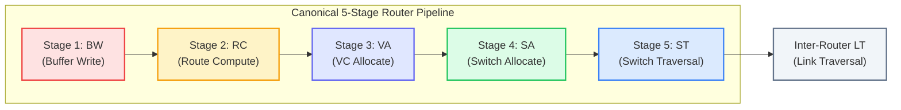
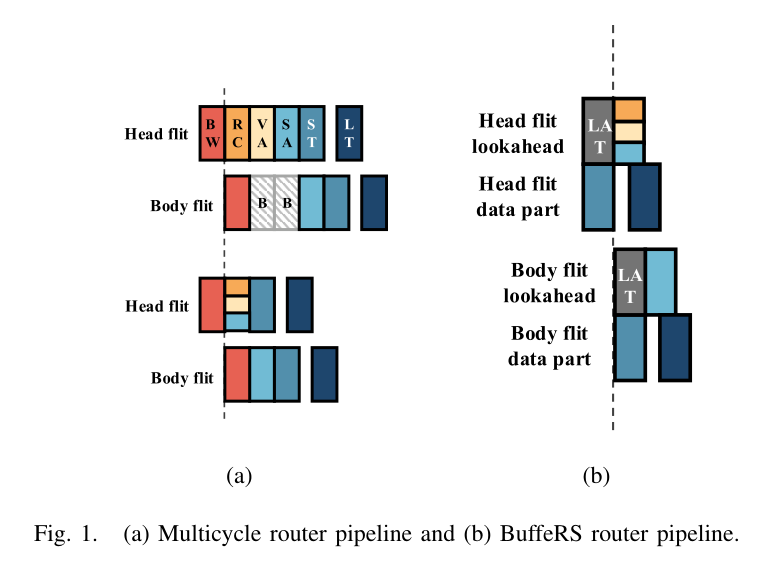
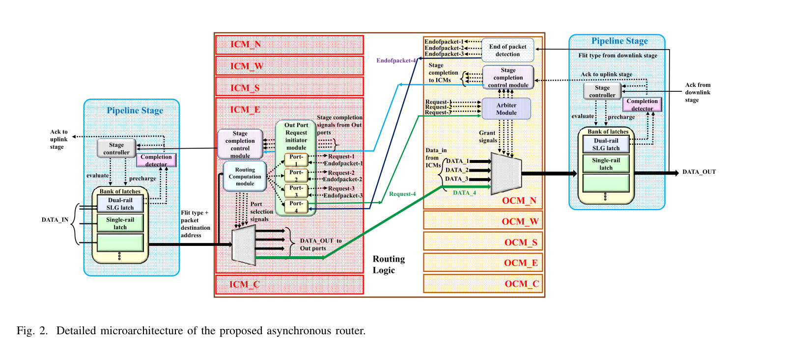
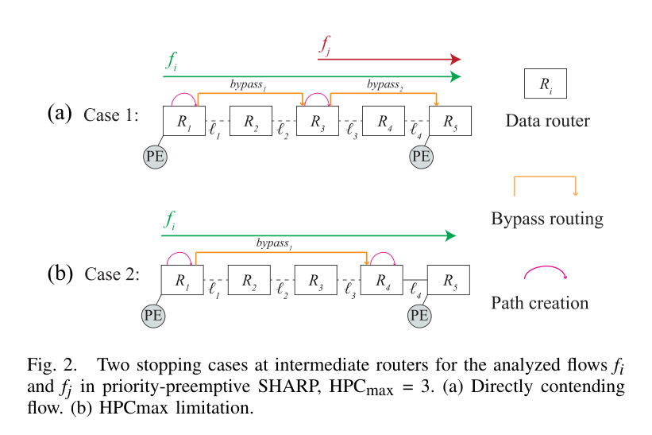
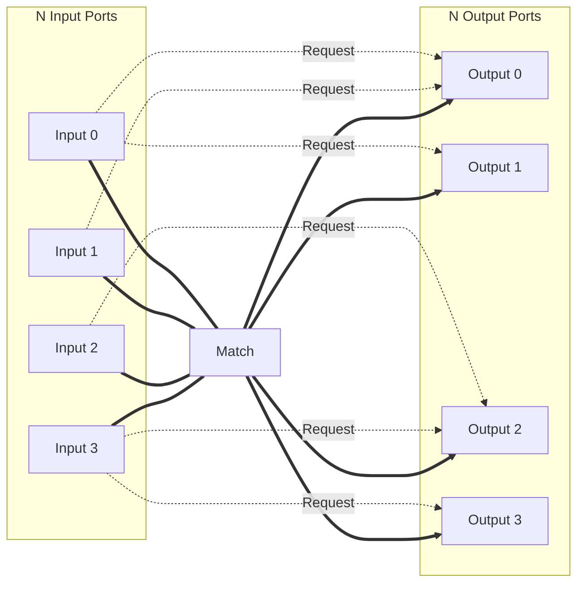

# Chapter 3: High-Performance Router Microarchitecture & Arbitration

> **Authors**: NoC-Lab Research Consortium  
> **Domain**: Silicon Microarchitecture & Interconnect Design  
> **Interactive Companion**: [NoC Learning Hub — Track 2: Router Microarchitecture](https://network-on-chip.github.io/learning/track2-router-architecture/)  
> **Accompanying Code**: [`code/matrix_arbiter_islip_sim.py`](code/matrix_arbiter_islip_sim.py), [`code/matrix_arbiter_4port.v`](code/matrix_arbiter_4port.v)

---

## Chapter Introduction

In modern many-core architectures, artificial intelligence engines, and multi-chiplet supercomputing clusters, the **on-chip router** serves as the central switching switchboard of the silicon die. While physical interconnect physics (explored in Chapter 1) dictate wire delays and signaling losses, and switching paradigms (Chapter 2) define how messages are serialized into flits, it is the internal **router microarchitecture** that ultimately governs per-hop packet latency, maximum operating frequency, and saturation throughput.

Every clock cycle spent inside an on-chip router compounds across the diameter of the network. In an $8 \times 8$ 2D mesh with an average hop count of $5.3$, a traditional 5-stage router imposes an intrinsic queuing-free latency penalty of over 26 clock cycles before a single bit of payload reaches the destination cache bank or compute tile. Consequently, the microarchitectural evolution of Network-on-Chip routers has been driven by an relentless quest: **how to compress the router pipeline from multi-cycle delays down to single-cycle—and even sub-cycle multi-hop—traversals, while preserving clock frequencies exceeding 1.5 to 2.0 GHz in deep sub-micron nodes.**

This chapter opens the silicon black box of the on-chip router. We systematically decompose the canonical five-stage Virtual Channel (VC) router datapath, dissect the timing and control hazards that emerge between buffer writing and switch traversal, and investigate advanced pipeline compression methods including lookahead routing, speculative switch allocation, and coordinated buffer reservation. Furthermore, we explore revolutionary non-traditional designs—ranging from Single-Cycle Multi-Hop Asynchronous Repeated Traversal (SMART/SHARP) to clockless Globally Asynchronous Locally Synchronous (GALS) domino architectures—before formalizing the circuit design of high-speed matrix arbiters and iterative bipartite matching allocators (iSLIP).

### Learning Objectives
- **Deconstruct the Canonical Pipeline**: Understand the exact microarchitectural responsibilities, input/output handshakes, and timing invariants across Buffer Write (BW), Route Computation (RC), Virtual Channel Allocation (VA), Switch Allocation (SA), and Switch Traversal (ST).
- **Master Pipeline Compression Techniques**: Formulate lookahead routing algorithms, speculative switch allocation state tables, and buffer reservation protocols (BuffeRS) to reduce per-hop router transit latency down to 1–2 cycles.
- **Analyze Single-Cycle & Asynchronous Frontiers**: Derive the physical hop-per-cycle ($HPC_{max}$) limit for repeated multi-hop bypassing, and evaluate asynchronous domino pipelines (HyPA) that eliminate power-hungry global clock trees.
- **Synthesize Hardware Arbiters & Crossbars**: Design $O(1)$ LRU matrix arbiters, formulate bipartite maximum matching, and evaluate iterative round-robin allocators (iSLIP) alongside multiplexer-tree crossbar fabrics.

### Chapter Roadmap & Interactive Modules
- **Section 3.1**: The Canonical Virtual-Channel Router Pipeline & Functional Decomposition.
- **Section 3.2**: Advanced Pipeline Compression, Lookahead Routing & Speculative Allocation.
- **Section 3.3**: Asynchronous Router Architectures (HyPA TVLSI 2026).
- **Section 3.4**: Single-Cycle Multi-Hop Traversal (SMART & SHARP).
- **Section 3.5**: Crossbar Arbitration Theory, Matrix Arbiters & iSLIP Matching.
- **Section 3.6**: Crossbar Switch Physical Circuit Design & Scaling.
- **Section 3.7**: Interactive Lab Challenges & Hands-on Simulators.
- **Section 3.8**: Checkpoint Assessment & Problem Sets.

---

## 3.1 The Canonical Virtual-Channel Router Pipeline

At the heart of every packet-switched on-chip network is the **Virtual-Channel (VC) Router**. The router is responsible for receiving flits from upstream links, buffering them in input queues, determining their destination routing paths, arbitrating for output physical channels, and driving flits across an internal crossbar fabric.

In a canonical synchronous architecture (such as the Dally-Peh classic model), processing each packet traverses a **five-stage pipeline**:



### 3.1.1 Stage-by-Stage Functional Decomposition

- **Stage 1: Buffer Write (BW)**
  - *Primary Role*: Receives incoming flits across physical inter-router link wires, decodes control headers, and writes payload bytes into the appropriate virtual channel storage slot.
  - *Microarchitectural Datapath*: Implemented using multi-queue dual-ported SRAM banks or distributed D-flip-flop register files organized per Virtual Channel (`VC_ID`). A write pointer (`wr_ptr`) increments per stored flit.
  - *Signals & Handshaking*: Evaluates incoming `flit_valid`, captures `flit_data[W-1:0]`, decodes `flit_type[1:0]` (Head, Body, Tail, Head-Tail), and extracts the target `vc_id_in`.
  - *Flit Invariant Behavior*:
    - **Head Flit**: Initializes the VC state machine from `IDLE` to `ROUTING`, latching the destination coordinate packet header for subsequent route computation.
    - **Body & Tail Flits**: Enqueued sequentially behind the Head flit; bypass route calculation and inherit existing channel state registers.
  - *Credit Management & Flow Control*: Synchronously decrements the upstream router's credit counter for this VC. If buffer occupancy reaches capacity ($depth = B_{max}$), upstream transmitters are prevented from sending further flits via credit exhaustion.
  - *Critical Path Timing*: Incurs SRAM write setup time ($t_{setup}$), address decoder propagation delay, and array cell charging delay before the flit becomes visible to internal arbitration logic.

- **Stage 2: Route Computation (RC)**
  - *Primary Role*: Resolves the output physical port (e.g., North, South, East, West, or Local) through which the packet must depart toward its final destination.
  - *Microarchitectural Datapath*: Evaluates the combinational routing function $\mathcal{R}: (C_{curr}, C_{dest}) \to P_{out}$ using fast parallel subtraction comparator slices or small lookup routing tables (LUTs).
  - *DOR Combinational Logic*: For Dimension-Order Routing (XY routing) in a 2D mesh, the hardware logic requires only two comparator blocks:
    - $\Delta X = X_{dest} - X_{curr}$: If $\Delta X > 0$, select East; if $\Delta X < 0$, select West.
    - $\Delta Y = Y_{dest} - Y_{curr}$: If $\Delta X == 0$ and $\Delta Y > 0$, select South; if $\Delta X == 0$ and $\Delta Y < 0$, select North; if both equal 0, select Local core injection/ejection.
  - *Flit Invariant Behavior*:
    - **Head Flit**: Exclusively undergoes Route Computation. Once the outgoing direction $P_{out}$ is resolved, it is written into the VC state table register (`vc_out_port <= P_out`).
    - **Body & Tail Flits**: Completely skip the RC stage! Because wormhole routing preserves packet integrity along a single path, body and tail flits automatically follow the output port established by their preceding Head flit.
  - *Pipeline Lookahead Optimization*: In modern routers, RC is performed *one hop ahead* at the upstream node (Lookahead Routing), effectively removing RC from the critical pipeline path of intermediate routers.

- **Stage 3: Virtual Channel Allocation (VA)**
  - *Primary Role*: Arbitrates among competing Head flits from multiple input ports that desire the same outgoing physical port, assigning an idle downstream Virtual Channel (`VC_ID_out`) to each winning packet.
  - *Two-Phase Separable Allocator Architecture*: Because a full $V_{in} \cdot P_{in} \times V_{out} \cdot P_{out}$ allocator is hardware-prohibitive, VA is factored into two smaller, decoupled arbitration stages:
    - *Phase 1 (Input-to-Output Request / V-to-1 Arbitration)*: At each input port, active VCs that have completed RC select one downstream candidate VC at the designated output port.
    - *Phase 2 (Output-to-Input Grant / P-to-1 Arbitration)*: At each output port, arbiters choose one winning input VC from all competing requests and return a grant signal (`va_grant`).
  - *Flit Invariant Behavior*:
    - **Head Flit**: Competes in VA. Upon winning a grant, it locks the assigned downstream `VC_ID_out` in the router state table (`vc_state <= ACTIVE_VC`).
    - **Body & Tail Flits**: Do not participate in VA; they are tagged with the previously allocated `VC_ID_out`.
  - *Resource Reservation & Release*: The assigned downstream VC remains exclusively reserved for this packet until the packet's Tail flit completes switch traversal and departs, guaranteeing that flits from different packets are never interleaved within the same virtual channel.

- **Stage 4: Switch Allocation (SA)**
  - *Primary Role*: Allocates physical access to the internal crossbar switch multiplexers on a cycle-by-cycle basis for flits that already possess a valid downstream VC and have available downstream buffer credits.
  - *Two-Stage Separable Crossbar Allocator*:
    - *Stage 1 (Input Port Arbitration)*: At each input port, an arbiter chooses one candidate flit among all local VCs that have flits ready and downstream credit count $> 0$.
    - *Stage 2 (Output Port Arbitration)*: For each physical output port, an arbiter selects one winner among the input ports that won Stage 1.
  - *Flit Invariant Behavior*:
    - **Head, Body, and Tail Flits**: All flits must win Switch Allocation individually in order to traverse the crossbar.
    - **Pipelined Streaming**: Once a Head flit wins SA, subsequent body flits can request SA in contiguous back-to-back cycles, achieving ideal single-cycle throughput under zero-contention conditions.
  - *Credit-Aware Allocation Guard*: A flit is eligible to request SA if and only if the downstream credit counter for its assigned VC is strictly positive ($Credit[P_{out}][VC_{out}] > 0$), preventing crossbar traversals that would cause downstream buffer overflows.

- **Stage 5: Switch Traversal (ST)**
  - *Primary Role*: Drives the granted flit from the input buffer storage through the internal crossbar switch fabric to the output port link registers.
  - *Microarchitectural Datapath*: The crossbar switch consists of $P$ multiplexer trees (one per output port), each selecting among $P$ input datapath buses of width $W$ bits (e.g., 64, 128, or 512 bits).
  - *Hardware Handshake & Control*: The winning grant signals from Stage 4 configure the multiplexer select lines (`xbar_sel[P_out] <= winning_input_port`).
  - *Energy & Timing Constraints*: Crossbar traversal represents a significant capacitive load due to long internal wire tracks crossing all input/output buses. High-speed drivers and intermediate pipeline registers are often placed between the multiplexer outputs and the physical link drivers.

- **Stage 6: Link Traversal (LT)**
  - *Primary Role*: Propagates physical voltage signals across the inter-router metal wires to the input registers of the neighboring downstream router.
  - *Physical Signaling*: Traverses intermediate or global metal layers (e.g., M4–M8 in standard FinFET processes) with optimal repeater insertion to maintain signal integrity and sharp edge transitions.
  - *Timing Relationship*: In short-distance local mesh topologies, LT typically completes within a single clock cycle ($t_{LT} = 1\text{ cycle}$). In long-distance express links or multi-chiplet topologies, LT may require multi-cycle pipelined links.
  - *Downstream Handshake & Credit Return*: As the flit enters the downstream router, a credit signal (`credit_out`) is pulsed backward to the upstream router, replenishing the transmitter's credit pool.

```
Figure 3.1: Canonical vs. Speculative vs. Lookahead Router Pipelines
+-----------------------------------------------------------------------------------------+
| Canonical (5 Cycles):      | BW | RC | VA | SA | ST | LT |                             |
+-----------------------------------------------------------------------------------------+
| Lookahead RC (4 Cycles):   | BW | -- | VA | SA | ST | LT |  (RC evaluated at hop N-1)   |
+-----------------------------------------------------------------------------------------+
| Speculative SA (3 Cycles): | BW | -- | VA || SA | ST | LT |  (VA & SA in parallel)      |
+-----------------------------------------------------------------------------------------+
| Low-Latency Bypass (1 Cyc):| Bypassed straight through crossbar: [ ST || LT ]          |
+-----------------------------------------------------------------------------------------+
```

---

## 3.2 Advanced Pipeline Compression & Router Bypassing

Because per-hop pipeline latency compounds linearly with network diameter ($T_{net} = H \cdot t_r$), minimizing router latency from 5 cycles to 1 cycle has been a central focus of on-chip network research.


*Figure 3.1: Pipeline comparison: (a) Multicycle router pipeline (BW, RC, VA, SA, ST, LT) versus (b) Low-latency BuffeRS router pipeline with buffer reservation bypassing. [Reproduced from: Z. Liu, X. Wu, and Y. Ye, "BuffeRS: A Buffer Reservation Scheduling Strategy for Router Bypassing in NoCs and Multichiplet Networks," IEEE Transactions on Computer-Aided Design of Integrated Circuits and Systems, vol. 45, no. 6, pp. 2635–2648, June 2026, DOI: 10.1109/TCAD.2025.3624677. © 2026 IEEE]*

### 3.2.1 Lookahead Routing
- **Core Principle & Hop Shift**: Standard routers evaluate output port direction upon packet arrival, imposing a full-cycle Route Computation stage. Under Lookahead Routing, router $N$ computes the routing decision for router $N+1$ *in advance*, while the flit is buffered or traversing hop $N$.
- **Header Field Encoding**: The computed downstream port direction (encoded as a 3-bit or 5-bit one-hot mask) is embedded directly into the Head flit's header before crossing the physical link.
- **Immediate VA Activation**: Upon arrival at router $N+1$, the outgoing port is already known combinatorially from the packet header, enabling Virtual Channel Allocation to initiate immediately in cycle 1.
- **Latency & Critical Path Benefit**: Completely eliminates the RC pipeline stage at every intermediate hop, compressing a 5-stage canonical router to 4 stages with negligible silicon area overhead.

### 3.2.2 Speculative Switch Allocation
- **Optimistic Resource Request**: In low-to-medium network load regimes, downstream virtual channel contention is infrequent. Speculative Switch Allocation exploits this by scheduling Virtual Channel Allocation (VA) and Switch Allocation (SA) concurrently in the same clock cycle.
- **Dual-Path Speculative Request Logic**: The Head flit requests an output crossbar port *speculatively*, assuming that its simultaneous request for a downstream VC will succeed.
- **Validation & Conflict Resolution**:
  - *Both Succeed*: If VA grants a downstream VC and speculative SA grants crossbar access, the flit immediately proceeds to Switch Traversal (ST) in cycle 2, compressing pipeline latency to 2 cycles.
  - *VA Contention Mis-prediction*: If VA fails due to VC exhaustion, the speculative SA grant is suppressed and squashed, preventing unauthorized crossbar traversal.
  - *Priority Rules*: Non-speculative requests (from body flits that already possess valid VCs) are given strict priority over speculative Head flit requests to eliminate pipeline stalls for ongoing flows.
- **Silicon Trade-Offs**: Delivers near-single-cycle zero-load latencies under light traffic, but incurs higher allocator power dissipation due to wasted speculative grant computations under saturation loads.

### 3.2.3 Buffer Reservation Scheduling: BuffeRS (TCAD 2026)
- **The Classical Bypassing Dilemma**: Traditional router bypassing mechanisms (e.g., SMART, NoRD) allow flits to skip input buffering and crossbars. However, when bypass flits arrive at downstream nodes only to find input queues completely saturated, they suffer abrupt pipeline stalls, deflections, or packet drops.
- **Time-Division Pre-Allocation**: BuffeRS (Liu et al., *IEEE TCAD 2026*) establishes a coordinated **buffer reservation scheduling strategy** that reserves destination buffer slots *in advance* across router groups before initiating traversal.
- **Two-Phase Reservation Protocol**:
  - *Reservation Phase*: A lightweight 1-bit lookahead token traverses ahead of the packet payload to claim a free buffer slot at the downstream destination tile.
  - *Bypass Phase*: The packet payload flits traverse through intermediate router crossbars in a single clock cycle without stopping, guaranteed that a guaranteed buffer slot awaits them at the terminating node.
- **Multi-Chiplet Interconnect Suitability**: Highly resilient across high-latency die-to-die (D2D) packaging boundaries, preventing credit turnaround latency loops from throttling inter-chiplet throughput.

#### Table 3.1: Quantitative Comparison of High-Performance Router Microarchitectures
| Architecture Paradigm | Pipeline Stages | Allocation Scheme | Clocking / Timing Strategy | Key Silicon Trade-Off |
| :--- | :--- | :--- | :--- | :--- |
| **Canonical VC Router** (Peh & Dally) | 4–5 cycles | Separable VA + SA | Fully Synchronous | Baseline area; multi-cycle per-hop serialization delay |
| **Lookahead Routing** | 3 cycles | Lookahead RC + SA | Fully Synchronous | Strips RC stage; minimal packet header overhead |
| **Speculative Allocator** | 2 cycles | Parallel speculative VA/SA | Fully Synchronous | Speculation mis-predictions stall under heavy injection |
| **SMART / SHARP** | 1–2 cycles | Priority bypass muxes | Multi-hop async bypass | Bounded by physical $HPC_{max}$ wire RC delay budget |
| **HyPA Router** (TVLSI 2026) | 0.8 ns / hop | Handshake pipeline | GALS Asynchronous domino | 62% lower power; eliminates global clock tree distribution |
| **BuffeRS** (TCAD 2026) | 1 cycle | Buffer reservation slots | Time-division coordinated | Deterministic zero-contention bypass; token reservation logic |

---

## 3.3 Asynchronous Router Architectures: HyPA (TVLSI 2026)

In large-scale Multi-Processor Systems-on-Chip (MPSoCs), distributing a single low-skew global clock across a $20\text{ mm} \times 20\text{ mm}$ die is prohibitively expensive in clock-tree power and timing closure complexity.


*Figure 3.2: Detailed microarchitecture of the proposed asynchronous router featuring a high-throughput domino-logic pipeline template with one-hot hybrid data encoding. [Reproduced from: M. N. Saranya, C. T. Avinash, and R. Rao, "HyPA: A Low-Latency Hybrid Pipeline Asynchronous Router for Network-on-Chip Architectures in GALS-Based SoCs," IEEE Transactions on Very Large Scale Integration (VLSI) Systems, vol. 34, 2026, DOI: 10.1109/TVLSI.2026.3716692. © 2026 IEEE]*

In **Globally Asynchronous Locally Synchronous (GALS)** systems, asynchronous routers eliminate clock trees entirely:
- **HyPA Router** (Saranya et al., *IEEE TVLSI 2026*): Implemented in 65nm CMOS, HyPA employs a **hybrid pipeline asynchronous architecture** based on high-throughput domino logic.
- **Power and Energy Gains**: Benchmarked against synchronous clock-gated routers, HyPA demonstrates **62% lower power consumption** and an **85% reduction in energy-per-flit**, achieving a forward latency of **0.8 ns** and a throughput of **1.65 GFlits/port/s**.

---

## 3.4 Single-Cycle Multi-Hop Traversal (SMART / SHARP)

In 2013, Krishna et al. introduced **SMART** (Single-Cycle Multi-hop Asynchronous Repeated Traversal), demonstrating that a flit can traverse **multiple physical router crossbars and links within a single clock cycle** when no contention exists.


*Figure 3.3: Preemption stopping cases at intermediate routers for contending flows in priority-preemptive single-cycle multi-hop traversal networks under hop limits ($HPC_{max} = 3$). [Reproduced from: IEEE Transactions on Very Large Scale Integration (VLSI) Systems, 2023, DOI: 10.1109/TVLSI.2023.3298101. © 2023 IEEE]*

As illustrated in Figure 3.3, single-cycle traversal is physically bounded by:

- **Clock Period Timing Budget ($HPC_{max}$)**:
  - Wire propagation delay and multiplexer gate delays accumulate along the bypassed path:
    $$t_{hop} = t_{crossbar\_mux} + t_{wire\_propagation} + t_{repeater}$$
  - The maximum traversable hops per cycle is strictly bounded by the clock cycle time:
    $$HPC_{max} = \left\lfloor \frac{T_{clk} - t_{setup}}{t_{hop}} \right\rfloor$$
  - At 1.0 GHz ($T_{clk} = 1.0\text{ ns}$) in 14nm FinFET, $HPC_{max}$ typically allows 3 to 5 hops before requiring intermediate latching.
- **Dynamic Flow Contention & Preemption**:
  - Local flits at intermediate nodes may contend for an output port that a distant bypass packet is attempting to cut through.
  - Priority-preemptive arbitration protocols dictate whether the traversing bypass flow preempts local traffic or stops and buffers in place.
- **Asynchronous Bypass Setup Signals**:
  - Dedicated lookahead request wires run parallel to data links, configuring bypass multiplexers in intermediate routers a fraction of a cycle before the packet payload arrives.

---

## 3.5 Crossbar Arbitration Theory & Matching Algorithms

Inside every router, crossbar allocation resolves contention when multiple input ports simultaneously request the same output port. This is formalized as the **Bipartite Maximum Matching Problem**:



Given $N$ input ports and $N$ output ports, the objective is to find a mapping $\mathcal{M} \subset I \times O$ subject to:
- **Input Uniqueness**: Each input $i \in I$ is mapped to at most one output ($\sum_{j} m_{i,j} \le 1$).
- **Output Uniqueness**: Each output $o \in O$ is mapped to at most one input ($\sum_{i} m_{i,j} \le 1$).
- **Cardinality Maximization**: Total matched pairs $|\mathcal{M}| = \sum_{i,j} m_{i,j}$ is maximized.
- **Fairness & Anti-Starvation**: Every requesting port is guaranteed access within a bounded number of arbitration cycles.

### 3.5.1 The Matrix Arbiter: Strict $O(1)$ Hardware LRU
The **Matrix Arbiter** is the gold standard for high-speed, fair arbitration among $N$ competing clients. It maintains an $N \times N$ triangular binary priority matrix $M$:

$$\text{Priority Matrix: } M[i][j] = \begin{cases} 
1 & \text{if Client } i \text{ has higher priority than Client } j \\ 
0 & \text{if Client } j \text{ has higher priority than Client } i 
\end{cases}$$

#### Microarchitectural Properties & Invariants:
- **Anti-Symmetry Property**: $M[i][j] = \overline{M[j][i]}$ for all $i \ne j$.
- **Diagonal Zero Invariant**: $M[i][i] = 0$ for all $i$, requiring storage for only $\frac{N(N-1)}{2}$ state flip-flops.
- **Two-Gate-Level Combinational Grant**: Client $i$ is granted if it asserts request $R_i$ and holds priority over all other active requesters:
  $$G_i = R_i \cdot \prod_{j \ne i} (\overline{R_j} + M[i][j])$$
  This evaluates in exactly two gate levels (an inverter/OR array followed by an $N$-input AND gate), making it exceptionally fast for $N \le 8$.
- **Single-Cycle LRU State Transition**:
  - When client $k$ wins the grant ($G_k = 1$), it immediately drops to the **Least Recently Used (LRU)** rank.
  - **Row $k$ is cleared to zero**: $M[k][j] \leftarrow 0 \quad (\forall j \ne k)$, removing priority over all peers.
  - **Column $k$ is set to one**: $M[i][k] \leftarrow 1 \quad (\forall i \ne k)$, ensuring all peers now take priority over client $k$.
- **Absolute Starvation Freedom**: In a system of $N$ requesters, no asserted request can wait more than $N-1$ arbitration rounds before winning.

```
Table 3.1: 4-Port Matrix Arbiter Priority State Evolution Under Continuous Contention
+-------+------------------+-------------------------+---------------+----------------------------+
| Cycle | Requests (R)     | Priority Matrix M       | Granted Winner| State Update Action        |
+-------+------------------+-------------------------+---------------+----------------------------+
| 0     | Initial State    | [0, 1, 1, 1]            | --            | Initial: 0 > 1 > 2 > 3     |
|       |                  | [0, 0, 1, 1]            |               |                            |
|       |                  | [0, 0, 0, 1]            |               |                            |
|       |                  | [0, 0, 0, 0]            |               |                            |
+-------+------------------+-------------------------+---------------+----------------------------+
| 1     | R = [1, 1, 0, 1] | Row 0 has all 1s over R | Client 0 Wins | Row 0 -> 0s, Col 0 -> 1s   |
| 2     | R = [1, 1, 0, 1] | Row 1 has priority over3| Client 1 Wins | Row 1 -> 0s, Col 1 -> 1s   |
| 3     | R = [1, 1, 0, 1] | Row 3 has priority over0| Client 3 Wins | Row 3 -> 0s, Col 3 -> 1s   |
| 4     | R = [1, 1, 0, 1] | Matrix has cycled fully | Client 0 Wins | Strict 100% Round-Robin LRU|
+-------+------------------+-------------------------+---------------+----------------------------+
(Simulated via code/matrix_arbiter_islip_sim.py)
```

### 3.5.2 McKeown's iSLIP Iterative Matching Algorithm
For a complete $N \times N$ crossbar switch, separable allocation using independent input and output arbiters can leave up to 50% of crossbar ports idle under heavy traffic due to conflicting uncoordinated grants.

In 1999, Nick McKeown introduced **iSLIP** (*Iterative Serial round-robin with SLIP*), an algorithm widely implemented in high-radix routers and internet switches:

#### The Three-Phase Iterative Protocol:
- **Phase 1: Parallel Request Generation**:
  - Each unmatched input port asserts request lines to every output port for which it holds at least one buffered flit.
- **Phase 2: Output-Side Round-Robin Grant**:
  - Each unmatched output port arbitrates among contending input requests using an independent round-robin pointer $g_j$.
  - The output asserts a tentative grant signal to the winning input. The pointer $g_j$ is **not updated yet**.
- **Phase 3: Input-Side Round-Robin Accept**:
  - Each unmatched input port arbitrates among all tentative grants it received using an independent accept pointer $a_i$.
  - The input accepts exactly one grant, establishing a confirmed input-output crossbar match $(\mathcal{M} \leftarrow \mathcal{M} \cup \{(i, j)\})$.
- **Pointer Update Invariant (The SLIP Principle)**:
  - Output grant pointers $g_j$ and input accept pointers $a_i$ are updated **if and only if** the match is accepted in the **very first iteration**:
    $$g_j \leftarrow (i + 1) \pmod N, \quad a_i \leftarrow (j + 1) \pmod N$$
  - Restricting updates strictly to iteration 1 prevents arbiters from falling into synchronized lockstep states under high offered load, de-correlating request patterns and maximizing entropy.

#### Convergence & Throughput Theorems:
- **Theorem 1 (Fast Convergence, McKeown 1999)**:
  - For an $N \times N$ crossbar switch, iSLIP converges to a maximal matching in at most $\min(N, \log_2 N)$ iterations.
  - In silicon, **2 iterations** achieve over **94% crossbar efficiency**, and **4 iterations** achieve **100% maximal matching** even under continuous 100% offered injection.
- **Theorem 2 (Starvation Freedom & 100% Saturation Throughput)**:
  - Under uniform independent and identically distributed (i.i.d.) traffic, iSLIP delivers **100% throughput** without internal switch speedup, guaranteeing that no input port is starved indefinitely.

---

## 3.6 Crossbar Switch Physical Circuit Design

The crossbar switch is the physical datapath hub connecting the $P$ input ports to the $P$ output ports ($P = 5$ for a standard 2D mesh: North, South, East, West, Local).

```
Crossbar Multiplexer Tree (Per Output Bit):
Input 0 Data ----[ MUX ]----+
Input 1 Data ----[     ]    |
                            +----[ MUX ]----> Output Port Data Line
Input 2 Data ----[ MUX ]----+
Input 3 Data ----[     ]
```

### 3.6.1 Area and Capacitance Scaling
- **Crosspoint Switch Complexity**: Scales quadratically with port count $P$ as $P^2 \times W$ transmission gates, tri-state buffers, or multiplexer cells, where $W$ is the flit datapath bit width (e.g., 64–512 bits).
- **Silicon Metal Track Area**: Consumes $2 \cdot P \cdot W \cdot \text{pitch}_{metal}$ wiring track area, creating significant routing density congestion on intermediate metal layers (M3–M5).
- **Capacitive Loading & Energy Scaling**:
  - Dynamic switching power is governed by:
    $$P_{xbar} = \alpha \cdot C_{xbar\_wire} \cdot V_{dd}^2 \cdot f_{clk}$$
  - As port count $P$ exceeds 8 (e.g., in high-radix Dragonfly routers with $P = 16\text{–}32$), long internal crossbar wire capacitance dominates router dynamic power.
- **Hierarchical Sub-Crossbars**: High-radix designs mitigate quadratic area and power penalties by replacing monolithic crossbars with **hierarchical two-stage crossbars** or bit-sliced matrix sub-blocks.

---

## 3.7 Interactive Lab & Hands-on Challenges

Test your arbitration and router pipeline expertise on the **Companion Learning Platform**:

- ⚔️ **[Arbiter Arena: Crossbar Clash](https://network-on-chip.github.io/learning/interactive/arbiter/)**:
  - Step cycle-by-cycle through Matrix Arbiters, Round-Robin, and Wavefront schedulers.
  - Inject adversarial traffic bursts to observe how priority matrix updates guarantee starvation freedom.
- 🔬 **[2D Mesh Routing Visualizer](https://network-on-chip.github.io/learning/interactive/visualizer/)**:
  - Inspect crossbar switch allocation states and input buffer queues across a full $8 \times 8$ mesh network.

---

## 3.8 Checkpoint Assessment

Test your mastery of Chapter 3 concepts against the official certification questions (mirroring the 3-Tier Exam Engine in [`quiz.md`](../../quiz.md)):

#### Question 3.1 (Tier 1: Fundamental)
*In a canonical 5-stage Virtual Channel router (BW -> RC -> VA -> SA -> ST), which pipeline stages are traversed by Body and Tail flits, and why? (Select all that apply)*

- **A)** Body and Tail flits only traverse 3 stages: Buffer Write (BW), Switch Allocation (SA), and Switch Traversal (ST).
- **B)** Route Computation (RC) is skipped because the output port was already computed by the Head flit.
- **C)** Virtual Channel Allocation (VA) is skipped because Body and Tail flits inherit the VC granted to the Head flit.
- **D)** Body and Tail flits must re-execute Route Computation (RC) to verify packet integrity.

??? success "Reveal Answer & Full Solution"
    **Correct Answer: Option A, B, C**

    **1. Step-by-Step Architectural & Mathematical Derivation:**
    In wormhole routing with Virtual Channels, packet processing is asymmetric: (1) Head Flit: Contains destination address routing headers. It must perform Buffer Write (BW), compute the output direction during Route Computation (RC), arbitrate for and secure a free downstream Virtual Channel during VC Allocation (VA), arbitrate for the crossbar during Switch Allocation (SA), and traverse the crossbar switch (ST)—taking 5 cycles. (2) Body & Tail Flits: Contain only data payloads and packet demarcation flags (e.g. Tail bit). Because the Head flit already reserved the output port and the downstream VC ID, trailing flits bypass RC and VA entirely. Upon arrival, they perform BW (1 cycle), request Switch Allocation (SA, 1 cycle) using the pre-assigned VC and output port, and traverse the crossbar (ST, 1 cycle). Thus, trailing flits require only 3 cycles (BW -> SA -> ST). The Tail flit additionally deallocates the downstream VC upon leaving ST.

    **2. Option-by-Option Breakdown & Distractor Analysis:**
    - **Option A (Correct):** True. Body and Tail flits only execute BW -> SA -> ST, compressing their per-hop pipeline latency to 3 cycles.
    - **Option B (Correct):** True. The output direction is preserved in the VC state register from the Head flit's RC stage.
    - **Option C (Correct):** True. Downstream VC allocation is held open for the entire packet until the Tail flit clears the router.
    - **Option D (Incorrect Distractor):** False. Body flits do not carry routing headers and cannot perform Route Computation.

    **3. Silicon Architect's Takeaway:**
    Head flits establish the network path (RC & VA); body flits stream through using pre-allocated VC state (BW -> SA -> ST).

    *(Reference: L.-S. Peh and W. J. Dally, 'A Delay Model and Speculative Architecture for Pipelined Routers,' HPCA, pp. 255–266, 2001. DOI: 10.1109/HPCA.2001.903268.)*

#### Question 3.2 (Tier 2: Core Engineering)
*In a hardware Matrix Arbiter implementing Least-Recently-Used (LRU) priority, how many flip-flops are required to store the priority state for an N-input arbiter, and what is its maximum grant evaluation latency?*

- **A)** N^2 flip-flops; evaluation takes N cycles using an iterative counter.
- **B)** N*(N - 1)/2 flip-flops; grant evaluation is purely combinational, executing in O(log N) gate delays.
- **C)** N flip-flops; evaluation requires an analog integrator.
- **D)** 2^N flip-flops; evaluation is non-deterministic.

??? success "Reveal Answer & Full Solution"
    **Correct Answer: Option B**

    **1. Step-by-Step Architectural & Mathematical Derivation:**
    An N-input Matrix Arbiter maintains a priority relationship between every distinct pair of requestors (i, j). Because priority is strictly asymmetric (if i has priority over j, then j cannot have priority over i: M[j, i] = NOT M[i, j]) and irreflexive (M[i, i] = 0), only the upper triangular elements of matrix M need to be physically stored in flip-flops. The number of stored bits is precisely N * (N - 1) / 2 flip-flops (e.g. 5*(4)/2 = 10 flip-flops for a 5-port router). The lower triangular elements are generated by simple inversion logic: M[j, i] = ~M[i, j]. The grant signal for requestor i is computed combinatorially: Grant[i] = Req[i] & [AND_{j != i} (~Req[j] | M[i, j])]. Using balanced tree logic, the multi-input AND gate executes in O(log N) gate delays (typically < 150 ps in 16nm/7nm standard cell libraries), enabling single-cycle switch allocation even at frequencies above 2 GHz.

    **2. Option-by-Option Breakdown & Distractor Analysis:**
    - **Option A (Incorrect Distractor):** Storing the full N^2 matrix wastes registers; diagonal is 0 and lower triangle is the exact inverse of upper triangle. Evaluation is single-cycle combinational, not N cycles.
    - **Option B (Correct):** Storing only the upper triangular matrix requires N(N-1)/2 flip-flops and evaluates combinatorially in O(log N) gate depth.
    - **Option C (Incorrect Distractor):** N bits are insufficient to track general LRU permutations among N requestors, and analog integrators are not used in digital arbiters.
    - **Option D (Incorrect Distractor):** 2^N represents exponential complexity, which is completely inaccurate for a priority matrix.

    **3. Silicon Architect's Takeaway:**
    Matrix arbiters provide strict, mathematically fair LRU arbitration with only N(N-1)/2 registers and sub-nanosecond combinational evaluation.

    *(Reference: W. J. Dally and B. Towles, Principles and Practices of Interconnection Networks, Chapter 18, Morgan Kaufmann, 2004.)*

#### Question 3.3 (Tier 3: Silicon Mastery)
*In Nick McKeown's iSLIP crossbar scheduling algorithm, why do the grant arbiters update their round-robin priority pointers ONLY when the grant is accepted by an input port in the subsequent phase?*

- **A)** To prevent grant pointers from desynchronizing and causing crossbar electrical shorts.
- **B)** To ensure that an output port only moves its priority pointer when a connection is actually established; updating on rejected grants causes pointer synchronization, collapsing crossbar matching throughput down to ~63%.
- **C)** Because grant arbiters are implemented in read-only memory (ROM).
- **D)** Because the IEEE 802.3 standard mandates frozen pointers under bursty traffic.

??? success "Reveal Answer & Full Solution"
    **Correct Answer: Option B**

    **1. Step-by-Step Architectural & Mathematical Derivation:**
    The iSLIP algorithm operates in three iterative phases: (1) Request: Inputs send requests to all outputs for which they have queued packets. (2) Grant: Each output selects one request using a round-robin arbiter with pointer g_i. (3) Accept: Each input receives multiple grants and selects one using an accept arbiter with pointer a_j. The critical breakthrough of iSLIP over prior algorithms (like SLIP) is the exact pointer update rule: The grant pointer g_i is updated (g_i = (selected + 1) mod N) IF AND ONLY IF the input port actually ACCEPTS the grant in phase 3. If an output grants to input k, but input k rejects the grant (because input k accepted a grant from another output), the output's pointer g_i REMAINS UNCHANGED. McKeown mathematically proved that updating pointers on unaccepted grants causes output pointers to lock in lockstep (synchronization), where multiple outputs repeatedly compete for the same input, throttling matching throughput to 1 - 1/e ~ 63.2%. Conditional updating forces pointers to desynchronize, achieving 100% sustained throughput under uniform traffic in O(log N) iterations.

    **2. Option-by-Option Breakdown & Distractor Analysis:**
    - **Option A (Incorrect Distractor):** Desynchronized pointers are actually the desired operational goal; crossbars cannot short-circuit because input/output multiplexers are mutually exclusive.
    - **Option B (Correct):** Updating pointers only on accepted grants maintains desynchronization among output arbiters, preventing the 63.2% throughput collapse.
    - **Option C (Incorrect Distractor):** Round-robin pointers are updated registers (flip-flops), not static ROM.
    - **Option D (Incorrect Distractor):** IEEE 802.3 governs Ethernet LANs, not on-chip crossbar switch schedulers.

    **3. Silicon Architect's Takeaway:**
    In crossbar switch allocation, conditional pointer updating guarantees arbiter desynchronization, achieving near-100% throughput without starvation.

    *(Reference: N. McKeown, 'The iSLIP Scheduling Algorithm for Input-Queued Switches,' IEEE/ACM Transactions on Networking, Vol. 7, No. 2, pp. 188–201, Apr. 1999. DOI: 10.1109/90.769767.)*

---

## References & Bibliography

1. **[Liu2026]** Z. Liu, X. Wu, and Y. Ye, "BuffeRS: A Buffer Reservation Scheduling Strategy for Router Bypassing in NoCs and Multichiplet Networks," *IEEE Transactions on Computer-Aided Design of Integrated Circuits and Systems*, vol. 45, no. 6, pp. 2635–2648, June 2026. [DOI: 10.1109/TCAD.2025.3624677](https://doi.org/10.1109/TCAD.2025.3624677).
2. **[Saranya2026]** M. N. Saranya, C. T. Avinash, and R. Rao, "HyPA: A Low-Latency Hybrid Pipeline Asynchronous Router for Network-on-Chip Architectures in GALS-Based SoCs," *IEEE Transactions on Very Large Scale Integration (VLSI) Systems*, vol. 34, 2026. [DOI: 10.1109/TVLSI.2026.3716692](https://doi.org/10.1109/TVLSI.2026.3716692).
3. **[Krishna2013]** T. Krishna, C.-H. O. Chen, W. C. Kwon, and L.-S. Peh, "Single-Cycle Multi-Hop Asynchronous Repeated Traversal: A Case for Asynchronous Logic in On-Chip Networks," in *Proceedings of the 46th Annual IEEE/ACM International Symposium on Microarchitecture (MICRO)*, 2013, pp. 336–348. [DOI: 10.1145/2540708.2540737](https://doi.org/10.1145/2540708.2540737).
4. **[McKeown1999]** N. McKeown, "The iSLIP Scheduling Algorithm for Input-Queued Switches," *IEEE/ACM Transactions on Networking*, vol. 7, no. 2, pp. 188–201, Apr. 1999. [DOI: 10.1109/90.769767](https://doi.org/10.1109/90.769767).
5. **[Peh2001]** L.-S. Peh and W. J. Dally, "A Delay Model and Speculative Architecture for Pipelined Routers," in *Proceedings of the 7th International Symposium on High-Performance Computer Architecture (HPCA)*, 2001, pp. 255–266. [DOI: 10.1109/HPCA.2001.903268](https://doi.org/10.1109/HPCA.2001.903268).
6. **[SHARP2023]** "Reduced Worst-Case Communication Latency Using Single-Cycle Multihop Traversal Network-on-Chip," *IEEE Transactions on Very Large Scale Integration (VLSI) Systems*, vol. 31, no. 10, pp. 1560–1572, Oct. 2023. [DOI: 10.1109/TVLSI.2023.3298101](https://doi.org/10.1109/TVLSI.2023.3298101).
