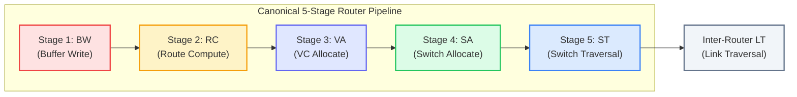
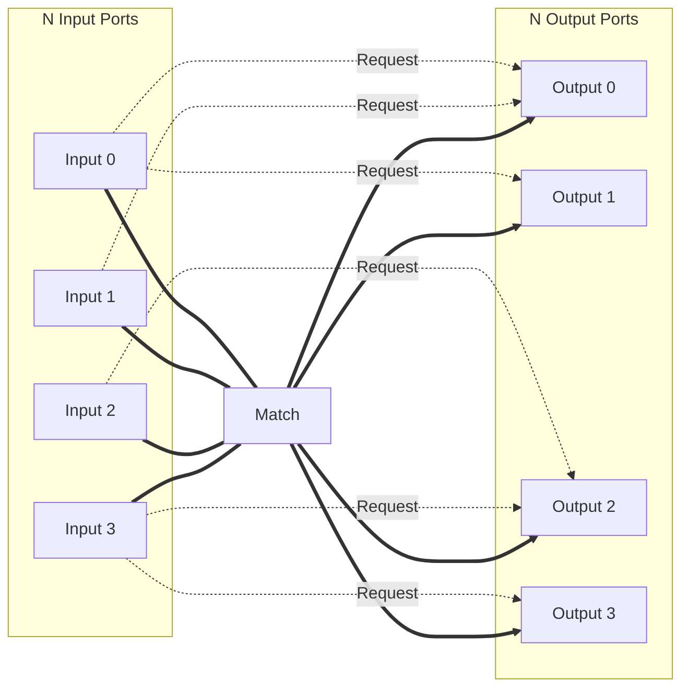

# Chapter 3: High-Performance Router Microarchitecture & Arbitration

> **Authors**: NoC-Lab Research Consortium  
> **Domain**: Silicon Microarchitecture & Interconnect Design  
> **Interactive Companion**: [NoC Learning Hub — Track 2: Router Microarchitecture](https://network-on-chip.github.io/learning/track2-router-architecture/)  
> **Accompanying Code**: [`code/matrix_arbiter_islip_sim.py`](code/matrix_arbiter_islip_sim.py), [`code/matrix_arbiter_4port.v`](code/matrix_arbiter_4port.v)

---

## 3.1 The Canonical Virtual-Channel Router Pipeline

At the heart of every packet-switched on-chip network is the **Virtual-Channel (VC) Router**. The router is responsible for receiving flits from upstream links, buffering them in input queues, determining their destination routing paths, arbitrating for output physical channels, and driving flits across an internal crossbar fabric.

In a canonical synchronous architecture (such as the Dally-Peh classic model), processing each packet traverses a **five-stage pipeline**:



### 3.1.1 Stage-by-Stage Functional Decomposition

1. **Buffer Write (BW)**:
   - An incoming flit arrives from an adjacent router or local network interface across the physical metal link.
   - The flit is decoded and written into the input FIFO buffer corresponding to its assigned **Virtual Channel ID** (`VC_ID`).
   - If the flit is a Head flit, the router prepares to initiate routing and channel allocation.
2. **Route Computation (RC)**:
   - Evaluates the routing function $R: (C_{curr}, C_{dest}) \to P_{out}$ to determine the set of permissible output physical ports (e.g., North, South, East, West, Local).
   - In deterministic Dimension-Order Routing (DOR), RC is implemented with simple combinational comparators: $\Delta X = X_{dest} - X_{curr}, \quad \Delta Y = Y_{dest} - Y_{curr}$.
   - *Optimization*: In modern pipelines, RC is computed **one hop in advance** via **Lookahead Routing**, entirely removing RC from the critical pipeline path of intermediate routers.
3. **Virtual Channel Allocation (VA)**:
   - The Head flit arbitrates for a free downstream Virtual Channel at the designated output port.
   - Because multiple input VCs may contend for the same downstream VC, VA is typically partitioned into a **two-phase separable allocator**:
     - *Phase 1 (Input Arbitration)*: Each input port selects one of its active VCs to request an output VC.
     - *Phase 2 (Output Arbitration)*: Each output VC arbitrates among contending input requests and grants ownership to exactly one input VC.
   - Once allocated, the downstream `VC_ID` remains reserved for the packet until its Tail flit departs.
4. **Switch Allocation (SA)**:
   - Flits that hold valid downstream VCs arbitrate for access to the shared crossbar switch input and output ports.
   - Like VA, SA uses a **two-stage separable crossbar allocator**:
     - *Stage 1*: Each input port arbitrates among its VCs that have flits ready to transmit.
     - *Stage 2*: Each output port arbitrates among the winning inputs.
   - Only flits that win both stages are permitted to traverse the crossbar switch in the subsequent cycle.
5. **Switch Traversal (ST)**:
   - The granted flit is read from its input buffer and traverses the multiplexer tree of the crossbar switch to reach the output link register.
6. **Link Traversal (LT)**:
   - The flit travels across the inter-router physical metal link wires to the downstream router's input port.

```
Figure 3.1: Canonical vs. Speculative vs. Lookahead Router Pipelines
+-----------------------------------------------------------------------------------------+
| Canonical (5 Cycles):      | BW | RC | VA | SA | ST | LT |                             |
+-----------------------------------------------------------------------------------------+
| Lookahead RC (4 Cycles):   | BW | -- | VA | SA | ST | LT |  (RC evaluated at hop N-1)   |
+-----------------------------------------------------------------------------------------+
| Speculative SA (3 Cycles): | BW | -- | VA || SA | ST | LT |  (VA & SA in parallel)      |
+-----------------------------------------------------------------------------------------+
| Low-Latency Bypass (1 Cyc):| Bypassed straight through crossbar: [ ST || LT ]          |
+-----------------------------------------------------------------------------------------+
```

---

## 3.2 Advanced Pipeline Compression & Router Bypassing

Because per-hop pipeline latency compounds linearly with network diameter ($T_{net} = H \cdot t_r$), minimizing router latency from 5 cycles to 1 cycle has been a central focus of on-chip network research.


*Figure 3.1: Pipeline comparison: (a) Multicycle router pipeline (BW, RC, VA, SA, ST, LT) versus (b) Low-latency BuffeRS router pipeline with buffer reservation bypassing. [Reproduced from: Z. Liu, X. Wu, and Y. Ye, "BuffeRS: A Buffer Reservation Scheduling Strategy for Router Bypassing in NoCs and Multichiplet Networks," IEEE Transactions on Computer-Aided Design of Integrated Circuits and Systems, vol. 45, no. 6, pp. 2635–2648, June 2026, DOI: 10.1109/TCAD.2025.3624677. © 2026 IEEE]*

### 3.2.1 Lookahead Routing
In standard routing, the Head flit computes its outgoing port upon arrival. Under **Lookahead Routing**:

- Router $N$ computes the output port for Router $N+1$.
- The computed direction is encoded directly into the Head flit's header before link traversal.
- When the flit arrives at Router $N+1$, the output direction is immediately available, allowing Virtual Channel Allocation to begin on cycle 1 ($\text{Savings} = 1\text{ cycle per intermediate hop}$).

### 3.2.2 Speculative Switch Allocation
Under low-to-medium network load, virtual channel contention is rare. **Speculative Switch Allocation** exploits this by executing Switch Allocation (SA) in parallel with Virtual Channel Allocation (VA):
- The Head flit requests a crossbar switch port **speculatively**, assuming that its VC allocation request will succeed in the same clock cycle.
- If both VA and speculative SA succeed, the flit immediately advances to Switch Traversal (ST), compressing the pipeline to **2 cycles** (or 1 cycle with advanced crossbar bypass).
- If VA fails (due to VC contention), the speculative SA grant is invalidated, giving priority to non-speculative body flits.

### 3.2.3 Buffer Reservation Scheduling: BuffeRS (TCAD 2026)
As formulated by Liu et al. (*IEEE TCAD 2026*), **BuffeRS** solves the fundamental flaw of prior bypass architectures:
- Traditional bypass mechanisms (such as SMART or NoRD) suffer when bypass flits arrive at downstream nodes only to find input buffers completely full, causing abrupt deflections or pipeline stalls.
- **BuffeRS** introduces a coordinated time-division **buffer reservation protocol** that reserves destination buffer slots *in advance* across router groups, providing deterministic contention-free bypass paths across both monolithic chips and multi-chiplet packaging boundaries.

#### Table 3.1: Quantitative Comparison of High-Performance Router Microarchitectures
| Architecture Paradigm | Pipeline Stages | Allocation Scheme | Clocking / Timing Strategy | Key Silicon Trade-Off |
| :--- | :--- | :--- | :--- | :--- |
| **Canonical VC Router** (Peh & Dally) | 4–5 cycles | Separable VA + SA | Fully Synchronous | Baseline area; multi-cycle per-hop serialization delay |
| **Lookahead Routing** | 3 cycles | Lookahead RC + SA | Fully Synchronous | Strips RC stage; minimal packet header overhead |
| **Speculative Allocator** | 2 cycles | Parallel speculative VA/SA | Fully Synchronous | Speculation mis-predictions stall under heavy injection |
| **SMART / SHARP** | 1–2 cycles | Priority bypass muxes | Multi-hop async bypass | Bounded by physical $HPC_{max}$ wire RC delay budget |
| **HyPA Router** (TVLSI 2026) | 0.8 ns / hop | Handshake pipeline | GALS Asynchronous domino | 62% lower power; eliminates global clock tree distribution |
| **BuffeRS** (TCAD 2026) | 1 cycle | Buffer reservation slots | Time-division coordinated | Deterministic zero-contention bypass; token reservation logic |

---

## 3.3 Asynchronous Router Architectures: HyPA (TVLSI 2026)

In large-scale Multi-Processor Systems-on-Chip (MPSoCs), distributing a single low-skew global clock across a $20\text{ mm} \times 20\text{ mm}$ die is prohibitively expensive in clock-tree power and timing closure complexity.


*Figure 3.2: Detailed microarchitecture of the proposed asynchronous router featuring a high-throughput domino-logic pipeline template with one-hot hybrid data encoding. [Reproduced from: M. N. Saranya, C. T. Avinash, and R. Rao, "HyPA: A Low-Latency Hybrid Pipeline Asynchronous Router for Network-on-Chip Architectures in GALS-Based SoCs," IEEE Transactions on Very Large Scale Integration (VLSI) Systems, vol. 34, 2026, DOI: 10.1109/TVLSI.2026.3716692. © 2026 IEEE]*

In **Globally Asynchronous Locally Synchronous (GALS)** systems, asynchronous routers eliminate clock trees entirely:
- **HyPA Router** (Saranya et al., *IEEE TVLSI 2026*): Implemented in 65nm CMOS, HyPA employs a **hybrid pipeline asynchronous architecture** based on high-throughput domino logic.
- **Power and Energy Gains**: Benchmarked against synchronous clock-gated routers, HyPA demonstrates **62% lower power consumption** and an **85% reduction in energy-per-flit**, achieving a forward latency of **0.8 ns** and a throughput of **1.65 GFlits/port/s**.

---

## 3.4 Single-Cycle Multi-Hop Traversal (SMART / SHARP)

In 2013, Krishna et al. introduced **SMART** (Single-Cycle Multi-hop Asynchronous Repeated Traversal), demonstrating that a flit can traverse **multiple physical router crossbars and links within a single clock cycle** when no contention exists.


*Figure 3.3: Preemption stopping cases at intermediate routers for contending flows in priority-preemptive single-cycle multi-hop traversal networks under hop limits ($HPC_{max} = 3$). [Reproduced from: IEEE Transactions on Very Large Scale Integration (VLSI) Systems, 2023, DOI: 10.1109/TVLSI.2023.3298101. © 2023 IEEE]*

As illustrated in Figure 3.3, single-cycle traversal is physically bounded by:

1. **Clock Period Timing Budget ($HPC_{max}$)**: Wire propagation delay and multiplexer gate delays accumulate along the path, with $t_{hop} = t_{crossbar\_mux} + t_{wire\_propagation} + t_{repeater}$. The maximum traversable hops per cycle is $HPC_{max} = \left\lfloor \frac{T_{clk} - t_{setup}}{t_{hop}} \right\rfloor$. At 1.0 GHz ($T_{clk} = 1.0\text{ ns}$), $HPC_{max}$ is typically 3 to 5 hops.
2. **Dynamic Flow Contention & Preemption**: If a local flit at an intermediate router requests an output port currently being cut through by a distant bypass packet, priority-preemptive arbitration dictates which flow stops and buffers, and which flow continues traversing.

---

## 3.5 Crossbar Arbitration Theory & Matching Algorithms

Inside every router, crossbar allocation resolves contention when multiple input ports simultaneously request the same output port. This is formalized as the **Bipartite Maximum Matching Problem**:



Given $N$ input ports and $N$ output ports, the objective is to find a mapping $\mathcal{M} \subset I \times O$ such that:
1. Each input $i \in I$ is mapped to at most one output.
2. Each output $o \in O$ is mapped to at most one input.
3. Total matched pairs $|\mathcal{M}|$ is maximized while ensuring strict hardware fairness and zero starvation.

### 3.5.1 The Matrix Arbiter: Strict $O(1)$ Hardware LRU
The **Matrix Arbiter** is the gold standard for high-speed, fair arbitration among $N$ competing clients. It maintains an $N \times N$ triangular binary priority matrix $M$:

$$\text{Priority Matrix: } M[i][j] = \begin{cases} 
1 & \text{if Client } i \text{ has higher priority than Client } j \\ 
0 & \text{if Client } j \text{ has higher priority than Client } i 
\end{cases}$$

#### Mathematical Properties:
- **Anti-Symmetry**: $M[i][j] = \overline{M[j][i]}$ for all $i \ne j$.
- **Diagonal Zero**: $M[i][i] = 0$ for all $i$.
- **Combinational Grant Generation**: Client $i$ is granted if it asserts request $R_i$ and has priority over all other active requesters:

    $$G_i = R_i \cdot \prod_{j \ne i} (\overline{R_j} + M[i][j])$$

    This logic evaluates in **exactly two gate levels** (an inverter/OR array followed by an $N$-input AND gate), making it exceptionally fast.

#### Single-Cycle LRU State Update:
When client $k$ wins the grant ($G_k = 1$), it becomes the **Least Recently Used (LRU)** client:
- **Row $k$ is cleared to zero**: $M[k][j] = 0 \quad (\forall j \ne k)$ — Client $k$ no longer holds priority over any client.
- **Column $k$ is set to one**: $M[i][k] = 1 \quad (\forall i \ne k)$ — Every other client now takes priority over Client $k$.

```
Table 3.1: 4-Port Matrix Arbiter Priority State Evolution Under Continuous Contention
+-------+------------------+-------------------------+---------------+----------------------------+
| Cycle | Requests (R)     | Priority Matrix M       | Granted Winner| State Update Action        |
+-------+------------------+-------------------------+---------------+----------------------------+
| 0     | Initial State    | [0, 1, 1, 1]            | --            | Initial: 0 > 1 > 2 > 3     |
|       |                  | [0, 0, 1, 1]            |               |                            |
|       |                  | [0, 0, 0, 1]            |               |                            |
|       |                  | [0, 0, 0, 0]            |               |                            |
+-------+------------------+-------------------------+---------------+----------------------------+
| 1     | R = [1, 1, 0, 1] | Row 0 has all 1s over R | Client 0 Wins | Row 0 -> 0s, Col 0 -> 1s   |
| 2     | R = [1, 1, 0, 1] | Row 1 has priority over3| Client 1 Wins | Row 1 -> 0s, Col 1 -> 1s   |
| 3     | R = [1, 1, 0, 1] | Row 3 has priority over0| Client 3 Wins | Row 3 -> 0s, Col 3 -> 1s   |
| 4     | R = [1, 1, 0, 1] | Matrix has cycled fully | Client 0 Wins | Strict 100% Round-Robin LRU|
+-------+------------------+-------------------------+---------------+----------------------------+
(Simulated via code/matrix_arbiter_islip_sim.py)
```

### 3.5.2 McKeown's iSLIP Iterative Matching Algorithm
For a complete $N \times N$ crossbar switch, separable allocation using independent input and output arbiters can leave up to 50% of crossbar ports idle under heavy traffic due to conflicting uncoordinated grants.

In 1999, Nick McKeown introduced **iSLIP** (*Iterative Serial round-robin with SLIP*), an algorithm widely implemented in high-radix routers and internet switches:

#### The Three-Phase iSLIP Protocol:
In each iteration:
1. **Phase 1: Request**:
   - Each unmatched input sends a request to every output for which it has a buffered flit.
2. **Phase 2: Grant**:
   - Each unmatched output arbitrates among incoming requests using a round-robin pointer $g_j$.
   - The output sends a grant to the winning input. The pointer $g_j$ is **not updated yet**.
3. **Phase 3: Accept**:
   - Each unmatched input arbitrates among the grants it received using an accept pointer $a_i$.
   - The input accepts the winning grant, establishing a matched input-output pair.
4. **Pointer Update (Crucial Rule)**:
   - Output grant pointers $g_j$ and input accept pointers $a_i$ are updated **if and only if** the match is accepted in the **first iteration**: $g_j = (i + 1) \pmod N, \quad a_i = (j + 1) \pmod N$.
   - Updating pointers only on the first iteration prevents the arbiters from synchronizing under high load, de-correlating request patterns and maintaining maximum matching entropy.

#### Convergence & Throughput Theorems:
- **Theorem 1 (McKeown 1999)**: For an $N \times N$ crossbar switch, iSLIP converges to a maximal matching in at most:

    $$\text{Iterations} \le \min(N, \log_2 N)$$

    In practice, **2 iterations** achieve over **94% crossbar efficiency**, and **4 iterations** achieve **100% maximal matching** even at 100% offered load.
- **Theorem 2 (100% Throughput Freedom from Starvation)**: Under uniform i.i.d. traffic, iSLIP achieves **100% throughput** without speedup, and no connection is starved.

---

## 3.6 Crossbar Switch Physical Circuit Design

The crossbar switch is the physical datapath hub connecting the $P$ input ports to the $P$ output ports ($P = 5$ for a standard 2D mesh: North, South, East, West, Local).

```
Crossbar Multiplexer Tree (Per Output Bit):
Input 0 Data ----[ MUX ]----+
Input 1 Data ----[     ]    |
                            +----[ MUX ]----> Output Port Data Line
Input 2 Data ----[ MUX ]----+
Input 3 Data ----[     ]
```

### 3.6.1 Area and Capacitance Scaling
For a router with $P$ ports and data width $W$ bits:

- **Total Crossbar Crosspoints**: $P^2 \times W$ transmission gates or tri-state drivers.
- **Wire Track Area**: $2 \cdot P \cdot W \cdot \text{pitch}_{metal}$.
- **Dynamic Switching Power**: $P_{xbar} = \alpha \cdot C_{xbar\_wire} \cdot V_{dd}^2 \cdot f_{clk}$. As port count $P$ increases beyond 8 (e.g. in high-radix Dragonfly routers with $P = 16\text{–}32$), crossbar wire capacitance skyrockets. High-radix designs replace monolithic crossbars with **hierarchical sub-crossbars** or **matrix slicing**.

---

## 3.7 Interactive Lab & Hands-on Challenges

Test your arbitration and router pipeline expertise on the **Companion Learning Platform**:

1. ⚔️ **[Arbiter Arena: Crossbar Clash](https://network-on-chip.github.io/learning/interactive/arbiter/)**:
   - Step cycle-by-cycle through Matrix Arbiters, Round-Robin, and Wavefront schedulers.
   - Inject adversarial traffic bursts to observe how priority matrix updates guarantee starvation freedom.
2. 🔬 **[2D Mesh Routing Visualizer](https://network-on-chip.github.io/learning/interactive/visualizer/)**:
   - Inspect crossbar switch allocation states and input buffer queues across a full $8 \times 8$ mesh network.

---

## 3.8 Checkpoint Assessment

Test your understanding against the 3-Tier Exam Engine in [`share/learning/quiz.md`](https://network-on-chip.github.io/learning/quiz/):

#### Question 3.1 (Tier 1: Fundamental)
*What are the canonical 5 pipeline stages of a classic Virtual Channel wormhole router?*
- **A)** Fetch, Decode, Execute, Memory, Writeback.
- **B)** Buffer Write (BW) $\to$ Route Computation (RC) $\to$ Virtual Channel Allocation (VA) $\to$ Switch Allocation (SA) $\to$ Switch Traversal (ST).
- **C)** Sample, Hold, Quantize, Encode, Transmit.
- **D)** Request, Grant, Accept, Clear, Release.
> **Correct Answer: B**. The standard synchronous router pipeline executes Buffer Write, Route Computation, VC Allocation, Switch Allocation, and Crossbar Switch Traversal.

#### Question 3.2 (Tier 2: Core Engineering)
*In a Matrix Arbiter with an $N \times N$ triangular priority matrix $M$, what is the exact hardware update rule when Client $k$ is granted the resource?*
- **A)** Row $k$ is cleared to all 0s ($M[k,:] = 0$) and Column $k$ is set to all 1s ($M[:,k] = 1$).
- **B)** Matrix $M$ is transposed ($M = M^T$).
- **C)** All diagonal elements $M[i,i]$ are inverted from 0 to 1.
- **D)** The matrix is shifted left by 1 bit using a barrel shifter.
> **Correct Answer: A**. Clearing row $k$ ensures client $k$ no longer has priority over anyone; setting column $k$ ensures every other client takes priority over client $k$, making $k$ the Least Recently Used (LRU).

#### Question 3.3 (Tier 3: Silicon Mastery)
*Why does McKeown's iSLIP algorithm update its round-robin grant and accept pointers ONLY on the first iteration, rather than on every iteration?*
- **A)** Because updating on subsequent iterations would exceed the clock cycle timing budget.
- **B)** Updating pointers on subsequent iterations would cause arbiters to synchronize into locked phase states, degrading matching entropy and lowering throughput under heavy load.
- **C)** Because subsequent iterations only transmit parity bits.
- **D)** Because subsequent iterations operate on optical crossbars.
> **Correct Answer: B**. Restricting pointer updates to iteration 1 de-synchronizes the grant and accept pointers, preventing cyclic matching lockup and enabling 100% throughput under uniform traffic.

---

## References & Bibliography

1. **[Liu2026]** Z. Liu, X. Wu, and Y. Ye, "BuffeRS: A Buffer Reservation Scheduling Strategy for Router Bypassing in NoCs and Multichiplet Networks," *IEEE Transactions on Computer-Aided Design of Integrated Circuits and Systems*, vol. 45, no. 6, pp. 2635–2648, June 2026. [DOI: 10.1109/TCAD.2025.3624677](https://doi.org/10.1109/TCAD.2025.3624677).
2. **[Saranya2026]** M. N. Saranya, C. T. Avinash, and R. Rao, "HyPA: A Low-Latency Hybrid Pipeline Asynchronous Router for Network-on-Chip Architectures in GALS-Based SoCs," *IEEE Transactions on Very Large Scale Integration (VLSI) Systems*, vol. 34, 2026. [DOI: 10.1109/TVLSI.2026.3716692](https://doi.org/10.1109/TVLSI.2026.3716692).
3. **[Krishna2013]** T. Krishna, C.-H. O. Chen, W. C. Kwon, and L.-S. Peh, "Single-Cycle Multi-Hop Asynchronous Repeated Traversal: A Case for Asynchronous Logic in On-Chip Networks," in *Proceedings of the 46th Annual IEEE/ACM International Symposium on Microarchitecture (MICRO)*, 2013, pp. 336–348. [DOI: 10.1145/2540708.2540737](https://doi.org/10.1145/2540708.2540737).
4. **[McKeown1999]** N. McKeown, "The iSLIP Scheduling Algorithm for Input-Queued Switches," *IEEE/ACM Transactions on Networking*, vol. 7, no. 2, pp. 188–201, Apr. 1999. [DOI: 10.1109/90.769767](https://doi.org/10.1109/90.769767).
5. **[Peh2001]** L.-S. Peh and W. J. Dally, "A Delay Model and Speculative Architecture for Pipelined Routers," in *Proceedings of the 7th International Symposium on High-Performance Computer Architecture (HPCA)*, 2001, pp. 255–266. [DOI: 10.1109/HPCA.2001.903268](https://doi.org/10.1109/HPCA.2001.903268).
6. **[SHARP2023]** "Reduced Worst-Case Communication Latency Using Single-Cycle Multihop Traversal Network-on-Chip," *IEEE Transactions on Very Large Scale Integration (VLSI) Systems*, vol. 31, no. 10, pp. 1560–1572, Oct. 2023. [DOI: 10.1109/TVLSI.2023.3298101](https://doi.org/10.1109/TVLSI.2023.3298101).
