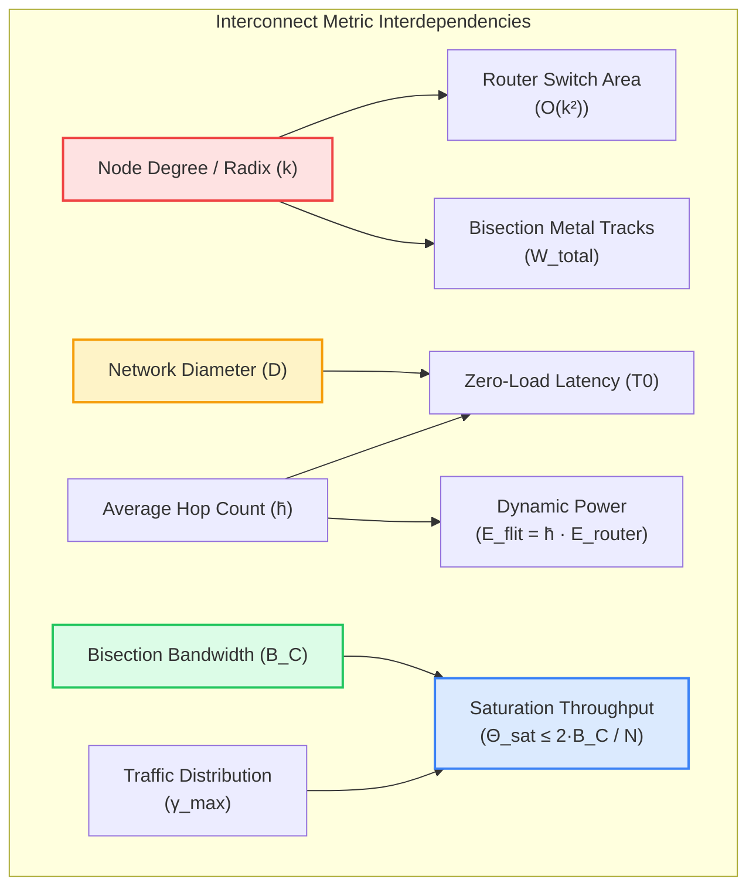
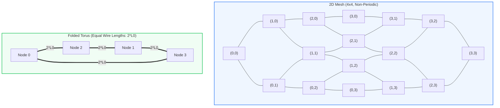
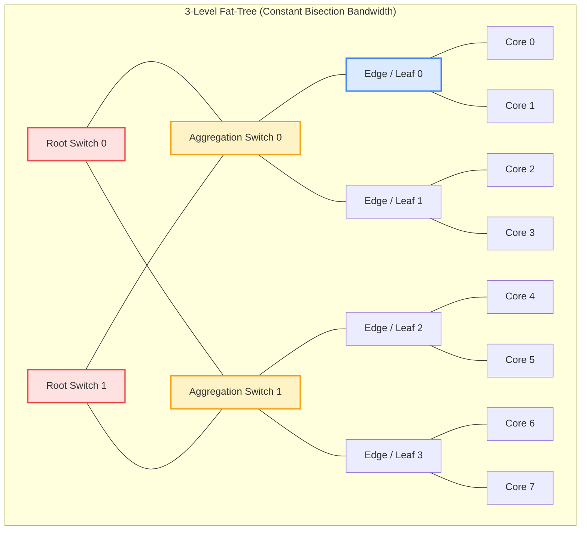
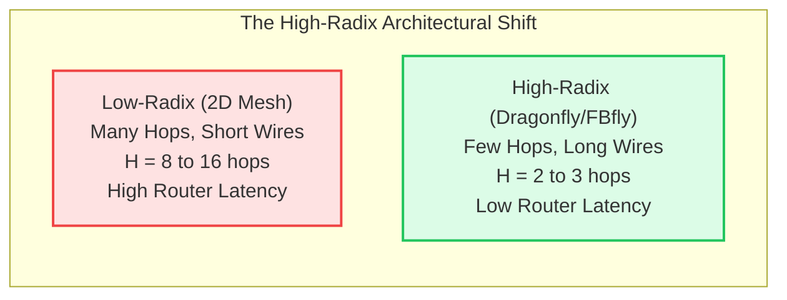
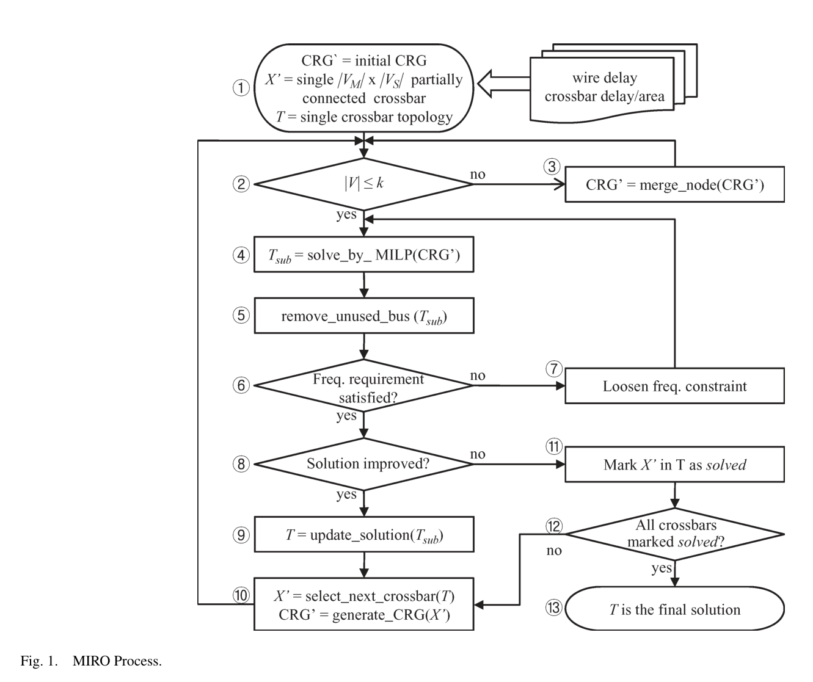
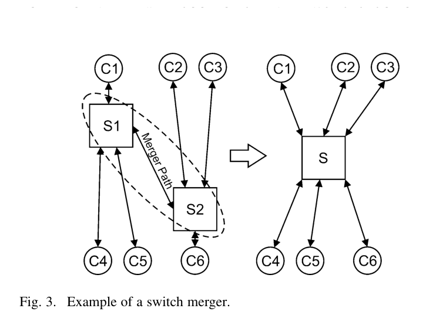
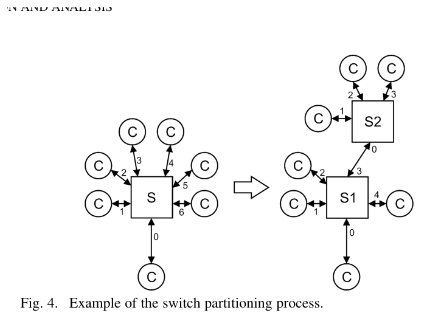
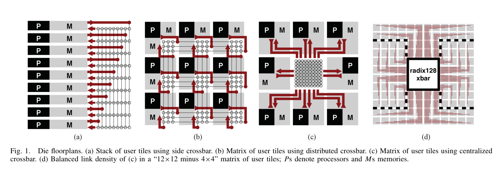
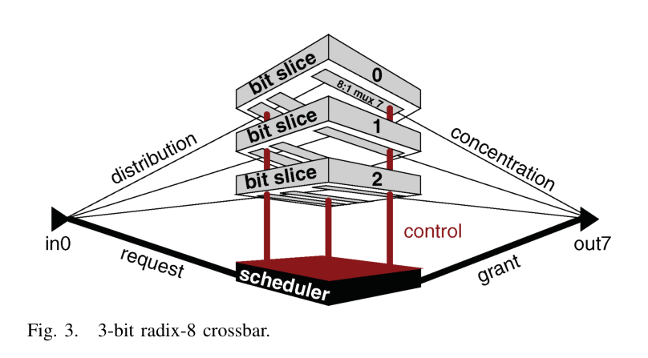

# Chapter 4: Direct, Indirect & High-Radix Interconnect Topologies

> **Authors**: NoC-Lab Research Consortium  
> **Domain**: Silicon Microarchitecture & Interconnect Design  
> **Interactive Companion**: [NoC Learning Hub — Track 3: Topologies & Metrics](https://network-on-chip.github.io/learning/track3-topologies/)  
> **Interactive Lab**: [Topology Titans: Graph Architect](https://network-on-chip.github.io/learning/interactive/topology/)  
> **Accompanying Code**: [`code/topology_metrics_sim.py`](code/topology_metrics_sim.py), [`code/topology_router_mesh_torus.v`](code/topology_router_mesh_torus.v)

---

## 4.1 Fundamentals of Interconnect Graph Theory & Quantitative Metrics

The **topology** of a Network-on-Chip defines the logical and physical connectivity between routers, processing elements (cores, accelerators, DSPs), and memory controllers. From a mathematical perspective, an interconnection network is represented as a directed graph $G = (V, E)$, where the vertex set $V$ denotes the routers and network nodes ($|V| = N$), and the edge set $E$ denotes the point-to-point physical channels interconnecting them.

The selection of a topology establishes the absolute performance upper bounds and silicon cost lower bounds of the system:
1. **Zero-Load Latency ($T_0$)**: The minimum time required for a packet to traverse the network in the absence of competing traffic.
2. **Saturation Throughput ($\Theta_{sat}$)**: The maximum data rate that the network can sustain before queues fill up and queueing latency diverges to infinity.
3. **Physical Layout Complexity**: Silicon area overhead, metal wire layer usage, wire congestion, repeater power dissipation, and pin limitations.

### 4.1.1 First-Principles Definitions & Mathematical Derivations

To evaluate any candidate topology objectively, we formalize the fundamental graph-theoretic and architectural metrics:

#### 1. Router Radix (Degree $k$)
The degree of a node $u \in V$, denoted as $\text{deg}(u)$, is the number of physical links incident upon it:

$$\text{deg}(u) = \text{deg}_{in}(u) + \text{deg}_{out}(u)$$

In a symmetric, regular network where every node has degree $k$, the router radix is $k$. A router connected to 4 neighbors plus 1 local compute interface has a physical radix of $5$. Because the internal crossbar switch area and power scale quadratically with radix ($O(k^2)$), low-radix topologies minimize router microarchitectural area, whereas high-radix topologies require larger switches but slash network hop count.

#### 2. Network Diameter ($D$)
The diameter is the maximum shortest-path distance between any pair of nodes in the network:

$$D = \max_{u, v \in V} d(u, v)$$

where $d(u, v)$ is the minimum number of channel hops required to travel from source node $u$ to destination node $v$. Diameter represents the worst-case zero-load communication distance.

#### 3. Average Hop Distance ($\bar{h}$)
The expected hop count between randomly chosen source-destination pairs under a given spatial traffic distribution $p(u, v)$:

$$\bar{h} = \sum_{u \in V} \sum_{v \in V, v \ne u} p(u, v) \cdot d(u, v)$$

Under **Uniform Random (UR)** traffic, every node communicates with every other node with equal probability $p(u, v) = \frac{1}{N(N-1)}$, reducing the metric to:

$$\bar{h}_{UR} = \frac{1}{N(N-1)} \sum_{u \ne v} d(u, v)$$

#### 4. Bisection Bandwidth ($B_C$)
The bisection bandwidth is the minimum bandwidth cut across the network that partitions the node set $V$ into two equal subsets $V_1$ and $V_2$ ($|V_1| = |V_2| = N/2$):

$$B_C = \min_{V_1, V_2} \sum_{u \in V_1, v \in V_2, (u, v) \in E} C(u, v)$$

where $C(u, v)$ is the channel bandwidth (in bits/sec or flits/cycle) of edge $(u, v)$. In symmetric topologies with uniform channel width $W$ bits and clock frequency $f_{clk}$, bisection bandwidth is expressed as the count of channels crossing the bisection cut $N_C$:

$$B_C = N_C \cdot W \cdot f_{clk}$$

Bisection bandwidth dictates the system's global throughput under adversarial or stress traffic patterns (e.g., bit-complement, matrix transpose).

#### 5. Maximum Channel Load ($\gamma_{max}$) and Saturation Throughput ($\Theta_{sat}$)
Let $\gamma_e$ denote the expected traffic volume traversing physical channel $e \in E$ when each node injects 1 flit per cycle. The **maximum channel load** $\gamma_{max}$ is defined as:

$$\gamma_{max} = \max_{e \in E} \gamma_e$$

Because a physical channel can carry at most 1 flit per cycle, the maximum achievable injection rate per node before network saturation (the **ideal saturation throughput** $\Theta_{sat}$) is strictly bounded by:

$$\Theta_{sat} \le \frac{1}{\gamma_{max}} \le \frac{2 B_C}{N} \quad \text{[flits/node/cycle]}$$

Under uniform random traffic across a bisection cut dividing the network in half, exactly half of the packets injected by $V_1$ are destined for $V_2$, requiring $\frac{N}{2} \times \frac{1}{2} = \frac{N}{4}$ flits/cycle to cross the cut in each direction. Hence, the aggregate cut demand is $\frac{N}{2}$, leading directly to the bound $\Theta_{sat} \le \frac{2 B_C}{N}$.

#### 6. Zero-Load Latency ($T_0$)
The average latency experienced by a packet of length $L$ flits traversing the network under zero contention:

$$T_0 = (\bar{h} + 1) \cdot t_{router} + \bar{h} \cdot t_{wire} + \left( \frac{L - 1}{\text{Rate}} \right)$$

where $t_{router}$ is the router pipeline latency (cycles/hop), $t_{wire}$ is the link flight time (cycles/hop), and $\frac{L - 1}{\text{Rate}}$ is the packet serialization latency across the channel.

---

## 4.2 Direct Topologies: 2D Mesh, 2D Torus & The Folded Torus

A topology is classified as **direct** if every router in the network is directly coupled to a processing element (PE / core). Direct topologies are the dominant design choice for homogeneous tiled multi-cores and single-chip cloud computers due to their modularity, standard rectilinear floorplanning, and localized wiring.

### 4.2.1 2D Mesh Topologies

In a $k \times k$ 2D Mesh ($N = k^2$ nodes):

- **Router Radix**: Interior routers have degree 5 (North, South, East, West, Local); edge routers have degree 4; corner routers have degree 3.
- **Diameter**: The worst-case traversal is between opposing corners $(0, 0)$ and $(k-1, k-1)$: $D_{Mesh} = 2(k - 1)$.
- **Average Hop Distance**: Evaluating $\bar{h} = \frac{1}{k^4 - k^2} \sum_{x_1, y_1} \sum_{x_2, y_2} (|x_1 - x_2| + |y_1 - y_2|)$, we obtain $\bar{h}_{Mesh} = \frac{2}{3} k \cdot \left(1 - \frac{1}{k^2}\right) \approx \frac{2}{3} k$.
- **Bisection Bandwidth**: Bisecting the mesh along its central line cuts exactly $k$ bidirectional links (or $2k$ directional channels): $B_{C, Mesh} = 2k \cdot W$. Consequently, ideal throughput per node scales inversely with grid dimension: $\Theta_{Mesh} \le \frac{2(2k \cdot W)}{k^2} = \frac{4 W}{k}$.

#### The Boundary Bottleneck of 2D Mesh
Because edge and corner routers have fewer physical neighbors than interior routers, packets directed across the network converge disproportionately on the center routers. Under uniform traffic, the central channels exhibit a maximum channel load of $\gamma_{max} \approx \frac{k}{4}$ flits/cycle, causing the center of a large 2D mesh to saturate prematurely while the peripheral channels operate well below capacity.

### 4.2.2 2D Torus & The Folded Torus

A $k \times k$ **2D Torus** ($k$-ary 2-cube) adds periodic wrap-around links connecting node $(x, 0)$ to $(x, k-1)$ and node $(0, y)$ to $(k-1, y)$.

- **Symmetry**: Every node is completely identical, eliminating edge effects and distributing channel loads uniformly.
- **Diameter**: $D_{Torus} = 2 \cdot \left\lfloor \frac{k}{2} \right\rfloor$. For an $8 \times 8$ network, the diameter drops from $14$ in a Mesh to $8$ in a Torus.
- **Average Hop Distance**: $\bar{h}_{Torus} \approx \frac{k}{2}$ (slashed by 25% compared to Mesh).
- **Bisection Bandwidth**: Bisecting a torus cuts through two sets of wrap-around rings, cutting $2k$ bidirectional links ($4k$ directional channels): $B_{C, Torus} = 4k \cdot W$ (exactly $2\times$ the Mesh bisection bandwidth).

#### The Long Wrap-Around Wire Crisis in Standard Torus
In a naive planar layout of a $k \times k$ torus, the wrap-around wire connecting the extreme edges must span the entire width of the chip:

$$L_{wrap} = (k - 1) \cdot L_0$$

where $L_0$ is the tile-to-tile pitch. As demonstrated in Chapter 1's Elmore delay formulations, wire resistance and capacitance grow with length. At $k = 8$, a wrap-around link spanning 7 tiles suffers over **$49\times$ higher Elmore delay** than an adjacent tile link unless heavily pipelined with multiple register stages. This introduces severe link latency asymmetry into the network.

#### The Folded Torus Solution
The **Folded Torus** topology overcomes this physical wire crisis through an interleaved spatial node permutation. By interleaving even and odd physical tiles along each dimension:

$$\text{Physical Order}: 0, \quad 2, \quad 4, \quad \dots, \quad k-2, \quad k-1, \quad \dots, \quad 3, \quad 1$$

every link in the network—including all wrap-around paths—has an identical physical length:

$$L_{link, Folded} = 2 \cdot L_0$$

By trading a uniform link length of $2 L_0$ for the elimination of catastrophic $(k-1) L_0$ global wires, the Folded Torus maintains full clock frequency while preserving the topological diameter and bisection bandwidth advantages of the torus.

---

## 4.3 Indirect & Multistage Interconnects: Clos, Fat-Tree & Butterfly

In an **indirect** network, processing elements are situated exclusively at the network periphery (terminal nodes), while internal routing is handled by a fabric of dedicated intermediate switching stages.

### 4.3.1 Clos Networks & Non-Blocking Theorems

A 3-stage Clos network, denoted $C(n, m, r)$, consists of:
- **First Stage**: $r$ input switches, each of size $n \times m$.
- **Middle Stage**: $m$ middle switches, each of size $r \times r$.
- **Third Stage**: $r$ output switches, each of size $m \times n$.

The fundamental properties derived by Charles Clos (1953) govern non-blocking behavior:

- **Strictly Non-Blocking (SNB)**: A network is strictly non-blocking if any idle input can connect to any idle output without rearranging existing connections:

$$m \ge 2n - 1$$

  *Proof Sketch*: In the worst case, an incoming request arrives at an input switch where the other $n-1$ inputs are already connected to $n-1$ distinct middle switches. Similarly, the destination output switch has $n-1$ active connections from $n-1$ other middle switches. In the worst-case disjoint scenario, these two sets of middle switches do not overlap, consuming $(n-1) + (n-1) = 2n - 2$ switches. Thus, to guarantee that at least one free middle switch exists to establish the new connection without conflict, we require $m \ge (2n - 2) + 1 = 2n - 1$.

- **Rearrangeably Non-Blocking (RNB)**: A network is rearrangeably non-blocking if any idle input can always be connected to any idle output, provided existing connections can be rerouted. By the **Slepian-Duguid Theorem**, a Clos network is rearrangeable if and only if:

$$m \ge n$$

### 4.3.2 Fat-Tree Topologies (Spine-Leaf)

Introduced by Charles Leiserson (1985), a **Fat-Tree** addresses the root congestion problem inherent in standard binary trees. In a simple tree, links near the root become severe bottlenecks because bisection bandwidth remains constant at 1 link while node count doubles at each level.

In a true Fat-Tree:
- The channel capacity (number of wires or parallel links) increases as one ascends the hierarchy toward the root.
- At level $l$, the bandwidth is proportional to the total number of compute nodes in that subtree, maintaining **constant bisection bandwidth** across every horizontal cut.
- Routing utilizes randomized or deterministic upward path selection (adaptive multi-pathing) to the lowest common ancestor, followed by deterministic downward descent.

---

## 4.4 High-Radix Interconnects: Flattened Butterfly & Dragonfly

As modern sub-10nm CMOS processes provide hundreds of millions of routing gates, router microarchitects face a fundamental trade-off: **Low-Radix / High-Diameter** vs. **High-Radix / Low-Diameter**.

| Attribute | Low-Radix (e.g., 2D Mesh) | High-Radix (e.g., Flattened Butterfly, Dragonfly) |
| :--- | :--- | :--- |
| **Router Switch Radix ($k$)** | Low ($k = 4 \text{ to } 5$) | High ($k = 16 \text{ to } 64+$) |
| **Network Hop Diameter ($D$)** | High ($D = 2\sqrt{N} \sim 16$) | Ultra-Low ($D = 2 \text{ to } 3$) |
| **Zero-Load Latency ($T_0$)** | Dominated by router traversal ($H \cdot t_{router}$) | Dominated by wire flight time ($H \cdot t_{wire}$) |
| **Crossbar Area Complexity** | Modest ($O(k^2)$ per router) | High ($O(k^2)$ per router) |
| **Wiring Layout** | Strictly localized, adjacent tiles | Global wires spanning across the die |

### 4.4.1 Flattened Butterfly (FBfly)

Proposed by John Kim et al. (ISCA 2007), the **Flattened Butterfly** projects a multi-stage butterfly network into a direct topology by combining the switches in each row into a single high-radix router.
- In a $k \times k$ Flattened Butterfly, each router connects directly to every other router in the same row and the same column.
- **Diameter**: $D_{FBfly} = 2$ (any node is at most 2 hops away).
- **Routing**: Minimal routing requires at most 1 hop along dimension $X$ and 1 hop along dimension $Y$.
- **Tradeoff**: While hop latency drops to just 2 router crossings, router radix explodes to $k_{radix} = 2(k - 1) + p$, where $p$ is the concentration factor. For $k = 8$, router radix exceeds 18 ports.

### 4.4.2 The Dragonfly Topology

The **Dragonfly** topology (Kim, Dally et al., ISCA 2008) organizes high-radix routers into a hierarchical two-level network:
1. **Local Groups (Cliques)**: Inside each group, $a$ routers are fully interconnected with high-density local links.
2. **Global Links**: Each router has $h$ global optical or long metal channels connecting directly to routers in other groups.
3. **Concentration**: Each router serves $p$ local compute nodes.

Under **Universal Globally-Adaptive Routing (UGAL)**, the Dragonfly routes minimally when global channels are uncongested, but dynamically misroutes packets non-minimally through a random intermediate group under adversarial traffic (such as nearest-neighbor or transpose patterns), effectively doubling saturation throughput by eliminating hot links.

---

## 4.5 Application-Specific & Cascaded Topologies: Synthesis & Partitioning

For heterogeneous Systems-on-Chip (SoCs)—such as mobile application processors integrating CPUs, GPUs, NPUs, video decoders, and ISP blocks—standard regular topologies (Mesh, Torus) suffer from severe area and power inefficiency. Communication demands are highly non-uniform; certain core pairs require tens of gigabytes per second, while others communicate only sporadic interrupts.

### 4.5.1 Synthesis of Cascaded Crossbar Networks (MIRO)

Minje Jun, Sungjoo Yoo, and Eui-Young Chung (*IEEE Transactions on Computer-Aided Design of Integrated Circuits and Systems*, TCAD 2009) investigated the synthesis of **cascaded crossbar switch networks**. Rather than deploying a single massive crossbar that limits clock frequency, or a rigid multi-hop mesh that introduces unnecessary hop delays, cascaded crossbars cluster communicating masters and slaves into small, fast crossbar switches interconnected in a tree or directed acyclic graph.

*Figure 4.1: The MIRO (Multi-stage Interconnect Reduction and Optimization) synthesis process for cascaded crossbar switches. The framework combines MILP exact formulation with heuristic clustering to satisfy bandwidth and latency constraints while minimizing crossbar area. [Reproduced from: M. Jun, S. Yoo, and E.-Y. Chung, "Topology Synthesis of Cascaded Crossbar Switches," IEEE Transactions on Computer-Aided Design of Integrated Circuits and Systems, Vol. 28, No. 6, pp. 926–930, June 2009, DOI: 10.1109/TCAD.2009.2017079. © 2009 IEEE]*

The synthesis problem is formalized via a **Communication Requirement Graph (CRG)** $G(V_M, V_S, E, \text{freq}_{lb})$:
- $V_M$: Master nodes (processors, DMA engines).
- $V_S$: Slave nodes (memory controllers, hardware accelerators).
- $e_{m, s} \in E$: Communication requirement with bandwidth demand $w(e_{m, s})$ and latency constraint $d(e_{m, s})$.

Jun et al. proved that while Mixed Integer Linear Programming (MILP) discovers globally optimal crossbar allocations, its runtime becomes intractable for $|V_M \cup V_S| > 16$. The proposed heuristic (MIRO) clusters masters based on traffic affinities and decomposes crossbars, achieving **up to 69.5% area reduction** over conventional bus matrices while satisfying all clock frequency and latency bounds.

### 4.5.2 Switch Merger & Partitioning in Throughput-Oriented Topologies

Victor Dumitriu and Gul N. Khan (*IEEE Transactions on Very Large Scale Integration Systems*, TVLSI 2009) established automated transaction-oriented topology generation algorithms based on iterative switch merging and partitioning:

*Figure 4.2: Switch merger process in application-specific NoC topology generation. Two individual switches with complementary traffic demands are merged into a single consolidated router to eliminate intermediate inter-switch channels. [Reproduced from: V. Dumitriu and G. N. Khan, "Throughput-Oriented NoC Topology Generation and Analysis for High Performance SoCs," IEEE Transactions on Very Large Scale Integration (VLSI) Systems, Vol. 17, No. 10, pp. 1433–1446, October 2009, DOI: 10.1109/TVLSI.2008.2006798. © 2009 IEEE]*

*Figure 4.3: Switch partitioning process. A large router exceeding silicon area, pin constraints, or local timing limits is partitioned into two cascaded smaller switches connected by a high-throughput bridge link. [Reproduced from: V. Dumitriu and G. N. Khan, "Throughput-Oriented NoC Topology Generation and Analysis for High Performance SoCs," IEEE Transactions on Very Large Scale Integration (VLSI) Systems, Vol. 17, No. 10, pp. 1433–1446, October 2009, DOI: 10.1109/TVLSI.2008.2006798. © 2009 IEEE]*

Dumitriu and Khan showed that by evaluating predictive contention metrics during the merge-partition exploration, the resulting application-specific topologies achieve equal or superior packet throughput compared to regular 2D meshes while consuming **on average 50% fewer network resources** (buffers, crossbar ports, and links).

---

## 4.6 Silicon Floorplanning, Wire Density & Physical Layout Limits

A fundamental misconception in early NoC literature was that full crossbars are physically unscalable beyond 16 to 32 nodes due to $O(N^2)$ area explosion. In a landmark study, Giorgos Passas, Manolis Katevenis, and Dionisios Pnevmatikatos (*IEEE Transactions on Computer-Aided Design of Integrated Circuits and Systems*, TCAD 2012) challenged this dogma by demonstrating that **monolithic crossbars scale efficiently beyond 100 nodes in modern CMOS silicon**.

*Figure 4.4: Die floorplans for crossbar-based on-chip networks. (a) Stack of user tiles using a side crossbar. (b) Matrix of user tiles with distributed crossbar slices. (c) Matrix of user tiles with centralized crossbar. (d) Balanced link density layout in a 12x12 minus 4x4 matrix of user tiles (P: processors, M: memories). [Reproduced from: G. Passas, M. Katevenis, and D. Pnevmatikatos, "Crossbar NoCs Are Scalable Beyond 100 Nodes," IEEE Transactions on Computer-Aided Design of Integrated Circuits and Systems, Vol. 31, No. 4, pp. 573–585, April 2012, DOI: 10.1109/TCAD.2011.2176730. © 2012 IEEE]*

*Figure 4.5: Layout of a 3-bit radix-8 crossbar bit-slice in standard-cell CMOS. Multiplexer cells are routed entirely under upper-level metal tracks, preventing wire-channel area inflation. [Reproduced from: G. Passas, M. Katevenis, and D. Pnevmatikatos, "Crossbar NoCs Are Scalable Beyond 100 Nodes," IEEE Transactions on Computer-Aided Design of Integrated Circuits and Systems, Vol. 31, No. 4, pp. 573–585, April 2012, DOI: 10.1109/TCAD.2011.2176730. © 2012 IEEE]*

### 4.6.1 The Passas-Katevenis Crossbar Scalability Theorem

Passas et al. fabricated and modeled a **radix-128 crossbar** in 90nm CMOS operating at 750 MHz:

- **Silicon Area Overhead**: The crossbar datapath occupied only $6.6\text{ mm}^2$ (with 90% standard-cell utilization), while the control path occupied $7\text{ mm}^2$. In a $150\text{ mm}^2$ die containing 128 $1\text{ mm}^2$ processor tiles, the crossbar occupied **only 11% of the total die area**, including all global link repeaters and pipeline flip-flops.
- **Wire Pitch vs. Gate Area**: Because modern CMOS technologies provide 8 to 12 metal layers, all $N$ data tracks of the crossbar fit directly **over the standard cells** on intermediate metal layers (M4–M7), without expanding the silicon cell footprint. Crossbar area grows as $\text{Area}_{crossbar} \approx O(N^2 \cdot W)$ (where $W$ is the wire pitch), while crossbar propagation delay scales as $\text{Delay}_{crossbar} \approx O(\sqrt{N \cdot W})$.
- **Performance Trade-Off vs. 2D Mesh**: Under local or benign traffic, a 2D mesh is superior because adjacent tiles communicate in 1 or 2 hops with zero global wire energy. However, under **global, stressed, or adversarial traffic patterns**, the radix-128 crossbar outperformed the 2D mesh by up to $3\times$ in throughput and $2.5\times$ in latency, because it completely eliminates multi-hop queueing contention and router buffer stalls.

---

## 4.7 Comprehensive Comparative Tradeoff Matrix

The following table summarizes the graph-theoretic, microarchitectural, and physical implementation characteristics of the primary interconnect topologies for an $N = 64$ node system:

| Topology | Radix ($k$) | Diameter ($D$) | Avg Hops ($\bar{h}$) | Bisection Bandwidth ($B_C / W$) | Zero-Load Latency ($T_0$, cyc) | Uniform Sat. Throughput | Dominant Physical Constraint |
| :--- | :---: | :---: | :---: | :---: | :---: | :---: | :--- |
| **Ring (1D)** | 2 | 32 | 16.0 | 4 | 28.0 | 0.125 | Catastrophic bisection bottleneck |
| **2D Mesh ($8 \times 8$)** | 4 (avg 3.5) | 14 | 5.33 | 16 | 12.0 | 0.500 | Center router saturation |
| **2D Torus ($8 \times 8$)** | 4 | 8 | 4.06 | 32 | 10.1 | 1.000 | Wrap-around wire length ($L_{wrap}$) |
| **Folded Torus ($8 \times 8$)** | 4 | 8 | 4.06 | 32 | 10.1 | 1.000 | $2 L_0$ link delay; complex PCB pinout |
| **Hypercube (6-cube)** | 6 | 6 | 3.05 | 64 | 8.57 | 2.000 | Non-planar wiring crossings |
| **Fat-Tree (3-level)** | 4 | 6 | 3.80 | 64 | 9.70 | 2.000 | High router count; top-tier wiring density |
| **Flattened Butterfly ($8 \times 8$)** | 14 | 2 | 1.78 | 256 | 6.67 | 8.000 | Massive crossbar radix ($14 \times 14$); global wires |
| **Full Crossbar ($64 \times 64$)** | 64 | 1 | 1.00 | 2048 | 5.00 | 64.000 | Global link routing tracks over tiles |

---

## 4.8 Self-Assessment Checkpoint Questions

### Conceptual & Quantitative Exercises

1. **Bisection Bandwidth Scaling**:
   Explain why a 2D Torus delivers exactly twice the bisection bandwidth of a 2D Mesh of identical dimensions ($k \times k$). Under what specific traffic pattern does this $2\times$ advantage translate into a full $2\times$ improvement in saturation throughput?

2. **Folded Torus Delay Invariance**:
   Consider an $8 \times 8$ tiled processor where adjacent tile pitch is $L_0 = 1.2\text{ mm}$. Calculate the wire length of the longest link in a standard planar torus versus a folded torus. Using the Elmore delay equation $\tau = 0.5 \cdot r_{wire} \cdot c_{wire} \cdot L^2$, compute the ratio of wire propagation delays.

3. **Strictly Non-Blocking Clos Sizing**:
   An architect is designing an on-chip 3-stage Clos switch to connect 64 IP cores ($N = 64$) using first-stage switches with $n = 8$ inputs.
   - (a) How many first-stage switches $r$ are required?
   - (b) What is the minimum number of middle-stage switches $m$ required to guarantee that the network is Strictly Non-Blocking (SNB)?
   - (c) What is the total crosspoint count of this SNB Clos network compared to a single monolithic $64 \times 64$ crossbar?

4. **Dragonfly UGAL Routing Decision**:
   Why does minimal routing perform poorly on a Dragonfly topology under transpose or bit-reversal traffic? Describe the condition under which UGAL dynamically switches from minimal routing to Valiant's non-minimal routing.

---

## 4.9 References & Bibliography

1. **G. Passas, M. Katevenis, and D. Pnevmatikatos**, "Crossbar NoCs Are Scalable Beyond 100 Nodes," *IEEE Transactions on Computer-Aided Design of Integrated Circuits and Systems*, Vol. 31, No. 4, pp. 573–585, April 2012. DOI: [10.1109/TCAD.2011.2176730](https://doi.org/10.1109/TCAD.2011.2176730).
2. **M. Jun, S. Yoo, and E.-Y. Chung**, "Topology Synthesis of Cascaded Crossbar Switches," *IEEE Transactions on Computer-Aided Design of Integrated Circuits and Systems*, Vol. 28, No. 6, pp. 926–930, June 2009. DOI: [10.1109/TCAD.2009.2017079](https://doi.org/10.1109/TCAD.2009.2017079).
3. **V. Dumitriu and G. N. Khan**, "Throughput-Oriented NoC Topology Generation and Analysis for High Performance SoCs," *IEEE Transactions on Very Large Scale Integration (VLSI) Systems*, Vol. 17, No. 10, pp. 1433–1446, October 2009. DOI: [10.1109/TVLSI.2008.2006798](https://doi.org/10.1109/TVLSI.2008.2006798).
4. **J. Kim, J. Balfour, and W. J. Dally**, "Flattened Butterfly Topology for On-Chip Networks," *Proceedings of the 40th Annual IEEE/ACM International Symposium on Microarchitecture (MICRO)*, pp. 172–182, 2007. DOI: [10.1109/MICRO.2007.28](https://doi.org/10.1109/MICRO.2007.28).
5. **J. Kim, W. J. Dally, S. Scott, and D. Abts**, "Technology-Driven, Highly-Scalable Dragonfly Topology," *Proceedings of the 35th Annual International Symposium on Computer Architecture (ISCA)*, pp. 77–88, 2008. DOI: [10.1109/ISCA.2008.19](https://doi.org/10.1109/ISCA.2008.19).
6. **C. Clos**, "A Study of Non-Blocking Switching Networks," *Bell System Technical Journal*, Vol. 32, No. 2, pp. 406–424, 1953.
7. **C. E. Leiserson**, "Fat-Trees: Universal Networks for Hardware-Efficient Supercomputing," *IEEE Transactions on Computers*, Vol. C-34, No. 10, pp. 892–901, October 1985. DOI: [10.1109/TC.1985.1676519](https://doi.org/10.1109/TC.1985.1676519).
8. **W. J. Dally and B. Towles**, *Principles and Practices of Interconnection Networks*, Morgan Kaufmann, 2004.
