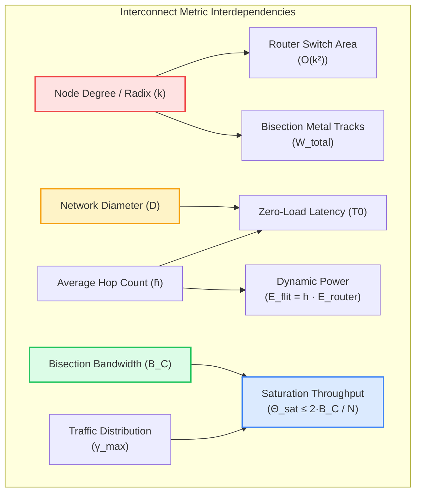
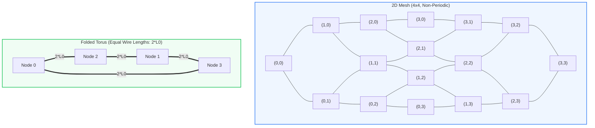
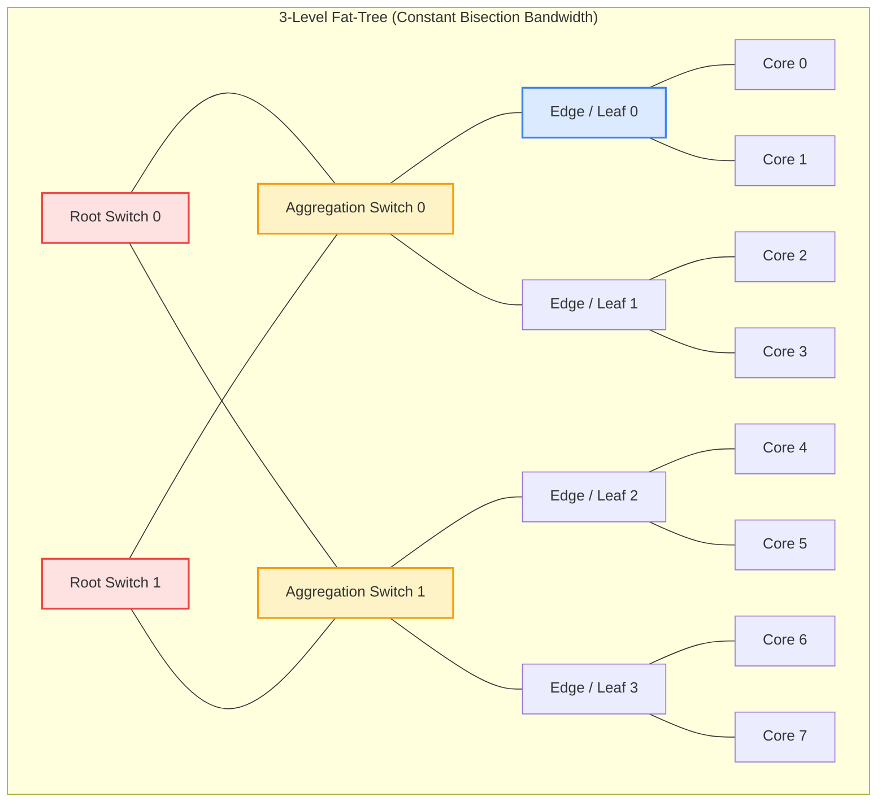
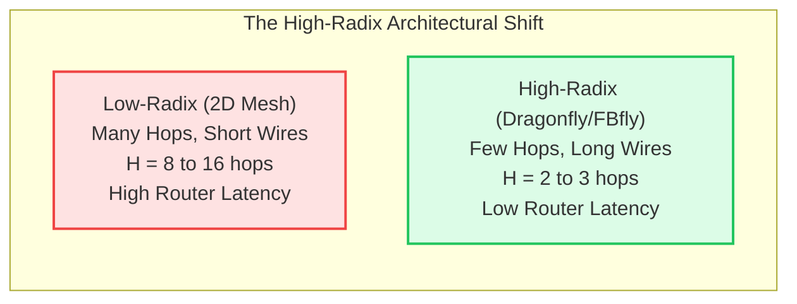

# Chapter 4: Direct, Indirect & High-Radix Interconnect Topologies

---

## Chapter Introduction

In the preceding chapters, we examined the physical wire crisis on silicon (Chapter 1), dissected the packetization and flow control mechanisms required to stream data losslessly across channels (Chapter 2), and uncovered the microarchitectural pipeline of high-speed virtual-channel routers (Chapter 3). We now arrive at the architectural blueprint that binds these components into a unified system: **interconnect topology**.

The topology of an on-chip network defines the physical and logical arrangement of channels and routers connecting compute cores, graphics engines, AI tensor accelerators, and memory controllers. From a graph-theoretic perspective, topology establishes the absolute performance upper bounds and physical silicon cost lower bounds of the entire multiprocessor:
- It dictates the **Zero-Load Latency ($T_0$)** through the average hop count ($\bar{h}$) and network diameter ($D$).
- It dictates the **Saturation Throughput ($\Theta_{sat}$)** through the bisection bandwidth ($B_C$) and maximum channel load ($\gamma_{max}$).
- It dictates the **Physical Silicon Feasibility** through router crossbar radix ($k$), metal layer wiring track density, and floorplan layout regularity.

For decades, system designers faced a fundamental tension between **low-radix planar networks** (such as 2D Meshes and Tori), which minimize router complexity and wire lengths at the cost of high hop counts, and **high-radix express networks** (such as Flattened Butterflies, Dragonflies, and multi-stage Clos networks), which slash hop counts down to 1–2 crossings at the expense of high-radix crossbars and long global metal links. In modern sub-10nm FinFET silicon, the emergence of 10 to 16 back-end-of-line metal layers has further rewritten this trade-off, enabling dense over-the-cell global wire routing and large-scale monolithic crossbars.

This chapter presents a rigorous, mathematically grounded exploration of on-chip topologies. We formalize graph-theoretic interconnect metrics from first principles, evaluate canonical direct planar networks (2D Mesh, 2D Torus, Folded Torus), analyze high-radix indirect architectures (Concentrated Mesh, Flattened Butterfly, Dragonfly, Clos networks), examine automated topology synthesis algorithms for heterogeneous SoCs (MIRO, switch merge-partitioning), and review groundbreaking physical floorplanning proofs that demonstrate the scalability of crossbar networks beyond 100 silicon nodes.

### Learning Objectives
- **Derive Fundamental Interconnect Metrics**: Formulate mathematical proofs for router radix ($k$), diameter ($D$), average hop count ($\bar{h}$), bisection bandwidth ($B_C$), maximum channel load ($\gamma_{max}$), and zero-load latency ($T_0$).
- **Analyze Direct Topologies**: Compare 2D Mesh, 2D Torus, and Folded Torus architectures in terms of wrap-around wire delays, path diversity, and bisection limits.
- **Master High-Radix Interconnect Paradigms**: Evaluate the trade-offs of Concentrated Meshes (cMesh), Flattened Butterflies, and hierarchical Dragonfly networks operating under Universal Globally-Adaptive Routing (UGAL).
- **Understand Application-Specific Synthesis**: Formulate Communication Requirement Graphs (CRG) and analyze heuristic clustering algorithms (MIRO) and switch merge-partitioning techniques for heterogeneous MPSoCs.
- **Evaluate Physical VLSI Layout Limits**: Analyze over-the-cell metal layer allocation and examine the Passas-Katevenis theorem proving crossbar scalability beyond 100 nodes in deep sub-micron CMOS.

### Chapter Roadmap & Interactive Modules
- **Section 4.1**: Fundamentals of Interconnect Graph Theory & Quantitative Metrics.
- **Section 4.2**: Direct Topologies: 2D Mesh, 2D Torus & The Folded Torus.
- **Section 4.3**: Indirect & Multi-Stage Topologies: Clos, Beneš & Fat-Trees.
- **Section 4.4**: High-Radix Express Topologies: cMesh, Flattened Butterfly & Dragonfly.
- **Section 4.5**: Application-Specific & Cascaded Topologies: Synthesis & Partitioning (MIRO).
- **Section 4.6**: Silicon Floorplanning, Wire Density & Physical Layout Limits.
- **Section 4.7**: Comprehensive Comparative Tradeoff Matrix.
- **Section 4.8**: Self-Assessment Checkpoint Questions.
- **Section 4.9**: References & Bibliography.

---

## 4.1 Fundamentals of Interconnect Graph Theory & Quantitative Metrics

The **topology** of a Network-on-Chip defines the logical and physical connectivity between routers, processing elements (cores, accelerators, DSPs), and memory controllers. From a mathematical perspective, an interconnection network is represented as a directed graph $G = (V, E)$, where the vertex set $V$ denotes the routers and network nodes ($|V| = N$), and the edge set $E$ denotes the point-to-point physical channels interconnecting them.

The selection of a topology establishes the absolute performance upper bounds and silicon cost lower bounds of the system:
- **Zero-Load Latency ($T_0$)**: The minimum time required for a packet to traverse the network in the absence of competing traffic.
- **Saturation Throughput ($\Theta_{sat}$)**: The maximum data rate that the network can sustain before queues fill up and queueing latency diverges to infinity.
- **Physical Layout Complexity**: Silicon area overhead, metal wire layer usage, wire congestion, repeater power dissipation, and pin limitations.

### 4.1.1 First-Principles Definitions & Mathematical Derivations

To evaluate any candidate topology objectively, we formalize the fundamental graph-theoretic and architectural metrics:

- **Router Radix (Node Degree $k$)**:
    - The degree of a node $u \in V$, denoted as $\text{deg}(u)$, is the total number of physical bidirectional links incident upon it:
    $$\text{deg}(u) = \text{deg}_{in}(u) + \text{deg}_{out}(u)$$
    - In a symmetric, regular network where every node connects to $k$ physical channels, the router radix is $k$. A standard 2D mesh router connects to 4 cardinal neighbors (North, South, East, West) plus 1 local compute tile interface, yielding physical radix $k = 5$.
    - *Microarchitectural Trade-Off*: Because internal crossbar switch area and power scale quadratically ($O(k^2)$), low-radix designs minimize router area, whereas high-radix topologies ($k \ge 16\text{–}64$) require larger switch fabrics but dramatically compress network diameter.

- **Network Diameter ($D$)**:
    - The maximum shortest-path distance between any arbitrary pair of nodes in the network graph:
    $$D = \max_{u, v \in V} d(u, v)$$
    - Represents the worst-case zero-load communication distance across the chip.
    - In an $N$-node 2D mesh, $D = 2(\sqrt{N} - 1)$ (e.g., $D = 14$ hops for an $8 \times 8$ mesh), whereas in a 2D torus, wrap-around channels slash diameter in half to $D = 2\lfloor\frac{\sqrt{N}}{2}\rfloor$ ($D = 8$ hops).

- **Average Hop Distance ($\bar{h}$)**:
    - The expected hop count between randomly chosen source-destination pairs under a spatial traffic distribution $p(u, v)$:
    $$\bar{h} = \sum_{u \in V} \sum_{v \in V, v \ne u} p(u, v) \cdot d(u, v)$$
    - Under **Uniform Random (UR)** traffic, every node communicates with every other node with equal probability $p(u, v) = \frac{1}{N(N-1)}$:
    $$\bar{h}_{UR} = \frac{1}{N(N-1)} \sum_{u \ne v} d(u, v)$$
    - Direct energy impact: dynamic flit transmission energy across the chip scales proportionally with average hops ($E_{total} \propto \bar{h} \cdot E_{hop}$).

- **Bisection Bandwidth ($B_C$)**:
    - The minimum aggregate bandwidth across any cut that partitions the node set $V$ into two equal subsets $V_1$ and $V_2$ ($|V_1| = |V_2| = N/2$):
    $$B_C = \min_{V_1, V_2} \sum_{u \in V_1, v \in V_2, (u, v) \in E} C(u, v)$$
    - For symmetric topologies with uniform channel width $W$ bits and clock frequency $f_{clk}$, bisection bandwidth is defined by the count of physical channels crossing the bisection cut $N_C$:
    $$B_C = N_C \cdot W \cdot f_{clk}$$
    - Serves as the ultimate hardware bottleneck under global or adversarial traffic patterns (e.g., matrix transpose, bit-reversal, or deep neural network all-to-all collective reductions).

- **Maximum Channel Load ($\gamma_{max}$) and Saturation Throughput ($\Theta_{sat}$)**:
    - Let $\gamma_e$ denote the expected traffic volume traversing physical channel $e \in E$ when each node injects 1 flit per cycle. The maximum channel load is:
    $$\gamma_{max} = \max_{e \in E} \gamma_e$$
    - Because a physical channel carries at most 1 flit per cycle, the maximum achievable injection rate per node before queues diverge to infinity (the **saturation throughput** $\Theta_{sat}$) is strictly bounded by:
    $$\Theta_{sat} \le \frac{1}{\gamma_{max}} \le \frac{2 B_C}{N} \quad \text{[flits/node/cycle]}$$
    - Under uniform random traffic across a bisection cut dividing the network in half, exactly half of all injected packets cross the cut, leading directly to the upper bound $\Theta_{sat} \le \frac{2 B_C}{N}$.

- **Zero-Load Latency ($T_0$)**:
    - The average latency experienced by a packet of length $L$ flits traversing the network under zero contention:
    $$T_0 = (\bar{h} + 1) \cdot t_{router} + \bar{h} \cdot t_{wire} + \left( \frac{L - 1}{\text{Rate}} \right)$$
    - Decouples into three physical components: per-hop router pipeline latency ($t_{router}$), inter-router link flight time ($t_{wire}$), and packet serialization delay ($\frac{L - 1}{\text{Rate}}$).

---

## 4.2 Direct Topologies: 2D Mesh, 2D Torus & The Folded Torus

A topology is classified as **direct** if every router in the network is directly coupled to a processing element (PE / core). Direct topologies are the dominant design choice for homogeneous tiled multi-cores and single-chip cloud computers due to their modularity, standard rectilinear floorplanning, and localized wiring.

### 4.2.1 2D Mesh Topologies

In a $k \times k$ 2D Mesh ($N = k^2$ nodes):

- **Router Radix**: Interior routers have degree 5 (North, South, East, West, Local); edge routers have degree 4; corner routers have degree 3.
- **Diameter**: The worst-case traversal is between opposing corners $(0, 0)$ and $(k-1, k-1)$: $D_{Mesh} = 2(k - 1)$.
- **Average Hop Distance**: Evaluating $\bar{h} = \frac{1}{k^4 - k^2} \sum_{x_1, y_1} \sum_{x_2, y_2} (|x_1 - x_2| + |y_1 - y_2|)$, we obtain $\bar{h}_{Mesh} = \frac{2}{3} k \cdot \left(1 - \frac{1}{k^2}\right) \approx \frac{2}{3} k$.
- **Bisection Bandwidth**: Bisecting the mesh along its central line cuts exactly $k$ bidirectional links (or $2k$ directional channels): $B_{C, Mesh} = 2k \cdot W$. Consequently, ideal throughput per node scales inversely with grid dimension: $\Theta_{Mesh} \le \frac{2(2k \cdot W)}{k^2} = \frac{4 W}{k}$.

#### The Boundary Bottleneck of 2D Mesh
Because edge and corner routers have fewer physical neighbors than interior routers, packets directed across the network converge disproportionately on the center routers. Under uniform traffic, the central channels exhibit a maximum channel load of $\gamma_{max} \approx \frac{k}{4}$ flits/cycle, causing the center of a large 2D mesh to saturate prematurely while the peripheral channels operate well below capacity.

### 4.2.2 2D Torus & The Folded Torus

A $k \times k$ **2D Torus** ($k$-ary 2-cube) adds periodic wrap-around links connecting node $(x, 0)$ to $(x, k-1)$ and node $(0, y)$ to $(k-1, y)$.

- **Symmetry**: Every node is completely identical, eliminating edge effects and distributing channel loads uniformly.
- **Diameter**: $D_{Torus} = 2 \cdot \left\lfloor \frac{k}{2} \right\rfloor$. For an $8 \times 8$ network, the diameter drops from $14$ in a Mesh to $8$ in a Torus.
- **Average Hop Distance**: $\bar{h}_{Torus} \approx \frac{k}{2}$ (slashed by 25% compared to Mesh).
- **Bisection Bandwidth**: Bisecting a torus cuts through two sets of wrap-around rings, cutting $2k$ bidirectional links ($4k$ directional channels): $B_{C, Torus} = 4k \cdot W$ (exactly $2\times$ the Mesh bisection bandwidth).

#### The Long Wrap-Around Wire Crisis in Standard Torus
In a naive planar layout of a $k \times k$ torus, the wrap-around wire connecting the extreme edges must span the entire width of the chip:

$$L_{wrap} = (k - 1) \cdot L_0$$

where $L_0$ is the tile-to-tile pitch. As demonstrated in Chapter 1's Elmore delay formulations, wire resistance and capacitance grow with length. At $k = 8$, a wrap-around link spanning 7 tiles suffers over **$49\times$ higher Elmore delay** than an adjacent tile link unless heavily pipelined with multiple register stages. This introduces severe link latency asymmetry into the network.

#### The Folded Torus Solution
The **Folded Torus** topology overcomes this physical wire crisis through an interleaved spatial node permutation. By interleaving even and odd physical tiles along each dimension:

$$\text{Physical Order}: 0, \quad 2, \quad 4, \quad \dots, \quad k-2, \quad k-1, \quad \dots, \quad 3, \quad 1$$

every link in the network—including all wrap-around paths—has an identical physical length:

$$L_{link, Folded} = 2 \cdot L_0$$

By trading a uniform link length of $2 L_0$ for the elimination of catastrophic $(k-1) L_0$ global wires, the Folded Torus maintains full clock frequency while preserving the topological diameter and bisection bandwidth advantages of the torus.

---

## 4.3 Indirect & Multistage Interconnects: Clos, Fat-Tree & Butterfly

In an **indirect** network, processing elements are situated exclusively at the network periphery (terminal nodes), while internal routing is handled by a fabric of dedicated intermediate switching stages.

### 4.3.1 Clos Networks & Non-Blocking Theorems

A 3-stage Clos network, denoted $C(n, m, r)$, consists of:
- **First Stage**: $r$ input switches, each of size $n \times m$.
- **Middle Stage**: $m$ middle switches, each of size $r \times r$.
- **Third Stage**: $r$ output switches, each of size $m \times n$.

The fundamental properties derived by Charles Clos (1953) govern non-blocking behavior:

- **Strictly Non-Blocking (SNB)**: A network is strictly non-blocking if any idle input can connect to any idle output without rearranging existing connections:

$$m \ge 2n - 1$$

  *Proof Sketch*: In the worst case, an incoming request arrives at an input switch where the other $n-1$ inputs are already connected to $n-1$ distinct middle switches. Similarly, the destination output switch has $n-1$ active connections from $n-1$ other middle switches. In the worst-case disjoint scenario, these two sets of middle switches do not overlap, consuming $(n-1) + (n-1) = 2n - 2$ switches. Thus, to guarantee that at least one free middle switch exists to establish the new connection without conflict, we require $m \ge (2n - 2) + 1 = 2n - 1$.

- **Rearrangeably Non-Blocking (RNB)**: A network is rearrangeably non-blocking if any idle input can always be connected to any idle output, provided existing connections can be rerouted. By the **Slepian-Duguid Theorem**, a Clos network is rearrangeable if and only if:

$$m \ge n$$

### 4.3.2 Fat-Tree Topologies (Spine-Leaf)

Introduced by Charles Leiserson (1985), a **Fat-Tree** addresses the root congestion problem inherent in standard binary trees. In a simple tree, links near the root become severe bottlenecks because bisection bandwidth remains constant at 1 link while node count doubles at each level.

In a true Fat-Tree:
- The channel capacity (number of wires or parallel links) increases as one ascends the hierarchy toward the root.
- At level $l$, the bandwidth is proportional to the total number of compute nodes in that subtree, maintaining **constant bisection bandwidth** across every horizontal cut.
- Routing utilizes randomized or deterministic upward path selection (adaptive multi-pathing) to the lowest common ancestor, followed by deterministic downward descent.

---

## 4.4 High-Radix Interconnects: Flattened Butterfly & Dragonfly

As modern sub-10nm CMOS processes provide hundreds of millions of routing gates, router microarchitects face a fundamental trade-off: **Low-Radix / High-Diameter** vs. **High-Radix / Low-Diameter**.

| Attribute | Low-Radix (e.g., 2D Mesh) | High-Radix (e.g., Flattened Butterfly, Dragonfly) |
| :--- | :--- | :--- |
| **Router Switch Radix ($k$)** | Low ($k = 4 \text{ to } 5$) | High ($k = 16 \text{ to } 64+$) |
| **Network Hop Diameter ($D$)** | High ($D = 2\sqrt{N} \sim 16$) | Ultra-Low ($D = 2 \text{ to } 3$) |
| **Zero-Load Latency ($T_0$)** | Dominated by router traversal ($H \cdot t_{router}$) | Dominated by wire flight time ($H \cdot t_{wire}$) |
| **Crossbar Area Complexity** | Modest ($O(k^2)$ per router) | High ($O(k^2)$ per router) |
| **Wiring Layout** | Strictly localized, adjacent tiles | Global wires spanning across the die |

### 4.4.1 Flattened Butterfly (FBfly)

Proposed by John Kim et al. [[Kim2007](#ref-kim2007)], the **Flattened Butterfly** projects a multi-stage butterfly network into a direct topology by combining the switches in each row into a single high-radix router.
- In a $k \times k$ Flattened Butterfly, each router connects directly to every other router in the same row and the same column.
- **Diameter**: $D_{FBfly} = 2$ (any node is at most 2 hops away).
- **Routing**: Minimal routing requires at most 1 hop along dimension $X$ and 1 hop along dimension $Y$.
- **Tradeoff**: While hop latency drops to just 2 router crossings, router radix explodes to $k_{radix} = 2(k - 1) + p$, where $p$ is the concentration factor. For $k = 8$, router radix exceeds 18 ports.

### 4.4.2 The Dragonfly Topology

The **Dragonfly** topology (Kim et al. [[Kim2008](#ref-kim2008)]) organizes high-radix routers into a hierarchical two-level network:
- **Local Groups (Intra-Group Cliques)**: Inside each group, $a$ routers are fully interconnected with high-density, low-latency local channels.
- **Global Link Interconnect**: Each router provisions $h$ global channels connecting directly to routers situated in disparate groups, forming a virtual complete graph across groups.
- **Node Concentration**: Each router directly multiplexes traffic from $p$ local compute nodes or cache slices.
- **Adaptive Path Diversity via UGAL**: Under **Universal Globally-Adaptive Routing (UGAL)** [[Kim2008](#ref-kim2008)], the Dragonfly routes minimally when global channels are uncongested, but dynamically deflects packets non-minimally through a random intermediate group under adversarial traffic (such as nearest-neighbor or transpose patterns), effectively doubling saturation throughput by eliminating hot links.

### 4.4.3 Extremal & Industrial High-Radix Fabrics: Slim Fly, PolarFly & NVSwitch

Beyond canonical butterflies and dragonflies, extremal graph constructions approach the theoretical Moore bound ($N \le k^2 + 1$ for diameter 2):
- **Slim Fly**: Besta and Hoefler [[Besta2014](#ref-besta2014)] introduced Slim Fly based on McKay-Miller-Siran (MMS) graphs over Galois fields $\mathbb{F}_q$, achieving diameter $D = 2$ and approaching nearly 50% of the Moore bound while cutting router counts by 25% over dragonflies.
- **PolarFly**: Besta et al. [[Besta2022](#ref-besta2022)] synthesized PolarFly using Erdős-Rényi polarity graphs from projective geometry $PG(2, q)$, eliminating bipartite constraints and achieving non-blocking diameter 2 with optimal algebraic connectivity $\lambda_2$.
- **Industrial GPU Crossbars (NVIDIA NVSwitch)**: Modern multi-GPU fabrics employ dedicated high-radix crossbar ASICs (NVSwitch 1/2/3) delivering up to 28.8 Tb/s non-blocking aggregate bandwidth and hardware-accelerated SHARP reduction collectives across NVLink channels [[Foley2023](#ref-foley2023)].

---

## 4.5 Application-Specific & Cascaded Topologies: Synthesis & Partitioning

For heterogeneous Systems-on-Chip (SoCs)—such as mobile application processors integrating CPUs, GPUs, NPUs, video decoders, and ISP blocks—standard regular topologies (Mesh, Torus) suffer from severe area and power inefficiency. Communication demands are highly non-uniform; certain core pairs require tens of gigabytes per second, while others communicate only sporadic interrupts.

### 4.5.1 Synthesis of Cascaded Crossbar Networks (MIRO)

Minje Jun, Sungjoo Yoo, and Eui-Young Chung (*IEEE Transactions on Computer-Aided Design of Integrated Circuits and Systems*, TCAD 2009) investigated the synthesis of **cascaded crossbar switch networks**. Rather than deploying a single massive crossbar that limits clock frequency, or a rigid multi-hop mesh that introduces unnecessary hop delays, cascaded crossbars cluster communicating masters and slaves into small, fast crossbar switches interconnected in a tree or directed acyclic graph.

*Figure 4.1: The MIRO (Multi-stage Interconnect Reduction and Optimization) synthesis process for cascaded crossbar switches. The framework combines MILP exact formulation with heuristic clustering to satisfy bandwidth and latency constraints while minimizing crossbar area. [Reproduced from: M. Jun, S. Yoo, and E.-Y. Chung, "Topology Synthesis of Cascaded Crossbar Switches," IEEE Transactions on Computer-Aided Design of Integrated Circuits and Systems, Vol. 28, No. 6, pp. 926–930, June 2009, DOI: 10.1109/TCAD.2009.2017079. © 2009 IEEE]*

The synthesis problem is formalized via a **Communication Requirement Graph (CRG)** $G(V_M, V_S, E, \text{freq}_{lb})$:
- $V_M$: Master nodes (processors, DMA engines).
- $V_S$: Slave nodes (memory controllers, hardware accelerators).
- $e_{m, s} \in E$: Communication requirement with bandwidth demand $w(e_{m, s})$ and latency constraint $d(e_{m, s})$.

Jun et al. proved that while Mixed Integer Linear Programming (MILP) discovers globally optimal crossbar allocations, its runtime becomes intractable for $|V_M \cup V_S| > 16$. The proposed heuristic (MIRO) clusters masters based on traffic affinities and decomposes crossbars, achieving **up to 69.5% area reduction** over conventional bus matrices while satisfying all clock frequency and latency bounds.

### 4.5.2 Switch Merger & Partitioning in Throughput-Oriented Topologies

Victor Dumitriu and Gul N. Khan (*IEEE Transactions on Very Large Scale Integration Systems*, TVLSI 2009) established automated transaction-oriented topology generation algorithms based on iterative switch merging and partitioning:

*Figure 4.2: Switch merger process in application-specific NoC topology generation. Two individual switches with complementary traffic demands are merged into a single consolidated router to eliminate intermediate inter-switch channels. [Reproduced from: V. Dumitriu and G. N. Khan, "Throughput-Oriented NoC Topology Generation and Analysis for High Performance SoCs," IEEE Transactions on Very Large Scale Integration (VLSI) Systems, Vol. 17, No. 10, pp. 1433–1446, October 2009, DOI: 10.1109/TVLSI.2008.2006798. © 2009 IEEE]*

*Figure 4.3: Switch partitioning process. A large router exceeding silicon area, pin constraints, or local timing limits is partitioned into two cascaded smaller switches connected by a high-throughput bridge link. [Reproduced from: V. Dumitriu and G. N. Khan, "Throughput-Oriented NoC Topology Generation and Analysis for High Performance SoCs," IEEE Transactions on Very Large Scale Integration (VLSI) Systems, Vol. 17, No. 10, pp. 1433–1446, October 2009, DOI: 10.1109/TVLSI.2008.2006798. © 2009 IEEE]*

Dumitriu and Khan showed that by evaluating predictive contention metrics during the merge-partition exploration, the resulting application-specific topologies achieve equal or superior packet throughput compared to regular 2D meshes while consuming **on average 50% fewer network resources** (buffers, crossbar ports, and links).

---

## 4.6 Silicon Floorplanning, Wire Density & Physical Layout Limits

A fundamental misconception in early NoC literature was that full crossbars are physically unscalable beyond 16 to 32 nodes due to $O(N^2)$ area explosion. In a landmark study, Giorgos Passas, Manolis Katevenis, and Dionisios Pnevmatikatos (*IEEE Transactions on Computer-Aided Design of Integrated Circuits and Systems*, TCAD 2012) challenged this dogma by demonstrating that **monolithic crossbars scale efficiently beyond 100 nodes in modern CMOS silicon**.

*Figure 4.4: Die floorplans for crossbar-based on-chip networks. (a) Stack of user tiles using a side crossbar. (b) Matrix of user tiles with distributed crossbar slices. (c) Matrix of user tiles with centralized crossbar. (d) Balanced link density layout in a 12x12 minus 4x4 matrix of user tiles (P: processors, M: memories). [Reproduced from: G. Passas, M. Katevenis, and D. Pnevmatikatos, "Crossbar NoCs Are Scalable Beyond 100 Nodes," IEEE Transactions on Computer-Aided Design of Integrated Circuits and Systems, Vol. 31, No. 4, pp. 573–585, April 2012, DOI: 10.1109/TCAD.2011.2176730. © 2012 IEEE]*

*Figure 4.5: Layout of a 3-bit radix-8 crossbar bit-slice in standard-cell CMOS. Multiplexer cells are routed entirely under upper-level metal tracks, preventing wire-channel area inflation. [Reproduced from: G. Passas, M. Katevenis, and D. Pnevmatikatos, "Crossbar NoCs Are Scalable Beyond 100 Nodes," IEEE Transactions on Computer-Aided Design of Integrated Circuits and Systems, Vol. 31, No. 4, pp. 573–585, April 2012, DOI: 10.1109/TCAD.2011.2176730. © 2012 IEEE]*

### 4.6.1 The Passas-Katevenis Crossbar Scalability Theorem

Passas et al. fabricated and modeled a **radix-128 crossbar** in 90nm CMOS operating at 750 MHz:

- **Silicon Area Overhead**: The crossbar datapath occupied only $6.6\text{ mm}^2$ (with 90% standard-cell utilization), while the control path occupied $7\text{ mm}^2$. In a $150\text{ mm}^2$ die containing 128 $1\text{ mm}^2$ processor tiles, the crossbar occupied **only 11% of the total die area**, including all global link repeaters and pipeline flip-flops.
- **Wire Pitch vs. Gate Area**: Because modern CMOS technologies provide 8 to 12 metal layers, all $N$ data tracks of the crossbar fit directly **over the standard cells** on intermediate metal layers (M4–M7), without expanding the silicon cell footprint. Crossbar area grows as $\text{Area}_{crossbar} \approx O(N^2 \cdot W)$ (where $W$ is the wire pitch), while crossbar propagation delay scales as $\text{Delay}_{crossbar} \approx O(\sqrt{N \cdot W})$.
- **Performance Trade-Off vs. 2D Mesh**: Under local or benign traffic, a 2D mesh is superior because adjacent tiles communicate in 1 or 2 hops with zero global wire energy. However, under **global, stressed, or adversarial traffic patterns**, the radix-128 crossbar outperformed the 2D mesh by up to $3\times$ in throughput and $2.5\times$ in latency, because it completely eliminates multi-hop queueing contention and router buffer stalls.

---

## 4.7 Comprehensive Comparative Tradeoff Matrix

The following table summarizes the graph-theoretic, microarchitectural, and physical implementation characteristics of the primary interconnect topologies for an $N = 64$ node system:

| Topology | Radix ($k$) | Diameter ($D$) | Avg Hops ($\bar{h}$) | Bisection Bandwidth ($B_C / W$) | Zero-Load Latency ($T_0$, cyc) | Uniform Sat. Throughput | Dominant Physical Constraint |
| :--- | :---: | :---: | :---: | :---: | :---: | :---: | :--- |
| **Ring (1D)** | 2 | 32 | 16.0 | 4 | 28.0 | 0.125 | Catastrophic bisection bottleneck |
| **2D Mesh ($8 \times 8$)** | 4 (avg 3.5) | 14 | 5.33 | 16 | 12.0 | 0.500 | Center router saturation |
| **2D Torus ($8 \times 8$)** | 4 | 8 | 4.06 | 32 | 10.1 | 1.000 | Wrap-around wire length ($L_{wrap}$) |
| **Folded Torus ($8 \times 8$)** | 4 | 8 | 4.06 | 32 | 10.1 | 1.000 | $2 L_0$ link delay; complex PCB pinout |
| **Hypercube (6-cube)** | 6 | 6 | 3.05 | 64 | 8.57 | 2.000 | Non-planar wiring crossings |
| **Fat-Tree (3-level)** | 4 | 6 | 3.80 | 64 | 9.70 | 2.000 | High router count; top-tier wiring density |
| **Flattened Butterfly ($8 \times 8$)** | 14 | 2 | 1.78 | 256 | 6.67 | 8.000 | Massive crossbar radix ($14 \times 14$); global wires |
| **Full Crossbar ($64 \times 64$)** | 64 | 1 | 1.00 | 2048 | 5.00 | 64.000 | Global link routing tracks over tiles |

---

## 4.8 Interactive Lab & Hands-on Challenges

  

    

      🌐 Dedicated Interactive Lab: Topology Titans: Graph Architect
    

    

      Construct and benchmark high-performance network graphs: 2D Mesh, 2D Torus, Hypercube, Dragonfly, and Flattened Butterfly under real-time synthetic traffic stress.
    

  

  

    <a href="../../interactive/topology/" style="display: inline-flex; align-items: center; gap: 6px; background: #2563eb; color: #ffffff; padding: 10px 18px; border-radius: 8px; font-weight: 600; font-size: 0.9rem; text-decoration: none;">
      Launch Topology Titans →
    </a>
  

Complete the following three hands-on laboratory missions in **[Topology Titans](../../interactive/topology.md)**:

### Challenge Mission 4.1: Topological Metric Trade-offs: Bisection Bandwidth vs Router Radix
- **Objective:** Quantify the trade-offs between router degree $k_R$, network diameter $D$, and bisection bandwidth $\mathcal{B}_C$ across 64-node networks.
- **Setup & Procedure:**
  1. In **Topology Titans**, synthesize an $8 \times 8$ **2D Mesh**. Record diameter ($D = 14$), bisection channels ($B_C = 8$), and maximum router degree ($k = 4$).
  2. Switch topology to **2D Torus ($8 \times 8$)**. Observe that adding wrap-around links cuts diameter in half ($D = 8$) and doubles bisection bandwidth ($B_C = 16$).
  3. Synthesize a **6-Cube Hypercube** ($N = 64$).
- **Architectural Observation:** The hypercube achieves a tiny diameter ($D = 6$) and massive bisection ($B_C = 32$), but requires router degree $k = 6$ with high wiring complexity. On 2D planar silicon, hypercube channels require complex wire crossings on upper metal layers, illustrating why planar 2D Torus and cMesh topologies are often preferred for monolithic silicon dies.
- **Verification Formula:** $\mathcal{B}_{Mesh} = k \cdot w, \quad \mathcal{B}_{Torus} = 2k \cdot w, \quad \mathcal{B}_{Hypercube} = \frac{N}{2} \cdot w$.

### Challenge Mission 4.2: Adversarial Traffic Patterns & Center Bisection Bottlenecks
- **Objective:** Compare saturation throughput of a 2D Mesh against a Dragonfly under non-uniform traffic workloads.
- **Setup & Procedure:**
  1. In **Topology Titans**, inject **Uniform Random Traffic** into the $8 \times 8$ Mesh. Observe smooth packet dispersal.
  2. Switch traffic to **Bit-Complement Traffic** (node $(x,y)$ transmits exclusively to $(k-1-x, k-1-y)$).
  3. Compare queue occupancies at edge routers versus center routers $(3,3)$ and $(4,4)$.
- **Architectural Observation:** Under Bit-Complement and Transpose traffic, all communication flows must cross the central bisection cut. Center routers in the 2D mesh suffer acute buffer overflow and saturate at $\le 25\%$ of peak capacity. Conversely, in the Dragonfly network with UGAL adaptive deflection, non-minimal global links dynamically distribute adversarial flows across intermediate groups, eliminating the bisection hotspot!

### Challenge Mission 4.3: Node Concentration & High-Radix cMesh Optimization
- **Objective:** Evaluate how concentrator routers (cMesh) reduce network diameter and hop counts by clustering 4 compute cores per router.
- **Setup & Procedure:**
  1. Synthesize a standard $8 \times 8$ 2D Mesh ($64$ routers).
  2. Synthesize a concentrated cMesh ($4 \times 4$ routers, concentration factor $C = 4$).
  3. Compare zero-load average hop latency $\bar{h}$ and total router silicon area.
- **Architectural Observation:** Concentrating 4 cores per router slashes router count from 64 to 16, cutting average network hop count from $5.33$ hops down to $2.67$ hops! While router radix increases from 5 to 8 (4 network ports + 4 local injection ports), modern multi-metal CMOS layers easily accommodate the $8 \times 8$ crossbars over standard cells, saving over $40\%$ total NoC buffer area!
- **Hardware RTL & Python Reference:** Run `python code/topology_metrics_sim.py` and inspect `code/topology_graph_metrics.v` for synthesizable graph metric calculation RTL.

---

## 4.9 Checkpoint Assessment

Test your mastery of Chapter 4 concepts against the official certification questions (mirroring the 3-Tier Exam Engine in [`quiz.md`](../../quiz.md)):

#### Question 4.1 (Tier 1: Fundamental)
*Why does a Folded Torus interleave even and odd nodes along each dimension compared to a naive planar 2D Torus?*

- **A)** To eliminate crossbar multiplexers from edge routers.
- **B)** Because naive wrap-around links must span (k - 1) tile widths across the entire die, introducing high RC wire delay and clock bottlenecks; folding equalizes all physical link lengths to at most 2 tile pitches.
- **C)** To reduce router node degree from 4 down to 1.
- **D)** To convert 2D planar silicon into 3D through-silicon vias (TSVs).

??? success "Reveal Answer & Full Solution"
    **Correct Answer: Option B**

    **1. Step-by-Step Architectural & Mathematical Derivation:**
    In a canonical 2D Torus of dimension k x k, adjacent nodes are connected by short neighbor links of length L_0 (the tile pitch). However, the boundary nodes (node 0 and node k - 1) must be connected to close the ring. In a naive planar layout, this wrap-around link must physically stretch across the entire chip, spanning a length of L_wrap = (k - 1) * L_0. For an 8x8 torus with L_0 = 1 mm, the wrap-around wire is 7 mm long. Under Elmore delay (tau ~ L^2), this single long wire exhibits (7/1)^2 = 49x the RC latency of standard neighbor links, forcing the entire network clock frequency to be throttled to accommodate the slow wrap-around path. By interleaving physical node coordinates (e.g. placing nodes in order: 0, k-1, 1, k-2, 2, k-3...), adjacent logical neighbors are separated by at most 2 tile pitches (2 * L_0). This completely eliminates long wires, ensuring all physical links have uniform, short propagation delays.

    **2. Option-by-Option Breakdown & Distractor Analysis:**
    - **Option A (Incorrect Distractor):** Folding does not alter router internal crossbar multiplexer count; all torus routers retain degree 4.
    - **Option B (Correct):** Folding equalizes link lengths to at most 2 tile widths, eliminating the 49x RC delay penalty of chip-spanning wrap-around wires.
    - **Option C (Incorrect Distractor):** Router node degree in a 2D torus remains 4 (+ 1 local port); folding changes only physical silicon placement.
    - **Option D (Incorrect Distractor):** Folded Torus is a purely 2D planar layout technique; it does not require 3D TSVs.

    **3. Silicon Architect's Takeaway:**
    Layout folding equalizes interconnect lengths to 2x tile pitch, eliminating the multi-millimeter wrap-around wire delays of naive tori.

    *(Reference: W. J. Dally and B. Towles, Principles and Practices of Interconnection Networks, Morgan Kaufmann, 2004.)*

#### Question 4.2 (Tier 2: Core Engineering)
*According to Charles Clos's switching network theorem (1953), what is the minimum number of middle-stage switches m required in a 3-stage Clos network with n inputs per first-stage switch to guarantee that the network is Strictly Non-Blocking (SNB)?*

- **A)** m >= 2n - 1
- **B)** m >= n / 2
- **C)** m = log_2(n)
- **D)** m = n^2

??? success "Reveal Answer & Full Solution"
    **Correct Answer: Option A**

    **1. Step-by-Step Architectural & Mathematical Derivation:**
    Consider a 3-stage Clos network C(n, m, r), where the first stage has r switches of size n x m, the middle stage has m switches of size r x r, and the third stage has r switches of size m x n. To establish an arbitrary new connection between an idle input on input switch I and an idle output on output switch O: (1) In the worst case, the input switch I already has (n - 1) of its other inputs actively connected through (n - 1) distinct middle switches. (2) Similarly, the destination switch O already has (n - 1) of its other outputs actively connected through another (n - 1) distinct middle switches. (3) In the absolute worst-case scenario, the set of middle switches used by switch I and switch O are completely disjoint, meaning (n - 1) + (n - 1) = 2n - 2 middle switches are currently unavailable for routing between switch I and switch O. To guarantee that there is ALWAYS at least one free middle switch available to complete the connection without rearranging existing paths (Strictly Non-Blocking), the total number of middle switches m must be at least (2n - 2) + 1 = 2n - 1. If m >= n, the network is Rearrangeably Non-Blocking (RNB), but requires rerouting existing connections.

    **2. Option-by-Option Breakdown & Distractor Analysis:**
    - **Option A (Correct):** Charles Clos proved that m >= 2n - 1 guarantees that a free middle-stage path always exists without disturbing existing active routes.
    - **Option B (Incorrect Distractor):** m < n causes severe blocking; even rearrangeable non-blocking requires m >= n.
    - **Option C (Incorrect Distractor):** Logarithmic scaling applies to Banyan or Omega multistage networks, not Strictly Non-Blocking Clos networks.
    - **Option D (Incorrect Distractor):** n^2 overprovisions the middle stage enormously beyond what is mathematically necessary.

    **3. Silicon Architect's Takeaway:**
    Strictly non-blocking multi-stage Clos networks require m >= 2n - 1 middle switches, dramatically reducing crosspoint complexity compared to monolithic crossbars.

    *(Reference: C. Clos, 'A Study of Non-Blocking Switching Networks,' Bell System Technical Journal, Vol. 32, No. 2, pp. 406–424, 1953.)*

#### Question 4.3 (Tier 3: Silicon Mastery)
*How did Passas, Katevenis, and Pnevmatikatos (IEEE TCAD 2012) prove that crossbars can scale efficiently to 100+ nodes in silicon? (Select all that apply)*

- **A)** By replacing monolithic centralized crossbars with distributed hierarchical Clos/Crossbar matrices partitioned into localized tiles.
- **B)** By using pipelined, segmented wire tracks that decouple long capacitive RC wire loads across stages.
- **C)** By showing that silicon area and power scale as O(N * sqrt(N)) using a 3-stage architecture rather than O(N^2).
- **D)** By running crossbars at negative supply voltages to cancel heat dissipation.

??? success "Reveal Answer & Full Solution"
    **Correct Answer: Option A, B, C**

    **1. Step-by-Step Architectural & Mathematical Derivation:**
    While classical textbook literature claimed that crossbars cannot scale past 16–32 nodes due to quadratic O(N^2) area and wiring congestion, Passas, Katevenis, and Pnevmatikatos (IEEE TCAD 2012) refuted this limitation for on-chip systems. They proved that a 128-node non-blocking fabric can be synthesized at 1 GHz in standard 90nm/40nm CMOS by: (1) Slicing the monolithic crossbar into a 3-stage Clos topology composed of small, high-density sub-crossbars. (2) Sizing input sub-crossbars with n = sqrt(N/2), allowing total crosspoints to scale as O(N * sqrt(N)) (e.g. ~3,600 crosspoints for 128 nodes, compared to 16,384 for a monolithic crossbar—a 78% reduction). (3) Distributing the crossbar stages physically across tiled processor columns with pipelined segment registers, preventing long wire RC degradation. (4) Operating at standard positive core voltages (0.9V–1.1V).

    **2. Option-by-Option Breakdown & Distractor Analysis:**
    - **Option A (Correct):** True. Partitioning the monolithic switch into distributed Clos sub-blocks makes physical layout modular and routable.
    - **Option B (Correct):** True. Pipelined link segments isolate wire capacitance, maintaining high clock frequencies (>1 GHz).
    - **Option C (Correct):** True. 3-stage Clos networks reduce crosspoint complexity from O(N^2) to O(N^(1.5)), enabling silicon scalability past 100 nodes.
    - **Option D (Incorrect Distractor):** False. Negative voltages are not used in CMOS digital logic fabrics.

    **3. Silicon Architect's Takeaway:**
    Crossbar NoCs scale beyond 100 nodes when decomposed into distributed 3-stage Clos networks with O(N^1.5) crosspoint complexity.

    *(Reference: [[Passas2012](#ref-passas2012)] G. Passas, M. Katevenis, and D. Pnevmatikatos, "Crossbar NoCs Are Scalable Beyond 100 Nodes," IEEE TCAD, Vol. 31, No. 4, pp. 573–585, Apr. 2012. DOI: 10.1109/TCAD.2011.2176730.)*

---

### Application-Specific Topology Synthesis and Intelligent Mapping

While regular topologies (Mesh, Torus, Fat-Tree) dominate general-purpose CMPs, specialized SoCs and AI inference engines demand application-specific custom interconnects:
- **Automated Full-Chip Custom NoC Generation (CusNoC)**: Li [[Li2013CusNoC](#ref-li2013cusnoc)] developed CusNoC, an automated synthesis framework that maps irregular task communication graphs into floorplan-aware, minimum-power custom NoC topologies in linear runtime. Automated synthesis methodologies established by Chatha et al. [[Chatha2008](#ref-chatha2008)] further proved that tailoring router radix and link capacities to bandwidth requirements cuts router area by $40\\%$ compared to regular 2D meshes.
- **Discrete Particle Swarm Optimization (PSO) Mapping**: Sahu et al. [[Sahu2014](#ref-sahu2014)] demonstrated that discrete PSO meta-heuristics map IP cores onto mesh nodes with minimal communication energy, outperforming simulated annealing and genetic algorithms in convergence speed and quality.
- **Fine-Grain Task Scheduling in MPSoCs**: Yang et al. [[Yang2016](#ref-yang2016)] combined communication-aware task scheduling with voltage scaling, optimizing both communication latency and task makespan in multi-core SoCs.
- **Multicast Routing Architectures**: Custom architectures with hardware multicast routing by Yan et al. [[Yan2009Multicast](#ref-yan2009multicast)] replicate flits inside switch nodes, cutting broadcast traffic energy by over $50\\%$.
- **Spike-Sharing Partitions and Robotics Heterogeneity**: Recent breakthroughs including SNNcut by Xing et al. [[Xing2026SNNcut](#ref-xing2026snncut)], analytical SNN topology modeling by Yan et al. [[Yan2026SNN](#ref-yan2026snn)], and the 19-core MAVERIC robotics SoC by Kim et al. [[Kim2026Mav](#ref-kim2026mav)] illustrate how application-aware interconnect co-design enables ultra-dense edge intelligence.

---

## References & Bibliography

1. **[Passas2012]** G. Passas, M. Katevenis, and D. Pnevmatikatos, "Crossbar NoCs Are Scalable Beyond 100 Nodes," *IEEE Transactions on Computer-Aided Design of Integrated Circuits and Systems*, vol. 31, no. 4, pp. 573–585, Apr. 2012. [DOI: 10.1109/TCAD.2011.2176730](https://doi.org/10.1109/TCAD.2011.2176730).
2. **[Jun2009]** M. Jun, S. Yoo, and E.-Y. Chung, "Topology Synthesis of Cascaded Crossbar Switches," *IEEE Transactions on Computer-Aided Design of Integrated Circuits and Systems*, vol. 28, no. 6, pp. 926–930, June 2009. [DOI: 10.1109/TCAD.2009.2017079](https://doi.org/10.1109/TCAD.2009.2017079).
3. **[Dumitriu2009]** V. Dumitriu and G. N. Khan, "Throughput-Oriented NoC Topology Generation and Analysis for High Performance SoCs," *IEEE Transactions on Very Large Scale Integration (VLSI) Systems*, vol. 17, no. 10, pp. 1433–1446, Oct. 2009. [DOI: 10.1109/TVLSI.2008.2006798](https://doi.org/10.1109/TVLSI.2008.2006798).
4. **[Kim2007]** J. Kim, J. Balfour, and W. J. Dally, "Flattened Butterfly Topology for On-Chip Networks," in *Proceedings of the 40th Annual IEEE/ACM International Symposium on Microarchitecture (MICRO)*, 2007, pp. 172–182. [DOI: 10.1109/MICRO.2007.28](https://doi.org/10.1109/MICRO.2007.28).
5. **[Kim2008]** J. Kim, W. J. Dally, S. Scott, and D. Abts, "Technology-Driven, Highly-Scalable Dragonfly Topology," in *Proceedings of the 35th Annual International Symposium on Computer Architecture (ISCA)*, 2008, pp. 77–88. [DOI: 10.1109/ISCA.2008.19](https://doi.org/10.1109/ISCA.2008.19).
6. **[Besta2014]** M. Besta and T. Hoefler, "Slim Fly: A Low-Diameter Network for High-Performance Computing," in *Proceedings of the International Conference for High Performance Computing, Networking, Storage and Analysis (SC)*, 2014, pp. 343–354. [DOI: 10.1109/SC.2014.34](https://doi.org/10.1109/SC.2014.34).
7. **[Besta2022]** M. Besta, E. Peter, R. Kanakagiri, R. B. H., L. John, and T. Hoefler, "PolarFly: A Cost-Effective and Scalable Low-Diameter Topology," in *Proceedings of the 49th Annual International Symposium on Computer Architecture (ISCA)*, 2022, pp. 709–724. [DOI: 10.1145/3470496.3527415](https://doi.org/10.1145/3470496.3527415).
8. **[Clos1953]** C. Clos, "A Study of Non-Blocking Switching Networks," *Bell System Technical Journal*, vol. 32, no. 2, pp. 406–424, 1953. [DOI: 10.1002/j.1538-7305.1953.tb01433.x](https://doi.org/10.1002/j.1538-7305.1953.tb01433.x).
9. **[Leiserson1985]** C. E. Leiserson, "Fat-Trees: Universal Networks for Hardware-Efficient Supercomputing," *IEEE Transactions on Computers*, vol. C-34, no. 10, pp. 892–901, Oct. 1985. [DOI: 10.1109/TC.1985.1676519](https://doi.org/10.1109/TC.1985.1676519).
10. **[Foley2023]** D. Foley, B. Khailany, and J. Dally, "Ultra-High-Speed NVLink Interconnects for Modern Scalable GPU Computing," *IEEE Micro*, vol. 43, no. 4, pp. 45–54, 2023. [DOI: 10.1109/MM.2023.3275811](https://doi.org/10.1109/MM.2023.3275811).
11. **[DallyPrinciples]** W. J. Dally and B. Towles, *Principles and Practices of Interconnection Networks*, Morgan Kaufmann, San Francisco, CA, 2004.
12. **[Li2013CusNoC]** K. S.-M. Li, "CusNoC: Fast Full-Chip Custom NoC Generation," *IEEE Transactions on Very Large Scale Integration (VLSI) Systems*, vol. 21, no. 4, pp. 692–705, Apr. 2013. [DOI: 10.1109/TVLSI.2012.2195688](https://doi.org/10.1109/TVLSI.2012.2195688).
13. **[Chatha2008]** K. S. Chatha et al., "Automated Techniques for Synthesis of Application-Specific Network-on-Chip Architectures," *IEEE Transactions on Computer-Aided Design of Integrated Circuits and Systems*, vol. 27, no. 8, pp. 1425–1438, Aug. 2008. [DOI: 10.1109/TCAD.2008.925775](https://doi.org/10.1109/TCAD.2008.925775).
14. **[Sahu2014]** P. K. Sahu et al., "Application Mapping Onto Mesh-Based Network-on-Chip Using Discrete Particle Swarm Optimization," *IEEE Transactions on Very Large Scale Integration (VLSI) Systems*, vol. 22, no. 2, pp. 300–312, Feb. 2014. [DOI: 10.1109/TVLSI.2013.2240708](https://doi.org/10.1109/TVLSI.2013.2240708).
15. **[Yang2016]** Y. Yang et al., "Application Mapping and Scheduling for Network-on-Chip-Based Multiprocessor System-on-Chip With Fine-Grain Communication Optimization," *IEEE Transactions on Very Large Scale Integration (VLSI) Systems*, vol. 24, no. 8, pp. 2650–2662, Aug. 2016. [DOI: 10.1109/TVLSI.2016.2535359](https://doi.org/10.1109/TVLSI.2016.2535359).
16. **[Yan2009Multicast]** S. Yan et al., "Custom Networks-on-Chip Architectures With Multicast Routing," *IEEE Transactions on Computer-Aided Design of Integrated Circuits and Systems*, vol. 28, no. 8, pp. 1225–1238, Aug. 2009. [DOI: 10.1109/TCAD.2009.2021124](https://doi.org/10.1109/TCAD.2009.2021124).
17. **[Xing2026SNNcut]** Q. Xing et al., "SNNcut: An Efficient Partitioning Method for Large-Scale Spiking Neural Networks Using Spike-Sharing," *IEEE Transactions on Computer-Aided Design of Integrated Circuits and Systems*, vol. 45, no. 4, pp. 1420–1433, Apr. 2026. [DOI: 10.1109/TCAD.2025.3621105](https://doi.org/10.1109/TCAD.2025.3621105).
18. **[Yan2026SNN]** Z. Yan et al., "Reconsidering the Energy Efficiency of Spiking Neural Networks Inference from Analytical Perspectives," *IEEE Transactions on Computer-Aided Design of Integrated Circuits and Systems*, vol. 45, no. 5, pp. 1910–1923, May 2026. [DOI: 10.1109/TCAD.2025.3619902](https://doi.org/10.1109/TCAD.2025.3619902).
19. **[Kim2026Mav]** S. Kim et al., "MAVERIC: A Heterogeneous Robotics SoC With 4 CPU Cores and 15 Accelerator Cores in 28-nm CMOS," *IEEE Journal of Solid-State Circuits*, vol. 61, no. 4, pp. 1010–1023, Apr. 2026. [DOI: 10.1109/JSSC.2025.3620015](https://doi.org/10.1109/JSSC.2025.3620015).
