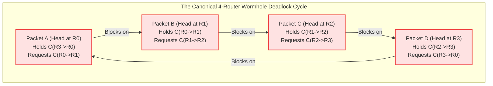
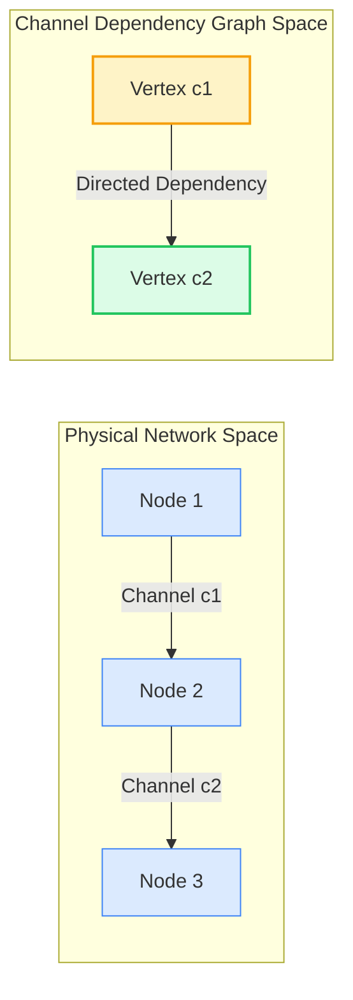
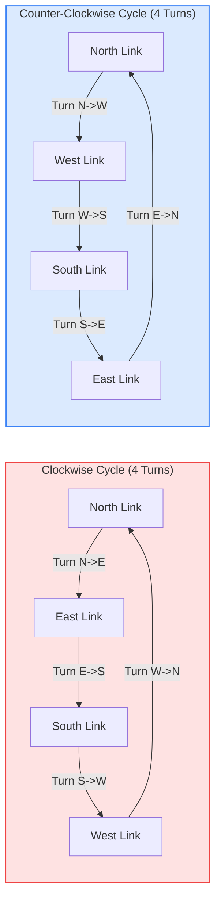
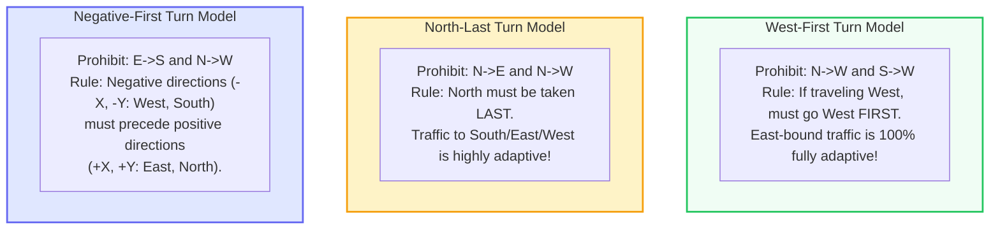
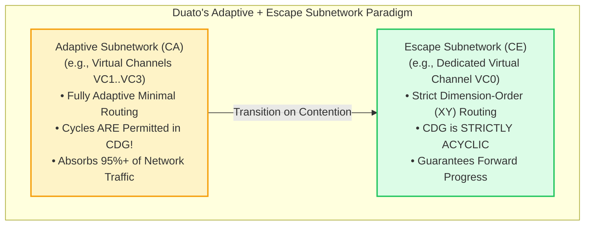
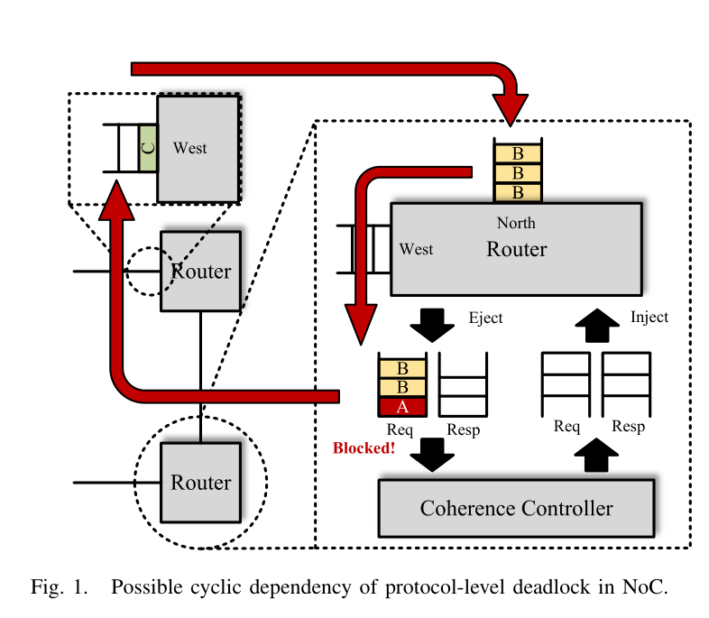
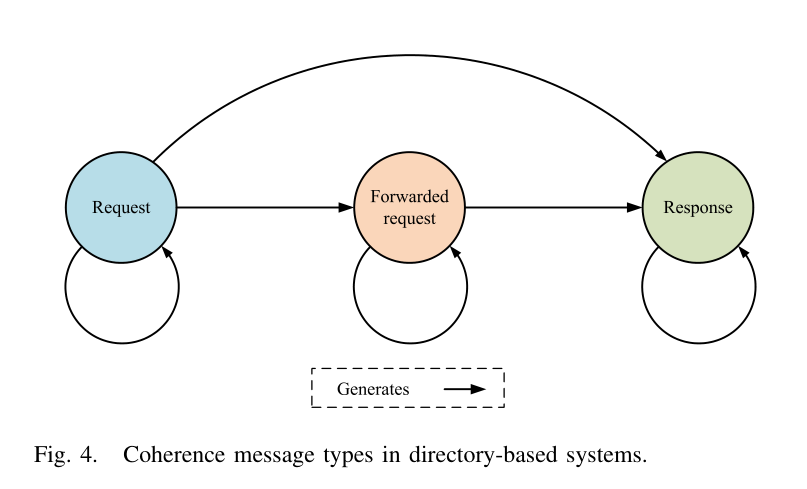
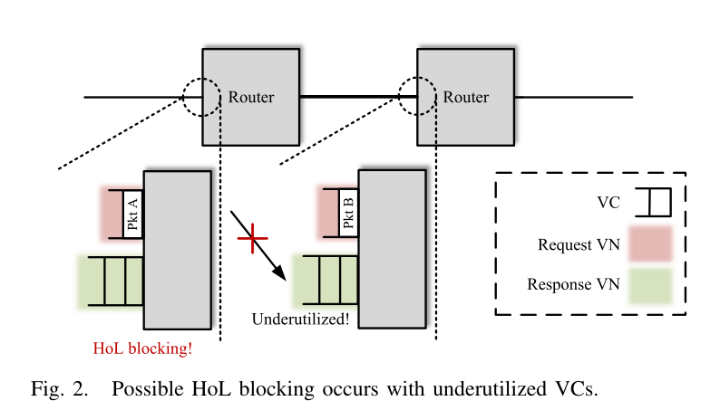
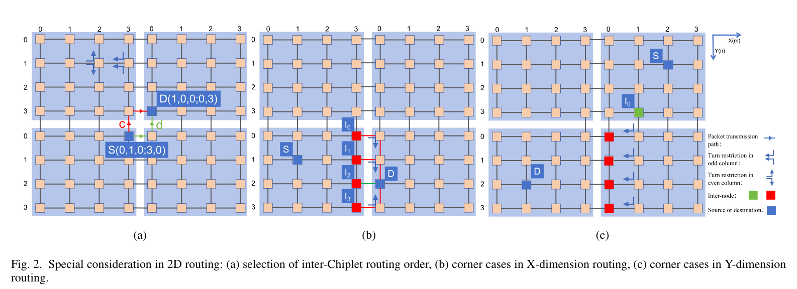

# Chapter 5: Deadlock Theory, Turn Models & Adaptive Routing

> **Authors**: NoC-Lab Research Consortium  
> **Domain**: Silicon Microarchitecture & Interconnect Design  
> **Interactive Companion**: [NoC Learning Hub — Track 4: Routing & Deadlock](https://network-on-chip.github.io/learning/track4-routing-deadlock/)  
> **Interactive Arcade**: [Deadlock Buster](https://network-on-chip.github.io/learning/interactive/game/) & [Packet Master](https://network-on-chip.github.io/learning/interactive/puzzle/)  
> **Accompanying Code**: [`code/cdg_cycle_detector.py`](code/cdg_cycle_detector.py), [`code/turn_model_routing.v`](code/turn_model_routing.v)

---

## Chapter Introduction

In the preceding chapters, we explored how physical wires are organized into interconnect topologies (Chapter 4) and how router switches arbitrate and buffer flits along their journey (Chapters 2 and 3). However, a physical network is inert without a **routing algorithm**—the intelligence that decides which physical and virtual channels a packet must traverse from source to destination.

In on-chip networks, routing is far more than a pathfinding problem. It is governed by an existential correctness invariant: **deadlock freedom**. In wormhole-switched NoCs, packets do not reside in a single buffer; they stretch like trains across multiple routers, simultaneously holding physical channel buffers while requesting downstream resources. If a set of packets forms a closed circular waiting dependency, the network enters a catastrophic **deadlock** state: traffic freezes across entire quadrants of the chip, processor pipelines stall indefinitely, and the entire system crashes.

Computer architects face a fundamental architectural dilemma:
- **Strictly Deterministic Routing** (such as Dimension-Order XY Routing) provides simple, provably cycle-free routing with minimal logic, but it is completely rigid. It cannot route around localized thermal hotspots, congested memory controllers, or permanent silicon wire defects.
- **Adaptive Routing** dynamically steers packets around traffic bottlenecks and faulty links, significantly boosting throughput and fault tolerance. However, permitting unrestricted turns introduces circular channel dependencies that can trigger fatal routing deadlocks.

This chapter presents the definitive theoretical foundations and microarchitectural mechanisms of on-chip routing and deadlock freedom. We begin with the mathematical formalism of Dally-Seitz Channel Dependency Graphs (CDGs), examine how the Glass-Ni Turn Model and Chiu's Odd-Even routing achieve partial adaptiveness without adding virtual channels, and investigate Duato's Theorem—the breakthrough proving that adaptive networks can tolerate cycles if an acyclic escape subnetwork is preserved. Finally, we venture beyond routing-layer deadlocks to explore cache coherence **protocol-level deadlocks** (PCMT, TCAD 2026) and multi-chiplet 3D vertical routing guarantees (ScaDA-Rou, TCAS-II 2026).

### Learning Objectives
- **Understand Deadlock Formation in Wormhole Networks**: Master the distributed holding behavior of multi-flit wormhole packets and distinguish deadlock from livelock and starvation.
- **Apply the Dally-Seitz Theorem**: Construct Channel Dependency Graphs (CDG) and prove the necessary and sufficient conditions for deadlock-free deterministic routing.
- **Design Turn-Model Adaptive Routing**: Analyze the 8 turns of a 2D mesh, formulate prohibition sets for West-First, North-Last, and Negative-First algorithms, and implement Chiu's Odd-Even routing.
- **Synthesize Escape-Channel Architectures (Duato's Theorem)**: Partition channel sets into fully adaptive and escape virtual channels, proving global forward progress despite cyclic adaptive paths.
- **Prevent Protocol-Level & 3D Multi-Chiplet Deadlocks**: Analyze coherence request-response cycles, evaluate Virtual Network (VN) area overheads, and examine unified priority solutions (PCMT) alongside 3D TSV routing models (ScaDA-Rou).

### Chapter Roadmap & Interactive Modules
- **Section 5.1**: The Deadlock Problem in Packet-Switched Networks & Failure Modes.
- **Section 5.2**: The Dally-Seitz Channel Dependency Graph Theorem & XY Proof.
- **Section 5.3**: Glass & Ni Turn Models for Partially Adaptive Routing.
- **Section 5.4**: Chiu's Odd-Even Turn Model: Even Turn Distribution.
- **Section 5.5**: Duato's Theorem: Fully Adaptive Routing with Escape VCs.
- **Section 5.6**: Protocol-Level Deadlock & Virtual Networks (PCMT Case Study).
- **Section 5.7**: 3D Multi-Chiplet Deadlock Freedom (ScaDA-Rou Case Study).
- **Section 5.8**: Comparative Summary Matrix of Routing Algorithms.
- **Section 5.9**: Self-Assessment Checkpoints & Review Exercises.
- **Section 5.10**: References & Bibliography.

---

## 5.1 The Deadlock Problem in Packet-Switched Networks

In packet-switched Networks-on-Chip (NoCs), **deadlock** is a catastrophic failure state wherein a set of concurrent packets are mutually blocked indefinitely, each holding one or more channel buffers while waiting for other buffers held by packets in the set. Without active deadlock avoidance or recovery, deadlocked packets freeze traffic across entire quadrants of the chip, leading to complete processor pipeline stall and system crash.

### 5.1.1 Why Wormhole Switching Exacerbates Deadlock

As established in Chapter 2, **Store-and-Forward (SAF)** switching requires routers to buffer entire packets before initiating forwarding. In SAF, a buffer dependency exists only between adjacent routers. 

In **Wormhole Switching**, however, buffer allocation is decoupled from packet length and operates at the flit granularity, drastically exacerbating deadlock vulnerability:
- **Distributed Channel Holding**: A single packet spans across multiple physical links and routers simultaneously, with the Head flit reserving routing state, Body flits streaming through the pipeline, and the Tail flit tearing down reservations.
- **Upstream Buffer Freezing**: When a Head flit encounters backpressure at a congested downstream router, trailing body flits freeze in place inside intermediate buffers along the entire path, blocking upstream physical channels.
- **Interleaved Channel Dependencies**: Blocked packets hold multiple distributed physical and virtual channels while awaiting downstream allocations, turning linear paths into complex cyclic waiting webs.
- **Exponential State Growth**: The multi-node footprint of wormhole packets dramatically multiplies the number of active dependencies in the network, creating fertile ground for circular dependency loops.

### 5.1.2 Classifying Anomaly States: Deadlock, Livelock & Starvation

To design robust interconnection networks, architects distinguish three fundamental pathologies:

| Failure Mode | Definition | Underlying Mechanism | Primary Mitigation |
| :--- | :--- | :--- | :--- |
| **Deadlock** | Permanent halt in forward progress; packets are frozen waiting on each other. | Circular resource dependency graph among channels or buffers. | Acyclic routing functions (DOR, Turn Models, Duato's escape channels). |
| **Livelock** | Packets continuously move across the network but never reach their destinations. | Pathological non-minimal misrouting (e.g. infinite deflection loops). | Hop counters, priority-aging, or bounded non-minimal routing. |
| **Starvation** | A packet is permanently denied service despite network forward progress. | Unfair switch arbitration policies (e.g. fixed priority). | Fair arbiters (Round-Robin, Matrix Arbiter LRU, iSLIP). |

---

## 5.2 The Dally-Seitz Channel Dependency Graph Theorem (1987)

The mathematical foundation of interconnection network deadlock freedom was formulated by William J. Dally and Charles L. Seitz in their seminal 1987 paper (*IEEE Transactions on Computers*).

### 5.2.1 Channel Dependency Graph (CDG) Formalism

Let $I = (V, C)$ denote an interconnection network, where $V$ is the set of processing/router nodes and $C$ is the set of unidirectional physical and virtual communication channels. Let $R: C \times V \to \mathcal{P}(C)$ be the routing function determining the set of permissible output channels based on the current channel $c_i \in C$ and the destination node $v_{dest} \in V$.

The **Channel Dependency Graph (CDG)** $D = (C, E_{CDG})$ is a directed graph where:
- The vertex set is the set of communication channels $C$.
- A directed edge $(c_i, c_j) \in E_{CDG}$ exists if and only if a packet can transition directly from channel $c_i$ to channel $c_j$ under routing function $R$: $\exists v \in V \text{ such that } c_j \in R(c_i, v)$.

### 5.2.2 The Dally-Seitz Theorem

> **Dally-Seitz Theorem (1987)**:  
> A deterministic routing function $R$ for an interconnection network $I$ is **deadlock-free** if and only if there are **no cycles** in its Channel Dependency Graph $D = (C, E_{CDG})$.

#### Proof
- **Sufficiency Proof ($\Leftarrow$)**:  
  - Assume $D$ has no directed cycles. Because $D$ is a finite directed acyclic graph (DAG), there exists at least one channel $c_{sink} \in C$ with zero out-degree (no channels depend on it; it delivers directly to local memory).
  - A packet occupying $c_{sink}$ can never be blocked by another packet in the network and will be consumed in finite time.
  - By topological sorting of the DAG, every channel $c_i$ can be assigned an integer rank $\text{rank}(c_i)$ such that: $(c_i, c_j) \in E_{CDG} \implies \text{rank}(c_i) < \text{rank}(c_j)$.
  - By induction on channel rank, flits on channels of rank $K$ are guaranteed to advance once all channels of rank $> K$ clear. Therefore, no packet can be blocked indefinitely, and the network is provably deadlock-free.
- **Necessity Proof ($\Rightarrow$)**:  
  - Assume $D$ contains a directed cycle $c_0 \to c_1 \to \dots \to c_{M-1} \to c_0$.
  - One can construct a configuration of $M$ packets $P_0, P_1, \dots, P_{M-1}$ such that packet $P_i$ occupies channel $c_i$ and requests channel $c_{(i+1) \bmod M}$.
  - If all channels have finite buffer capacity and are full, no packet can advance because each packet is waiting on a channel held by another packet in the cycle. The network is permanently deadlocked. $\blacksquare$

### 5.2.3 Application to Dimension-Order Routing (XY Routing)

In a 2D Mesh, deterministic **XY Dimension-Order Routing** routes packets strictly along the $X$-dimension until $\Delta X = 0$, and only then turns into the $Y$-dimension until $\Delta Y = 0$.
- **Permissible Turns**: $(X \to X), (X \to Y), (Y \to Y)$
- **Prohibited Turns**: $(Y \to X)$ (no turns from $Y$ to $X$ are ever permitted).

Because channels in the $X$-dimension never depend on channels in the $Y$-dimension, all edges in the CDG flow monotonically from $X$-channels to $Y$-channels. Hence, the CDG is strictly acyclic, proving that **XY routing is provably deadlock-free on any 2D Mesh without requiring virtual channels**.

---

## 5.3 Glass & Ni Turn Models for Adaptive Routing (1994)

While XY routing guarantees deadlock freedom, it is strictly deterministic: if an $X$-channel along the path is congested or faulty, the packet cannot deviate, leading to Head-of-Line blocking and poor throughput under non-uniform traffic.

Christopher J. Glass and Lionel M. Ni (*Journal of the ACM*, 1994) introduced the **Turn Model**, providing the first systematic methodology for designing **partially adaptive, deadlock-free routing algorithms without adding virtual channels**.

### 5.3.1 The 8 Turns of a 2D Mesh

In a 2D Mesh, a packet can travel in 4 directions: East, West, North, South. A change of direction constitutes a **turn**. There are exactly $4 \times 2 = 8$ possible 90-degree turns:

$$\{E \to N, \quad E \to S, \quad W \to N, \quad W \to S, \quad N \to E, \quad N \to W, \quad S \to E, \quad S \to W\}$$

These 8 turns can form two types of simple cycles in the physical mesh:
- **Clockwise Cycle**: $E \to S \to W \to N \to E$ (uses turns $E \to S$, $S \to W$, $W \to N$, $N \to E$).
- **Counter-Clockwise Cycle**: $E \to N \to W \to S \to E$ (uses turns $E \to N$, $N \to W$, $W \to S$, $S \to E$).

### 5.3.2 The Turn Model Theorem

> **Glass & Ni Turn Model Theorem (1994)**:  
> To prevent deadlock in an $n$-dimensional mesh, it is necessary and sufficient to **prohibit at least one turn in every simple directed cycle**. To maximize routing adaptiveness, exactly **one turn from each directed cycle** should be prohibited.

In a 2D Mesh, there are 2 directed cycles (clockwise and counter-clockwise). By prohibiting exactly **2 out of the 8 turns** (one from clockwise, one from counter-clockwise) such that no complex cycles can be formed, the network achieves **6/8 (75%) turn freedom** without virtual channels!

### 5.3.3 The Three Canonical 2D Turn Models

#### 1. West-First Routing
- **Prohibited Turns**: $N \to W$ and $S \to W$.
- **Operational Rule**: If a packet must travel West ($\Delta X < 0$), it **must execute all Westward hops first** before turning North, South, or East. Once a packet turns away from West, it can never turn West again.
- **Adaptiveness**: Packets destined for the East ($\Delta X > 0$) enjoy **100% full adaptiveness**—they can freely interleave East, North, and South hops around congested routers.

#### 2. North-Last Routing
- **Prohibited Turns**: $N \to E$ and $N \to W$.
- **Operational Rule**: A packet must postpone any Northward traversal until all East, West, and South hops are complete. Once a packet heads North, it must finish its journey traveling exclusively North.

#### 3. Negative-First Routing
- **Prohibited Turns**: Transitions from positive directions ($+X, +Y$: East, North) to negative directions ($-X, -Y$: West, South).
- **Operational Rule**: A packet must route along all negative dimensions first before acquiring any positive dimension channels.

---

## 5.4 The Odd-Even Turn Model (Chiu, 2000)

A key limitation of the Glass & Ni turn models is **spatial asymmetry**. For example, in West-First routing, East-bound packets have multiple routing choices, but West-bound packets are strictly deterministic, causing uneven channel utilization.

Ge-Ming Chiu (*IEEE Transactions on Parallel and Distributed Systems*, 2000) introduced the **Odd-Even Turn Model**, which conditions turn restrictions on the **column parity ($x$-coordinate)** of the router:
- **At Even Columns ($x \bmod 2 == 0$)**:
  - Packets are **not allowed to turn from North or South onto West** ($N \to W$ and $S \to W$ prohibited).
  - Packets are **not allowed to turn from East to North or South** ($E \to N$ and $E \to S$ prohibited).
- **At Odd Columns ($x \bmod 2 == 1$)**:
  - Packets are **not allowed to turn from North or South onto East** ($N \to E$ and $S \to E$ prohibited).
  - Packets are **not allowed to turn from West to North or South** ($W \to N$ and $W \to S$ prohibited).

By alternating turn prohibitions between even and odd columns, the Odd-Even model prevents cycles while distributing routing adaptiveness evenly across both East-bound and West-bound traffic flows.

---

## 5.5 Duato's Theorem for Fully Adaptive Routing (1993)

While turn models provide partial adaptiveness, they still restrict valid shortest paths. To achieve **100% Fully Adaptive Routing (FAR)**—where any flit can take any uncongested physical channel that moves it closer to its destination—virtual channels must be deployed.

In 1993, José Duato (*IEEE Transactions on Parallel and Distributed Systems*) established a landmark theorem proving that **the Channel Dependency Graph of an adaptive router DOES NOT need to be acyclic** to guarantee deadlock freedom!

### 5.5.1 The Duato Conditions

> **Duato's Theorem (1993)**:  
> An adaptive routing function $R$ for an interconnection network $I$ is **deadlock-free** if and only if the channel set $C$ can be partitioned into an adaptive channel subset $C_A$ and an escape channel subset $C_E$ ($C = C_A \cup C_E$) such that:
> - **Acyclic Escape Subnetwork**: There exists an escape routing subfunction $R_E: C_E \times V \to \mathcal{P}(C_E)$ whose restricted Channel Dependency Graph $D_E = (C_E, E_{E})$ is **strictly acyclic**.
> - **Unconditional Escape Transition**: Packets on any adaptive channel in $C_A$ are always permitted to transition into $C_E$ whenever congestion or contention occurs.
> - **Connected Escape Coverage**: The escape subnetwork $C_E$ provides at least one connected path between every source and destination pair in the system.

#### Operational Principle
Under low-to-medium contention, flits arbitrate for high-performance adaptive virtual channels ($C_A$), routing around localized traffic hot spots. If an adaptive channel is congested or a potential cycle begins to form, blocked flits are guaranteed access to the escape virtual channel ($C_E$, e.g., running strict XY routing). Because $C_E$ is strictly acyclic, flits inside $C_E$ can never deadlock and are guaranteed forward progress to their destinations.

Duato's theorem decouples high-performance adaptive routing from the rigid acyclic constraints of Dally-Seitz, serving as the architectural foundation of modern commercial NoCs (such as Intel TeraFLOPS, Tilera TILE64, and IBM BlueGene).

---

## 5.6 Protocol-Level Deadlock & Virtual Networks (PCMT Case Study)

In shared-memory multi-core processors, routing-level deadlock freedom is necessary but **not sufficient** to prevent system lockup. A distinct, insidious class of deadlock occurs at the cache coherence protocol level: **Protocol-Level Deadlock**.

### 5.6.1 The Request-Response Dependency Loop

In directory-based cache coherence protocols (e.g., MESI, MOESI), processors exchange multi-step coherence messages across the NoC:
- **Coherence Request Step**: Core A sends a `Request` (GetS/GetM) to Directory D.
- **Forward / Invalidate Step**: Directory D sends a `Forwarded Request` or `Invalidation` probe to Core B.
- **Data Response Step**: Core B sends an `Acknowledgement` or `Response Data` back to Core A.

*Figure 5.1: Possible cyclic dependency causing protocol-level deadlock in a multi-core NoC. A core's incoming request queue fills up and cannot accept new requests until its outgoing response is delivered, creating a circular protocol dependence across routers. [Reproduced from: Y. Jia, Z. Zhang, C. Fu, L. Wan, and J. Han, "PCMT: Prioritizing Coherence Message Types for NoC Protocol-Level Deadlock Freedom," IEEE Transactions on Computer-Aided Design of Integrated Circuits and Systems, Vol. 45, No. 4, pp. 1949–1962, April 2026, DOI: 10.1109/TCAD.2025.3524944. © 2026 IEEE]*

*Figure 5.2: Coherence message classifications in directory-based memory hierarchies: Request, Forwarded Request, Response, and Writeback dependencies. [Reproduced from: Y. Jia et al., "PCMT," IEEE TCAD, Vol. 45, No. 4, April 2026, DOI: 10.1109/TCAD.2025.3524944. © 2026 IEEE]*

If all messages share the same physical router queues, a **Request-Response circular dependency** emerges:
- Router input buffers fill with incoming `Requests`.
- A core cannot process an incoming `Request` because its output queue is full of outgoing `Responses`.
- The outgoing `Responses` cannot enter the network because the network routers are completely jammed with blocked `Requests`.
- The system deadlocks, even though the underlying routing algorithm (e.g., XY DOR) is provably deadlock-free!

### 5.6.2 The Virtual Network (VN) Buffer Inflation Crisis

The traditional architectural solution is **Virtual Networks (VNs)**: partitioning router virtual channels into isolated message classes:
- $VN_0$: Requests
- $VN_1$: Forwarded Requests / Invalidation
- $VN_2$: Responses

Because responses never generate requests, messages in higher-priority VNs can always be consumed, breaking protocol cycles. However, as demonstrated by Jia et al. (*IEEE TCAD*, 2026), dedicated VNs incur severe silicon penalties:

*Figure 5.3: Low virtual channel utilization and Head-of-Line blocking in virtual networks. Rigid partition walls leave response VCs idle while request VCs saturate, wasting up to 63% of input buffer area. [Reproduced from: Y. Jia et al., "PCMT," IEEE TCAD, Vol. 45, No. 4, April 2026, DOI: 10.1109/TCAD.2025.3524944. © 2026 IEEE]*

### 5.6.3 The PCMT Solution (IEEE TCAD 2026)

Yufan Jia, Zhiyuan Zhang, Chao Fu, Li Wan, and Jun Han (*IEEE Transactions on Computer-Aided Design of Integrated Circuits and Systems*, TCAD 2026) proposed **Prioritizing Coherence Message Types (PCMT)**:
- Eliminates rigid virtual network partition walls entirely, allowing all flits to dynamically share unified FIFO buffer pools.
- Leverages the intrinsic priority hierarchy of directory coherence messages: Response flits are granted preemptive arbitration priority at switch allocation, draining response chains before new requests can saturate the queues.
- In a 6-VN MOESI-Hammer system, PCMT achieved identical performance while **slashing router input buffer area by up to 63%**.

---

## 5.7 3D Multi-Chiplet Deadlock Freedom (ScaDA-Rou Case Study)

In heterogeneous 2.5D and 3D multi-chiplet systems, inter-chiplet communication crosses through microbumps, silicon interposers, and Through-Silicon Vias (TSVs). Interposer routing introduces complex topological boundaries and vertical link bottlenecks.

*Figure 5.4: Special consideration in multi-chiplet 2D/3D routing: (a) selection of inter-chiplet routing order; (b) corner cases in X-dimension routing; (c) corner cases in Y-dimension routing. [Reproduced from: L. Zhu, H. Gu, Y. Tan, and G. Zhang, "ScaDA-Rou: A Scalable, Deadlock-Free, and Adaptive Routing for 3-D Multi-Chiplet System," IEEE Transactions on Circuits and Systems–II: Express Briefs, Vol. 73, No. 4, pp. 433–437, April 2026, DOI: 10.1109/TCSII.2025.3526101. © 2026 IEEE]*

Lijing Zhu, Huaxi Gu, Yun Tan, and Guangming Zhang (*IEEE Transactions on Circuits and Systems–II: Express Briefs*, TCAS-II 2026) introduced **ScaDA-Rou**:
- **In-Plane Deadlock Avoidance**: Establishes turn model prohibitions within each individual 2D chiplet layer.
- **Cross-Plane Deadlock Avoidance**: Partitions virtual channels based on the source and destination planes of cross-plane vertical packets, preventing vertical TSV dependency cycles.
- **Throughput & Latency Acceleration**: ScaDA-Rou achieved an average **89.2% latency improvement** under non-uniform multi-chiplet workloads while guaranteeing complete deadlock freedom across arbitrary 3D chiplet stacks.

---

## 5.8 Comparative Summary Matrix of Routing Algorithms

| Routing Algorithm | Determinism | Turn Restrictions | Min. VCs Required | Fault Tolerance | Saturation Throughput |
| :--- | :--- | :--- | :---: | :---: | :---: |
| **Dimension-Order (XY)** | Strictly Deterministic | No $Y \to X$ turns | 1 VC | Zero (fails on 1 fault) | Moderate (center hot spot) |
| **West-First (Glass & Ni)** | Partially Adaptive | No $N \to W$, $S \to W$ | 1 VC | High (East-bound only) | +25% over XY |
| **North-Last (Glass & Ni)** | Partially Adaptive | No $N \to E$, $N \to W$ | 1 VC | High (South-bound only) | +25% over XY |
| **Negative-First** | Partially Adaptive | No $(+ \to -)$ turns | 1 VC | High (Quadrant-dependent) | +20% over XY |
| **Odd-Even (Chiu)** | Partially Adaptive | Parity-dependent | 1 VC | High (Uniformly distributed)| +35% over XY |
| **Duato FAR + XY Escape** | Fully Adaptive | No restrictions in $C_A$ | 2 VCs | Very High (all minimal paths)| +75% to +100% over XY |
| **PCMT (Jia et al., 2026)** | Protocol Coherence | Priority-preemptive | 1 Unified Pool | High | Drains VCs; -63% area |

---

## 5.9 Checkpoint Assessment

Test your mastery of Chapter 5 concepts against the official certification questions (mirroring the 3-Tier Exam Engine in [`quiz.md`](../../quiz.md)):

#### Question 5.1 (Tier 1: Fundamental)
*What is the necessary and sufficient condition established by William Dally and Charles Seitz (1987) for a deterministic routing algorithm to be deadlock-free in a wormhole network?*

- **A)** The network must have at least 16 virtual channels per physical link.
- **B)** The Channel Dependency Graph (CDG) must contain no directed cycles.
- **C)** All routers must operate with optical clock synchronization.
- **D)** Routers must drop packets whenever a buffer is 50% full.

??? success "Reveal Answer & Full Solution"
    **Correct Answer: Option B**

    **1. Step-by-Step Architectural & Mathematical Derivation:**
    In wormhole-routed networks, packets hold buffer channels while requesting downstream channels, creating hold-and-wait resource dependencies. Dally and Seitz formalized this through the Channel Dependency Graph (CDG), D = (C, E), where: (1) Each vertex c_i in C represents a dedicated routing channel/buffer. (2) A directed edge (c_i, c_j) in E exists if a packet holding channel c_i can immediately request channel c_j under the routing algorithm R. Dally and Seitz proved: A deterministic routing function R for network N is deadlock-free IF AND ONLY IF its Channel Dependency Graph D has NO DIRECTED CYCLES. If a directed cycle exists (c_1 -> c_2 -> ... -> c_k -> c_1), a set of packets can completely fill these buffers such that each packet waits for the next to advance, creating a permanent, unresolvable circular deadlock. Establishing a strict partial order on channels (e.g. dimension order: X links before Y links) guarantees an acyclic CDG.

    **2. Option-by-Option Breakdown & Distractor Analysis:**
    - **Option A (Incorrect Distractor):** Deterministic XY routing requires only 1 virtual channel to be deadlock-free; 16 VCs are completely unnecessary.
    - **Option B (Correct):** An acyclic Channel Dependency Graph is the mathematically proven necessary and sufficient condition for deterministic deadlock freedom.
    - **Option C (Incorrect Distractor):** Clock synchronization does not prevent topological buffer dependency deadlocks.
    - **Option D (Incorrect Distractor):** Wormhole flow control is strictly lossless; dropping packets violates reliable on-chip communication semantics.

    **3. Silicon Architect's Takeaway:**
    Deadlock in interconnection networks is fundamentally a directed cycle in the Channel Dependency Graph; eliminating cycles guarantees deadlock-free operation.

    *(Reference: W. J. Dally and C. L. Seitz, 'Deadlock-Free Message Routing in Multiprocessor Interconnection Networks,' IEEE Transactions on Computers, Vol. C-36, No. 5, pp. 547–553, May 1987. DOI: 10.1109/TC.1987.1676939.)*

#### Question 5.2 (Tier 2: Core Engineering)
*In a 2D Mesh with 8 possible 90-degree turns, how many turns must be prohibited in the Turn Model (Glass & Ni, 1994) to eliminate deadlock while retaining maximum routing adaptivity?*

- **A)** Exactly 2 turns (one from each of the two simple 4-turn cycles: clockwise and counter-clockwise).
- **B)** Exactly 4 turns, forcing deterministic XY or YX routing.
- **C)** All 8 turns, prohibiting any direction change.
- **D)** 0 turns; 2D meshes cannot deadlock under any circumstances.

??? success "Reveal Answer & Full Solution"
    **Correct Answer: Option A**

    **1. Step-by-Step Architectural & Mathematical Derivation:**
    In a 2D mesh, there are 8 possible 90-degree turns: {NE, NW, SE, SW, EN, ES, WN, WS}. The simplest directed cycles in the CDG are formed by 4-turn closed loops: (1) Clockwise (CW) cycle: North -> East -> South -> West -> North. (2) Counter-Clockwise (CCW) cycle: North -> West -> South -> East -> North. Because every complex cycle in a 2D mesh must contain at least one complete CW or CCW turn loop, breaking at least one turn in the CW cycle and one turn in the CCW cycle breaks all possible cycles. To maximize remaining adaptivity, Glass and Ni proved that exactly 2 turns must be prohibited: one turn from the CW cycle and one turn from the CCW cycle. For example: - West-First: Prohibits NW (CCW) and SW (CW). - North-Last: Prohibits NE (CW) and NW (CCW). - Negative-First: Prohibits ES (CW) and WN (CCW). By contrast, deterministic XY routing eliminates 4 turns ({NW, SW, NE, SE}), unnecessarily destroying all dynamic adaptivity.

    **2. Option-by-Option Breakdown & Distractor Analysis:**
    - **Option A (Correct):** Prohibiting exactly 2 turns breaks both clockwise and counter-clockwise cycles with minimal loss of routing adaptivity.
    - **Option B (Incorrect Distractor):** Prohibiting 4 turns describes deterministic DOR, which destroys 100% of routing adaptivity.
    - **Option C (Incorrect Distractor):** Prohibiting all 8 turns prevents packets from changing dimension entirely.
    - **Option D (Incorrect Distractor):** Unconstrained 2D meshes deadlock almost instantly under congestion due to cyclic channel dependencies.

    **3. Silicon Architect's Takeaway:**
    The Turn Model achieves deadlock-free partially adaptive routing without virtual channels by removing just 2 of the 8 turns.

    *(Reference: C. J. Glass and L. M. Ni, 'The Turn Model for Adaptive Routing,' Journal of the ACM, Vol. 41, No. 5, pp. 874–902, Sept. 1994. DOI: 10.1145/185675.185682.)*

#### Question 5.3 (Tier 3: Silicon Mastery)
*Why does routing-level deadlock freedom (e.g. using deterministic XY DOR) fail to prevent Protocol-Level Deadlock in shared-memory multicore architectures? (Select all that apply)*

- **A)** Cache coherence protocols create message dependencies where servicing an incoming Request flit requires generating and injecting an outgoing Response flit.
- **B)** If Request and Response messages share the same physical buffers, a flood of Requests can fill all router buffers, preventing Response messages from being delivered.
- **C)** Protocol deadlocks can be completely prevented by separating coherence message classes into distinct Virtual Networks (VNETs) mapped to independent Virtual Channels.
- **D)** Protocol deadlocks only occur if the CPU clock speed exceeds 5 GHz.

??? success "Reveal Answer & Full Solution"
    **Correct Answer: Option A, B, C**

    **1. Step-by-Step Architectural & Mathematical Derivation:**
    Routing-level deadlock freedom ensures that packets do not form circular dependency loops within the network router buffers (assuming destination nodes always consume flits). However, in shared-memory CMPs running cache coherence (e.g. MESI / MOESI): (1) Message Dependency: When a core receives a Read Request, it cannot consume the request flit until it allocates a cache buffer, inspects directory state, and transmits a Read Response. (2) Circular Wait: If the network uses a single shared buffer class for both Requests and Responses, a flood of Request packets can saturate all router buffers. Now, a core attempting to inject a Response packet is blocked because all input buffers are filled with Requests. Meanwhile, the cores holding the Request flits cannot consume them until they receive their Responses. This creates an end-to-end circular dependency between message classes that spans outside the network into core controllers. (3) Virtual Network (VNET) Solution: CMP architectures partition coherence messages into strictly ordered message classes: VNET0 (Requests) -> VNET1 (Forwards) -> VNET2 (Responses). By dedicating independent Virtual Channels to each VNET, Responses are physically guaranteed never to be blocked behind Requests, preventing protocol deadlock.

    **2. Option-by-Option Breakdown & Distractor Analysis:**
    - **Option A (Correct):** True. Coherence transactions create application-level dependency chains: Request -> Forward -> Response.
    - **Option B (Correct):** True. If buffers are shared, Request congestion prevents Responses from draining, deadlocking the system.
    - **Option C (Correct):** True. Dedicating independent VNETs/VCs guarantees that higher-priority response flits cannot be blocked by request flits.
    - **Option D (Incorrect Distractor):** False. Protocol deadlocks are logical resource dependency cycles, completely independent of clock frequency.

    **3. Silicon Architect's Takeaway:**
    Deadlock-free routing only guarantees flit delivery if nodes sink packets; protocol deadlock freedom requires independent Virtual Networks (VNETs) for Requests and Responses.

    *(Reference: Y. Jia, Z. Zhang, C. Fu, L. Wan, and J. Han, 'PCMT: Prioritizing Coherence Message Types for NoC Protocol-Level Deadlock Freedom,' IEEE TCAD, Vol. 45, No. 4, pp. 1949–1962, Apr. 2026. DOI: 10.1109/TCAD.2025.3524944.)*

---

## References & Bibliography

1. **[Dally1987]** W. J. Dally and C. L. Seitz, "Deadlock-Free Message Routing in Multiprocessor Interconnection Networks," *IEEE Transactions on Computers*, vol. C-36, no. 5, pp. 547–553, May 1987. [DOI: 10.1109/TC.1987.1676939](https://doi.org/10.1109/TC.1987.1676939).
2. **[Duato1993]** J. Duato, "A New Theory of Deadlock-Free Adaptive Routing in Wormhole Networks," *IEEE Transactions on Parallel and Distributed Systems*, vol. 4, no. 12, pp. 1320–1331, Dec. 1993. [DOI: 10.1109/71.257110](https://doi.org/10.1109/71.257110).
3. **[Glass1994]** C. J. Glass and L. M. Ni, "The Turn Model for Adaptive Routing," *Journal of the ACM*, vol. 41, no. 5, pp. 874–902, Sept. 1994. [DOI: 10.1145/185675.185682](https://doi.org/10.1145/185675.185682).
4. **[Chiu2000]** G.-M. Chiu, "The Odd-Even Turn Model for Adaptive Routing," *IEEE Transactions on Parallel and Distributed Systems*, vol. 11, no. 7, pp. 729–738, July 2000. [DOI: 10.1109/71.877843](https://doi.org/10.1109/71.877843).
5. **[Jia2026]** Y. Jia, Z. Zhang, C. Fu, L. Wan, and J. Han, "PCMT: Prioritizing Coherence Message Types for NoC Protocol-Level Deadlock Freedom," *IEEE Transactions on Computer-Aided Design of Integrated Circuits and Systems*, vol. 45, no. 4, pp. 1949–1962, Apr. 2026. [DOI: 10.1109/TCAD.2025.3524944](https://doi.org/10.1109/TCAD.2025.3524944).
6. **[Zhu2026]** L. Zhu, H. Gu, Y. Tan, and G. Zhang, "ScaDA-Rou: A Scalable, Deadlock-Free, and Adaptive Routing for 3-D Multi-Chiplet System," *IEEE Transactions on Circuits and Systems–II: Express Briefs*, vol. 73, no. 4, pp. 433–437, Apr. 2026. [DOI: 10.1109/TCSII.2025.3526101](https://doi.org/10.1109/TCSII.2025.3526101).
7. **[Schroeder1991]** M. D. Schroeder et al., "Autonet: A High-Speed, Self-Configuring Local Area Network Using Point-to-Point Links," *IEEE Journal on Selected Areas in Communications*, vol. 9, no. 8, pp. 1318–1335, Oct. 1991. [DOI: 10.1109/49.105178](https://doi.org/10.1109/49.105178).
8. **[Mejia2006]** A. Mejia, J. Flich, J. Duato, S.-A. Reinemo, and T. Skeie, "Segment-Based Routing: An Efficient Fault-Tolerant Routing Methodology for Meshes and Tori," in *Proceedings of the 20th International Parallel and Distributed Processing Symposium (IPDPS)*, 2006. [DOI: 10.1109/IPDPS.2006.1639316](https://doi.org/10.1109/IPDPS.2006.1639316).
9. **[DallyPrinciples]** W. J. Dally and B. Towles, *Principles and Practices of Interconnection Networks*, Morgan Kaufmann Publishers, San Francisco, CA, 2004.
