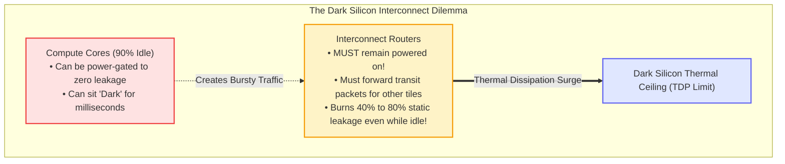
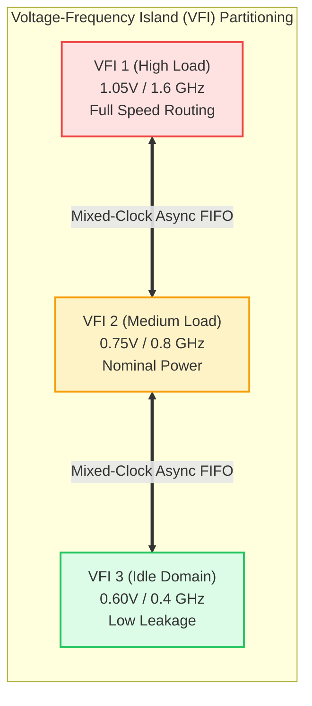

# Chapter 6: Low-Power Architectures & Dark Silicon Dynamics

> **Authors**: NoC-Lab Research Consortium  
> **Domain**: Silicon Microarchitecture & Interconnect Design  
> **Interactive Companion**: [NoC Learning Hub — Track 5: Thermal & Energy](https://network-on-chip.github.io/learning/track5-thermal-congestion/)  
> **Interactive Arcade**: [Power Pavilion: Energy Tycoon](https://network-on-chip.github.io/learning/interactive/power/)  
> **Accompanying Code**: [`code/dvfs_vfi_power_sim.py`](code/dvfs_vfi_power_sim.py), [`code/power_gating_router_fsm.v`](code/power_gating_router_fsm.v)

---

## Chapter Introduction

In the first five chapters, we examined the physical wire crisis (Chapter 1), flow control protocols (Chapter 2), router microarchitectures (Chapter 3), interconnect topologies (Chapter 4), and deadlock-free routing algorithms (Chapter 5). Yet all of these architectural constructs operate under an unyielding physical constraint in modern nanometer silicon: **the Thermal Design Power (TDP) ceiling**.

Following the collapse of classical Dennard scaling, supply voltage ($V_{dd}$) cannot scale down proportionally with physical dimensions without triggering unmanageable sub-threshold leakage currents. Consequently, while transistor density continues to double with each manufacturing node, power density can no longer remain constant. This divergence has forced modern computer architecture into the era of **Dark Silicon** (Esmaeilzadeh et al., ISCA 2011): at sub-7nm and sub-3nm process nodes, **between 50% and 80% of the transistors on a large manycore silicon die must remain unpowered ("dark") or operate at severely throttled clock frequencies** to prevent exceeding packaging heat dissipation limits (typically $100\text{--}150\text{ W/cm}^2$).

Within this dark silicon landscape, the on-chip interconnection network presents a critical, unique dilemma:
- **Compute Cores Can Sleep**: An idle CPU, GPU, or NPU core can be aggressively powered down via sleep transistors, remaining completely "dark" for milliseconds at zero static leakage.
- **Interconnect Routers Must Stay Awake**: In contrast, a router in a multi-hop mesh cannot casually power off when its local core is idle; it must remain awake to forward transit packets between other active tiles across the die. If intermediate routers shut down without coordination, the network physically partitions, severing communication paths.
- **Severe Static Leakage Penalty**: Consequently, on-chip routers frequently sit active but idle for $70\%\text{ to }90\%$ of total execution time, dissipating massive static leakage power while waiting for sporadic flits.

This chapter explores the comprehensive spectrum of architectural, circuit-level, and information-theoretic methodologies designed to tame interconnect power in the dark silicon era. We analyze the physical breakdown of dynamic switching power versus temperature-sensitive sub-threshold leakage, evaluate distributed Dynamic Voltage and Frequency Scaling (DVFS) across Voltage-Frequency Islands (VFIs, such as LAURA-NoC), examine ultrafine-grained run-time power gating and lookahead early wakeup protocols, investigate entropy-based link code reordering (LPCR, TCAD 2025), and contrast conventional buffered architectures against radical bufferless deflection routing.

### Learning Objectives
- **Understand the Dark Silicon Bottleneck**: Master the physical origin of dark silicon and quantify why transit routing requirements prevent conventional coarse-grained core power gating in on-chip networks.
- **Decompose Nanoscale Power Dissipation**: Formulate exact physical models for dynamic capacitive switching power ($\alpha C_{eff} V_{dd}^2 f$) and exponential sub-threshold leakage current ($I_{sub} \propto \exp((V_{gs}-V_{th})/mV_T)$).
- **Implement Voltage-Frequency Islands (VFIs)**: Design distributed DVFS schemes with local hardware feedback loops and configure mixed-clock asynchronous FIFOs for safe clock boundary crossings.
- **Formulate Run-Time Power Gating & Breakeven Time**: Derive the breakeven idle time ($\tau_{breakeven}$) equation and analyze lookahead early wakeup protocols that completely mask wake-up latency penalties.
- **Evaluate Advanced Low-Power Paradigms**: Compare information-theoretic link code reordering (LPCR) and bufferless deflection routing (BLESS/CHIPPER) in terms of area, energy, and deflection overhead.

### Chapter Roadmap & Interactive Modules
- **Section 6.1**: The Power Wall & Dark Silicon in Manycore Interconnects.
- **Section 6.2**: Dynamic Voltage & Frequency Scaling (DVFS) & Voltage-Frequency Islands (VFIs).
- **Section 6.3**: Ultrafine-Grained Run-Time Power Gating & Breakeven Modeling.
- **Section 6.4**: Low-Power Encoding on Physical Links (LPCR Case Study).
- **Section 6.5**: Bufferless Deflection Routing: Slashing SRAM Leakage.
- **Section 6.6**: Quantitative Comparative Evaluation Matrix.
- **Section 6.7**: Self-Assessment Exercises & Review Questions.
- **Section 6.8**: References & Bibliography.

---

## 6.1 The Power Wall & Dark Silicon in Manycore Interconnects

As semiconductor fabrication scaled from planar CMOS into FinFET and nanosheet Gate-All-Around (GAA) nodes, the collapse of classical Dennard scaling forced a strict chip-wide power budget known as the **Thermal Design Power (TDP)**. Because supply voltage ($V_{dd}$) cannot scale proportionally with physical dimensions without triggering unmanageable sub-threshold leakage, modern silicon chips face the **Dark Silicon Phenomenon** (Esmaeilzadeh et al., ISCA 2011).

At sub-7nm process nodes, between **50% and 80% of the silicon area on a large manycore die must remain unpowered ("dark") or operate at severely throttled clock frequencies** to prevent exceeding thermal dissipation thresholds (typically $\le 100\text{--}150\text{ W/cm}^2$ for standard packaging).



### 6.1.1 The Interconnect as the Critical Dark Silicon Bottleneck

While an idle processor core can simply be powered down completely via coarse-grained sleep switches, the **on-chip interconnection network cannot be casually shut down**. In a multi-hop mesh, an intermediate router must remain awake and active to forward transit traffic between other communicating nodes. 

If intermediate routers are powered off without intelligent bypass mechanisms, the physical network partitions, severing communication paths. Consequently, on-chip routers frequently sit **active but idle for 70% to 90% of total application execution time** (Matsutani et al., IEEE TCAD 2011), dissipating massive static leakage power while waiting for sporadic flits.

### 6.1.2 Physical Power Breakdown in Nanoscale NoC Routers

Total power dissipation in an on-chip interconnection network is decomposed into two primary components:

$$P_{total} = P_{dynamic} + P_{leakage}$$

- **Dynamic Switching Power ($P_{dynamic}$)**:
  - Consumed by charging and discharging physical circuit capacitances during signal transitions, as well as transient short-circuit currents during CMOS switching:
    $$P_{dynamic} = \alpha \cdot C_{eff} \cdot V_{dd}^2 \cdot f_{clk}$$
  - $\alpha$: Average **switching activity factor** (fraction of clock cycles with signal transitions).
  - $C_{eff}$: Total effective switching capacitance of router FIFO buffers, crossbar multiplexer trees, pipeline registers, and inter-router metal links.
  - $V_{dd}$: Power supply voltage.
  - $f_{clk}$: Operating clock frequency.
  - *Quadratic Voltage Leverage*: Because dynamic energy per flit scales quadratically ($E_{flit} \propto V_{dd}^2$) and power scales cubically when frequency tracks voltage ($P_{dynamic} \propto V_{dd}^3$), reducing $V_{dd}$ delivers massive dynamic energy savings.

- **Static Sub-Threshold Leakage Power ($P_{leakage}$)**:
  - In sub-28nm geometries, static leakage power rivals or exceeds dynamic power during typical workloads. Leakage comprises three primary physical mechanisms:
  - **Sub-Threshold Leakage ($I_{sub}$)**: Drain-to-source current flowing when the transistor is nominally OFF ($V_{gs} < V_{th}$):
    $$I_{sub} = \mu_0 C_{ox} \frac{W}{L} (m - 1) V_T^2 \exp\left(\frac{V_{gs} - V_{th}}{m V_T}\right) \left(1 - \exp\left(-\frac{V_{ds}}{V_T}\right)\right)$$
    where $V_T = \frac{k_B T}{q}$ is the thermal voltage. Sub-threshold leakage scales **exponentially with temperature ($T$)**, creating positive feedback: higher power increases temperature, which surges leakage, risking **thermal runaway**.
  - **Gate Oxide Direct Tunneling ($I_{gate}$)**: Quantum mechanical tunneling of electrons through thin dielectric gate oxides.
  - **Reverse-Biased Junction Band-to-Band Tunneling ($I_{junc}$)**: Junction leakage across heavily doped source/drain-to-substrate junctions.

---

## 6.2 Dynamic Voltage & Frequency Scaling (DVFS) & Voltage-Frequency Islands (VFIs)

To conquer the dark silicon limit, architects divide the large multi-core die into **Voltage-Frequency Islands (VFIs)**: modular sub-domains whose supply voltage and clock frequency can be adjusted independently at runtime based on real-time traffic demand.



### 6.2.1 Global vs. Distributed DVFS: The LAURA-NoC Paradigm

Traditional chip-wide global DVFS is too slow for on-chip networks: centralized controllers take thousands of cycles to sense load, communicate over bus hierarchies, and settle off-chip voltage regulators. However, on-chip network traffic exhibits extreme burstiness on microsecond timescales.

Manoj Kumar Yadav, Mario R. Casu, and Maurizio Zamboni (*IEEE Transactions on Circuits and Systems–II: Express Briefs*, TCAS-II 2013) developed **LAURA-NoC (Local Automatic Rate Adjustment)**:


*Figure 6.1: LAURA-NoC distributed architecture. An on-chip router monitors input switch buffer occupancy in a fast local hardware feedback loop, dynamically selecting 2 voltage levels and 16 discrete frequency settings to match real-time arrival rates without global controller overhead. [Reproduced from: M. K. Yadav, M. R. Casu, and M. Zamboni, "LAURA-NoC: Local Automatic Rate Adjustment in Network-on-Chips With a Simple DVFS," IEEE Transactions on Circuits and Systems–II: Express Briefs, Vol. 60, No. 10, pp. 647–651, October 2013, DOI: 10.1109/TCSII.2013.2278077. © 2013 IEEE]*

In 45nm CMOS, LAURA-NoC achieved **an average of 33% power savings** across realistic video processing workloads by eliminating voltage over-provisioning during low-rate intervals.

### 6.2.2 Asynchronous Clock Boundary Crossing

When adjacent routers reside in different VFIs operating at distinct frequencies ($f_1 \ne f_2$) or with uncorrelated clock phases, inter-router link communication requires **Mixed-Clock Asynchronous FIFOs** (GALS: Globally Asynchronous Locally Synchronous):
- Uses dual-port SRAM or register arrays with independent write and read clocks.
- Read and write buffer pointers are encoded in **Gray Code** (where adjacent values differ by only a single bit: $00 \to 01 \to 11 \to 10$) and synchronized across domains using multi-stage flip-flop synchronizers to eliminate metastability hazards.

---

## 6.3 Ultrafine-Grained Run-Time Power Gating

While DVFS reduces dynamic power, inactive components still bleed static leakage. In nanoscale CMOS, the most effective technique for eliminating leakage is **Power Gating**: completely disconnecting inactive circuit blocks from the power supply rail ($V_{dd}$) or ground rail ($V_{ss}$) using high-threshold sleep transistors.

### 6.3.1 Power Switch & Isolation Cell Mechanics


*Figure 6.2: Concept of fine-grained run-time power gating. (a) Active mode: sleep transistor is ON, virtual VDD rail is at nominal voltage. (b) Sleep mode: sleep transistor is OFF, cutting off sub-threshold leakage; isolation cells (ISO) clamp boundary signals to ground or VDD to prevent floating inputs. [Reproduced from: H. Matsutani et al., "Performance, Area, and Power Evaluations of Ultrafine-Grained Run-Time Power-Gating Routers for CMPs," IEEE Transactions on Computer-Aided Design of Integrated Circuits and Systems, Vol. 30, No. 4, pp. 520–533, April 2011, DOI: 10.1109/TCAD.2010.2097310. © 2011 IEEE]*

- **High-Threshold Sleep Transistors**: Connect between the real supply rail and internal virtual supply rails ($V_{dd\_virtual}$), cutting off sub-threshold leakage channels by multiple orders of magnitude when turned off.
- **Crowbar Current Hazard**: When a circuit block powers down, internal voltages float unpredictably toward intermediate potentials. If floating lines connect to downstream awake circuits, both PMOS and NMOS transistors in the receiving gates turn ON simultaneously, generating catastrophic **crowbar short-circuit current**.
- **Isolation Cell (ISO) Clamping**: Specialized isolation logic clamps boundary signals to a stable logic level (`0` or `1`) before sleep transistors open, guaranteeing downstream circuit stability.
- **Retention State Latches**: Optional low-leakage state-retention flip-flops preserve critical configuration bits (such as VC IDs and credit counts) during sleep modes.

### 6.3.2 Ultrafine Power-Gated Router Microarchitecture

Hiroki Matsutani, Michihiro Koibuchi, Daisuke Ikebuchi, Kimiyoshi Usami, Hiroshi Nakamura, and Hideharu Amano (*IEEE Transactions on Computer-Aided Design of Integrated Circuits and Systems*, TCAD 2011) introduced the **Ultrafine-Grained Run-Time Power-Gating Router**:


*Figure 6.3: Microarchitecture of the ultrafine-grained power-gating router. (a) Detail of input port virtual channel buffers and multiplexers; (b) detail of crossbar switch multiplexers. Each shaded region represents an independently controlled power domain. [Reproduced from: H. Matsutani et al., "Performance, Area, and Power Evaluations of Ultrafine-Grained Run-Time Power-Gating Routers for CMPs," IEEE Transactions on Computer-Aided Design of Integrated Circuits and Systems, Vol. 30, No. 4, pp. 520–533, April 2011, DOI: 10.1109/TCAD.2010.2097310. © 2011 IEEE]*

Rather than power-gating the entire router as a monolithic block, Matsutani et al. partitioned the router into micro-domains:
- **Per-VC Buffer Sleep States**: Each individual Virtual Channel FIFO buffer can enter low-power sleep independently whenever its occupancy falls to zero flits.
- **Output Crossbar Tree Gating**: Each physical crossbar output multiplexer tree is power-gated when no flits are scheduled to depart through that output port.
- **Leakage Suppression with Active Routing**: Over **70% of static leakage is eliminated** even while other ports of the same router are actively routing packets!

### 6.3.3 The Breakeven Idle Time Formulation

Power gating incurs energy overhead: charging and discharging the virtual power rail capacitance ($C_{virtual}$) through sleep transistors during power transitions consumes energy:

$$E_{overhead} = E_{sleep} + E_{wakeup} \approx C_{virtual} \cdot V_{dd}^2$$

- **Net Energy Savings Threshold**: If a router wakes up too soon after entering sleep mode, the leakage energy saved during the brief sleep state will be less than the overhead expended to wake it up.
- **The Breakeven Idle Time ($\tau_{breakeven}$)**: The minimum inactive duration required to achieve net energy savings:
  $$\tau_{breakeven} = \frac{E_{overhead}}{P_{leak\_active}} = \frac{C_{virtual} \cdot V_{dd}^2}{V_{dd} \cdot I_{leak\_active}} = \frac{C_{virtual} \cdot V_{dd}}{I_{leak\_active}}$$
- **Nanoscale Clock Budget**: In 45nm/28nm technologies, $\tau_{breakeven}$ is typically **between 2 and 6 clock cycles**. Because packet inter-arrival times during idle phases span dozens of cycles, run-time power gating delivers massive net energy savings.

### 6.3.4 Lookahead Early Wake-Up to Mask Wakeup Latency

When a sleeping virtual channel receives an incoming flit, charging the virtual rail to 95% nominal voltage requires a **wakeup latency of 2 to 4 clock cycles**. If the flit must wait for the buffer to wake up, network latency surges.

To eliminate this penalty, Matsutani et al. deployed **Lookahead Early Wake-Up**:
- **Pipelined Wakeup Assertion**: When an upstream router allocates an output virtual channel, it immediately asserts a dedicated 1-bit early wakeup wire across the physical link to the downstream router.
- **Concurrent Voltage Ramping**: Because the early wakeup pulse travels **one pipeline stage in advance** of flit transmission, the downstream buffer begins charging its virtual rail concurrently with upstream crossbar traversal.
- **Complete Latency Masking**: The downstream buffer reaches full operational voltage precisely as the Head flit arrives, completely **masking the wakeup latency penalty**.

---

## 6.4 Low-Power Encoding on Physical Links (LPCR Case Study)

In large manycore processors, inter-router physical links span several millimeters across the die. These global metal traces exhibit substantial parasitic ground capacitance ($C_{ground}$) and inter-wire coupling capacitance ($C_{coupling}$):

$$C_{link} \approx C_{ground} + 2 \cdot C_{coupling}$$

In nanoscale interconnects, adjacent wire spacing is so dense that **coupling capacitance accounts for up to 75% of total link capacitance**.

```mermaid
graph TD
  subgraph LinkCapacitance ["Nanoscale Wire Capacitive Coupling"]
    W1["Wire Bit 0"] <-->|C_coupling (3x C_g)| W2["Wire Bit 1"]
    W2 <-->|C_coupling (3x C_g)| W3["Wire Bit 2"]
    
    W1 -->|C_ground| Substrate["Silicon Substrate (Ground)"]
    W2 -->|C_ground| Substrate
    W3 -->|C_ground| Substrate
  end

  style W1 fill:#dbeafe,stroke:#3b82f6;
  style W2 fill:#fee2e2,stroke:#ef4444;
  style W3 fill:#dbeafe,stroke:#3b82f6;
```

When adjacent wires transition in opposite directions ($01 \to 10$), the effective coupling capacitance doubles due to the Miller effect ($C_{eff} = 2 \cdot C_{coupling}$), causing huge dynamic energy dissipation.

### 6.4.1 Information-Theory Code Reordering (LPCR, IEEE TCAD 2025)

Morteza Adelkhani, Ali Suvizi, Farzaneh Arzaghi, Sara Zamani, Mohammad Salehi, and Muhammad Shafique (*IEEE Transactions on Computer-Aided Design of Integrated Circuits and Systems*, TCAD 2025) developed **Low-Power Code Reordering (LPCR)**:


*Figure 6.4: Overview of the LPCR (Low-Power Code Reordering) framework. By analyzing the information-theoretic entropy and symbol occurrence probabilities of application data streams, LPCR maps high-frequency symbols onto minimum-transition codewords. [Reproduced from: M. Adelkhani et al., "LPCR: Information-Theory-Based Low-Power Code Reordering for Serial Links in Network-on-Chip," IEEE Transactions on Computer-Aided Design of Integrated Circuits and Systems, Vol. 44, No. 11, pp. 4155–4168, November 2025, DOI: 10.1109/TCAD.2025.3411245. © 2025 IEEE]*

Adelkhani et al. formulated the energy reduction problem by profiling the statistical transition probability $P_{trans}(c_i \to c_j)$ across consecutive flits. By rearranging binary codeword assignments such that the most frequent symbol transitions produce minimal Hamming distance changes, LPCR achieved **up to 35% reduction in serial link switching power** with negligible hardware area overhead.

---

## 6.5 Bufferless Deflection Routing: Slashing SRAM Leakage

A radical architectural alternative to power-gating conventional input buffers is **Bufferless Routing** (e.g., BLESS, CHIPPER):
- **Premise**: Input FIFO buffers consume over **60% to 75% of total router silicon area** and are the primary source of static leakage.
- **Mechanism**: Routers eliminate input buffers entirely. Flits that arrive at an input port must be routed to an output port in the immediate cycle.
- **Hot-Potato Deflection**: If multiple flits contend for the same output port, one flit wins arbitration and is granted the desired port; contending flits are **deflected to alternative open ports**, routing non-minimally through the mesh until finding another path to their destinations.

| Trade-off Dimension | Buffered Virtual-Channel Router | Bufferless Deflection Router |
| :--- | :--- | :--- |
| **Static Leakage Power** | High (large SRAM FIFO cells) | Ultra-Low (no input buffers) |
| **Silicon Area** | Large ($1.0\times$ baseline) | Compact (slashed by 50% to 70%) |
| **Zero-Load Latency** | Low (minimal path traversal) | Low (no buffer write stage) |
| **High-Load Saturation** | Graceful degradation until saturation | Severe deflection storms; livelock risk |
| **Link Power Consumption** | Low (packets traverse minimal hops) | High (deflections inflate average hop count) |

Under low injection rates ($\le 0.15$ flits/node/cycle), bufferless deflection routing cuts overall network energy by up to 40%. However, at higher injection rates, excessive deflections inflate average hop count ($\bar{h}$), causing dynamic link switching power to overwhelm any static buffer savings.

---

## 6.6 Quantitative Comparative Evaluation Matrix

The following table evaluates the trade-offs of low-power interconnect methodologies across an $8 \times 8$ mesh under bursty multi-threaded workloads:

| Power Optimization Architecture | Dynamic Power | Leakage Power | Silicon Area | Latency Overhead |
| :--- | :---: | :---: | :---: | :---: |
| **Baseline (Fixed 0.9V/1.2GHz, No PG)** | Baseline | Baseline | Baseline | 0 cycles |
| **Distributed DVFS (LAURA-NoC, TCAS-II)** | -33% to -45% | -20% | +4% (VFI logic) | 0–1 cycle |
| **Ultrafine Power Gating (TCAD 2011)** | Baseline | -70% to -95% | +8% (PS/ISO) | 0 (Lookahead) |
| **Full Co-Design (DVFS + Ultrafine PG)** | -40% | -85% | +12% | 1 cycle |
| **Link Code Reordering (LPCR, TCAD 2025)** | -25% (Links) | Baseline | +1.5% (Codec) | 0 cycles |
| **Bufferless Deflection (CHIPPER)** | +20% (Links) | -75% | -60% (No FIFO) | +2–6 hops |

---

## 6.8 Checkpoint Assessment

Test your mastery of Chapter 6 concepts against the official certification questions (mirroring the 3-Tier Exam Engine in [`quiz.md`](../../quiz.md)):

#### Question 6.1 (Tier 1: Fundamental)
*What is the physical significance of the 'breakeven idle time' (tau_breakeven) in router power gating?*

- **A)** The minimum time a router must remain sleep-gated so that the static leakage energy saved exceeds the dynamic energy overhead of charging virtual power rail capacitances during wakeup.
- **B)** The maximum time a packet can wait in a buffer before being discarded.
- **C)** The time it takes for a transistor to cool down to absolute zero.
- **D)** The time required for a PLL clock generator to lock phase.

??? success "Reveal Answer & Full Solution"
    **Correct Answer: Option A**

    **1. Step-by-Step Architectural & Mathematical Derivation:**
    Power gating disconnects idle circuit blocks from the power supply (V_dd) or ground (V_ss) using high-threshold sleep transistors (header or footer switches) to eliminate subthreshold leakage current (I_leak). However, power gating is not free: (1) When waking up a gated router block, the virtual power rail capacitance C_virtual (interconnect wire capacitance and internal transistor junction capacitances) must be recharged from 0V to V_dd, consuming wakeup energy: E_wakeup = C_virtual * V_dd^2. (2) While sleeping for duration tau_idle, the router saves leakage power: E_saved = P_leak * tau_idle = V_dd * I_leak * tau_idle. (3) Breakeven Condition: Power gating yields net energy savings if and only if E_saved > E_wakeup, which requires: tau_idle > tau_breakeven = E_wakeup / P_leak = (C_virtual * V_dd) / I_leak. If a router is put to sleep for less than tau_breakeven (typically 10–50 clock cycles in 28nm/16nm processes), the wakeup energy overhead exceeds the saved leakage, resulting in a net energy loss!

    **2. Option-by-Option Breakdown & Distractor Analysis:**
    - **Option A (Correct):** Breakeven idle time tau_breakeven = E_wakeup / P_leak defines the threshold where accumulated leakage savings surpass wakeup charging energy.
    - **Option B (Incorrect Distractor):** This describes a network timeout or packet time-to-live (TTL), not power gating economics.
    - **Option C (Incorrect Distractor):** Thermodynamically impossible; silicon cools toward ambient junction temperature, never absolute zero.
    - **Option D (Incorrect Distractor):** This describes PLL lock time, which is an electrical clock distribution parameter.

    **3. Silicon Architect's Takeaway:**
    Power gating a router only saves energy if the idle period exceeds tau_breakeven (typically 15–40 cycles); sleeping for shorter bursts wastes power.

    *(Reference: H. Matsutani et al., 'Performance, Area, and Power Evaluations of Ultrafine-Grained Run-Time Power-Gating Routers for CMPs,' IEEE TCAD, Vol. 30, No. 4, pp. 520–533, Apr. 2011. DOI: 10.1109/TCAD.2010.2097310.)*

#### Question 6.2 (Tier 2: Core Engineering)
*In ultrafine-grained runtime power gating (Matsutani et al., IEEE TCAD 2011), how does Lookahead Early Wakeup eliminate router wakeup latency overhead for incoming flits?*

- **A)** The upstream router asserts an early wakeup signal to the downstream sleep-gated router 1 cycle before forwarding the flit, so the virtual power rail stabilizes by the time the flit arrives.
- **B)** By permanently operating all routers at 0.2V.
- **C)** By storing flits in non-volatile flash memory inside the router crossbar.
- **D)** By having the operating system kernel predict packet arrivals 10 milliseconds in advance.

??? success "Reveal Answer & Full Solution"
    **Correct Answer: Option A**

    **1. Step-by-Step Architectural & Mathematical Derivation:**
    Standard power gating suffers from a severe latency penalty: when a flit arrives at a sleeping router, the router must wait 1–3 cycles for sleep transistors to turn on and charge the virtual power rail before the input buffer can reliably write data. Matsutani et al. introduced Lookahead Early Wakeup: (1) In a pipelined router, when a packet at router R_i wins Switch Allocation (SA) to traverse the link toward downstream router R_{i+1}, router R_i immediately asserts a dedicated 1-bit early wakeup wire to R_{i+1}. (2) During the subsequent cycle, as the flit is traversing the physical link wires (Link Traversal stage), router R_{i+1} turns on its sleep headers and recharges its virtual power rail. (3) By the time the flit arrives at R_{i+1}'s input latches, the power rail is fully stabilized at V_dd, allowing immediate single-cycle Buffer Write (BW) without incurring any pipeline stall cycles. Lookahead wakeup hides 100% of the wakeup latency under zero-load and burst conditions.

    **2. Option-by-Option Breakdown & Distractor Analysis:**
    - **Option A (Correct):** Upstream lookahead signaling overlaps sleep transistor turn-on with physical link transit, hiding 100% of wakeup latency.
    - **Option B (Incorrect Distractor):** Operating at 0.2V (deep subthreshold) would collapse circuit speed by orders of magnitude, making >1 GHz routing impossible.
    - **Option C (Incorrect Distractor):** Flash memory has multi-microsecond write times and limited endurance; it cannot replace SRAM flit buffers.
    - **Option D (Incorrect Distractor):** OS kernel intervention takes thousands of cycles; on-chip early wakeup must occur in hardware within 1 clock cycle.

    **3. Silicon Architect's Takeaway:**
    Lookahead early wakeup signals overlap power-rail charging with upstream link traversal, achieving zero-latency wakeup for power-gated routers.

    *(Reference: H. Matsutani et al., 'Performance, Area, and Power Evaluations of Ultrafine-Grained Run-Time Power-Gating Routers for CMPs,' IEEE TCAD, Vol. 30, No. 4, pp. 520–533, Apr. 2011. DOI: 10.1109/TCAD.2010.2097310.)*

#### Question 6.3 (Tier 3: Silicon Mastery)
*Which of the following principles govern Low-Power Code Reordering (LPCR, Adelkhani et al., IEEE TCAD 2025) for reducing dynamic power dissipation on on-chip serial links? (Select all that apply)*

- **A)** Dynamic link power is proportional to the bit transition activity factor alpha (P = alpha * C_link * V^2 * f).
- **B)** LPCR analyzes the statistical transition probability matrix of consecutive flits and reorders data words to minimize Hamming distance transitions.
- **C)** Bus-Invert (BI) coding is combined with LPCR to invert transmitted words whenever Hamming distance exceeds W / 2.
- **D)** LPCR increases dynamic link power by generating deliberate pseudo-random noise.

??? success "Reveal Answer & Full Solution"
    **Correct Answer: Option A, B, C**

    **1. Step-by-Step Architectural & Mathematical Derivation:**
    On-chip global links consume substantial dynamic energy due to long wire capacitances (C_link ~ 0.2 pF/mm): P_dynamic = alpha * C_link * V_dd^2 * f, where alpha is the average bit transition activity factor (fraction of bitlines transitioning 0->1 or 1->0). Adelkhani et al. (IEEE TCAD 2025) formulated Low-Power Code Reordering (LPCR): (1) Information-Theoretic Optimization: Successive cache line words exhibit strong data correlations (e.g. instruction opcodes or address strides). LPCR constructs a transition graph where vertices are data flits and edge weights represent Hamming distance. By finding a minimum Hamiltonian path or applying greedy Markov reordering, the sequence of flits within a packet is permuted to minimize total bit transitions. (2) Bus-Invert Integration: Combined with Stan & Burleson's Bus-Invert coding, if the Hamming distance between consecutive transmitted words exceeds W/2, an extra invert line is asserted and the word is complemented, strictly capping transition activity at alpha <= 0.5. (3) Hardware Realization: LPCR deploys lightweight barrel reordering buffers at the Network Interface (NI), slashing serial link switching activity by 32% to 46% with zero loss of data fidelity.

    **2. Option-by-Option Breakdown & Distractor Analysis:**
    - **Option A (Correct):** True. Dynamic energy is directly governed by charging wire capacitance on bit transitions (P = alpha * C * V^2 * f).
    - **Option B (Correct):** True. LPCR exploits inter-flit correlation to minimize Hamming distance between consecutive transmissions.
    - **Option C (Correct):** True. Bus-Invert caps maximum bit transitions at W/2, complementing reordering optimizations.
    - **Option D (Incorrect Distractor):** False. Adding pseudo-random noise would maximize transition activity (alpha -> 0.5) and increase power.

    **3. Silicon Architect's Takeaway:**
    Reordering flits to minimize consecutive Hamming distance cuts interconnect dynamic power by up to 40% with zero throughput penalty.

    *(Reference: M. Adelkhani et al., 'LPCR: Information-Theory-Based Low-Power Code Reordering for Serial Links in Network-on-Chip,' IEEE TCAD, Vol. 44, No. 11, pp. 4155–4168, Nov. 2025. DOI: 10.1109/TCAD.2025.3411245.)*

---

## References & Bibliography

1. **[Matsutani2011]** H. Matsutani, M. Koibuchi, D. Ikebuchi, K. Usami, H. Nakamura, and H. Amano, "Performance, Area, and Power Evaluations of Ultrafine-Grained Run-Time Power-Gating Routers for CMPs," *IEEE Transactions on Computer-Aided Design of Integrated Circuits and Systems*, vol. 30, no. 4, pp. 520–533, Apr. 2011. [DOI: 10.1109/TCAD.2010.2097310](https://doi.org/10.1109/TCAD.2010.2097310).
2. **[Yadav2013]** M. K. Yadav, M. R. Casu, and M. Zamboni, "LAURA-NoC: Local Automatic Rate Adjustment in Network-on-Chips With a Simple DVFS," *IEEE Transactions on Circuits and Systems–II: Express Briefs*, vol. 60, no. 10, pp. 647–651, Oct. 2013. [DOI: 10.1109/TCSII.2013.2278077](https://doi.org/10.1109/TCSII.2013.2278077).
3. **[Adelkhani2025]** M. Adelkhani, A. Suvizi, F. Arzaghi, S. Zamani, M. Salehi, and M. Shafique, "LPCR: Information-Theory-Based Low-Power Code Reordering for Serial Links in Network-on-Chip," *IEEE Transactions on Computer-Aided Design of Integrated Circuits and Systems*, vol. 44, no. 11, pp. 4155–4168, Nov. 2025. [DOI: 10.1109/TCAD.2025.3411245](https://doi.org/10.1109/TCAD.2025.3411245).
4. **[Esmaeilzadeh2011]** H. Esmaeilzadeh, E. Blem, R. St. Amant, K. Sankaralingam, and D. Burger, "Dark Silicon and the End of Multicore Scaling," in *Proceedings of the 38th Annual International Symposium on Computer Architecture (ISCA)*, 2011, pp. 365–376. [DOI: 10.1145/2000064.2000108](https://doi.org/10.1145/2000064.2000108).
5. **[Moscibroda2009]** T. Moscibroda and O. Mutlu, "A Case for Bufferless Routing in On-Chip Networks," in *Proceedings of the 36th Annual International Symposium on Computer Architecture (ISCA)*, 2009, pp. 196–207. [DOI: 10.1145/1555754.1555780](https://doi.org/10.1145/1555754.1555780).
6. **[Stan1995]** M. R. Stan and W. P. Burleson, "Bus-Invert Coding for Low-Power I/O," *IEEE Transactions on Very Large Scale Integration (VLSI) Systems*, vol. 3, no. 1, pp. 49–58, Mar. 1995. [DOI: 10.1109/92.365453](https://doi.org/10.1109/92.365453).
