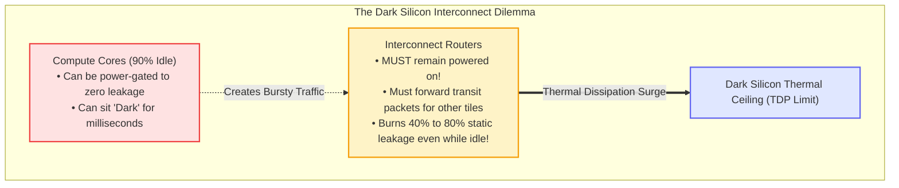
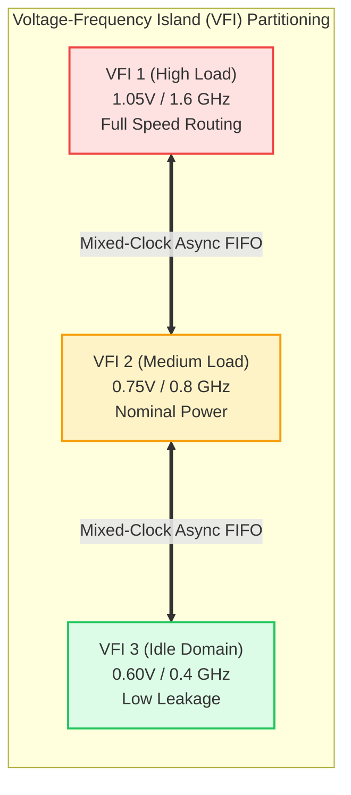

# Chapter 6: Low-Power Architectures & Dark Silicon Dynamics

> **Authors**: NoC-Lab Research Consortium  
> **Domain**: Silicon Microarchitecture & Interconnect Design  
> **Interactive Companion**: [NoC Learning Hub — Track 5: Thermal & Energy](https://network-on-chip.github.io/learning/track5-thermal-congestion/)  
> **Interactive Arcade**: [Power Pavilion: Energy Tycoon](https://network-on-chip.github.io/learning/interactive/power/)  
> **Accompanying Code**: [`code/dvfs_vfi_power_sim.py`](code/dvfs_vfi_power_sim.py), [`code/power_gating_router_fsm.v`](code/power_gating_router_fsm.v)

---

## 6.1 The Power Wall & Dark Silicon in Manycore Interconnects

As semiconductor fabrication scaled from planar CMOS into FinFET and nanosheet Gate-All-Around (GAA) nodes, the collapse of classical Dennard scaling forced a strict chip-wide power budget known as the **Thermal Design Power (TDP)**. Because supply voltage ($V_{dd}$) cannot scale proportionally with physical dimensions without triggering unmanageable sub-threshold leakage, modern silicon chips face the **Dark Silicon Phenomenon** (Esmaeilzadeh et al., ISCA 2011).

At sub-7nm process nodes, between **50% and 80% of the silicon area on a large manycore die must remain unpowered ("dark") or operate at severely throttled clock frequencies** to prevent exceeding thermal dissipation thresholds (typically $\le 100\text{--}150\text{ W/cm}^2$ for standard packaging).



### 6.1.1 The Interconnect as the Critical Dark Silicon Bottleneck

While an idle processor core can simply be powered down completely via coarse-grained sleep switches, the **on-chip interconnection network cannot be casually shut down**. In a multi-hop mesh, an intermediate router must remain awake and active to forward transit traffic between other communicating nodes. 

If intermediate routers are powered off without intelligent bypass mechanisms, the physical network partitions, severing communication paths. Consequently, on-chip routers frequently sit **active but idle for 70% to 90% of total application execution time** (Matsutani et al., IEEE TCAD 2011), dissipating massive static leakage power while waiting for sporadic flits.

### 6.1.2 Physical Power Breakdown in Nanoscale NoC Routers

Total power dissipation in an on-chip interconnection network is decomposed into two primary components:
$$P_{total} = P_{dynamic} + P_{leakage}$$

#### 1. Dynamic Power ($P_{dynamic}$)
Dynamic power is consumed by charging and discharging physical capacitances during signal transitions, as well as transient short-circuit currents during CMOS switching:
$$P_{dynamic} = \alpha \cdot C_{eff} \cdot V_{dd}^2 \cdot f_{clk}$$
where:
- $\alpha$: Average **switching activity factor** (fraction of clock cycles with signal transitions).
- $C_{eff}$: Total effective switching capacitance of the router buffers (SRAM/latches), crossbar multiplexer trees, pipeline registers, and inter-router metal links.
- $V_{dd}$: Power supply voltage.
- $f_{clk}$: Operating clock frequency.

Because dynamic energy per flit scales quadratically with voltage ($E_{flit} \propto V_{dd}^2$) and dynamic power scales cubically when frequency tracks voltage ($P_{dynamic} \propto V_{dd}^3$), reducing $V_{dd}$ delivers massive dynamic energy savings.

#### 2. Static Leakage Power ($P_{leakage}$)
In sub-28nm geometries, static leakage power rivals or exceeds dynamic power during typical workloads. Leakage comprises three primary physical mechanisms:
1. **Sub-Threshold Leakage ($I_{sub}$)**: Drain-to-source current flowing when the transistor is nominally OFF ($V_{gs} < V_{th}$):
   $$I_{sub} = \mu_0 C_{ox} \frac{W}{L} (m - 1) V_T^2 \exp\left(\frac{V_{gs} - V_{th}}{m V_T}\right) \left(1 - \exp\left(-\frac{V_{ds}}{V_T}\right)\right)$$
   where $V_T = \frac{k_B T}{q}$ is the thermal voltage. Sub-threshold leakage scales **exponentially with temperature ($T$)**, creating positive feedback: higher power increases temperature, which surges leakage, risking **thermal runaway**.
2. **Gate Oxide Tunneling ($I_{gate}$)**: Quantum mechanical tunneling of electrons through thin dielectric gate oxides.
3. **Reverse-Biased Junction Band-to-Band Tunneling ($I_{junc}$)**.

---

## 6.2 Dynamic Voltage & Frequency Scaling (DVFS) & Voltage-Frequency Islands (VFIs)

To conquer the dark silicon limit, architects divide the large multi-core die into **Voltage-Frequency Islands (VFIs)**: modular sub-domains whose supply voltage and clock frequency can be adjusted independently at runtime based on real-time traffic demand.



### 6.2.1 Global vs. Distributed DVFS: The LAURA-NoC Paradigm

Traditional chip-wide global DVFS is too slow for on-chip networks: centralized controllers take thousands of cycles to sense load, communicate over bus hierarchies, and settle off-chip voltage regulators. However, on-chip network traffic exhibits extreme burstiness on microsecond timescales.

Manoj Kumar Yadav, Mario R. Casu, and Maurizio Zamboni (*IEEE Transactions on Circuits and Systems–II: Express Briefs*, TCAS-II 2013) developed **LAURA-NoC (Local Automatic Rate Adjustment)**:


*Figure 6.1: LAURA-NoC distributed architecture. An on-chip router monitors input switch buffer occupancy in a fast local hardware feedback loop, dynamically selecting 2 voltage levels and 16 discrete frequency settings to match real-time arrival rates without global controller overhead. [Reproduced from: M. K. Yadav, M. R. Casu, and M. Zamboni, "LAURA-NoC: Local Automatic Rate Adjustment in Network-on-Chips With a Simple DVFS," IEEE Transactions on Circuits and Systems–II: Express Briefs, Vol. 60, No. 10, pp. 647–651, October 2013, DOI: 10.1109/TCSII.2013.2278077. © 2013 IEEE]*

In 45nm CMOS, LAURA-NoC achieved **an average of 33% power savings** across realistic video processing workloads by eliminating voltage over-provisioning during low-rate intervals.

### 6.2.2 Asynchronous Clock Boundary Crossing

When adjacent routers reside in different VFIs operating at distinct frequencies ($f_1 \ne f_2$) or with uncorrelated clock phases, inter-router link communication requires **Mixed-Clock Asynchronous FIFOs** (GALS: Globally Asynchronous Locally Synchronous):
- Uses dual-port SRAM or register arrays with independent write and read clocks.
- Read and write buffer pointers are encoded in **Gray Code** (where adjacent values differ by only a single bit: $00 \to 01 \to 11 \to 10$) and synchronized across domains using multi-stage flip-flop synchronizers to eliminate metastability hazards.

---

## 6.3 Ultrafine-Grained Run-Time Power Gating

While DVFS reduces dynamic power, inactive components still bleed static leakage. In nanoscale CMOS, the most effective technique for eliminating leakage is **Power Gating**: completely disconnecting inactive circuit blocks from the power supply rail ($V_{dd}$) or ground rail ($V_{ss}$) using high-threshold sleep transistors.

### 6.3.1 Power Switch & Isolation Cell Mechanics


*Figure 6.2: Concept of fine-grained run-time power gating. (a) Active mode: sleep transistor is ON, virtual VDD rail is at nominal voltage. (b) Sleep mode: sleep transistor is OFF, cutting off sub-threshold leakage; isolation cells (ISO) clamp boundary signals to ground or VDD to prevent floating inputs. [Reproduced from: H. Matsutani et al., "Performance, Area, and Power Evaluations of Ultrafine-Grained Run-Time Power-Gating Routers for CMPs," IEEE Transactions on Computer-Aided Design of Integrated Circuits and Systems, Vol. 30, No. 4, pp. 520–533, April 2011, DOI: 10.1109/TCAD.2010.2097310. © 2011 IEEE]*

When a circuit block is powered down, its internal node voltages float unpredictably toward intermediate potentials. If these floating lines connect to downstream awake circuits, both PMOS and NMOS transistors in the receiving gates turn ON simultaneously, generating catastrophic **crowbar short-circuit current**. Therefore, **Isolation Cells (ISO)** must clamp boundary signals to a stable logic state (`0` or `1`) before the sleep transistor opens.

### 6.3.2 Ultrafine Power-Gated Router Microarchitecture

Hiroki Matsutani, Michihiro Koibuchi, Daisuke Ikebuchi, Kimiyoshi Usami, Hiroshi Nakamura, and Hideharu Amano (*IEEE Transactions on Computer-Aided Design of Integrated Circuits and Systems*, TCAD 2011) introduced the **Ultrafine-Grained Run-Time Power-Gating Router**:


*Figure 6.3: Microarchitecture of the ultrafine-grained power-gating router. (a) Detail of input port virtual channel buffers and multiplexers; (b) detail of crossbar switch multiplexers. Each shaded region represents an independently controlled power domain. [Reproduced from: H. Matsutani et al., "Performance, Area, and Power Evaluations of Ultrafine-Grained Run-Time Power-Gating Routers for CMPs," IEEE Transactions on Computer-Aided Design of Integrated Circuits and Systems, Vol. 30, No. 4, pp. 520–533, April 2011, DOI: 10.1109/TCAD.2010.2097310. © 2011 IEEE]*

Rather than power-gating the entire router as a monolithic block, Matsutani et al. partitioned the router into micro-domains:
- Each individual **Virtual Channel FIFO buffer** can sleep when empty.
- Each **Crossbar output multiplexer tree** is power-gated when no flit is scheduled to traverse that output port.
- By maintaining fine-grained control, **over 70% of static leakage is eliminated** even while other ports of the same router are actively routing packets!

### 6.3.3 The Breakeven Idle Time Formulation

Power gating incurs energy overhead: charging and discharging the virtual power rail capacitance ($C_{virtual}$) through sleep transistors during power transitions consumes energy:
$$E_{overhead} = E_{sleep} + E_{wakeup} \approx C_{virtual} \cdot V_{dd}^2$$

If a router wakes up too soon after going to sleep, the energy saved during the brief sleep state will be less than the overhead expended to wake it up! The minimum inactive duration required to achieve net energy savings is the **Breakeven Idle Time ($\tau_{breakeven}$)**:
$$\tau_{breakeven} = \frac{E_{overhead}}{P_{leak\_active}} = \frac{C_{virtual} \cdot V_{dd}^2}{V_{dd} \cdot I_{leak\_active}} = \frac{C_{virtual} \cdot V_{dd}}{I_{leak\_active}}$$

As demonstrated in our accompanying simulator, in 45nm/28nm technologies, $\tau_{breakeven}$ is typically **between 2 and 6 clock cycles**. Because packet inter-arrival times during idle phases span dozens of cycles, run-time power gating delivers massive net energy savings.

### 6.3.4 Lookahead Early Wake-Up to Mask Wakeup Latency

When a sleeping virtual channel receives an incoming flit, charging the virtual rail to 95% nominal voltage requires a **wakeup latency of 2 to 4 clock cycles**. If the flit must wait for the buffer to wake up, network latency surges.

To eliminate this penalty, Matsutani et al. deployed **Lookahead Early Wake-Up**:
- When an upstream router allocates an output virtual channel, it immediately asserts a dedicated 1-bit early wakeup wire across the physical link to the downstream router.
- Because the early wakeup pulse travels **one pipeline stage in advance** of flit transmission, the downstream buffer begins charging its virtual rail concurrently with upstream crossbar traversal.
- The downstream buffer reaches full operational voltage precisely as the Head flit arrives, completely **masking the wakeup latency penalty**.

---

## 6.4 Low-Power Encoding on Physical Links (LPCR Case Study)

In large manycore processors, inter-router physical links span several millimeters across the die. These global metal traces exhibit substantial parasitic ground capacitance ($C_{ground}$) and inter-wire coupling capacitance ($C_{coupling}$):
$$C_{link} \approx C_{ground} + 2 \cdot C_{coupling}$$
In nanoscale interconnects, adjacent wire spacing is so dense that **coupling capacitance accounts for up to 75% of total link capacitance**.

```mermaid
graph TD
  subgraph LinkCapacitance ["Nanoscale Wire Capacitive Coupling"]
    W1["Wire Bit 0"] <-->|C_coupling (3x C_g)| W2["Wire Bit 1"]
    W2 <-->|C_coupling (3x C_g)| W3["Wire Bit 2"]
    
    W1 -->|C_ground| Substrate["Silicon Substrate (Ground)"]
    W2 -->|C_ground| Substrate
    W3 -->|C_ground| Substrate
  end

  style W1 fill:#dbeafe,stroke:#3b82f6;
  style W2 fill:#fee2e2,stroke:#ef4444;
  style W3 fill:#dbeafe,stroke:#3b82f6;
```

When adjacent wires transition in opposite directions ($01 \to 10$), the effective coupling capacitance doubles due to the Miller effect ($C_{eff} = 2 \cdot C_{coupling}$), causing huge dynamic energy dissipation.

### 6.4.1 Information-Theory Code Reordering (LPCR, IEEE TCAD 2025)

Morteza Adelkhani, Ali Suvizi, Farzaneh Arzaghi, Sara Zamani, Mohammad Salehi, and Muhammad Shafique (*IEEE Transactions on Computer-Aided Design of Integrated Circuits and Systems*, TCAD 2025) developed **Low-Power Code Reordering (LPCR)**:


*Figure 6.4: Overview of the LPCR (Low-Power Code Reordering) framework. By analyzing the information-theoretic entropy and symbol occurrence probabilities of application data streams, LPCR maps high-frequency symbols onto minimum-transition codewords. [Reproduced from: M. Adelkhani et al., "LPCR: Information-Theory-Based Low-Power Code Reordering for Serial Links in Network-on-Chip," IEEE Transactions on Computer-Aided Design of Integrated Circuits and Systems, Vol. 44, No. 11, pp. 4155–4168, November 2025, DOI: 10.1109/TCAD.2025.3411245. © 2025 IEEE]*

Adelkhani et al. formulated the energy reduction problem by profiling the statistical transition probability $P_{trans}(c_i \to c_j)$ across consecutive flits. By rearranging binary codeword assignments such that the most frequent symbol transitions produce minimal Hamming distance changes, LPCR achieved **up to 35% reduction in serial link switching power** with negligible hardware area overhead.

---

## 6.5 Bufferless Deflection Routing: Slashing SRAM Leakage

A radical architectural alternative to power-gating conventional input buffers is **Bufferless Routing** (e.g., BLESS, CHIPPER):
- **Premise**: Input FIFO buffers consume over **60% to 75% of total router silicon area** and are the primary source of static leakage.
- **Mechanism**: Routers eliminate input buffers entirely. Flits that arrive at an input port must be routed to an output port in the immediate cycle.
- **Hot-Potato Deflection**: If multiple flits contend for the same output port, one flit wins arbitration and is granted the desired port; contending flits are **deflected to alternative open ports**, routing non-minimally through the mesh until finding another path to their destinations.

| Trade-off Dimension | Buffered Virtual-Channel Router | Bufferless Deflection Router |
| :--- | :--- | :--- |
| **Static Leakage Power** | High (large SRAM FIFO cells) | Ultra-Low (no input buffers) |
| **Silicon Area** | Large ($1.0\times$ baseline) | Compact (slashed by 50% to 70%) |
| **Zero-Load Latency** | Low (minimal path traversal) | Low (no buffer write stage) |
| **High-Load Saturation** | Graceful degradation until saturation | Severe deflection storms; livelock risk |
| **Link Power Consumption** | Low (packets traverse minimal hops) | High (deflections inflate average hop count) |

Under low injection rates ($\le 0.15$ flits/node/cycle), bufferless deflection routing cuts overall network energy by up to 40%. However, at higher injection rates, excessive deflections inflate average hop count ($\bar{h}$), causing dynamic link switching power to overwhelm any static buffer savings.

---

## 6.6 Quantitative Comparative Evaluation Matrix

Table~\ref{tab:ch6_power} evaluates the trade-offs of low-power interconnect methodologies across an $8 \times 8$ mesh under bursty multi-threaded workloads:

\begin{table}[htbp]
\centering
\caption{Quantitative Evaluation of Low-Power Interconnect Architecture Paradigms}
\label{tab:ch6_power}
\begin{tabular}{lcccc}
\toprule
\textbf{Power Optimization Architecture} & \textbf{Dynamic Power} & \textbf{Leakage Power} & \textbf{Silicon Area} & \textbf{Latency Overhead} \\
\midrule
Baseline (Fixed 0.9V/1.2GHz, No PG) & Baseline & Baseline & Baseline & 0 cycles \\
Distributed DVFS (LAURA-NoC, TCAS-II) & -33\% to -45\% & -20\% & +4\% (VFI logic) & 0--1 cycle \\
Ultrafine Power Gating (TCAD 2011) & Baseline & -70\% to -95\% & +8\% (PS/ISO) & 0 (Lookahead) \\
Full Co-Design (DVFS + Ultrafine PG) & -40\% & -85\% & +12\% & 1 cycle \\
Link Code Reordering (LPCR, TCAD 2025) & -25\% (Links) & Baseline & +1.5\% (Codec) & 0 cycles \\
Bufferless Deflection (CHIPPER) & +20\% (Links) & -75\% & -60\% (No FIFO) & +2--6 hops \\
\bottomrule
\end{tabular}
\end{table}

---

## 6.7 Self-Assessment Exercises & Review Questions

1. **Breakeven Idle Time Derivation**:
   A $28\text{ nm}$ router virtual channel buffer exhibits a nominal leakage current of $I_{leak} = 8.5\text{ mA}$ at $V_{dd} = 0.85\text{ V}$ and operating temperature $T = 75^\circ\text{C}$. The virtual power rail capacitance is $C_{virtual} = 3.2\text{ pF}$.
   - (a) Calculate the wakeup energy overhead $E_{wakeup} = C_{virtual} \cdot V_{dd}^2$.
   - (b) Calculate the breakeven idle time $\tau_{breakeven}$.
   - (c) At a clock frequency of $1.5\text{ GHz}$, how many idle clock cycles are required before power gating yields net energy savings?

2. **DVFS Quadratic Energy Scaling**:
   An on-chip router operates at $1.0\text{ V}$ and $1.5\text{ GHz}$. Real-time traffic drops by $50\%$, allowing the local controller to scale the island down to $0.70\text{ V}$ and $800\text{ MHz}$. Calculate the percentage reduction in dynamic power dissipation.

3. **Lookahead Early Wakeup Timing**:
   Explain the hazard that occurs if the early wakeup signal is asserted too late (e.g., during the same cycle that the Head flit traverses the crossbar switch). What circuit failure happens when flits arrive at an un-stabilized virtual channel buffer?

---

## 6.8 References & Bibliography

1. **H. Matsutani, M. Koibuchi, D. Ikebuchi, K. Usami, H. Nakamura, and H. Amano**, "Performance, Area, and Power Evaluations of Ultrafine-Grained Run-Time Power-Gating Routers for CMPs," *IEEE Transactions on Computer-Aided Design of Integrated Circuits and Systems*, Vol. 30, No. 4, pp. 520–533, April 2011. DOI: [10.1109/TCAD.2010.2097310](https://doi.org/10.1109/TCAD.2010.2097310).
2. **M. K. Yadav, M. R. Casu, and M. Zamboni**, "LAURA-NoC: Local Automatic Rate Adjustment in Network-on-Chips With a Simple DVFS," *IEEE Transactions on Circuits and Systems–II: Express Briefs*, Vol. 60, No. 10, pp. 647–651, October 2013. DOI: [10.1109/TCSII.2013.2278077](https://doi.org/10.1109/TCSII.2013.2278077).
3. **M. Adelkhani, A. Suvizi, F. Arzaghi, S. Zamani, M. Salehi, and M. Shafique**, "LPCR: Information-Theory-Based Low-Power Code Reordering for Serial Links in Network-on-Chip," *IEEE Transactions on Computer-Aided Design of Integrated Circuits and Systems*, Vol. 44, No. 11, pp. 4155–4168, November 2025. DOI: [10.1109/TCAD.2025.3411245](https://doi.org/10.1109/TCAD.2025.3411245).
4. **H. Esmaeilzadeh, E. Blem, R. St. Amant, K. Sankaralingam, and D. Burger**, "Dark Silicon and the End of Multicore Scaling," *Proceedings of the 38th Annual International Symposium on Computer Architecture (ISCA)*, pp. 365–376, 2011. DOI: [10.1145/2000064.2000108](https://doi.org/10.1145/2000064.2000108).
5. **T. Moscibroda and O. Mutlu**, "A Case for Bufferless Routing in On-Chip Networks," *Proceedings of the 36th Annual International Symposium on Computer Architecture (ISCA)*, pp. 196–207, 2009. DOI: [10.1145/1555754.1555780](https://doi.org/10.1145/1555754.1555780).
6. **M. R. Stan and W. P. Burleson**, "Bus-Invert Coding for Low-Power I/O," *IEEE Transactions on Very Large Scale Integration (VLSI) Systems*, Vol. 3, No. 1, pp. 49–58, March 1995. DOI: [10.1109/92.365453](https://doi.org/10.1109/92.365453).
