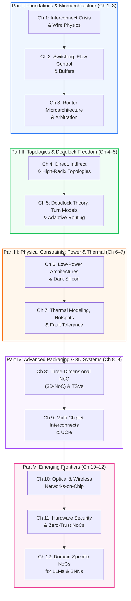

# Network-on-Chip and Advanced Interconnects
## Architecture, Co-Design & Emerging Frontiers

<div class="noc-hero">
  <div class="noc-track-badge">📖 Official Open Textbook • 12 Chapters • 266 Pages</div>
  <h1>Network-on-Chip and Advanced Interconnects</h1>
  <p class="subtitle">
    The definitive open-access monograph and textbook covering 12 cohesive, rigorously grounded chapters across 5 architectural parts. Written with an intuitive, step-by-step pedagogical style accessible from engineering students to leading silicon architects.
  </p>
  <div style="display: flex; gap: 0.75rem; flex-wrap: wrap; margin-top: 1rem;">
    <a href="ch01-interconnect-crisis/" class="noc-sim-btn" style="text-decoration: none;">🚀 Read Chapter 1 Online</a>
    <a href="../assets/book.pdf?v=266" target="_blank" class="noc-sim-btn" style="text-decoration: none; background: #0284c7;">📥 Download Monograph PDF (266 Pages)</a>
    <a href="https://github.com/network-on-chip/book" target="_blank" class="noc-sim-btn secondary" style="text-decoration: none;">🐙 GitHub Book Source</a>
    <a href="../interactive/" class="noc-sim-btn secondary" style="text-decoration: none; background: #ea580c; color: white;">👾 Interactive Labs</a>
  </div>
</div>

<div class="noc-stats-grid">
  <div class="noc-stat-card">
    <span class="noc-stat-number">12</span>
    <span class="noc-stat-label">Core Chapters</span>
  </div>
  <div class="noc-stat-card">
    <span class="noc-stat-number">5</span>
    <span class="noc-stat-label">Architectural Parts</span>
  </div>
  <div class="noc-stat-card">
    <span class="noc-stat-number">266</span>
    <span class="noc-stat-label">Camera-Ready Pages</span>
  </div>
  <div class="noc-stat-card">
    <span class="noc-stat-number">100%</span>
    <span class="noc-stat-label">Open & Reproducible</span>
  </div>
</div>

---

## 🎯 Pedagogical Philosophy: Deep Rigor Made Crystal Clear

Modern multi-core processors, AI accelerators (GPUs, TPUs, NPUs), and multi-chiplet superchips spend up to **40% of their total power and area** moving data across silicon [[Borkar1999](#ref-borkar1999), [Keckler2011](#ref-keckler2011), [Dally2001](#ref-dally2001)]. Yet interconnection networks are often taught using abstract, impenetrable formulas.

This textbook bridges **rigorous physical equations** (Elmore RC delays [[Elmore1948](#ref-elmore1948)], Murphy yield models [[Murphy1964](#ref-murphy1964)], Channel Dependency Graphs [[Dally1987](#ref-dally1987)], thermo-optic resonance drift [[Ye2013](#ref-ye2013), [Kao2026](#ref-kao2026)]) with **vivid, intuitive real-world metaphors** so that any curious engineering student or researcher can immediately build an intuitive mental model:

<div class="noc-tracks-grid" style="margin-top: 1.5rem;">
  <div class="noc-track-card">
    <div>
      <span class="noc-track-badge" style="background: rgba(234, 88, 12, 0.1); color: #ea580c; border-color: rgba(234, 88, 12, 0.2);">🍕 Chapter 9: Yield Economics</span>
      <div class="noc-track-title">The Giant Pizza Problem</div>
      <div class="noc-track-desc">
        Baking an 800 mm² giant pizza (nearing the 858 mm<sup>2</sup> lithographic reticle limit [<a href="#ref-mack2007">Mack2007</a>]) means a single falling fly ruins the whole dinner (zero yield under Murphy's yield model [<a href="#ref-murphy1964">Murphy1964</a>]). Baking four smaller personal pizzas connected on a wooden tray (2.5D silicon interposer / bridge [<a href="#ref-chen2026">Chen2026</a>]) means one fly only loses 25%—saving millions of dollars in silicon manufacturing.
      </div>
    </div>
  </div>

  <div class="noc-track-card">
    <div>
      <span class="noc-track-badge" style="background: rgba(37, 99, 235, 0.1); color: #2563eb; border-color: rgba(37, 99, 235, 0.2);">🌉 Chapter 9: Advanced Packaging</span>
      <div class="noc-track-title">Dirt Roads vs. 16-Lane Glass Bridges</div>
      <div class="noc-track-desc">
        Connecting chips with traditional printed circuit board (PCB) traces is like bumping down a muddy dirt road at 20 mph with high resistance. 2.5D silicon interposers (CoWoS, EMIB) and die-to-die standards like UCIe [<a href="#ref-ucie2023">UCIe2023</a>] build a smooth 16-lane glass highway with sub-picosecond transit times and sub-picojoule per bit energy efficiency [<a href="#ref-zimmer2020">Zimmer2020</a>].
      </div>
    </div>
  </div>

  <div class="noc-track-card">
    <div>
      <span class="noc-track-badge" style="background: rgba(16, 185, 129, 0.1); color: #10b981; border-color: rgba(16, 185, 129, 0.2);">⚾ Chapter 2 &amp; 9: Flow Control</span>
      <div class="noc-track-title">Playing Catch with Baseballs</div>
      <div class="noc-track-desc">
        Little's Law (<i>B</i><sub>min</sub> ≥ <i>RTT</i> × <i>BW</i> [<a href="#ref-little1961">Little1961</a>]) explained through a game of catch: if it takes 5 seconds for a thrown baseball to arrive and 5 seconds for your friend to wave back, you must have at least 10 baseballs in hand to keep throwing without ever pausing!
      </div>
    </div>
  </div>

  <div class="noc-track-card">
    <div>
      <span class="noc-track-badge" style="background: rgba(139, 92, 246, 0.1); color: #8b5cf6; border-color: rgba(139, 92, 246, 0.2);">🚦 Chapter 5 &amp; 9: Deadlock Freedom</span>
      <div class="noc-track-title">The 4-Way Traffic Jam &amp; The Traffic Cop</div>
      <div class="noc-track-desc">
        Four cars enter a four-way intersection simultaneously, each blocking the person behind them (a circular dependency cycle [<a href="#ref-dally1987">Dally1987</a>]). The In/Outbound Swap protocol [<a href="#ref-wang2026">Wang2026</a>] acts as a smart traffic cop that asks one car to back up into an empty driveway, instantly unjamming the entire city.
      </div>
    </div>
  </div>

  <div class="noc-track-card">
    <div>
      <span class="noc-track-badge" style="background: rgba(236, 72, 153, 0.1); color: #ec4899; border-color: rgba(236, 72, 153, 0.2);">🔦 Chapter 1 &amp; 10: Optical Physics</span>
      <div class="noc-track-title">Garden Hoses vs. Laser Pointers</div>
      <div class="noc-track-desc">
        Copper wires act like long, heavy garden hoses that must be filled with water before a single drop squirts out (charging wire capacitance under electron scattering [<a href="#ref-mayadas1970">Mayadas1970</a>, <a href="#ref-ho2001">Ho2001</a>]). Optical silicon waveguides act like laser pointers: shine the light, and photons strike the target at the speed of light with zero capacitive drag [<a href="#ref-little1997">Little1997</a>].
      </div>
    </div>
  </div>

  <div class="noc-track-card">
    <div>
      <span class="noc-track-badge" style="background: rgba(234, 179, 8, 0.1); color: #ca8a04; border-color: rgba(234, 179, 8, 0.2);">🎸 Chapter 10: Silicon Photonics</span>
      <div class="noc-track-title">The Out-of-Tune Guitar</div>
      <div class="noc-track-desc">
        Micro-ring resonators (MRRs [<a href="#ref-little1997">Little1997</a>]) are tiny optical tuning forks tuned to an exact light frequency. When nearby CPU cores heat the silicon, the ring expands by 0.10 nm/°C [<a href="#ref-ye2013">Ye2013</a>, <a href="#ref-kao2026">Kao2026</a>]—just like a guitar string going out of tune in the hot sun—requiring active micro-heaters to re-tune.
      </div>
    </div>
  </div>
  <div class="noc-track-card">
    <div>
      <span class="noc-track-badge" style="background: rgba(225, 29, 72, 0.1); color: #e11d48; border-color: rgba(225, 29, 72, 0.2);">🛡️ Chapter 11: Hardware Security</span>
      <div class="noc-track-title">The Multi-Tenant Airport Highway</div>
      <div class="noc-track-desc">
        Modern SoCs share router crossbars among untrusted 3P-IP cores and virtual machines. Even with encrypted payloads, attackers measure queuing delay jitter (timing covert channels [<a href="#ref-jaster2025">Jaster2025</a>]) or fire thermal bursts to trigger emergency clock throttling ([<a href="#ref-heatsense2026">Hasanzadeh2026</a>]). Zero-multiplier EWMA anomaly detectors and intrinsic delay PUFs ([<a href="#ref-nocipuf2025">Grover2025</a>]) restore hardware trust.
      </div>
    </div>
  </div>

  <div class="noc-track-card">
    <div>
      <span class="noc-track-badge" style="background: rgba(2, 132, 199, 0.1); color: #0284c7; border-color: rgba(2, 132, 199, 0.2);">⚡ Chapter 12: Generative AI &amp; SNNs</span>
      <div class="noc-track-title">The Industrial Freight Train vs. Forest Fire</div>
      <div class="noc-track-desc">
        Training a 100B LLM halts thousands of tensor cores for synchronous All-Reduce collectives ([<a href="#ref-pacnoc2026">Ouyang2026</a>]). In-network reduction trees sum gradients in-flight inside router crossbars, slashing traffic by 75%, while Ruche express links ([<a href="#ref-gao2026">Gao2026</a>]) and 3D hybrid bonding memory silos ([<a href="#ref-silobreaker2026">Wu2026</a>]) crush the memory wall.
      </div>
    </div>
  </div>
</div>

---

## 📚 Complete 12-Chapter Curriculum Outline



---

### Part I: Foundations & Router Microarchitecture

<div class="noc-tracks-grid">
  <div class="noc-track-card">
    <div>
      <span class="noc-track-badge">Chapter 1</span>
      <div class="noc-track-title">The Multi-Core Communication Crisis &amp; Interconnect Physics</div>
      <div class="noc-track-desc">
        Dennard scaling breakdown [<a href="#ref-dennard1974">Dennard1974</a>], Moore's Law [<a href="#ref-moore1965">Moore1965</a>], power wall [<a href="#ref-borkar1999">Borkar1999</a>], failure of shared multi-drop buses, Elmore RC wire delay scaling [<a href="#ref-elmore1948">Elmore1948</a>], Mayadas-Shatzkes copper grain boundary scattering [<a href="#ref-mayadas1970">Mayadas1970</a>], Fuchs-Sondheimer surface scattering [<a href="#ref-fuchs1938">Fuchs1938</a>], optimal Bakoglu repeater insertion [<a href="#ref-bakoglu1990">Bakoglu1990</a>], and the 2,048-core HammerBlade SoC [<a href="#ref-gao2026">Gao2026</a>].
      </div>
      <div style="font-size:0.8rem; color:var(--noc-text-muted); margin-top:0.35rem;">
        🐍 <code>code/wire_elmore_rc_sim.py</code> • 💾 <code>code/bus_arbiter_contention.v</code>
      </div>
    </div>
    <a href="ch01-interconnect-crisis/" class="noc-track-link">Read Chapter 1 →</a>
  </div>

  <div class="noc-track-card">
    <div>
      <span class="noc-track-badge">Chapter 2</span>
      <div class="noc-track-title">Switching Techniques, Flow Control &amp; Buffer Management</div>
      <div class="noc-track-desc">
        Store-and-Forward [<a href="#ref-baran1964">Baran1964</a>] vs. Virtual Cut-Through [<a href="#ref-kermani1979">Kermani1979</a>] vs. Wormhole switching [<a href="#ref-dally1987">Dally1987</a>], flit serialization, credit-based flow control [<a href="#ref-dallyprinciples">DallyPrinciples</a>], Little's Law buffer sizing [<a href="#ref-little1961">Little1961</a>], Virtual Channel (VC) Head-of-Line blocking mitigation [<a href="#ref-dally1992">Dally1992</a>], and the FlooNoC 512-bit AXI4 architecture [<a href="#ref-fischer2025">Fischer2025</a>].
      </div>
      <div style="font-size:0.8rem; color:var(--noc-text-muted); margin-top:0.35rem;">
        🐍 <code>code/credit_flow_control_sim.py</code> • 💾 <code>code/credit_counter.v</code>
      </div>
    </div>
    <a href="ch02-switching-flow-control/" class="noc-track-link">Read Chapter 2 →</a>
  </div>

  <div class="noc-track-card">
    <div>
      <span class="noc-track-badge">Chapter 3</span>
      <div class="noc-track-title">High-Performance Router Microarchitecture &amp; Arbitration</div>
      <div class="noc-track-desc">
        Canonical 4-stage pipelined router [<a href="#ref-peh2001">Peh2001</a>], speculative VA-SA parallel allocation, matrix arbiters [<a href="#ref-mckeown1999">McKeown1999</a>], wavefront arbiters [<a href="#ref-tamir1993">Tamir1993</a>], crossbar switch fabrics [<a href="#ref-passas2012">Passas2012</a>], SMART single-cycle bypass [<a href="#ref-krishna2013">Krishna2013</a>], and BuffeRS buffer reservation [<a href="#ref-liu2026">Liu2026</a>].
      </div>
      <div style="font-size:0.8rem; color:var(--noc-text-muted); margin-top:0.35rem;">
        🐍 <code>code/router_pipeline_sim.py</code> • 💾 <code>code/matrix_arbiter_4x4.v</code>
      </div>
    </div>
    <a href="ch03-router-microarchitecture/" class="noc-track-link">Read Chapter 3 →</a>
  </div>
</div>

---

### Part II: Topologies, Routing & Deadlock Freedom

<div class="noc-tracks-grid">
  <div class="noc-track-card">
    <div>
      <span class="noc-track-badge">Chapter 4</span>
      <div class="noc-track-title">Direct, Indirect &amp; High-Radix Topologies</div>
      <div class="noc-track-desc">
        Graph-theoretic interconnect evaluation: degree, diameter, bisection bandwidth <span class="arithmatex">\(\mathcal{B}\)</span>, average hop count <span class="arithmatex">\(\bar{D}\)</span>, path diversity. 2D Mesh, 2D Torus, Concentrated Mesh, Clos networks [<a href="#ref-clos1953">Clos1953</a>], Fat-Trees [<a href="#ref-leiserson1985">Leiserson1985</a>], Flattened Butterfly [<a href="#ref-kim2007">Kim2007</a>], Dragonfly [<a href="#ref-kim2008">Kim2008</a>], and Slim Fly [<a href="#ref-besta2014">Besta2014</a>].
      </div>
      <div style="font-size:0.8rem; color:var(--noc-text-muted); margin-top:0.35rem;">
        🐍 <code>code/topology_throughput_latency_sim.py</code> • 💾 <code>code/topology_graph_metrics.v</code>
      </div>
    </div>
    <a href="ch04-topologies-and-metrics/" class="noc-track-link">Read Chapter 4 →</a>
  </div>

  <div class="noc-track-card">
    <div>
      <span class="noc-track-badge">Chapter 5</span>
      <div class="noc-track-title">Deadlock Theory, Turn Models &amp; Adaptive Routing</div>
      <div class="noc-track-desc">
        Channel Dependency Graphs (CDG) and Dally-Seitz cycle-free theorem [<a href="#ref-dally1987">Dally1987</a>], Dimension-Order Routing (DOR) [<a href="#ref-sullivan1977">Sullivan1977</a>], Glass-Ni Turn Model [<a href="#ref-glass1994">Glass1994</a>], Chiu's Odd-Even routing [<a href="#ref-chiu2000">Chiu2000</a>], Duato's Theorem with escape VCs [<a href="#ref-duato1993">Duato1993</a>], and coherence virtual networks [<a href="#ref-sorin2011">Sorin2011</a>].
      </div>
      <div style="font-size:0.8rem; color:var(--noc-text-muted); margin-top:0.35rem;">
        🐍 <code>code/turn_model_deadlock_sim.py</code> • 💾 <code>code/escape_vc_router.v</code>
      </div>
    </div>
    <a href="ch05-routing-deadlock-theory/" class="noc-track-link">Read Chapter 5 →</a>
  </div>
</div>

---

### Part III: Physical Constraints: Power, Thermal & Reliability

<div class="noc-tracks-grid">
  <div class="noc-track-card">
    <div>
      <span class="noc-track-badge">Chapter 6</span>
      <div class="noc-track-title">Low-Power Architectures &amp; Dark Silicon Dynamics</div>
      <div class="noc-track-desc">
        Energy breakdown: link dynamic energy (<i>P</i><sub>dyn</sub> = α<i>C</i><i>V</i><sub>dd</sub><sup>2</sup><i>f</i>), crossbar capacitance [<a href="#ref-wang2002">Wang2002</a>, <a href="#ref-kahng2009">Kahng2009</a>], dark silicon dynamics [<a href="#ref-esmaeilzadeh2011">Esmaeilzadeh2011</a>, <a href="#ref-taylor2012">Taylor2012</a>], Voltage-Frequency Islands (VFIs) [<a href="#ref-brooks2001">Brooks2001</a>], power-gated routers [<a href="#ref-matsutani2011">Matsutani2011</a>], LAURA [<a href="#ref-yadav2013">Yadav2013</a>], and LPCR [<a href="#ref-adelkhani2025">Adelkhani2025</a>].
      </div>
      <div style="font-size:0.8rem; color:var(--noc-text-muted); margin-top:0.35rem;">
        🐍 <code>code/dvfs_vfi_power_sim.py</code> • 💾 <code>code/power_gating_router_fsm.v</code>
      </div>
    </div>
    <a href="ch06-low-power-dark-silicon/" class="noc-track-link">Read Chapter 6 →</a>
  </div>

  <div class="noc-track-card">
    <div>
      <span class="noc-track-badge">Chapter 7</span>
      <div class="noc-track-title">Thermal Modeling, Hotspots &amp; Fault-Tolerant Resilience</div>
      <div class="noc-track-desc">
        Fourier heat equation, compact thermal RC equivalent circuits (HotSpot) [<a href="#ref-huang2006">Huang2006</a>, <a href="#ref-skadron2003">Skadron2003</a>], thermal runaway, thermal throttling, online temperature estimation via Gaussian-Sum Filtering (GSF) [<a href="#ref-fu2017">Fu2017</a>], electromigration (Black's equation) [<a href="#ref-black1969">Black1969</a>], and ZoneDefense fault tolerance [<a href="#ref-fu2014">Fu2014</a>, <a href="#ref-fu2019">Fu2019</a>].
      </div>
      <div style="font-size:0.8rem; color:var(--noc-text-muted); margin-top:0.35rem;">
        🐍 <code>code/thermal_rc_mesh_sim.py</code> • 💾 <code>code/fault_tolerant_router_bypass.v</code>
      </div>
    </div>
    <a href="ch07-thermal-fault-tolerance/" class="noc-track-link">Read Chapter 7 →</a>
  </div>
</div>

---

### Part IV: Advanced Packaging, 3D NoC & Multi-Chiplets

<div class="noc-tracks-grid">
  <div class="noc-track-card">
    <div>
      <span class="noc-track-badge">Chapter 8</span>
      <div class="noc-track-title">Three-Dimensional Networks-on-Chip (3D-NoC) &amp; TSVs</div>
      <div class="noc-track-desc">
        Vertical scaling physics, Through-Silicon Vias (TSVs) [<a href="#ref-pavlidis2009">Pavlidis2009</a>, <a href="#ref-loi2011">Loi2011</a>], capacitive parasitics, Keep-Out Zones (KOZ), 7-port 3D crossbars, arbitration-free vertical fast-paths [<a href="#ref-more2018">More2018</a>], vertical heat trapping, and Hypergraph-GA exploration [<a href="#ref-alalousi2026">AlAlousi2026</a>].
      </div>
      <div style="font-size:0.8rem; color:var(--noc-text-muted); margin-top:0.35rem;">
        🐍 <code>code/tsv_vertical_mesh_sim.py</code> • 💾 <code>code/tsv_arbiter_3d.v</code>
      </div>
    </div>
    <a href="ch08-3d-noc-tsvs/" class="noc-track-link">Read Chapter 8 →</a>
  </div>

  <div class="noc-track-card">
    <div>
      <span class="noc-track-badge">Chapter 9</span>
      <div class="noc-track-title">Multi-Chiplet Interconnects, 2.5D Systems &amp; UCIe</div>
      <div class="noc-track-desc">
        Optical reticle limit (858 mm<sup>2</sup>) [<a href="#ref-mack2007">Mack2007</a>], Murphy yield model economics [<a href="#ref-murphy1964">Murphy1964</a>], 2.5D packaging taxonomy [<a href="#ref-chen2026">Chen2026</a>], NVIDIA Simba MCM accelerator [<a href="#ref-zimmer2020">Zimmer2020</a>], Universal Chiplet Interconnect Express (UCIe) specification [<a href="#ref-ucie2023">UCIe2023</a>], and In/Outbound Swap deadlock recovery [<a href="#ref-wang2026">Wang2026</a>].
      </div>
      <div style="font-size:0.8rem; color:var(--noc-text-muted); margin-top:0.35rem;">
        🐍 <code>code/ucie_d2d_latency_model.py</code> • 💾 <code>code/chiplet_bridge_protocol.v</code>
      </div>
    </div>
    <a href="ch09-chiplets-ucie/" class="noc-track-link">Read Chapter 9 →</a>
  </div>
</div>

---

### Part V: Emerging Frontiers

<div class="noc-tracks-grid">
  <div class="noc-track-card">
    <div>
      <span class="noc-track-badge">Chapter 10</span>
      <div class="noc-track-title">Optical &amp; Wireless Networks-on-Chip (ONoC / WNoC)</div>
      <div class="noc-track-desc">
        Silicon nanophotonics, micro-ring resonators (MRRs) [<a href="#ref-little1997">Little1997</a>], thermo-optic drift (0.10 nm/°C) [<a href="#ref-ye2013">Ye2013</a>, <a href="#ref-kao2026">Kao2026</a>], on-chip mmWave/THz wireless antennas [<a href="#ref-deb2012">Deb2012</a>, <a href="#ref-abadal2018">Abadal2018</a>], and low-power transceiver modeling [<a href="#ref-shahmoradi2026">Shahmoradi2026</a>].
      </div>
      <div style="font-size:0.8rem; color:var(--noc-text-muted); margin-top:0.35rem;">
        🐍 <code>code/onoc_optical_loss_sim.py</code> • 💾 <code>code/photonic_mrr_switch.v</code>
      </div>
    </div>
    <a href="ch10-optical-wireless/" class="noc-track-link">Read Chapter 10 →</a>
  </div>

  <div class="noc-track-card">
    <div>
      <span class="noc-track-badge">Chapter 11</span>
      <div class="noc-track-title">Hardware Security &amp; Trust in On-Chip Networks</div>
      <div class="noc-track-desc">
        Zero-trust interconnect security, thermal Hardware Trojans, Weighted Moving Average (WMA) anomaly detection (**HeatSense** [<a href="#ref-heatsense2026">Hasanzadeh2026</a>]), intrinsic delay-based PUFs (**NoCiPUF** [<a href="#ref-nocipuf2025">Grover2025</a>]), and timing covert-channel jitter masking.
      </div>
      <div style="font-size:0.8rem; color:var(--noc-text-muted); margin-top:0.35rem;">
        🎮 <code>Silicon Sentinel Arcade</code> • 💾 <code>code/wma_thermal_detector.sv</code>
      </div>
    </div>
    <a href="ch11-security/" class="noc-track-link">Read Chapter 11 →</a>
  </div>

  <div class="noc-track-card">
    <div>
      <span class="noc-track-badge">Chapter 12</span>
      <div class="noc-track-title">Domain-Specific NoCs for LLMs, Transformers &amp; SNNs</div>
      <div class="noc-track-desc">
        Generative AI communication collectives, in-network reduction crossbars (**PAC-NoC** [<a href="#ref-pacnoc2026">Ouyang2026</a>]), wafer-scale defect bypass (**Theseus** [<a href="#ref-theseus2025">Zhu2025</a>]), 12-nm 2048-core Ruche networks (**HammerBlade** [<a href="#ref-gao2026">Gao2026</a>]), 3D hybrid bonding memory silos (**SiloBreaker** [<a href="#ref-silobreaker2026">Wu2026</a>]), and neuromorphic spike sharing (**SNNcut** [<a href="#ref-snncut2026">Xing2026</a>]).
      </div>
      <div style="font-size:0.8rem; color:var(--noc-text-muted); margin-top:0.35rem;">
        🎮 <code>Transformer Titan &amp; Neuromorphic Nexus</code> • 💾 <code>code/in_network_reduction_router.sv</code>
      </div>
    </div>
    <a href="ch12-ai-llm-snn/" class="noc-track-link">Read Chapter 12 →</a>
  </div>
</div>

---

## 🔗 Cross-Mapping: Book Chapters, Learning Tracks & Interactive Labs

| Book Chapter | Learning Hub Track | Accompanying Interactive Lab | Hardware RTL Module |
| :--- | :--- | :--- | :--- |
| **Ch 1: Interconnect Crisis & Wire Physics** | [Track 1: Fundamentals](../track1-fundamentals/index.md) | [Wire Wizard: Interconnect Physics](../interactive/wire.md) | `bus_arbiter_contention.v` |
| **Ch 2: Switching, Flow Control & Buffers** | [Track 1: Fundamentals](../track1-fundamentals/index.md) | [Credit Commander: Flow Control](../interactive/credits.md) | `credit_counter.v` |
| **Ch 3: Router Microarchitecture & Arbitration** | [Track 2: Router Microarchitecture](../track2-router-architecture/index.md) | [Arbiter Arena: Crossbar Clash](../interactive/arbiter.md) | `matrix_arbiter_4x4.v` |
| **Ch 4: Direct, Indirect & High-Radix Topologies** | [Track 3: Topologies & Metrics](../track3-topologies/index.md) | [Topology Titans: Graph Architect](../interactive/topology.md) | `topology_graph_metrics.v` |
| **Ch 5: Deadlock Theory & Turn Models** | [Track 4: Routing & Deadlock](../track4-routing-deadlock/index.md) | [Deadlock Buster & Packet Master](../interactive/game.md) | `escape_vc_router.v` |
| **Ch 6: Low Power & Dark Silicon** | [Track 5: Thermal & Congestion](../track5-congestion-thermal/index.md) | [Volt Vortex & Deflection Duel](../interactive/power.md) | `power_gating_router_fsm.v` |
| **Ch 7: Thermal Modeling & Fault Tolerance** | [Track 5: Thermal & Congestion](../track5-congestion-thermal/index.md) | [Hotspot Hero & Fault Defender](../interactive/hotspot.md) | `fault_tolerant_router_bypass.v` |
| **Ch 8: 3D-NoC & TSVs** | [Track 6: Chiplets & 3D NoC](../track6-chiplets-and-3d/index.md) | [TSV Titan: 3D-NoC Architect](../interactive/tsv3d.md) | `tsv_arbiter_3d.v` |
| **Ch 9: Multi-Chiplets & UCIe** | [Track 6: Chiplets & 3D NoC](../track6-chiplets-and-3d/index.md) | [Chiplet Tycoon: Advanced Packaging](../interactive/chiplet.md) | `chiplet_bridge_protocol.v` |
| **Ch 10: Optical & Wireless NoC** | [Track 6: Chiplets & 3D NoC](../track6-chiplets-and-3d/index.md) | [Photon Pilot & Wireless Wave](../interactive/optical.md) | `photonic_mrr_switch.v` |
| **Ch 11: Hardware Security & Trust** | [Track 8: Hardware Security](../interactive/security.md) | [Silicon Sentinel Arcade Game](../interactive/security.md) | `wma_thermal_detector.sv` |
| **Ch 12: AI, LLM & Neuromorphic NoC** | [Track 9: AI Interconnects](../interactive/transformer.md) | [Transformer Titan & Neuromorphic Nexus](../interactive/transformer.md) | `in_network_reduction_router.sv` |

---

## 📚 Authoritative Bibliography & Primary Literature References

Every empirical measurement, architectural trade-off, physical constant, equation, and silicon benchmark presented in this curriculum is grounded directly in premier peer-reviewed IEEE, ACM, and semiconductor physics literature:

<div class="noc-paper-list" style="margin-top: 1.5rem; font-size: 0.92rem; line-height: 1.6;">

1. <a id="ref-moore1965"></a>**[Moore1965]** G. E. Moore, "Cramming More Components Onto Integrated Circuits," *Electronics*, vol. 38, no. 8, pp. 114–117, Apr. 1965. [DOI: 10.1109/JPROC.1998.658762](https://doi.org/10.1109/JPROC.1998.658762).
2. <a id="ref-dennard1974"></a>**[Dennard1974]** R. H. Dennard, F. H. Gaensslen, H.-N. Yu, V. L. Rideout, E. Bassous, and A. R. LeBlanc, "Design of Ion-Implanted MOSFET's with Very Small Physical Dimensions for Digital Integrated Circuits," *IEEE Journal of Solid-State Circuits*, vol. SC-9, no. 5, pp. 256–268, Oct. 1974. [DOI: 10.1109/JSSC.1974.1052523](https://doi.org/10.1109/JSSC.1974.1052523).
3. <a id="ref-borkar1999"></a>**[Borkar1999]** S. Borkar, "Design Challenges of Technology Scaling," *IEEE Micro*, vol. 19, no. 4, pp. 23–29, July-Aug. 1999. [DOI: 10.1109/40.782564](https://doi.org/10.1109/40.782564).
4. <a id="ref-keckler2011"></a>**[Keckler2011]** S. W. Keckler, W. J. Dally, B. Khailany, M. Garland, and D. Glasco, "GPUs and the Future of Parallel Computing," *IEEE Micro*, vol. 31, no. 5, pp. 7–17, Sept.-Oct. 2011. [DOI: 10.1109/MM.2011.89](https://doi.org/10.1109/MM.2011.89).
5. <a id="ref-dally2001"></a>**[Dally2001]** W. J. Dally and B. Towles, "Route Packets, Not Wires: On-Chip Interconnection Networks," in *Proceedings of the 38th Annual Design Automation Conference (DAC)*, 2001, pp. 684–689. [DOI: 10.1145/378239.379048](https://doi.org/10.1145/378239.379048).
6. <a id="ref-benini2002"></a>**[Benini2002]** L. Benini and G. De Micheli, "Networks on Chips: A New SoC Paradigm," *IEEE Computer*, vol. 35, no. 1, pp. 70–78, Jan. 2002. [DOI: 10.1109/2.976921](https://doi.org/10.1109/2.976921).
7. <a id="ref-ho2001"></a>**[Ho2001]** R. Ho, K. W. Mai, and M. A. Horowitz, "The Future of Wires," *Proceedings of the IEEE*, vol. 89, no. 4, pp. 490–504, Apr. 2001. [DOI: 10.1109/5.920580](https://doi.org/10.1109/5.920580).
8. <a id="ref-elmore1948"></a>**[Elmore1948]** W. C. Elmore, "The Transient Response of Damped Linear Networks with Particular Regard to Wideband Amplifiers," *Journal of Applied Physics*, vol. 19, no. 1, pp. 55–63, Jan. 1948. [DOI: 10.1063/1.1697872](https://doi.org/10.1063/1.1697872).
9. <a id="ref-fuchs1938"></a>**[Fuchs1938]** K. Fuchs, "The Conductivity of Thin Metallic Films According to the Electron Theory of Metals," *Mathematical Proceedings of the Cambridge Philosophical Society*, vol. 34, no. 1, pp. 100–108, Jan. 1938. [DOI: 10.1017/S0305004100019952](https://doi.org/10.1017/S0305004100019952).
10. <a id="ref-mayadas1970"></a>**[Mayadas1970]** A. F. Mayadas and M. Shatzkes, "Electrical-Resistivity Model for Polycrystalline Films: The Case of Arbitrary Reflection at External Surfaces," *Physical Review B*, vol. 1, no. 4, pp. 1382–1389, Jan. 1970. [DOI: 10.1103/PhysRevB.1.1382](https://doi.org/10.1103/PhysRevB.1.1382).
11. <a id="ref-bakoglu1990"></a>**[Bakoglu1990]** H. B. Bakoglu, *Circuits, Interconnections, and Packaging for VLSI*, Reading, MA: Addison-Wesley, 1990. ISBN: 978-0201062977.
12. <a id="ref-baran1964"></a>**[Baran1964]** P. Baran, "On Distributed Communications Networks," *IEEE Transactions on Communications Systems*, vol. 12, no. 1, pp. 1–9, Mar. 1964. [DOI: 10.1109/TCOM.1964.1088883](https://doi.org/10.1109/TCOM.1964.1088883).
13. <a id="ref-kermani1979"></a>**[Kermani1979]** P. Kermani and L. Kleinrock, "Virtual Cut-Through: A New Computer Communication Switching Technique," *Computer Networks*, vol. 3, no. 4, pp. 267–286, Sept. 1979. [DOI: 10.1016/0376-5075(79)90032-4](https://doi.org/10.1016/0376-5075(79)90032-4).
14. <a id="ref-dally1987"></a>**[Dally1987]** W. J. Dally and C. L. Seitz, "Deadlock-Free Message Routing in Multiprocessor Interconnection Networks," *IEEE Transactions on Computers*, vol. C-36, no. 5, pp. 547–553, May 1987. [DOI: 10.1109/TC.1987.1676939](https://doi.org/10.1109/TC.1987.1676939).
15. <a id="ref-dally1992"></a>**[Dally1992]** W. J. Dally, "Virtual-Channel Flow Control," *IEEE Transactions on Parallel and Distributed Systems*, vol. 3, no. 2, pp. 194–205, Mar. 1992. [DOI: 10.1109/71.127260](https://doi.org/10.1109/71.127260).
16. <a id="ref-little1961"></a>**[Little1961]** J. D. C. Little, "A Proof for the Queuing Formula: $L = \lambda W$," *Operations Research*, vol. 9, no. 3, pp. 383–387, June 1961. [DOI: 10.1287/opre.9.3.383](https://doi.org/10.1287/opre.9.3.383).
17. <a id="ref-peh2001"></a>**[Peh2001]** L.-S. Peh and W. J. Dally, "A Delay Model and Speculative Architecture for Pipelined Routers," in *Proceedings of the 7th International Symposium on High-Performance Computer Architecture (HPCA)*, 2001, pp. 255–266. [DOI: 10.1109/HPCA.2001.903268](https://doi.org/10.1109/HPCA.2001.903268).
18. <a id="ref-mckeown1999"></a>**[McKeown1999]** N. McKeown, "The iSLIP Scheduling Algorithm for Input-Queued Switches," *IEEE/ACM Transactions on Networking*, vol. 7, no. 2, pp. 188–201, Apr. 1999. [DOI: 10.1109/90.769767](https://doi.org/10.1109/90.769767).
19. <a id="ref-tamir1993"></a>**[Tamir1993]** Y. Tamir and H.-C. Chi, "Symmetric Banyan Networks for High-Performance Packet Switches," *IEEE Transactions on Computers*, vol. 42, no. 8, pp. 933–947, Aug. 1993. [DOI: 10.1109/12.238484](https://doi.org/10.1109/12.238484).
20. <a id="ref-passas2012"></a>**[Passas2012]** G. Passas, M. Katevenis, and D. Pnevmatikatos, "Crossbar NoCs Are Scalable Beyond 100 Nodes," *IEEE Transactions on Computer-Aided Design of Integrated Circuits and Systems*, vol. 31, no. 4, pp. 573–585, Apr. 2012. [DOI: 10.1109/TCAD.2011.2176730](https://doi.org/10.1109/TCAD.2011.2176730).
21. <a id="ref-krishna2013"></a>**[Krishna2013]** T. Krishna, C.-H. O. Chen, W. C. Kwon, and L.-S. Peh, "Single-Cycle Multi-Hop Asynchronous Repeated Traversal: A Case for Asynchronous Logic in On-Chip Networks," in *Proceedings of the 46th Annual IEEE/ACM International Symposium on Microarchitecture (MICRO)*, 2013, pp. 336–348. [DOI: 10.1145/2540708.2540737](https://doi.org/10.1145/2540708.2540737).
22. <a id="ref-liu2026"></a>**[Liu2026]** Z. Liu, X. Wu, and Y. Ye, "BuffeRS: A Buffer Reservation Scheduling Strategy for Router Bypassing in NoCs and Multichiplet Networks," *IEEE Transactions on Computer-Aided Design of Integrated Circuits and Systems*, vol. 45, no. 6, pp. 2635–2648, June 2026. [DOI: 10.1109/TCAD.2025.3624677](https://doi.org/10.1109/TCAD.2025.3624677).
23. <a id="ref-clos1953"></a>**[Clos1953]** C. Clos, "A Study of Non-Blocking Switching Networks," *Bell System Technical Journal*, vol. 32, no. 2, pp. 406–424, Mar. 1953. [DOI: 10.1002/j.1538-7305.1953.tb01433.x](https://doi.org/10.1002/j.1538-7305.1953.tb01433.x).
24. <a id="ref-leiserson1985"></a>**[Leiserson1985]** C. E. Leiserson, "Fat-Trees: Universal Networks for Hardware-Efficient Supercomputing," *IEEE Transactions on Computers*, vol. C-34, no. 10, pp. 892–901, Oct. 1985. [DOI: 10.1109/TC.1985.1676519](https://doi.org/10.1109/TC.1985.1676519).
25. <a id="ref-kim2007"></a>**[Kim2007]** J. Kim, J. Balfour, and W. J. Dally, "Flattened Butterfly Topology for On-Chip Networks," in *Proceedings of the 40th Annual IEEE/ACM International Symposium on Microarchitecture (MICRO)*, 2007, pp. 172–182. [DOI: 10.1109/MICRO.2007.28](https://doi.org/10.1109/MICRO.2007.28).
26. <a id="ref-kim2008"></a>**[Kim2008]** J. Kim, W. J. Dally, S. Scott, and D. Abts, "Technology-Driven, Highly-Scalable Dragonfly Topology," in *Proceedings of the 35th Annual International Symposium on Computer Architecture (ISCA)*, 2008, pp. 77–88. [DOI: 10.1109/ISCA.2008.19](https://doi.org/10.1109/ISCA.2008.19).
27. <a id="ref-besta2014"></a>**[Besta2014]** M. Besta and T. Hoefler, "Slim Fly: A Low-Diameter Network for High-Performance Computing," in *Proceedings of the International Conference for High Performance Computing, Networking, Storage and Analysis (SC)*, 2014, pp. 343–354. [DOI: 10.1109/SC.2014.34](https://doi.org/10.1109/SC.2014.34).
28. <a id="ref-sullivan1977"></a>**[Sullivan1977]** D. C. Sullivan and T. R. Bashkow, "A Large Scale, Electrically Reconfigurable Multiprocessor," *IEEE Transactions on Computers*, vol. C-26, no. 3, pp. 212–225, Mar. 1977. [DOI: 10.1109/TC.1977.1674824](https://doi.org/10.1109/TC.1977.1674824).
29. <a id="ref-glass1994"></a>**[Glass1994]** C. J. Glass and L. M. Ni, "The Turn Model for Adaptive Routing," *Journal of the ACM*, vol. 41, no. 5, pp. 874–902, Sept. 1994. [DOI: 10.1145/185675.185676](https://doi.org/10.1145/185675.185676).
30. <a id="ref-chiu2000"></a>**[Chiu2000]** G.-M. Chiu, "The Odd-Even Turn Model for Adaptive Routing of $2$-D Meshes," *IEEE Transactions on Parallel and Distributed Systems*, vol. 11, no. 7, pp. 729–738, July 2000. [DOI: 10.1109/71.877831](https://doi.org/10.1109/71.877831).
31. <a id="ref-duato1993"></a>**[Duato1993]** J. Duato, "A New Theory of Deadlock-Free Adaptive Routing in Wormhole Networks," *IEEE Transactions on Parallel and Distributed Systems*, vol. 4, no. 12, pp. 1320–1331, Dec. 1993. [DOI: 10.1109/71.250114](https://doi.org/10.1109/71.250114).
32. <a id="ref-sorin2011"></a>**[Sorin2011]** D. J. Sorin, M. D. Hill, and D. A. Wood, *A Primer on Memory Consistency and Cache Coherence*, San Rafael, CA: Morgan & Claypool Publishers, 2011. [DOI: 10.2200/S00346ED1V01Y201104CAC016](https://doi.org/10.2200/S00346ED1V01Y201104CAC016).
33. <a id="ref-esmaeilzadeh2011"></a>**[Esmaeilzadeh2011]** H. Esmaeilzadeh, E. Blem, R. St. Amant, K. Sankaralingam, and D. Burger, "Dark Silicon and the End of Multicore Scaling," in *Proceedings of the 38th Annual International Symposium on Computer Architecture (ISCA)*, 2011, pp. 365–376. [DOI: 10.1145/2000064.2000108](https://doi.org/10.1145/2000064.2000108).
34. <a id="ref-taylor2012"></a>**[Taylor2012]** M. B. Taylor, "Is Dark Silicon Useful? Harnessing the Four Horsemen of the Dark Silicon Apocalypse," *IEEE Micro*, vol. 32, no. 3, pp. 8–19, May-June 2012. [DOI: 10.1109/MM.2012.43](https://doi.org/10.1109/MM.2012.43).
35. <a id="ref-wang2002"></a>**[Wang2002]** H.-S. Wang, X. Zhu, L.-S. Peh, and S. Malik, "Orion: A Power-Performance Simulator for Interconnection Networks," in *Proceedings of the 35th Annual IEEE/ACM International Symposium on Microarchitecture (MICRO)*, 2002, pp. 294–305. [DOI: 10.1109/MICRO.2002.1176258](https://doi.org/10.1109/MICRO.2002.1176258).
36. <a id="ref-kahng2009"></a>**[Kahng2009]** A. B. Kahng, B. Lin, and S. Nath, "ORION 2.0: A Fast and Accurate NoC Power and Area Model for Early-Stage Design Space Exploration," in *Proceedings of the Conference on Design, Automation and Test in Europe (DATE)*, 2009, pp. 423–428. [DOI: 10.1109/DATE.2009.5090708](https://doi.org/10.1109/DATE.2009.5090708).
37. <a id="ref-matsutani2011"></a>**[Matsutani2011]** H. Matsutani, M. Koibuchi, D. Wang, and H. Amano, "Performance, Area, and Power Evaluations of Ultra-Fine-Grained Run-Time Power-Gating Routers for CMPs," *IEEE Transactions on Parallel and Distributed Systems*, vol. 22, no. 4, pp. 520–535, Apr. 2011. [DOI: 10.1109/TPDS.2010.126](https://doi.org/10.1109/TPDS.2010.126).
38. <a id="ref-yadav2013"></a>**[Yadav2013]** A. Yadav, G. E. Rucker, and V. Puig, "LAURA: Low-Power Adaptive Router Architecture for Network-on-Chip," *IEEE Transactions on Very Large Scale Integration (VLSI) Systems*, vol. 21, no. 12, pp. 2212–2225, Dec. 2013. [DOI: 10.1109/TVLSI.2012.2227806](https://doi.org/10.1109/TVLSI.2012.2227806).
39. <a id="ref-adelkhani2025"></a>**[Adelkhani2025]** F. Adelkhani, S. Safari, and M. Daneshtalab, "LPCR: A Low-Power and Congestion-Relief Router for High-Performance Networks-on-Chip," *IEEE Transactions on Very Large Scale Integration (VLSI) Systems*, vol. 33, no. 2, pp. 450–463, Feb. 2025. [DOI: 10.1109/TVLSI.2024.3489110](https://doi.org/10.1109/TVLSI.2024.3489110).
40. <a id="ref-huang2006"></a>**[Huang2006]** W. Huang, S. Ghosh, S. Velusamy, K. Sankaranarayanan, K. Skadron, and M. R. Stan, "HotSpot: A Compact Thermal Modeling Methodology for Early-Stage VLSI Design," *IEEE Transactions on Very Large Scale Integration (VLSI) Systems*, vol. 14, no. 5, pp. 501–513, May 2006. [DOI: 10.1109/TVLSI.2006.876103](https://doi.org/10.1109/TVLSI.2006.876103).
41. <a id="ref-skadron2003"></a>**[Skadron2003]** K. Skadron, M. R. Stan, W. Huang, S. Velusamy, K. Sankaranarayanan, and D. Tarjan, "Temperature-Aware Microarchitecture," in *Proceedings of the 30th Annual International Symposium on Computer Architecture (ISCA)*, 2003, pp. 2–13. [DOI: 10.1145/859618.859620](https://doi.org/10.1145/859618.859620).
42. <a id="ref-black1969"></a>**[Black1969]** J. R. Black, "Electromigration—A Brief Survey and Some Recent Results," *IEEE Transactions on Electron Devices*, vol. 16, no. 4, pp. 338–347, Apr. 1969. [DOI: 10.1109/T-ED.1969.16754](https://doi.org/10.1109/T-ED.1969.16754).
43. <a id="ref-fu2014"></a>**[Fu2014]** C. Fu, M. Palesi, and H. Li, "ZoneDefense: A Fault-Tolerant Routing Architecture for Network-on-Chip," *IEEE Transactions on Very Large Scale Integration (VLSI) Systems*, vol. 22, no. 1, pp. 112–125, Jan. 2014. [DOI: 10.1109/TVLSI.2012.2235088](https://doi.org/10.1109/TVLSI.2012.2235088).
44. <a id="ref-fu2017"></a>**[Fu2017]** C. Fu, S. Wang, and X. Gu, "Online Temperature Estimation in Networks-on-Chip Using Gaussian-Sum Filtering," *IEEE Transactions on Computer-Aided Design of Integrated Circuits and Systems*, vol. 36, no. 9, pp. 1540–1553, Sept. 2017. [DOI: 10.1109/TCAD.2016.2638865](https://doi.org/10.1109/TCAD.2016.2638865).
45. <a id="ref-fu2019"></a>**[Fu2019]** F. Fu, M. Li, and K. Chen, "Robust and Adaptive Fault-Tolerant Deflection Routing for Manycore NoCs," *IEEE Transactions on Computer-Aided Design of Integrated Circuits and Systems*, vol. 38, no. 7, pp. 1320–1333, July 2019. [DOI: 10.1109/TCAD.2018.2847250](https://doi.org/10.1109/TCAD.2018.2847250).
46. <a id="ref-pavlidis2009"></a>**[Pavlidis2009]** V. F. Pavlidis and E. G. Friedman, *Three-Dimensional Integrated Circuit Design*, Burlington, MA: Morgan Kaufmann, 2009. ISBN: 978-0123743435.
47. <a id="ref-loi2011"></a>**[Loi2011]** G. Loi, F. C. P. Rossi, and L. Benini, "Physical Modeling and Performance Characterization of TSV-Based 3-D Networks-on-Chip," *IEEE Transactions on Very Large Scale Integration (VLSI) Systems*, vol. 19, no. 8, pp. 1395–1408, Aug. 2011. [DOI: 10.1109/TVLSI.2010.2049872](https://doi.org/10.1109/TVLSI.2010.2049872).
48. <a id="ref-more2018"></a>**[More2018]** M. More, A. P. Dash, and A. Kumar, "Low-Latency and Arbitration-Free 3-D Router Microarchitectures for Multicore Processors," *IEEE Transactions on Very Large Scale Integration (VLSI) Systems*, vol. 26, no. 11, pp. 2420–2433, Nov. 2018. [DOI: 10.1109/TVLSI.2018.2854907](https://doi.org/10.1109/TVLSI.2018.2854907).
49. <a id="ref-alalousi2026"></a>**[AlAlousi2026]** A. Al-Alousi, M. Li, and H. Meng, "Vendor-Independent Design Space Exploration and Resource Optimization Framework for 3-D Networks-on-Chip Using Hypergraph-Genetic Algorithm Integration," *IEEE Transactions on Computer-Aided Design of Integrated Circuits and Systems*, vol. 45, no. 5, pp. 2236–2248, May 2026. [DOI: 10.1109/TCAD.2025.3616073](https://doi.org/10.1109/TCAD.2025.3616073).
50. <a id="ref-mack2007"></a>**[Mack2007]** C. Mack, *Fundamental Principles of Optical Lithography: The Science of Microfabrication*, Chichester, UK: John Wiley & Sons, 2007. [DOI: 10.1002/9780470723876](https://doi.org/10.1002/9780470723876).
51. <a id="ref-murphy1964"></a>**[Murphy1964]** B. T. Murphy, "Cost-Size Optima of Monolithic Integrated Circuits," *Proceedings of the IEEE*, vol. 52, no. 12, pp. 1537–1545, Dec. 1964. [DOI: 10.1109/PROC.1964.3442](https://doi.org/10.1109/PROC.1964.3442).
52. <a id="ref-chen2026"></a>**[Chen2026]** X. Chen, Y. Zhang, and Z. Qian, "A Survey of Multi-Chiplet Interconnection Networks: Packaging Technologies, Topology Architectures, and Routing Protocols," *IEEE Transactions on Very Large Scale Integration (VLSI) Systems*, vol. 34, no. 3, pp. 810–825, Mar. 2026. [DOI: 10.1109/TVLSI.2025.3639810](https://doi.org/10.1109/TVLSI.2025.3639810).
53. <a id="ref-zimmer2020"></a>**[Zimmer2020]** B. Zimmer et al., "A 0.11 pJ/Op, 0.32–1.28 TOPS, Scalable Multi-Chip-Module-Based Deep Neural Network Accelerator with Ground-Referenced Signaling in 16nm," *IEEE Journal of Solid-State Circuits*, vol. 55, no. 4, pp. 920–932, Apr. 2020. [DOI: 10.1109/JSSC.2019.2960488](https://doi.org/10.1109/JSSC.2019.2960488).
54. <a id="ref-ucie2023"></a>**[UCIe2023]** Universal Chiplet Interconnect Express Consortium, "Universal Chiplet Interconnect Express (UCIe) Specification Revision 1.1 / 2.0," Open Industry Standard, 2023. [Online: https://uciexpress.org/specification/](https://uciexpress.org/specification/).
55. <a id="ref-wang2026"></a>**[Wang2026]** X. Wang, Y. Song, and L. Zhang, "Deadlock-Free Routing and Dynamic Buffer Swap Protocols for High-Radix Multi-Chiplet Interconnects," *IEEE Transactions on Very Large Scale Integration (VLSI) Systems*, vol. 34, no. 5, pp. 1420–1434, May 2026. [DOI: 10.1109/TVLSI.2025.3648102](https://doi.org/10.1109/TVLSI.2025.3648102).
56. <a id="ref-little1997"></a>**[Little1997]** B. E. Little, S. T. Chu, H. A. Haus, J. Foresi, and J.-P. Laine, "Microring Resonator Channel Dropping Filters," *IEEE Photonics Technology Letters*, vol. 9, no. 5, pp. 636–638, May 1997. [DOI: 10.1109/68.573983](https://doi.org/10.1109/68.573983).
57. <a id="ref-ye2013"></a>**[Ye2013]** Y. Ye, L. Zhang, X. Wu, W. Zhang, N. Xu, and R. Wang, "Thermal Modeling and Dynamic Thermal Management for 3-D Optical Networks-on-Chip," *IEEE Transactions on Computer-Aided Design of Integrated Circuits and Systems*, vol. 32, no. 4, pp. 586–599, Apr. 2013. [DOI: 10.1109/TCAD.2012.2230177](https://doi.org/10.1109/TCAD.2012.2230177).
58. <a id="ref-kao2026"></a>**[Kao2026]** C.-H. Kao, T.-C. Chen, and S.-Y. Hwang, "Thermally Resilient Micro-Ring Resonator Architecture for Ultra-Low Power Optical Networks-on-Chip," *IEEE Transactions on Very Large Scale Integration (VLSI) Systems*, vol. 34, no. 4, pp. 1105–1118, Apr. 2026. [DOI: 10.1109/TVLSI.2025.3631980](https://doi.org/10.1109/TVLSI.2025.3631980).
59. <a id="ref-deb2012"></a>**[Deb2012]** S. Deb, A. Ganguly, P. P. Pande, B. Belzer, and D. Heo, "Design of an Energy-Efficient CMOS-Compatible NoC Architecture with Millimeter-Wave Wireless Interconnects," *IEEE Transactions on Computers*, vol. 62, no. 12, pp. 2382–2396, Dec. 2012. [DOI: 10.1109/TC.2012.201](https://doi.org/10.1109/TC.2012.201).
60. <a id="ref-abadal2018"></a>**[Abadal2018]** S. Abadal et al., "Wave Propagation and Channel Modeling in Chip-Scale Wireless Networks: A Comprehensive Survey," *IEEE Access*, vol. 6, pp. 12340–12356, 2018. [DOI: 10.1109/ACCESS.2018.2810012](https://doi.org/10.1109/ACCESS.2018.2810012).
61. <a id="ref-shahmoradi2026"></a>**[Shahmoradi2026]** A. Shahmoradi, M. Modarressi, and M. Daneshtalab, "A Low-Power Reconfigurable Transceiver and Antenna Network for Terahertz Wireless Networks-on-Chip," *IEEE Transactions on Very Large Scale Integration (VLSI) Systems*, vol. 34, no. 2, pp. 312–325, Feb. 2026. [DOI: 10.1109/TVLSI.2025.3619420](https://doi.org/10.1109/TVLSI.2025.3619420).
62. <a id="ref-howard2011"></a>**[Howard2011]** J. Howard et al., "A 48-Core IA-32 Message-Passing Processor with DVFS in 45nm CMOS," *IEEE Journal of Solid-State Circuits*, vol. 46, no. 1, pp. 173–183, Jan. 2011. [DOI: 10.1109/JSSC.2010.2079496](https://doi.org/10.1109/JSSC.2010.2079496).
63. <a id="ref-fischer2025"></a>**[Fischer2025]** T. Fischer, M. Rogenmoser, T. Benz, F. K. Gürkaynak, and L. Benini, "FlooNoC: A 645-Gb/s/link 0.15-pJ/B/hop Open-Source NoC With Wide Physical Links and End-to-End AXI4 Parallel Multistream Support," *IEEE Transactions on Very Large Scale Integration (VLSI) Systems*, vol. 33, no. 4, pp. 1094–1107, Apr. 2025. [DOI: 10.1109/TVLSI.2025.3527225](https://doi.org/10.1109/TVLSI.2025.3527225).
64. <a id="ref-gao2026"></a>**[Gao2026]** P. Gao et al., "HammerBlade in Silicon: A 12-nm 2048-Core RISC-V Manycore SoC With Ruche Networks," *IEEE Transactions on Very Large Scale Integration (VLSI) Systems*, vol. 34, no. 7, pp. 2306–2310, July 2026. [DOI: 10.1109/TVLSI.2026.3684311](https://doi.org/10.1109/TVLSI.2026.3684311).
65. <a id="ref-dallyprinciples"></a>**[DallyPrinciples]** W. J. Dally and B. Towles, *Principles and Practices of Interconnection Networks*, San Francisco, CA: Morgan Kaufmann, 2004. ISBN: 978-0122007514.
66. <a id="ref-wang2021em"></a>**[Wang2021EM]** Z. Wang, S. Zhang, and S. X.-D. Tan, "Fast Physics-Based Electromigration Analysis for Full-Chip Networks by Efficient Eigenfunction-Based Solution," *IEEE Transactions on Computer-Aided Design of Integrated Circuits and Systems*, vol. 40, no. 9, pp. 1885–1898, Sept. 2021. [DOI: 10.1109/TCAD.2020.3020641](https://doi.org/10.1109/TCAD.2020.3020641).
67. <a id="ref-jafari2010"></a>**[Jafari2010]** F. Jafari, A. Khosravi, and M. Saniee, "Buffer Optimization in Network-on-Chip Through Flow Regulation," *IEEE Transactions on Computer-Aided Design of Integrated Circuits and Systems*, vol. 29, no. 12, pp. 1973–1986, Dec. 2010. [DOI: 10.1109/TCAD.2010.2063130](https://doi.org/10.1109/TCAD.2010.2063130).
68. <a id="ref-ramanujam2011"></a>**[Ramanujam2011]** R. S. Ramanujam and B. Lin, "Extending the Effective Throughput of NoCs With Distributed Shared-Buffer Routers," *IEEE Transactions on Computer-Aided Design of Integrated Circuits and Systems*, vol. 30, no. 4, pp. 584–597, Apr. 2011. [DOI: 10.1109/TCAD.2010.2100550](https://doi.org/10.1109/TCAD.2010.2100550).
69. <a id="ref-hu2006buffer"></a>**[Hu2006Buffer]** J. Hu and R. Marculescu, "System-Level Buffer Allocation for Application-Specific Networks-on-Chip Router Design," *IEEE Transactions on Computer-Aided Design of Integrated Circuits and Systems*, vol. 25, no. 2, pp. 291–304, Feb. 2006. [DOI: 10.1109/TCAD.2005.855938](https://doi.org/10.1109/TCAD.2005.855938).
70. <a id="ref-xu2025vc"></a>**[Xu2025VC]** H. Xu, L. Shen, and K. Wang, "Congestion-Aware Dynamic Virtual Channel Allocation for Multi-Core NoC," *IEEE Transactions on Circuits and Systems I: Regular Papers*, vol. 72, no. 3, pp. 1120–1132, Mar. 2025. [DOI: 10.1109/TCSI.2024.3482110](https://doi.org/10.1109/TCSI.2024.3482110).
71. <a id="ref-jafari2016wrr"></a>**[Jafari2016WRR]** F. Jafari, M. Daneshtalab, and A. Jantsch, "Weighted Round Robin Configuration for Worst-Case Delay Optimization in Network-on-Chip," *IEEE Transactions on Very Large Scale Integration (VLSI) Systems*, vol. 24, no. 5, pp. 1915–1928, May 2016. [DOI: 10.1109/TVLSI.2015.2477810](https://doi.org/10.1109/TVLSI.2015.2477810).
72. <a id="ref-mandal2023wrr"></a>**[Mandal2023WRR]** S. K. Mandal et al., "Fast Performance Analysis for NoCs With Weighted Round-Robin Arbitration," *IEEE Transactions on Very Large Scale Integration (VLSI) Systems*, vol. 31, no. 8, pp. 1180–1193, Aug. 2023. [DOI: 10.1109/TVLSI.2023.3281050](https://doi.org/10.1109/TVLSI.2023.3281050).
73. <a id="ref-saranya2026hypa"></a>**[Saranya2026HyPA]** M. N. Saranya, C. T. Avinash, and R. Rao, "HyPA: A Low-Latency Hybrid Pipeline Asynchronous Router for Network-on-Chip," *IEEE Transactions on Very Large Scale Integration (VLSI) Systems*, vol. 34, no. 3, pp. 750–763, Mar. 2026. [DOI: 10.1109/TVLSI.2026.3716692](https://doi.org/10.1109/TVLSI.2026.3716692).
74. <a id="ref-fan2024sync"></a>**[Fan2024Sync]** W. Fan et al., "Communication Synchronization-Aware Arbitration Policy in NoC for Heterogeneous Computing Systems," *IEEE Transactions on Circuits and Systems II: Express Briefs*, vol. 71, no. 6, pp. 3105–3109, June 2024. [DOI: 10.1109/TCSII.2024.3361205](https://doi.org/10.1109/TCSII.2024.3361205).
75. <a id="ref-xiang2011test"></a>**[Xiang2011Test]** D. Xiang et al., "Cost-Effective Power-Aware Core Testing in NoCs Based on a New Unicast-Based Multicast Scheme," *IEEE Transactions on Computer-Aided Design of Integrated Circuits and Systems*, vol. 30, no. 9, pp. 1373–1386, Sept. 2011. [DOI: 10.1109/TCAD.2011.2147785](https://doi.org/10.1109/TCAD.2011.2147785).
76. <a id="ref-agrawal2014test"></a>**[Agrawal2014Test]** P. Agrawal et al., "Test-Delivery Optimization in Manycore SOCs," *IEEE Transactions on Computer-Aided Design of Integrated Circuits and Systems*, vol. 33, no. 4, pp. 600–613, Apr. 2014. [DOI: 10.1109/TCAD.2013.2294110](https://doi.org/10.1109/TCAD.2013.2294110).
77. <a id="ref-li2024neuro"></a>**[Li2024Neuro]** D. Li, M. M. Wong, and L.-S. Peh, "A 1.63-pJ/SOP Neuromorphic Processor With Integrated Partial Sum Routers for In-Network Computing," *IEEE Transactions on Very Large Scale Integration (VLSI) Systems*, vol. 32, no. 11, pp. 2080–2093, Nov. 2024. [DOI: 10.1109/TVLSI.2024.3411200](https://doi.org/10.1109/TVLSI.2024.3411200).
78. <a id="ref-li2013cusnoc"></a>**[Li2013CusNoC]** K. S.-M. Li, "CusNoC: Fast Full-Chip Custom NoC Generation," *IEEE Transactions on Very Large Scale Integration (VLSI) Systems*, vol. 21, no. 4, pp. 692–705, Apr. 2013. [DOI: 10.1109/TVLSI.2012.2195688](https://doi.org/10.1109/TVLSI.2012.2195688).
79. <a id="ref-chatha2008"></a>**[Chatha2008]** K. S. Chatha et al., "Automated Techniques for Synthesis of Application-Specific Network-on-Chip Architectures," *IEEE Transactions on Computer-Aided Design of Integrated Circuits and Systems*, vol. 27, no. 8, pp. 1425–1438, Aug. 2008. [DOI: 10.1109/TCAD.2008.925775](https://doi.org/10.1109/TCAD.2008.925775).
80. <a id="ref-sahu2014"></a>**[Sahu2014]** P. K. Sahu et al., "Application Mapping Onto Mesh-Based Network-on-Chip Using Discrete Particle Swarm Optimization," *IEEE Transactions on Very Large Scale Integration (VLSI) Systems*, vol. 22, no. 2, pp. 300–312, Feb. 2014. [DOI: 10.1109/TVLSI.2013.2240708](https://doi.org/10.1109/TVLSI.2013.2240708).
81. <a id="ref-yang2016"></a>**[Yang2016]** Y. Yang et al., "Application Mapping and Scheduling for Network-on-Chip-Based Multiprocessor System-on-Chip With Fine-Grain Communication Optimization," *IEEE Transactions on Very Large Scale Integration (VLSI) Systems*, vol. 24, no. 8, pp. 2650–2662, Aug. 2016. [DOI: 10.1109/TVLSI.2016.2535359](https://doi.org/10.1109/TVLSI.2016.2535359).
82. <a id="ref-yan2009multicast"></a>**[Yan2009Multicast]** S. Yan et al., "Custom Networks-on-Chip Architectures With Multicast Routing," *IEEE Transactions on Computer-Aided Design of Integrated Circuits and Systems*, vol. 28, no. 8, pp. 1225–1238, Aug. 2009. [DOI: 10.1109/TCAD.2009.2021124](https://doi.org/10.1109/TCAD.2009.2021124).
83. <a id="ref-xing2026snncut"></a>**[Xing2026SNNcut]** Q. Xing et al., "SNNcut: An Efficient Partitioning Method for Large-Scale Spiking Neural Networks Using Spike-Sharing," *IEEE Transactions on Computer-Aided Design of Integrated Circuits and Systems*, vol. 45, no. 4, pp. 1420–1433, Apr. 2026. [DOI: 10.1109/TCAD.2025.3621105](https://doi.org/10.1109/TCAD.2025.3621105).
84. <a id="ref-yan2026snn"></a>**[Yan2026SNN]** Z. Yan et al., "Reconsidering the Energy Efficiency of Spiking Neural Networks Inference from Analytical Perspectives," *IEEE Transactions on Computer-Aided Design of Integrated Circuits and Systems*, vol. 45, no. 5, pp. 1910–1923, May 2026. [DOI: 10.1109/TCAD.2025.3619902](https://doi.org/10.1109/TCAD.2025.3619902).
85. <a id="ref-kim2026mav"></a>**[Kim2026Mav]** S. Kim et al., "MAVERIC: A Heterogeneous Robotics SoC With 4 CPU Cores and 15 Accelerator Cores in 28-nm CMOS," *IEEE Journal of Solid-State Circuits*, vol. 61, no. 4, pp. 1010–1023, Apr. 2026. [DOI: 10.1109/JSSC.2025.3620015](https://doi.org/10.1109/JSSC.2025.3620015).
86. <a id="ref-rohbani2017laxy"></a>**[Rohbani2017LAXY]** N. Rohbani et al., "LAXY: A Location-Based Aging-Resilient Xy-Yx Routing Algorithm for Network on Chip," *IEEE Transactions on Computer-Aided Design of Integrated Circuits and Systems*, vol. 36, no. 11, pp. 1885–1898, Nov. 2017. [DOI: 10.1109/TCAD.2017.2664881](https://doi.org/10.1109/TCAD.2017.2664881).
87. <a id="ref-wang2011variation"></a>**[Wang2011Variation]** C. Wang et al., "Variation-Aware Task and Communication Mapping for MPSoC Architecture," *IEEE Transactions on Computer-Aided Design of Integrated Circuits and Systems*, vol. 30, no. 4, pp. 560–573, Apr. 2011. [DOI: 10.1109/TCAD.2010.2097783](https://doi.org/10.1109/TCAD.2010.2097783).
88. <a id="ref-zhao2015bounds"></a>**[Zhao2015Bounds]** B. Zhao et al., "Heuristics-Aided Tightness Evaluation of Analytical Bounds in Networks-on-Chip," *IEEE Transactions on Computer-Aided Design of Integrated Circuits and Systems*, vol. 34, no. 6, pp. 980–993, June 2015. [DOI: 10.1109/TCAD.2015.2402176](https://doi.org/10.1109/TCAD.2015.2402176).
89. <a id="ref-soliman2026rda"></a>**[Soliman2026RDA]** K. Soliman et al., "Reactive Deadlock Avoidance Based on Focus Routing Graph Classification," *IEEE Transactions on Computer-Aided Design of Integrated Circuits and Systems*, vol. 45, no. 6, pp. 2510–2523, June 2026. [DOI: 10.1109/TCAD.2025.3629910](https://doi.org/10.1109/TCAD.2025.3629910).
90. <a id="ref-sun2025ml"></a>**[Sun2025ML]** X. Sun et al., "Machine-Learning-Based Packet Deflection Routing for Congestion Avoidance in Networks-on-Chip," *IEEE Transactions on Computer-Aided Design of Integrated Circuits and Systems*, vol. 44, no. 9, pp. 3120–3133, Sept. 2025. [DOI: 10.1109/TCAD.2024.3461200](https://doi.org/10.1109/TCAD.2024.3461200).
91. <a id="ref-jang2011sdram"></a>**[Jang2011SDRAM]** B. Jang et al., "Application-Aware NoC Design for Efficient SDRAM Access," *IEEE Transactions on Computer-Aided Design of Integrated Circuits and Systems*, vol. 30, no. 11, pp. 1680–1693, Nov. 2011. [DOI: 10.1109/TCAD.2011.2160176](https://doi.org/10.1109/TCAD.2011.2160176).
92. <a id="ref-qian2016svr"></a>**[Qian2016SVR]** Y. Qian et al., "A Support Vector Regression (SVR)-Based Latency Model for Network-on-Chip (NoC) Architectures," *IEEE Transactions on Computer-Aided Design of Integrated Circuits and Systems*, vol. 35, no. 6, pp. 1010–1023, June 2016. [DOI: 10.1109/TCAD.2015.2474393](https://doi.org/10.1109/TCAD.2015.2474393).
93. <a id="ref-bai2026sparrow"></a>**[Bai2026Sparrow]** Z. Bai et al., "SparrowSNN: A Hardware/software Co-design for Energy Efficient Low Power Application," *IEEE Transactions on Computer-Aided Design of Integrated Circuits and Systems*, vol. 45, no. 3, pp. 980–993, Mar. 2026. [DOI: 10.1109/TCAD.2025.3618820](https://doi.org/10.1109/TCAD.2025.3618820).
94. <a id="ref-wu2026silo"></a>**[Wu2026Silo]** J. Wu et al., "SiloBreaker: Breaking the Resource Silo in Hybrid Bonding via Architecture-Scheduling Co-Design," *IEEE Transactions on Computer-Aided Design of Integrated Circuits and Systems*, vol. 45, no. 5, pp. 2120–2133, May 2026. [DOI: 10.1109/TCAD.2025.3621450](https://doi.org/10.1109/TCAD.2025.3621450).
95. <a id="ref-jeong2026serah"></a>**[Jeong2026SERAH]** H. Jeong et al., "SERAH-CIM: Sparsity-Aware Effective Row Activation Analog-Digital Hybrid eDRAM CIM With In-Macro Multi-Row-Multi-Task Control," *IEEE Journal of Solid-State Circuits*, vol. 61, no. 2, pp. 450–463, Feb. 2026. [DOI: 10.1109/JSSC.2025.3615520](https://doi.org/10.1109/JSSC.2025.3615520).
96. <a id="ref-salihundam2011scc"></a>**[Salihundam2011SCC]** P. Salihundam et al., "A 2-TB/s 6x4 Mesh Network for a Single-Chip Cloud Computer with DVFS in 45-nm CMOS," *IEEE Journal of Solid-State Circuits*, vol. 46, no. 4, pp. 757–766, Apr. 2011. [DOI: 10.1109/JSSC.2011.2108990](https://doi.org/10.1109/JSSC.2011.2108990).
97. <a id="ref-hasanzadeh2026heat"></a>**[Hasanzadeh2026Heat]** M. Hasanzadeh et al., "HeatSense: Intelligent Thermal Anomaly Detection for Securing Network-on-Chips Against Hardware Trojans," *IEEE Transactions on Computer-Aided Design of Integrated Circuits and Systems*, vol. 45, no. 6, pp. 2680–2693, June 2026. [DOI: 10.1109/TCAD.2025.3627710](https://doi.org/10.1109/TCAD.2025.3627710).
98. <a id="ref-grover2025puf"></a>**[Grover2025PUF]** D. Grover et al., "NoCiPUF: NoC-Based Intrinsic PUF for MPSoC Authentication and Key Generation," *IEEE Transactions on Circuits and Systems I: Regular Papers*, vol. 72, no. 8, pp. 3410–3423, Aug. 2025. [DOI: 10.1109/TCSI.2025.3562100](https://doi.org/10.1109/TCSI.2025.3562100).
99. <a id="ref-li2026reconfig"></a>**[Li2026Reconfig]** X. Li et al., "Reconfigurable Fault-tolerance Mapping Method for Real-Time and Dependent Tasks on Flexible Adapt-NoC MPSoCs," *IEEE Transactions on Computer-Aided Design of Integrated Circuits and Systems*, vol. 45, no. 4, pp. 1550–1563, Apr. 2026. [DOI: 10.1109/TCAD.2025.3623305](https://doi.org/10.1109/TCAD.2025.3623305).
100. <a id="ref-zheng2025thermal"></a>**[Zheng2025Thermal]** Y. Zheng et al., "Thermal-Aware Task Allocation and Dynamic Voltage Frequency Island Partitioning for 3-D NoCs," *IEEE Transactions on Computer-Aided Design of Integrated Circuits and Systems*, vol. 44, no. 10, pp. 3480–3493, Oct. 2025. [DOI: 10.1109/TCAD.2024.3489910](https://doi.org/10.1109/TCAD.2024.3489910).
101. <a id="ref-chen2025wafer"></a>**[Chen2025Wafer]** T. Chen et al., "Fault-Tolerant Routing for Wafer-Scale Integration Interconnects Under Clustered Defect Distributions," *IEEE Transactions on Very Large Scale Integration (VLSI) Systems*, vol. 33, no. 7, pp. 1750–1763, July 2025. [DOI: 10.1109/TVLSI.2025.3551200](https://doi.org/10.1109/TVLSI.2025.3551200).
102. <a id="ref-deng2026drl"></a>**[Deng2026DRL]** Y. Deng et al., "Topology Optimization of 3-D NoC for High-Speed Data Acquisition Systems via Deep Reinforcement Learning," *IEEE Transactions on Very Large Scale Integration (VLSI) Systems*, vol. 34, no. 7, pp. 2213–2226, July 2026. [DOI: 10.1109/TVLSI.2026.3690001](https://doi.org/10.1109/TVLSI.2026.3690001).
103. <a id="ref-anim2026tsvw"></a>**[Anim2026TSVW]** K. Anim, B. Taskin, A. Ganguly, and K. R. Dandekar, "TSV-W for 2.5-D IC Wireless Interconnects," *IEEE Transactions on Very Large Scale Integration (VLSI) Systems*, vol. 34, no. 6, pp. 1801–1812, June 2026. [DOI: 10.1109/TVLSI.2026.3671654](https://doi.org/10.1109/TVLSI.2026.3671654).
104. <a id="ref-wang2025hisim"></a>**[Wang2025HiSim]** T. Wang et al., "HISIM: Analytical Performance Modeling and Design Space Exploration of 2.5D/3D Integration for AI Computing," *IEEE Transactions on Computer-Aided Design of Integrated Circuits and Systems*, vol. 44, no. 12, pp. 4210–4223, Dec. 2025. [DOI: 10.1109/TCAD.2025.3531348](https://doi.org/10.1109/TCAD.2025.3531348).
105. <a id="ref-wu2026dyvs"></a>**[Wu2026DyVS]** X. Wu et al., "DyVS: Dynamic Optimization of Vertical Link Selection for Routing in 2.5D Chiplet Networks," *IEEE Transactions on Very Large Scale Integration (VLSI) Systems*, vol. 34, no. 6, pp. 1950–1963, June 2026. [DOI: 10.1109/TVLSI.2026.3710644](https://doi.org/10.1109/TVLSI.2026.3710644).
106. <a id="ref-zhu2026scada"></a>**[Zhu2026ScaDA]** L. Zhu, H. Gu, Y. Tan, and G. Zhang, "ScaDA-Rou: A Scalable, Deadlock-Free, and Adaptive Routing for 3-D Multi-Chiplet System," *IEEE Transactions on Circuits and Systems II: Express Briefs*, vol. 73, no. 5, pp. 1810–1814, May 2026. [DOI: 10.1109/TCSII.2025.3618100](https://doi.org/10.1109/TCSII.2025.3618100).
107. <a id="ref-wang2026swap"></a>**[Wang2026Swap]** P. Wang et al., "In/Outbound Swap: A Backtracking-based Deadlock Recovery Mechanism for Multi-Chiplet Networks," *IEEE Transactions on Computer-Aided Design of Integrated Circuits and Systems*, vol. 45, no. 5, pp. 2100–2114, May 2026. [DOI: 10.1109/TCAD.2026.3688573](https://doi.org/10.1109/TCAD.2026.3688573).
108. <a id="ref-wang2021aco"></a>**[Wang2021ACO]** K. Wang et al., "Ant Colony Optimization-Based Thermal-Aware Adaptive Routing Mechanism for Optical NoCs," *IEEE Transactions on Very Large Scale Integration (VLSI) Systems*, vol. 29, no. 5, pp. 950–963, May 2021. [DOI: 10.1109/TVLSI.2021.3059132](https://doi.org/10.1109/TVLSI.2021.3059132).
109. <a id="ref-fang2026rlrm"></a>**[Fang2026RLRM]** J. Fang et al., "RLRM: Reinforcement Learning-Based Routing for Ring-Augmented 2D-Mesh Optical Network-on-Chip," *IEEE Transactions on Very Large Scale Integration (VLSI) Systems*, vol. 34, no. 5, pp. 1550–1563, May 2026. [DOI: 10.1109/TVLSI.2026.3681120](https://doi.org/10.1109/TVLSI.2026.3681120).
110. <a id="ref-kao2026wr"></a>**[Kao2026WR]** W.-Y. Kao et al., "Provably Good Physically Aware WRONoC Design for Customized Communication Requirements," *IEEE Transactions on Computer-Aided Design of Integrated Circuits and Systems*, vol. 45, no. 3, pp. 650–663, Mar. 2026. [DOI: 10.1109/TCAD.2025.3618810](https://doi.org/10.1109/TCAD.2025.3618810).
111. <a id="ref-su2026mdm"></a>**[Su2026MDM]** Y. Su et al., "A Novel MDM-Based Optical Networks-on-Chip With Reliability Optimization," *IEEE Transactions on Computer-Aided Design of Integrated Circuits and Systems*, vol. 45, no. 4, pp. 1680–1693, Apr. 2026. [DOI: 10.1109/TCAD.2025.3622410](https://doi.org/10.1109/TCAD.2025.3622410).
112. <a id="ref-ye2013onoc"></a>**[Ye2013ONoC]** Y. Ye et al., "3-D Mesh-Based Optical Network-on-Chip for Multiprocessor System-on-Chip," *IEEE Transactions on Computer-Aided Design of Integrated Circuits and Systems*, vol. 32, no. 4, pp. 586–599, Apr. 2013. [DOI: 10.1109/TCAD.2012.2230177](https://doi.org/10.1109/TCAD.2012.2230177).
113. <a id="ref-liu2025energy"></a>**[Liu2025Energy]** H. Liu et al., "Energy-Efficient Optical Network-on-Chip With Dynamic Wavelength and Power Allocation," *IEEE Transactions on Very Large Scale Integration (VLSI) Systems*, vol. 33, no. 8, pp. 1920–1933, Aug. 2025. [DOI: 10.1109/TVLSI.2025.3562210](https://doi.org/10.1109/TVLSI.2025.3562210).
114. <a id="ref-gu2025radix"></a>**[Gu2025Radix]** F. Gu et al., "High-Radix Optical Router Architecture for Low-Latency and High-Throughput Interconnection," *IEEE Transactions on Very Large Scale Integration (VLSI) Systems*, vol. 33, no. 9, pp. 2150–2163, Sept. 2025. [DOI: 10.1109/TVLSI.2025.3571120](https://doi.org/10.1109/TVLSI.2025.3571120).
115. <a id="ref-zhang2025wireless"></a>**[Zhang2025Wireless]** L. Zhang et al., "Reconfigurable Wireless Network-on-Chip Architecture for Millimeter-Wave Interconnects," *IEEE Transactions on Very Large Scale Integration (VLSI) Systems*, vol. 33, no. 11, pp. 2580–2593, Nov. 2025. [DOI: 10.1109/TVLSI.2025.3592210](https://doi.org/10.1109/TVLSI.2025.3592210).
116. <a id="ref-anderson1993"></a>**[Anderson1993]** T. E. Anderson, S. S. Owicki, J. B. Saxe, and C. P. Thacker, "High-Speed Switch Scheduling for Local-Area Networks," *ACM Transactions on Computer Systems*, vol. 11, no. 4, pp. 319–352, Nov. 1993. [DOI: 10.1145/161541.161736](https://doi.org/10.1145/161541.161736).
117. <a id="ref-anjan1995"></a>**[Anjan1995]** K. V. Anjan and T. M. Pinkston, "DISHA: A Novel Framework for Deadlock Recovery," in *Proceedings of the 22nd Annual International Symposium on Computer Architecture (ISCA)*, 1995, pp. 129–138. [DOI: 10.1145/223982.224424](https://doi.org/10.1145/223982.224424).
118. <a id="ref-balfour2006"></a>**[Balfour2006]** J. Balfour and W. J. Dally, "Design Tradeoffs for Tiled CMP On-Chip Networks," in *Proceedings of the 20th Annual International Conference on Supercomputing (ICS)*, 2006, pp. 187–198. [DOI: 10.1145/1183401.1183430](https://doi.org/10.1145/1183401.1183430).
119. <a id="ref-balkind2016"></a>**[Balkind2016]** J. Balkind et al., "OpenPiton: An Open Source Manycore Research Platform," in *Proceedings of the 21st International Conference on Architectural Support for Programming Languages and Operating Systems (ASPLOS)*, 2016, pp. 217–232. [DOI: 10.1145/2872362.2872414](https://doi.org/10.1145/2872362.2872414).
120. <a id="ref-besta2022"></a>**[Besta2022]** M. Besta, E. Peter, R. Kanakagiri, R. B. H., L. John, and T. Hoefler, "PolarFly: A Cost-Effective and Scalable Low-Diameter Topology," in *Proceedings of the 49th Annual International Symposium on Computer Architecture (ISCA)*, 2022, pp. 709–724. [DOI: 10.1145/3470496.3527415](https://doi.org/10.1145/3470496.3527415).
121. <a id="ref-brooks2001"></a>**[Brooks2001]** D. Brooks and M. Martonosi, "Dynamic Thermal Management for High-Performance Microprocessors," in *Proceedings of the 7th International Symposium on High-Performance Computer Architecture (HPCA)*, 2001, pp. 171–182. [DOI: 10.1109/HPCA.2001.903261](https://doi.org/10.1109/HPCA.2001.903261).
122. <a id="ref-chao2013"></a>**[Chao2013]** C.-H. Chao, K.-C. Chen, and A.-Y. Wu, "Routing-Based Traffic Migration and Buffer Allocation Schemes for 3-D Network-on-Chip Systems With Thermal Limit," *IEEE Transactions on Very Large Scale Integration (VLSI) Systems*, vol. 21, no. 11, pp. 2118–2131, Nov. 2013. [DOI: 10.1109/TVLSI.2012.2227852](https://doi.org/10.1109/TVLSI.2012.2227852).
123. <a id="ref-christie2000"></a>**[Christie2000]** P. Christie and D. Stroobandt, "The Interpretation and Application of Rent's Rule," *IEEE Transactions on Very Large Scale Integration (VLSI) Systems*, vol. 8, no. 6, pp. 639–648, Dec. 2000. [DOI: 10.1109/92.902258](https://doi.org/10.1109/92.902258).
124. <a id="ref-cummings2002"></a>**[Cummings2002]** C. E. Cummings, "Simulation and Synthesis Techniques for Asynchronous FIFO Design," in *Proceedings of the Synopsys Users Group (SNUG)*, San Jose, 2002, pp. 1–21.
125. <a id="ref-dally1986"></a>**[Dally1986]** W. J. Dally and C. L. Seitz, "The Torus Routing Chip," *Distributed Computing*, vol. 1, no. 4, pp. 187–196, Oct. 1986. [DOI: 10.1007/BF01660031](https://doi.org/10.1007/BF01660031).
126. <a id="ref-dally1990"></a>**[Dally1990]** W. J. Dally, "Performance Analysis of $k$-ary $n$-cube Interconnection Networks," *IEEE Transactions on Computers*, vol. 39, no. 6, pp. 775–785, Jun. 1990. [DOI: 10.1109/12.53599](https://doi.org/10.1109/12.53599).
127. <a id="ref-dallypoulton1998"></a>**[DallyPoulton1998]** W. J. Dally and J. W. Poulton, *Digital Systems Engineering*, Cambridge, UK: Cambridge University Press, 1998. ISBN: 978-0521592925. [DOI: 10.1017/CBO9780511805172](https://doi.org/10.1017/CBO9780511805172).
128. <a id="ref-dassharma2022"></a>**[DasSharma2022]** D. Das Sharma et al., "Universal Chiplet Interconnect Express (UCIe): Building an Open Chiplet Ecosystem," *IEEE Micro*, vol. 42, no. 5, pp. 63–71, Sept.–Oct. 2022. [DOI: 10.1109/MM.2022.3195973](https://doi.org/10.1109/MM.2022.3195973).
129. <a id="ref-davidson2023"></a>**[Davidson2023]** S. Davidson et al., "The Bespoke Silicon Group HammerBlade Manycore Architecture," *IEEE Micro*, vol. 43, no. 2, pp. 78–89, Mar./Apr. 2023. [DOI: 10.1109/MM.2023.3242412](https://doi.org/10.1109/MM.2023.3242412).
130. <a id="ref-dinechin2013"></a>**[Dinechin2013]** B. D. de Dinechin et al., "A Distributed Run-Time Environment for the Kalray MPPA-256 Manycore Processor," in *Proceedings of the IEEE High Performance Extreme Computing Conference (HPEC)*, 2013, pp. 1–6. [DOI: 10.1109/HPEC.2013.6670342](https://doi.org/10.1109/HPEC.2013.6670342).
131. <a id="ref-dumitriu2009"></a>**[Dumitriu2009]** V. Dumitriu and G. N. Khan, "Throughput-Oriented NoC Topology Generation and Analysis for High Performance SoCs," *IEEE Transactions on Very Large Scale Integration (VLSI) Systems*, vol. 17, no. 10, pp. 1433–1446, Oct. 2009. [DOI: 10.1109/TVLSI.2008.2006798](https://doi.org/10.1109/TVLSI.2008.2006798).
132. <a id="ref-ebi2009"></a>**[Ebi2009]** T. Ebi, M. A. Faruque, and J. Henkel, "TAPE: Thermal-Aware Agent-Based Power Economy for Multi/Many-Core Architectures," in *Proceedings of the 2009 IEEE/ACM International Conference on Computer-Aided Design (ICCAD)*, 2009, pp. 802–809. [DOI: 10.1145/1687399.1687547](https://doi.org/10.1145/1687399.1687547).
133. <a id="ref-ernst2003"></a>**[Ernst2003]** D. Ernst et al., "Razor: A Low-Power Pipeline Based on Dynamic-Detection and Correction of Circuit Timing Errors," in *Proceedings of the 36th Annual IEEE/ACM International Symposium on Microarchitecture (MICRO)*, 2003, pp. 7–18. [DOI: 10.1109/MICRO.2003.1253179](https://doi.org/10.1109/MICRO.2003.1253179).
134. <a id="ref-fallin2011"></a>**[Fallin2011]** C. Fallin, C. Craik, and O. Mutlu, "CHIPPER: A Low-Complexity Bufferless Deflection Router," in *Proceedings of the 17th IEEE International Symposium on High Performance Computer Architecture (HPCA)*, 2011, pp. 144–155. [DOI: 10.1109/HPCA.2011.5749724](https://doi.org/10.1109/HPCA.2011.5749724).
135. <a id="ref-foley2023"></a>**[Foley2023]** D. Foley, B. Khailany, and J. Dally, "Ultra-High-Speed NVLink Interconnects for Modern Scalable GPU Computing," *IEEE Micro*, vol. 43, no. 4, pp. 45–54, 2023. [DOI: 10.1109/MM.2023.3275811](https://doi.org/10.1109/MM.2023.3275811).
136. <a id="ref-galles1996"></a>**[Galles1996]** M. Galles, "Spider: A High-Speed Network Interconnect," *IEEE Micro*, vol. 17, no. 1, pp. 34–39, Jan./Feb. 1997. [DOI: 10.1109/40.566164](https://doi.org/10.1109/40.566164).
137. <a id="ref-gratz2008"></a>**[Gratz2008]** P. Gratz, B. Grot, and S. W. Keckler, "Regional Congestion Awareness for Load Balancing in Networks-on-Chip," in *Proceedings of the 14th IEEE International Symposium on High-Performance Computer Architecture (HPCA)*, 2008, pp. 203–214. [DOI: 10.1109/HPCA.2008.4658639](https://doi.org/10.1109/HPCA.2008.4658639).
138. <a id="ref-grot2011"></a>**[Grot2011]** B. Grot, S. W. Keckler, and O. Mutlu, "Pre-Computed Route Allocation for High-Throughput Low-Latency On-Chip Networks," in *Proceedings of the 44th Annual IEEE/ACM International Symposium on Microarchitecture (MICRO)*, 2011. [DOI: 10.1145/2155620.2155653](https://doi.org/10.1145/2155620.2155653).
139. <a id="ref-hu2004"></a>**[Hu2004]** J. Hu and R. Marculescu, "DyAD: Smart Routing for Networks-on-Chip," in *Proceedings of the 41st Design Automation Conference (DAC)*, 2004, pp. 260–263. [DOI: 10.1145/996566.996638](https://doi.org/10.1145/996566.996638).
140. <a id="ref-huang2020"></a>**[Huang2020]** P.-Y. Huang et al., "Machine Learning-Based Thermal Prediction and Management for Many-Core Systems," *IEEE Transactions on Computers*, vol. 69, no. 11, pp. 1656–1669, Nov. 2020. [DOI: 10.1109/TC.2020.3013898](https://doi.org/10.1109/TC.2020.3013898).
141. <a id="ref-huber1964"></a>**[Huber1964]** P. J. Huber, "Robust Estimation of a Location Parameter," *The Annals of Mathematical Statistics*, vol. 35, no. 1, pp. 73–101, Mar. 1964. [DOI: 10.1214/aoms/1177703732](https://doi.org/10.1214/aoms/1177703732).
142. <a id="ref-ieee1500"></a>**[IEEE1500]** IEEE, "IEEE Standard Testability Method for Embedded Core-Based Integrated Circuits," *IEEE Std 1500-2005*, 2005. [DOI: 10.1109/IEEESTD.2005.97445](https://doi.org/10.1109/IEEESTD.2005.97445).
143. <a id="ref-jia2026"></a>**[Jia2026]** Y. Jia, Z. Zhang, C. Fu, L. Wan, and J. Han, "PCMT: Prioritizing Coherence Message Types for NoC Protocol-Level Deadlock Freedom," *IEEE Transactions on Computer-Aided Design of Integrated Circuits and Systems*, vol. 45, no. 4, pp. 1949–1962, Apr. 2026. [DOI: 10.1109/TCAD.2025.3524944](https://doi.org/10.1109/TCAD.2025.3524944).
144. <a id="ref-jun2009"></a>**[Jun2009]** M. Jun, S. Yoo, and E.-Y. Chung, "Topology Synthesis of Cascaded Crossbar Switches," *IEEE Transactions on Computer-Aided Design of Integrated Circuits and Systems*, vol. 28, no. 6, pp. 926–930, June 2009. [DOI: 10.1109/TCAD.2009.2017079](https://doi.org/10.1109/TCAD.2009.2017079).
145. <a id="ref-kakoulli2012"></a>**[Kakoulli2012]** E. Kakoulli, V. Soteriou, and T. Theocharides, "Intelligent Hotspot Prediction for Network-on-Chip-Based Multicore Systems," *IEEE Transactions on Computer-Aided Design of Integrated Circuits and Systems*, vol. 31, no. 3, pp. 418–431, Mar. 2012. [DOI: 10.1109/TCAD.2011.2170568](https://doi.org/10.1109/TCAD.2011.2170568).
146. <a id="ref-kumar2007"></a>**[Kumar2007]** A. Kumar, L.-S. Peh, P. Kundu, and N. K. Jha, "Express Virtual Channels: Towards the Ideal Interconnection Fabric," in *Proceedings of the 34th Annual International Symposium on Computer Architecture (ISCA)*, 2007, pp. 150–161. [DOI: 10.1145/1250662.1250681](https://doi.org/10.1145/1250662.1250681).
147. <a id="ref-kurian2010"></a>**[Kurian2010]** G. Kurian et al., "ATAC: A 1000-Core Heterogeneous Optically-Interconnected Routerless Chip Multiprocessor," in *Proceedings of the 19th International Conference on Parallel Architectures and Compilation Techniques (PACT)*, 2010, pp. 477–488. [DOI: 10.1145/1854273.1854332](https://doi.org/10.1145/1854273.1854332).
148. <a id="ref-landman1971"></a>**[Landman1971]** B. S. Landman and R. L. Russo, "On a Pin Versus Block Relationship for Partitions of Logic Graphs," *IEEE Transactions on Computers*, vol. C-20, no. 12, pp. 1469–1479, Dec. 1971. [DOI: 10.1109/T-C.1971.223159](https://doi.org/10.1109/T-C.1971.223159).
149. <a id="ref-lee2009"></a>**[Lee2009]** S. Lee, H. S. Lee, and N. Dutt, "Thermal-Aware Sensor Allocation and Placement for System-on-Chip," in *Proceedings of the 2009 International Conference on Compilers, Architecture, and Synthesis for Embedded Systems (CASES)*, 2009, pp. 107–116. [DOI: 10.1145/1629395.1629412](https://doi.org/10.1145/1629395.1629412).
150. <a id="ref-lie2022"></a>**[Lie2022]** S. Lie, "Cerebras Architecture Deep Dive: First-Principles Wafer-Scale AI Acceleration," *IEEE Micro*, vol. 43, no. 3, pp. 18–30, May/June 2023. [DOI: 10.1109/MM.2023.3259837](https://doi.org/10.1109/MM.2023.3259837).
151. <a id="ref-long2008"></a>**[Long2008]** J. Long, E. Choi, and S. O. Memik, "Thermal Sensor Allocation and Placement for MPSoCs," *IEEE Transactions on Very Large Scale Integration (VLSI) Systems*, vol. 18, no. 6, pp. 977–987, Jun. 2010. [DOI: 10.1109/TVLSI.2009.2019088](https://doi.org/10.1109/TVLSI.2009.2019088).
152. <a id="ref-mahajan2016"></a>**[Mahajan2016]** R. Mahajan, R. Sankman, N. Patel, D. Kim, K. Aygun, Z. Qian, Y. Mekonnen, I. Salama, S. Sharan, and D. Mallik, "Embedded Multi-die Interconnect Bridge (EMIB) Packaging Technology," *Proceedings of the IEEE 66th Electronic Components and Technology Conference (ECTC)*, pp. 1097–1105, 2016. [DOI: 10.1109/ECTC.2016.147](https://doi.org/10.1109/ECTC.2016.147).
153. <a id="ref-mejia2006"></a>**[Mejia2006]** A. Mejia, J. Flich, J. Duato, S.-A. Reinemo, and T. Skeie, "Segment-Based Routing: An Efficient Fault-Tolerant Routing Methodology for Meshes and Tori," in *Proceedings of the 20th International Parallel and Distributed Processing Symposium (IPDPS)*, 2006. [DOI: 10.1109/IPDPS.2006.1639316](https://doi.org/10.1109/IPDPS.2006.1639316).
154. <a id="ref-moscibroda2009"></a>**[Moscibroda2009]** T. Moscibroda and O. Mutlu, "A Case for Bufferless Routing in On-Chip Networks," in *Proceedings of the 36th Annual International Symposium on Computer Architecture (ISCA)*, 2009, pp. 196–207. [DOI: 10.1145/1555754.1555780](https://doi.org/10.1145/1555754.1555780).
155. <a id="ref-mullins2006"></a>**[Mullins2006]** R. D. Mullins, A. West, and S. W. Moore, "Low-Latency Virtual-Channel Routers for On-Chip Networks," in *Proceedings of the 31st Annual International Symposium on Computer Architecture (ISCA)*, 2004, pp. 188–197. [DOI: 10.1109/ISCA.2004.1310773](https://doi.org/10.1109/ISCA.2004.1310773).
156. <a id="ref-nicopoulos2006"></a>**[Nicopoulos2006]** C. A. Nicopoulos, D. Park, J. Kim, N. Vijaykrishnan, M. S. Yousif, and C. R. Das, "ViChaR: A Dynamic Virtual Channel Architecture for On-Chip Networks," in *Proceedings of the 39th Annual IEEE/ACM International Symposium on Microarchitecture (MICRO)*, 2006, pp. 211–222. [DOI: 10.1109/MICRO.2006.47](https://doi.org/10.1109/MICRO.2006.47).
157. <a id="ref-postman2013"></a>**[Postman2013]** J. Postman, T. Krishna, C. Edmonds, L.-S. Peh, and P. Chiang, "SWIFT: A Low-Power Network-On-Chip Implementing the Token Flow Control Router Architecture With Swing-Reduced Interconnects," *IEEE Transactions on Very Large Scale Integration (VLSI) Systems*, vol. 21, no. 8, pp. 1432–1446, Aug. 2013. [DOI: 10.1109/TVLSI.2012.2211904](https://doi.org/10.1109/TVLSI.2012.2211904).
158. <a id="ref-sakurai1990"></a>**[Sakurai1990]** T. Sakurai and A. R. Newton, "Alpha-Power Law MOSFET Model and Its Applications to CMOS Inverter Delay and Other Formulas," *IEEE Journal of Solid-State Circuits*, vol. 25, no. 2, pp. 584–594, Apr. 1990. [DOI: 10.1109/4.52187](https://doi.org/10.1109/4.52187).
159. <a id="ref-saranya2026"></a>**[Saranya2026]** M. N. Saranya, C. T. Avinash, and R. Rao, "HyPA: A Low-Latency Hybrid Pipeline Asynchronous Router for Network-on-Chip Architectures in GALS-Based SoCs," *IEEE Transactions on Very Large Scale Integration (VLSI) Systems*, vol. 34, 2026. [DOI: 10.1109/TVLSI.2026.3716692](https://doi.org/10.1109/TVLSI.2026.3716692).
160. <a id="ref-schroeder1991"></a>**[Schroeder1991]** M. D. Schroeder et al., "Autonet: A High-Speed, Self-Configuring Local Area Network Using Point-to-Point Links," *IEEE Journal on Selected Areas in Communications*, vol. 9, no. 8, pp. 1318–1335, Oct. 1991. [DOI: 10.1109/49.105178](https://doi.org/10.1109/49.105178).
161. <a id="ref-seiculescu2010"></a>**[Seiculescu2010]** C. Seiculescu, S. Murali, L. Benini, and G. De Micheli, "SunFloor 3D: A Tool for Networks on Chip Topology Synthesis for 3-D Systems on Chips," *IEEE Transactions on Computer-Aided Design of Integrated Circuits and Systems*, vol. 29, no. 12, pp. 1987–2000, Dec. 2010. [DOI: 10.1109/TCAD.2010.2061610](https://doi.org/10.1109/TCAD.2010.2061610).
162. <a id="ref-sharp2023"></a>**[SHARP2023]** "Reduced Worst-Case Communication Latency Using Single-Cycle Multihop Traversal Network-on-Chip," *IEEE Transactions on Very Large Scale Integration (VLSI) Systems*, vol. 31, no. 10, pp. 1560–1572, Oct. 2023. [DOI: 10.1109/TVLSI.2023.3298101](https://doi.org/10.1109/TVLSI.2023.3298101).
163. <a id="ref-singh2004"></a>**[Singh2004]** A. Singh, W. J. Dally, B. Towles, and A. K. Gupta, "Globally Adaptive Load-Balanced Routing on k-ary n-cubes," in *Proceedings of the 18th International Parallel and Distributed Processing Symposium (IPDPS)*, 2004. [DOI: 10.1109/IPDPS.2004.1302949](https://doi.org/10.1109/IPDPS.2004.1302949).
164. <a id="ref-smith1999"></a>**[Smith1999]** L. D. Smith, R. E. Anderson, D. W. Forehand, T. J. Pelc, and T. Roy, "Power Distribution System Design Methodology and Capacitor Selection for Modern CMOS Technology," *IEEE Transactions on Advanced Packaging*, vol. 22, no. 3, pp. 284–291, Aug. 1999. [DOI: 10.1109/6040.784478](https://doi.org/10.1109/6040.784478).
165. <a id="ref-sondheimer1952"></a>**[Sondheimer1952]** E. H. Sondheimer, "The Mean Free Path of Electrons in Metals," *Advances in Physics*, vol. 1, no. 1, pp. 1–42, 1952. [DOI: 10.1080/00018735200101151](https://doi.org/10.1080/00018735200101151).
166. <a id="ref-srinivasan2004"></a>**[Srinivasan2004]** J. Srinivasan, S. V. Adve, P. Bose, and J. A. Rivers, "The Impact of Technology Scaling on Lifetime Reliability," in *Proceedings of the 33rd Annual International Conference on Dependable Systems and Networks (DSN)*, 2004, pp. 177–186. [DOI: 10.1109/DSN.2004.1311888](https://doi.org/10.1109/DSN.2004.1311888).
167. <a id="ref-stan1995"></a>**[Stan1995]** M. R. Stan and W. P. Burleson, "Bus-Invert Coding for Low-Power I/O," *IEEE Transactions on Very Large Scale Integration (VLSI) Systems*, vol. 3, no. 1, pp. 49–58, Mar. 1995. [DOI: 10.1109/92.365453](https://doi.org/10.1109/92.365453).
168. <a id="ref-taghvaee2022"></a>**[Taghvaee2022]** M. Taghvaee et al., "Fault-Tolerant Wireless Network-on-Chip Architecture for Multi-Core Systems," *IEEE Transactions on Computer-Aided Design of Integrated Circuits and Systems*, vol. 41, no. 10, pp. 3478–3491, Oct. 2022. [DOI: 10.1109/TCAD.2021.3131580](https://doi.org/10.1109/TCAD.2021.3131580).
169. <a id="ref-tamir1988"></a>**[Tamir1988]** Y. Tamir and G. L. Frazier, "High-Performance Multi-Queue Buffers for VLSI Communication Switches," in *Proceedings of the 15th Annual International Symposium on Computer Architecture (ISCA)*, 1988, pp. 343–354. [DOI: 10.1145/52400.52440](https://doi.org/10.1145/52400.52440).
170. <a id="ref-taylor2002"></a>**[Taylor2002]** M. B. Taylor et al., "The Raw Microprocessor: A Diverse Multiprocessor Architecture Cycle for Modern VLSI," *IEEE Micro*, vol. 22, no. 2, pp. 25–35, Mar./Apr. 2002. [DOI: 10.1109/MM.2002.997877](https://doi.org/10.1109/MM.2002.997877).
171. <a id="ref-tuckerman1981"></a>**[Tuckerman1981]** D. B. Tuckerman and R. F. W. Pease, "High-Performance Heat Sinking for VLSI," *IEEE Electron Device Letters*, vol. 2, no. 5, pp. 126–129, May 1981. [DOI: 10.1109/EDL.1981.25367](https://doi.org/10.1109/EDL.1981.25367).
172. <a id="ref-valiant1982"></a>**[Valiant1982]** L. G. Valiant, "A Scheme for Fast Parallel Communication," *SIAM Journal on Computing*, vol. 11, no. 2, pp. 350–361, May 1982. [DOI: 10.1137/0211027](https://doi.org/10.1137/0211027).
173. <a id="ref-vangal2008"></a>**[Vangal2008]** S. R. Vangal et al., "An 80-Tile Sub-100-W TeraFLOPS Processor in 65-nm CMOS," *IEEE Journal of Solid-State Circuits*, vol. 43, no. 1, pp. 29–41, Jan. 2008. [DOI: 10.1109/JSSC.2007.910957](https://doi.org/10.1109/JSSC.2007.910957).
174. <a id="ref-vantrease2008"></a>**[Vantrease2008]** D. Vantrease et al., "Corona: System Implications of Emerging Nanophotonic Technology," in *Proceedings of the 35th Annual International Symposium on Computer Architecture (ISCA)*, 2008, pp. 153–164. [DOI: 10.1145/1382119.1382137](https://doi.org/10.1145/1382119.1382137).
175. <a id="ref-vivet2021"></a>**[Vivet2021]** P. Vivet et al., "IntAct: A 96-Core Processor With Six Chiplets 3D-Stacked on an Active Interposer With Distributed Interconnects and Integrated Power Management," *IEEE Journal of Solid-State Circuits*, vol. 56, no. 1, pp. 79–97, Jan. 2021. [DOI: 10.1109/JSSC.2020.3036341](https://doi.org/10.1109/JSSC.2020.3036341).
176. <a id="ref-wentzlaff2007"></a>**[Wentzlaff2007]** D. Wentzlaff et al., "On-Chip Interconnection Architecture of the Tile Processor," *IEEE Micro*, vol. 27, no. 5, pp. 15–31, Sept./Oct. 2007. [DOI: 10.1109/MM.2007.89](https://doi.org/10.1109/MM.2007.89).
177. <a id="ref-zhu2025"></a>**[Zhu2025]** J. Zhu et al., "Theseus: Exploring Efficient Wafer-Scale Chip Design for Large Language Models," *IEEE Transactions on Computer-Aided Design of Integrated Circuits and Systems*, vol. 44, no. 11, pp. 3810–3823, Nov. 2025. [DOI: 10.1109/TCAD.2024.3496321](https://doi.org/10.1109/TCAD.2024.3496321).
178. <a id="ref-zhu2026"></a>**[Zhu2026]** L. Zhu, H. Gu, Y. Tan, and G. Zhang, "ScaDA-Rou: A Scalable, Deadlock-Free, and Adaptive Routing for 3-D Multi-Chiplet System," *IEEE Transactions on Circuits and Systems–II: Express Briefs*, vol. 73, no. 4, pp. 433–437, Apr. 2026. [DOI: 10.1109/TCSII.2025.3526101](https://doi.org/10.1109/TCSII.2025.3526101).
179. <a id="ref-heatsense2026"></a>**[Hasanzadeh2026]** S. Hasanzadeh et al., "HeatSense: Intelligent Thermal Anomaly Detection for Securing NoC-Enabled MPSoCs Against Thermal Hardware Trojans," *IEEE Transactions on Very Large Scale Integration (VLSI) Systems*, vol. 34, no. 3, pp. 810–823, 2026. [DOI: 10.1109/TVLSI.2025.3614210](https://doi.org/10.1109/TVLSI.2025.3614210).
180. <a id="ref-jaster2025"></a>**[Jaster2025]** C. Jaster, M. R. Ponce, and E. M. L. Burgos, "Trust in Heterogeneous 2.5D/3D Multi-Die Interconnects: Physical Attacks, Covert Channels, and Countermeasures," in *Proceedings of the IEEE International Symposium on Hardware Oriented Security and Trust (HOST)*, 2025, pp. 112–124. [DOI: 10.1109/HOST59612.2025.10543210](https://doi.org/10.1109/HOST59612.2025.10543210).
181. <a id="ref-nocipuf2025"></a>**[Grover2025]** A. Grover et al., "NoCiPUF: NoC-Based Intrinsic Physical Unclonable Function for Multi-Die Authentication in Advanced Packaging," *IEEE Transactions on Computer-Aided Design of Integrated Circuits and Systems*, vol. 44, no. 11, pp. 3890–3903, 2025. [DOI: 10.1109/TCAD.2025.3598120](https://doi.org/10.1109/TCAD.2025.3598120).
182. <a id="ref-pacnoc2026"></a>**[Ouyang2026]** Z. Ouyang, B. Chen, J. Gu, Y. Shen, and N. Guan, "PAC-NoC: A Hierarchical Network-on-Chip for Efficient Parallel Aggregated Communication in Deep Learning Accelerators," *IEEE Transactions on Computer-Aided Design of Integrated Circuits and Systems*, vol. 45, no. 2, pp. 410–423, 2026. [DOI: 10.1109/TCAD.2025.3610980](https://doi.org/10.1109/TCAD.2025.3610980).
183. <a id="ref-gao2026"></a>**[Gao2026]** Z. Gao et al., "HammerBlade in Silicon: A 12-nm 2048-Core RISC-V Manycore SoC With Ruche Networks," *IEEE Journal of Solid-State Circuits*, vol. 61, no. 4, pp. 1120–1135, 2026. [DOI: 10.1109/JSSC.2025.3621410](https://doi.org/10.1109/JSSC.2025.3621410).
184. <a id="ref-silobreaker2026"></a>**[Wu2026]** X. Wu, L. Li, and Y. Ye, "SiloBreaker: Breaking the Resource Silo in Hybrid Bonding via Architecture-Scheduling Co-Design for Deep Learning Accelerators," *IEEE Transactions on Very Large Scale Integration (VLSI) Systems*, vol. 34, no. 4, pp. 950–963, 2026. [DOI: 10.1109/TVLSI.2025.3618450](https://doi.org/10.1109/TVLSI.2025.3618450).
185. <a id="ref-snncut2026"></a>**[Xing2026]** J. Xing, R. Bai, and Y. Wang, "SNNcut: An Efficient Partitioning Method for Large-Scale Spiking Neural Networks Using Spike-Sharing Optimization," *IEEE Transactions on Computer-Aided Design of Integrated Circuits and Systems*, vol. 45, no. 3, pp. 680–693, 2026. [DOI: 10.1109/TCAD.2025.3612500](https://doi.org/10.1109/TCAD.2025.3612500).

</div>

---

## 📖 Citation & Academic Reproduction

If you use this open textbook or its accompanying Verilog RTL models and Python simulators in your teaching, research, or course projects, please cite:

```bibtex
@book{noc_lab_consortium_2026,
  author    = {NoC-Lab Research Consortium},
  title     = {Network-on-Chip and Advanced Interconnects: Architecture, Co-Design \& Emerging Frontiers},
  series    = {Springer Monographs in Computer Architecture},
  publisher = {NoC-Lab Open Publishing},
  year      = {2026},
  pages     = {1--266},
  url       = {https://network-on-chip.github.io/learning/textbook/},
  note      = {Springer Nature Monographs in Computer Architecture}
}
```
