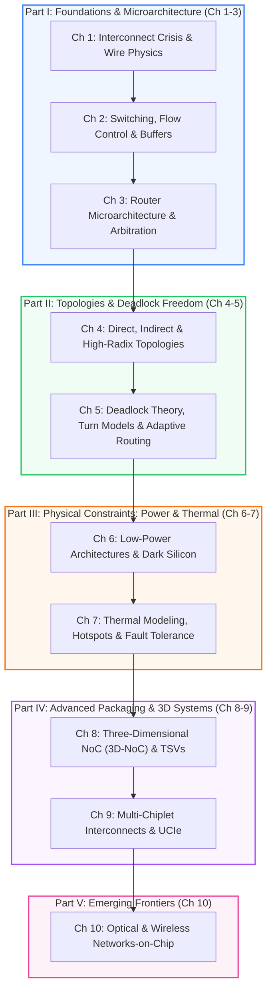

# Network-on-Chip and Advanced Interconnects
## Architecture, Co-Design & Emerging Frontiers

<div class="noc-hero">
  <div class="noc-track-badge">📖 Official Open Textbook • 10 Chapters • 134 Pages</div>
  <h1>Network-on-Chip and Advanced Interconnects</h1>
  <p class="subtitle">
    The definitive open-access monograph and textbook covering 10 cohesive, rigorously grounded chapters across 5 architectural parts. Written with an intuitive, step-by-step pedagogical style accessible from high school students to leading silicon architects.
  </p>
  <div style="display: flex; gap: 0.75rem; flex-wrap: wrap; margin-top: 1rem;">
    <a href="ch01-interconnect-crisis/" class="noc-sim-btn" style="text-decoration: none;">🚀 Read Chapter 1 Online</a>
    <a href="../assets/book.pdf" target="_blank" class="noc-sim-btn" style="text-decoration: none; background: #0284c7;">📥 Download Monograph PDF (134 Pages)</a>
    <a href="https://github.com/network-on-chip/book" target="_blank" class="noc-sim-btn secondary" style="text-decoration: none;">🐙 GitHub Book Source</a>
    <a href="../interactive/game.md" class="noc-sim-btn secondary" style="text-decoration: none; background: #ea580c; color: white;">👾 Interactive Labs</a>
  </div>
</div>

<div class="noc-stats-grid">
  <div class="noc-stat-card">
    <span class="noc-stat-number">10</span>
    <span class="noc-stat-label">Core Chapters</span>
  </div>
  <div class="noc-stat-card">
    <span class="noc-stat-number">5</span>
    <span class="noc-stat-label">Architectural Parts</span>
  </div>
  <div class="noc-stat-card">
    <span class="noc-stat-number">134</span>
    <span class="noc-stat-label">Camera-Ready Pages</span>
  </div>
  <div class="noc-stat-card">
    <span class="noc-stat-number">100%</span>
    <span class="noc-stat-label">Open & Reproducible</span>
  </div>
</div>

---

## 🎯 Pedagogical Philosophy: Deep Rigor Made Crystal Clear

Modern multi-core processors, AI accelerators (GPUs, TPUs, NPUs), and multi-chiplet superchips spend up to **40% of their total power and area** moving data across silicon. Yet interconnection networks are often taught using abstract, impenetrable formulas.

This textbook bridges **rigorous physical equations** (Elmore RC delays, Murphy yield models, Channel Dependency Graphs, thermo-optic resonance drift) with **vivid, intuitive real-world metaphors** so that any curious high school student or undergraduate can immediately build an intuitive mental model:

<div class="noc-tracks-grid" style="margin-top: 1.5rem;">
  <div class="noc-track-card">
    <div>
      <span class="noc-track-badge" style="background: rgba(234, 88, 12, 0.1); color: #ea580c; border-color: rgba(234, 88, 12, 0.2);">🍕 Chapter 9: Yield Economics</span>
      <div class="noc-track-title">The Giant Pizza Problem</div>
      <div class="noc-track-desc">
        Baking an 800 mm² giant pizza means a single falling fly ruins the whole dinner (zero yield). Baking four smaller personal pizzas connected on a wooden tray (silicon interposer) means one fly only loses 25%—saving millions of dollars in silicon manufacturing.
      </div>
    </div>
  </div>

  <div class="noc-track-card">
    <div>
      <span class="noc-track-badge" style="background: rgba(37, 99, 235, 0.1); color: #2563eb; border-color: rgba(37, 99, 235, 0.2);">🌉 Chapter 9: Advanced Packaging</span>
      <div class="noc-track-title">Dirt Roads vs. 16-Lane Glass Bridges</div>
      <div class="noc-track-desc">
        Connecting chips with traditional printed circuit board (PCB) traces is like bumping down a muddy dirt road at 20 mph with high resistance. 2.5D silicon interposers (CoWoS, EMIB) build a smooth 16-lane glass highway with sub-picosecond transit times.
      </div>
    </div>
  </div>

  <div class="noc-track-card">
    <div>
      <span class="noc-track-badge" style="background: rgba(16, 185, 129, 0.1); color: #10b981; border-color: rgba(16, 185, 129, 0.2);">⚾ Chapter 2 &amp; 9: Flow Control</span>
      <div class="noc-track-title">Playing Catch with Baseballs</div>
      <div class="noc-track-desc">
        Little's Law ($B_{min} \ge RTT \times BW$) explained through a game of catch: if it takes 5 seconds for a thrown baseball to arrive and 5 seconds for your friend to wave back, you must have at least 10 baseballs in hand to keep throwing without ever pausing!
      </div>
    </div>
  </div>

  <div class="noc-track-card">
    <div>
      <span class="noc-track-badge" style="background: rgba(139, 92, 246, 0.1); color: #8b5cf6; border-color: rgba(139, 92, 246, 0.2);">🚦 Chapter 5 &amp; 9: Deadlock Freedom</span>
      <div class="noc-track-title">The 4-Way Traffic Jam &amp; The Traffic Cop</div>
      <div class="noc-track-desc">
        Four cars enter a four-way intersection simultaneously, each blocking the person behind them (a circular dependency cycle). The In/Outbound Swap protocol acts as a smart traffic cop that asks one car to back up into an empty driveway, instantly unjamming the entire city.
      </div>
    </div>
  </div>

  <div class="noc-track-card">
    <div>
      <span class="noc-track-badge" style="background: rgba(236, 72, 153, 0.1); color: #ec4899; border-color: rgba(236, 72, 153, 0.2);">🔦 Chapter 1 &amp; 10: Optical Physics</span>
      <div class="noc-track-title">Garden Hoses vs. Laser Pointers</div>
      <div class="noc-track-desc">
        Copper wires act like long, heavy garden hoses that must be filled with water before a single drop squirts out (charging wire capacitance). Optical silicon waveguides act like laser pointers: shine the light, and photons strike the target at the speed of light with zero capacitive drag.
      </div>
    </div>
  </div>

  <div class="noc-track-card">
    <div>
      <span class="noc-track-badge" style="background: rgba(234, 179, 8, 0.1); color: #ca8a04; border-color: rgba(234, 179, 8, 0.2);">🎸 Chapter 10: Silicon Photonics</span>
      <div class="noc-track-title">The Out-of-Tune Guitar</div>
      <div class="noc-track-desc">
        Micro-ring resonators (MRRs) are tiny optical tuning forks tuned to an exact light frequency. When nearby CPU cores heat the silicon, the ring expands by $0.10\text{ nm/}^\circ\text{C}$—just like a guitar string going out of tune in the hot sun—requiring active micro-heaters to re-tune.
      </div>
    </div>
  </div>
</div>

---

## 📚 Complete 10-Chapter Curriculum Outline



---

### Part I: Foundations & Router Microarchitecture

<div class="noc-tracks-grid">
  <div class="noc-track-card">
    <div>
      <span class="noc-track-badge">Chapter 1</span>
      <div class="noc-track-title">The Multi-Core Communication Crisis &amp; Interconnect Physics</div>
      <div class="noc-track-desc">
        Dennard scaling breakdown, sub-threshold leakage, quantum tunneling, failure of shared multi-drop buses (AMBA AHB/APB), RC wire delay scaling, Mayadas-Shatzkes copper grain boundary scattering, and optimal repeater insertion ($L_{opt}, s_{opt}$).
      </div>
      <div style="font-size:0.8rem; color:var(--noc-text-muted); margin-top:0.35rem;">
        🐍 <code>code/wire_elmore_rc_sim.py</code> • 💾 <code>code/bus_arbiter_contention.v</code>
      </div>
    </div>
    <a href="ch01-interconnect-crisis/" class="noc-track-link">Read Chapter 1 →</a>
  </div>

  <div class="noc-track-card">
    <div>
      <span class="noc-track-badge">Chapter 2</span>
      <div class="noc-track-title">Switching Techniques, Flow Control &amp; Buffer Management</div>
      <div class="noc-track-desc">
        Store-and-Forward vs. Virtual Cut-Through vs. Wormhole switching, flit serialization, credit-based flow control turnaround latency loops ($RTT$), on/off and credit counters, Virtual Channel (VC) Head-of-Line blocking mitigation, and AXI4/TileLink NI packetization.
      </div>
      <div style="font-size:0.8rem; color:var(--noc-text-muted); margin-top:0.35rem;">
        🐍 <code>code/credit_flow_control_sim.py</code> • 💾 <code>code/credit_counter.v</code>
      </div>
    </div>
    <a href="ch02-switching-flow-control/" class="noc-track-link">Read Chapter 2 →</a>
  </div>

  <div class="noc-track-card">
    <div>
      <span class="noc-track-badge">Chapter 3</span>
      <div class="noc-track-title">High-Performance Router Microarchitecture &amp; Arbitration</div>
      <div class="noc-track-desc">
        Canonical 4-stage pipelined router (BW, RC, VA/SA, ST/LT), speculative VA-SA parallel allocation, matrix arbiters (sub-200ps LRU), wavefront arbiters, crossbar switch fabrics (multiplexer vs. transmission gate), and SMART single-cycle multi-hop bypass paths.
      </div>
      <div style="font-size:0.8rem; color:var(--noc-text-muted); margin-top:0.35rem;">
        🐍 <code>code/router_pipeline_sim.py</code> • 💾 <code>code/matrix_arbiter_4x4.v</code>
      </div>
    </div>
    <a href="ch03-router-microarchitecture/" class="noc-track-link">Read Chapter 3 →</a>
  </div>
</div>

---

### Part II: Topologies, Routing & Deadlock Freedom

<div class="noc-tracks-grid">
  <div class="noc-track-card">
    <div>
      <span class="noc-track-badge">Chapter 4</span>
      <div class="noc-track-title">Direct, Indirect &amp; High-Radix Topologies</div>
      <div class="noc-track-desc">
        Graph-theoretic interconnect evaluation: degree, diameter, bisection bandwidth $\mathcal{B}$, average hop count $\bar{D}$, path diversity. 2D Mesh, 2D Torus, Folded Torus, Concentrated Mesh (cMesh), Clos networks, Fat-Trees, Flattened Butterfly, and Dragonfly.
      </div>
      <div style="font-size:0.8rem; color:var(--noc-text-muted); margin-top:0.35rem;">
        🐍 <code>code/topology_throughput_latency_sim.py</code> • 💾 <code>code/topology_graph_metrics.v</code>
      </div>
    </div>
    <a href="ch04-topologies-and-metrics/" class="noc-track-link">Read Chapter 4 →</a>
  </div>

  <div class="noc-track-card">
    <div>
      <span class="noc-track-badge">Chapter 5</span>
      <div class="noc-track-title">Deadlock Theory, Turn Models &amp; Adaptive Routing</div>
      <div class="noc-track-desc">
        Channel Dependency Graphs (CDG), Dally-Seitz cycle-free theorem, Dimension-Order Routing (DOR / XY), Glass-Ni Turn Model (West-First, North-Last, Negative-First), Chiu's Odd-Even routing, Duato's Theorem with escape VCs, and cache coherence VNET deadlock avoidance.
      </div>
      <div style="font-size:0.8rem; color:var(--noc-text-muted); margin-top:0.35rem;">
        🐍 <code>code/turn_model_deadlock_sim.py</code> • 💾 <code>code/escape_vc_router.v</code>
      </div>
    </div>
    <a href="ch05-routing-deadlock-theory/" class="noc-track-link">Read Chapter 5 →</a>
  </div>
</div>

---

### Part III: Physical Constraints: Power, Thermal & Reliability

<div class="noc-tracks-grid">
  <div class="noc-track-card">
    <div>
      <span class="noc-track-badge">Chapter 6</span>
      <div class="noc-track-title">Low-Power Architectures &amp; Dark Silicon Dynamics</div>
      <div class="noc-track-desc">
        Energy breakdown: link dynamic energy ($P_{dyn} = \alpha C V_{dd}^2 f$), crossbar capacitance, sub-threshold leakage in dark silicon ($>20\%$ unpowered area), Voltage-Frequency Islands (VFIs), fine-grained sleep transistors, and lookahead power gating.
      </div>
      <div style="font-size:0.8rem; color:var(--noc-text-muted); margin-top:0.35rem;">
        🐍 <code>code/dvfs_vfi_power_sim.py</code> • 💾 <code>code/power_gating_router_fsm.v</code>
      </div>
    </div>
    <a href="ch06-low-power-dark-silicon/" class="noc-track-link">Read Chapter 6 →</a>
  </div>

  <div class="noc-track-card">
    <div>
      <span class="noc-track-badge">Chapter 7</span>
      <div class="noc-track-title">Thermal Modeling, Hotspots &amp; Fault-Tolerant Resilience</div>
      <div class="noc-track-desc">
        Fourier heat equation, compact thermal RC equivalent circuits (HotSpot), thermal runaway positive feedback, thermal throttling (DVFS, RCA), online temperature estimation via Gaussian-Sum Filtering (GSF), electromigration (Black's equation), and bypass fault tolerance.
      </div>
      <div style="font-size:0.8rem; color:var(--noc-text-muted); margin-top:0.35rem;">
        🐍 <code>code/thermal_rc_mesh_sim.py</code> • 💾 <code>code/fault_tolerant_router_bypass.v</code>
      </div>
    </div>
    <a href="ch07-thermal-fault-tolerance/" class="noc-track-link">Read Chapter 7 →</a>
  </div>
</div>

---

### Part IV: Advanced Packaging, 3D NoC & Multi-Chiplets

<div class="noc-tracks-grid">
  <div class="noc-track-card">
    <div>
      <span class="noc-track-badge">Chapter 8</span>
      <div class="noc-track-title">Three-Dimensional Networks-on-Chip (3D-NoC) &amp; TSVs</div>
      <div class="noc-track-desc">
        Vertical scaling physics, Through-Silicon Vias (TSVs), capacitive parasitics, Keep-Out Zones (KOZ), 7-port 3D crossbars (N, S, E, W, Up, Down, Local), arbitration-free vertical fast-paths, vertical heat trapping, and interlayer thermal routing.
      </div>
      <div style="font-size:0.8rem; color:var(--noc-text-muted); margin-top:0.35rem;">
        🐍 <code>code/tsv_vertical_mesh_sim.py</code> • 💾 <code>code/tsv_arbiter_3d.v</code>
      </div>
    </div>
    <a href="ch08-3d-noc-tsvs/" class="noc-track-link">Read Chapter 8 →</a>
  </div>

  <div class="noc-track-card">
    <div>
      <span class="noc-track-badge">Chapter 9</span>
      <div class="noc-track-title">Multi-Chiplet Interconnects, 2.5D Systems &amp; UCIe</div>
      <div class="noc-track-desc">
        Optical reticle limit ($858\text{ mm}^2$), Murphy yield model economics, 2.5D silicon interposers (CoWoS, EMIB), the Universal Chiplet Interconnect Express (UCIe) 3-layer architecture, D2D latency modeling, Little's Law buffer sizing, and In/Outbound Swap deadlock recovery.
      </div>
      <div style="font-size:0.8rem; color:var(--noc-text-muted); margin-top:0.35rem;">
        🐍 <code>code/ucie_d2d_latency_model.py</code> • 💾 <code>code/chiplet_bridge_protocol.v</code>
      </div>
    </div>
    <a href="ch09-chiplets-ucie/" class="noc-track-link">Read Chapter 9 →</a>
  </div>
</div>

---

### Part V: Emerging Frontiers

<div class="noc-tracks-grid">
  <div class="noc-track-card">
    <div>
      <span class="noc-track-badge">Chapter 10</span>
      <div class="noc-track-title">Optical &amp; Wireless Networks-on-Chip (ONoC / WNoC)</div>
      <div class="noc-track-desc">
        Silicon nanophotonics, micro-ring resonators (MRRs), Parallel (PSE) vs Crossing (CSE) switching elements, thermo-optic drift ($0.10\text{ nm/}^\circ\text{C}$), on-chip mmWave/THz wireless antennas (60 GHz), OOK transceiver power modeling, and hybrid photonic-RF topologies.
      </div>
      <div style="font-size:0.8rem; color:var(--noc-text-muted); margin-top:0.35rem;">
        🐍 <code>code/onoc_optical_loss_sim.py</code> • 💾 <code>code/photonic_mrr_switch.v</code>
      </div>
    </div>
    <a href="ch10-optical-wireless/" class="noc-track-link">Read Chapter 10 →</a>
  </div>
</div>

---

## 🔗 Cross-Mapping: Book Chapters, Learning Tracks & Interactive Labs

| Book Chapter | Learning Hub Track | Accompanying Interactive Lab | Hardware RTL Module |
| :--- | :--- | :--- | :--- |
| **Ch 1: Interconnect Crisis & Wire Physics** | [Track 1: Fundamentals](../track1-fundamentals/index.md) | [2D Mesh Simulator](../interactive/visualizer.md) | `bus_arbiter_contention.v` |
| **Ch 2: Switching, Flow Control & Buffers** | [Track 1: Fundamentals](../track1-fundamentals/index.md) | [Credit Commander Link](../interactive/credits.md) | `credit_counter.v` |
| **Ch 3: Router Microarchitecture & Arbitration** | [Track 2: Router Microarchitecture](../track2-router-architecture/index.md) | [Arbiter Arena Clash](../interactive/arbiter.md) | `matrix_arbiter_4x4.v` |
| **Ch 4: Direct, Indirect & High-Radix Topologies** | [Track 3: Topologies & Metrics](../track3-topologies/index.md) | [Topology Titans Exascale](../interactive/topology.md) | `topology_graph_metrics.v` |
| **Ch 5: Deadlock Theory & Turn Models** | [Track 4: Routing & Deadlock](../track4-routing-deadlock/index.md) | [Deadlock Buster Arcade](../interactive/game.md) | `escape_vc_router.v` |
| **Ch 6: Low Power & Dark Silicon** | [Track 5: Thermal & Congestion](../track5-congestion-thermal/index.md) | [Volt Vortex Power](../interactive/power.md) | `power_gating_router_fsm.v` |
| **Ch 7: Thermal Modeling & Fault Tolerance** | [Track 5: Thermal & Congestion](../track5-congestion-thermal/index.md) | [Hotspot Hero Arcade](../interactive/hotspot.md) | `fault_tolerant_router_bypass.v` |
| **Ch 8: 3D-NoC & TSVs** | [Track 6: Chiplets & 3D NoC](../track6-chiplets-and-3d/index.md) | [Chiplet Tycoon Architect](../interactive/chiplet.md) | `tsv_arbiter_3d.v` |
| **Ch 9: Multi-Chiplets & UCIe** | [Track 6: Chiplets & 3D NoC](../track6-chiplets-and-3d/index.md) | [Chiplet Tycoon Architect](../interactive/chiplet.md) | `chiplet_bridge_protocol.v` |
| **Ch 10: Optical & Wireless NoC** | [Track 6: Chiplets & 3D NoC](../track6-chiplets-and-3d/index.md) | [Photon Pilot Grid](../interactive/optical.md) | `photonic_mrr_switch.v` |

---

## 📖 Citation & Academic Reproduction

If you use this open textbook or its accompanying Verilog RTL models and Python simulators in your teaching, research, or course projects, please cite:

```bibtex
@book{noc_lab_consortium_2026,
  author    = {NoC-Lab Research Consortium},
  title     = {Network-on-Chip and Advanced Interconnects: Architecture, Co-Design \& Emerging Frontiers},
  series    = {Springer Monographs in Computer Architecture},
  publisher = {NoC-Lab Open Publishing},
  year      = {2026},
  pages     = {1--134},
  url       = {https://network-on-chip.github.io/learning/textbook/},
  note      = {Springer Nature Monographs in Computer Architecture}
}
```
