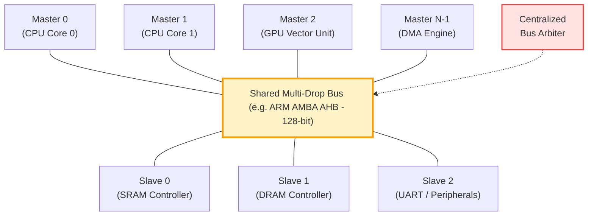
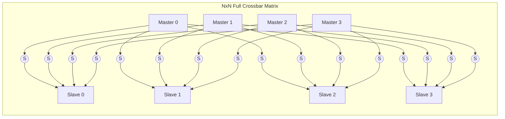
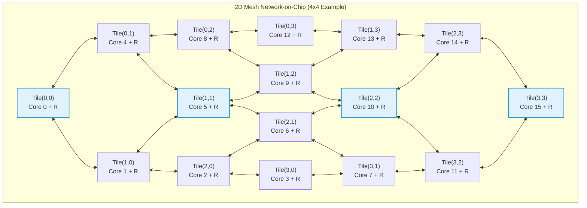

# 1.1 Why Network-on-Chip?

As semiconductor technology scaled down following Moore's Law and Dennard Scaling, single-core microprocessors struck the **Power Wall** in the early 2000s. Chip architects could no longer drive clock frequencies higher without exceeding the thermal dissipation limits of standard packaging ($\approx 100\text{–}130\text{ W/cm}^2$). 

To sustain computing performance growth, the industry executed a paradigm shift toward **Multi-Processor Systems-on-Chip (MPSoCs)** and **Chip Multi-Processors (CMPs)**, integrating dozens to hundreds of processing elements, accelerators, and memory controllers on a single monolithic silicon die.

However, scaling compute cores immediately triggered an existential crisis in **on-chip interconnect physical design**.

---

## 1. The Breakdown of Shared Multi-Drop Buses

In early Systems-on-Chip, intellectual property (IP) blocks (CPUs, DSPs, DMA engines, SRAM controllers) communicated through shared multi-drop buses such as **ARM AMBA (AHB/APB)**, **IBM CoreConnect**, or **Wishbone**.



While shared buses are simple and cost-effective for small SoCs ($N \le 4\text{–}8$ masters), they collapse under severe physical and architectural bottlenecks as core counts grow:

### A. Capacitive Loading & Elmore Wire Delay
A shared bus consists of long physical metal traces spanning across the entire silicon die. Every connected master and slave attaches an input/output transceiver tap to the shared wire.

According to the **Elmore Delay Model**, the propagation delay $\tau$ of a distributed $RC$ line loaded by $N$ capacitive taps is:

$$\tau_{bus} \approx 0.38 \cdot R_{wire} \cdot C_{wire} + \sum_{i=1}^{N} R_{driver} \cdot C_{tap, i} + \sum_{i=1}^{N} R_{wire, i} \cdot C_{tap, i}$$

Where:
- $R_{wire}$ is the total resistance of the global metal wire across the die.
- $C_{wire}$ is the total wire capacitance (area capacitance to substrate + fringe capacitance).
- $C_{tap, i}$ is the input capacitance of the $i$-th master/slave transceiver tap.

As core count $N$ increases, total capacitance skyrockets ($C_{total} \propto N$). Consequently, the maximum achievable bus clock frequency ($f_{max} \approx \frac{1}{2 \tau_{bus}}$) drops precipitously. While local processor logic easily ran at 2.0–3.0 GHz, global shared buses were throttled to 200–400 MHz.

### B. Sub-10nm Interconnect Physics: Electron Scattering
In deep-submicron processes (below 14nm, 7nm, and 3nm), interconnect resistance does not scale linearly. Because of **electron surface scattering** and **grain-boundary scattering** (described by the **Mayadas-Shatzkes model**), the effective resistivity of copper ($\rho_{eff}$) surges dramatically once the wire dimensions approach the electron mean free path ($\approx 39\text{ nm}$ in bulk Cu at room temperature).

Furthermore, ultra-thin barrier and liner materials (such as Tantalum/Tantalum Nitride or Cobalt/Ruthenium) required to prevent copper electromigration consume an increasingly large fraction of the wire's cross-sectional area, drastically increasing $R_{wire}$ per millimeter. Long global bus wires became unbearable thermal and delay bottlenecks.

```
Bulk Copper Wire (>180nm):   [=========== Low-Resistivity Pure Cu ===========]
Nanoscale Wire (<7nm):       [|TaN|::: High-Resistivity Grain Boundaries :::|TaN|]
```

### C. The Serialization Bottleneck
A shared bus is a **single shared medium**. At any given clock cycle, the centralized bus arbiter can grant bus access to **exactly one master**.
- **Fixed Aggregate Bandwidth**:
  $$BW_{agg} = W \times f_{bus}$$
  where $W$ is the bus width (e.g., 64 or 128 bits) and $f_{bus}$ is the bus clock frequency.
- **Collapsing Per-Core Bandwidth**:
  When $N$ active cores contend for the bus, the average bandwidth available to each core collapses asymptotically to zero:
  $$BW_{core} = \frac{W \times f_{bus}}{N} \propto \frac{1}{N}$$

For a 64-core CMP, each core would receive only $\approx 1.5\%$ of the bus bandwidth, leaving high-performance superscalar pipelines starved of cache lines.

### D. Repeater Insertion & Dynamic Power Waste
To mitigate quadratic $RC$ delay, global bus lines require periodic **repeater insertion** (CMOS inverters/buffers). The optimal repeater pitch $L_{opt}$ is given by:

$$L_{opt} = \sqrt{\frac{2 \cdot R_{gate} \cdot C_{gate}}{R_{wire} \cdot C_{wire}}}$$

For a 20mm global bus, hundreds of large repeaters must be placed across multiple metal layers. On every bus transaction, the entire global capacitive line—including hundreds of repeaters—must charge and discharge:

$$P_{dynamic} = \alpha \cdot C_{total} \cdot V_{DD}^2 \cdot f$$

Driving long buses rapidly consumed over **30% to 40% of the entire chip's dynamic power budget**, simply moving bits across silicon without performing any computation.

---

## 2. Dedicated Point-to-Point Crossbars: Why Not Just $N \times N$?

To escape bus serialization, computer architects explored **full crossbar switches** (or crossbar matrices). In an $N \times N$ crossbar, every master connects to an independent horizontal bus, every slave connects to an independent vertical bus, and a switching element exists at every intersection.



A crossbar allows multiple non-conflicting master-slave pairs to communicate simultaneously, achieving peak aggregate bandwidth:

$$BW_{crossbar} = N \times W \times f$$

However, a full $N \times N$ crossbar suffers from **quadratic physical complexity**:

$$\text{Crosspoint Switches} = N^2, \quad \text{Wiring Tracks} = 2 \times N \times W$$

| Master Count ($N$) | Crosspoints ($N^2$) | Routing Tracks (128-bit) | Physical Silicon Viability |
| :--- | :--- | :--- | :--- |
| **4 Cores** | 16 | 1,024 tracks | Excellent (Standard micro-switch) |
| **8 Cores** | 64 | 2,048 tracks | Feasible (High-end smartphone SoC) |
| **16 Cores** | 256 | 4,096 tracks | Difficult (High wire congestion) |
| **64 Cores** | 4,096 | 16,384 tracks | **Intractable (Exceeds routing budget)** |
| **256 Cores** | 65,536 | 65,536 tracks | **Physically Impossible in 2D layout** |

Beyond 16 cores, the multiplexer tree fan-in and dense routing channels create unbearable physical congestion, leading to timing violations and ballooning silicon area.

---

## 3. The Network-on-Chip (NoC) Solution

In 2001, two landmark papers fundamentally transformed on-chip computer architecture:
1. **Luca Benini & Giovanni De Micheli** (*"Networks on Chips: A New SoC Paradigm"*, IEEE Computer, 2002 / DAC 2001)
2. **William J. Dally & Brian Towles** (*"Route Packets, Not Wires: On-Chip Interconnection Networks"*, DAC 2001)

Their central thesis was both elegant and revolutionary:

> <p style="font-size: 1.15rem; font-weight: 700; color: var(--noc-primary); margin: 0.5rem 0;">
> 💡 "Route packets, not wires. Replace long dedicated global wires with microscopic packet-switched routing networks inside silicon."
> </p>



### Core Architectural Principles of NoC:
1. **Short, Predictable Point-to-Point Links**: Routers communicate strictly with their immediate spatial neighbors (North, South, East, West, Local). Wire length is strictly bounded to the tile pitch ($\approx 1\text{–}2\text{ mm}$), completely eliminating multi-die global RC delays.
2. **Concurrent Multi-Hop Communication**: Unrelated communication streams traverse independent links simultaneously. While Core 0 writes to Core 1, Core 14 can transfer a block to Core 15 without contention.
3. **Linear Aggregate Bandwidth Scaling**: Aggregate network bandwidth scales linearly with the number of nodes:
   $$BW_{agg} \approx \frac{2 \sqrt{N} \cdot W \cdot f}{\text{traffic factor}} = O(N)$$
4. **Modular Tile Reusability (LEGO Principle)**: Architects design a single standard tile comprising:
   $$\text{Tile} = \text{Compute Core} + \text{L1/L2 Cache} + \text{Network Interface (NI)} + \text{Router}$$
   This tile is synthesized, timed, and verified once, then stepped across the silicon reticle in a regular 2D grid.

---

## 4. 🧮 Interactive Interconnect Scalability Explorer

Experiment with the interactive tool below. Adjust the number of cores $N$, the chip size, the data width, and the target clock frequency to observe how Shared Buses, Full Crossbars, and 2D Mesh NoCs scale in bandwidth, wiring tracks, and dynamic power.

<div class="noc-sim-container" id="nocScaleCalc">
  <div style="font-size:1.1rem; font-weight:700; color:var(--tcl-heading); margin-bottom:1rem; display:flex; align-items:center; gap:0.5rem;">
    <span>⚡ Interconnect Scalability &amp; Physics Explorer</span>
  </div>

  <div style="display:grid; grid-template-columns:repeat(auto-fit, minmax(220px, 1fr)); gap:1rem; margin-bottom:1.25rem;">
    <div>
      <label style="font-size:0.85rem; font-weight:600; display:block; margin-bottom:0.35rem;">
        Number of Processing Cores ($N$): <span id="valCores" style="color:var(--tcl-blue-600); font-weight:700;">16</span>
      </label>
      <input type="range" id="sliderCores" min="2" max="128" step="2" value="16" style="width:100%;" oninput="updateScalabilitySim()">
      <div style="display:flex; justify-content:space-between; font-size:0.75rem; color:var(--noc-text-muted);">
        <span>2 (Dual)</span><span>16</span><span>64</span><span>128 (Large CMP)</span>
      </div>
    </div>

    <div>
      <label style="font-size:0.85rem; font-weight:600; display:block; margin-bottom:0.35rem;">
        Die Edge Length ($L_{die}$): <span id="valDie" style="color:var(--tcl-blue-600); font-weight:700;">16 mm</span>
      </label>
      <input type="range" id="sliderDie" min="4" max="32" step="2" value="16" style="width:100%;" oninput="updateScalabilitySim()">
      <div style="display:flex; justify-content:space-between; font-size:0.75rem; color:var(--noc-text-muted);">
        <span>4 mm (Mobile)</span><span>16 mm</span><span>32 mm (Server)</span>
      </div>
    </div>

    <div>
      <label style="font-size:0.85rem; font-weight:600; display:block; margin-bottom:0.35rem;">
        Data Bus / Link Width ($W$):
      </label>
      <select id="selectWidth" class="noc-sim-select" style="width:100%;" onchange="updateScalabilitySim()">
        <option value="64">64 bits (8 Bytes)</option>
        <option value="128" selected>128 bits (16 Bytes)</option>
        <option value="256">256 bits (32 Bytes)</option>
        <option value="512">512 bits (64 Bytes - Cacheline)</option>
      </select>
    </div>

    <div>
      <label style="font-size:0.85rem; font-weight:600; display:block; margin-bottom:0.35rem;">
        Nominal Clock Target ($f$): <span id="valFreq" style="color:var(--tcl-blue-600); font-weight:700;">2.0 GHz</span>
      </label>
      <input type="range" id="sliderFreq" min="0.5" max="3.5" step="0.5" value="2.0" style="width:100%;" oninput="updateScalabilitySim()">
      <div style="display:flex; justify-content:space-between; font-size:0.75rem; color:var(--noc-text-muted);">
        <span>0.5 GHz</span><span>2.0 GHz</span><span>3.5 GHz</span>
      </div>
    </div>
  </div>

  <!-- Dynamic Output Metric Cards -->
  <div style="display:grid; grid-template-columns:repeat(auto-fit, minmax(260px, 1fr)); gap:1rem; margin-bottom:1rem;">
    <!-- Shared Bus Card -->
    <div style="background:var(--noc-surface-subtle); border:1px solid var(--noc-border); border-radius:10px; padding:1.25rem;">
      <div style="font-size:0.8rem; font-weight:700; color:#b45309; text-transform:uppercase; letter-spacing:0.5px;">Shared Multi-Drop Bus</div>
      <div style="font-size:1.5rem; font-weight:800; color:var(--tcl-heading); margin:0.35rem 0;" id="busBw">-- GB/s</div>
      <div style="font-size:0.85rem; line-height:1.6; color:var(--md-default-fg-color--lighter);">
        • <b>Achievable Clock:</b> <span id="busFreq" style="font-weight:600;">--</span><br>
        • <b>Per-Core Bandwidth:</b> <span id="busPerCore" style="font-weight:600;">--</span><br>
        • <b>Global Wiring Tracks:</b> <span id="busWires" style="font-weight:600;">--</span><br>
        • <b>Crosspoints:</b> 1 shared line
      </div>
      <div id="busStatus" style="margin-top:0.75rem; font-size:0.78rem; font-weight:600; padding:4px 8px; border-radius:6px;"></div>
    </div>

    <!-- NxN Crossbar Card -->
    <div style="background:var(--noc-surface-subtle); border:1px solid var(--noc-border); border-radius:10px; padding:1.25rem;">
      <div style="font-size:0.8rem; font-weight:700; color:#0284c7; text-transform:uppercase; letter-spacing:0.5px;">Full N×N Crossbar Matrix</div>
      <div style="font-size:1.5rem; font-weight:800; color:var(--tcl-heading); margin:0.35rem 0;" id="xbarBw">-- GB/s</div>
      <div style="font-size:0.85rem; line-height:1.6; color:var(--md-default-fg-color--lighter);">
        • <b>Operating Clock:</b> <span id="xbarFreq" style="font-weight:600;">--</span><br>
        • <b>Crosspoint Switches:</b> <span id="xbarCrosspoints" style="font-weight:600;">--</span><br>
        • <b>Total Wiring Tracks:</b> <span id="xbarTracks" style="font-weight:600;">--</span><br>
        • <b>Per-Core Peak:</b> <span id="xbarPerCore" style="font-weight:600;">--</span>
      </div>
      <div id="xbarStatus" style="margin-top:0.75rem; font-size:0.78rem; font-weight:600; padding:4px 8px; border-radius:6px;"></div>
    </div>

    <!-- 2D Mesh NoC Card -->
    <div style="background:var(--noc-surface-subtle); border:1.5px solid var(--tcl-blue-600); border-radius:10px; padding:1.25rem;">
      <div style="font-size:0.8rem; font-weight:700; color:var(--tcl-blue-600); text-transform:uppercase; letter-spacing:0.5px;">2D Mesh Network-on-Chip</div>
      <div style="font-size:1.5rem; font-weight:800; color:var(--tcl-heading); margin:0.35rem 0;" id="nocBw">-- GB/s</div>
      <div style="font-size:0.85rem; line-height:1.6; color:var(--md-default-fg-color--lighter);">
        • <b>Operating Clock:</b> <span id="nocFreq" style="font-weight:600;">--</span><br>
        • <b>Router Switches:</b> <span id="nocRouters" style="font-weight:600;">--</span><br>
        • <b>Bisection Bandwidth:</b> <span id="nocBisect" style="font-weight:600;">--</span><br>
        • <b>Average Wire Hop:</b> <span id="nocHopDist" style="font-weight:600;">--</span>
      </div>
      <div id="nocStatus" style="margin-top:0.75rem; font-size:0.78rem; font-weight:600; padding:4px 8px; border-radius:6px;"></div>
    </div>
  </div>

  <div id="simTakeaway" style="font-size:0.88rem; padding:0.75rem 1rem; border-radius:8px; background:rgba(37,99,235,0.08); border:1px solid rgba(37,99,235,0.25); color:var(--tcl-heading); line-height:1.5;"></div>
</div>

<script>
function updateScalabilitySim() {
  const N = parseInt(document.getElementById("sliderCores").value, 10);
  const L_die = parseFloat(document.getElementById("sliderDie").value);
  const W_bits = parseInt(document.getElementById("selectWidth").value, 10);
  const W_bytes = W_bits / 8;
  const f_target = parseFloat(document.getElementById("sliderFreq").value);

  document.getElementById("valCores").textContent = N;
  document.getElementById("valDie").textContent = `${L_die} mm`;
  document.getElementById("valFreq").textContent = `${f_target.toFixed(1)} GHz`;

  // 1. Shared Bus Calculations
  // Wire cap increases with L_die and tap cap increases with N
  // Effective RC delay degrades bus frequency
  const tau_rc_ns = (0.015 * L_die * L_die) + (0.08 * N * (L_die / 10));
  const f_bus_max = Math.min(f_target, 1.0 / (2.0 * Math.max(0.4, tau_rc_ns)));
  const bus_agg_gb = (W_bytes * f_bus_max).toFixed(1);
  const bus_per_core_mb = ((W_bytes * f_bus_max * 1000) / N).toFixed(0);

  document.getElementById("busBw").textContent = `${bus_agg_gb} GB/s`;
  document.getElementById("busFreq").textContent = `${f_bus_max.toFixed(2)} GHz (${Math.round((f_bus_max/f_target)*100)}% target)`;
  document.getElementById("busPerCore").textContent = `${bus_per_core_mb} MB/s`;
  document.getElementById("busWires").textContent = `${W_bits} tracks`;

  const busSt = document.getElementById("busStatus");
  if (N <= 4) {
    busSt.textContent = "🟢 Acceptable for small microcontroller";
    busSt.style.background = "rgba(34,197,94,0.15)";
    busSt.style.color = "#166534";
  } else if (N <= 16) {
    busSt.textContent = "🟡 Heavily Contended (Severe Serialization)";
    busSt.style.background = "rgba(234,88,12,0.15)";
    busSt.style.color = "#9a3412";
  } else {
    busSt.textContent = "🔴 Total Collapse (Bandwidth starvation)";
    busSt.style.background = "rgba(239,68,68,0.15)";
    busSt.style.color = "#991b1b";
  }

  // 2. NxN Crossbar Calculations
  const xbar_crosspoints = N * N;
  const xbar_tracks = 2 * N * W_bits;
  // Crossbar mux fan-in penalty
  const fan_in_penalty = 1.0 / (1.0 + 0.015 * Math.log2(N) * Math.log2(N));
  const f_xbar = f_target * fan_in_penalty;
  const xbar_agg_gb = (N * W_bytes * f_xbar).toFixed(1);
  const xbar_per_core_gb = (W_bytes * f_xbar).toFixed(1);

  document.getElementById("xbarBw").textContent = `${xbar_agg_gb} GB/s`;
  document.getElementById("xbarFreq").textContent = `${f_xbar.toFixed(2)} GHz`;
  document.getElementById("xbarCrosspoints").textContent = `${xbar_crosspoints.toLocaleString()} switches`;
  document.getElementById("xbarTracks").textContent = `${xbar_tracks.toLocaleString()} tracks`;
  document.getElementById("xbarPerCore").textContent = `${xbar_per_core_gb} GB/s`;

  const xbarSt = document.getElementById("xbarStatus");
  if (N <= 8) {
    xbarSt.textContent = "🟢 Ideal for Small Cluster (Low Overhead)";
    xbarSt.style.background = "rgba(34,197,94,0.15)";
    xbarSt.style.color = "#166534";
  } else if (N <= 16) {
    xbarSt.textContent = "🟡 Heavy Routing Congestion";
    xbarSt.style.background = "rgba(234,88,12,0.15)";
    xbarSt.style.color = "#9a3412";
  } else {
    xbarSt.textContent = "🔴 Intractable Silicon Area (>O(N²) limit)";
    xbarSt.style.background = "rgba(239,68,68,0.15)";
    xbarSt.style.color = "#991b1b";
  }

  // 3. 2D Mesh NoC Calculations
  const grid_side = Math.sqrt(N);
  const hop_dist_mm = (L_die / grid_side).toFixed(2);
  // Short hop wires run at full target frequency
  const f_noc = f_target;
  // Bisection bandwidth = 2 * sqrt(N) * W_bytes * f_noc
  const bisection_gb = (2 * grid_side * W_bytes * f_noc).toFixed(1);
  // Aggregate network bandwidth: sum of all 4*N bidirectional link traversals
  const noc_agg_gb = (2 * N * W_bytes * f_noc * 0.6).toFixed(1);

  document.getElementById("nocBw").textContent = `${noc_agg_gb} GB/s`;
  document.getElementById("nocFreq").textContent = `${f_noc.toFixed(2)} GHz (100% full speed)`;
  document.getElementById("nocRouters").textContent = `${N} tiles (5-port R)`;
  document.getElementById("nocBisect").textContent = `${bisection_gb} GB/s`;
  document.getElementById("nocHopDist").textContent = `${hop_dist_mm} mm / link`;

  const nocSt = document.getElementById("nocStatus");
  nocSt.textContent = "🟢 Optimal Scalability & Predictable Timing";
  nocSt.style.background = "rgba(37,99,235,0.15)";
  nocSt.style.color = "#1e40af";

  // Dynamic takeaway text
  const ratio = (parseFloat(noc_agg_gb) / Math.max(0.1, parseFloat(bus_agg_gb))).toFixed(1);
  document.getElementById("simTakeaway").innerHTML = `
    <strong>Architectural Insight for N = ${N} cores (${L_die}×${L_die} mm die):</strong><br>
    The 2D Mesh NoC achieves <strong>${ratio}× higher aggregate bandwidth</strong> than the shared bus while keeping all physical link wires under <strong>${hop_dist_mm} mm</strong>. 
    Meanwhile, an $N \\times N$ crossbar would demand <strong>${xbar_crosspoints.toLocaleString()} crosspoints</strong> and <strong>${xbar_tracks.toLocaleString()} parallel routing tracks</strong>, making physical place-and-route impossible.
  `;
}

// Initial calculation on page load
if (document.readyState === "loading") {
  document.addEventListener("DOMContentLoaded", updateScalabilitySim);
} else {
  updateScalabilitySim();
}
</script>

---

## 5. Landmark Silicon Implementations

To prove that NoCs were not merely academic concepts, pioneering semiconductor teams built silicon proof-of-concepts that established the foundations of modern multicore computing:

### A. MIT RAW Microprocessor (2002)
Designed by Anant Agarwal and his group at MIT, the **RAW (Reconfigurable Architecture Workstation)** was one of the earliest working 2D mesh chips. It featured 16 compute tiles arranged in a $4 \times 4$ grid, integrated 4 on-chip networks (two static networks for scalar operand routing and two dynamic networks for memory and I/O), and proved that pipelined 2D meshes could deliver scalar operands faster than centralized register files.

### B. Intel Polaris TeraFLOPS Processor (ISSCC 2007)
Intel fabricated an 80-tile multicore test chip on 65nm CMOS with over 100 million transistors. Each tile featured two floating-point cores and a 5-port 2D mesh router.
- **Clock Frequency:** Scalable from 3.1 GHz to 5.7 GHz.
- **Raw Throughput:** Delivered **1.0 TeraFLOPS** of compute performance while consuming just **62 Watts**.
- **Interconnect:** 80 routers achieved 1.6 Terabits/second bisection bandwidth with a 2-cycle per-hop pipeline.

### C. Intel Single-Chip Cloud Computer (SCC - ISSCC 2010)
Fabricated on 45nm CMOS, Intel SCC integrated 48 Pentium cores in a $6 \times 4$ 2D mesh. It introduced **Voltage and Frequency Islands (VFIs)**, dividing the on-chip mesh routers into dynamic power domains to prove that packet-switched routing could scale efficiently with dynamic power gating.

### D. Tilera TILE64 & TILE-Gx (2007–2012)
Tilera commercialized a 64-tile RISC processor featuring their proprietary **iMesh** architecture. Instead of a single network, each tile was connected to **5 independent, parallel 2D mesh networks** simultaneously:
- User Dynamic Network (UDN) for inter-thread message passing.
- Input/Output Dynamic Network (IDN) for PCIe/Ethernet traffic.
- Memory Dynamic Network (MDN) for L3 cache coherence.
- Static Network (STN) for compiler-routed deterministic streaming.

```
Tilera 5-Layer iMesh:
[UDN Mesh] ---> User Inter-process Communication
[IDN Mesh] ---> High-speed PCIe & 10GbE I/O Transfers
[MDN Mesh] ---> Cache Coherence & Memory Traffic
[STN Mesh] ---> Zero-Overhead Compiler Operand Streaming
[Memory-Bus] -> Dedicated Off-chip DRAM Interconnect
```

### E. Modern Industry Standard: Intel Xeon Scalable Mesh (Skylake-SP to Emerald Rapids)
For over a decade, Intel server processors utilized dual concentric ring buses. At 28 cores (Skylake-SP in 2017), ring traversal latencies and bisection bandwidth bottlenecks forced Intel to replace the ring with a **2D Mesh NoC**. By organizing cores and memory controllers into a rectangular grid, worst-case hop count was reduced by over 40%, boosting multi-threaded server scaling across cloud workloads.

---

## 6. Worked Numerical Example: Bus vs NoC Delay Analysis

> [!TIP]
> **Problem Statement:**  
> Consider an MPSoC fabricated on a 10nm process with a die width $L = 15\text{ mm}$.  
> A shared global bus spans the full 15mm width, loaded by $N = 32$ master/slave taps ($C_{tap} = 15\text{ fF}$ each).  
> The global wire has sheet resistance $r = 80\ \Omega/\text{mm}$ and unit capacitance $c = 0.18\text{ pF/mm}$.  
> Driver output resistance is $R_d = 450\ \Omega$.  
> 
> Compare the bus propagation delay against a 2D mesh NoC tile-to-tile link ($L_{link} = 15 / \sqrt{32} \approx 2.65\text{ mm}$) with a single receiver tap ($C_{load} = 15\text{ fF}$).

### Step 1: Compute Shared Bus Delay
$$\text{Total Wire Resistance: } R_{wire} = 80\ \Omega/\text{mm} \times 15\text{ mm} = 1,200\ \Omega$$
$$\text{Total Wire Capacitance: } C_{wire} = 0.18\text{ pF/mm} \times 15\text{ mm} = 2.70\text{ pF}$$
$$\text{Total Tap Capacitance: } C_{taps} = 32 \times 0.015\text{ pF} = 0.48\text{ pF}$$
$$\text{Total Capacitance: } C_{total} = 2.70\text{ pF} + 0.48\text{ pF} = 3.18\text{ pF}$$

Using the distributed Elmore delay approximation:
$$\tau_{bus} \approx R_d \cdot C_{total} + 0.38 \cdot R_{wire} \cdot C_{wire} + \frac{1}{2} R_{wire} \cdot C_{taps}$$
$$\tau_{bus} \approx 450\ \Omega \cdot 3.18\text{ pF} + 0.38 \cdot 1200\ \Omega \cdot 2.70\text{ pF} + 0.5 \cdot 1200\ \Omega \cdot 0.48\text{ pF}$$
$$\tau_{bus} \approx 1.431\text{ ns} + 1.231\text{ ns} + 0.288\text{ ns} = \mathbf{2.95\text{ ns}}$$

$$\text{Maximum Bus Clock: } f_{bus} \approx \frac{1}{2 \cdot \tau_{bus}} = \frac{1}{5.90\text{ ns}} \approx \mathbf{169.5\text{ MHz}}$$

### Step 2: Compute NoC Local Link Delay
For a direct point-to-point NoC link of length $L_{link} = 2.65\text{ mm}$:
$$R_{link} = 80\ \Omega/\text{mm} \times 2.65\text{ mm} = 212\ \Omega$$
$$C_{link} = 0.18\text{ pF/mm} \times 2.65\text{ mm} = 0.477\text{ pF}$$
$$\tau_{noc} \approx R_d \cdot (C_{link} + C_{load}) + 0.38 \cdot R_{link} \cdot C_{link}$$
$$\tau_{noc} \approx 450\ \Omega \cdot (0.477\text{ pF} + 0.015\text{ pF}) + 0.38 \cdot 212\ \Omega \cdot 0.477\text{ pF}$$
$$\tau_{noc} \approx 0.221\text{ ns} + 0.038\text{ ns} = \mathbf{0.259\text{ ns}}$$

$$\text{Maximum NoC Link Clock: } f_{noc} \approx \frac{1}{2 \cdot \tau_{noc}} \approx \frac{1}{0.518\text{ ns}} \approx \mathbf{1.93\text{ GHz}}$$

### Conclusion:
The localized NoC point-to-point link operates **over $11.4\times$ faster** than the shared bus ($1.93\text{ GHz}$ vs $169.5\text{ MHz}$) while offering dozens of concurrent communications simultaneously!

---

## 7. 🎯 Knowledge Check: Lesson 1.1

Test your comprehension of on-chip interconnect fundamentals.

<div class="noc-sim-container" id="quiz11" style="margin-top:1rem;">
  <div style="font-weight:700; font-size:1.05rem; margin-bottom:1rem; color:var(--tcl-heading);">
    📝 Concept Check: Interconnect Scaling
  </div>

  <div id="q11_block">
    <p style="font-weight:600; font-size:0.95rem; margin-bottom:0.75rem;" id="q11_text">
      <b>Question:</b> Why does copper wire resistance per unit length increase dramatically in sub-10nm CMOS processes compared to older 180nm processes?
    </p>

    <div style="display:flex; flex-direction:column; gap:0.5rem;" id="q11_options">
      <button class="noc-sim-select" style="text-align:left; padding:0.65rem 0.85rem; cursor:pointer;" onclick="checkQuiz11(0)">
        A. Because copper atoms evaporate at room temperature in narrow wires.
      </button>
      <button class="noc-sim-select" style="text-align:left; padding:0.65rem 0.85rem; cursor:pointer;" onclick="checkQuiz11(1)">
        B. Because electron surface and grain-boundary scattering dominate when dimensions approach the electron mean free path, and resistive TaN diffusion barriers occupy a larger fraction of wire area.
      </button>
      <button class="noc-sim-select" style="text-align:left; padding:0.65rem 0.85rem; cursor:pointer;" onclick="checkQuiz11(2)">
        C. Because digital clock frequencies are too low to activate electron valence bands.
      </button>
      <button class="noc-sim-select" style="text-align:left; padding:0.65rem 0.85rem; cursor:pointer;" onclick="checkQuiz11(3)">
        D. Because sub-10nm processes replace copper wires with aluminum.
      </button>
    </div>

    <div id="q11_feedback" style="display:none; margin-top:1rem; padding:0.85rem; border-radius:8px; font-size:0.9rem; line-height:1.5;"></div>
  </div>
</div>

<script>
function checkQuiz11(idx) {
  const fb = document.getElementById("q11_feedback");
  fb.style.display = "block";
  const opts = document.getElementById("q11_options").children;
  for (let i = 0; i < opts.length; i++) {
    opts[i].onclick = null;
    opts[i].style.cursor = "default";
  }

  if (idx === 1) {
    opts[1].style.background = "rgba(34,197,94,0.15)";
    opts[1].style.borderColor = "#22c55e";
    fb.style.background = "rgba(34,197,94,0.1)";
    fb.style.border = "1px solid rgba(34,197,94,0.3)";
    fb.style.color = "#166534";
    fb.innerHTML = "<strong>✓ Correct!</strong> As wire width shrinks to the electron mean free path (~39nm), electron scattering off grain boundaries and sidewalls increases resistivity dramatically (Mayadas-Shatzkes effect). In addition, high-resistance diffusion barrier liners (Ta/TaN) occupy a larger percentage of the trench cross-section.";
  } else {
    opts[idx].style.background = "rgba(239,68,68,0.15)";
    opts[idx].style.borderColor = "#ef4444";
    opts[1].style.background = "rgba(34,197,94,0.15)";
    opts[1].style.borderColor = "#22c55e";
    fb.style.background = "rgba(239,68,68,0.1)";
    fb.style.border = "1px solid rgba(239,68,68,0.3)";
    fb.style.color = "#991b1b";
    fb.innerHTML = "<strong>✗ Incorrect.</strong> The correct answer is <strong>B</strong>. At nanoscale dimensions, physical boundary scattering and electromigration barrier liners cause effective copper resistivity to explode.";
  }
}
</script>

---

## Summary & Next Steps

In this lesson, we established why long shared buses and monolithic $N \times N$ crossbars failed as multicore processors scaled beyond 8–16 cores:
- Shared buses hit an intractable wall of **capacitive loading, wire delay, and serialized contention**.
- Crossbars require **$O(N^2)$ crosspoints and routing tracks**, causing physical layout collapse.
- Networks-on-Chip solved this by **routing packets over modular, short, high-frequency point-to-point links**.

In the next lesson, we will examine how continuous application data is sliced into **packets**, **flits**, and **phits**, and compare the three foundational switching techniques: **Store-and-Forward**, **Virtual Cut-Through**, and **Wormhole Switching**.

👉 **Proceed to [Lesson 1.2: Packets, Flits & Switching](02-packet-switching-flits.md)**
