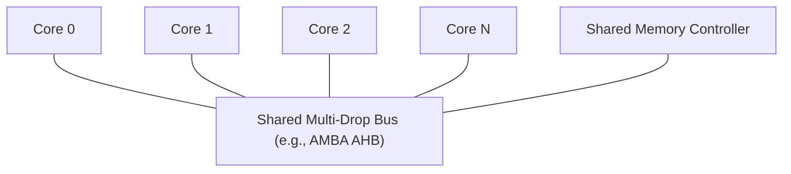
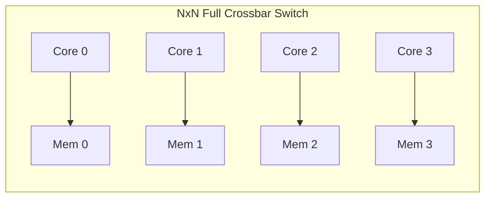
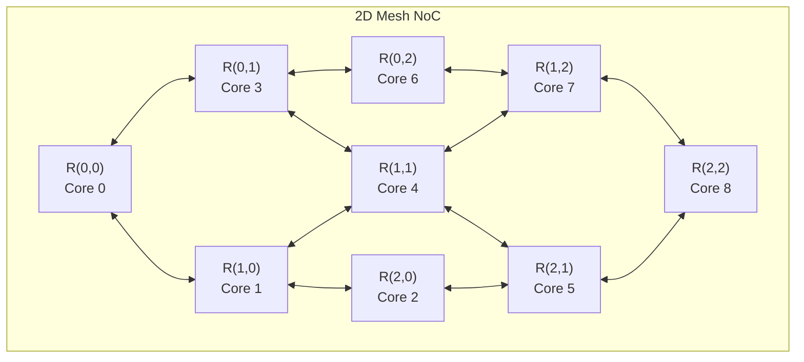

# 1.1 Why Network-on-Chip?

As semiconductor technology scaled down following Moore's Law and Dennard Scaling, single-core CPUs hit the **Power Wall** in the early 2000s. To continue increasing compute performance, computer architects shifted toward **Multi-Processor Systems-on-Chip (MPSoCs)** and **Chip Multi-Processors (CMPs)**, integrating tens to hundreds of cores on a single silicon die.

However, scaling the number of processing elements introduced a critical interconnect crisis.

---

## 1. The Breakdown of Shared Buses

In early Systems-on-Chip (SoCs), IP cores (CPUs, GPUs, DSPs, SRAM controllers) communicated via shared multi-drop buses such as **ARM AMBA (AHB/APB)** or **Wishbone**.

While shared buses are conceptually simple and cost-effective for small systems (2–8 masters), they suffer from severe physical and architectural scaling limitations:

### A. Capacitive Load & RC Wire Delay
In sub-micron processes (65nm and below), global interconnect wires do not scale as favorably as transistors. A shared bus requires long physical wires spanning across the entire die, loaded by capacitive taps from every connected master and slave:

$$\tau \approx 0.38 \cdot R_{wire} \cdot C_{wire} + \sum_{i=1}^{N} C_{load, i}$$

As $N$ grows, the parasitic capacitance skyrockets, slashing the maximum achievable bus clock frequency ($f_{max}$).

### B. Serialization Bottleneck
A shared bus is a single shared medium: **only one master can transmit data at any given clock cycle**. If Core 0 is streaming data to the memory controller, Core 1 and Core 2 are completely blocked. As $N$ increases from 8 to 64 cores:
- Total bandwidth remains fixed: $BW = \text{bus width} \times f_{clk}$.
- Per-core bandwidth drops asymptotically to zero: $BW_{core} \propto \frac{1}{N}$.

### C. Energy Dissipation
Driving long global bus wires on every clock cycle expends dynamic power across the full chip area:

$$P_{dynamic} = \alpha \cdot C_{total} \cdot V_{DD}^2 \cdot f$$

---

## 2. Dedicated Point-to-Point Crossbars: Why Not Just $N \times N$?

To overcome bus serialization, designers turned to full crossbar switches. In a crossbar, any master can simultaneously communicate with any non-conflicting slave.

However, a full $N \times N$ crossbar suffers from quadratic area and wire complexity:

$$\text{Crosspoints} = O(N^2), \quad \text{Wiring Tracks} = O(N^2)$$

For $N = 64$ cores, an $N \times N$ crossbar requires $4,096$ crosspoints and thousands of parallel routing tracks, creating intractable routing congestion at physical layout and prohibitive silicon area.

---

## 3. The Network-on-Chip (NoC) Solution

In 2001, seminal works by Luca Benini & Giovanni De Micheli (*Networks on Chips: A New SoC Paradigm*) and William J. Dally & Brian Towles (*Route Packets, Not Wires: On-Chip Interconnection Networks*) proposed applying telecommunication and internetworking principles directly inside silicon:

> **"Route packets, not wires."**

### Key Advantages of NoC:
1. **Short, Predictable Point-to-Point Links**: Routers only connect to their immediate neighbors (North, South, East, West). Wires are short and fast, enabling high operating frequencies without long global RC delays.
2. **Concurrent Transmissions**: Multiple packets traverse different links simultaneously (e.g., Node 0 talking to Node 1 while Node 7 talks to Node 8), providing aggregate bandwidth that scales linearly with network size: $BW_{agg} \propto N$.
3. **Modular & Scalable Tile Design**: Designers can design one standard tile (Compute Core + Local Cache + Router + Network Interface) and replicate it across a regular 2D grid like LEGO blocks.

---

## Summary Comparison

| Metric | Shared Bus | Full $N \times N$ Crossbar | Network-on-Chip (NoC) |
| :--- | :--- | :--- | :--- |
| **Wiring Complexity** | $O(1)$ wires | $O(N^2)$ crosspoints | $O(N)$ short links |
| **Bandwidth Scaling** | Constrained ($O(1)$) | Peak ($O(N)$) | Highly Scalable ($O(N)$) |
| **Max Frequency** | Low (capacitive load) | Moderate (multiplexer fan-in) | Very High (pipelined links) |
| **Silicon Area** | Minimal | Prohibitive for large $N$ | Modular & Predictable |
| **Optimal Core Range** | 2 – 8 cores | 4 – 16 cores | 16 – 1000+ cores |

In the next lesson, we will see how continuous application messages are diced into **packets**, **flits**, and **phits** to flow efficiently through on-chip routers.
