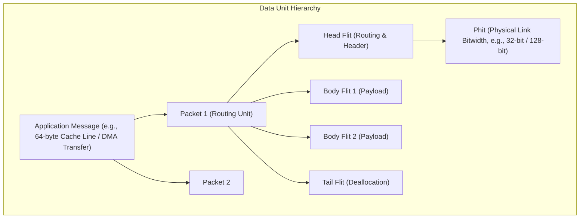

# 1.2 Packets, Flits & Switching

In Network-on-Chip (NoC), data communication is divided into a rigorous structural hierarchy to balance routing flexibility with extremely tight hardware area and buffer budgets.

---

## 1. The Data Hierarchy: Messages, Packets, Flits, and Phits



### Definitions:
1. **Message**: The logical unit of communication generated by the application layer (e.g., a cache coherence request, a memory read response, or an RDMA block transfer).
2. **Packet**: The fundamental **routing unit**. A packet contains complete addressing headers (Source ID, Destination ID, Virtual Channel ID, Quality-of-Service priority) and payload data.
3. **Flit (Flow Control Unit)**: The atomic unit of **buffer allocation and flow control**. Buffers inside on-chip routers are sized to hold integer multiples of flits, not entire packets.
   - **Head Flit**: Contains routing header information; reserves the routing path and allocates virtual channels.
   - **Body Flits**: Contain pure payload data and follow the path carved out by the Head Flit.
   - **Tail Flit**: Contains the end of the packet payload and tears down or deallocates the virtual channel and state in the router.
   - **Single-Flit Packet (Head-and-Tail)**: Combines routing header, short payload (e.g., 8-byte coherence ACK), and deallocation in a single flit.
4. **Phit (Physical Unit)**: The unit of physical transfer across a wire in a single clock cycle. If a physical link has 128 data wires and a flit is 128 bits, then $1 \text{ Flit} = 1 \text{ Phit}$.

---

## 2. Evolution of Switching Mechanisms

How do routers forward packets along their paths from source to destination? Three primary switching paradigms exist in network architecture:

### A. Store-and-Forward (SAF)
In Store-and-Forward switching, a router must receive and buffer the **entire packet** before it makes a routing decision or begins transmitting the first flit to the downstream router.

```
Router 0: [====== Packet ======]
Router 1:                        [====== Packet ======]
Router 2:                                               [====== Packet ======]
Time --->
```

- **Buffer Requirement**: Every router input buffer must be at least as large as the maximum packet size ($B \ge L$).
- **Zero-Load Latency**:
  $$T_{SAF} = H \times \left( t_r + \frac{L}{W} \right)$$
  Where $H$ is the number of hops, $t_r$ is router pipeline delay, $L$ is packet length in bits, and $W$ is channel bandwidth in bits/cycle.
- **Verdict for NoC**: Unacceptable! Packets experience massive latency, and buffers consume excessive silicon area.

---

### B. Virtual Cut-Through (VCT)
Proposed by Kermani and Kleinrock (1979), Virtual Cut-Through allows the router to forward the packet header immediately to the next hop as soon as the routing decision is computed, **without waiting for the entire packet to arrive**, provided that the downstream router has enough space to hold the entire packet.

- **Zero-Load Latency**:
  $$T_{VCT} = H \cdot t_r + \frac{L}{W}$$
- **Limitation**: When congestion occurs, the entire packet must still be buffered at the blocked node. Buffers must still be sized to store complete packets ($B \ge L$).

---

### C. Wormhole Switching (WH)
Introduced by William J. Dally and Charles L. Seitz (1986), **Wormhole Switching** revolutionized on-chip and multiprocessor interconnects.

In Wormhole switching:
1. The packet is split into a train of flits.
2. The **Head Flit** advances cycle-by-cycle across routers, establishing the path.
3. The **Body Flits** follow immediately behind in pipelined fashion like the body of a worm.
4. When the Head Flit is blocked at a downstream router due to contention, the body flits **stop and freeze in place across intermediate router buffers**, rather than buffering at a single node!

```
Hop 0: [Tail] [Body 2] [Body 1]
Hop 1:                          [Head] (blocked)
Hop 2:
```

### Advantages of Wormhole Switching:
- **Tiny Buffer Requirements**: Routers only need buffers large enough to hold a few **flits** (e.g., 2–8 flits per virtual channel) instead of entire kilobytes of packet data.
- **Extremely Low Latency**:
  $$T_{WH} = H \cdot t_r + \frac{L}{W}$$
  Notice that latency scales additively with hop count $H$, not multiplicatively with packet length!

---

## Comparison Summary

| Switching Technique | Buffer Allocation Unit | Min Buffer per Port | Latency under Zero Load |
| :--- | :--- | :--- | :--- |
| **Store-and-Forward (SAF)** | Packet | Full Packet ($L$) | $H \cdot \left( t_r + \frac{L}{W} \right)$ |
| **Virtual Cut-Through (VCT)** | Packet | Full Packet ($L$) | $H \cdot t_r + \frac{L}{W}$ |
| **Wormhole Switching (WH)** | **Flit** | **Few Flits ($k \ll L$)** | **$H \cdot t_r + \frac{L}{W}$** |

> [!WARNING]
> While Wormhole switching minimizes buffer cost, stopped flits hold on to physical links and buffers across multiple routers, causing **Head-of-Line (HoL) blocking** and potential **deadlocks**.
> 
> In [Track 2: Router Microarchitecture](../track2-router-architecture/02-virtual-channels.md), we will see how **Virtual Channels (VCs)** solve this problem.
