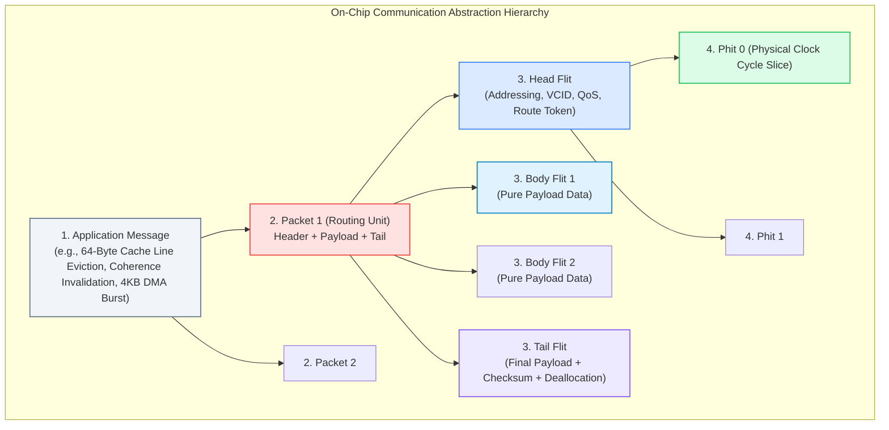

# 1.2 Packets, Flits & Switching

<div class="noc-book-banner" style="background: linear-gradient(135deg, rgba(30, 58, 138, 0.25), rgba(15, 23, 42, 0.45)); border: 1px solid rgba(59, 130, 246, 0.4); border-radius: 10px; padding: 16px 20px; margin-bottom: 24px; display: flex; align-items: center; justify-content: space-between; flex-wrap: wrap; gap: 12px;">
  <div>
    <div style="font-weight: 700; color: #60a5fa; font-size: 1.05rem; display: flex; align-items: center; gap: 8px;">
      <span>📖 Companion Textbook Chapter Available</span>
    </div>
    <div style="font-size: 0.88rem; color: #cbd5e1; margin-top: 4px;">
      Read <strong>Chapter 2: Switching Techniques, Flow Control & Buffer Management</strong> in our open textbook, featuring mathematical latency derivations for SAF vs VCT vs Wormhole, FlooNoC AXI4 NI architectures, and synthesizable credit flow RTL.
    </div>
  </div>
  <a href="../textbook/ch02-switching-flow-control/" style="display: inline-flex; align-items: center; gap: 6px; background: #2563eb; color: #ffffff; padding: 8px 16px; border-radius: 6px; font-weight: 600; font-size: 0.85rem; text-decoration: none; transition: background 0.2s;">
    <span>Explore Chapter 2 →</span>
  </a>
</div>

In Network-on-Chip (NoC), data communication is divided into a rigorous structural hierarchy. This hierarchy balances routing flexibility with the microarchitectural reality that **on-chip SRAM/register buffers consume precious silicon area and power** (typically 35% to 65% of total router power and area) [[Wang2002](#ref-wang2002)], [[Kahng2009](#ref-kahng2009)].

In this lesson, we examine how application transactions are diced into **packets**, **flits**, and **phits**, and compare the three seminal switching techniques that govern how data travels across routers: **Store-and-Forward**, **Virtual Cut-Through**, and **Wormhole Switching**.

---

## 1. The Data Hierarchy: Messages, Packets, Flits, and Phits

Modern on-chip networks decompose communication into four distinct abstraction layers:



### Definitions:

1. **Application Message**:  
   The logical semantic unit generated by the processing core, memory hierarchy, or DMA engine. Examples include an atomic compare-and-swap, an L2 cache miss request, a 64-byte writeback burst, or an interrupt notification.
2. **Packet**:  
   The fundamental **routing unit**. A packet carries the full end-to-end routing address: Source Node ID $(X_s, Y_s)$, Destination Node ID $(X_d, Y_d)$, Virtual Channel ID (VCID), Quality-of-Service (QoS) priority, and message length.
3. **Flit (Flow Control Unit)**:  
   The atomic unit of **buffer allocation and flow control**. Router FIFO buffers on-chip are sized to store integer multiples of *flits*, not entire packets!
   - **Head Flit**: Contains all routing and virtual-channel reservation headers. It allocates the path through the router pipeline.
   - **Body Flits**: Carry pure data payload and follow the path reserved by their preceding Head Flit.
   - **Tail Flit**: Marks the end of the packet payload and deallocates the virtual channel and crossbar reservations.
   - **Single-Flit Packet (Head-and-Tail)**: Combines routing header, small payload (e.g., an 8-byte coherence ACK or synchronization barrier), and VC release into a single flit.
4. **Phit (Physical Unit)**:  
   The physical slice of bits transmitted across physical link wires in a single clock cycle. If a physical link has 128 data wires and a flit is 128 bits wide, then $1\text{ Flit} = 1\text{ Phit}$. If the physical channel is narrower (e.g., 32 bits wide), then $1\text{ Flit} = 4\text{ Phits}$.

---

## 2. Bit-Level Flit Header Architecture

In high-performance silicon routers, flit encoding is engineered to minimize decoding logic delay in the critical path. Below is a standard 128-bit industry flit format (similar to OpenPiton [[Balkind2016](#ref-balkind2016)], FlooNoC [[Fischer2025](#ref-fischer2025)], TileLink NoC, and Intel AXI-Mesh [[DallyPrinciples](#ref-dallyprinciples)]):

### A. Head Flit Bit Allocation (128 bits)

```
 127 126 125 124 123 120 119       112 111       104 103        96 95       88 87       80 79             8 7         0
+-------+-------+--------+-------------+-------------+-------------+-----------+-----------+----------------+-----------+
| Type  | QoS   | VC ID  | Msg Opcode  | Source ID   | Dest ID     | Hop Count | Seq / TID | Address/Data   | Parity/ECC|
| (2b)  | (2b)  | (4b)   | (8b)        | (8b)        | (8b)        | (8b)      | (8b)      | Payload (72b)  | (8b)      |
+-------+-------+--------+-------------+-------------+-------------+-----------+-----------+----------------+-----------+
```

- **Type (`[127:126]`):** `00` = Head, `01` = Body, `10` = Tail, `11` = Single-Flit (Head+Tail).
- **QoS Priority (`[125:124]`):** 2-bit priority level for latency-critical memory responses vs bulk traffic.
- **VC ID (`[123:120]`):** Specifies which Virtual Channel (0 to 15) this packet occupies.
- **Msg Opcode (`[119:112]`):** Memory transaction type (Read Request, Write Invalidate, Coherence Ack).
- **Source / Dest ID (`[111:96]`):** $(X, Y)$ coordinate coordinates in the 2D mesh grid.
- **Hop Count / TTL (`[95:88]`):** Incremented per hop to detect livelock routing faults.
- **Parity / ECC (`[7:0]`):** Single-error-correction double-error-detection (SECDED) protecting routing headers.

### B. Body & Tail Flit Format (128 bits)

```
 127 126 125 122 121                                                                           8 7         0
+-------+--------+-------------------------------------------------------------------------------+-----------+
| Type  | VC ID  | Payload Data Bits (114 bits)                                                  | Data ECC  |
| (2b)  | (4b)   |                                                                               | (8b)      |
+-------+--------+-------------------------------------------------------------------------------+-----------+
```

Notice that Body and Tail flits **carry no destination addresses or routing metadata**! They rely entirely on the state configured in the router by the Head Flit, maximizing bandwidth utilization for payload data.

---

## 3. The Evolution of Switching Techniques

How does a router forward packets along the path from source to destination? Three fundamental paradigms exist:

```
Timeline:
1960s–1970s: [Store-and-Forward (ARPANET)] 
                  ↓
1979:        [Virtual Cut-Through (Kermani & Kleinrock)]
                  ↓
1986:        [Wormhole Switching (Dally & Seitz)]  <-- Dominant Silicon Standard
```

### A. Store-and-Forward (SAF) Switching
In Store-and-Forward switching [[Baran1964](#ref-baran1964)], a router must receive and store the **entire packet** in its input buffer before it can compute the route or begin forwarding the first flit to the downstream router.

```
Router 0: [=== Packet (L flits) ===]
Router 1:                            [=== Packet (L flits) ===]
Router 2:                                                       [=== Packet ===]
Time --->
```

#### Analytical Latency Model (Zero Load):
Let:
- $H$ = Number of network hops traversed.
- $t_r$ = Router pipeline delay per hop (in clock cycles).
- $L$ = Packet length in bits.
- $W$ = Channel bandwidth in bits per cycle ($L/W$ is serialization delay).

$$T_{SAF} = H \times \left( t_r + \frac{L}{W} \right)$$

#### Architectural Assessment:
- **Buffer Requirement:** The router input buffer at every port must be at least as large as the **maximum packet length** ($B \ge L$). For 512-byte cacheline transfers, each port requires kilobytes of SRAM.
- **Latency Scaling:** Latency scales **multiplicatively with packet length and hop count** ($O(H \times L)$). 
- **Verdict for Silicon NoC:** **Completely unacceptable**. In a 6-hop network, packet serialization would occur 6 consecutive times, causing massive memory stall penalties.

---

### B. Virtual Cut-Through (VCT) Switching
Proposed by Parviz Kermani and Leonard Kleinrock in 1979 [[Kermani1979](#ref-kermani1979)], **Virtual Cut-Through** allows a router to forward the packet header to the next hop as soon as the routing decision is computed, **without waiting for the rest of the packet to arrive**.

```
Router 0: [Head][Body 1][Body 2][Tail]
Router 1:       [Head][Body 1][Body 2][Tail]
Router 2:             [Head][Body 1][Body 2][Tail]
Time --->
```

#### Analytical Latency Model (Zero Load):

$$T_{VCT} = H \cdot t_r + \frac{L}{W}$$

Under zero contention, VCT cuts latency drastically: the packet length $L/W$ is incurred **only once** as a pipeline filling delay, while each hop adds only router processing delay $t_r$!

#### The Critical Limitation:
When the downstream router is busy or congested, VCT **aborts cut-through and buffers the entire remaining packet at the blocked router**.
- **Buffer Sizing:** Input buffers must still be dimensioned to hold **entire packets** ($B \ge L$).
- If a router runs out of full-packet buffer slots, upstream packets are blocked completely.

---

### C. Wormhole Switching (WH)
Introduced in 1986 by **William J. Dally and Charles L. Seitz** [[Dally1986](#ref-dally1986)], [[Dally1987](#ref-dally1987)], **Wormhole Switching** revolutionized on-chip networks, multicore processors, and parallel supercomputers.

In Wormhole Switching:
1. The packet is sliced into a train of flits.
2. The **Head Flit** advances cycle-by-cycle across routers, allocating virtual channels and carving out the routing path.
3. The **Body Flits** follow immediately behind in a pipelined stream like the body of a worm.
4. The **Tail Flit** brings up the rear and frees the allocated router states.

```
Router 0: [Tail][Body 2][Body 1]
Router 1:                       [Head] (Advancing)
Router 2:
```

#### Crucial Difference under Congestion:
When the Head Flit is blocked at a downstream router due to contention:
- **Flits do NOT buffer at a single router!**
- The body flits **freeze in place across intermediate router buffers**, stretched out across the physical path like a frozen caterpillar!

```
Router 0: [Tail][Body 2] 
Router 1:               [Body 1] 
Router 2:                       [Head] (BLOCKED by contention)
```

#### Zero-Load Latency:

$$T_{WH} = H \cdot t_r + \frac{L}{W}$$

Identical to Virtual Cut-Through under zero load!

#### Why Wormhole Dominates Silicon:
- **Tiny Buffer Requirements:** A router only needs input buffers deep enough to store a **few flits** (e.g., 2 to 8 flits per VC), completely decoupled from the packet size $L$!
- **Massive Area Savings:** Replaces large kilobytes-per-port SRAM buffers with tiny register-based flip-flop FIFOs, saving over 70% of router silicon area.

---

## 4. 🕹️ Interactive Switching Techniques Simulator

Run the cycle-accurate switching simulator below. Compare how **Store-and-Forward**, **Virtual Cut-Through**, and **Wormhole Switching** propagate packets across 4 routers. Toggle the congestion switch to observe what happens when Downstream Router 2 is blocked!

<div class="noc-sim-container" id="switchSim">
  <div style="font-size:1.1rem; font-weight:700; color:var(--tcl-heading); margin-bottom:1rem; display:flex; align-items:center; justify-content:space-between; flex-wrap:wrap; gap:0.5rem;">
    <span>🔬 Multi-Hop Switching Pipeline Simulator</span>
    <span id="simCycleBadge" style="font-family:'JetBrains Mono', monospace; font-size:0.9rem; font-weight:700; color:var(--tcl-blue-600); background:rgba(37,99,235,0.1); padding:3px 10px; border-radius:6px;">
      Cycle: 0
    </span>
  </div>

  <div class="noc-sim-controls">
    <label><b>Switching Mode:</b>
      <select id="switchMode" class="noc-sim-select" onchange="resetSwitchSim()">
        <option value="wormhole">Wormhole Switching (WH - Flit-based)</option>
        <option value="vct">Virtual Cut-Through (VCT - Packet buffers)</option>
        <option value="saf">Store-and-Forward (SAF - Store full packet)</option>
      </select>
    </label>

    <label><b>Packet Size ($L$):</b>
      <select id="pktLength" class="noc-sim-select" onchange="resetSwitchSim()">
        <option value="4" selected>4 Flits (1 Head + 2 Body + 1 Tail)</option>
        <option value="6">6 Flits (1 Head + 4 Body + 1 Tail)</option>
      </select>
    </label>

    <button class="noc-sim-btn" onclick="stepSwitchSim()">⏭ Step Cycle</button>
    <button class="noc-sim-btn" id="btnPlaySwitch" onclick="togglePlaySwitch()">▶ Auto Play</button>
    <button class="noc-sim-btn secondary" onclick="resetSwitchSim()">🔄 Reset</button>

    <label style="margin-left:auto; display:flex; align-items:center; gap:0.4rem; cursor:pointer; font-size:0.88rem; font-weight:600; color:#ea580c;">
      <input type="checkbox" id="checkCongestion" onchange="toggleCongestion()"> ⚠️ Inject Congestion at Router 2
    </label>
  </div>

  <!-- Router Pipeline Visual Canvas -->
  <div style="background:var(--noc-surface-subtle); border:1px solid var(--noc-border); border-radius:10px; padding:1.5rem; margin-bottom:1rem; overflow-x:auto;">
    <div style="display:flex; justify-content:space-between; align-items:center; min-width:680px; position:relative;">
      
      <!-- Router 0 -->
      <div style="text-align:center; flex:1;">
        <div style="font-weight:700; font-size:0.9rem; margin-bottom:6px; color:var(--tcl-heading);">Router 0 (Source)</div>
        <div id="r0_buf" style="background:var(--noc-surface); border:2px solid var(--tcl-border); border-radius:8px; padding:8px; min-height:80px; display:flex; flex-direction:column; gap:4px; justify-content:center; align-items:center; transition:all 0.2s;"></div>
        <div style="font-size:0.75rem; color:var(--noc-text-muted); margin-top:4px;">Buffer Occupancy</div>
      </div>

      <div style="font-weight:800; color:var(--noc-text-muted); font-size:1.4rem;">➔</div>

      <!-- Router 1 -->
      <div style="text-align:center; flex:1;">
        <div style="font-weight:700; font-size:0.9rem; margin-bottom:6px; color:var(--tcl-heading);">Router 1 (Hop 1)</div>
        <div id="r1_buf" style="background:var(--noc-surface); border:2px solid var(--tcl-border); border-radius:8px; padding:8px; min-height:80px; display:flex; flex-direction:column; gap:4px; justify-content:center; align-items:center; transition:all 0.2s;"></div>
        <div style="font-size:0.75rem; color:var(--noc-text-muted); margin-top:4px;">Buffer Occupancy</div>
      </div>

      <div style="font-weight:800; color:var(--noc-text-muted); font-size:1.4rem;">➔</div>

      <!-- Router 2 -->
      <div style="text-align:center; flex:1;">
        <div style="font-weight:700; font-size:0.9rem; margin-bottom:6px; color:var(--tcl-heading);" id="r2_title">Router 2 (Hop 2)</div>
        <div id="r2_buf" style="background:var(--noc-surface); border:2px solid var(--tcl-border); border-radius:8px; padding:8px; min-height:80px; display:flex; flex-direction:column; gap:4px; justify-content:center; align-items:center; transition:all 0.2s;"></div>
        <div style="font-size:0.75rem; color:var(--noc-text-muted); margin-top:4px;">Buffer Occupancy</div>
      </div>

      <div style="font-weight:800; color:var(--noc-text-muted); font-size:1.4rem;">➔</div>

      <!-- Router 3 -->
      <div style="text-align:center; flex:1;">
        <div style="font-weight:700; font-size:0.9rem; margin-bottom:6px; color:var(--tcl-heading);">Router 3 (Dest)</div>
        <div id="r3_buf" style="background:var(--noc-surface); border:2px solid var(--tcl-border); border-radius:8px; padding:8px; min-height:80px; display:flex; flex-direction:column; gap:4px; justify-content:center; align-items:center; transition:all 0.2s;"></div>
        <div style="font-size:0.75rem; color:var(--noc-text-muted); margin-top:4px;">Received Flits</div>
      </div>

    </div>
  </div>

  <div id="simSwitchStatus" style="font-size:0.88rem; padding:0.75rem 1rem; border-radius:8px; background:rgba(37,99,235,0.08); border:1px solid rgba(37,99,235,0.25); color:var(--tcl-heading); line-height:1.5;"></div>
</div>

<script>
let switchState = {
  cycle: 0,
  mode: "wormhole",
  pktLen: 4,
  isPlaying: false,
  timer: null,
  congestion: false,
  // Flit positions: Array of objects { id, type: 'H'|'B'|'T', node: 0..3, in_transit: false }
  flits: [],
  delivered: 0
};

function resetSwitchSim() {
  clearInterval(switchState.timer);
  switchState.isPlaying = false;
  document.getElementById("btnPlaySwitch").textContent = "▶ Auto Play";
  switchState.cycle = 0;
  switchState.mode = document.getElementById("switchMode").value;
  switchState.pktLen = parseInt(document.getElementById("pktLength").value, 10);
  switchState.delivered = 0;
  switchState.congestion = document.getElementById("checkCongestion").checked;

  // Initialize flits in Router 0
  switchState.flits = [];
  for (let i = 0; i < switchState.pktLen; i++) {
    let type = "B";
    if (i === 0) type = "H";
    else if (i === switchState.pktLen - 1) type = "T";
    switchState.flits.push({
      idx: i,
      type: type,
      node: 0, // all start at R0
      stage: "queued" // queued, buffered, transmitted
    });
  }

  renderSwitchSim();
}

function toggleCongestion() {
  switchState.congestion = document.getElementById("checkCongestion").checked;
  const r2Title = document.getElementById("r2_title");
  if (switchState.congestion) {
    r2Title.innerHTML = "Router 2 <span style='color:#ef4444;'>(BLOCKED!)</span>";
  } else {
    r2Title.innerHTML = "Router 2 (Hop 2)";
  }
  renderSwitchSim();
}

function togglePlaySwitch() {
  if (switchState.isPlaying) {
    clearInterval(switchState.timer);
    switchState.isPlaying = false;
    document.getElementById("btnPlaySwitch").textContent = "▶ Auto Play";
  } else {
    switchState.isPlaying = true;
    document.getElementById("btnPlaySwitch").textContent = "⏸ Pause";
    switchState.timer = setInterval(() => {
      stepSwitchSim();
    }, 900);
  }
}

function stepSwitchSim() {
  switchState.cycle++;
  const mode = switchState.mode;
  const isCongested = switchState.congestion;

  if (mode === "saf") {
    // Store and forward:
    // Flits move as a single block node by node
    // Takes pktLen cycles to serialize out of node
    const activeNode = switchState.flits[0].node;
    if (activeNode < 3) {
      if (activeNode === 1 && isCongested) {
        // blocked at R1 trying to enter R2
      } else {
        // Check if all flits have arrived at activeNode
        // Every pktLen cycles, entire packet jumps to next hop
        if (switchState.cycle % switchState.pktLen === 0) {
          switchState.flits.forEach(f => {
            if (f.node < 3) f.node++;
          });
        }
      }
    }
  } else if (mode === "vct") {
    // Virtual Cut-Through
    // Head flit cuts through immediately if downstream buffer has full packet capacity
    // If congested at R2, entire packet stops and buffers at R1
    const head = switchState.flits[0];
    if (head.node === 1 && isCongested) {
      // Congestion: Head is blocked at R1, so tail flits accumulate in R1!
      for (let i = 1; i < switchState.flits.length; i++) {
        if (switchState.flits[i].node < 1) {
          switchState.flits[i].node = 1; // gather into R1 buffer
        }
      }
    } else {
      // Normal cut-through: Flits advance one hop per cycle in pipeline
      for (let i = switchState.flits.length - 1; i >= 0; i--) {
        const f = switchState.flits[i];
        if (f.node < 3) {
          // Can advance if predecessor has already moved
          if (i === 0 || switchState.flits[i-1].node > f.node) {
            f.node++;
          }
        }
      }
    }
  } else if (mode === "wormhole") {
    // Wormhole switching
    // Flits stream pipelined.
    // If R2 is congested, Head stops at R1/R2 boundary, and trailing flits FREEZE across routers!
    const head = switchState.flits[0];
    if (head.node === 1 && isCongested) {
      // Head blocked at R1!
      // In wormhole, buffer is only 1-2 flits per node!
      // Flit 0 (Head) is at Node 1.
      // Flit 1 fills Node 1 buffer.
      // Flit 2 must freeze in Node 0!
      // Flit 3 must freeze in Node 0!
      // Worm stretches across Node 0 and Node 1!
      if (switchState.flits[1].node < 1) switchState.flits[1].node = 1;
      // Trailing flits cannot enter R1 because buffer is full!
    } else {
      for (let i = switchState.flits.length - 1; i >= 0; i--) {
        const f = switchState.flits[i];
        if (f.node < 3) {
          if (i === 0 || switchState.flits[i-1].node > f.node) {
            f.node++;
          }
        }
      }
    }
  }

  renderSwitchSim();
}

function renderSwitchSim() {
  document.getElementById("simCycleBadge").textContent = `Cycle: ${switchState.cycle}`;

  // Clear buffers
  for (let n = 0; n <= 3; n++) {
    const el = document.getElementById(`r${n}_buf`);
    el.innerHTML = "";
  }

  // Populate flit pills
  switchState.flits.forEach(f => {
    const pill = document.createElement("div");
    pill.style.padding = "3px 8px";
    pill.style.borderRadius = "4px";
    pill.style.fontSize = "0.75rem";
    pill.style.fontWeight = "700";
    pill.style.fontFamily = "'JetBrains Mono', monospace";
    pill.style.display = "inline-block";
    pill.style.width = "85%";
    pill.style.textAlign = "center";

    if (f.type === "H") {
      pill.style.background = "#2563eb";
      pill.style.color = "#ffffff";
      pill.textContent = `Head [F${f.idx}]`;
    } else if (f.type === "T") {
      pill.style.background = "#9333ea";
      pill.style.color = "#ffffff";
      pill.textContent = `Tail [F${f.idx}]`;
    } else {
      pill.style.background = "#0284c7";
      pill.style.color = "#ffffff";
      pill.textContent = `Body [F${f.idx}]`;
    }

    const container = document.getElementById(`r${f.node}_buf`);
    if (container) container.appendChild(pill);
  });

  // Empty placeholders
  for (let n = 0; n <= 3; n++) {
    const el = document.getElementById(`r${n}_buf`);
    if (el.children.length === 0) {
      el.innerHTML = "<span style='font-size:0.75rem; color:var(--noc-text-muted); font-style:italic;'>[Empty]</span>";
    }
  }

  // Update commentary
  const statusEl = document.getElementById("simSwitchStatus");
  const head = switchState.flits[0];
  const tail = switchState.flits[switchState.flits.length - 1];

  if (tail.node === 3) {
    statusEl.innerHTML = `🎉 <b>Packet Completely Delivered at Router 3!</b> Total Latency: <b>${switchState.cycle} cycles</b>.`;
    clearInterval(switchState.timer);
    switchState.isPlaying = false;
    document.getElementById("btnPlaySwitch").textContent = "▶ Auto Play";
  } else if (switchState.congestion && head.node === 1) {
    if (switchState.mode === "wormhole") {
      statusEl.innerHTML = `⚠️ <b>Wormhole Frozen Worm Phenomenon:</b> Head Flit is blocked at Router 2. Notice that trailing flits are <strong>frozen in place across both Router 0 and Router 1</strong>! Router buffers in R0 and R1 are now blocked, preventing other unrelated packets from using those links.`;
    } else if (switchState.mode === "vct") {
      statusEl.innerHTML = `⚠️ <b>Virtual Cut-Through Blocked:</b> Head Flit stopped at Router 2. All remaining flits drain into Router 1's input buffer. Router 1 requires a large buffer ($\ge L$) to hold the entire packet.`;
    } else {
      statusEl.innerHTML = `⚠️ <b>Store-and-Forward Blocked:</b> Router 1 cannot transmit to Router 2 until the downstream buffer clears.`;
    }
  } else {
    statusEl.innerHTML = `🚀 <b>${switchState.mode.toUpperCase()} in progress:</b> Head Flit at Router ${head.node}, Tail Flit at Router ${tail.node}. Advancing across links...`;
  }
}

if (document.readyState === "loading") {
  document.addEventListener("DOMContentLoaded", resetSwitchSim);
} else {
  resetSwitchSim();
}
</script>

---

## 5. Comparison Matrix: SAF vs VCT vs Wormhole

The table below summarizes the key trade-offs between the three switching paradigms:

| Architectural Metric | Store-and-Forward (SAF) | Virtual Cut-Through (VCT) | Wormhole Switching (WH) |
| :--- | :--- | :--- | :--- |
| **Buffer Allocation Unit** | Full Packet ($L$ bits) | Full Packet ($L$ bits) | **Flit ($W$ bits)** |
| **Minimum Buffer per Port** | $\ge L$ flits | $\ge L$ flits | **$2\text{–}8$ flits ($k \ll L$)** |
| **Silicon Area Overhead** | High (Multi-KB SRAMs) | High (Multi-KB SRAMs) | **Minimal (Flip-Flop FIFOs)** |
| **Zero-Load Latency** | $H \times \left( t_r + \frac{L}{W} \right)$ | $H \cdot t_r + \frac{L}{W}$ | **$H \cdot t_r + \frac{L}{W}$** |
| **Latency vs Packet Length** | $O(H \times L)$ (Multiplicative) | $O(H + L)$ (Additive) | **$O(H + L)$ (Additive)** |
| **Behavior Under Congestion** | Buffers at blocked node | Buffers at blocked node | **Freezes across multiple hops** |
| **Vulnerability to HoL Blocking**| Low (confines to 1 node) | Low (confines to 1 node) | **High (stretches across links)** |

---

## 6. The Dark Side of Wormhole Switching: Head-of-Line Blocking

While Wormhole Switching achieves the lowest buffer cost and lowest latency, its behavior under congestion creates a severe vulnerability: **Head-of-Line (HoL) Blocking**.

When a worm is blocked waiting for a downstream resource (e.g., an arbitration stall or a busy memory controller):
1. The Head Flit stops.
2. The Body and Tail flits immediately stall behind it, occupying buffer slots and holding physical channel allocations across multiple intermediate routers.
3. Unrelated packets in upstream routers that want to travel in a completely different direction (e.g., South) are **stuck behind the frozen worm**!

```
Frozen Worm (Heading East):
Router A [Tail] ===> Router B [Body] ===> Router C [Head (Blocked)]
                           |
Unrelated Packet (Wants to go South) is completely trapped behind [Body]!
```

This phenomenon can cause network throughput to collapse to a fraction of peak capacity under moderate traffic loads.

> [!IMPORTANT]
> How do modern on-chip networks solve Head-of-Line blocking without abandoning the low buffer cost of Wormhole Switching?  
> By introducing **Virtual Channels (VCs)** [[Dally1992](#ref-dally1992)]! Virtual channels multiplex multiple independent logical FIFO queues onto a single physical link, allowing unblocked packets to bypass frozen worms. We explore this in [Track 2: Router Microarchitecture](../track2-router-architecture/02-virtual-channels.md).

---

## 7. Worked Numerical Example: Latency & Buffer Silicon Sizing

> [!TIP]
> **Problem Statement:**  
> A 64-core CMP utilizes a $8 \times 8$ 2D Mesh NoC running at $f = 2.0\text{ GHz}$ ($\tau_{cycle} = 0.5\text{ ns}$).  
> A coherence writeback message transmits a 64-byte ($512\text{ bits}$) cache line across a path of $H = 6\text{ hops}$.  
> Channel width is $W = 128\text{ bits}$ per cycle ($1\text{ Flit} = 128\text{ bits}$).  
> Router pipeline delay is $t_r = 2\text{ clock cycles}$ per hop.  
> 
> Compare the Zero-Load Latency and Minimum Buffer Storage per port for:
> 1. Store-and-Forward (SAF)
> 2. Wormhole Switching (WH)

### Step 1: Compute Packet Length in Flits

$$\text{Payload Flits} = \frac{512\text{ bits}}{128\text{ bits/flit}} = 4\text{ flits}$$

$$\text{With Header Flit: } L = 1\text{ (Head)} + 4\text{ (Payload)} = 5\text{ flits}$$

$$\text{Serialization Time: } \frac{L}{W} = 5\text{ clock cycles} = 2.5\text{ ns}$$

### Step 2: Store-and-Forward (SAF) Calculations
Each hop must receive and buffer the entire 5-flit packet before forwarding:

$$T_{hop, SAF} = t_r + \frac{L}{W} = 2\text{ cycles} + 5\text{ cycles} = 7\text{ cycles/hop}$$

$$\text{Total Latency: } T_{SAF} = H \times T_{hop, SAF} = 6 \times 7\text{ cycles} = \mathbf{42\text{ clock cycles} = 21.0\text{ ns}}$$

$$\text{Minimum Buffer Storage per Port: } B_{SAF} = L = 5\text{ flits} \times 128\text{ bits} = \mathbf{640\text{ bits (80 Bytes)}}$$

### Step 3: Wormhole Switching (WH) Calculations
The Head flit cuts through routers pipelined, incurring serialization delay only once:

$$T_{WH} = H \cdot t_r + \frac{L}{W} = (6 \times 2\text{ cycles}) + 5\text{ cycles} = \mathbf{17\text{ clock cycles} = 8.5\text{ ns}}$$

$$\text{Minimum Buffer Storage per Port: } B_{WH} = 2\text{ flits} \times 128\text{ bits} = \mathbf{256\text{ bits (32 Bytes)}}$$

### Conclusion:
- Wormhole switching is **$2.47\times$ faster** ($8.5\text{ ns}$ vs $21.0\text{ ns}$) under zero load.
- Wormhole switching requires **60% less buffer memory**, drastically cutting router area and static leakage power.

---

## 8. 🎯 Knowledge Check: Lesson 1.2

Test your comprehension of packet switching, flit headers, and buffer mechanics.

<div class="noc-sim-container" id="quiz12" style="margin-top:1rem;">
  <div style="font-weight:700; font-size:1.05rem; margin-bottom:1rem; color:var(--tcl-heading);">
    📝 Concept Check: Switching Mechanics &amp; Buffer Trade-offs
  </div>

  <!-- Question 1 -->
  <div style="margin-bottom:1.5rem; padding-bottom:1.2rem; border-bottom:1px solid var(--tcl-border);">
    <p style="font-weight:600; font-size:0.95rem; margin-bottom:0.75rem;">
      <b>Question 1:</b> When a packet's Head Flit encounters contention and stops at a blocked router, how do Virtual Cut-Through (VCT) and Wormhole (WH) switching differ in their handling of the trailing Body flits?
    </p>

    <div style="display:flex; flex-direction:column; gap:0.5rem;" id="q12_options">
      <button class="noc-sim-select" style="text-align:left; padding:0.65rem 0.85rem; cursor:pointer;" onclick="checkQuiz12(0)">
        A. VCT drops trailing flits immediately; Wormhole sends an interrupt to the operating system.
      </button>
      <button class="noc-sim-select" style="text-align:left; padding:0.65rem 0.85rem; cursor:pointer;" onclick="checkQuiz12(1)">
        B. VCT buffers the entire remaining packet inside the blocked node's local buffer (requiring $B \ge L$); Wormhole buffers only what fits in the immediate queue and freezes the remaining flits stretched out across upstream routers.
      </button>
      <button class="noc-sim-select" style="text-align:left; padding:0.65rem 0.85rem; cursor:pointer;" onclick="checkQuiz12(2)">
        C. Both techniques behave identically and reroute trailing flits over optical links.
      </button>
      <button class="noc-sim-select" style="text-align:left; padding:0.65rem 0.85rem; cursor:pointer;" onclick="checkQuiz12(3)">
        D. Wormhole switching converts the body flits into parallel bus signals.
      </button>
    </div>
    <div id="q12_feedback" style="display:none; margin-top:0.75rem; padding:0.85rem; border-radius:8px; font-size:0.9rem; line-height:1.5;"></div>
  </div>

  <!-- Question 2 -->
  <div style="margin-bottom:1.5rem; padding-bottom:1.2rem; border-bottom:1px solid var(--tcl-border);">
    <p style="font-weight:600; font-size:0.95rem; margin-bottom:0.75rem;">
      <b>Question 2:</b> Consider transmitting a 5-flit packet across $H = 8$ hops with router pipeline delay $t_r = 2$ cycles and serialization rate $1$ flit/cycle. According to zero-load latency models, why does Wormhole switching drastically outperform Store-and-Forward (SAF)?
    </p>

    <div style="display:flex; flex-direction:column; gap:0.5rem;" id="q12_q2_options">
      <button class="noc-sim-select" style="text-align:left; padding:0.65rem 0.85rem; cursor:pointer;" onclick="checkQuiz12_Q2(0)">
        A. Store-and-Forward serializes the 5 flits at every individual hop ($T_{SAF} = 8 \times (2 + 5) = 56$ cycles), whereas Wormhole pipelines flits so serialization occurs only once ($T_{WH} = 8 \times 2 + 5 = 21$ cycles, $2.67\times$ faster).
      </button>
      <button class="noc-sim-select" style="text-align:left; padding:0.65rem 0.85rem; cursor:pointer;" onclick="checkQuiz12_Q2(1)">
        B. Store-and-Forward relies on optical laser pulses while Wormhole uses analog capacitors.
      </button>
      <button class="noc-sim-select" style="text-align:left; padding:0.65rem 0.85rem; cursor:pointer;" onclick="checkQuiz12_Q2(2)">
        C. Wormhole switching bypasses the laws of physics by predicting future packets.
      </button>
    </div>
    <div id="q12_q2_feedback" style="display:none; margin-top:0.75rem; padding:0.85rem; border-radius:8px; font-size:0.9rem; line-height:1.5;"></div>
  </div>

  <!-- Question 3 -->
  <div>
    <p style="font-weight:600; font-size:0.95rem; margin-bottom:0.75rem;">
      <b>Question 3:</b> What is the root cause of Head-of-Line (HoL) blocking in pure wormhole-switched networks without virtual channels?
    </p>

    <div style="display:flex; flex-direction:column; gap:0.5rem;" id="q12_q3_options">
      <button class="noc-sim-select" style="text-align:left; padding:0.65rem 0.85rem; cursor:pointer;" onclick="checkQuiz12_Q3(0)">
        A. Transistor threshold voltage drift in the crossbar multiplexers.
      </button>
      <button class="noc-sim-select" style="text-align:left; padding:0.65rem 0.85rem; cursor:pointer;" onclick="checkQuiz12_Q3(1)">
        B. When a Head Flit is stalled, its trailing body flits freeze across intermediate router buffers and physical links, blocking unrelated packets behind them from advancing even toward completely idle output ports.
      </button>
      <button class="noc-sim-select" style="text-align:left; padding:0.65rem 0.85rem; cursor:pointer;" onclick="checkQuiz12_Q3(2)">
        C. Tail flits erase routing memory tables before body flits arrive.
      </button>
    </div>
    <div id="q12_q3_feedback" style="display:none; margin-top:0.75rem; padding:0.85rem; border-radius:8px; font-size:0.9rem; line-height:1.5;"></div>
  </div>
</div>

<script>
function checkQuiz12(idx) {
  const fb = document.getElementById("q12_feedback");
  fb.style.display = "block";
  const opts = document.getElementById("q12_options").children;
  for (let i = 0; i < opts.length; i++) { opts[i].onclick = null; opts[i].style.cursor = "default"; }

  if (idx === 1) {
    opts[1].style.background = "rgba(34,197,94,0.15)"; opts[1].style.borderColor = "#22c55e";
    fb.style.background = "rgba(34,197,94,0.1)"; fb.style.border = "1px solid rgba(34,197,94,0.3)"; fb.style.color = "#166534";
    fb.innerHTML = "<strong>✓ Correct!</strong> In Virtual Cut-Through, input buffers are guaranteed to hold entire packets, so trailing flits coalesce inside the blocked router. In Wormhole switching, buffers are tiny (flit-sized), causing the flit train to stall across multiple upstream routers.";
  } else {
    opts[idx].style.background = "rgba(239,68,68,0.15)"; opts[idx].style.borderColor = "#ef4444";
    opts[1].style.background = "rgba(34,197,94,0.15)"; opts[1].style.borderColor = "#22c55e";
    fb.style.background = "rgba(239,68,68,0.1)"; fb.style.border = "1px solid rgba(239,68,68,0.3)"; fb.style.color = "#991b1b";
    fb.innerHTML = "<strong>✗ Incorrect.</strong> The correct answer is <strong>B</strong>. VCT buffers full packets at the contention point; Wormhole freezes flits in-place across intermediate routers.";
  }
}

function checkQuiz12_Q2(idx) {
  const fb = document.getElementById("q12_q2_feedback");
  fb.style.display = "block";
  const opts = document.getElementById("q12_q2_options").children;
  for (let i = 0; i < opts.length; i++) { opts[i].onclick = null; opts[i].style.cursor = "default"; }

  if (idx === 0) {
    opts[0].style.background = "rgba(34,197,94,0.15)"; opts[0].style.borderColor = "#22c55e";
    fb.style.background = "rgba(34,197,94,0.1)"; fb.style.border = "1px solid rgba(34,197,94,0.3)"; fb.style.color = "#166534";
    fb.innerHTML = "<strong>✓ Correct!</strong> Store-and-Forward suffers multiplicative serialization delay $H \\times (t_r + L/W) = 56$ cycles. Wormhole pipelining incurs serialization delay only once: $H \\cdot t_r + L/W = 21$ cycles, yielding over 2.6× lower zero-load latency!";
  } else {
    opts[idx].style.background = "rgba(239,68,68,0.15)"; opts[idx].style.borderColor = "#ef4444";
    opts[0].style.background = "rgba(34,197,94,0.15)"; opts[0].style.borderColor = "#22c55e";
    fb.style.background = "rgba(239,68,68,0.1)"; fb.style.border = "1px solid rgba(239,68,68,0.3)"; fb.style.color = "#991b1b";
    fb.innerHTML = "<strong>✗ Incorrect.</strong> The correct answer is <strong>A</strong>. SAF serializes flits at every hop, whereas Wormhole cuts through pipelined.";
  }
}

function checkQuiz12_Q3(idx) {
  const fb = document.getElementById("q12_q3_feedback");
  fb.style.display = "block";
  const opts = document.getElementById("q12_q3_options").children;
  for (let i = 0; i < opts.length; i++) { opts[i].onclick = null; opts[i].style.cursor = "default"; }

  if (idx === 1) {
    opts[1].style.background = "rgba(34,197,94,0.15)"; opts[1].style.borderColor = "#22c55e";
    fb.style.background = "rgba(34,197,94,0.1)"; fb.style.border = "1px solid rgba(34,197,94,0.3)"; fb.style.color = "#166534";
    fb.innerHTML = "<strong>✓ Correct!</strong> Because pure wormhole routers allocate physical channels to a single packet stream, stalled flits freeze across links, blocking subsequent packets even if those packets want to turn toward completely uncongested output ports.";
  } else {
    opts[idx].style.background = "rgba(239,68,68,0.15)"; opts[idx].style.borderColor = "#ef4444";
    opts[1].style.background = "rgba(34,197,94,0.15)"; opts[1].style.borderColor = "#22c55e";
    fb.style.background = "rgba(239,68,68,0.1)"; fb.style.border = "1px solid rgba(239,68,68,0.3)"; fb.style.color = "#991b1b";
    fb.innerHTML = "<strong>✗ Incorrect.</strong> The correct answer is <strong>B</strong>. HoL blocking occurs because frozen body flits monopolize link buffers and trap trailing traffic.";
  }
}
</script>

---

## 9. Interactive Arcade & Lab Challenges

Test your flit scheduling and switching expertise with interactive challenges:
- 🎮 **[Packet Master: Flit Routing Puzzle](../interactive/puzzle.md):** Navigate flit trains through multi-hop mesh routers, avoiding buffer contention and pipeline deadlocks.
- ⚔️ **[Deflection Duel: Bufferless Routing](../interactive/deflection.md):** Experience zero-buffer hot-potato deflection routing and discover when deflection collapses under load.
- ⚖️ **[Arbiter Arena: Crossbar Scheduling](../interactive/arbiter.md):** Master matrix and round-robin arbitration to eliminate Head-of-Line stalls across crossbar ports.

---

## References & Further Reading

1. <a id="ref-baran1964"></a>**[Baran1964]** P. Baran, "On Distributed Communications Networks," *IEEE Transactions on Communications Systems*, vol. 12, no. 1, pp. 1–9, Mar. 1964. [DOI: 10.1109/TCOM.1964.1088883](https://doi.org/10.1109/TCOM.1964.1088883).
2. <a id="ref-kermani1979"></a>**[Kermani1979]** P. Kermani and L. Kleinrock, "Virtual Cut-Through: A New Computer Communication Switching Technique," *Computer Networks*, vol. 3, no. 4, pp. 267–286, Sep. 1979. [DOI: 10.1016/0376-5075(79)90032-1](https://doi.org/10.1016/0376-5075(79)90032-1).
3. <a id="ref-dally1986"></a>**[Dally1986]** W. J. Dally and C. L. Seitz, "The Torus Routing Chip," *Distributed Computing*, vol. 1, no. 4, pp. 187–196, Oct. 1986. [DOI: 10.1007/BF01660031](https://doi.org/10.1007/BF01660031).
4. <a id="ref-dally1987"></a>**[Dally1987]** W. J. Dally and C. L. Seitz, "Deadlock-Free Message Routing in Multiprocessor Interconnection Networks," *IEEE Transactions on Computers*, vol. C-36, no. 5, pp. 547–553, May 1987. [DOI: 10.1109/TC.1987.1676939](https://doi.org/10.1109/TC.1987.1676939).
5. <a id="ref-dally1992"></a>**[Dally1992]** W. J. Dally, "Virtual-Channel Flow Control," *IEEE Transactions on Parallel and Distributed Systems*, vol. 3, no. 2, pp. 194–205, Mar. 1992. [DOI: 10.1109/71.127260](https://doi.org/10.1109/71.127260).
6. <a id="ref-wang2002"></a>**[Wang2002]** H.-S. Wang, X. Zhu, L.-S. Peh, and S. Malik, "Orion: A Power-Performance Simulator for Interconnection Networks," in *Proceedings of the 35th Annual IEEE/ACM International Symposium on Microarchitecture (MICRO)*, 2002, pp. 294–305. [DOI: 10.1109/MICRO.2002.1176258](https://doi.org/10.1109/MICRO.2002.1176258).
7. <a id="ref-kahng2009"></a>**[Kahng2009]** A. B. Kahng, B. Lin, and S. Nath, "ORION 2.0: A Power-Area Simulator for Interconnection Networks," in *Proceedings of the Conference on Design, Automation and Test in Europe (DATE)*, 2009, pp. 423–428. [DOI: 10.1109/DATE.2009.5090710](https://doi.org/10.1109/DATE.2009.5090710).
8. <a id="ref-balkind2016"></a>**[Balkind2016]** J. Balkind et al., "OpenPiton: An Open Source Manycore Research Platform," in *Proceedings of the 21st International Conference on Architectural Support for Programming Languages and Operating Systems (ASPLOS)*, 2016, pp. 217–232. [DOI: 10.1145/2872362.2872414](https://doi.org/10.1145/2872362.2872414).
9. <a id="ref-fischer2025"></a>**[Fischer2025]** T. Fischer, M. Rogenmoser, T. Benz, F. K. Gürkaynak, and L. Benini, "FlooNoC: A 645-Gb/s/link 0.15-pJ/B/hop Open-Source NoC With Wide Physical Links and End-to-End AXI4 Parallel Multistream Support," *IEEE Transactions on Very Large Scale Integration (VLSI) Systems*, vol. 33, no. 4, pp. 1094–1107, Apr. 2025. [DOI: 10.1109/TVLSI.2024.3524673](https://doi.org/10.1109/TVLSI.2024.3524673).
10. <a id="ref-dallyprinciples"></a>**[DallyPrinciples]** W. J. Dally and B. Towles, *Principles and Practices of Interconnection Networks*, Morgan Kaufmann, 2004.

---

## Summary & Next Steps

In this lesson, we explored:
- The hierarchy of **Messages, Packets, Flits, and Phits**.
- Bitfield layouts of **Head, Body, and Tail flits**.
- Why **Wormhole Switching** became the standard in silicon by cutting buffer storage to just a few flits while retaining cut-through latency.
- The danger of **Head-of-Line blocking** when flits freeze across intermediate links.

Now that we understand how flits navigate routers, how do routers ensure they never transmit a flit when the downstream buffer is full? In the next lesson, we study **Flow Control and the Credit Mechanism**.

👉 **Proceed to [Lesson 1.3: Flow Control & Credit Mechanism](03-flow-control-credit.md)**

