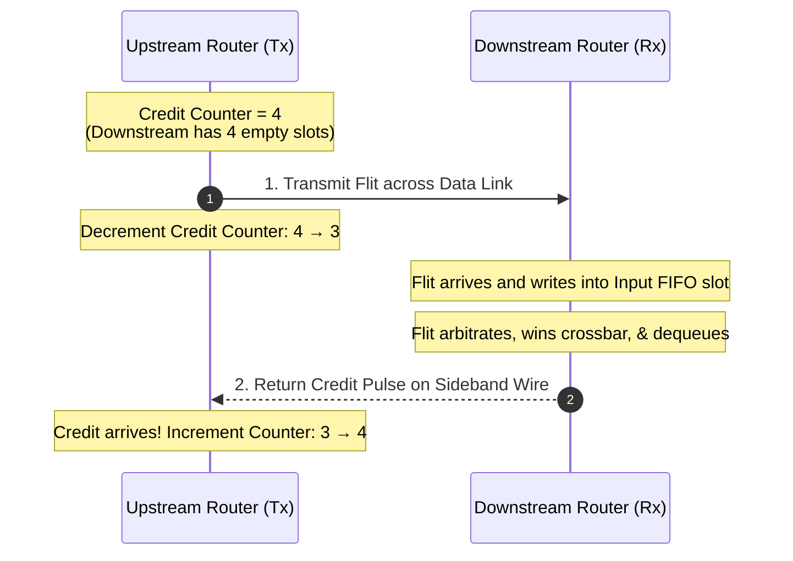
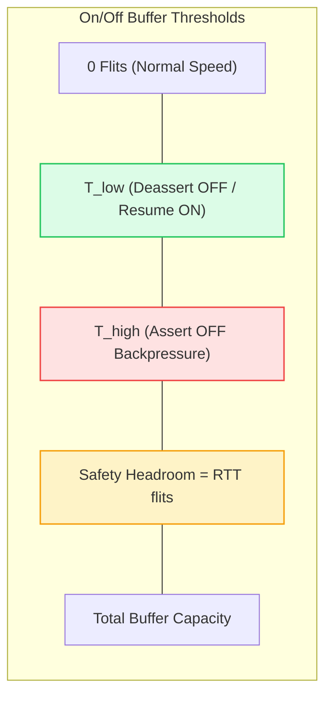

# 1.3 Flow Control & Credit Mechanism

In wide-area networks (such as the Internet and Ethernet), when router buffers overflow, packets are simply dropped, and higher-level protocols (like TCP) retransmit missing data. 

In a silicon System-on-Chip, **dropping packets is strictly forbidden**. Cache coherence protocols (such as MESI or MOESI) and memory consistency models depend on guaranteed, lossless delivery. A single dropped invalidation message or memory writeback would immediately cause cache incoherence, deadlock, or silent data corruption.

Therefore, an on-chip router must never transmit a flit across a physical link unless it is **100% physically guaranteed that the downstream router has an empty buffer slot ready to receive it**. This hardware guarantee is enforced by **Flow Control**.

---

## 1. Credit-Based Flow Control Architecture

**Credit-based flow control** is the universal standard in silicon Networks-on-Chip (featured in Intel Xeon Mesh, AMD Infinity Fabric, Apple M-Series UltraFusion, and ARM CoreLink fabrics).



### Protocol Mechanics & Hardware State Machine:

1. **Reset & Initialization**:  
   At system reset, the upstream router initializes an internal register `credit_count` to the total capacity of the downstream input buffer:
   $$\text{credit\_count} \leftarrow B_{total} \quad (\text{e.g., } 4\text{ flits})$$
2. **Transmission & Decrement**:  
   When the upstream router has a flit ready to send:
   - It checks if $\text{credit\_count} > 0$.
   - If $\text{credit\_count} > 0$, the flit is placed onto the forward physical link wires, and `credit_count` is decremented by 1:
     $$\text{credit\_count} \leftarrow \text{credit\_count} - 1$$
   - If $\text{credit\_count} == 0$, the upstream router **must stall**. It is forbidden from transmitting, guaranteeing zero buffer overflow at the receiver!
3. **Buffer Dequeue & Credit Generation**:  
   The downstream router stores the incoming flit in its input FIFO. Eventually, the flit wins switch allocation and traverses the crossbar switch to the next router. At the exact cycle the buffer slot is emptied, the downstream router pulses a high bit on a dedicated backward **credit return wire**.
4. **Credit Reception & Increment**:  
   Upon detecting the credit pulse, the upstream router increments its credit register:
   $$\text{credit\_count} \leftarrow \text{credit\_count} + 1$$

---

## 2. Derivation of the Credit Round-Trip Time ($RTT$) & Minimum Buffer Sizing

A paramount question in on-chip router microarchitecture is:  
**How deep must the downstream input buffer be to sustain 100% wire throughput without stalling?**

To answer this, we must dissect the **Credit Round-Trip Loop**:

```mermaid
gantt
  title Complete Credit Turnaround Latency Breakdown
  dateFormat X
  axisFormat %s

  section Forward Path (Flit)
  1. Link Wire Traversal (Tx → Rx)          :done, 0, 1
  2. Input Buffer Write (BW)                 :done, 1, 2
  3. Router Arbitration & Dequeue (SA + ST)  :active, 2, 4
  section Backward Path (Credit)
  4. Credit Generation Pulse                 :crit, 4, 5
  5. Credit Wire Return (Rx → Tx)            :crit, 5, 6
  6. Upstream Counter Increment & Switch Arb :crit, 6, 7
```



### Analytical Breakdown of $RTT$ Components:

Let:
- $t_{link}$ = Forward physical wire propagation time across inter-router links (typically 1 clock cycle; 2 cycles if pipelined with repeaters).
- $t_{bw}$ = Time to write the flit into the downstream input FIFO (1 cycle).
- $t_{deq}$ = Time for the flit to arbitrate, traverse the crossbar switch, and free its buffer slot ($1\text{–}2$ cycles).
- $t_{cred\_gen}$ = Time to detect buffer release and assert the credit signal (1 cycle).
- $t_{cred\_wire}$ = Backward physical wire propagation of the credit signal (typically equal to $t_{link}$).
- $t_{up\_proc}$ = Time for the upstream router to increment `credit_count` and grant the next flit (1 cycle).

The **Credit Round-Trip Time ($RTT$)** is the total clock cycles elapsed from the moment a flit departs the upstream transmitter until the credit releasing that slot returns to enable another transmission:

$$RTT = t_{link} + t_{bw} + t_{deq} + t_{cred\_gen} + t_{cred\_wire} + t_{up\_proc}$$

---

### The Fundamental Buffer Sizing Law:

Consider a continuous stream of flits attempting to utilize 100% of the channel bandwidth (1 flit per cycle):
- At Cycle 0, Flit 0 departs ($C = B - 1$).
- At Cycle 1, Flit 1 departs ($C = B - 2$).
- At Cycle $B - 1$, Flit $B - 1$ departs ($C = 0$).

At this moment, the upstream router has exhausted all credits! It **cannot send another flit until Credit 0 returns**.
- Credit 0 will arrive at cycle $t = RTT$.
- If $B < RTT$, the upstream router is forced to **idle for $RTT - B$ clock cycles**, injecting artificial **pipeline bubbles** into the physical link wires!

$$\text{Minimum Buffer Depth for 100\% Throughput: } \mathbf{B_{min} \ge \lceil RTT \rceil}$$

$$\text{Sustained Throughput Efficiency: } \eta = \min\left(100\%, \frac{B}{RTT} \times 100\%\right)$$

```
Case 1: B = 4, RTT = 4 (Saturated 100% Line Rate)
Cycle:   0   1   2   3   4   5   6   7
Flits:  [F0][F1][F2][F3][F4][F5][F6][F7]  --> 100% Channel Utilization!

Case 2: B = 2, RTT = 4 (Under-buffered: 50% Throughput)
Cycle:   0   1   2   3   4   5   6   7
Flits:  [F0][F1][--][--][F2][F3][--][--]  --> Stalls introduce 50% bubble cycles!
                 ↑   ↑           ↑   ↑
           Credit Starvation Pipeline Bubbles
```

---

## 3. 🎛️ Interactive Credit Loop & Buffer Sizing Simulator

Use this interactive simulator to experiment with the Credit Round-Trip Time loop. Adjust link delays, downstream dequeue speed, credit return delays, and buffer depths to observe how credit exhaustion introduces pipeline bubbles in real time.

<div class="noc-sim-container" id="creditSim">
  <div style="font-size:1.1rem; font-weight:700; color:var(--tcl-heading); margin-bottom:1rem; display:flex; align-items:center; justify-content:space-between; flex-wrap:wrap; gap:0.5rem;">
    <span>🔬 Interactive Credit Loop &amp; Buffer Turnaround Simulator</span>
    <span id="creditCycleBadge" style="font-family:'JetBrains Mono', monospace; font-size:0.9rem; font-weight:700; color:var(--tcl-blue-600); background:rgba(37,99,235,0.1); padding:3px 10px; border-radius:6px;">
      Cycle: 0
    </span>
  </div>

  <div style="display:grid; grid-template-columns:repeat(auto-fit, minmax(200px, 1fr)); gap:1rem; margin-bottom:1.25rem;">
    <div>
      <label style="font-size:0.85rem; font-weight:600; display:block; margin-bottom:0.35rem;">
        Forward Link Delay ($t_{link}$): <span id="valLinkDelay" style="color:var(--tcl-blue-600); font-weight:700;">1 cycle</span>
      </label>
      <input type="range" id="sliderLinkDelay" min="1" max="4" step="1" value="1" style="width:100%;" oninput="updateCreditSimParams()">
    </div>

    <div>
      <label style="font-size:0.85rem; font-weight:600; display:block; margin-bottom:0.35rem;">
        Rx Dequeue Latency ($t_{deq}$): <span id="valDeqDelay" style="color:var(--tcl-blue-600); font-weight:700;">1 cycle</span>
      </label>
      <input type="range" id="sliderDeqDelay" min="1" max="3" step="1" value="1" style="width:100%;" oninput="updateCreditSimParams()">
    </div>

    <div>
      <label style="font-size:0.85rem; font-weight:600; display:block; margin-bottom:0.35rem;">
        Credit Wire Delay ($t_{cred}$): <span id="valCredDelay" style="color:var(--tcl-blue-600); font-weight:700;">1 cycle</span>
      </label>
      <input type="range" id="sliderCredDelay" min="1" max="4" step="1" value="1" style="width:100%;" oninput="updateCreditSimParams()">
    </div>

    <div>
      <label style="font-size:0.85rem; font-weight:600; display:block; margin-bottom:0.35rem;">
        Input Buffer Depth ($B$): <span id="valBufDepth" style="color:var(--tcl-blue-600); font-weight:700;">4 flits</span>
      </label>
      <input type="range" id="sliderBufDepth" min="1" max="10" step="1" value="4" style="width:100%;" oninput="updateCreditSimParams()">
    </div>
  </div>

  <div class="noc-sim-controls" style="margin-bottom:1rem;">
    <button class="noc-sim-btn" onclick="stepCreditSim()">⏭ Step 1 Cycle</button>
    <button class="noc-sim-btn" id="btnPlayCredit" onclick="togglePlayCredit()">▶ Continuous Stream</button>
    <button class="noc-sim-btn secondary" onclick="resetCreditSim()">🔄 Reset State</button>

    <div style="margin-left:auto; display:flex; gap:1.25rem; align-items:center; font-size:0.88rem;">
      <div><b>Total RTT:</b> <span id="dispRTT" style="color:var(--tcl-blue-600); font-weight:700;">4 cycles</span></div>
      <div><b>B_min:</b> <span id="dispBmin" style="color:var(--tcl-blue-600); font-weight:700;">4 flits</span></div>
      <div><b>Efficiency:</b> <span id="dispEff" style="color:#16a34a; font-weight:700;">100%</span></div>
    </div>
  </div>

  <!-- Animated Router & Link Wave Graphic -->
  <div style="background:var(--noc-surface-subtle); border:1px solid var(--noc-border); border-radius:10px; padding:1.5rem; margin-bottom:1rem;">
    <div style="display:grid; grid-template-columns: 200px 1fr 200px; gap:1.5rem; align-items:center;">
      
      <!-- Upstream Router -->
      <div style="background:var(--noc-surface); border:2px solid var(--tcl-border); border-radius:8px; padding:1rem; text-align:center;">
        <div style="font-weight:700; font-size:0.95rem; margin-bottom:0.5rem; color:var(--tcl-heading);">Upstream Router (Tx)</div>
        <div style="font-size:0.8rem; color:var(--noc-text-muted); margin-bottom:0.25rem;">Available Credits</div>
        <div id="dispCreditCounter" style="font-size:2.2rem; font-weight:900; font-family:'JetBrains Mono', monospace; color:var(--tcl-blue-600);">4</div>
        <div id="txStatusBadge" style="margin-top:0.5rem; font-size:0.75rem; font-weight:700; padding:2px 8px; border-radius:4px; background:rgba(34,197,94,0.15); color:#166534;">TRANSMITTING</div>
      </div>

      <!-- Links in flight -->
      <div style="display:flex; flex-direction:column; gap:1.25rem;">
        <!-- Forward Data Link -->
        <div>
          <div style="display:flex; justify-content:space-between; font-size:0.78rem; font-weight:600; margin-bottom:4px; color:var(--tcl-heading);">
            <span>Forward Data Wire (Flits ➔)</span>
            <span id="fwdFlightCount" style="color:var(--noc-text-muted);">0 in-flight</span>
          </div>
          <div id="wireForward" style="background:var(--noc-surface); border:1px dashed var(--noc-border); border-radius:6px; min-height:36px; display:flex; gap:8px; align-items:center; padding:4px 8px; overflow-x:auto;">
            <span style="font-size:0.75rem; color:var(--noc-text-muted); font-style:italic;">[Link Idle]</span>
          </div>
        </div>

        <!-- Backward Credit Wire -->
        <div>
          <div style="display:flex; justify-content:space-between; font-size:0.78rem; font-weight:600; margin-bottom:4px; color:var(--tcl-heading);">
            <span>Backward Credit Wire (⯇ Credit Pulses)</span>
            <span id="bwdFlightCount" style="color:var(--noc-text-muted);">0 in-flight</span>
          </div>
          <div id="wireBackward" style="background:var(--noc-surface); border:1px dashed var(--noc-border); border-radius:6px; min-height:36px; display:flex; gap:8px; align-items:center; padding:4px 8px; flex-direction:row-reverse; overflow-x:auto;">
            <span style="font-size:0.75rem; color:var(--noc-text-muted); font-style:italic;">[No Credits in Return]</span>
          </div>
        </div>
      </div>

      <!-- Downstream Router -->
      <div style="background:var(--noc-surface); border:2px solid var(--tcl-border); border-radius:8px; padding:1rem; text-align:center;">
        <div style="font-weight:700; font-size:0.95rem; margin-bottom:0.5rem; color:var(--tcl-heading);">Downstream Router (Rx)</div>
        <div style="font-size:0.8rem; color:var(--noc-text-muted); margin-bottom:0.25rem;">Input Buffer Slots</div>
        <div id="dispBufferSlots" style="display:flex; gap:4px; justify-content:center; flex-wrap:wrap; min-height:48px; align-items:center;"></div>
        <div id="dispBufferOccupancy" style="font-size:0.75rem; font-weight:600; color:var(--noc-text-muted); margin-top:4px;">0 / 4 Occupied</div>
      </div>

    </div>
  </div>

  <div id="creditAnalysis" style="font-size:0.88rem; padding:0.75rem 1rem; border-radius:8px; line-height:1.5;"></div>
</div>

<script>
let creditSim = {
  cycle: 0,
  t_link: 1,
  t_deq: 1,
  t_cred: 1,
  buf_cap: 4,
  credits: 4,
  rx_buf: [], // holds flits currently buffered in Rx
  in_flight_fwd: [], // { flit_id, arrival_cycle }
  in_flight_bwd: [], // { arrival_cycle }
  flit_counter: 0,
  stalled_cycles: 0,
  transmitted_flits: 0,
  isPlaying: false,
  timer: null
};

function updateCreditSimParams() {
  creditSim.t_link = parseInt(document.getElementById("sliderLinkDelay").value, 10);
  creditSim.t_deq = parseInt(document.getElementById("sliderDeqDelay").value, 10);
  creditSim.t_cred = parseInt(document.getElementById("sliderCredDelay").value, 10);
  creditSim.buf_cap = parseInt(document.getElementById("sliderBufDepth").value, 10);

  document.getElementById("valLinkDelay").textContent = `${creditSim.t_link} cycle${creditSim.t_link > 1 ? 's' : ''}`;
  document.getElementById("valDeqDelay").textContent = `${creditSim.t_deq} cycle${creditSim.t_deq > 1 ? 's' : ''}`;
  document.getElementById("valCredDelay").textContent = `${creditSim.t_cred} cycle${creditSim.t_cred > 1 ? 's' : ''}`;
  document.getElementById("valBufDepth").textContent = `${creditSim.buf_cap} flits`;

  const rtt = creditSim.t_link + 1 + creditSim.t_deq + creditSim.t_cred + 1;
  document.getElementById("dispRTT").textContent = `${rtt} cycles`;
  document.getElementById("dispBmin").textContent = `${rtt} flits`;

  const eff = Math.min(100, Math.round((creditSim.buf_cap / rtt) * 100));
  const effEl = document.getElementById("dispEff");
  effEl.textContent = `${eff}%`;
  if (eff >= 100) {
    effEl.style.color = "#16a34a";
  } else {
    effEl.style.color = "#ea580c";
  }

  resetCreditSim();
}

function resetCreditSim() {
  clearInterval(creditSim.timer);
  creditSim.isPlaying = false;
  document.getElementById("btnPlayCredit").textContent = "▶ Continuous Stream";

  creditSim.cycle = 0;
  creditSim.credits = creditSim.buf_cap;
  creditSim.rx_buf = [];
  creditSim.in_flight_fwd = [];
  creditSim.in_flight_bwd = [];
  creditSim.flit_counter = 0;
  creditSim.stalled_cycles = 0;
  creditSim.transmitted_flits = 0;

  renderCreditSim();
}

function togglePlayCredit() {
  if (creditSim.isPlaying) {
    clearInterval(creditSim.timer);
    creditSim.isPlaying = false;
    document.getElementById("btnPlayCredit").textContent = "▶ Continuous Stream";
  } else {
    creditSim.isPlaying = true;
    document.getElementById("btnPlayCredit").textContent = "⏸ Pause Stream";
    creditSim.timer = setInterval(() => {
      stepCreditSim();
    }, 850);
  }
}

function stepCreditSim() {
  creditSim.cycle++;
  const curCycle = creditSim.cycle;

  // 1. Process Credits arriving at Upstream Tx
  const arrived_credits = creditSim.in_flight_bwd.filter(c => c.arrival_cycle === curCycle);
  creditSim.in_flight_bwd = creditSim.in_flight_bwd.filter(c => c.arrival_cycle > curCycle);
  creditSim.credits += arrived_credits.length;

  // 2. Process Flits in Downstream Buffer: Dequeue if processing time elapsed
  const surviving_buf = [];
  creditSim.rx_buf.forEach(item => {
    if (curCycle >= item.depart_cycle) {
      // Slot freed! Send credit back to Upstream
      creditSim.in_flight_bwd.push({
        arrival_cycle: curCycle + creditSim.t_cred + 1 // wire + upstream latch
      });
    } else {
      surviving_buf.push(item);
    }
  });
  creditSim.rx_buf = surviving_buf;

  // 3. Process Flits arriving at Downstream Rx from forward wire
  const arriving_flits = creditSim.in_flight_fwd.filter(f => f.arrival_cycle === curCycle);
  creditSim.in_flight_fwd = creditSim.in_flight_fwd.filter(f => f.arrival_cycle > curCycle);
  arriving_flits.forEach(f => {
    creditSim.rx_buf.push({
      flit_id: f.flit_id,
      depart_cycle: curCycle + creditSim.t_deq
    });
  });

  // 4. Upstream Tx attempts to transmit 1 flit this cycle
  if (creditSim.credits > 0) {
    creditSim.credits--;
    creditSim.flit_counter++;
    creditSim.transmitted_flits++;
    creditSim.in_flight_fwd.push({
      flit_id: creditSim.flit_counter,
      arrival_cycle: curCycle + creditSim.t_link
    });
  } else {
    // Stalled due to credit exhaustion!
    creditSim.stalled_cycles++;
  }

  renderCreditSim();
}

function renderCreditSim() {
  document.getElementById("creditCycleBadge").textContent = `Cycle: ${creditSim.cycle}`;
  document.getElementById("dispCreditCounter").textContent = creditSim.credits;

  const txBadge = document.getElementById("txStatusBadge");
  if (creditSim.credits > 0) {
    txBadge.textContent = "TRANSMITTING";
    txBadge.style.background = "rgba(34,197,94,0.15)";
    txBadge.style.color = "#166534";
  } else {
    txBadge.textContent = "STALLED (0 CREDITS)";
    txBadge.style.background = "rgba(239,68,68,0.15)";
    txBadge.style.color = "#991b1b";
  }

  // Forward wire pills
  const fwdEl = document.getElementById("wireForward");
  fwdEl.innerHTML = "";
  if (creditSim.in_flight_fwd.length === 0) {
    fwdEl.innerHTML = "<span style='font-size:0.75rem; color:var(--noc-text-muted); font-style:italic;'>[Link Idle]</span>";
  } else {
    creditSim.in_flight_fwd.forEach(f => {
      const p = document.createElement("span");
      p.style.background = "#2563eb";
      p.style.color = "#ffffff";
      p.style.padding = "2px 8px";
      p.style.borderRadius = "4px";
      p.style.fontSize = "0.75rem";
      p.style.fontFamily = "'JetBrains Mono', monospace";
      p.style.fontWeight = "700";
      p.textContent = `Flit #${f.flit_id}`;
      fwdEl.appendChild(p);
    });
  }
  document.getElementById("fwdFlightCount").textContent = `${creditSim.in_flight_fwd.length} in-flight`;

  // Backward wire pills
  const bwdEl = document.getElementById("wireBackward");
  bwdEl.innerHTML = "";
  if (creditSim.in_flight_bwd.length === 0) {
    bwdEl.innerHTML = "<span style='font-size:0.75rem; color:var(--noc-text-muted); font-style:italic;'>[No Credits in Return]</span>";
  } else {
    creditSim.in_flight_bwd.forEach(() => {
      const p = document.createElement("span");
      p.style.background = "#16a34a";
      p.style.color = "#ffffff";
      p.style.padding = "2px 8px";
      p.style.borderRadius = "4px";
      p.style.fontSize = "0.75rem";
      p.style.fontFamily = "'JetBrains Mono', monospace";
      p.style.fontWeight = "700";
      p.textContent = "CREDIT +1";
      bwdEl.appendChild(p);
    });
  }
  document.getElementById("bwdFlightCount").textContent = `${creditSim.in_flight_bwd.length} in-flight`;

  // Rx buffer slots
  const bufSlotsEl = document.getElementById("dispBufferSlots");
  bufSlotsEl.innerHTML = "";
  for (let i = 0; i < creditSim.buf_cap; i++) {
    const slot = document.createElement("div");
    slot.style.width = "32px";
    slot.style.height = "32px";
    slot.style.borderRadius = "4px";
    slot.style.display = "flex";
    slot.style.alignItems = "center";
    slot.style.justifyContent = "center";
    slot.style.fontSize = "0.75rem";
    slot.style.fontFamily = "'JetBrains Mono', monospace";
    slot.style.fontWeight = "700";

    if (i < creditSim.rx_buf.length) {
      slot.style.background = "#0284c7";
      slot.style.color = "#ffffff";
      slot.textContent = `F${creditSim.rx_buf[i].flit_id}`;
    } else {
      slot.style.background = "var(--noc-surface-subtle)";
      slot.style.border = "1.5px dashed var(--noc-border)";
      slot.style.color = "var(--noc-text-muted)";
      slot.textContent = "";
    }
    bufSlotsEl.appendChild(slot);
  }
  document.getElementById("dispBufferOccupancy").textContent = `${creditSim.rx_buf.length} / ${creditSim.buf_cap} Occupied`;

  // Dynamic analysis box
  const rtt = creditSim.t_link + 1 + creditSim.t_deq + creditSim.t_cred + 1;
  const analysisEl = document.getElementById("creditAnalysis");
  if (creditSim.buf_cap >= rtt) {
    analysisEl.style.background = "rgba(34,197,94,0.08)";
    analysisEl.style.border = "1px solid rgba(34,197,94,0.25)";
    analysisEl.style.color = "#166534";
    analysisEl.innerHTML = `
      <strong>🟢 Optimal Buffer Sizing (B = ${creditSim.buf_cap} ≥ RTT = ${rtt}):</strong><br>
      The buffer depth is sufficiently large to absorb all flits in-flight during the credit turnaround loop. The upstream transmitter sustains <strong>100% line rate throughput</strong> with zero pipeline bubbles!
    `;
  } else {
    analysisEl.style.background = "rgba(234,88,12,0.08)";
    analysisEl.style.border = "1px solid rgba(234,88,12,0.25)";
    analysisEl.style.color = "#9a3412";
    analysisEl.innerHTML = `
      <strong>⚠️ Under-buffered System (B = ${creditSim.buf_cap} &lt; RTT = ${rtt}):</strong><br>
      The transmitter exhausts its credits after sending ${creditSim.buf_cap} flits and is forced to stall for <strong>${rtt - creditSim.buf_cap} idle cycle(s)</strong> every turnaround loop. Link utilization is capped at <strong>${Math.round((creditSim.buf_cap / rtt)*100)}%</strong>. Increase buffer depth to at least <strong>${rtt} flits</strong> to eliminate bubbles.
    `;
  }
}

if (document.readyState === "loading") {
  document.addEventListener("DOMContentLoaded", updateCreditSimParams);
} else {
  updateCreditSimParams();
}
</script>

---

## 4. Alternative Flow Control Mechanisms

While credit-based flow control is the silicon industry standard, alternative mechanisms exist with distinct microarchitectural trade-offs:

### A. On/Off Flow Control
Rather than transmitting discrete credit pulses for every single dequeued flit, the downstream router monitors its buffer occupancy and asserts a single stop/go signal:

- **OFF Signal:** Asserted when buffer occupancy exceeds an upper threshold $T_{high}$. The upstream router stops transmitting.
- **ON Signal:** Asserted when occupancy drains below a lower threshold $T_{low}$. The upstream router resumes transmission.



#### The Safety Headroom Requirement:
When the downstream router asserts the **OFF** signal, flits already in-flight on the forward wire will still arrive! Therefore, the buffer must provide a **safety headroom**:

$$\text{Headroom} = \text{Buffer Capacity} - T_{high} \ge RTT$$

If the headroom is smaller than $RTT$, in-flight flits will overflow the buffer! Because of this required hysteresis headroom, On/Off flow control requires larger physical SRAM buffers than credit-based control.

---

### B. Bufferless Deflection Routing (BLESS & CHIPPER)
Can we eliminate router buffers altogether to save silicon area and static leakage?

In **Bufferless Routing** (e.g., BLESS - Moscibroda & Mutlu, 2009; CHIPPER - Fallin et al., 2011):
- Routers have **zero input buffers**.
- In every clock cycle, all incoming flits must be forwarded to an output port.
- When two flits contend for the same optimal output port, the arbiter grants the port to one flit according to priority.
- The losing flit is **deflected ("hot-potato routed")** onto an available suboptimal output port (e.g., misrouted to the West instead of East).

#### Verdict on Bufferless Routing:
While bufferless designs achieve dramatic area savings under ultra-light injection rates ($< 0.05\text{ flits/cycle}$), under moderate to high traffic loads they suffer from:
1. **Severe Latency Penalties:** Deflected flits wander the network in circles.
2. **Livelock Risks:** Flits may bounce indefinitely unless complex age-based priority arbitration is enforced.
3. **Dynamic Power Explosion:** Constantly clocking deflected flits across wire links expends more dynamic power than the static power saved by omitting buffers!

---

## 5. Comparison: Flow Control Protocols

| Flow Control Technique | Buffer Requirement | Control Overhead | Silicon Area | Link Utilization | Primary Application |
| :--- | :--- | :--- | :--- | :--- | :--- |
| **Credit-Based** | $B = RTT$ (Compact) | 1 credit wire per VC | Moderate (Registers) | **100% (Zero Bubbles)** | **On-Chip NoC (Industry Standard)** |
| **On/Off Backpressure**| $B = RTT + \text{Hysteresis}$ | 1 wire per physical port | Higher (Extra headroom) | ~80–90% | Chip-to-Chip & Board Interconnects |
| **Ack / Nack** | Retransmit Buffer at Tx | ACK / NACK reply packets| High (Retransmit FIFO) | ~70–85% | PCIe, FibreChannel, Infiniband |
| **Bufferless (BLESS)** | **0 Buffers** | Priority arbiters | **Lowest Area** | Collapses under congestion | Low-power specialized edge devices |

---

## 6. Worked Numerical Example: High-Frequency Buffer Dimensioning

> [!TIP]
> **Problem Statement:**  
> An advanced server NoC operates at $f_{clk} = 2.4\text{ GHz}$ ($\tau = 0.417\text{ ns}$).  
> A long horizontal link spans across two compute tiles ($L = 3.6\text{ mm}$), requiring **2 clock cycles** for forward link wire traversal ($t_{link} = 2\text{ cycles}$).  
> Receiver FIFO write takes $t_{bw} = 1\text{ cycle}$.  
> Downstream switch allocation and dequeue takes $t_{deq} = 2\text{ cycles}$.  
> Credit generation takes $t_{cred\_gen} = 1\text{ cycle}$.  
> The backward credit return wire is also pipelined, taking $t_{cred\_wire} = 2\text{ cycles}$.  
> Upstream counter update and grant takes $t_{up\_proc} = 1\text{ cycle}$.  
> 
> 1. Calculate the Credit Round-Trip Time ($RTT$).
> 2. Determine the Minimum Buffer Depth ($B_{min}$) to sustain 100% throughput line rate.
> 3. If the microarchitect only provisions a buffer of $B = 5\text{ flits}$ to save area, calculate the maximum achievable channel utilization and sustained throughput (in GB/s) for a 128-bit flit channel.

### Step 1: Calculate $RTT$
$$RTT = t_{link} + t_{bw} + t_{deq} + t_{cred\_gen} + t_{cred\_wire} + t_{up\_proc}$$
$$RTT = 2 + 1 + 2 + 1 + 2 + 1 = \mathbf{9\text{ clock cycles}}$$

### Step 2: Determine Minimum Buffer Depth
$$B_{min} = \lceil RTT \rceil = \mathbf{9\text{ flits}}$$
To achieve 100% channel utilization without pipeline bubbles, the downstream router must allocate at least **9 flits** of buffer capacity per virtual channel.

### Step 3: Analyze Under-Buffered Scenario ($B = 5$ flits)
If $B = 5$ flits:
$$\text{Channel Utilization: } \eta = \frac{B}{RTT} = \frac{5}{9} \approx \mathbf{55.56\%}$$

$$\text{Ideal 100% Bandwidth: } BW_{ideal} = 16\text{ Bytes/flit} \times 2.4\text{ GHz} = 38.4\text{ GB/s}$$
$$\text{Actual Sustained Bandwidth: } BW_{actual} = 38.4\text{ GB/s} \times 55.56\% = \mathbf{21.33\text{ GB/s}}$$

The link wastes **$44.44\%$ of its theoretical bandwidth** due to credit starvation pipeline bubbles!

---

## 7. Synthesizable Verilog RTL: Credit Flow Controller (`credit_flow_control.v`)

Below is a production-grade, synthesizable Verilog implementation of an upstream credit-based flow control manager. It maintains the real-time credit counter, gates upstream flit transmissions, processes downstream credit pulses, handles simultaneous transmit/credit events, and flags protocol underflow/overflow errors:

```verilog
// Synthesizable Credit-Based Flow Control Manager
// Parameterized buffer depth, single-cycle credit accounting,
// transmit grant qualification, and stall bubble detection.
module credit_flow_control #(
    parameter integer BUFFER_DEPTH = 4,                       // Max downstream FIFO slots
    parameter integer CREDIT_WIDTH = $clog2(BUFFER_DEPTH + 1) // Bitwidth for credit counter
)(
    input  wire                    clk,
    input  wire                    rst_n,

    // Upstream Transmit Interface (Core / Switch -> Local Tx)
    input  wire                    tx_val,          // Valid flit request from upstream pipeline
    output wire                    tx_ready,        // Ready to accept flit (credits available)
    output wire                    tx_fire,         // Handshake fire: flit departs across physical link

    // Credit Return Interface (From Downstream Rx Link)
    input  wire                    credit_in,       // 1-cycle pulse: downstream buffer freed a slot

    // Diagnostic & Telemetry Status
    output reg  [CREDIT_WIDTH-1:0] credit_count,    // Real-time available downstream credits
    output wire                    credit_exhausted,// 1 when counter is 0 (bubble cycle)
    output reg                     overflow_err,    // Protocol violation: credit returned when buffer already full
    output reg                     underflow_err    // Flit transmitted when zero credits available
);

    // Flit departs when valid request arrives AND at least 1 credit is available
    assign tx_ready         = (credit_count > {CREDIT_WIDTH{1'b0}});
    assign tx_fire          = tx_val & tx_ready;
    assign credit_exhausted = (credit_count == {CREDIT_WIDTH{1'b0}});

    // Synchronous Credit Accounting
    always @(posedge clk or negedge rst_n) begin
        if (!rst_n) begin
            credit_count  <= BUFFER_DEPTH[CREDIT_WIDTH-1:0]; // Initialize to full capacity
            overflow_err  <= 1'b0;
            underflow_err <= 1'b0;
        end else begin
            case ({tx_fire, credit_in})
                2'b10: begin
                    // Flit transmitted without incoming credit: decrement
                    if (credit_count > {CREDIT_WIDTH{1'b0}}) begin
                        credit_count <= credit_count - 1'b1;
                    end else begin
                        underflow_err <= 1'b1; // Protocol error!
                    end
                end

                2'b01: begin
                    // Credit returned without flit transmission: increment
                    if (credit_count < BUFFER_DEPTH[CREDIT_WIDTH-1:0]) begin
                        credit_count <= credit_count + 1'b1;
                    end else begin
                        overflow_err <= 1'b1; // Protocol error: illegal extra credit!
                    end
                end

                2'b11: begin
                    // Simultaneous transmission and credit return: net change is zero
                    credit_count <= credit_count;
                end

                2'b00: begin
                    // Idle cycle: maintain state
                    credit_count <= credit_count;
                end
            endcase
        end
    end

endmodule
```

---

## 8. 🎯 Knowledge Check: Lesson 1.3

Test your comprehension of credit flow control, buffer turnaround latency, and backpressure mechanisms.

<div class="noc-sim-container" id="quiz13" style="margin-top:1rem;">
  <div style="font-weight:700; font-size:1.05rem; margin-bottom:1rem; color:var(--tcl-heading);">
    📝 Concept Check: Flow Control &amp; Buffer Dimensioning
  </div>

  <!-- Question 1 -->
  <div style="margin-bottom:1.5rem; padding-bottom:1.2rem; border-bottom:1px solid var(--tcl-border);">
    <p style="font-weight:600; font-size:0.95rem; margin-bottom:0.75rem;">
      <b>Question 1:</b> In credit-based flow control, what is the consequence of configuring an input buffer depth $B$ that is strictly smaller than the Credit Round-Trip Time ($B < RTT$)?
    </p>

    <div style="display:flex; flex-direction:column; gap:0.5rem;" id="q13_options">
      <button class="noc-sim-select" style="text-align:left; padding:0.65rem 0.85rem; cursor:pointer;" onclick="checkQuiz13(0)">
        A. Excess flits are dropped on the wire, triggering an OS page fault.
      </button>
      <button class="noc-sim-select" style="text-align:left; padding:0.65rem 0.85rem; cursor:pointer;" onclick="checkQuiz13(1)">
        B. The upstream transmitter exhausts its credits after sending $B$ flits and must stall until the first credit returns, introducing pipeline bubbles that cap throughput at $B / RTT$.
      </button>
      <button class="noc-sim-select" style="text-align:left; padding:0.65rem 0.85rem; cursor:pointer;" onclick="checkQuiz13(2)">
        C. The downstream router enters an irreversible electrical latchup.
      </button>
      <button class="noc-sim-select" style="text-align:left; padding:0.65rem 0.85rem; cursor:pointer;" onclick="checkQuiz13(3)">
        D. Flits automatically compress themselves by 50% to fit into the smaller buffer.
      </button>
    </div>
    <div id="q13_feedback" style="display:none; margin-top:0.75rem; padding:0.85rem; border-radius:8px; font-size:0.9rem; line-height:1.5;"></div>
  </div>

  <!-- Question 2 -->
  <div style="margin-bottom:1.5rem; padding-bottom:1.2rem; border-bottom:1px solid var(--tcl-border);">
    <p style="font-weight:600; font-size:0.95rem; margin-bottom:0.75rem;">
      <b>Question 2:</b> A 2.4 GHz NoC link requires $t_{link} = 2$ cycles for wire traversal, $t_{bw} = 1$ cycle for receiver FIFO write, $t_{deq} = 2$ cycles for switch allocation and dequeue, $t_{cred\_gen} = 1$ cycle for credit generation, $t_{cred\_wire} = 2$ cycles for backward credit return, and $t_{up\_proc} = 1$ cycle for upstream grant logic. What is the minimum buffer depth $B_{min}$ to sustain 100% throughput?
    </p>

    <div style="display:flex; flex-direction:column; gap:0.5rem;" id="q13_q2_options">
      <button class="noc-sim-select" style="text-align:left; padding:0.65rem 0.85rem; cursor:pointer;" onclick="checkQuiz13_Q2(0)">
        A. $B_{min} = 4$ flits.
      </button>
      <button class="noc-sim-select" style="text-align:left; padding:0.65rem 0.85rem; cursor:pointer;" onclick="checkQuiz13_Q2(1)">
        B. $B_{min} = 9$ flits, because $RTT = 2 + 1 + 2 + 1 + 2 + 1 = 9$ clock cycles.
      </button>
      <button class="noc-sim-select" style="text-align:left; padding:0.65rem 0.85rem; cursor:pointer;" onclick="checkQuiz13_Q2(2)">
        C. $B_{min} = 1$ flit, because routers always buffer flits in cache.
      </button>
    </div>
    <div id="q13_q2_feedback" style="display:none; margin-top:0.75rem; padding:0.85rem; border-radius:8px; font-size:0.9rem; line-height:1.5;"></div>
  </div>

  <!-- Question 3 -->
  <div>
    <p style="font-weight:600; font-size:0.95rem; margin-bottom:0.75rem;">
      <b>Question 3:</b> Why does On/Off backpressure flow control require a physical buffer with a safety headroom $\ge RTT$ above its high threshold $T_{high}$?
    </p>

    <div style="display:flex; flex-direction:column; gap:0.5rem;" id="q13_q3_options">
      <button class="noc-sim-select" style="text-align:left; padding:0.65rem 0.85rem; cursor:pointer;" onclick="checkQuiz13_Q3(0)">
        A. Because during the $RTT$ cycles required for the OFF signal to reach and halt the upstream transmitter, flits already in-flight on the forward link will continue arriving and must be safely absorbed.
      </button>
      <button class="noc-sim-select" style="text-align:left; padding:0.65rem 0.85rem; cursor:pointer;" onclick="checkQuiz13_Q3(1)">
        B. To store debugging logs for the operating system kernel.
      </button>
      <button class="noc-sim-select" style="text-align:left; padding:0.65rem 0.85rem; cursor:pointer;" onclick="checkQuiz13_Q3(2)">
        C. To power off the receiver transistors during idle periods.
      </button>
    </div>
    <div id="q13_q3_feedback" style="display:none; margin-top:0.75rem; padding:0.85rem; border-radius:8px; font-size:0.9rem; line-height:1.5;"></div>
  </div>
</div>

<script>
function checkQuiz13(idx) {
  const fb = document.getElementById("q13_feedback");
  fb.style.display = "block";
  const opts = document.getElementById("q13_options").children;
  for (let i = 0; i < opts.length; i++) { opts[i].onclick = null; opts[i].style.cursor = "default"; }

  if (idx === 1) {
    opts[1].style.background = "rgba(34,197,94,0.15)"; opts[1].style.borderColor = "#22c55e";
    fb.style.background = "rgba(34,197,94,0.1)"; fb.style.border = "1px solid rgba(34,197,94,0.3)"; fb.style.color = "#166534";
    fb.innerHTML = "<strong>✓ Correct!</strong> When B < RTT, the upstream transmitter depletes its credit counter and must stall for (RTT - B) cycles waiting for credit return, capping sustained throughput at B / RTT.";
  } else {
    opts[idx].style.background = "rgba(239,68,68,0.15)"; opts[idx].style.borderColor = "#ef4444";
    opts[1].style.background = "rgba(34,197,94,0.15)"; opts[1].style.borderColor = "#22c55e";
    fb.style.background = "rgba(239,68,68,0.1)"; fb.style.border = "1px solid rgba(239,68,68,0.3)"; fb.style.color = "#991b1b";
    fb.innerHTML = "<strong>✗ Incorrect.</strong> The correct answer is <strong>B</strong>. Flow control guarantees no packets are dropped, but an undersized buffer causes credit starvation stalls.";
  }
}

function checkQuiz13_Q2(idx) {
  const fb = document.getElementById("q13_q2_feedback");
  fb.style.display = "block";
  const opts = document.getElementById("q13_q2_options").children;
  for (let i = 0; i < opts.length; i++) { opts[i].onclick = null; opts[i].style.cursor = "default"; }

  if (idx === 1) {
    opts[1].style.background = "rgba(34,197,94,0.15)"; opts[1].style.borderColor = "#22c55e";
    fb.style.background = "rgba(34,197,94,0.1)"; fb.style.border = "1px solid rgba(34,197,94,0.3)"; fb.style.color = "#166534";
    fb.innerHTML = "<strong>✓ Correct!</strong> Summing all components yields $RTT = 2 + 1 + 2 + 1 + 2 + 1 = 9$ clock cycles. Hence, $B_{min} = \\lceil RTT \\rceil = 9$ flits are required for 100% throughput.";
  } else {
    opts[idx].style.background = "rgba(239,68,68,0.15)"; opts[idx].style.borderColor = "#ef4444";
    opts[1].style.background = "rgba(34,197,94,0.15)"; opts[1].style.borderColor = "#22c55e";
    fb.style.background = "rgba(239,68,68,0.1)"; fb.style.border = "1px solid rgba(239,68,68,0.3)"; fb.style.color = "#991b1b";
    fb.innerHTML = "<strong>✗ Incorrect.</strong> The correct answer is <strong>B</strong>. $B_{min} \\ge RTT = 9$ flits.";
  }
}

function checkQuiz13_Q3(idx) {
  const fb = document.getElementById("q13_q3_feedback");
  fb.style.display = "block";
  const opts = document.getElementById("q13_q3_options").children;
  for (let i = 0; i < opts.length; i++) { opts[i].onclick = null; opts[i].style.cursor = "default"; }

  if (idx === 0) {
    opts[0].style.background = "rgba(34,197,94,0.15)"; opts[0].style.borderColor = "#22c55e";
    fb.style.background = "rgba(34,197,94,0.1)"; fb.style.border = "1px solid rgba(34,197,94,0.3)"; fb.style.color = "#166534";
    fb.innerHTML = "<strong>✓ Correct!</strong> Because the backpressure OFF signal takes time to traverse the return link, flits that are already in flight will still arrive. The headroom $\\ge RTT$ absorbs these in-flight flits to prevent buffer overflow.";
  } else {
    opts[idx].style.background = "rgba(239,68,68,0.15)"; opts[idx].style.borderColor = "#ef4444";
    opts[0].style.background = "rgba(34,197,94,0.15)"; opts[0].style.borderColor = "#22c55e";
    fb.style.background = "rgba(239,68,68,0.1)"; fb.style.border = "1px solid rgba(239,68,68,0.3)"; fb.style.color = "#991b1b";
    fb.innerHTML = "<strong>✗ Incorrect.</strong> The correct answer is <strong>A</strong>. Safety headroom absorbs flits already in-flight during backpressure signal propagation.";
  }
}
</script>

---

## 9. Interactive Arcade & Lab Challenges

Test your credit budgeting and buffer management in arcade simulations:
- 🎮 **[Credit Commander: Flow Control Defense](../interactive/credits.md):** Defend router buffers against sudden traffic surges by managing credit limits, preventing buffer overflows, and eliminating credit-exhaustion bubbles.
- 🔬 **[2D Mesh Routing Visualizer](../interactive/visualizer.md):** Track real-time credit decrements and backward pulse returns across all 5 router ports simultaneously.

---

## Summary & Next Steps

In this lesson, we established:
- Why on-chip networks require **100% lossless flow control**.
- How **credit-based accounting** prevents buffer overflow without dropping packets.
- The mathematical derivation of the **Credit Round-Trip Time ($RTT$)** and why $B_{min} \ge RTT$ is required for maximum throughput.
- Trade-offs with alternative mechanisms like **On/Off backpressure** and **bufferless deflection routing**.
- A complete, synthesizable Verilog implementation of an upstream **Credit Flow Controller (`credit_flow_control.v`)**.

Now, how do external compute cores (CPUs, GPUs, Caches) actually inject memory transactions into this flit-switched network? In our final foundational lesson, we study the **Network Interface (NI)**.

👉 **Proceed to [Lesson 1.4: Network Interface (NI) Architecture](04-network-interface-packetization.md)**

