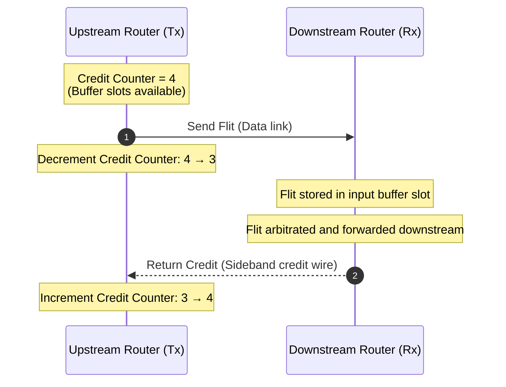
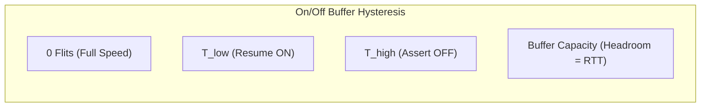

# 1.3 Flow Control & Credit Mechanism

In on-chip networks, dropping packets (like Ethernet or the Internet does) is strictly prohibited. Cache coherence protocols and memory consistency models require **lossless, reliable transmission**. 

Therefore, a router must never transmit a flit to a downstream neighbor unless it is 100% guaranteed that an empty buffer slot exists to store it. This guarantee is enforced by **Flow Control**.

---

## 1. Credit-Based Flow Control

**Credit-based flow control** is the gold standard in modern silicon NoCs (such as Intel Xeon mesh, AMD Infinity Fabric, and Apple M-series chips).

### Protocol Mechanics:
1. **Initialization**: At reset, the upstream router initializes its `credit_count` to the total capacity of the downstream input buffer (e.g., $C = 4$).
2. **Transmission**: Whenever the upstream router has a flit ready to send, it checks if $\text{credit\_count} > 0$. If yes, it transmits the flit across the physical link and decrements `credit_count` by 1.
3. **Consumption & Return**: When the downstream router eventually dequeues the flit and forwards it through the crossbar, the buffer slot is freed. The downstream router asserts a single-bit credit signal on the backward wire.
4. **Credit Reception**: Upon receiving the credit pulse, the upstream router increments `credit_count` by 1.

---

## 2. Buffer Sizing & The Credit Round-Trip Latency (RTT)

A critical design challenge in NoC microarchitecture is: **How deep must the input buffer be to sustain 100% throughput without stalling?**

Consider the timeline from when a flit leaves the upstream router to when a credit returns:

```mermaid
gantt
  title Credit Loop Latency Breakdown
  dateFormat X
  axisFormat %s

  section Forward Path
  Wire Traversal (Tx → Rx)       :done, 0, 1
  Input Buffer Write & Dequeue   :active, 1, 2
  section Backward Path
  Credit Generation & Wire Return:crit, 2, 3
  Credit Counter Increment & Arb :crit, 3, 4
```

Let:
- $t_{link}$ = Link wire propagation delay (typically 1 clock cycle).
- $t_{proc}$ = Time inside downstream router to process and dequeue the flit.
- $t_{credit}$ = Wire propagation delay of the credit return wire (typically 1 clock cycle).
- $RTT$ = Total Round-Trip Time = $t_{link} + t_{proc} + t_{credit}$.

If the buffer capacity $B$ is less than $RTT$, the upstream router will exhaust its credits and stall before the first credit can return!

$$\text{Minimum Buffer Depth for 100\% Throughput: } B_{min} \ge RTT = t_{link} + t_{proc} + t_{credit}$$

For an adjacent router pair with a 1-cycle forward link, 1-cycle dequeue, and 1-cycle credit wire:

$$B_{min} = 1 + 1 + 1 = 3 \text{ flits}$$

Any buffer smaller than 3 flits will inevitably introduce bubble cycles, capping link utilization below 100%.

---

## 3. Alternative: On/Off Flow Control

In On/Off flow control, rather than returning discrete credits for every flit, the downstream router monitors its buffer occupancy and asserts a single stop signal:

- **OFF Signal**: Asserted when buffer occupancy exceeds an upper threshold $T_{high}$. The upstream node stops sending.
- **ON Signal**: Re-asserted when occupancy drains below a lower threshold $T_{low}$. The upstream node resumes sending.

### Comparison:

| Feature | Credit-Based Flow Control | On/Off Flow Control |
| :--- | :--- | :--- |
| **Signaling Overhead** | 1 credit wire per VC (or encoded credit) | 1 wire per physical port |
| **Buffer Efficiency** | High; buffers can be compact ($B = RTT$) | Requires extra headroom to absorb in-flight flits |
| **Implementation Complexity** | Upstream counter logic required | Simple threshold comparators |
| **Typical Use Case** | On-chip routers (NoCs) | Chip-to-chip or board-level links |

Now that we understand how flits are queued, transmitted, and credited between neighbors, we can examine the internal anatomy of an on-chip router in [Track 2: Router Microarchitecture](../track2-router-architecture/index.md).
