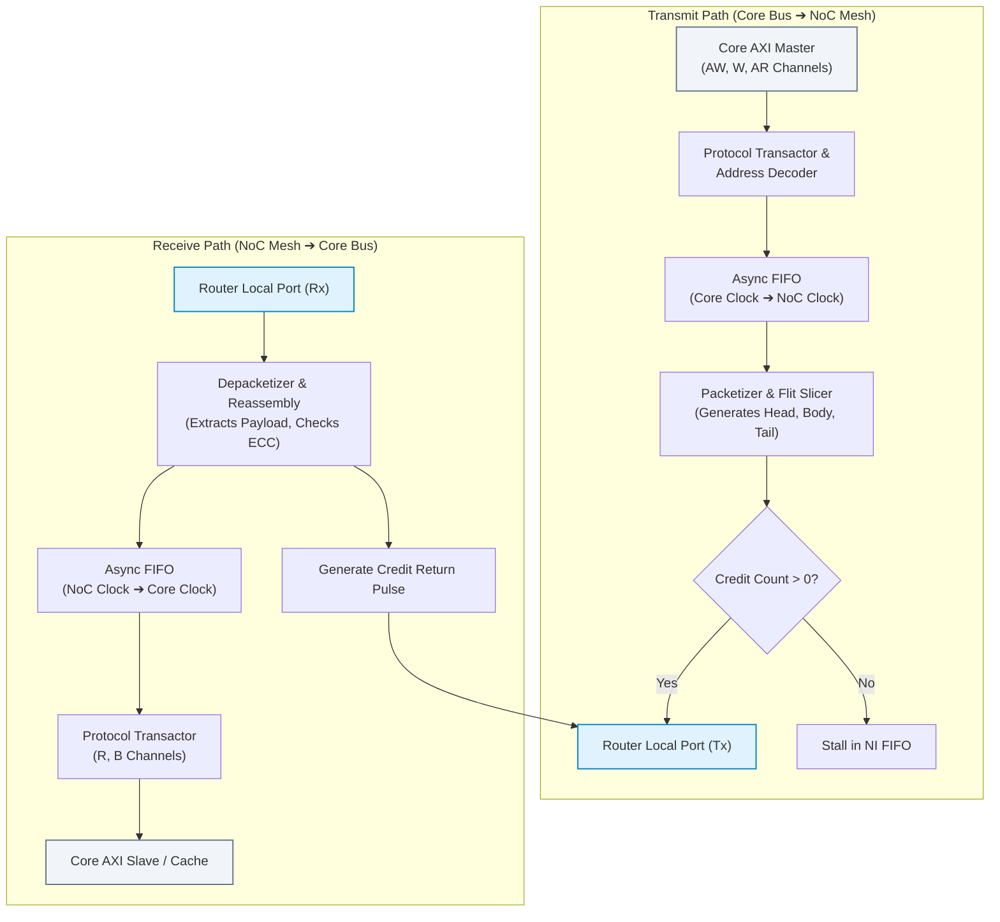
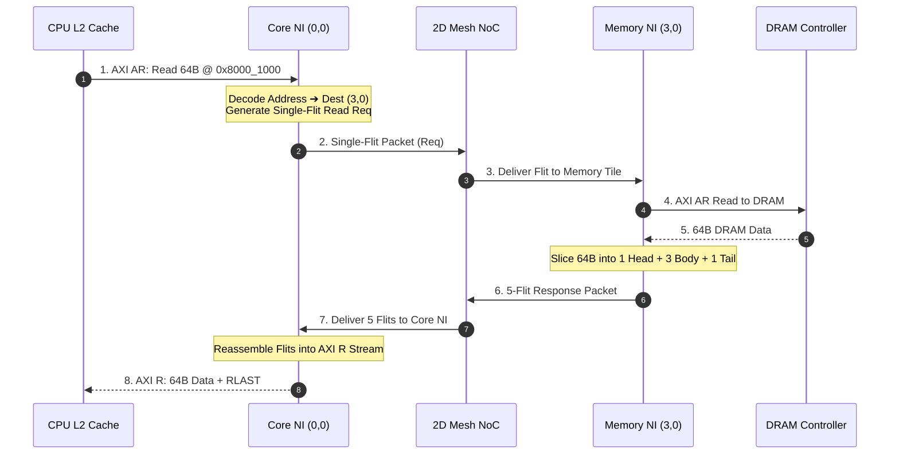
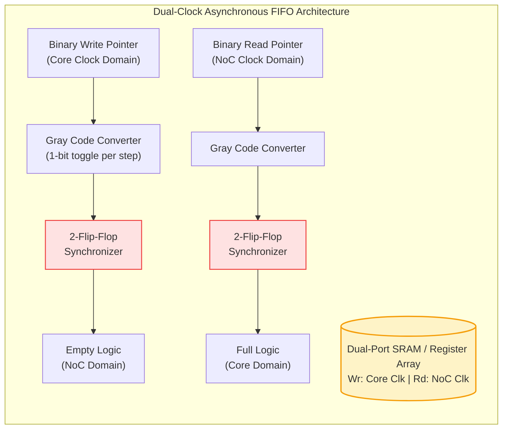
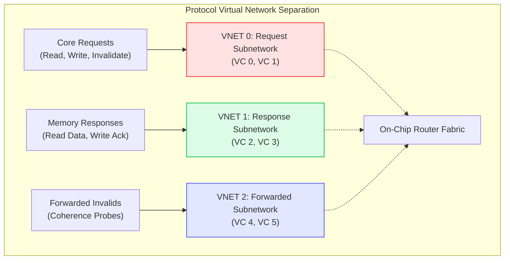

# 1.4 Network Interface (NI) Architecture & Packetization

In the previous lessons, we examined how on-chip routers switch flits and enforce credit-based flow control. However, a microprocessor core, GPU shader cluster, or High-Bandwidth Memory (HBM) controller does not naturally communicate in flits or 2D mesh coordinates.

Processing cores speak standard memory bus protocols—such as **ARM AMBA AXI5**, **ARM CHI (Coherent Hub Interface)**, **RISC-V TileLink**, or **Open Core Protocol (OCP)**. 

The **Network Interface (NI)**—also known as the Network Adapter or Socket—is the indispensable bridge that translates high-level memory read/write transactions into low-level packetized flits, handles asynchronous clock domain crossings, and prevents catastrophic protocol deadlocks.

```
+--------------------+         +--------------------+         +--------------------+
|  Processor Core /  |  AXI5   | Network Interface  |  Flits  |   On-Chip Router   |
|  L2 Cache Slice    |<=======>|       (NI)         |<=======>|     Local Port     |
+--------------------+         +--------------------+         +--------------------+
```

---

## 1. Anatomy of the Network Interface

The Network Interface is divided into two primary datapaths: the **Transmit Path (Egress)** and the **Receive Path (Ingress)**:



### Primary Hardware Responsibilities:
1. **Address-to-Coordinate Mapping:** The NI contains an internal memory map table. When the CPU issues a load to physical address `0x8000_1000`, the NI decodes that this address belongs to Memory Controller 3 located at router coordinate $(X=3, Y=0)$.
2. **Packetization & Serialization:** Memory transactions (e.g., a 64-byte writeback burst) are packed with addressing headers, sliced into $W$-bit flits, and appended with error-detecting codes.
3. **Depacketization & Reassembly:** Incoming flits are checked for transmission errors, stripped of network headers, and reconstructed into standard bus handshake signals (`RVALID`, `RDATA`, `RLAST`).
4. **End-to-End Flow Control:** Ensures that the core does not flood the network if downstream response buffers are full.

---

## 2. Protocol Translation: Slicing AXI5 Transactions into Flits

Consider a CPU core reading a 64-byte ($512\text{ bits}$) cache line from a remote DDR5 memory controller across a 128-bit NoC fabric:

```
Step 1: Core issues AXI Read Address (AR channel):
        ARADDR = 0x8000_1000, ARLEN = 3 (4 beats of 128 bits = 64 bytes), ARID = 0x05

Step 2: NI Packetizer creates a Single-Flit Request Packet:
        [Head+Tail Flit]: Type=11, Dest=(3,0), Src=(0,0), VC=0, Opcode=READ_REQ, Addr=0x8000_1000

Step 3: Flit traverses 2D mesh to Router (3,0) and reaches Memory Controller NI.

Step 4: Memory Controller reads DRAM and transmits a 5-Flit Response Packet:
        Flit 0 [Head]: Type=00, Dest=(0,0), Src=(3,0), VC=1, Opcode=READ_RESP, TID=0x05
        Flit 1 [Body]: Type=01, Payload = Data Bytes [15:0]
        Flit 2 [Body]: Type=01, Payload = Data Bytes [31:16]
        Flit 3 [Body]: Type=01, Payload = Data Bytes [47:32]
        Flit 4 [Tail]: Type=10, Payload = Data Bytes [63:48] + 16-bit CRC

Step 5: Core NI Depacketizer strips headers and asserts AXI Read Data (R channel):
        Beats 0..3 with RDATA, RVALID, and RLAST asserted on beat 3.
```



---

## 3. Clock Domain Crossing (CDC) & Dual-Clock Asynchronous FIFOs

In real silicon, **compute cores and on-chip networks operate in different clock domains**:
- **Processor Core Domain:** Highly optimized dynamic clock tree running at $2.5\text{–}4.0\text{ GHz}$ for peak IPC.
- **NoC Interconnect Domain:** Energy-efficient, globally synchronous clock running at $1.0\text{–}1.8\text{ GHz}$.

If a flit were passed directly between these two clock domains, setup or hold timing violations would cause bistable latch **metastability**, corrupting flits and crashing the system.

The NI resolves this using **Dual-Clock Asynchronous FIFOs**:



### Why Gray Code is Mandatory:
In a standard binary counter, transitioning from `3` (`0011`) to `4` (`0100`) causes **three bits to toggle simultaneously**. Due to tiny wire skew differences, the receiving clock domain might sample `0000`, `0111`, or `0010`, corrupting pointer comparisons!

In **Gray Code**, exactly **one single bit toggles** between any two consecutive values:

| Value | Binary Code | Gray Code | Bits Toggled |
| :---: | :---: | :---: | :---: |
| **0** | `0000` | `0000` | -- |
| **1** | `0001` | `0001` | 1 bit |
| **2** | `0010` | `0011` | 1 bit |
| **3** | `0011` | `0010` | 1 bit |
| **4** | `0100` | `0110` | 1 bit (Binary toggled 3 bits!) |
| **5** | `0101` | `0111` | 1 bit |

Even if the destination clock samples the pointer during a transition, it can only sample either the *old* value or the *new* value—never an invalid intermediate state!

---

## 4. Protocol-Level Deadlock Avoidance (The Fetch Deadlock Problem)

A critical hazard in on-chip system design is that **a network can be 100% free of routing deadlocks, yet the entire system still freezes in a Protocol Deadlock (Fetch Deadlock)**!

### The Circular Dependency:
Consider two nodes, Core A and Core B:
1. Core A sends a **Read Request** to Core B.
2. Core B's input FIFO fills with incoming Requests from Core A and other cores.
3. Core B wants to process Core A's request, but to do so, Core B must first issue its own Request to Core C to resolve cache coherence.
4. Meanwhile, Core A's input buffer is completely full of waiting Requests, so Core A cannot accept any Responses!
5. **Deadlock Knots Form:** Requests are waiting for Responses, while Responses are trapped behind blocked Requests in the same physical FIFO queues!

```
Request Queue:   [Req A→B] ===> Needs [Resp B→A] to clear!
                       ↑                      |
                       +----------------------+ (Circular Dependency!)
```

### The Solution: Virtual Networks (VNETs)
To prevent protocol deadlock, the Network Interface strictly enforces **Virtual Network Separation**:



By ensuring that **Responses travel on a strictly independent Virtual Network (VNET 1)** with dedicated buffer queues, Responses can always bypass blocked Requests. This guarantees forward progress and completely breaks protocol dependency cycles!

---

## 5. 🎛️ Interactive AXI-to-Flit Packetization Explorer

Experiment with the interactive tool below. Select an AXI memory transaction and physical link width to see how the Network Interface packetizes requests, calculates bitfield headers, and reassembles responses.

<div class="noc-sim-container" id="packetSim">
  <div style="font-size:1.1rem; font-weight:700; color:var(--tcl-heading); margin-bottom:1rem; display:flex; align-items:center; justify-content:space-between; flex-wrap:wrap; gap:0.5rem;">
    <span>🔬 Interactive AXI5 Transaction Packetizer</span>
  </div>

  <div style="display:grid; grid-template-columns:repeat(auto-fit, minmax(220px, 1fr)); gap:1rem; margin-bottom:1.25rem;">
    <div>
      <label style="font-size:0.85rem; font-weight:600; display:block; margin-bottom:0.35rem;">Memory Transaction Type:</label>
      <select id="selTxType" class="noc-sim-select" style="width:100%;" onchange="updatePacketizerSim()">
        <option value="read64" selected>64-Byte Cache Line Read Request</option>
        <option value="write64">64-Byte Cache Line Writeback (Dirty Eviction)</option>
        <option value="ack8">8-Byte Coherence Invalidation ACK</option>
      </select>
    </div>

    <div>
      <label style="font-size:0.85rem; font-weight:600; display:block; margin-bottom:0.35rem;">NoC Physical Channel Width ($W$):</label>
      <select id="selNoCWidth" class="noc-sim-select" style="width:100%;" onchange="updatePacketizerSim()">
        <option value="64">64 bits (8 Bytes / cycle)</option>
        <option value="128" selected>128 bits (16 Bytes / cycle)</option>
        <option value="256">256 bits (32 Bytes / cycle)</option>
      </select>
    </div>

    <div>
      <label style="font-size:0.85rem; font-weight:600; display:block; margin-bottom:0.35rem;">Destination Router Tile:</label>
      <select id="selDestTile" class="noc-sim-select" style="width:100%;" onchange="updatePacketizerSim()">
        <option value="3,0" selected>Tile (3,0) - Memory Controller East</option>
        <option value="0,3">Tile (0,3) - HBM High-Bandwidth Stack</option>
        <option value="2,2">Tile (2,2) - L3 Cache Slice Shared</option>
      </select>
    </div>
  </div>

  <!-- Dynamic Output Breakdown -->
  <div style="background:var(--noc-surface-subtle); border:1px solid var(--noc-border); border-radius:10px; padding:1.25rem; margin-bottom:1rem;">
    <div style="display:flex; justify-content:space-between; align-items:center; margin-bottom:0.75rem; flex-wrap:wrap; gap:0.5rem;">
      <span style="font-size:0.95rem; font-weight:700; color:var(--tcl-heading);">Generated Flit Stream Breakdown:</span>
      <span id="flitCountBadge" style="font-size:0.82rem; font-weight:700; color:var(--tcl-blue-600); background:rgba(37,99,235,0.1); padding:2px 8px; border-radius:4px;">5 Flits Total</span>
    </div>

    <!-- Visual Flit Train Container -->
    <div id="flitTrainContainer" style="display:flex; gap:8px; overflow-x:auto; padding:8px 0; align-items:center;"></div>
  </div>

  <div id="packetizerDetails" style="font-size:0.88rem; padding:0.75rem 1rem; border-radius:8px; background:rgba(37,99,235,0.08); border:1px solid rgba(37,99,235,0.25); color:var(--tcl-heading); line-height:1.5;"></div>
</div>

<script>
function updatePacketizerSim() {
  const txType = document.getElementById("selTxType").value;
  const W_bits = parseInt(document.getElementById("selNoCWidth").value, 10);
  const W_bytes = W_bits / 8;
  const dest = document.getElementById("selDestTile").value;

  let totalPayloadBytes = 0;
  let isSingleFlit = false;
  let vnetName = "VNET 0 (Request)";
  let opcodeName = "READ_REQ";

  if (txType === "read64") {
    totalPayloadBytes = 0; // Read request only carries address in header!
    isSingleFlit = true;
    vnetName = "VNET 0 (Request)";
    opcodeName = "READ_REQ (0x01)";
  } else if (txType === "write64") {
    totalPayloadBytes = 64; // Full cache line
    isSingleFlit = false;
    vnetName = "VNET 0 (Request / WriteData)";
    opcodeName = "WRITE_BLOCK (0x04)";
  } else if (txType === "ack8") {
    totalPayloadBytes = 8;
    isSingleFlit = (W_bytes >= 16);
    vnetName = "VNET 2 (Coherence Ack)";
    opcodeName = "INV_ACK (0x09)";
  }

  const container = document.getElementById("flitTrainContainer");
  container.innerHTML = "";

  let flitCount = 1; // At least Head flit
  if (!isSingleFlit) {
    // Number of body/tail flits needed for payload
    const payloadFlits = Math.ceil(totalPayloadBytes / W_bytes);
    flitCount = 1 + payloadFlits;
  }

  document.getElementById("flitCountBadge").textContent = `${flitCount} Flit${flitCount > 1 ? 's' : ''} (${flitCount * W_bytes} Bytes on wire)`;

  // Render Flit Pills
  for (let i = 0; i < flitCount; i++) {
    const card = document.createElement("div");
    card.style.border = "1.5px solid var(--tcl-border)";
    card.style.borderRadius = "8px";
    card.style.padding = "8px 12px";
    card.style.background = "var(--noc-surface)";
    card.style.minWidth = "140px";
    card.style.flexShrink = "0";

    if (isSingleFlit) {
      card.style.borderColor = "#9333ea";
      card.innerHTML = `
        <div style="font-size:0.75rem; font-weight:700; color:#9333ea; text-transform:uppercase;">Single-Flit (Head+Tail)</div>
        <div style="font-size:0.85rem; font-weight:700; margin:4px 0; color:var(--tcl-heading);">Flit 0 [H+T]</div>
        <div style="font-size:0.75rem; color:var(--noc-text-muted);">Dest: (${dest})<br>Addr: 0x8000_1000<br>Op: ${opcodeName}</div>
      `;
    } else if (i === 0) {
      card.style.borderColor = "#2563eb";
      card.innerHTML = `
        <div style="font-size:0.75rem; font-weight:700; color:#2563eb; text-transform:uppercase;">Head Flit</div>
        <div style="font-size:0.85rem; font-weight:700; margin:4px 0; color:var(--tcl-heading);">Flit 0 [H]</div>
        <div style="font-size:0.75rem; color:var(--noc-text-muted);">Dest: (${dest})<br>Route Token: XY<br>Len: ${flitCount} flits</div>
      `;
    } else if (i === flitCount - 1) {
      card.style.borderColor = "#ea580c";
      card.innerHTML = `
        <div style="font-size:0.75rem; font-weight:700; color:#ea580c; text-transform:uppercase;">Tail Flit</div>
        <div style="font-size:0.85rem; font-weight:700; margin:4px 0; color:var(--tcl-heading);">Flit ${i} [T]</div>
        <div style="font-size:0.75rem; color:var(--noc-text-muted);">Payload [${totalPayloadBytes-1}:${totalPayloadBytes - W_bytes}]<br>CRC Checksum<br>VC Release Flag</div>
      `;
    } else {
      card.style.borderColor = "#0284c7";
      card.innerHTML = `
        <div style="font-size:0.75rem; font-weight:700; color:#0284c7; text-transform:uppercase;">Body Flit</div>
        <div style="font-size:0.85rem; font-weight:700; margin:4px 0; color:var(--tcl-heading);">Flit ${i} [B]</div>
        <div style="font-size:0.75rem; color:var(--noc-text-muted);">Payload: ${W_bytes} Bytes<br>No Routing Headers<br>Pure Data</div>
      `;
    }

    container.appendChild(card);
    if (i < flitCount - 1) {
      const arr = document.createElement("div");
      arr.style.fontSize = "1.2rem";
      arr.style.fontWeight = "800";
      arr.style.color = "var(--noc-text-muted)";
      arr.textContent = "➔";
      container.appendChild(arr);
    }
  }

  // Update explanation
  document.getElementById("packetizerDetails").innerHTML = `
    <strong>Microarchitectural Packetization Profile:</strong><br>
    • <b>Virtual Network Mapping:</b> Mapped to <strong>${vnetName}</strong> to ensure strict protocol deadlock freedom.<br>
    • <b>Physical Wire Utilization:</b> Slicing across a <strong>${W_bits}-bit channel</strong> requires <strong>${flitCount} clock cycle(s)</strong> of serialization delay.<br>
    • <b>Header Efficiency:</b> All routing metadata is packed into Flit 0. Trailing flits dedicate 100% of their bandwidth to payload data.
  `;
}

if (document.readyState === "loading") {
  document.addEventListener("DOMContentLoaded", updatePacketizerSim);
} else {
  updatePacketizerSim();
}
</script>

---

## 6. Real Silicon Case Study: ARM CoreLink CMN-700 Coherent Mesh Network

ARM's flagship **CoreLink CMN-700** interconnect provides the backbone for Neoverse-based cloud server CPUs (such as AWS Graviton3/4, NVIDIA Grace, and Ampere Altra).

```
ARM CoreLink CMN-700 Mesh Tile:
+--------------------------------------------------------+
|                      XP Router                         |
|     (Crosspoint Switch: North, South, East, West)      |
+---------------------------+----------------------------+
                            |
           +----------------+----------------+
           |                                 |
+----------v-----------+          +----------v-----------+
|  HN-F (Home Node)    |          |  RN-F (Request Node) |
|  System Level Cache  |          |  Neoverse Core + NI  |
+----------------------+          +----------------------+
```

### Key NI Architectural Highlights in CMN-700:
1. **Request Node (RN) vs Home Node (HN) Separation:**  
   Every Neoverse V2 core connects to the mesh through a Request Node Network Interface (RN-F). The RN translates ARM AMBA CHI issue commands into CHI flits.
2. **Dedicated Flit Channels:**  
   CMN-700 defines separate physical or virtual channels for:
   - `REQ` (Requests): Allocates cache lines.
   - `RSP` (Responses): Returns status tokens.
   - `SNP` (Snoops): Core coherence invalidation broadcasts.
   - `DAT` (Data): Carries 128-bit / 256-bit payload flits.
3. **Flit Packing & Protocol Packing:**  
   Single-beat requests pack physical address, security tier (Realm, Secure, Non-Secure), and quality-of-service priority into a compact 128-bit flit, minimizing hop latencies across a $12 \times 12$ cross-die mesh.

---

## 7. 🎯 Knowledge Check: Lesson 1.4

<div class="noc-sim-container" id="quiz14" style="margin-top:1rem;">
  <div style="font-weight:700; font-size:1.05rem; margin-bottom:1rem; color:var(--tcl-heading);">
    📝 Concept Check: Network Interfaces &amp; Protocol Deadlock
  </div>

  <div id="q14_block">
    <p style="font-weight:600; font-size:0.95rem; margin-bottom:0.75rem;">
      <b>Question:</b> Even when an on-chip network uses strictly acyclic Dimension-Order Routing (DOR), why can a system still freeze in a "Protocol Deadlock" (Fetch Deadlock), and how does the Network Interface prevent it?
    </p>

    <div style="display:flex; flex-direction:column; gap:0.5rem;" id="q14_options">
      <button class="noc-sim-select" style="text-align:left; padding:0.65rem 0.85rem; cursor:pointer;" onclick="checkQuiz14(0)">
        A. Because copper wires lose charge at high temperature; prevented by adding cooling fans to the NI.
      </button>
      <button class="noc-sim-select" style="text-align:left; padding:0.65rem 0.85rem; cursor:pointer;" onclick="checkQuiz14(1)">
        B. Because Request transactions can depend on Response transactions, creating circular dependency loops in shared queues; prevented by dividing channels into independent Virtual Networks (e.g. VNET0 for Requests, VNET1 for Responses).
      </button>
      <button class="noc-sim-select" style="text-align:left; padding:0.65rem 0.85rem; cursor:pointer;" onclick="checkQuiz14(2)">
        C. Because Gray code pointers can only count up to 16 before resetting.
      </button>
      <button class="noc-sim-select" style="text-align:left; padding:0.65rem 0.85rem; cursor:pointer;" onclick="checkQuiz14(3)">
        D. Because AXI bursts require 1000 bits of CRC parity.
      </button>
    </div>

    <div id="q14_feedback" style="display:none; margin-top:1rem; padding:0.85rem; border-radius:8px; font-size:0.9rem; line-height:1.5;"></div>
  </div>
</div>

<script>
function checkQuiz14(idx) {
  const fb = document.getElementById("q14_feedback");
  fb.style.display = "block";
  const opts = document.getElementById("q14_options").children;
  for (let i = 0; i < opts.length; i++) {
    opts[i].onclick = null;
    opts[i].style.cursor = "default";
  }

  if (idx === 1) {
    opts[1].style.background = "rgba(34,197,94,0.15)";
    opts[1].style.borderColor = "#22c55e";
    fb.style.background = "rgba(34,197,94,0.1)";
    fb.style.border = "1px solid rgba(34,197,94,0.3)";
    fb.style.color = "#166534";
    fb.innerHTML = "<strong>✓ Correct!</strong> Routing algorithms prevent routing-level deadlocks (buffer cycles in the mesh), but higher-level memory protocols create request-response dependency cycles. Virtual Networks (VNETs) isolate requests from responses, breaking the cycle.";
  } else {
    opts[idx].style.background = "rgba(239,68,68,0.15)";
    opts[idx].style.borderColor = "#ef4444";
    opts[1].style.background = "rgba(34,197,94,0.15)";
    opts[1].style.borderColor = "#22c55e";
    fb.style.background = "rgba(239,68,68,0.1)";
    fb.style.border = "1px solid rgba(239,68,68,0.3)";
    fb.style.color = "#991b1b";
    fb.innerHTML = "<strong>✗ Incorrect.</strong> The correct answer is <strong>B</strong>. Protocol deadlocks occur when responses are blocked behind requests in shared queues. VNET separation guarantees forward progress.";
  }
}
</script>

---

## 🏁 Track 1 Mastery Summary

Congratulations! You have completed the foundational track of Network-on-Chip architecture:

1. **Lesson 1.1:** You learned why shared buses and crossbars broke under Moore's Law, and how the **NoC paradigm** enabled scalable multicore processors.
2. **Lesson 1.2:** You mastered the data unit hierarchy (**Messages, Packets, Flits, Phits**) and proved why **Wormhole Switching** minimizes buffer area and latency.
3. **Lesson 1.3:** You derived the **Credit Round-Trip Time ($RTT$) loop** and established the buffer sizing law ($B_{min} \ge RTT$) to eliminate throughput pipeline bubbles.
4. **Lesson 1.4:** You connected compute cores to the NoC using the **Network Interface (NI)**, crossed clock domains with Gray-code FIFOs, and eliminated protocol deadlocks using **Virtual Networks (VNETs)**.

---

### What's Next?
Now that flits can flow seamlessly into the network, how does an on-chip router actually arbitrate ports, resolve conflicts, and switch flits in a single clock cycle?

👉 **Advance to [Track 2: Router Microarchitecture](../track2-router-architecture/index.md)**
