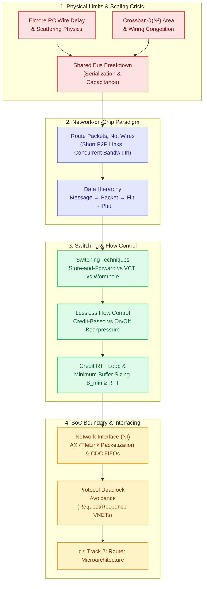

# Track 1: Interconnect Fundamentals

  
Foundational Curriculum • Module 01

  <h1>Interconnect Fundamentals &amp; Network-on-Chip Paradigm</h1>
  

    Master the physical and architectural principles that govern on-chip communication. Explore why shared buses collapsed under Moore's Law, how packetized flow control revolutionized multi-core silicon, and how nanometer wires transport gigabytes of data every clock cycle.
  

  

    ⏱️ 4 In-Depth Lessons
    🔬 4 Interactive Simulators
    💾 Synthesizable Verilog RTL
    🎯 3-Question Quizzes
    🎮 Arcade Game Linkages
  

---

## 🗺️ Architectural Learning Roadmap

The diagram below outlines how the concepts in Track 1 connect the physics of silicon wires to the protocol layers of on-chip routers:

---

## 📚 Syllabus & Chapters in Track 1

  

    

      Lesson 1.1
      
Why Network-on-Chip?

      

        Explore the breakdown of shared multi-drop buses (AMBA, Wishbone) and the quadratic area of crossbars. Learn Elmore wire delay models, electron scattering at sub-10nm nodes, repeater overheads, and the seminal 2001 breakthrough: <em>"Route packets, not wires."</em>
      

      

        ⚡ <strong>Features:</strong> Interactive Bus vs Crossbar vs NoC Scalability Calculator, Intel TeraFLOPS &amp; SCC case studies, 3-Question Quiz, Arcade links to <em>Topology Titans</em> &amp; <em>2D Mesh Visualizer</em>.
      

    

    <a href="01-why-noc/" class="noc-track-link">Launch Lesson 1.1 →</a>
  

  

    

      Lesson 1.2
      
Packets, Flits &amp; Switching

      

        Deconstruct application messages into Packets, Flits (Head, Body, Tail), and physical Phits. Compare Store-and-Forward (SAF), Virtual Cut-Through (VCT), and Wormhole (WH) switching with zero-load latency derivations, timing diagrams, and Head-of-Line blocking analysis.
      

      

        ⚡ <strong>Features:</strong> Interactive Switching Techniques Simulator with cycle-by-cycle animation, 3-Question Quiz, Arcade links to <em>Packet Master</em>, <em>Deflection Duel</em> &amp; <em>Arbiter Arena</em>.
      

    

    <a href="02-packet-switching-flits/" class="noc-track-link">Launch Lesson 1.2 →</a>
  

  

    

      Lesson 1.3
      
Flow Control &amp; Credit Mechanisms

      

        Analyze lossless on-chip flow control protocols. Derive the Credit Round-Trip Time ($RTT$) loop and prove the fundamental buffer sizing condition ($B_{min} \ge RTT$) required to sustain 100% throughput line rate without pipeline bubbles.
      

      

        ⚡ <strong>Features:</strong> Synthesizable Verilog <code>credit_flow_control.v</code>, Interactive Credit Turnaround Loop Simulator, 3-Question Quiz, Arcade link to <em>Credit Commander</em>.
      

    

    <a href="03-flow-control-credit/" class="noc-track-link">Launch Lesson 1.3 →</a>
  

  

    

      Lesson 1.4
      
Network Interface (NI) Architecture

      

        Bridge the gap between IP cores and routers. Understand how ARM AXI and RISC-V TileLink transactions are packetized, how dual-clock asynchronous FIFOs cross clock domains (CDC), and how Virtual Networks (VNETs) eliminate protocol deadlocks.
      

      

        ⚡ <strong>Features:</strong> Synthesizable Verilog <code>async_fifo_cdc.v</code>, Interactive AXI-to-Flit Packetizer Explorer, 3-Question Quiz, Arcade links to <em>QoS Gladiator</em> &amp; <em>Packet Master</em>.
      

    

    <a href="04-network-interface-packetization/" class="noc-track-link">Launch Lesson 1.4 →</a>
  

---

## 🎯 Track Learning Objectives

Upon completing Track 1, you will be able to:

1. **Calculate wire delays and bandwidth limits** for multi-drop buses and identify when a design must transition to an on-chip network.
2. **Evaluate the tradeoffs** between Store-and-Forward, Virtual Cut-Through, and Wormhole switching regarding buffer silicon area, pipeline delay, and latency under zero load.
3. **Formulate flit header bit allocations** including routing IDs, Virtual Channel specifiers, Quality-of-Service priorities, and payload error-correcting codes.
4. **Dimension router input buffers** using the Credit Round-Trip Time ($RTT$) equation to ensure 100% sustained link utilization across varying wire delays.
5. **Architect a complete Network Interface (NI)** to convert memory bus bursts (AXI/TileLink) into flit streams, cross clock domains via asynchronous FIFOs, and prevent protocol-level fetch deadlocks.

---

## 🔬 Silicon Milestones at a Glance

The transition from buses to NoCs represents one of the most critical shifts in semiconductor history:

| Year | Architecture | Interconnect Mechanism | Significance |
| :--- | :--- | :--- | :--- |
| **1996** | ARM AMBA (AHB/APB) | Multi-drop Shared Bus | Defined early 2D SoC interconnect; hit severe limits beyond 4–8 masters. |
| **2001** | Benini &amp; De Micheli / Dally &amp; Towles | Theoretical NoC Framework | Seminal papers establishing the <em>"Route packets, not wires"</em> paradigm. |
| **2007** | Intel Polaris (TeraFLOPS) | 80-Tile 2D Mesh NoC | First silicon demonstration of 1.0+ TeraFLOPS at 62W with 5-port packet routers. |
| **2010** | Intel SCC | 48-Core 2D Mesh NoC | Single-Chip Cloud Computer proving message-passing on a $6 \times 4$ router grid. |
| **2011** | Tilera TILE-Gx | 64-Tile iMesh Architecture | Commercial multicore server chip with 5 independent parallel 2D mesh networks. |
| **2017** | Intel Skylake-SP | Scalable 2D Ring/Mesh Fabric | Replaced monolithic ring buses with a 2D mesh spanning 28+ server cores. |
| **2021** | Apple M1 Max / Ultra | UltraFusion 2.5 TB/s D2D NoC | High-density passive interposer linking dual dies with ultra-low latency packet fabric. |
| **2023** | AMD EPYC Genoa &amp; Zen 4 | Infinity Fabric NoC | Modular chiplet architecture connecting 12 CCDs through a centralized I/O die. |

Ready to begin? Start with **[Lesson 1.1: Why Network-on-Chip?](01-why-noc.md)**.
