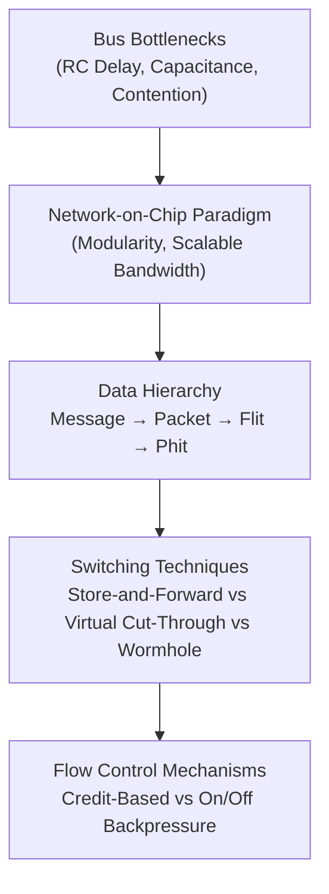

# Track 1: Interconnect Fundamentals

Welcome to the foundation of on-chip communication. In this track, you will learn why traditional bus-based architectures were replaced by packet-switched Networks-on-Chip (NoC), how data is decomposed into packets and flits, and how flow control mechanisms prevent buffer overflow.

---

## 🗺️ Track Roadmap

---

## 📖 Lessons in this Track

1. **[1.1 Why Network-on-Chip?](01-why-noc.md)**  
   The historical shift from shared multi-drop buses (AMBA, Wishbone) to packet-switched micro-networks. Wire delay scaling and bandwidth bottlenecks.
2. **[1.2 Packets, Flits & Switching](02-packet-switching-flits.md)**  
   Understanding messages, packets, flits (Head, Body, Tail), and phits. Comparing Store-and-Forward, Virtual Cut-Through, and Wormhole switching.
3. **[1.3 Flow Control & Credit Mechanism](03-flow-control-credit.md)**  
   Buffer management, upstream credit accounting, on/off signaling, and the buffer turnaround latency loop.
