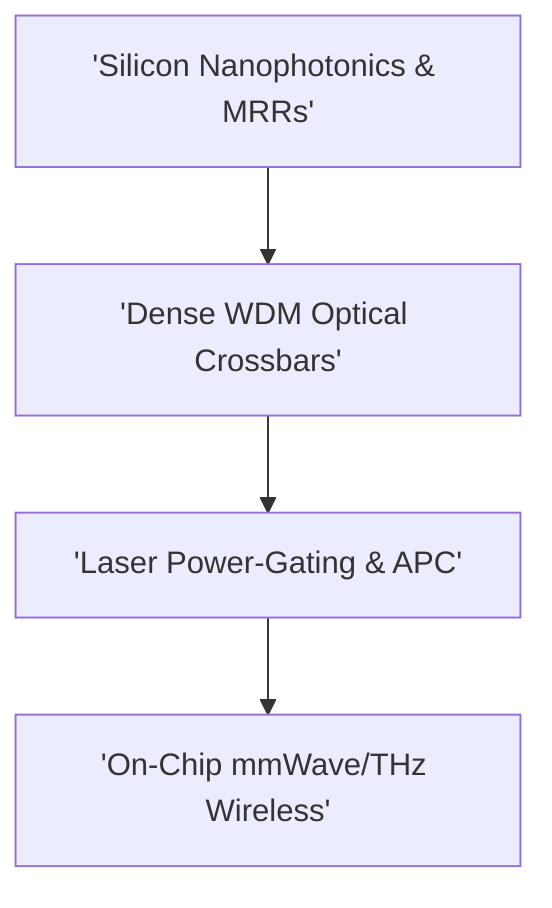

# Track 10: Optical & Wireless Networks-on-Chip

  
Network Architecture • Module 10

  <h1>Optical & Wireless Networks-on-Chip</h1>
  
Silicon nanophotonics, microring resonators (MRRs), wavelength-routed ONoC (WRONoC), laser power-gating, and on-chip mmWave/THz wireless antennas.

  

    ⏱️ 4 In-Depth Lessons
    🔬 Interactive Simulators &amp; Tools
    💻 Synthesizable Verilog RTL
    📜 Grounded in Official Monograph
  

  

    

      📚 Aligned with Chapter 10 of Official 12-Chapter Textbook
    

    

      Explore complete theoretical derivations, physical scaling parameters, and microarchitectural proofs in <strong>Chapter 10</strong>.
    

  

  <a href="../textbook/ch10-optical-wireless/" style="display: inline-flex; align-items: center; gap: 6px; background: #2563eb; color: #ffffff; padding: 8px 16px; border-radius: 6px; font-weight: 600; font-size: 0.85rem; text-decoration: none;">
    Read Chapter 10 in Textbook →
  </a>

---

## 🗺️ Architectural Learning Roadmap

The diagram below outlines how the core concepts in Track 10 connect across the physical and protocol layers:

---

## 📚 Syllabus & Lessons in Track 10

  

    

      Lesson 10.1
      
Silicon Nanophotonics & Microring Resonators

      
Waveguides, microring resonators (MRRs), electro-optic modulation, and zero-capacitance light flight.

      

        ⚡ <strong>Features:</strong> Photon Pilot Optical Grid
      

    

    <a href="01-silicon-nanophotonics-mrrs/" class="noc-track-link">Launch Lesson 10.1 →</a>
  

  

    

      Lesson 10.2
      
Wavelength-Routed Optical NoC (WRONoC)

      
Dense Wavelength-Division Multiplexing (DWDM), non-blocking optical crossbar matrices, and insertion loss.

      

        ⚡ <strong>Features:</strong> Optical Insertion Loss Analyzer
      

    

    <a href="02-wronoc-optical-crossbars/" class="noc-track-link">Launch Lesson 10.2 →</a>
  

  

    

      Lesson 10.3
      
Laser Power-Gating & Thermal Drift Compensation

      
Silicon thermo-optic coefficients (0.10 nm/K), Automated Phase Control (APC), and laser power efficiency.

      

        ⚡ <strong>Features:</strong> APC Thermal Drift Simulator
      

    

    <a href="03-laser-power-gating-apc/" class="noc-track-link">Launch Lesson 10.3 →</a>
  

  

    

      Lesson 10.4
      
On-Chip Wireless NoC (WiNoC) Frontiers

      
Millimeter-wave and terahertz on-chip antennas, zig-zag transceivers, and small-world global shortcuts.

      

        ⚡ <strong>Features:</strong> Wireless Wave mmWave Explorer
      

    

    <a href="04-wireless-noc-frontiers/" class="noc-track-link">Launch Lesson 10.4 →</a>
  

---

## 💻 Web EDA Unix Workbench Quick Launch

Simulate, verify, and inspect the synthesizable SystemVerilog implementations for Track 10 using our integrated in-browser terminal:

  guest@noc-lab:~$ run-sim --topo mesh4x4 --algo xy --inj 0.05 
  [SIM-EXEC] Progress: [========================================] 100% (Zero-load latency: 4.85 cyc)

👉 **[Launch Interactive Web EDA Unix Terminal &amp; Visualizer](../interactive/terminal/)**
