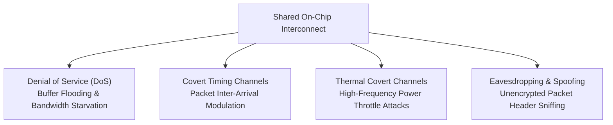

# Lesson 11.1: Security Threat Models in On-Chip Networks

  
Track 11 • Lesson 01

  <h1>Multi-Tenant SoCs, Untrusted Third-Party IPs &amp; Attack Taxonomy</h1>
  

    Classify hardware security vulnerabilities in modern shared networks-on-chip: from malicious third-party IP cores to buffer-flooding Denial-of-Service and side-channel leakage.
  

---

## 1. The Zero-Trust Silicon Paradigm

In cloud data centers and multi-tenant SoCs (e.g., AWS Graviton, Apple Silicon, heterogeneous automotive SoCs), multiple mutually distrusting applications share the same physical router fabric. Furthermore, modern chips integrate dozens of third-party IP blocks (3PIPs) whose transistor layouts cannot be fully verified:

---

## 2. Interactive Arcade Challenge

Defend against live hardware threats in our interactive CAD laboratory:

👉 **[Launch NoC Hardware Security CAD: NoC Security &amp; Threat Defense Arcade](../../interactive/security/)**

---

👉 **Next: [Lesson 11.2: Thermal & Timing Covert Channels](02-thermal-timing-covert-channels.md)**
