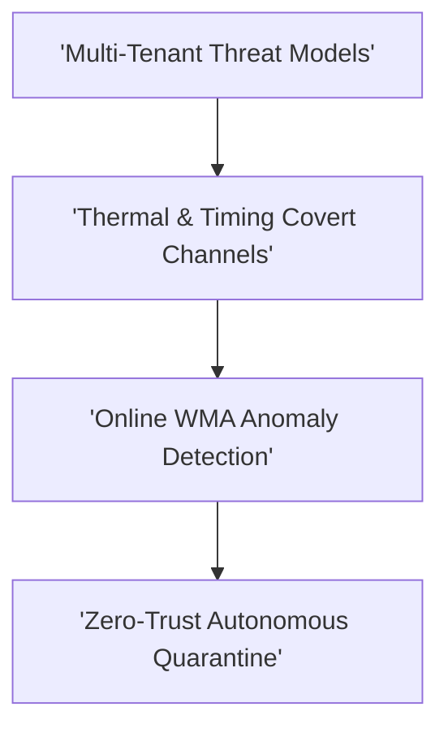

# Track 11: Hardware Security & Trust in On-Chip Networks

  
Network Architecture • Module 11

  <h1>Hardware Security & Trust in On-Chip Networks</h1>
  
Multi-tenant threat models, thermal and timing covert channels, online WMA anomaly filtering (TCAD '26 HeatSense), and Physical Unclonable Functions (PUFs).

  

    ⏱️ 4 In-Depth Lessons
    🔬 Interactive Simulators &amp; Tools
    💻 Synthesizable Verilog RTL
    📜 Grounded in Official Monograph
  

  

    

      📚 Aligned with Chapter 11 of Official 12-Chapter Textbook
    

    

      Explore complete theoretical derivations, physical scaling parameters, and microarchitectural proofs in <strong>Chapter 11</strong>.
    

  

  <a href="../textbook/ch11-security/" style="display: inline-flex; align-items: center; gap: 6px; background: #2563eb; color: #ffffff; padding: 8px 16px; border-radius: 6px; font-weight: 600; font-size: 0.85rem; text-decoration: none;">
    Read Chapter 11 in Textbook →
  </a>

---

## 🗺️ Architectural Learning Roadmap

The diagram below outlines how the core concepts in Track 11 connect across the physical and protocol layers:

---

## 📚 Syllabus & Lessons in Track 11

  

    

      Lesson 11.1
      
Security Threat Models in On-Chip Networks

      
Multi-tenant SoCs, untrusted third-party IPs, buffer-flooding DoS, and eavesdropping taxonomy.

      

        ⚡ <strong>Features:</strong> NoC Hardware Security CAD Defense Arcade
      

    

    <a href="01-security-threat-models/" class="noc-track-link">Launch Lesson 11.1 →</a>
  

  

    

      Lesson 11.2
      
Thermal & Timing Covert Channels

      
Packet inter-arrival delay modulation, substrate thermal conduction leakage, and 256-bit AES exfiltration.

      

        ⚡ <strong>Features:</strong> Timing Jitter Covert Channel Analyzer
      

    

    <a href="02-thermal-timing-covert-channels/" class="noc-track-link">Launch Lesson 11.2 →</a>
  

  

    

      Lesson 11.3
      
Online WMA Anomaly Detection (HeatSense)

      
Hardware-friendly fixed-point EWMA tracking, adaptive threshold bounds, and IEEE TCAD '26 HeatSense.

      

        ⚡ <strong>Features:</strong> Synthesizable WMA Verilog RTL
      

    

    <a href="03-heatsense-wma-anomaly-detection/" class="noc-track-link">Launch Lesson 11.3 →</a>
  

  

    

      Lesson 11.4
      
Hardware Trojan Defense & Zero-Trust Quarantine

      
Autonomous clock gating, packet deflection, and intrinsic interconnect wire-delay PUF authentication.

      

        ⚡ <strong>Features:</strong> Web EDA HeatSense Verification
      

    

    <a href="04-trojan-defense-quarantine/" class="noc-track-link">Launch Lesson 11.4 →</a>
  

---

## 💻 Web EDA Unix Workbench Quick Launch

Simulate, verify, and inspect the synthesizable SystemVerilog implementations for Track 11 using our integrated in-browser terminal:

  guest@noc:~$ run-sim --topo mesh4x4 --algo xy --inj 0.05 
  [SIM-EXEC] Progress: [========================================] 100% (Zero-load latency: 4.85 cyc)

👉 **[Launch Interactive Web EDA Unix Terminal &amp; Visualizer](../interactive/terminal/)**
