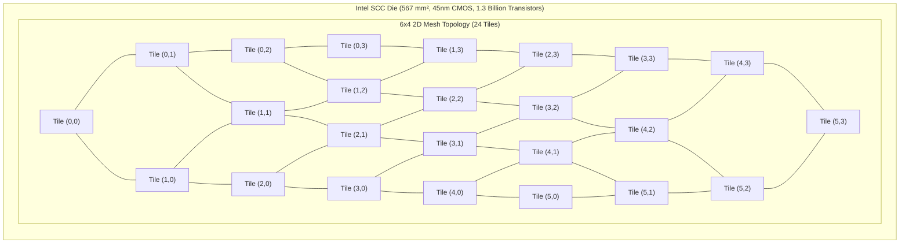
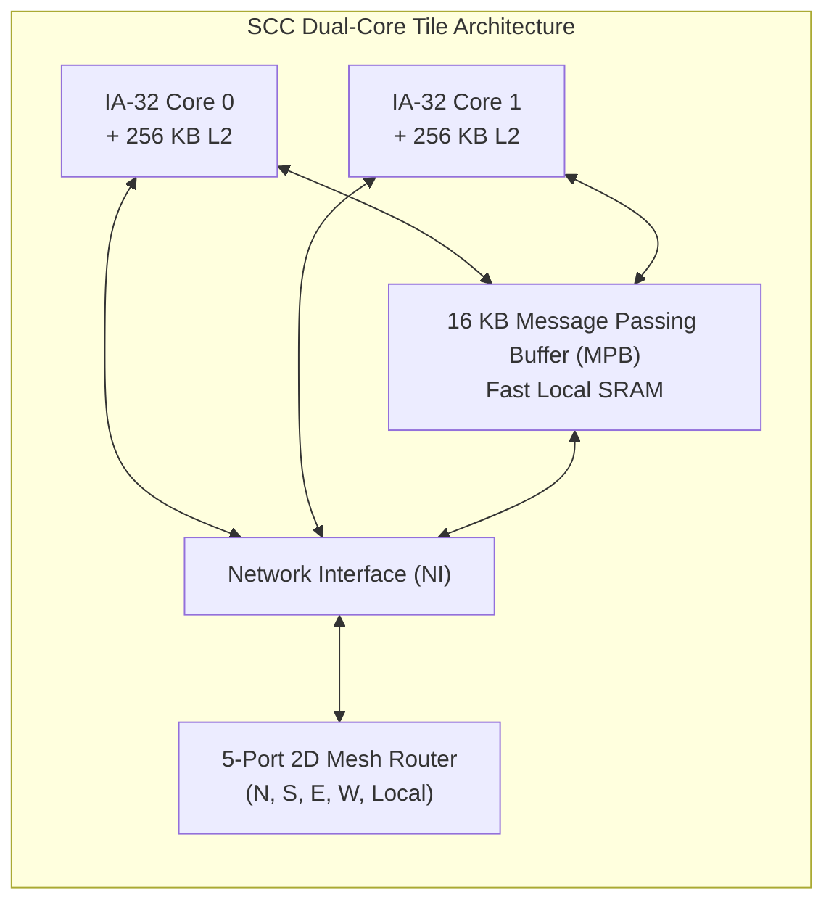
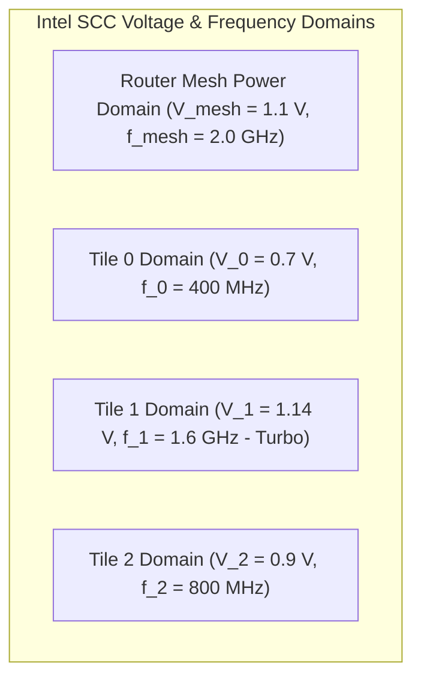

# 7.1 The Manycore Milestone: Intel 48-Core Single-Chip Cloud Computer (SCC)

> **Companion Reading:** Monograph Chapter 1 — *The On-Chip Interconnect Crisis*, Section 1.3 (Landmark Silicon Implementations: Intel SCC). [Read in Companion Textbook →](/learning/textbook/ch01-interconnect-crisis/)

| Paper Details | Primary Reference |
| :--- | :--- |
| **Title** | *A 2-TB/s 6×4 Mesh Network for a Single-Chip Cloud Computer with DVFS in 45-nm CMOS* |
| **Authors** | P. Salihundam, S. Jain, T. Jacob, S. Kumar, V. Erraguntla, Y. Hoskote, S. Vangal, G. Ruhl, N. Borkar |
| **Venue** | **IEEE Journal of Solid-State Circuits (JSSC)**, Vol. 46, No. 4, April 2011 [[Salihundam2011](#ref-salihundam2011)] |
| **Repository Paper** | 📂 [`papers/a-2-tb-s-6-times-4-mesh-network-for-a-single-chip-cloud-computer-with-dvfs-in-45-nm-cmos/`](https://github.com/network-on-chip/noc-lab/tree/main/papers/a-2-tb-s-6-times-4-mesh-network-for-a-single-chip-cloud-computer-with-dvfs-in-45-nm-cmos) |

---

## 1. The Historical Challenge: Breaking the Cache Coherence Wall

In 2009, multi-core processors were hitting a scalability brick wall. Desktop and server CPUs scaled from 2 to 4 to 8 cores using snooping buses and centralized crossbars. However, attempting to scale hardware cache coherence (MESI/MOESI directories) to **48 or 100 cores** resulted in exponential coherence traffic, directory area explosions, and catastrophic power consumption.

Building on prior research from the 80-tile TeraFLOPS processor [[Vangal2008](#ref-vangal2008)], Intel Labs embarked on a landmark experimental project: the **Single-Chip Cloud Computer (SCC)** [[Howard2011](#ref-howard2011)], [[Salihundam2011](#ref-salihundam2011)].
Instead of treating on-chip cores as a tightly-coupled shared-memory multiprocessor with hardware cache coherence, Intel treated the chip as an **on-die datacenter cluster** (a "Cloud on a Chip"). 48 independent Pentium-class IA-32 cores communicate strictly via a high-speed **packet-switched 2D Mesh Network-on-Chip**.



---

## 2. Microarchitecture of the SCC Tile & Router

The SCC floorplan integrates **24 dual-core tiles** in a $6 \times 4$ 2D mesh:



### Key Silicon Specifications:
- **Process Technology:** $45 \ \text{nm}$ Hi-K Metal Gate CMOS.
- **Die Size:** $567 \ \text{mm}^2$ containing $1.3 \ \text{Billion}$ transistors.
- **Fabric Bandwidth:** **$2.0 \ \text{Terabits/sec}$ ($256 \ \text{GB/s}$)** bisection bandwidth at $2.0 \ \text{GHz}$ ($1.1 \ \text{V}$).
- **Link Width:** $16 \ \text{Bytes}$ ($128 \ \text{bits}$) data $+ 16 \ \text{bits}$ sideband/credit per direction.
- **Physical Wire Length:** $5.4 \ \text{mm}$ inter-router links spanning between adjacent tiles.

---

### The 4-Cycle Low-Latency Router Pipeline

To minimize packet transit delay across the large $567 \ \text{mm}^2$ die, the SCC router employs an aggressive **4-stage pipeline** with **route pre-computation** and **speculative early buffer writing**:

```
 Cycle 1            Cycle 2            Cycle 3            Cycle 4
[ Link Traversal & ]  [ Route Compute &  ]  [ Switch Allocation ]  [ Crossbar Traversal ]
[ Speculative Write]  [ VC Allocation   ]  [ (Wrapped WFA)     ]  [ to Output Channel  ]
```


1. **Cycle 1 (Link Traversal + Speculative Write):** Flits traverse the $5.4 \ \text{mm}$ inter-tile link and write directly into the input FIFO based on speculative write pointers, eliminating arrival dependency checks.
2. **Cycle 2 (Route Pre-Computation):** Using Lookahead Routing ([Lesson 3.1](../track3-router-microarchitecture/01-pipeline-stages.md)), the output port for hop $N+1$ is computed during hop $N$.
3. **Cycle 3 (Wrapped Wave-Front Allocation - WWFA):** A specialized single-cycle 2D wave-front arbiter [[Tamir1993](#ref-tamir1993)] matches 5 input ports to 5 output ports concurrently, sustaining over **$90\%$ crossbar utilization**.
4. **Cycle 4 (Crossbar Switch Traversal):** The 128-bit flit traverses the crossbar matrix directly into the output link driver.

---

## 3. The Message Passing Buffer (MPB) Innovation

How did Intel bypass the cache coherence directory bottleneck?

Instead of maintaining cache lines coherent in hardware across 48 cores, each tile embeds a dedicated **$16 \ \text{KB}$ Message Passing Buffer (MPB)**:
- The MPB is a high-speed local SRAM visible to all cores via a global physical address window.
- When Core 0 on Tile $(0, 0)$ wants to send data to Core 15 on Tile $(3, 2)$, it writes payload cache lines directly into its local MPB and sends an ultra-short interrupt packet across the NoC.
- Core 15 reads the message directly across the mesh or copies it to its local cache.
- **Result:** Zero directory state overhead, zero false-sharing cache invalidation storms, and deterministic microsecond message passing!

---

## 4. Fine-Grained DVFS & Voltage Islands

The SCC paper was one of the earliest silicon demonstrations of **per-tile Dynamic Voltage and Frequency Scaling (DVFS)**:



- **Independent Mesh Domain:** The router network operates on a dedicated voltage domain ($1.1 \ \text{V}$) and clock grid ($2.0 \ \text{GHz}$) to guarantee that communication channels never throttle, even if individual CPU cores sleep.
- **6 Separate Voltage Domains:** Dual-core tiles are grouped into 6 voltage regulators ($0.7 \ \text{V}$ to $1.14 \ \text{V}$).
- **24 Separate Frequency Domains:** Each individual tile controls its own clock frequency ($100 \ \text{MHz}$ to $1.6 \ \text{GHz}$) via on-die phase-locked loops (PLLs).
- **Clock Domain Crossing (CDC):** The Network Interface (NI) incorporates asynchronous dual-clock FIFOs to smoothly bridge the variable tile core clock ($f_{core}$) and the fixed $2.0 \ \text{GHz}$ mesh clock ($f_{mesh}$).

---

## 5. Interactive Intel SCC 48-Core Mesh Simulator

Explore Intel's $6 \times 4$ SCC processor below. Click on individual tiles to inspect core frequencies and voltage levels, adjust the global mesh frequency and core workloads, and observe total power dissipation and bisection bandwidth in real time!

<div style="background:var(--md-code-bg-color); border:1px solid var(--md-default-fg-color--lightest); border-radius:8px; padding:20px; margin:24px 0;">
  <div style="display:flex; justify-content:space-between; align-items:center; flex-wrap:wrap; gap:12px; margin-bottom:16px;">
    <h3 style="margin:0; font-size:1.15rem; color:var(--md-typeset-color);">⚡ Intel 48-Core SCC Mesh & DVFS Power Simulator</h3>
    <div style="display:flex; gap:8px;">
      <button onclick="setWorkload('idle')" style="padding:4px 10px; border-radius:4px; background:#1e293b; color:#cbd5e1; border:1px solid #475569; cursor:pointer;">Idle (25W)</button>
      <button onclick="setWorkload('balanced')" style="padding:4px 10px; border-radius:4px; background:#0284c7; color:#fff; border:1px solid #0284c7; cursor:pointer;">Balanced (65W)</button>
      <button onclick="setWorkload('turbo')" style="padding:4px 10px; border-radius:4px; background:#ef4444; color:#fff; border:1px solid #ef4444; cursor:pointer;">Turbo Peak (125W)</button>
    </div>
  </div>

  <div style="display:grid; grid-template-columns:1fr 280px; gap:20px; align-items:start;">
    <div>
      <canvas id="canvasSCC" width="600" height="380" style="width:100%; height:auto; background:#0f172a; border-radius:6px; display:block; cursor:pointer;"></canvas>
      <div style="display:flex; justify-content:space-between; margin-top:8px; font-size:0.85rem; color:var(--md-default-fg-color--light);">
        <span>💡 Click on any tile to toggle its DVFS power state</span>
        <span id="txt-bisection" style="font-weight:700; color:#38bdf8;">Bisection BW: 256 GB/s</span>
      </div>
    </div>

    <div style="background:rgba(15,23,42,0.6); padding:16px; border-radius:6px; border:1px solid rgba(255,255,255,0.08); font-size:0.85rem;">
      <div style="font-weight:700; color:#38bdf8; margin-bottom:12px; font-size:0.95rem;">📊 Silicon Metrics & Telemetry</div>

      <div style="margin-bottom:12px;">
        <div style="font-size:0.8rem; color:#94a3b8;">Total Chip Power Dissipation:</div>
        <div id="txt-total-pwr" style="font-size:1.4rem; font-weight:800; color:#10b981;">62.4 Watts</div>
      </div>

      <div style="border-top:1px solid rgba(255,255,255,0.1); padding-top:10px; margin-bottom:12px;">
        <div style="font-size:0.8rem; color:#94a3b8;">Selected Tile Telemetry:</div>
        <div id="txt-tile-info" style="font-family:monospace; font-size:0.8rem; color:#e2e8f0; line-height:1.5; margin-top:4px;">
          Tile: (2, 1)<br/>
          Cores: Core 10 & 11<br/>
          Voltage: 1.00 V<br/>
          Frequency: 1.0 GHz<br/>
          Tile Power: 2.4 W
        </div>
      </div>

      <div style="border-top:1px solid rgba(255,255,255,0.1); padding-top:10px;">
        <label style="display:block; font-size:0.8rem; margin-bottom:4px; color:#94a3b8;">Router Mesh Frequency ($f_{mesh}$):</label>
        <select id="sel-mesh-clk" onchange="updateSCCSim()" style="width:100%; padding:4px 8px; border-radius:4px; background:#1e293b; color:#fff; border:1px solid #475569;">
          <option value="1.0">1.0 GHz (128 GB/s Bisection, 0.9V)</option>
          <option value="1.6">1.6 GHz (204 GB/s Bisection, 1.0V)</option>
          <option value="2.0" selected>2.0 GHz (256 GB/s Bisection, 1.1V - Max)</option>
        </select>
      </div>
    </div>
  </div>
</div>

<script>
(function() {
  const canvas = document.getElementById('canvasSCC');
  const ctx = canvas.getContext('2d');

  // 6 columns x 4 rows
  const COLS = 6;
  const ROWS = 4;
  const tiles = [];
  let selectedTile = { x: 2, y: 1 };

  for (let y = 0; y < ROWS; y++) {
    for (let x = 0; x < COLS; x++) {
      tiles.push({
        x: x,
        y: y,
        state: 'balanced', // 'idle', 'balanced', 'turbo'
        v: 1.0,
        f: 1.0
      });
    }
  }

  canvas.addEventListener('click', (e) => {
    const rect = canvas.getBoundingClientRect();
    const scaleX = canvas.width / rect.width;
    const scaleY = canvas.height / rect.height;
    const mx = (e.clientX - rect.left) * scaleX;
    const my = (e.clientY - rect.top) * scaleY;

    // Tile bounding boxes
    const padX = 40, padY = 40;
    const tileW = 75, tileH = 65;
    const gapX = 14, gapY = 16;

    for (let t of tiles) {
      const tx = padX + t.x * (tileW + gapX);
      const ty = padY + t.y * (tileH + gapY);
      if (mx >= tx && mx <= tx + tileW && my >= ty && my <= ty + tileH) {
        selectedTile = { x: t.x, y: t.y };
        // Cycle state
        if (t.state === 'idle') t.state = 'balanced';
        else if (t.state === 'balanced') t.state = 'turbo';
        else t.state = 'idle';
        updateTileParams(t);
        updateSCCSim();
        return;
      }
    }
  });

  function updateTileParams(t) {
    if (t.state === 'idle') { t.v = 0.7; t.f = 0.4; }
    else if (t.state === 'balanced') { t.v = 1.0; t.f = 1.0; }
    else if (t.state === 'turbo') { t.v = 1.14; t.f = 1.6; }
  }

  window.setWorkload = function(mode) {
    for (let t of tiles) {
      t.state = mode;
      updateTileParams(t);
    }
    updateSCCSim();
  };

  window.updateSCCSim = function() {
    const meshClk = parseFloat(document.getElementById('sel-mesh-clk').value);
    // Bisection BW: 4 links across the 6x4 cut * 2 directions * 16 bytes * f_mesh
    // 4 links * 32 B/cycle = 128 B/cycle * 2 GHz = 256 GB/s
    const bisectionGBs = 4 * 32 * meshClk;
    document.getElementById('txt-bisection').textContent = 'Bisection BW: ' + Math.round(bisectionGBs) + ' GB/s (' + (bisectionGBs * 8 / 1000).toFixed(1) + ' Tb/s)';

    // Compute total power: Mesh router baseline + sum of 24 tiles
    // Mesh baseline: 12W at 2.0 GHz
    const pMesh = 12.0 * (meshClk / 2.0);
    let pTiles = 0;

    for (let t of tiles) {
      // Dynamic power: P = C * V^2 * f
      // Tile power: 0.8W (idle), 2.2W (balanced), 4.8W (turbo)
      let pt = 0;
      if (t.state === 'idle') pt = 0.75;
      else if (t.state === 'balanced') pt = 2.2;
      else if (t.state === 'turbo') pt = 4.8;
      pTiles += pt;
    }

    const totalPwr = pMesh + pTiles;
    const pwrEl = document.getElementById('txt-total-pwr');
    pwrEl.textContent = totalPwr.toFixed(1) + ' Watts';
    pwrEl.style.color = totalPwr > 100 ? '#ef4444' : (totalPwr > 60 ? '#f59e0b' : '#10b981');

    // Update selected tile display
    const sel = tiles.find(t => t.x === selectedTile.x && t.y === selectedTile.y);
    if (sel) {
      const core0 = (sel.y * 6 + sel.x) * 2;
      const core1 = core0 + 1;
      let pt = sel.state === 'idle' ? 0.75 : (sel.state === 'balanced' ? 2.2 : 4.8);
      document.getElementById('txt-tile-info').innerHTML = `
        Tile: (${sel.x}, ${sel.y}) [${sel.state.toUpperCase()}]<br/>
        Cores: Core ${core0} & ${core1}<br/>
        Voltage: ${sel.v.toFixed(2)} V<br/>
        Frequency: ${sel.f.toFixed(1)} GHz<br/>
        Tile Power: ${pt.toFixed(2)} W
      `;
    }

    renderSCC();
  };

  function renderSCC() {
    ctx.clearRect(0, 0, canvas.width, canvas.height);

    const padX = 40, padY = 40;
    const tileW = 75, tileH = 65;
    const gapX = 14, gapY = 16;

    // Draw mesh interconnect links
    ctx.strokeStyle = 'rgba(56, 189, 248, 0.45)';
    ctx.lineWidth = 3;

    // Horizontal links
    for (let y = 0; y < ROWS; y++) {
      for (let x = 0; x < COLS - 1; x++) {
        const x1 = padX + x * (tileW + gapX) + tileW;
        const y1 = padY + y * (tileH + gapY) + tileH / 2;
        const x2 = padX + (x + 1) * (tileW + gapX);
        ctx.beginPath();
        ctx.moveTo(x1, y1);
        ctx.lineTo(x2, y1);
        ctx.stroke();
      }
    }

    // Vertical links
    for (let x = 0; x < COLS; x++) {
      for (let y = 0; y < ROWS - 1; y++) {
        const x1 = padX + x * (tileW + gapX) + tileW / 2;
        const y1 = padY + y * (tileH + gapY) + tileH;
        const y2 = padY + (y + 1) * (tileH + gapY);
        ctx.beginPath();
        ctx.moveTo(x1, y1);
        ctx.lineTo(x1, y2);
        ctx.stroke();
      }
    }

    // Draw tiles
    for (let t of tiles) {
      const tx = padX + t.x * (tileW + gapX);
      const ty = padY + t.y * (tileH + gapY);

      const isSelected = (t.x === selectedTile.x && t.y === selectedTile.y);

      // Color coding based on state
      let fill = '#1e293b';
      let border = '#475569';
      if (t.state === 'idle') { fill = 'rgba(2, 132, 199, 0.15)'; border = '#0284c7'; }
      else if (t.state === 'balanced') { fill = 'rgba(16, 185, 129, 0.2)'; border = '#10b981'; }
      else if (t.state === 'turbo') { fill = 'rgba(239, 68, 68, 0.25)'; border = '#ef4444'; }

      ctx.fillStyle = fill;
      ctx.fillRect(tx, ty, tileW, tileH);

      ctx.strokeStyle = isSelected ? '#ffffff' : border;
      ctx.lineWidth = isSelected ? 2.5 : 1.5;
      ctx.strokeRect(tx, ty, tileW, tileH);

      // Text inside tile
      ctx.fillStyle = '#f8fafc';
      ctx.font = 'bold 10px Inter, sans-serif';
      ctx.fillText(`Tile (${t.x},${t.y})`, tx + 6, ty + 15);

      ctx.fillStyle = '#94a3b8';
      ctx.font = '9px Inter, sans-serif';
      ctx.fillText(`${t.f.toFixed(1)} GHz`, tx + 6, ty + 30);
      ctx.fillText(`${t.v.toFixed(2)} V`, tx + 6, ty + 44);

      // Central router dot
      ctx.beginPath();
      ctx.arc(tx + tileW - 12, ty + 14, 5, 0, Math.PI * 2);
      ctx.fillStyle = '#38bdf8';
      ctx.fill();
    }
  }

  updateSCCSim();
})();
</script>

---

## 6. Worked Numerical Problem: SCC Bisection Bandwidth

### Problem Statement
From the published silicon measurements in Intel's 2011 JSSC paper:
The SCC on-chip fabric is a $6 \times 4$ 2D mesh router network. Each inter-router physical link operates at clock frequency $f_{mesh} = 2.0 \ \text{GHz}$ and carries a **$16\text{-Byte}$ ($128\text{-bit}$)** flit payload per cycle in each direction.

1. **Calculate the bisection bandwidth of the $6 \times 4$ mesh across the vertical network bisection cut.**
2. **If an IA-32 core executes a cache miss requiring a 32-Byte cache line transfer across 3 hops, calculate the minimum packet serialization latency.**
3. **If the router network consumes $12.0 \ \text{W}$ at $2.0 \ \text{GHz}$ ($1.1 \ \text{V}$), calculate the energy efficiency per flit hop in picojoules ($\text{pJ/bit}$).**

---

### Step-by-Step Solution

#### Step 1: Bisection Bandwidth Across the Cut
In a $6 \times 4$ 2D mesh, cutting the network in half vertically divides the 6 columns into two $3 \times 4$ sub-meshes.
The number of parallel bidirectional physical links crossing this bisection cut is equal to the number of rows:

$$N_{cut\_links} = 4 \ \text{links}$$

Each link transmits in both directions ($2 \times 16 \ \text{Bytes/cycle} = 32 \ \text{Bytes/cycle}$).
At $f_{mesh} = 2.0 \ \text{GHz}$ ($2.0 \times 10^9 \ \text{cycles/sec}$):

$$\text{Bisection Bandwidth} = 4 \times (32 \ \text{Bytes/cycle}) \times (2.0 \times 10^9 \ \text{cycles/sec})$$

$$\text{Bisection Bandwidth} = 256 \times 10^9 \ \text{Bytes/sec} = \mathbf{256 \ \text{GB/s}} = \mathbf{2.048 \ \text{Terabits/sec}}$$

This confirms Intel’s headline claim of **$2.0 \ \text{Tb/s}$ bisection bandwidth**!

#### Step 2: 32-Byte Cache Line Serialization
A 32-Byte packet payload plus an 8-Byte routing header yields a total packet size:

$$S_{packet} = 32 \ \text{Bytes} + 8 \ \text{Bytes} = 40 \ \text{Bytes}$$

Because each flit carries $16 \ \text{Bytes}$:

$$N_{flits} = \left\lceil \frac{40 \ \text{Bytes}}{16 \ \text{Bytes/flit}} \right\rceil = 3 \ \text{flits}$$

At $2.0 \ \text{GHz}$ ($0.5 \ \text{ns/cycle}$), serializing 3 flits into the network interface consumes:

$$t_{serial} = 3 \ \text{cycles} \times 0.5 \ \text{ns} = \mathbf{1.5 \ \text{ns}}$$

#### Step 3: Router Energy Efficiency
The 24 routers together dissipate $12.0 \ \text{W}$. The power per router is:

$$P_{router} = \frac{12.0 \ \text{W}}{24} = 0.50 \ \text{W/router} \ (500 \ \text{mW})$$

At full saturation, each 5-port router can switch up to 5 incoming flits of 128 bits every cycle ($5 \times 128 = 640 \ \text{bits/cycle}$):

$$\text{Throughput} = 640 \ \text{bits/cycle} \times (2.0 \times 10^9 \ \text{cycles/s}) = 1.28 \ \text{Tbps/router}$$

$$\text{Energy per bit} = \frac{0.50 \ \text{Joules/sec}}{1.28 \times 10^{12} \ \text{bits/sec}} \approx 0.39 \times 10^{-12} \ \text{J/bit} = \mathbf{0.39 \ \text{pJ/bit/hop}}$$

---

## 7. Synthesizable Verilog Module: `scc_mesh_router_wwfa.v`

To achieve the headline $2.0 \ \text{TB/s}$ bisection throughput at $2.0 \ \text{GHz}$, the Intel SCC architecture deployed a high-speed 5-port 2D mesh router featuring **Lookahead Routing** and a single-cycle **Wrapped Wave-Front Allocator (WWFA)**.

The synthesizable module below implements the core of the SCC router switch allocation and crossbar datapath. It decodes destination coordinates to pre-compute the next-hop direction, performs 5x5 contention-free port matching via a rotating wave-front diagonal matrix, and switches 128-bit flits concurrently to downstream tiles while checking credit availability.

```verilog
//=============================================================================
// File: scc_mesh_router_wwfa.v
// Module: scc_mesh_router_wwfa
// Description: Synthesizable 5-Port Mesh Router with Wrapped Wave-Front
//              Allocation (WWFA) and Lookahead Routing based on the Intel 48-Core
//              Single-Chip Cloud Computer (SCC, IEEE JSSC 2011).
//              Ports: 0: North, 1: South, 2: East, 3: West, 4: Local (Tile)
//              Features:
//              - 128-bit flit datapath matching SCC physical link width.
//              - Single-cycle Wrapped Wave-Front Allocator (WWFA) matching
//                up to 5 inputs to 5 outputs concurrently.
//              - Rotating priority offset for starvation-free round-robin fairness.
//              - Downstream buffer credit gating.
//              - Lookahead route pre-computation for hop N+1.
//=============================================================================

`timescale 1ns / 1ps

module scc_mesh_router_wwfa #(
    parameter integer DATA_WIDTH = 128,       // SCC flit data width (16 Bytes)
    parameter integer MESH_X     = 6,         // 6x4 2D Mesh
    parameter integer MESH_Y     = 4
)(
    input  wire                    clk_mesh,  // 2.0 GHz mesh clock
    input  wire                    rst_n,
    
    // Current Tile Position
    input  wire [2:0]              cur_x,     // 0..5
    input  wire [1:0]              cur_y,     // 0..3
    
    // 5 Input Channels (N, S, E, W, L)
    input  wire [4:0]              req_valid,
    input  wire [2:0]              dest_x [4:0],
    input  wire [1:0]              dest_y [4:0],
    input  wire [DATA_WIDTH-1:0]   flit_in [4:0],
    
    // Downstream Flow Control Credits
    input  wire [4:0]              out_credit_avail,
    
    // 5 Output Channels (N, S, E, W, L)
    output reg  [4:0]              flit_out_valid,
    output reg  [DATA_WIDTH-1:0]   flit_out [4:0],
    output reg  [2:0]              lookahead_dir [4:0], // Next-hop precomputed port
    output reg  [2:0]              grant_count          // Active concurrent grants (0..5)
);

    // Port Enumeration
    localparam PORT_NORTH = 3'd0;
    localparam PORT_SOUTH = 3'd1;
    localparam PORT_EAST  = 3'd2;
    localparam PORT_WEST  = 3'd3;
    localparam PORT_LOCAL = 3'd4;

    // Route Pre-Computation (Lookahead Dimension-Order Routing X-Y)
    reg [2:0] target_port [4:0];
    integer i;

    always @(*) begin
        for (i = 0; i < 5; i = i + 1) begin
            if (req_valid[i]) begin
                if (dest_x[i] > cur_x)
                    target_port[i] = PORT_EAST;
                else if (dest_x[i] < cur_x)
                    target_port[i] = PORT_WEST;
                else if (dest_y[i] > cur_y)
                    target_port[i] = PORT_SOUTH;
                else if (dest_y[i] < cur_y)
                    target_port[i] = PORT_NORTH;
                else
                    target_port[i] = PORT_LOCAL;
            end else begin
                target_port[i] = PORT_LOCAL;
            end
        end
    end

    // Wrapped Wave-Front Allocation (WWFA) Priority Diagonal Rotation
    reg [2:0] prio_offset;

    always @(posedge clk_mesh or negedge rst_n) begin
        if (!rst_n) begin
            prio_offset <= 3'd0;
        end else begin
            prio_offset <= (prio_offset == 3'd4) ? 3'd0 : prio_offset + 3'd1;
        end
    end

    // Match 5 Inputs to 5 Outputs without Port Collisions
    reg [4:0] input_granted;
    reg [4:0] output_taken;
    reg [2:0] out_map [4:0]; // out_map[out_port] = granted_in_port
    integer step, in_idx, out_idx;

    always @(*) begin
        input_granted  = 5'b00000;
        output_taken   = 5'b00000;
        grant_count    = 3'd0;

        for (out_idx = 0; out_idx < 5; out_idx = out_idx + 1) begin
            out_map[out_idx] = 3'd7; // None
        end

        // Evaluate requests in wave-front priority order
        for (step = 0; step < 5; step = step + 1) begin
            in_idx = (prio_offset + step) % 5;
            if (req_valid[in_idx]) begin
                out_idx = target_port[in_idx];
                // Check if target output is free and has downstream buffer credits
                if (!output_taken[out_idx] && out_credit_avail[out_idx]) begin
                    input_granted[in_idx]  = 1'b1;
                    output_taken[out_idx]   = 1'b1;
                    out_map[out_idx]        = in_idx[2:0];
                    grant_count             = grant_count + 3'd1;
                end
            end
        end
    end

    // Crossbar Switch Datapath & Register Stage
    integer p;
    always @(posedge clk_mesh or negedge rst_n) begin
        if (!rst_n) begin
            flit_out_valid <= 5'b00000;
            for (p = 0; p < 5; p = p + 1) begin
                flit_out[p]      <= {DATA_WIDTH{1'b0}};
                lookahead_dir[p] <= PORT_LOCAL;
            end
        end else begin
            for (p = 0; p < 5; p = p + 1) begin
                if (output_taken[p]) begin
                    flit_out_valid[p] <= 1'b1;
                    flit_out[p]       <= flit_in[out_map[p]];
                    lookahead_dir[p]  <= target_port[out_map[p]];
                end else begin
                    flit_out_valid[p] <= 1'b0;
                    flit_out[p]       <= {DATA_WIDTH{1'b0}};
                    lookahead_dir[p]  <= PORT_LOCAL;
                end
            end
        end
    end

endmodule
```

---

## 8. 🕹️ Interactive Simulation & Arcade Linkages

Deepen your practical mastery of multi-core switch allocation, wave-front arbitration, and tile-level power management with our interactive engineering simulation workbenches:

- 🎮 **[Arbiter Simulator: Crossbar Clash](../interactive/arbiter.md):** Master 5x5 crossbar switch matching, wave-front allocation algorithms, and arbitration fairness under high-injection workloads.
- 🎮 **[Dark Silicon Power Gating CAD: Dark Silicon Power](../interactive/power.md):** Regulate per-tile DVFS voltage domains, manage on-chip thermal budgets, and prevent thermal runaway across manycore dies.

---

## 9. 🎯 Concept Check: Lesson 7.1

Test your understanding of the Intel 48-Core Single-Chip Cloud Computer architecture with this 3-question self-assessment.

<div class="noc-sim-container" id="quiz71" style="margin-top:1rem;">
  <div style="display:flex; justify-content:space-between; align-items:center; margin-bottom:1rem; flex-wrap:wrap; gap:0.5rem;">
    <div style="font-weight:700; font-size:1.05rem; color:var(--tcl-heading);">
      📝 Concept Check: Intel 48-Core SCC Landmark Paper
    </div>
    <div id="q71_score_badge" style="font-size:0.85rem; font-weight:600; padding:4px 10px; border-radius:12px; background:rgba(37,99,235,0.1); color:#2563eb;">
      Score: 0 / 3
    </div>
  </div>

  <!-- Question 1 -->
  <div id="q71_1_block" style="margin-bottom:1.5rem; padding-bottom:1rem; border-bottom:1px solid var(--noc-border);">
    <p style="font-weight:600; font-size:0.95rem; margin-bottom:0.75rem;">
      <b>1. Eliminating Hardware Cache Coherence:</b> Why did Intel's SCC architecture employ on-die Message Passing Buffers (MPBs) instead of a monolithic hardware MESI/MOESI directory across its 48 cores?
    </p>
    <div style="display:flex; flex-direction:column; gap:0.5rem;" id="q71_1_opts">
      <button class="noc-sim-select" style="text-align:left; padding:0.65rem 0.85rem; cursor:pointer;" onclick="checkQ71(1, 0)">
        A. Maintaining hardware directory-based cache coherence across 48 cores induces exponential coherence invalidation traffic, directory area explosions, and catastrophic power dissipation.
      </button>
      <button class="noc-sim-select" style="text-align:left; padding:0.65rem 0.85rem; cursor:pointer;" onclick="checkQ71(1, 1)">
        B. The IA-32 instruction set architecture does not support load and store instructions.
      </button>
      <button class="noc-sim-select" style="text-align:left; padding:0.65rem 0.85rem; cursor:pointer;" onclick="checkQ71(1, 2)">
        C. 45-nm CMOS cannot physically fabricate static RAM memory cells.
      </button>
      <button class="noc-sim-select" style="text-align:left; padding:0.65rem 0.85rem; cursor:pointer;" onclick="checkQ71(1, 3)">
        D. Message Passing Buffers completely eliminate the need for physical interconnect wires.
      </button>
    </div>
    <div id="q71_1_fb" style="display:none; margin-top:0.75rem; padding:0.75rem; border-radius:8px; font-size:0.9rem; line-height:1.5;"></div>
  </div>

  <!-- Question 2 -->
  <div id="q71_2_block" style="margin-bottom:1.5rem; padding-bottom:1rem; border-bottom:1px solid var(--noc-border);">
    <p style="font-weight:600; font-size:0.95rem; margin-bottom:0.75rem;">
      <b>2. SCC 4-Stage Router Pipeline Latency:</b> In the SCC router pipeline, what architectural techniques allow the router to achieve a 2.0 ns per-hop latency while sustaining >90% switch utilization?
    </p>
    <div style="display:flex; flex-direction:column; gap:0.5rem;" id="q71_2_opts">
      <button class="noc-sim-select" style="text-align:left; padding:0.65rem 0.85rem; cursor:pointer;" onclick="checkQ71(2, 0)">
        A. Lookahead routing pre-computation and speculative early buffer writing coupled with a single-cycle Wrapped Wave-Front Allocator (WWFA).
      </button>
      <button class="noc-sim-select" style="text-align:left; padding:0.65rem 0.85rem; cursor:pointer;" onclick="checkQ71(2, 1)">
        B. Automatically dropping flits whenever an output port experiences contention.
      </button>
      <button class="noc-sim-select" style="text-align:left; padding:0.65rem 0.85rem; cursor:pointer;" onclick="checkQ71(2, 2)">
        C. Operating the entire crossbar on analog optical lasers.
      </button>
      <button class="noc-sim-select" style="text-align:left; padding:0.65rem 0.85rem; cursor:pointer;" onclick="checkQ71(2, 3)">
        D. Using a single shared central queue for all 5 router ports.
      </button>
    </div>
    <div id="q71_2_fb" style="display:none; margin-top:0.75rem; padding:0.75rem; border-radius:8px; font-size:0.9rem; line-height:1.5;"></div>
  </div>

  <!-- Question 3 -->
  <div id="q71_3_block" style="margin-bottom:1rem;">
    <p style="font-weight:600; font-size:0.95rem; margin-bottom:0.75rem;">
      <b>3. Independent Mesh Voltage &amp; Frequency Domain:</b> Why did Intel place the 2D mesh router network on an independent power domain ($1.1\text{ V}, 2.0\text{ GHz}$) separate from the 24 core tile voltage domains?
    </p>
    <div style="display:flex; flex-direction:column; gap:0.5rem;" id="q71_3_opts">
      <button class="noc-sim-select" style="text-align:left; padding:0.65rem 0.85rem; cursor:pointer;" onclick="checkQ71(3, 0)">
        A. To guarantee that communication fabric bandwidth ($2.0\text{ TB/s}$) and packet transit latencies remain deterministic even when individual computing tiles throttle down to low frequency or enter sleep states.
      </button>
      <button class="noc-sim-select" style="text-align:left; padding:0.65rem 0.85rem; cursor:pointer;" onclick="checkQ71(3, 1)">
        B. Routers require higher voltage because copper traces have zero electrical resistance.
      </button>
      <button class="noc-sim-select" style="text-align:left; padding:0.65rem 0.85rem; cursor:pointer;" onclick="checkQ71(3, 2)">
        C. Because IA-32 CPU cores cannot run on direct current (DC).
      </button>
      <button class="noc-sim-select" style="text-align:left; padding:0.65rem 0.85rem; cursor:pointer;" onclick="checkQ71(3, 3)">
        D. To allow flits to be stored permanently in routers without power.
      </button>
    </div>
    <div id="q71_3_fb" style="display:none; margin-top:0.75rem; padding:0.75rem; border-radius:8px; font-size:0.9rem; line-height:1.5;"></div>
  </div>

  <div style="margin-top:1rem; text-align:right;">
    <button class="noc-sim-btn" onclick="resetQuiz71()" style="padding:4px 12px; font-size:0.85rem;">🔄 Reset Quiz</button>
  </div>
</div>

<script>
const q71Answers = [0, 0, 0];
const q71Feedback = [
  "✓ Correct! Maintaining full hardware cache coherence across 48 cores creates severe invalidation storms and exponential directory area overhead. Intel's message-passing architecture treats the chip as a distributed cloud cluster, scaling cleanly.",
  "✓ Correct! By computing the next hop in advance (lookahead routing) and writing flits speculatively into input buffers, the SCC router hides arbitration delay, completing contention-free switch matching in a single-cycle Wrapped Wave-Front Allocator.",
  "✓ Correct! Decoupling the mesh fabric onto a dedicated 1.1 V / 2.0 GHz power grid ensures that packets traverse the chip at maximum speed without stalling, even when surrounding compute tiles sleep or dynamically throttle to save power."
];
let q71Score = [0, 0, 0];

function checkQ71(qIdx, optIdx) {
  const fb = document.getElementById(`q71_${qIdx}_fb`);
  const opts = document.querySelectorAll(`#q71_${qIdx}_opts button`);
  
  opts.forEach(b => {
    b.disabled = true;
    b.style.opacity = '0.7';
  });

  fb.style.display = 'block';
  if (optIdx === q71Answers[qIdx - 1]) {
    opts[optIdx].style.border = '2px solid #10b981';
    opts[optIdx].style.background = 'rgba(16, 185, 129, 0.15)';
    opts[optIdx].style.opacity = '1';
    fb.style.background = 'rgba(16, 185, 129, 0.1)';
    fb.style.border = '1px solid #10b981';
    fb.style.color = '#10b981';
    fb.textContent = q71Feedback[qIdx - 1];
    q71Score[qIdx - 1] = 1;
  } else {
    opts[optIdx].style.border = '2px solid #ef4444';
    opts[optIdx].style.background = 'rgba(239, 68, 68, 0.15)';
    opts[optIdx].style.opacity = '1';
    opts[q71Answers[qIdx - 1]].style.border = '2px solid #10b981';
    opts[q71Answers[qIdx - 1]].style.opacity = '1';
    fb.style.background = 'rgba(239, 68, 68, 0.1)';
    fb.style.border = '1px solid #ef4444';
    fb.style.color = '#ef4444';
    fb.textContent = "✗ Incorrect. " + q71Feedback[qIdx - 1];
    q71Score[qIdx - 1] = 0;
  }

  const total = q71Score.reduce((a, b) => a + b, 0);
  const badge = document.getElementById('q71_score_badge');
  badge.textContent = `Score: ${total} / 3`;
  if (total === 3) {
    badge.style.background = 'rgba(16, 185, 129, 0.15)';
    badge.style.color = '#10b981';
  }
}

function resetQuiz71() {
  q71Score = [0, 0, 0];
  const badge = document.getElementById('q71_score_badge');
  badge.textContent = 'Score: 0 / 3';
  badge.style.background = 'rgba(37,99,235,0.1)';
  badge.style.color = '#2563eb';

  for (let q = 1; q <= 3; q++) {
    const fb = document.getElementById(`q71_${q}_fb`);
    fb.style.display = 'none';
    fb.textContent = '';
    const opts = document.querySelectorAll(`#q71_${q}_opts button`);
    opts.forEach(b => {
      b.disabled = false;
      b.style.border = '';
      b.style.background = '';
      b.style.opacity = '1';
    });
  }
}
</script>

---

## 10. Summary & Next Steps

Intel’s 48-Core Single-Chip Cloud Computer demonstrated that a packet-switched 2D mesh combined with tile-level DVFS and message passing can scale manycore architectures to commercial reality.

In **[Lesson 7.2: The Multi-Chiplet Revolution: NVIDIA Simba](02-nvidia-simba-mcm.md)**, we examine how NVIDIA scaled deep learning acceleration across **36 chiplets** using Ground-Referenced Signaling (GRS) and hierarchical on-package networks!

---

## References & Primary Sources

<a id="ref-salihundam2011"></a>**[Salihundam2011]** P. Salihundam, S. Jain, T. Jacob, S. Kumar, V. Erraguntla, Y. Hoskote, S. Vangal, G. Ruhl, and N. Borkar, "A 2-TB/s $6 \times 4$ Mesh Network for a Single-Chip Cloud Computer with DVFS in 45-nm CMOS," *IEEE Journal of Solid-State Circuits*, vol. 46, no. 4, pp. 757–766, 2011. [DOI: 10.1109/JSSC.2011.2108121](https://doi.org/10.1109/JSSC.2011.2108121)

<a id="ref-howard2011"></a>**[Howard2011]** J. Howard, S. Dighe, S. R. Vangal, G. Ruhl, N. Borkar, S. Jain, V. Erraguntla, M. Konow, M. Riepen, M. Gries, G. Droege, T. Lund-Larsen, S. Steibl, S. Borkar, V. K. De, and R. Van Der Wijngaart, "A 48-core IA-32 message-passing processor with DVFS in 45nm CMOS," *IEEE Micro*, vol. 31, no. 3, pp. 44–53, 2011. [DOI: 10.1109/MM.2011.48](https://doi.org/10.1109/MM.2011.48)

<a id="ref-vangal2008"></a>**[Vangal2008]** S. R. Vangal, J. Howard, G. Ruhl, S. Dighe, H. Wilson, J. Tschanz, D. Finan, A. Singh, T. Jacob, S. Jain, V. Erraguntla, C. Roberts, Y. Hoskote, N. Borkar, and S. Borkar, "An 80-tile sub-100-W TeraFLOPS processor in 65-nm CMOS," *IEEE Journal of Solid-State Circuits*, vol. 43, no. 1, pp. 29–41, 2008. [DOI: 10.1109/JSSC.2007.910957](https://doi.org/10.1109/JSSC.2007.910957)

<a id="ref-tamir1993"></a>**[Tamir1993]** Y. Tamir and H.-C. Chi, "Symmetric bipartite matchers for high-performance packet switches," *IEEE Transactions on Parallel and Distributed Systems*, vol. 4, no. 1, pp. 91–98, 1993. [DOI: 10.1109/71.205655](https://doi.org/10.1109/71.205655)


