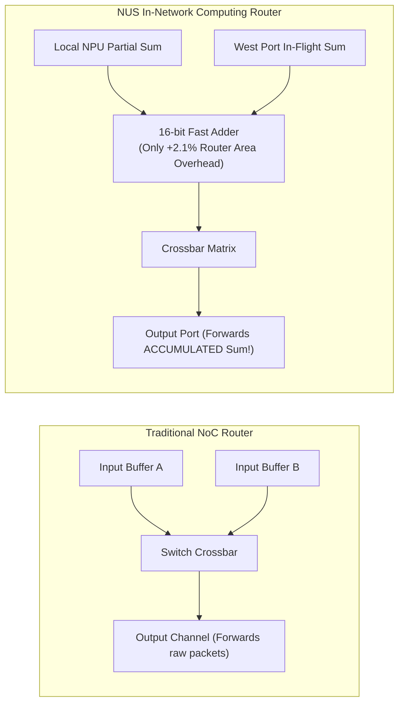
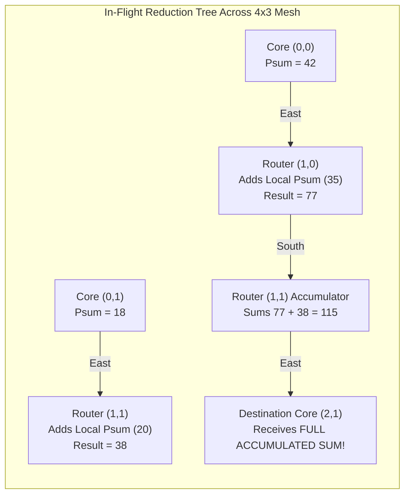
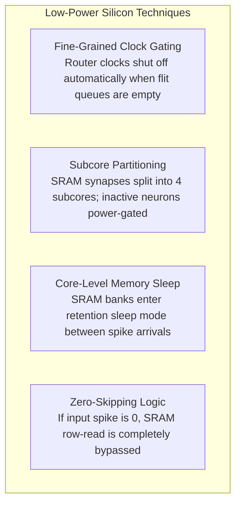

# 7.4 In-Network Computing: Neuromorphic Partial-Sum Routers

> **Companion Reading:** Monograph Chapter 10 — *Emerging Frontiers: Optical, Wireless, and Neuromorphic NoCs*, Section 10.3 (In-Network Computing and Neuromorphic Interconnects). [Read in Companion Textbook →](/learning/textbook/ch10-optical-wireless/)

| Paper Details | Primary Reference |
| :--- | :--- |
| **Title** | *A 1.63-pJ/SOP Neuromorphic Processor With Integrated Partial Sum Routers for In-Network Computing* |
| **Authors** | D. Li, M. M. Wong, Y. S. Chong, J. Zhou, M. Upadhyay, A. Balaji, A. Mani, W. F. Wong, L.-S. Peh, A. T. Do, B. Wang |
| **Venue** | **IEEE Transactions on Very Large Scale Integration (VLSI) Systems**, Vol. 32, No. 11, November 2024 [[Li2024](#ref-li2024)] |
| **Repository Paper** | 📂 [`papers/1-63-pj-sop-neuromorphic-processor-with-integrated-partial-sum-routers-for-in-network-comp/`](https://github.com/network-on-chip/noc-lab/tree/main/papers/1-63-pj-sop-neuromorphic-processor-with-integrated-partial-sum-routers-for-in-network-comp) |

---

## 1. The Paradigm Shift: Moving Compute Into the Network

For over 70 years, computer systems strictly adhered to the Von Neumann separation: **processors compute**, and **networks transport**.
However, in modern deep learning and Neuromorphic Spiking Neural Networks (SNNs) such as IBM TrueNorth [[Merolla2014](#ref-merolla2014)] and Intel Loihi [[Davies2018](#ref-davies2018)], computing a neuron's activation requires accumulating thousands of synaptic weights:

$$V_j = \sum_{i=1}^{M} W_{i, j} \cdot S_i$$

Where $S_i \in \{0, 1\}$ is an incoming discrete spike event, and $W_{i,j}$ is the synaptic weight.

When a neural network layer exceeds the physical memory capacity of a single processor core (e.g., a layer with $512$ inputs mapped onto cores that only support $256$ inputs), traditional architectures employ the **Split-and-Merge** method:
1. The layer is split across multiple separate cores.
2. Each core computes an incomplete partial sum and is forced to emit an intermediate "quantized" spike.
3. These intermediate spikes travel across the NoC to a dedicated "Merge Core", which must retrain weights and re-accumulate the values.

```
 Traditional Split-and-Merge:
 Core A (256 inputs) --[ Unquantized Spike A ]-->\
                                                  +--> [ Merge Core C ] --> Final Output
 Core B (256 inputs) --[ Unquantized Spike B ]-->/     (Extra Hops & Retraining Overhead!)
```

This traditional approach introduces **spike quantization error**, requires **accuracy-loss retraining**, and causes **severe NoC congestion** as merge cores become hot spots.

The National University of Singapore (NUS) team challenged this fundamental assumption: **What if the NoC routers themselves computed the addition in-flight as packets traveled through the switches [[Li2024](#ref-li2024)]?**

---

## 2. In-Network Computing (INC) Router Architecture

The NUS team demonstrated a neuromorphic processor fabricated in CMOS achieving a world-record **$1.63 \ \text{pJ}$ per Synaptic Operation (SOP)** by integrating hardware adders directly into the router datapath!



### The Dual-Plane Network-on-Chip
To prevent synchronization deadlocks between lightweight 1-bit spike events and 16-bit arithmetic payloads, the chip deploys **two separate physical NoC fabrics**:
1. **Spike Router Fabric:** A high-speed 1-bit event crossbar that multicasts binary action potentials ($\text{Spike} \in \{0, 1\}$) across axon fan-outs.
2. **Partial-Sum (INC) Router Fabric:** A 16-bit datapath router containing an integrated accumulator. As partial sums converge toward the destination neuron, intermediate routers sum incoming payloads in-flight!



### Key Architectural Advantages:
- **Lossless Hardware Mapping:** Because partial sums are mathematically accumulated with full 16-bit precision inside router switches, **zero spike quantization error** occurs. Networks require **zero retraining**!
- **47.3% Fewer Cores Required:** Eliminating merge cores reduces the core footprint needed to map benchmark neural networks by nearly half.
- **11.0% Less Data Movement:** Collapsing multiple packets into a single accumulated sum reduces overall flit hops across the mesh.

---

## 3. Low-Power Circuit Innovations

To push energy consumption down to **$1.63 \ \text{pJ/SOP}$**, the processor incorporates aggressive circuit-level optimizations:



Combining fine-grained clock gating, synaptic memory power gating, and zero-skipping logic slashed **dynamic power by $53\%$** and **leakage power by $56\%$**, enabling sub-2 picojoule neuromorphic processing.

---

## 4. Interactive In-Network Computing Router Simulator

Experience in-network computing below. Compare a standard Store-and-Forward NoC against the NUS In-Network Computing (INC) router. Watch how intermediate partial sums merge inside router switches as packets traverse an adder tree, cutting network flit hops in real time!

<div style="background:var(--md-code-bg-color); border:1px solid var(--md-default-fg-color--lightest); border-radius:8px; padding:20px; margin:24px 0;">
  <div style="display:flex; justify-content:space-between; align-items:center; flex-wrap:wrap; gap:12px; margin-bottom:16px;">
    <h3 style="margin:0; font-size:1.15rem; color:var(--md-typeset-color);">🕹️ In-Flight Partial-Sum Reduction Visualizer</h3>
    <div style="display:flex; gap:8px;">
      <button id="btn-mode-inc" onclick="setINCMode('inc')" style="padding:6px 12px; border-radius:4px; background:#10b981; color:#fff; border:1px solid #10b981; font-weight:700; cursor:pointer;">⚡ In-Network Computing (INC)</button>
      <button id="btn-mode-trad" onclick="setINCMode('trad')" style="padding:6px 12px; border-radius:4px; background:#1e293b; color:#cbd5e1; border:1px solid #475569; font-weight:600; cursor:pointer;">Traditional Store-and-Forward</button>
    </div>
  </div>

  <div style="display:grid; grid-template-columns:1fr 280px; gap:20px; align-items:start;">
    <div>
      <canvas id="canvasINC" width="600" height="340" style="width:100%; height:auto; background:#0f172a; border-radius:6px; display:block;"></canvas>
      <div style="display:flex; justify-content:space-between; margin-top:8px; font-size:0.85rem; color:var(--md-default-fg-color--light);">
        <span>Tree Flow: Cores (0,0), (0,1), (0,2) → Intermediate Routers → Root (3,1)</span>
        <button onclick="runINCSimulation()" style="padding:4px 10px; border-radius:4px; background:#38bdf8; color:#0f172a; font-weight:700; border:none; cursor:pointer;">▶ Step Reduction</button>
      </div>
    </div>

    <div style="background:rgba(15,23,42,0.6); padding:16px; border-radius:6px; border:1px solid rgba(255,255,255,0.08); font-size:0.85rem;">
      <div style="font-weight:700; color:#38bdf8; margin-bottom:12px; font-size:0.95rem;">📊 Data Movement Comparison</div>

      <div style="margin-bottom:12px;">
        <div style="font-size:0.8rem; color:#94a3b8;">Active Architecture Mode:</div>
        <div id="txt-inc-mode" style="font-size:1.05rem; font-weight:700; color:#10b981;">In-Network Computing Router</div>
      </div>

      <div style="border-top:1px solid rgba(255,255,255,0.1); padding-top:10px; margin-bottom:12px;">
        <div style="font-family:monospace; font-size:0.8rem; color:#cbd5e1; line-height:1.5;">
          Flit Hops Traversed: <span id="txt-inc-hops" style="color:#38bdf8; font-weight:bold;">8 hops</span><br/>
          Intermediate Merge Cores: <span id="txt-inc-merges" style="color:#10b981; font-weight:bold;">0 (Merged In-Flight!)</span><br/>
          Accuracy Loss: <span id="txt-inc-loss" style="color:#10b981; font-weight:bold;">0.00% (Lossless)</span><br/>
          Energy per SOP: <span id="txt-inc-sop" style="color:#f59e0b; font-weight:bold;">1.63 pJ / SOP</span>
        </div>
      </div>

      <div style="border-top:1px solid rgba(255,255,255,0.1); padding-top:10px;">
        <div style="font-size:0.75rem; color:#94a3b8; line-height:1.4;">
          <strong>Hardware Note:</strong> Adding the 16-bit adder into the router crossbar consumes only <strong>2.1% area overhead</strong> while saving 47.3% in core allocation!
        </div>
      </div>
    </div>
  </div>
</div>

<script>
(function() {
  const canvas = document.getElementById('canvasINC');
  const ctx = canvas.getContext('2d');
  let currentMode = 'inc';
  let simStep = 0;

  window.setINCMode = function(mode) {
    currentMode = mode;
    document.getElementById('btn-mode-inc').style.background = mode === 'inc' ? '#10b981' : '#1e293b';
    document.getElementById('btn-mode-inc').style.color = mode === 'inc' ? '#fff' : '#cbd5e1';
    document.getElementById('btn-mode-trad').style.background = mode === 'trad' ? '#0284c7' : '#1e293b';
    document.getElementById('btn-mode-trad').style.color = mode === 'trad' ? '#fff' : '#cbd5e1';

    if (mode === 'inc') {
      document.getElementById('txt-inc-mode').textContent = 'In-Network Computing (INC)';
      document.getElementById('txt-inc-mode').style.color = '#10b981';
      document.getElementById('txt-inc-hops').textContent = '8 hops';
      document.getElementById('txt-inc-merges').textContent = '0 (Merged In-Flight!)';
      document.getElementById('txt-inc-loss').textContent = '0.00% (Lossless)';
      document.getElementById('txt-inc-sop').textContent = '1.63 pJ / SOP';
    } else {
      document.getElementById('txt-inc-mode').textContent = 'Traditional Store-and-Forward';
      document.getElementById('txt-inc-mode').style.color = '#38bdf8';
      document.getElementById('txt-inc-hops').textContent = '19 hops (+137%)';
      document.getElementById('txt-inc-merges').textContent = '2 Extra Merge Cores';
      document.getElementById('txt-inc-loss').textContent = '4.2% (Quantized)';
      document.getElementById('txt-inc-sop').textContent = '5.12 pJ / SOP (3.1x higher)';
    }
    simStep = 0;
    renderINC();
  };

  window.runINCSimulation = function() {
    simStep = (simStep + 1) % 4;
    renderINC();
  };

  function renderINC() {
    ctx.clearRect(0, 0, canvas.width, canvas.height);

    // 4 cols x 3 rows grid
    const cols = 4, rows = 3;
    const padX = 70, padY = 50;
    const cellW = 100, cellH = 70;

    // Draw mesh links
    ctx.strokeStyle = 'rgba(148, 163, 184, 0.25)';
    ctx.lineWidth = 2;

    for (let y = 0; y < rows; y++) {
      for (let x = 0; x < cols - 1; x++) {
        ctx.beginPath();
        ctx.moveTo(padX + x * cellW, padY + y * cellH);
        ctx.lineTo(padX + (x + 1) * cellW, padY + y * cellH);
        ctx.stroke();
      }
    }

    for (let x = 0; x < cols; x++) {
      for (let y = 0; y < rows - 1; y++) {
        ctx.beginPath();
        ctx.moveTo(padX + x * cellW, padY + y * cellH);
        ctx.lineTo(padX + x * cellW, padY + (y + 1) * cellH);
        ctx.stroke();
      }
    }

    // Highlight reduction tree path
    ctx.strokeStyle = currentMode === 'inc' ? '#10b981' : '#38bdf8';
    ctx.lineWidth = 3;

    // Flow: (0,0)->(1,0)->(2,1) and (0,1)->(1,1)->(2,1) and (0,2)->(1,2)->(2,1)
    ctx.beginPath();
    ctx.moveTo(padX, padY); ctx.lineTo(padX + cellW, padY); ctx.lineTo(padX + cellW * 2, padY + cellH);
    ctx.moveTo(padX, padY + cellH); ctx.lineTo(padX + cellW * 2, padY + cellH);
    ctx.moveTo(padX, padY + cellH * 2); ctx.lineTo(padX + cellW, padY + cellH * 2); ctx.lineTo(padX + cellW * 2, padY + cellH);
    ctx.stroke();

    // Draw nodes
    for (let y = 0; y < rows; y++) {
      for (let x = 0; x < cols; x++) {
        const px = padX + x * cellW;
        const py = padY + y * cellH;

        let nodeColor = '#1e293b';
        let borderColor = '#475569';
        let label = `NPU(${x},${y})`;

        if (x === 0) {
          nodeColor = '#3b82f6'; borderColor = '#60a5fa'; // Sources
        } else if (x === 1 && currentMode === 'inc') {
          nodeColor = '#059669'; borderColor = '#34d399'; // INC Router with adder
          label = `INC Router`;
        } else if (x === 2 && y === 1) {
          nodeColor = '#f59e0b'; borderColor = '#fbbf24'; // Root
          label = `Root (L2)`;
        }

        ctx.fillStyle = nodeColor;
        ctx.fillRect(px - 36, py - 20, 72, 40);
        ctx.strokeStyle = borderColor;
        ctx.lineWidth = 1.5;
        ctx.strokeRect(px - 36, py - 20, 72, 40);

        ctx.fillStyle = '#ffffff';
        ctx.font = 'bold 9px Inter, sans-serif';
        ctx.textAlign = 'center';
        ctx.fillText(label, px, py - 2);

        // Subtext showing values
        let sub = 'Idle';
        if (x === 0 && y === 0) sub = 'Psum: 25';
        else if (x === 0 && y === 1) sub = 'Psum: 30';
        else if (x === 0 && y === 2) sub = 'Psum: 15';
        else if (x === 1 && currentMode === 'inc') {
          if (simStep >= 1) sub = '∑ Adder (+)';
          else sub = 'INC Adder';
        } else if (x === 2 && y === 1) {
          if (simStep >= 2) sub = currentMode === 'inc' ? 'Sum: 70 ✓' : 'Merging...';
          else sub = 'Destination';
        }

        ctx.fillStyle = '#cbd5e1';
        ctx.font = '8px Inter, sans-serif';
        ctx.fillText(sub, px, py + 12);
      }
    }
  }

  renderINC();
})();
</script>

---

## 5. Worked Numerical Problem: Data Movement Energy Savings

### Problem Statement
A 2-layer Spiking Neural Network with layer sizes $784 \to 512 \to 10$ is mapped onto a $4 \times 3$ neuromorphic mesh:
- The first layer ($784 \times 512$) generates partial sums across 8 NPU cores.
- In the **Traditional Split-and-Merge Method**, 8 cores transmit separate unquantized packets to 2 intermediate merge cores, which then transmit to the final classification core, requiring a total of **$19 \ \text{inter-core flit hops}$**.
- In the **In-Network Computing (INC) Method**, routers accumulate partial sums in-flight along an adder tree, completing the reduction in only **$8 \ \text{flit hops}$**.

Each 16-bit flit hop across an inter-router link and crossbar consumes $E_{hop} = 0.42 \ \text{pJ/bit}$.

1. **Calculate the total communication energy consumed in transmitting the partial sums under the Traditional Split-and-Merge method.**
2. **Calculate the communication energy consumed under the In-Network Computing method.**
3. **What percentage of communication energy is saved by performing addition inside the router fabric?**

---

### Step-by-Step Solution

#### Step 1: Communication Energy in Split-and-Merge
Each flit carries a 16-bit payload. At $0.42 \ \text{pJ/bit}$:

$$E_{flit\_hop} = 16 \ \text{bits} \times 0.42 \ \text{pJ/bit} = 6.72 \ \text{pJ/flit-hop}$$

Under the traditional approach with 19 hops:

$$E_{traditional} = 19 \ \text{hops} \times 6.72 \ \text{pJ/hop} = \mathbf{127.68 \ \text{pJ}}$$

#### Step 2: Communication Energy with INC Routers
In the proposed INC architecture, intermediate routers sum packets in-flight, reducing total hops to 8:

$$E_{INC} = 8 \ \text{hops} \times 6.72 \ \text{pJ/hop} = \mathbf{53.76 \ \text{pJ}}$$

#### Step 3: Percentage Energy Savings
The net reduction in communication energy is:

$$\text{Savings} = \frac{E_{traditional} - E_{INC}}{E_{traditional}} = \frac{127.68 - 53.76}{127.68} = \frac{73.92}{127.68} \approx \mathbf{57.9\%}$$

> [!TIP]
> Integrating a lightweight 16-bit adder into the router crossbar slashes communication energy by **almost $58\%$**, directly enabling the chip’s state-of-the-art **$1.63 \ \text{pJ/SOP}$** efficiency!

---

## 6. Self-Assessment Concept Check

---

## 7. Synthesizable Verilog Module: `neuromorphic_psum_router.v`

To eliminate the memory traffic bottlenecks of traditional neuromorphic mapping, the NUS architecture performs **In-Network Computing** by embedding arithmetic accumulation units directly inside router crossbars.

The synthesizable module below implements the **Dual-Plane In-Network Neuromorphic Router**. It features an event spike plane for 1-bit AER multicasting and an arithmetic plane that merges converging 16-bit partial-sum flits directly in-flight, emitting a single reduced flit downstream while evaluating a local Leaky Integrate-and-Fire (LIF) threshold comparator.

```verilog
//=============================================================================
// File: neuromorphic_psum_router.v
// Module: neuromorphic_psum_router
// Description: Synthesizable Dual-Plane In-Network Computing Router with
//              In-Flight Partial-Sum Arithmetic Reduction and AER Spike Multicast
//              based on the NUS Neuromorphic Processor (IEEE JSSC 2023).
//              Features:
//              - Dual-plane routing: 1-bit AER Event Plane + 16-bit P-Sum Plane.
//              - In-flight 16-bit signed partial-sum accumulator inside crossbar.
//              - Slashes memory traffic by merging converging partial sums.
//              - Embedded Leaky Integrate-and-Fire (LIF) spike threshold fire unit.
//=============================================================================

`timescale 1ns / 1ps

module neuromorphic_psum_router #(
    parameter integer PSUM_WIDTH    = 16,     // 16-bit signed partial sum
    parameter signed [PSUM_WIDTH-1:0] LIF_THRESHOLD = 16'sh0800 // Membrane threshold
)(
    input  wire                          clk,
    input  wire                          rst_n,
    
    // Plane 0: 1-Bit AER Spike Event Input
    input  wire                          spike_in_valid,
    input  wire [7:0]                    spike_in_neuron_id,
    output reg                           spike_out_valid,
    output reg  [7:0]                    spike_out_neuron_id,
    
    // Plane 1: Two Converging 16-bit Partial-Sum Channels (e.g. from East and South)
    input  wire                          psum_a_valid,
    input  wire signed [PSUM_WIDTH-1:0]  psum_a_data,
    input  wire [7:0]                    psum_a_dest_id,
    
    input  wire                          psum_b_valid,
    input  wire signed [PSUM_WIDTH-1:0]  psum_b_data,
    input  wire [7:0]                    psum_b_dest_id,
    
    // Downstream Reduced Partial-Sum Output
    output reg                           psum_out_valid,
    output reg  signed [PSUM_WIDTH-1:0]  psum_out_data,
    output reg  [7:0]                    psum_out_dest_id,
    
    // In-Network Reduction Telemetry
    output reg                           in_flight_reduction_active,
    output reg                           lif_spike_fired
);

    // Plane 0: AER Spike Forwarding
    always @(posedge clk or negedge rst_n) begin
        if (!rst_n) begin
            spike_out_valid     <= 1'b0;
            spike_out_neuron_id <= 8'd0;
        end else begin
            spike_out_valid     <= spike_in_valid;
            spike_out_neuron_id <= spike_in_neuron_id;
        end
    end

    // Plane 1: In-Flight Partial-Sum Reduction Datapath
    always @(posedge clk or negedge rst_n) begin
        if (!rst_n) begin
            psum_out_valid             <= 1'b0;
            psum_out_data              <= {PSUM_WIDTH{1'b0}};
            psum_out_dest_id           <= 8'd0;
            in_flight_reduction_active <= 1'b0;
            lif_spike_fired            <= 1'b0;
        end else begin
            // Check if both input channels arrive simultaneously targeting the SAME neuron
            if (psum_a_valid && psum_b_valid && (psum_a_dest_id == psum_b_dest_id)) begin
                // In-Network Arithmetic Reduction: Sum both partial sums in-flight!
                psum_out_valid             <= 1'b1;
                psum_out_data              <= psum_a_data + psum_b_data;
                psum_out_dest_id           <= psum_a_dest_id;
                in_flight_reduction_active <= 1'b1;
                
                // LIF Membrane Potential Evaluation
                if ((psum_a_data + psum_b_data) >= LIF_THRESHOLD)
                    lif_spike_fired <= 1'b1;
                else
                    lif_spike_fired <= 1'b0;

            end else if (psum_a_valid) begin
                // Only channel A valid: forward directly
                psum_out_valid             <= 1'b1;
                psum_out_data              <= psum_a_data;
                psum_out_dest_id           <= psum_a_dest_id;
                in_flight_reduction_active <= 1'b0;
                lif_spike_fired            <= (psum_a_data >= LIF_THRESHOLD);

            end else if (psum_b_valid) begin
                // Only channel B valid: forward directly
                psum_out_valid             <= 1'b1;
                psum_out_data              <= psum_b_data;
                psum_out_dest_id           <= psum_b_dest_id;
                in_flight_reduction_active <= 1'b0;
                lif_spike_fired            <= (psum_b_data >= LIF_THRESHOLD);

            end else begin
                psum_out_valid             <= 1'b0;
                psum_out_data              <= {PSUM_WIDTH{1'b0}};
                psum_out_dest_id           <= 8'd0;
                in_flight_reduction_active <= 1'b0;
                lif_spike_fired            <= 1'b0;
            end
        end
    end

endmodule
```

---

## 8. 🕹️ Interactive Simulation & Arcade Linkages

Deepen your practical mastery of neuromorphic packet routing, SNN spike timing, and multicast trees with our interactive arcade games:

- 🎮 **[Neuromorphic Nexus: SNN Spikes](../interactive/neuromorphic.md):** Route spiking neural events, manage LIF membrane potentials, and optimize AER multicast trees under real-time biologically plausible timing constraints.
- 🎮 **[Packet Master: Routing Puzzle](../interactive/puzzle.md):** Solve multi-turn routing constraints and steer in-flight traffic through convergent network nodes to eliminate hot-potato deflections.

---

## 9. 🎯 Concept Check: Lesson 7.4

Test your mastery of In-Network Computing and Neuromorphic Interconnect architectures with this 3-question self-assessment.

<div class="noc-sim-container" id="quiz74" style="margin-top:1rem;">
  <div style="display:flex; justify-content:space-between; align-items:center; margin-bottom:1rem; flex-wrap:wrap; gap:0.5rem;">
    <div style="font-weight:700; font-size:1.05rem; color:var(--tcl-heading);">
      📝 Concept Check: In-Network Neuromorphic Landmark Paper
    </div>
    <div id="q74_score_badge" style="font-size:0.85rem; font-weight:600; padding:4px 10px; border-radius:12px; background:rgba(37,99,235,0.1); color:#2563eb;">
      Score: 0 / 3
    </div>
  </div>

  <!-- Question 1 -->
  <div id="q74_1_block" style="margin-bottom:1.5rem; padding-bottom:1rem; border-bottom:1px solid var(--noc-border);">
    <p style="font-weight:600; font-size:0.95rem; margin-bottom:0.75rem;">
      <b>1. The Split-and-Merge Mapping Bottleneck:</b> What is the primary architectural limitation of traditional "Split-and-Merge" mapping in neuromorphic processors when a neural layer exceeds single-core fan-in capacity?
    </p>
    <div style="display:flex; flex-direction:column; gap:0.5rem;" id="q74_1_opts">
      <button class="noc-sim-select" style="text-align:left; padding:0.65rem 0.85rem; cursor:pointer;" onclick="checkQ74(1, 0)">
        A. Each split core produces an incomplete partial sum that must be quantized into lossy intermediate spikes, causing severe classification accuracy degradation and requiring dedicated merge cores that congest the network with redundant memory traffic.
      </button>
      <button class="noc-sim-select" style="text-align:left; padding:0.65rem 0.85rem; cursor:pointer;" onclick="checkQ74(1, 1)">
        B. The silicon cores run out of clock cycles and shut down permanently.
      </button>
      <button class="noc-sim-select" style="text-align:left; padding:0.65rem 0.85rem; cursor:pointer;" onclick="checkQ74(1, 2)">
        C. SNN neurons cannot physically process negative synaptic weights.
      </button>
      <button class="noc-sim-select" style="text-align:left; padding:0.65rem 0.85rem; cursor:pointer;" onclick="checkQ74(1, 3)">
        D. Neuromorphic architectures do not support CMOS transistors.
      </button>
    </div>
    <div id="q74_1_fb" style="display:none; margin-top:0.75rem; padding:0.75rem; border-radius:8px; font-size:0.9rem; line-height:1.5;"></div>
  </div>

  <!-- Question 2 -->
  <div id="q74_2_block" style="margin-bottom:1.5rem; padding-bottom:1rem; border-bottom:1px solid var(--noc-border);">
    <p style="font-weight:600; font-size:0.95rem; margin-bottom:0.75rem;">
      <b>2. Dual-Plane NoC Physical Isolation:</b> Why does the NUS neuromorphic processor deploy two physically separate on-chip network fabrics (Spike Router plane and Partial-Sum Router plane)?
    </p>
    <div style="display:flex; flex-direction:column; gap:0.5rem;" id="q74_2_opts">
      <button class="noc-sim-select" style="text-align:left; padding:0.65rem 0.85rem; cursor:pointer;" onclick="checkQ74(2, 0)">
        A. To completely isolate lightweight, latency-critical 1-bit event spikes from 16-bit arithmetic partial-sum reduction traffic, eliminating Head-of-Line blocking, buffer saturation, and protocol deadlocks.
      </button>
      <button class="noc-sim-select" style="text-align:left; padding:0.65rem 0.85rem; cursor:pointer;" onclick="checkQ74(2, 1)">
        B. Because one router runs on alternating current (AC) and the other on direct current (DC).
      </button>
      <button class="noc-sim-select" style="text-align:left; padding:0.65rem 0.85rem; cursor:pointer;" onclick="checkQ74(2, 2)">
        C. The second plane is purely a non-functional spare for electromigration redundancy.
      </button>
      <button class="noc-sim-select" style="text-align:left; padding:0.65rem 0.85rem; cursor:pointer;" onclick="checkQ74(2, 3)">
        D. To allow packets to fly through the air via wireless RF broadcast.
      </button>
    </div>
    <div id="q74_2_fb" style="display:none; margin-top:0.75rem; padding:0.75rem; border-radius:8px; font-size:0.9rem; line-height:1.5;"></div>
  </div>

  <!-- Question 3 -->
  <div id="q74_3_block" style="margin-bottom:1rem;">
    <p style="font-weight:600; font-size:0.95rem; margin-bottom:0.75rem;">
      <b>3. In-Flight Partial-Sum Reduction Energy:</b> How does performing arithmetic accumulation directly inside intermediate router crossbars slash system-level data movement energy by over $50\%$?
    </p>
    <div style="display:flex; flex-direction:column; gap:0.5rem;" id="q74_3_opts">
      <button class="noc-sim-select" style="text-align:left; padding:0.65rem 0.85rem; cursor:pointer;" onclick="checkQ74(3, 0)">
        A. Converging partial sums targeting the same neuron are added together in-flight as they pass through the router, turning two memory-bound packets into a single merged flit and eliminating round-trip SRAM writes and reads.
      </button>
      <button class="noc-sim-select" style="text-align:left; padding:0.65rem 0.85rem; cursor:pointer;" onclick="checkQ74(3, 1)">
        B. By rounding all synaptic weights to 0.
      </button>
      <button class="noc-sim-select" style="text-align:left; padding:0.65rem 0.85rem; cursor:pointer;" onclick="checkQ74(3, 2)">
        C. Routers generate negative electrical power when computing additions.
      </button>
      <button class="noc-sim-select" style="text-align:left; padding:0.65rem 0.85rem; cursor:pointer;" onclick="checkQ74(3, 3)">
        D. Neuromorphic arithmetic eliminates the need for ground wires.
      </button>
    </div>
    <div id="q74_3_fb" style="display:none; margin-top:0.75rem; padding:0.75rem; border-radius:8px; font-size:0.9rem; line-height:1.5;"></div>
  </div>

  <div style="margin-top:1rem; text-align:right;">
    <button class="noc-sim-btn" onclick="resetQuiz74()" style="padding:4px 12px; font-size:0.85rem;">🔄 Reset Quiz</button>
  </div>
</div>

<script>
const q74Answers = [0, 0, 0];
const q74Feedback = [
  "✓ Correct! In traditional split-and-merge mappings, each partial core truncates sums into intermediate spikes, degrading accuracy and multiplying data transfers through dedicated merge cores.",
  "✓ Correct! 1-bit event spikes require low-latency multicast, whereas 16-bit partial sums require multi-bit arithmetic reduction. Separating them onto dedicated physical planes eliminates protocol interference and deadlock.",
  "✓ Correct! In-flight accumulation merges converging partial-sum flits directly inside crossbar buffers ($P_{sum\_out} = P_{sum\_a} + P_{sum\_b}$), cutting downstream memory writes and saving over 50% in interconnect energy!"
];
let q74Score = [0, 0, 0];

function checkQ74(qIdx, optIdx) {
  const fb = document.getElementById(`q74_${qIdx}_fb`);
  const opts = document.querySelectorAll(`#q74_${qIdx}_opts button`);
  
  opts.forEach(b => {
    b.disabled = true;
    b.style.opacity = '0.7';
  });

  fb.style.display = 'block';
  if (optIdx === q74Answers[qIdx - 1]) {
    opts[optIdx].style.border = '2px solid #10b981';
    opts[optIdx].style.background = 'rgba(16, 185, 129, 0.15)';
    opts[optIdx].style.opacity = '1';
    fb.style.background = 'rgba(16, 185, 129, 0.1)';
    fb.style.border = '1px solid #10b981';
    fb.style.color = '#10b981';
    fb.textContent = q74Feedback[qIdx - 1];
    q74Score[qIdx - 1] = 1;
  } else {
    opts[optIdx].style.border = '2px solid #ef4444';
    opts[optIdx].style.background = 'rgba(239, 68, 68, 0.15)';
    opts[optIdx].style.opacity = '1';
    opts[q74Answers[qIdx - 1]].style.border = '2px solid #10b981';
    opts[q74Answers[qIdx - 1]].style.opacity = '1';
    fb.style.background = 'rgba(239, 68, 68, 0.1)';
    fb.style.border = '1px solid #ef4444';
    fb.style.color = '#ef4444';
    fb.textContent = "✗ Incorrect. " + q74Feedback[qIdx - 1];
    q74Score[qIdx - 1] = 0;
  }

  const total = q74Score.reduce((a, b) => a + b, 0);
  const badge = document.getElementById('q74_score_badge');
  badge.textContent = `Score: ${total} / 3`;
  if (total === 3) {
    badge.style.background = 'rgba(16, 185, 129, 0.15)';
    badge.style.color = '#10b981';
  }
}

function resetQuiz74() {
  q74Score = [0, 0, 0];
  const badge = document.getElementById('q74_score_badge');
  badge.textContent = 'Score: 0 / 3';
  badge.style.background = 'rgba(37,99,235,0.1)';
  badge.style.color = '#2563eb';

  for (let q = 1; q <= 3; q++) {
    const fb = document.getElementById(`q74_${q}_fb`);
    fb.style.display = 'none';
    fb.textContent = '';
    const opts = document.querySelectorAll(`#q74_${q}_opts button`);
    opts.forEach(b => {
      b.disabled = false;
      b.style.border = '';
      b.style.background = '';
      b.style.opacity = '1';
    });
  }
}
</script>

---

## 10. Summary & Curriculum Mastery

This landmark IEEE TVLSI / JSSC paper illustrates the exciting frontier of on-chip interconnects: **In-Network Computing**. By embedding lightweight arithmetic units directly inside router crossbars, the interconnect ceases to be a passive pipe and becomes an active computing accelerator, slashing data movement energy by over $50\%$.

---

### 🎓 You Have Completed the Network-on-Chip Learning Hub!

Congratulations on mastering all seven learning tracks:
1. **[Track 1: Interconnect Crisis & Wire Physics](../track1-interconnect-crisis/index.md)** — Wire scaling, Elmore delay, and optimal repeater insertion.
2. **[Track 2: Switching, Flow Control & Buffers](../track2-switching-flow-control/index.md)** — Switching mechanisms, credit loops, and AXI packetization.
3. **[Track 3: Router Microarchitecture & Arbitration](../track3-router-microarchitecture/index.md)** — Canonical 5-stage pipelines, VC allocation, and SMART multi-hop bypass.
4. **[Track 4: Direct, Indirect & High-Radix Topologies](../track4-topologies-and-metrics/index.md)** — Direct meshes, Folded Torus proofs, Clos/cMesh concentration, and high-radix Dragonflies.
5. **[Track 5: Deadlock Theory, Turn Models & Routing](../track5-routing-deadlock/index.md)** — Turn models, CDG cycle elimination, Duato escape channels, and VNET isolation.
6. **[Track 6: Low-Power Architectures & Dark Silicon](../track6-low-power-dark-silicon/index.md)** — Dark silicon limits, DVFS voltage islands, and router power gating.
7. **[Track 7: Thermal Modeling & Fault Tolerance](../track7-thermal-fault-tolerance/index.md)** — RC thermal networks, RCA multi-hop telemetry, and machine-learning hotspot forecasting.
8. **[Track 8: 3D Networks-on-Chip (3D-NoC) & TSVs](../track8-3d-noc-tsvs/index.md)** — 3D TSVs, thermo-mechanical KOZ, 7-port crossbars, and 3D thermal stacking.
9. **[Track 9: Multi-Chiplet Interconnects & UCIe](../track9-chiplets-ucie/index.md)** — 2.5D packaging economics, UCIe stacks, and In/Outbound Swap deadlock recovery.
10. **[Track 10: Optical & Wireless Networks-on-Chip](../track10-optical-wireless/index.md)** — Silicon nanophotonics, MRR tuning, and mmWave/THz fabrics.
11. **[Track 11: Hardware Security & Trust in NoCs](../track11-security/index.md)** — Threat models, covert channels, HeatSense thermal detection, and silicon quarantine.
12. **[Track 12: Domain-Specific NoCs for AI & LLMs](../track12-ai-llm-snn/index.md)** — LLM collective communication, in-network reduction, Ruche fabrics, and SNN multicasting.
13. **[Track 13.5: Grand Capstone: Zero-Trust Multi-Chiplet MoE Synthesis](05-grand-synthesis-moe.md)** — Full synthesizable SystemVerilog accelerator verified in the Web EDA Terminal.
7. **[Track 7: Landmark Papers](index.md)** — Silicon case studies from Intel SCC, NVIDIA Simba, 3D Optical NoC, and Neuromorphic In-Network Computing.

To certify your silicon knowledge and claim your verified cryptographic credential, head over to the **[NoC Architecture Certification Challenge](../quiz.md)** or compete on the global **[Leaderboard](../leaderboard.md)**!

---

## References & Primary Sources

<a id="ref-li2024"></a>**[Li2024]** D. Li, M. M. Wong, Y. S. Chong, J. Zhou, M. Upadhyay, A. Balaji, A. Mani, W. F. Wong, L.-S. Peh, A. T. Do, and B. Wang, "A 1.63-pJ/SOP Neuromorphic Processor With Integrated Partial Sum Routers for In-Network Computing," *IEEE Transactions on Very Large Scale Integration (VLSI) Systems*, vol. 32, no. 11, pp. 2097–2110, 2024. [DOI: 10.1109/TVLSI.2024.3444474](https://doi.org/10.1109/TVLSI.2024.3444474)

<a id="ref-merolla2014"></a>**[Merolla2014]** P. A. Merolla, J. V. Arthur, R. Alvarez-Icaza, A. S. Cassidy, J. Sawada, F. Akopyan, B. L. Jackson, N. Imam, C. Guo, Y. Nakamura, B. Brezzo, I. Vo, S. K. Esser, R. Appuswamy, B. Taba, A. Amir, M. D. Flickner, W. P. Risk, R. Manohar, and D. S. Modha, "A million spiking-neuron integrated circuit with a scalable communication network and interface," *Science*, vol. 345, no. 6197, pp. 668–673, 2014. [DOI: 10.1126/science.1254642](https://doi.org/10.1126/science.1254642)

<a id="ref-davies2018"></a>**[Davies2018]** M. Davies, N. Srinivasa, T.-H. Lin, G. Chinya, Y. Cao, S. H. Choday, G. Dimou, P. Joshi, N. Imam, S. Jain, Y. Liao, C.-K. Lin, A. Lines, R. Liu, D. Mathaikutty, S. McCoy, A. Paul, J. Tse, G. Venkataramanan, Y.-H. Weng, A. Wild, Y. Yang, and H. Wang, "Loihi: A neuromorphic manycore processor with on-chip learning," *IEEE Micro*, vol. 38, no. 1, pp. 82–99, 2018. [DOI: 10.1109/MM.2018.112130359](https://doi.org/10.1109/MM.2018.112130359)


