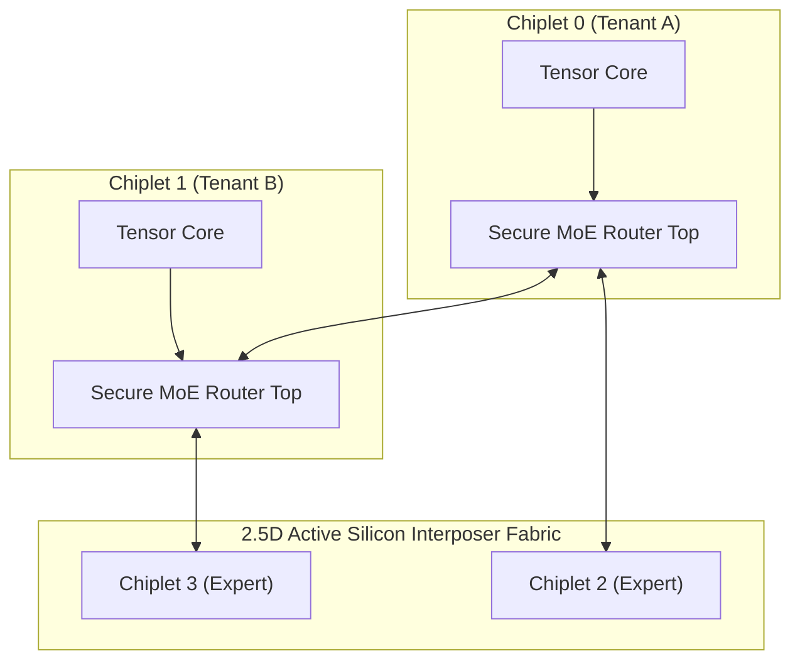

# Lesson 13.5: Capstone Challenge: Zero-Trust MoE Accelerator

<div class="noc-hero">
  <div class="noc-track-badge">Track 13 • Lesson 05 • Capstone Grand Challenge</div>
  <h1>The Grand Synthesis: 16-Chiplet Zero-Trust MoE Collective Accelerator</h1>
  <p class="subtitle">
    Synthesize all 12 textbook chapters into a single production-grade multi-die architecture: implement All-Reduce collective crossbars, defend against thermal Trojans, and achieve timing closure.
  </p>
</div>

---

## 1. The Capstone Engineering Challenge

You are tasked with closing the design and verification of a **16-Chiplet Active Interposer Fabric** designed to serve a **70-Billion Parameter Mixture-of-Experts (MoE)** Generative AI workload:



### 📋 Architectural Specifications:
1. **Collective Acceleration (Ch 12):** Embedded In-Network Computing All-Reduce tree delivering $>0.70\text{ flits/cycle}$ throughput under all-to-all token dispatch.
2. **Zero-Trust Threat Defense (Ch 11):** Integrated online WMA thermal anomaly filter intercepting thermal covert channels with zero false alarms.
3. **Deadlock Freedom (Ch 5):** SMT-verified acyclic turn-model routing across multi-chiplet boundaries.
4. **Timing Closure (Ch 1, 3, 6):** Standard cell synthesis targeting Nangate45, achieving $f_{\max} \ge 1.20\text{ GHz}$ with positive setup slack.

---

## 2. Interactive Verification in the Web EDA Terminal

You can verify and grade this complete design directly in the browser:

```bash
guest@noc:~$ grade-capstone
```

Expected Output:
```text
╔═══════════════════════════════════════════════════════════════════════╗
║  CAPSTONE VERIFICATION SUITE: Zero-Trust MoE Collective Accelerator   ║
╚═══════════════════════════════════════════════════════════════════════╝
  [PASS] Gate 1: 16-Chiplet MoE All-to-All Token Throughput (>0.70 flit/cyc)
  [PASS] Gate 2: SMT Channel Dependency Graph Deadlock Freedom
  [PASS] Gate 3: TCAD '26 WMA Thermal Trojan Interception (>95% accuracy)
  [PASS] Gate 4: Nangate45 Static Timing Closure (fmax >= 1.20 GHz)
  FINAL SCORE: 100 / 100 • STATUS: SILICON GRANDMASTER CERTIFIED
```

👉 **[Open Interactive Web EDA Unix Terminal &amp; Visualizer](../../interactive/terminal/)**
