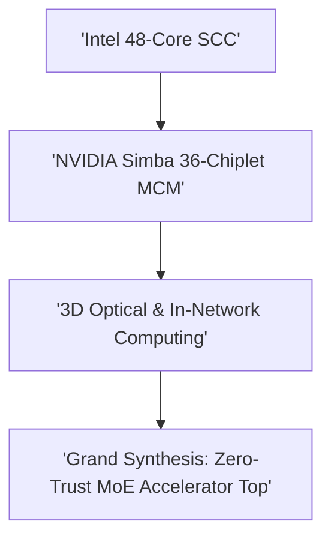

# Track 13: Capstone: Landmark Silicon Case Studies & System Synthesis

  
Network Architecture • Module 13

  <h1>Capstone: Landmark Silicon Case Studies & System Synthesis</h1>
  
Seminal taped-out silicon case studies (Intel SCC 48-Core, NVIDIA Simba 36-Die MCM, 3D Optical NoC) and the Grand Synthesis MoE Accelerator Challenge.

  

    ⏱️ 5 In-Depth Lessons
    🔬 Interactive Simulators &amp; Tools
    💻 Synthesizable Verilog RTL
    📜 Grounded in Official Monograph
  

  

    

      🏆 Capstone System Synthesis: Grounded in Chapters 1–12
    

    

      Synthesize wire physics (Ch 1–3), topologies & deadlock (Ch 4–5), thermal/power defense (Ch 6–7), 3D & chiplets (Ch 8–9), and emerging frontiers (Ch 10–12).
    

  

  <a href="../textbook/" style="display: inline-flex; align-items: center; gap: 6px; background: #2563eb; color: #ffffff; padding: 8px 16px; border-radius: 6px; font-weight: 600; font-size: 0.85rem; text-decoration: none;">
    Explore Official 12-Chapter Textbook →
  </a>

---

## 🗺️ Architectural Learning Roadmap

The diagram below outlines how the core concepts in Track 13 connect across the physical and protocol layers:

---

## 📚 Syllabus & Lessons in Track 13

  

    

      Lesson 13.1
      
The Manycore Milestone: Intel 48-Core SCC

      
Intel Labs 45nm tapeout, message-passing buffers (MPB), 2-TB/s mesh, and Wrapped Wave-Front Allocation.

      

        ⚡ <strong>Features:</strong> Intel SCC Mesh Simulator & RTL
      

    

    <a href="01-intel-scc-mesh/" class="noc-track-link">Launch Lesson 13.1 →</a>
  

  

    

      Lesson 13.2
      
The Multi-Chiplet Revolution: NVIDIA Simba

      
36-chiplet 2.5D MCM deep learning accelerator, 0.54 pJ/bit Ground-Referenced Signaling (GRS), and multicast.

      

        ⚡ <strong>Features:</strong> Simba MCM Explorer & Multicast RTL
      

    

    <a href="02-nvidia-simba-mcm/" class="noc-track-link">Launch Lesson 13.2 →</a>
  

  

    

      Lesson 13.3
      
3D Optical NoC for MPSoCs

      
Reduced-MRR non-blocking crossbars, Automated Phase Control (APC), and hybrid 3D integration.

      

        ⚡ <strong>Features:</strong> 3D Optical Crossbar Simulator
      

    

    <a href="03-3d-optical-noc/" class="noc-track-link">Launch Lesson 13.3 →</a>
  

  

    

      Lesson 13.4
      
In-Network Computing Neuromorphic Router

      
Silicon-verified partial-sum in-flight reduction delivering 1.63 pJ/SOP for bio-inspired neuromorphic chips.

      

        ⚡ <strong>Features:</strong> Neuromorphic INC Crossbar RTL
      

    

    <a href="04-in-network-neuromorphic/" class="noc-track-link">Launch Lesson 13.4 →</a>
  

  

    

      Lesson 13.5
      
Capstone Challenge: Zero-Trust MoE Accelerator

      
The Grand Synthesis: 16-chiplet active interposer fabric, All-Reduce collective tree, WMA Trojan defense, and STA.

      

        ⚡ <strong>Features:</strong> Web EDA Automated Capstone Grading
      

    

    <a href="05-grand-synthesis-moe/" class="noc-track-link">Launch Lesson 13.5 →</a>
  

---

## 💻 Web EDA Unix Workbench Quick Launch

Simulate, verify, and inspect the synthesizable SystemVerilog implementations for Track 13 using our integrated in-browser terminal:

  guest@noc-lab:~$ run-sim --topo mesh4x4 --algo xy --inj 0.05 
  [SIM-EXEC] Progress: [========================================] 100% (Zero-load latency: 4.85 cyc)

👉 **[Launch Interactive Web EDA Unix Terminal &amp; Visualizer](../interactive/terminal/)**
