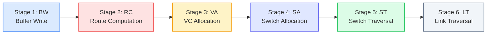
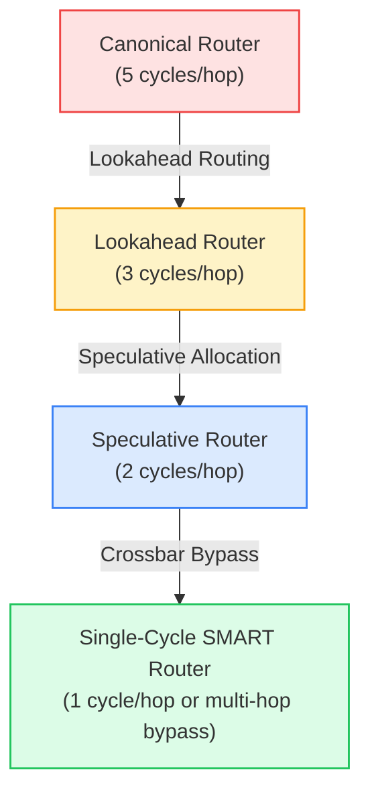

# 2.1 Canonical Router Pipeline

To understand how a flit navigates a silicon on-chip router, we first examine the classic **canonical 5-stage router pipeline** popularized by William J. Dally and Li-Shiuan Peh, and then analyze how modern aggressive designs compress this pipeline down to a single clock cycle.

The router's core task is to move flits from input physical links to output physical links while resolving contention, managing buffer allocations, and preserving packet ordering.

---

## 1. The Canonical 5-Stage Router Pipeline

In a classic virtual-channel wormhole router, a **Head Flit** must complete five sequential operations before it can cross the physical inter-router link:



### Stage-by-Stage Hardware Breakdown:

#### 1. Buffer Write (BW):
- The incoming flit arrives from the physical inter-router link wires.
- The router decodes the Virtual Channel ID (`VC_ID`) in the flit header and writes the flit into the designated input VC FIFO buffer (typically an SRAM or dual-port register file).
- The input port updates its local write pointer and occupancy counters.

#### 2. Route Computation (RC):
- For a **Head Flit**, the routing logic inspects the destination coordinate $(X_d, Y_d)$ in the header.
- The routing algorithm (e.g., Dimension-Order XY Routing or Turn Model) computes the target physical output port (North, South, East, West, or Local).
- The result is stored as a 1-hot output port vector (e.g., `5'b00010` for East) in the VC state register.

#### 3. Virtual Channel Allocation (VA):
- The Head Flit now knows which output port it needs, but it must secure an available, empty downstream Virtual Channel at that output port.
- Multiple input VCs may compete for the same downstream VCs. The **VC Arbiter** resolves these conflicts and assigns a free downstream VC to the winning input VC.
- Once granted, the input VC transitions from `WAITING_FOR_VC` to `ACTIVE`.

#### 4. Switch Allocation (SA):
- Having secured a downstream VC and verified that the downstream router has available buffer credits ($\text{credit\_count} > 0$), the flit bids for physical access to the internal **Crossbar Switch**.
- The Switch Allocator arbitrates among all input VCs competing for the same output crossbar multiplexers.

#### 5. Switch Traversal (ST):
- The winning flit is read from its input buffer and traverses through the physical crossbar multiplexer matrix to the output port latch.

#### 6. Link Traversal (LT):
- The flit travels across the physical inter-router metal wires to the input buffer of the adjacent downstream router tile.

---

## 2. Head Flits vs. Body & Tail Flits

A foundational property of wormhole routers is that **Body and Tail Flits do NOT perform Route Computation (RC) or VC Allocation (VA)!**

```
Head Flit:  [BW] ➔ [RC] ➔ [VA] ➔ [SA] ➔ [ST] ➔ [LT]  (5 Router Cycles)
Body Flit:  [BW] ───────────────> [SA] ➔ [ST] ➔ [LT]  (3 Router Cycles)
Tail Flit:  [BW] ───────────────> [SA] ➔ [ST] ➔ [LT]  (3 Router Cycles + Dealloc)
```

1. **Path Established by Head Flit:**  
   The Head Flit sets up the routing registers and downstream VC assignment for the entire packet.
2. **Body Flits Follow the Path:**  
   When Body flits arrive, they simply inherit the output port and VC assignment reserved by the Head Flit. They proceed directly from **Buffer Write (BW) to Switch Allocation (SA)**.
3. **Tail Flit Deallocation:**  
   The Tail Flit traverses the crossbar and simultaneously issues a **deallocation pulse**, clearing the VC state registers back to `IDLE` so that another packet can reserve that channel.

---

## 3. Pipelining Optimizations: From 5 Cycles to 1 Cycle

A 5-cycle per-hop router delay imposes prohibitive latency in large multicore chips (e.g., a 6-hop traversal across an $8 \times 8$ mesh would require $6 \times 5 = 30$ clock cycles just for router logic!). 

To achieve high clock frequencies and ultra-low latency, computer architects developed three progressive microarchitectural optimizations:



### A. Lookahead Routing (Eliminating RC from the Critical Path)
In a standard router, Route Computation occurs after the flit arrives. In **Lookahead Routing**:
- **Router $N-1$ computes the routing decision for Router $N$ in advance!**
- Before transmitting the Head Flit across the physical link, Router $N-1$ evaluates the next hop's routing direction and embeds it as a pre-computed 1-hot vector into the flit header.
- When the flit arrives at Router $N$, **its output port is already known**.
- Route Computation (RC) is completely eliminated from the critical path, allowing **Buffer Write (BW) and Virtual Channel Allocation (VA) to execute in parallel in Cycle 1**!

### B. Speculative Switch Allocation (Parallel VA + SA)
In a non-speculative router, a flit must win a downstream VC (**VA**) *before* it can request the crossbar (**SA**). In **Speculative Routers** (pioneered by Li-Shiuan Peh and William J. Dally in 2001):
- A flit bids for a downstream VC and bids for the crossbar switch **simultaneously in the very same clock cycle**, *speculating* that it will successfully win both!
- **If the speculation succeeds:** The flit traverses the crossbar immediately in Cycle 2, cutting an entire clock cycle.
- **If the speculation fails:** The switch grant is annulled and awarded to a non-speculative flit. The losing flit buffers in the queue and retries non-speculatively.

### C. 1-Stage Speculative Crossbar Bypass (SMART)
Under low-to-moderate network injection rates, the majority of router buffers are empty. In modern **1-Stage Bypass Routers** (e.g., Intel Skylake mesh, SMART NoC):
- When an incoming flit arrives at an input port whose buffer is empty and there is no crossbar contention, the flit **bypasses the input FIFO entirely**.
- The flit shoots straight through the crossbar multiplexer to the output register in the **very same clock cycle ($t_r = 1\text{ cycle}$)**!

---

## 4. 🎛️ Interactive Router Pipeline Stepper & Speculative Stepper

Use this interactive simulator to observe how Head, Body, and Tail flits navigate router stages cycle by cycle. Switch between the **Canonical 5-Stage**, **Lookahead 3-Stage**, and **1-Stage Bypass** architectures to inspect pipeline latency differences.

<div class="noc-sim-container" id="pipelineSim">
  <div style="font-size:1.1rem; font-weight:700; color:var(--tcl-heading); margin-bottom:1rem; display:flex; align-items:center; justify-content:space-between; flex-wrap:wrap; gap:0.5rem;">
    <span>🔬 Cycle-by-Cycle Router Pipeline Simulator</span>
    <span id="pipeCycleBadge" style="font-family:'JetBrains Mono', monospace; font-size:0.9rem; font-weight:700; color:var(--tcl-blue-600); background:rgba(37,99,235,0.1); padding:3px 10px; border-radius:6px;">
      Cycle: 0
    </span>
  </div>

  <div class="noc-sim-controls">
    <label><b>Router Architecture:</b>
      <select id="pipeArch" class="noc-sim-select" onchange="resetPipeSim()">
        <option value="canonical" selected>Canonical 5-Stage (BW ➔ RC ➔ VA ➔ SA ➔ ST)</option>
        <option value="lookahead">Lookahead 3-Stage ((BW+VA) ➔ SA ➔ ST)</option>
        <option value="speculative">Speculative 2-Stage ((BW+VA+SA) ➔ ST)</option>
        <option value="bypass">1-Stage Speculative Bypass (Direct ST Traversal)</option>
      </select>
    </label>

    <button class="noc-sim-btn" onclick="stepPipeSim()">⏭ Step Cycle</button>
    <button class="noc-sim-btn" id="btnPlayPipe" onclick="togglePlayPipe()">▶ Auto Run</button>
    <button class="noc-sim-btn secondary" onclick="resetPipeSim()">🔄 Reset</button>

    <div style="margin-left:auto; font-size:0.88rem; font-weight:600; color:var(--tcl-heading);">
      Packet: <span style="color:var(--tcl-blue-600);">1 Head + 2 Body + 1 Tail</span>
    </div>
  </div>

  <!-- Pipeline Stages Visual Grid -->
  <div style="background:var(--noc-surface-subtle); border:1px solid var(--noc-border); border-radius:10px; padding:1.25rem; margin-bottom:1rem; overflow-x:auto;">
    <div id="pipeStagesContainer" style="display:flex; justify-content:space-between; gap:12px; min-width:680px;"></div>
  </div>

  <!-- Output Metrics Strip -->
  <div style="display:grid; grid-template-columns:repeat(auto-fit, minmax(180px, 1fr)); gap:1rem; margin-bottom:1rem;">
    <div style="background:var(--noc-surface); border:1px solid var(--noc-border); border-radius:8px; padding:0.75rem 1rem;">
      <div style="font-size:0.75rem; color:var(--noc-text-muted); text-transform:uppercase;">Head Flit Latency</div>
      <div id="dispHeadLat" style="font-size:1.4rem; font-weight:800; color:var(--tcl-blue-600);">-- cycles</div>
    </div>
    <div style="background:var(--noc-surface); border:1px solid var(--noc-border); border-radius:8px; padding:0.75rem 1rem;">
      <div style="font-size:0.75rem; color:var(--noc-text-muted); text-transform:uppercase;">Tail Flit Latency</div>
      <div id="dispTailLat" style="font-size:1.4rem; font-weight:800; color:#ea580c;">-- cycles</div>
    </div>
    <div style="background:var(--noc-surface); border:1px solid var(--noc-border); border-radius:8px; padding:0.75rem 1rem;">
      <div style="font-size:0.75rem; color:var(--noc-text-muted); text-transform:uppercase;">Uncontended Per-Hop Cost</div>
      <div id="dispHopCost" style="font-size:1.4rem; font-weight:800; color:#16a34a;">5 cycles</div>
    </div>
  </div>

  <div id="pipeAnalysis" style="font-size:0.88rem; padding:0.75rem 1rem; border-radius:8px; background:rgba(37,99,235,0.08); border:1px solid rgba(37,99,235,0.25); color:var(--tcl-heading); line-height:1.5;"></div>
</div>

<script>
let pipeSim = {
  cycle: 0,
  arch: "canonical",
  isPlaying: false,
  timer: null,
  // 4 Flits: F0 (Head), F1 (Body), F2 (Body), F3 (Tail)
  flits: [
    { id: 0, type: "Head", injectCycle: 1, currentStage: -1, doneCycle: null },
    { id: 1, type: "Body", injectCycle: 2, currentStage: -1, doneCycle: null },
    { id: 2, type: "Body", injectCycle: 3, currentStage: -1, doneCycle: null },
    { id: 3, type: "Tail", injectCycle: 4, currentStage: -1, doneCycle: null }
  ]
};

const STAGE_DEFS = {
  canonical: ["BW (Buffer Write)", "RC (Route Compute)", "VA (VC Alloc)", "SA (Switch Alloc)", "ST (Switch Traversal)", "LT (Link Wire)"],
  lookahead: ["BW + VA (Parallel)", "SA (Switch Alloc)", "ST (Switch Traversal)", "LT (Link Wire)"],
  speculative: ["BW + VA + SA (Speculative)", "ST (Switch Traversal)", "LT (Link Wire)"],
  bypass: ["ST (Direct Crossbar Bypass)", "LT (Link Wire)"]
};

function resetPipeSim() {
  clearInterval(pipeSim.timer);
  pipeSim.isPlaying = false;
  document.getElementById("btnPlayPipe").textContent = "▶ Auto Run";
  pipeSim.cycle = 0;
  pipeSim.arch = document.getElementById("pipeArch").value;

  pipeSim.flits = [
    { id: 0, type: "Head", injectCycle: 1, currentStage: -1, doneCycle: null },
    { id: 1, type: "Body", injectCycle: 2, currentStage: -1, doneCycle: null },
    { id: 2, type: "Body", injectCycle: 3, currentStage: -1, doneCycle: null },
    { id: 3, type: "Tail", injectCycle: 4, currentStage: -1, doneCycle: null }
  ];

  renderPipeSim();
}

function togglePlayPipe() {
  if (pipeSim.isPlaying) {
    clearInterval(pipeSim.timer);
    pipeSim.isPlaying = false;
    document.getElementById("btnPlayPipe").textContent = "▶ Auto Run";
  } else {
    pipeSim.isPlaying = true;
    document.getElementById("btnPlayPipe").textContent = "⏸ Pause";
    pipeSim.timer = setInterval(() => {
      stepPipeSim();
    }, 850);
  }
}

function stepPipeSim() {
  pipeSim.cycle++;
  const curCycle = pipeSim.cycle;
  const stages = STAGE_DEFS[pipeSim.arch];
  const maxStage = stages.length - 1;

  // Advance active flits backward so later flits don't overwrite
  pipeSim.flits.forEach(f => {
    if (f.doneCycle !== null) return;

    if (f.currentStage === -1) {
      if (curCycle >= f.injectCycle) {
        f.currentStage = 0; // Enter first stage
      }
    } else if (f.currentStage < maxStage) {
      // In canonical architecture, Body flits skip RC and VA!
      if (pipeSim.arch === "canonical" && (f.type === "Body" || f.type === "Tail")) {
        if (f.currentStage === 0) {
          // Skip RC (1) and VA (2), jump straight to SA (3)
          f.currentStage = 3;
        } else {
          f.currentStage++;
        }
      } else {
        f.currentStage++;
      }
    } else {
      // Completed final stage (LT)
      f.doneCycle = curCycle;
    }
  });

  renderPipeSim();
}

function renderPipeSim() {
  document.getElementById("pipeCycleBadge").textContent = `Cycle: ${pipeSim.cycle}`;
  const stages = STAGE_DEFS[pipeSim.arch];
  const container = document.getElementById("pipeStagesContainer");
  container.innerHTML = "";

  stages.forEach((stName, stIdx) => {
    const col = document.createElement("div");
    col.style.flex = "1";
    col.style.background = "var(--noc-surface)";
    col.style.border = "1.5px solid var(--tcl-border)";
    col.style.borderRadius = "8px";
    col.style.padding = "10px 8px";
    col.style.textAlign = "center";
    col.style.minHeight = "120px";
    col.style.display = "flex";
    col.style.flexDirection = "column";

    const header = document.createElement("div");
    header.style.fontSize = "0.78rem";
    header.style.fontWeight = "700";
    header.style.color = "var(--tcl-heading)";
    header.style.borderBottom = "1px solid var(--tcl-border)";
    header.style.paddingBottom = "4px";
    header.style.marginBottom = "8px";
    header.textContent = stName;
    col.appendChild(header);

    const slotContainer = document.createElement("div");
    slotContainer.style.display = "flex";
    slotContainer.style.flexDirection = "column";
    slotContainer.style.gap = "6px";
    slotContainer.style.flex = "1";

    // Find flits in this stage
    const flitsHere = pipeSim.flits.filter(f => f.currentStage === stIdx && f.doneCycle === null);
    if (flitsHere.length === 0) {
      slotContainer.innerHTML = "<span style='font-size:0.75rem; color:var(--noc-text-muted); font-style:italic; margin:auto;'>[Empty]</span>";
    } else {
      flitsHere.forEach(f => {
        const pill = document.createElement("div");
        pill.style.padding = "4px 6px";
        pill.style.borderRadius = "4px";
        pill.style.fontSize = "0.75rem";
        pill.style.fontFamily = "'JetBrains Mono', monospace";
        pill.style.fontWeight = "700";

        if (f.type === "Head") {
          pill.style.background = "#2563eb";
          pill.style.color = "#ffffff";
          pill.textContent = "Head Flit [F0]";
        } else if (f.type === "Tail") {
          pill.style.background = "#ea580c";
          pill.style.color = "#ffffff";
          pill.textContent = "Tail Flit [F3]";
        } else {
          pill.style.background = "#0284c7";
          pill.style.color = "#ffffff";
          pill.textContent = `Body [F${f.id}]`;
        }
        slotContainer.appendChild(pill);
      });
    }

    col.appendChild(slotContainer);
    container.appendChild(col);
  });

  // Update Latency badges
  const head = pipeSim.flits[0];
  const tail = pipeSim.flits[3];
  document.getElementById("dispHeadLat").textContent = head.doneCycle ? `${head.doneCycle - head.injectCycle} cycles` : (head.currentStage >= 0 ? `${pipeSim.cycle - head.injectCycle + 1} cycles...` : "--");
  document.getElementById("dispTailLat").textContent = tail.doneCycle ? `${tail.doneCycle - tail.injectCycle} cycles` : (tail.currentStage >= 0 ? `${pipeSim.cycle - tail.injectCycle + 1} cycles...` : "--");

  const hopCost = stages.length - 1; // excluding wire LT
  document.getElementById("dispHopCost").textContent = `${hopCost} cycle${hopCost > 1 ? 's' : ''}`;

  // Commentary
  const analysisEl = document.getElementById("pipeAnalysis");
  if (pipeSim.arch === "canonical") {
    analysisEl.innerHTML = `
      <strong>Canonical 5-Stage Router (BW ➔ RC ➔ VA ➔ SA ➔ ST):</strong><br>
      • Head Flit requires all 5 router stages to resolve output direction and downstream VC.<br>
      • Body and Tail Flits skip RC and VA, streaming directly from BW ➔ SA ➔ ST in a 3-cycle pipe.
    `;
  } else if (pipeSim.arch === "lookahead") {
    analysisEl.innerHTML = `
      <strong>Lookahead 3-Stage Router ((BW+VA) ➔ SA ➔ ST):</strong><br>
      • Route Computation is evaluated in the previous hop (Router N-1), removing RC from the critical path.<br>
      • Buffer Write and Virtual Channel Allocation execute in parallel in Stage 1, saving 2 full cycles per hop!
    `;
  } else if (pipeSim.arch === "speculative") {
    analysisEl.innerHTML = `
      <strong>Speculative 2-Stage Router ((BW+VA+SA) ➔ ST):</strong><br>
      • The flit simultaneously bids for a downstream VC and bids for the crossbar switch in Cycle 1.<br>
      • Speculation succeeds under uncontended traffic, allowing crossbar traversal in Cycle 2!
    `;
  } else {
    analysisEl.innerHTML = `
      <strong>1-Stage Speculative Crossbar Bypass (SMART):</strong><br>
      • Flit bypasses input FIFOs entirely when uncontended and cuts directly through the crossbar in Cycle 1.<br>
      • Achieves ideal 1-cycle per-hop latency, matching dedicated wire speeds!
    `;
  }

  if (tail.doneCycle !== null) {
    clearInterval(pipeSim.timer);
    pipeSim.isPlaying = false;
    document.getElementById("btnPlayPipe").textContent = "▶ Auto Run";
  }
}

if (document.readyState === "loading") {
  document.addEventListener("DOMContentLoaded", resetPipeSim);
} else {
  resetPipeSim();
}
</script>

---

## 5. Summary Table: Router Pipeline Architectures

| Router Architecture | Head Flit Pipeline | Body Flit Pipeline | Uncontended Router Latency | Critical Path Bottleneck |
| :--- | :--- | :--- | :--- | :--- |
| **Canonical Router** | BW $\rightarrow$ RC $\rightarrow$ VA $\rightarrow$ SA $\rightarrow$ ST | BW $\rightarrow$ SA $\rightarrow$ ST | **5 cycles** | VC Arbiter delay & sequential dependencies |
| **Lookahead Router** | (BW + VA) $\rightarrow$ SA $\rightarrow$ ST | BW $\rightarrow$ SA $\rightarrow$ ST | **3 cycles** | Lookahead routing pre-computation |
| **Speculative Router** | (BW + VA + SA) $\rightarrow$ ST | (BW + SA) $\rightarrow$ ST | **2 cycles** | Speculative grant validation logic |
| **Bypass Router (SMART)** | Crossbar Bypass ST | Crossbar Bypass ST | **1 cycle** | Multi-hop crossbar bypass propagation delay |

---

## 6. Worked Numerical Example: Pipeline Latency Across 5 Hops

> [!TIP]
> **Problem Statement:**  
> A packet consisting of 1 Head Flit and 3 Body Flits traverses a path of $H = 5\text{ hops}$ on a 2.0 GHz NoC ($\tau = 0.5\text{ ns}$).  
> Link traversal between adjacent routers takes $t_{link} = 1\text{ clock cycle}$.  
> 
> Compare the Total Delivery Latency (from injection to delivery of the last flit) under zero contention for:
> 1. A Canonical 5-Stage Router ($t_r = 5\text{ cycles}$)
> 2. A 1-Stage Speculative Bypass Router ($t_r = 1\text{ cycle}$)

### Step 1: Canonical 5-Stage Router
The Head Flit requires 5 cycles inside each router plus 1 cycle for wire traversal ($t_{hop} = 5 + 1 = 6\text{ cycles/hop}$):
$$\text{Head Flit Arrival Time at Destination: } T_{head} = H \times (t_r + t_{link}) = 5 \times (5 + 1) = \mathbf{30\text{ clock cycles}}$$

Because the 3 subsequent Body flits follow in a pipelined stream (1 flit per cycle):
$$T_{total, Canonical} = T_{head} + (L - 1) = 30 + 3 = \mathbf{33\text{ clock cycles} = 16.5\text{ ns}}$$

### Step 2: 1-Stage Speculative Bypass Router
Each hop takes only 1 cycle for router crossbar traversal plus 1 cycle for wire traversal ($t_{hop} = 1 + 1 = 2\text{ cycles/hop}$):
$$T_{head, Bypass} = H \times (t_r + t_{link}) = 5 \times (1 + 1) = \mathbf{10\text{ clock cycles}}$$
$$T_{total, Bypass} = 10 + (L - 1) = 10 + 3 = \mathbf{13\text{ clock cycles} = 6.5\text{ ns}}$$

### Conclusion:
Compressing the router pipeline reduces delivery latency by **over 60%** ($6.5\text{ ns}$ vs $16.5\text{ ns}$), dramatically cutting memory stall times in processor caches!

---

---

## 7. Synthesizable Verilog RTL: Lookahead Route Pre-Computation (`lookahead_route_compute.v`)

Below is a production-grade, synthesizable Verilog implementation of a Lookahead Route Pre-Computation unit. Rather than waiting for the flit to reach downstream Router $H+1$ and spending an entire clock cycle computing its output port, Router $H$ evaluates the routing decision for Router $H+1$ in parallel during traversal and embeds the 1-hot direction into the Head Flit header:

```verilog
// Synthesizable Lookahead Route Pre-Computation Unit
// Pre-computes the output direction for Router (hop + 1) while the flit is
// in Router (hop), removing Route Computation from the downstream critical path.
module lookahead_route_compute #(
    parameter integer COORD_WIDTH = 4 // Supports up to 16x16 2D Mesh coordinates
)(
    input  wire                   clk,
    input  wire                   rst_n,
    input  wire                   head_val,       // Valid Head Flit arriving at current router
    
    // Coordinates
    input  wire [COORD_WIDTH-1:0] next_x,         // Coordinate of Downstream Router (hop + 1)
    input  wire [COORD_WIDTH-1:0] next_y,
    input  wire [COORD_WIDTH-1:0] dest_x,         // Final destination coordinate
    input  wire [COORD_WIDTH-1:0] dest_y,

    // Pre-computed 1-hot direction for Downstream Router (hop + 1)
    output reg  [4:0]             lookahead_dir   // [4]=LOCAL, [3]=NORTH, [2]=SOUTH, [1]=EAST, [0]=WEST
);

    // Dimension-Order Routing (DOR: X-first, then Y)
    wire [4:0] dir_comb;

    assign dir_comb[0] = (dest_x < next_x);                        // Turn WEST at next hop
    assign dir_comb[1] = (dest_x > next_x);                        // Turn EAST at next hop
    assign dir_comb[2] = (dest_x == next_x) && (dest_y < next_y); // Turn SOUTH at next hop
    assign dir_comb[3] = (dest_x == next_x) && (dest_y > next_y); // Turn NORTH at next hop
    assign dir_comb[4] = (dest_x == next_x) && (dest_y == next_y); // Eject to LOCAL core at next hop

    // Registered Lookahead Direction Output
    always @(posedge clk or negedge rst_n) begin
        if (!rst_n) begin
            lookahead_dir <= 5'b00000;
        end else if (head_val) begin
            lookahead_dir <= dir_comb;
        end
    end

endmodule
```

---

## 8. 🎯 Knowledge Check: Lesson 2.1

Test your comprehension of router pipeline stages, lookahead pre-routing, and latency compression.

<div class="noc-sim-container" id="quiz21" style="margin-top:1rem;">
  <div style="font-weight:700; font-size:1.05rem; margin-bottom:1rem; color:var(--tcl-heading);">
    📝 Concept Check: Router Pipelining &amp; Latency Scaling
  </div>

  <!-- Question 1 -->
  <div style="margin-bottom:1.5rem; padding-bottom:1.2rem; border-bottom:1px solid var(--tcl-border);">
    <p style="font-weight:600; font-size:0.95rem; margin-bottom:0.75rem;">
      <b>Question 1:</b> Why do Body and Tail flits in a wormhole router only traverse 3 pipeline stages (BW ➔ SA ➔ ST) rather than the full 5 stages (BW ➔ RC ➔ VA ➔ SA ➔ ST)?
    </p>

    <div style="display:flex; flex-direction:column; gap:0.5rem;" id="q21_options">
      <button class="noc-sim-select" style="text-align:left; padding:0.65rem 0.85rem; cursor:pointer;" onclick="checkQuiz21(0)">
        A. Because Body flits are routed using optical frequencies that bypass silicon registers.
      </button>
      <button class="noc-sim-select" style="text-align:left; padding:0.65rem 0.85rem; cursor:pointer;" onclick="checkQuiz21(1)">
        B. Because the Head Flit already computed the output port and reserved the downstream Virtual Channel; Body and Tail flits simply inherit this allocated state.
      </button>
      <button class="noc-sim-select" style="text-align:left; padding:0.65rem 0.85rem; cursor:pointer;" onclick="checkQuiz21(2)">
        C. Because Body flits contain no data payload.
      </button>
      <button class="noc-sim-select" style="text-align:left; padding:0.65rem 0.85rem; cursor:pointer;" onclick="checkQuiz21(3)">
        D. Because the operating system disables RC and VA after cycle 10.
      </button>
    </div>
    <div id="q21_feedback" style="display:none; margin-top:0.75rem; padding:0.85rem; border-radius:8px; font-size:0.9rem; line-height:1.5;"></div>
  </div>

  <!-- Question 2 -->
  <div style="margin-bottom:1.5rem; padding-bottom:1.2rem; border-bottom:1px solid var(--tcl-border);">
    <p style="font-weight:600; font-size:0.95rem; margin-bottom:0.75rem;">
      <b>Question 2:</b> How does Lookahead Routing eliminate the Route Computation (RC) cycle from the downstream router's critical path?
    </p>

    <div style="display:flex; flex-direction:column; gap:0.5rem;" id="q21_q2_options">
      <button class="noc-sim-select" style="text-align:left; padding:0.65rem 0.85rem; cursor:pointer;" onclick="checkQuiz21_Q2(0)">
        A. The current router (hop $H$) computes the output direction for the subsequent router (hop $H+1$) and embeds this pre-computed direction into the Head Flit, enabling hop $H+1$ to proceed directly to Virtual Channel Allocation (VA) upon arrival.
      </button>
      <button class="noc-sim-select" style="text-align:left; padding:0.65rem 0.85rem; cursor:pointer;" onclick="checkQuiz21_Q2(1)">
        B. It transmits packets backward toward the source node.
      </button>
      <button class="noc-sim-select" style="text-align:left; padding:0.65rem 0.85rem; cursor:pointer;" onclick="checkQuiz21_Q2(2)">
        C. It replaces crossbar switches with analog op-amps.
      </button>
    </div>
    <div id="q21_q2_feedback" style="display:none; margin-top:0.75rem; padding:0.85rem; border-radius:8px; font-size:0.9rem; line-height:1.5;"></div>
  </div>

  <!-- Question 3 -->
  <div>
    <p style="font-weight:600; font-size:0.95rem; margin-bottom:0.75rem;">
      <b>Question 3:</b> For a 4-flit packet traversing 5 hops with $t_{link} = 1$ cycle, how does the zero-load latency of a 1-stage speculative bypass router compare with a canonical 5-stage router?
    </p>

    <div style="display:flex; flex-direction:column; gap:0.5rem;" id="q21_q3_options">
      <button class="noc-sim-select" style="text-align:left; padding:0.65rem 0.85rem; cursor:pointer;" onclick="checkQuiz21_Q3(0)">
        A. Both architectures produce identical 50-cycle latencies.
      </button>
      <button class="noc-sim-select" style="text-align:left; padding:0.65rem 0.85rem; cursor:pointer;" onclick="checkQuiz21_Q3(1)">
        B. The 1-stage bypass router delivers the packet in 13 cycles ($6.5\text{ ns}$ at 2.0 GHz) compared to 33 cycles ($16.5\text{ ns}$) for the canonical router—reducing total latency by over 60%.
      </button>
      <button class="noc-sim-select" style="text-align:left; padding:0.65rem 0.85rem; cursor:pointer;" onclick="checkQuiz21_Q3(2)">
        C. The canonical router is faster because 5 stages provide higher clock frequencies.
      </button>
    </div>
    <div id="q21_q3_feedback" style="display:none; margin-top:0.75rem; padding:0.85rem; border-radius:8px; font-size:0.9rem; line-height:1.5;"></div>
  </div>
</div>

<script>
function checkQuiz21(idx) {
  const fb = document.getElementById("q21_feedback");
  fb.style.display = "block";
  const opts = document.getElementById("q21_options").children;
  for (let i = 0; i < opts.length; i++) { opts[i].onclick = null; opts[i].style.cursor = "default"; }

  if (idx === 1) {
    opts[1].style.background = "rgba(34,197,94,0.15)"; opts[1].style.borderColor = "#22c55e";
    fb.style.background = "rgba(34,197,94,0.1)"; fb.style.border = "1px solid rgba(34,197,94,0.3)"; fb.style.color = "#166534";
    fb.innerHTML = "<strong>✓ Correct!</strong> The Head Flit performs Route Computation (RC) and Virtual Channel Allocation (VA) to establish the output port and downstream VC reservation. Body flits follow in its wake and only require Switch Allocation (SA) to traverse the crossbar.";
  } else {
    opts[idx].style.background = "rgba(239,68,68,0.15)"; opts[idx].style.borderColor = "#ef4444";
    opts[1].style.background = "rgba(34,197,94,0.15)"; opts[1].style.borderColor = "#22c55e";
    fb.style.background = "rgba(239,68,68,0.1)"; fb.style.border = "1px solid rgba(239,68,68,0.3)"; fb.style.color = "#991b1b";
    fb.innerHTML = "<strong>✗ Incorrect.</strong> The correct answer is <strong>B</strong>. Only the Head Flit carries addressing headers; trailing flits inherit the path state.";
  }
}

function checkQuiz21_Q2(idx) {
  const fb = document.getElementById("q21_q2_feedback");
  fb.style.display = "block";
  const opts = document.getElementById("q21_q2_options").children;
  for (let i = 0; i < opts.length; i++) { opts[i].onclick = null; opts[i].style.cursor = "default"; }

  if (idx === 0) {
    opts[0].style.background = "rgba(34,197,94,0.15)"; opts[0].style.borderColor = "#22c55e";
    fb.style.background = "rgba(34,197,94,0.1)"; fb.style.border = "1px solid rgba(34,197,94,0.3)"; fb.style.color = "#166534";
    fb.innerHTML = "<strong>✓ Correct!</strong> By computing the direction for the next hop ahead of time, Lookahead Routing allows Buffer Write and Virtual Channel Allocation to execute immediately upon flit arrival, eliminating RC from the critical path.";
  } else {
    opts[idx].style.background = "rgba(239,68,68,0.15)"; opts[idx].style.borderColor = "#ef4444";
    opts[0].style.background = "rgba(34,197,94,0.15)"; opts[0].style.borderColor = "#22c55e";
    fb.style.background = "rgba(239,68,68,0.1)"; fb.style.border = "1px solid rgba(239,68,68,0.3)"; fb.style.color = "#991b1b";
    fb.innerHTML = "<strong>✗ Incorrect.</strong> The correct answer is <strong>A</strong>. Lookahead routing pre-computes the routing decision one hop in advance.";
  }
}

function checkQuiz21_Q3(idx) {
  const fb = document.getElementById("q21_q3_feedback");
  fb.style.display = "block";
  const opts = document.getElementById("q21_q3_options").children;
  for (let i = 0; i < opts.length; i++) { opts[i].onclick = null; opts[i].style.cursor = "default"; }

  if (idx === 1) {
    opts[1].style.background = "rgba(34,197,94,0.15)"; opts[1].style.borderColor = "#22c55e";
    fb.style.background = "rgba(34,197,94,0.1)"; fb.style.border = "1px solid rgba(34,197,94,0.3)"; fb.style.color = "#166534";
    fb.innerHTML = "<strong>✓ Correct!</strong> In the bypass router, $T_{head} = 5 \\times (1 + 1) = 10$ cycles, plus 3 body cycles = 13 cycles ($6.5\\text{ ns}$). In the canonical router, $T_{head} = 5 \\times (5 + 1) = 30$ cycles, plus 3 body cycles = 33 cycles ($16.5\\text{ ns}$).";
  } else {
    opts[idx].style.background = "rgba(239,68,68,0.15)"; opts[idx].style.borderColor = "#ef4444";
    opts[1].style.background = "rgba(34,197,94,0.15)"; opts[1].style.borderColor = "#22c55e";
    fb.style.background = "rgba(239,68,68,0.1)"; fb.style.border = "1px solid rgba(239,68,68,0.3)"; fb.style.color = "#991b1b";
    fb.innerHTML = "<strong>✗ Incorrect.</strong> The correct answer is <strong>B</strong>. Pipelining compression reduces latency by >60% across 5 hops.";
  }
}
</script>

---

## 9. Interactive Arcade & Lab Challenges

Test your router pipeline mastery with interactive simulations:
- 🧩 **[Packet Master: Flit Routing Puzzle](../interactive/puzzle.md):** Guide head and body flits through multi-stage router pipelines, resolving crossbar conflicts in real time.
- 🎮 **[Deadlock Buster Arcade](../interactive/game.md):** Defend the router fabric against pipeline stalls and buffer deadlock knots.

---

## Summary & Next Steps

In this lesson, we explored:
- The classical **canonical 5-stage router pipeline** (BW, RC, VA, SA, ST).
- Why **Head Flits carve the path** while Body/Tail flits skip RC and VA.
- Pipelining optimizations including **Lookahead Routing**, **Speculative Allocation**, and **1-Cycle Crossbar Bypassing**.
- Synthesizable Verilog RTL for **Lookahead Route Pre-Computation (`lookahead_route_compute.v`)**.

In the next lesson, we will see how router input buffers are partitioned into **Virtual Channels (VCs)** to eliminate Head-of-Line blocking and isolate memory traffic.

👉 **Proceed to [Lesson 2.2: Virtual Channel (VC) Design](02-virtual-channels.md)**

