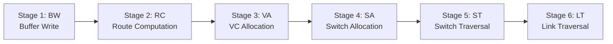
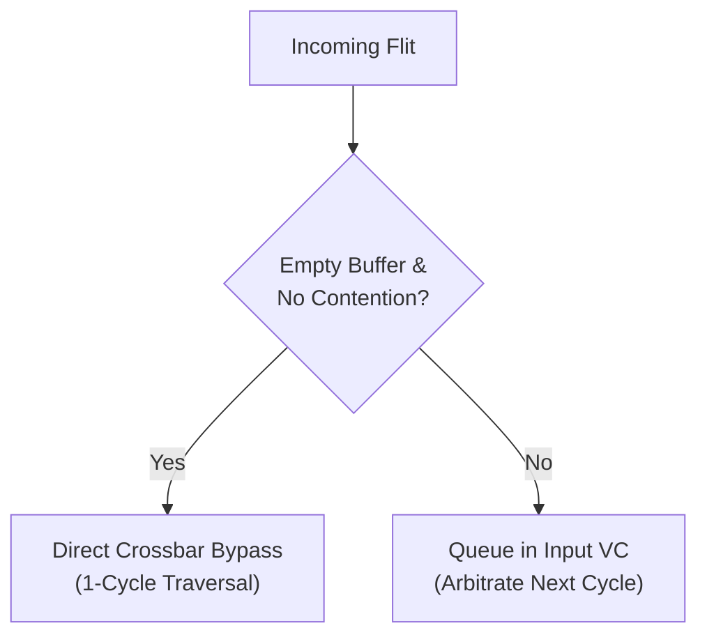

# 2.1 Canonical Router Pipeline

To understand how a flit navigates a silicon router, we first examine the classic **canonical 5-stage router pipeline** popularized by William Dally and Li-Shiuan Peh, and then explore how modern aggressive designs compress this into a single clock cycle.

---

## 1. The Canonical 5-Stage Router Pipeline

In a classic virtual-channel wormhole router, a **Head Flit** must complete five sequential operations before it can leave the router:

### Stage Details:
1. **Buffer Write (BW)**:
   - The incoming flit arrives from the physical input link and is written into the designated input Virtual Channel (VC) buffer.
2. **Route Computation (RC)**:
   - The router inspects the packet destination coordinate $(x_d, y_d)$ in the Head Flit header and executes the routing algorithm (e.g., XY routing) to determine the output physical port (e.g., East).
3. **Virtual Channel Allocation (VA)**:
   - The Head Flit requests an available, empty downstream Virtual Channel at the selected output port. The VC Arbiter resolves conflicts among competing input VCs.
4. **Switch Allocation (SA)**:
   - Once a downstream VC is secured, the flit requests access to the internal Crossbar Switch to connect its input port to the designated output port.
5. **Switch Traversal (ST)**:
   - The flit traverses through the physical crossbar multiplexer datapath toward the output port latch.
6. **Link Traversal (LT)**:
   - The flit travels across the physical inter-router wires to the adjacent router's input port.

### Body and Tail Flits:
Notice that **Body and Tail Flits do NOT perform RC or VA!** 
Because the Head Flit already established the output port and reserved the downstream VC, Body flits skip directly to **BW $\rightarrow$ SA $\rightarrow$ ST** (a 3-stage pipeline). The Tail Flit releases the reserved VC state upon completing ST.

---

## 2. Pipelining Optimizations: From 5 Cycles to 1 Cycle

A 5-cycle per-hop latency is prohibitive in a high-performance CMP where a packet might travel 6 hops ($6 \times 5 = 30$ clock cycles just for router overhead!). Silicon architects apply three key microarchitectural optimizations:

### A. Lookahead Routing (Eliminating RC)
Instead of computing the routing decision at the current router, **Router $N-1$ computes the routing decision for Router $N$ in advance**, encoding the result directly into the Head Flit header.
- When the flit arrives at Router $N$, its output port is already known!
- **RC is completely removed from the critical path**, allowing Buffer Write (BW) and Virtual Channel Allocation (VA) to run in parallel in Stage 1.

### B. Speculative Switch Allocation (VA + SA in Parallel)
In a standard router, a flit must win a downstream VC (VA) *before* it can request the crossbar (SA). In **Speculative Routers** (Peh & Dally, 2001):
- The flit simultaneously bids for a downstream VC and bids for the crossbar switch, *speculating* that it will win both.
- If it wins both, it traverses the switch immediately, cutting a whole cycle.
- If it loses the VC bid, the switch grant is revoked and awarded to non-speculative flits.

### C. 1-Stage Speculative Bypass Routers
In modern high-speed designs (e.g., SMART routers, Intel Skylake/Ice Lake mesh), when an input buffer is empty and there is no crossbar contention:
- The incoming flit **bypasses the input buffer entirely** and shoots directly through the crossbar in the very same clock cycle ($t_r = 1 \text{ cycle}$)!

---

## Pipeline Comparison

| Architecture | Head Flit Pipeline | Body Flit Pipeline | Uncontended Latency |
| :--- | :--- | :--- | :--- |
| **Canonical Router** | BW $\rightarrow$ RC $\rightarrow$ VA $\rightarrow$ SA $\rightarrow$ ST | BW $\rightarrow$ SA $\rightarrow$ ST | 5 cycles / hop |
| **Lookahead Router** | (BW + VA) $\rightarrow$ SA $\rightarrow$ ST | BW $\rightarrow$ SA $\rightarrow$ ST | 3 cycles / hop |
| **Speculative Router** | (BW + VA + SA) $\rightarrow$ ST | (BW + SA) $\rightarrow$ ST | 2 cycles / hop |
| **Bypass Router (SMART)** | Bypass ST | Bypass ST | **1 cycle / hop** |

Next, let's look at how **Virtual Channels (VCs)** prevent network congestion from freezing the entire chip.
