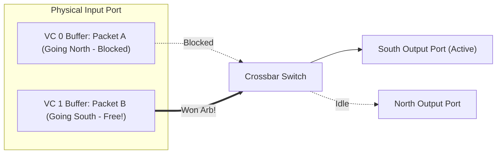
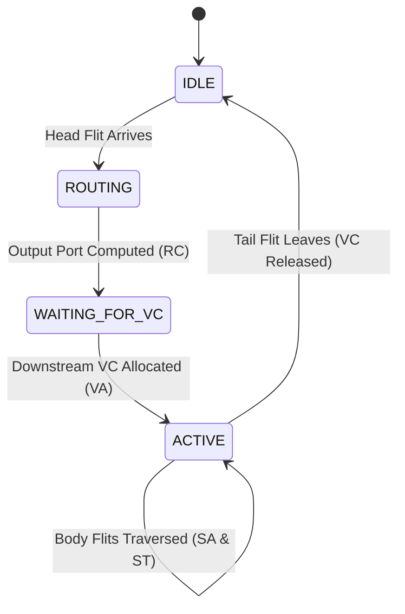

# 2.2 Virtual Channel (VC) Design

Wormhole switching delivers exceptional buffer area efficiency, but it has one catastrophic vulnerability: **Head-of-Line (HoL) Blocking**.

In this lesson, we explore how **Virtual Channels (VCs)** solve HoL blocking and provide protocol-level isolation.

---

## 1. The Head-of-Line (HoL) Blocking Problem

Imagine a single physical FIFO buffer at the West input port of a router:

```
[Packet B: destined for South]  [Packet A: destined for North] ---> Crossbar
```

1. **Packet A** (at the head of the buffer) wants to route to the **North** output port, but North is currently busy.
2. Packet A is blocked and must wait.
3. **Packet B** (behind Packet A in the same FIFO) wants to route to the **South** output port.
4. Even though the **South** port is completely idle and free, **Packet B cannot move because it is trapped behind Packet A!**

This phenomenon is called **Head-of-Line (HoL) Blocking**. In heavy traffic, HoL blocking causes throughput collapse, as blocked packets create cascading backpressure across the entire mesh.

---

## 2. Virtual Channels: Logical Separation on Shared Wires

In 1992, William J. Dally proposed **Virtual Channel Flow Control**.

Instead of a single FIFO queue per physical input port, the physical buffer memory is split into multiple independent logical queues called **Virtual Channels (VCs)**.



### Key Principles:
1. **Shared Physical Wires**: VCs share the exact same physical wires between routers on a cycle-by-cycle, time-multiplexed basis.
2. **Independent Buffer Queues**: Each VC has its own dedicated FIFO buffer and its own downstream credit counter.
3. **Bypassing Congestion**: If Packet A in VC 0 is blocked, the router's switch arbiter simply skips VC 0 and awards the crossbar to Packet B in VC 1. Packet B flows out without impediment!

---

## 3. The VC State Machine

Each virtual channel controller maintains an internal finite state machine (FSM) to track the lifecycle of packets passing through it:



1. **IDLE**: The VC buffer is empty and ready to accept a new packet.
2. **ROUTING**: A Head flit has arrived. The router is computing its destination output port.
3. **WAITING_FOR_VC**: The output port is known, and the flit is bidding for an available downstream VC.
4. **ACTIVE**: Downstream VC has been granted. The flits of the packet compete for the crossbar switch cycle-by-cycle until the Tail flit traverses.
5. **IDLE**: The Tail flit leaves, freeing the VC state.

---

## 4. Virtual Networks & Protocol Deadlock Prevention

Beyond eliminating HoL blocking, VCs are essential for preventing **Protocol Deadlocks** in cache-coherent multicore processors.

### What is a Protocol Deadlock?
In a directory-based cache coherence system (e.g., MESI / MOESI):
- Core 0 sends a **Request** packet (e.g., "Read Exclusive") to the Memory Directory.
- The Directory cannot finish the request until Core 1 replies with an **Invalidation Response**.
- If Requests and Responses share the same physical buffers, a circular buffer dependency can occur: Request buffers fill up, preventing Response packets from moving, causing the entire processor to hang permanently!

### The Solution: Virtual Networks (VNETs)
By assigning dedicated VCs to different message classes:
- **VC 0 & VC 1 $\rightarrow$ VNET 0 (Request Network)**
- **VC 2 & VC 3 $\rightarrow$ VNET 1 (Response Network)**

Because Response packets travel in an isolated virtual network that never blocks on Requests, protocol deadlocks are mathematically impossible!

---

In the next lesson, we will see how the router decides which VC gets to traverse the physical crossbar switch in [2.3 Arbitration & Crossbar Switching](03-arbitration-crossbar.md).
