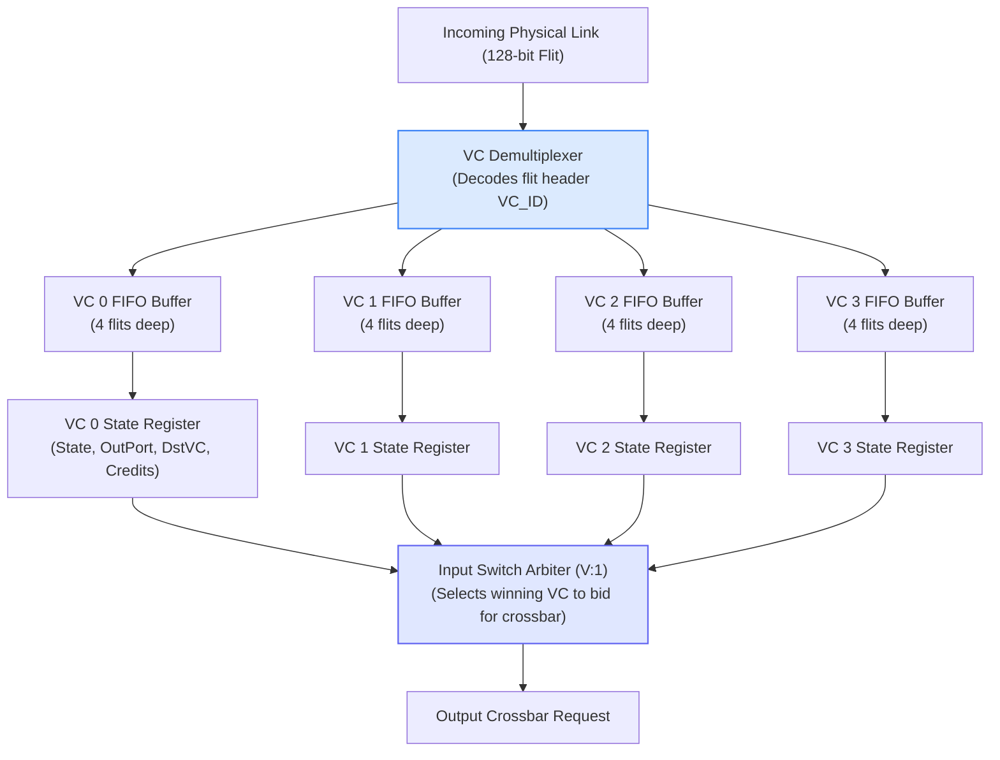
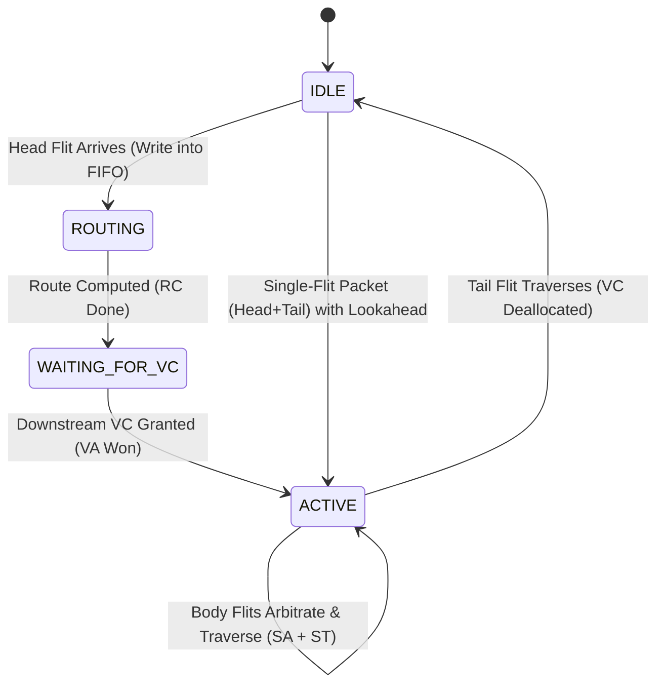

# 2.2 Virtual Channel (VC) Architecture

Wormhole switching delivers exceptional buffer area efficiency by allowing flits to advance as soon as a single buffer slot is free. However, as discovered in early multicore designs, unadorned wormhole switching suffers from a devastating flaw: **Head-of-Line (HoL) Blocking**.

In this lesson, we explore how **Virtual Channels (VCs)**—introduced by William J. Dally in 1992 [[Dally1992]](#ref-dally1992)—eliminate Head-of-Line blocking, provide independent flow control on shared wires [[DallyPrinciples]](#ref-dallyprinciples), and establish **Virtual Networks (VNETs)** to isolate cache coherence protocols [[Sorin2011]](#ref-sorin2011).

---

## 1. The Head-of-Line (HoL) Blocking Bottleneck

Consider a router input port equipped with a **single shared FIFO queue**:

```
Input Port FIFO (West):
[Tail: Pkt B] [Body: Pkt B] [Head: Pkt B (Going South)] | [Head: Pkt A (Going North - BLOCKED)] ➔ Crossbar
```

1. **Packet A** arrives first and wants to route to the **North** output port. However, North is congested due to a hotspot at an adjacent memory controller. Packet A's Head Flit stops and waits in the input buffer.
2. **Packet B** arrives immediately behind Packet A in the very same FIFO. Packet B wants to route to the **South** output port.
3. The South output port is **completely idle and free**!
4. Yet, **Packet B cannot move** because it is physically trapped behind Packet A in the single FIFO queue!

This is **Head-of-Line (HoL) Blocking**. Under moderate-to-heavy traffic loads, HoL blocking causes router throughput to collapse by **over 50% to 60%**, as stalls cascade backward across upstream links like traffic jams on a highway.

---

## 2. Virtual Channels: Logical Separation on Shared Wires

In 1992, William J. Dally proposed **Virtual Channel Flow Control**:

> <p style="font-size: 1.05rem; font-weight: 700; color: var(--noc-primary); margin: 0.5rem 0;">
> 💡 "Multiplex multiple independent logical FIFO queues onto a single physical link, decoupling buffer allocation from physical channel allocation."
> </p>

```mermaid
graph LR
  subgraph Physical_Input_Port ["Physical Input Port (West)"]
    VC0["VC 0 Buffer: Packet A<br/>(Going North - Blocked)"]
    VC1["VC 1 Buffer: Packet B<br/>(Going South - FREE!)"]
    VC2["VC 2 Buffer: [Empty / Idle]"]
    VC3["VC 3 Buffer: [Empty / Idle]"]
  end

  Crossbar["Crossbar Switch Multiplexers"]

  VC0 -.->|"Request Blocked"| Crossbar
  VC1 ==="Won Switch Arbiter!"===> Crossbar

  Crossbar --> OutNorth["North Output Port (Busy)"]
  Crossbar --> OutSouth["South Output Port (Active: Packet B streaming!)"]

  style VC0 fill:#fee2e2,stroke:#ef4444,stroke-width:1.5px;
  style VC1 fill:#dcfce7,stroke:#22c55e,stroke-width:2px;
  style Crossbar fill:#fef3c7,stroke:#f59e0b,stroke-width:1.5px;
```

### Core Microarchitectural Properties:
1. **Shared Physical Links:** All virtual channels at a port time-multiplex the exact same physical wires cycle by cycle. In Cycle 0, the link carries a flit from VC 0; in Cycle 1, it carries a flit from VC 1.
2. **Independent Logical Queues:** Each virtual channel has its own dedicated FIFO buffer storage.
3. **Independent Flow Control (Credits):** Each VC tracks its own downstream credit counter (`credit_count[vc]`). If VC 0 runs out of credits, VC 1 can continue transmitting flits as long as its credits are positive!
4. **Bypassing Congestion:** When Packet A in VC 0 stalls, the Switch Allocator simply skips VC 0 and awards the crossbar to Packet B in VC 1. Packet B flows out without impediment!

---

## 3. Hardware Architecture of an Input Virtual Channel Unit

Below is the gate-level organizational layout of an input port with $V = 4$ Virtual Channels:



### Per-VC Hardware State Registers:
Each Virtual Channel controller maintains dedicated flip-flops for its internal state:
- **`state` (2 bits):** Encodes the VC lifecycle state (`IDLE`, `ROUTING`, `WAITING_VC`, `ACTIVE`).
- **`out_port` (5 bits):** 1-hot vector indicating target output direction (North, South, East, West, Local).
- **`downstream_vc` (4 bits):** Stores the assigned downstream VC ID won during Virtual Channel Allocation.
- **`credit_count` (4 bits):** Downstream credit register tracking available buffer slots at the next router.

---

## 4. The Virtual Channel Finite State Machine (FSM)

Each virtual channel operates according to a formal state machine:



### State Transitions Explained:
1. **`IDLE`:**  
   The VC is unallocated and its buffer is empty. It is ready to accept a new packet from the physical link.
2. **`ROUTING`:**  
   A Head Flit has arrived and entered the FIFO. The Route Computation unit evaluates the destination coordinates $(X_d, Y_d)$ to select the target output port.
3. **`WAITING_FOR_VC`:**  
   The output port is known. The Head Flit bids against other input ports in the **VC Allocator** to secure an available downstream virtual channel.
4. **`ACTIVE`:**  
   The downstream VC is locked. Flits in this queue are eligible to compete in **Switch Allocation (SA)**. Body flits stream through cycle by cycle.
5. **Deallocation:**  
   When the **Tail Flit** wins switch traversal, the router clears the VC state back to `IDLE`, freeing the channel for the next packet.

---

## 5. 🎛️ Interactive Head-of-Line (HoL) Blocking & VC Solver

Experiment with the interactive tool below. Queue up conflicting packets and observe how a **Single FIFO (1 VC)** completely locks up when North is congested, while **Multi-VC (2 or 4 VCs)** allows South-bound packets to bypass the bottleneck!

<div class="noc-sim-container" id="vcSim">
  <div style="font-size:1.1rem; font-weight:700; color:var(--tcl-heading); margin-bottom:1rem; display:flex; align-items:center; justify-content:space-between; flex-wrap:wrap; gap:0.5rem;">
    <span>🔬 Virtual Channel HoL Blocking &amp; Bypass Simulator</span>
    <span id="vcCycleBadge" style="font-family:'JetBrains Mono', monospace; font-size:0.9rem; font-weight:700; color:var(--tcl-blue-600); background:rgba(37,99,235,0.1); padding:3px 10px; border-radius:6px;">
      Cycle: 0
    </span>
  </div>

  <div class="noc-sim-controls">
    <label><b>Virtual Channels per Port:</b>
      <select id="vcCountSelect" class="noc-sim-select" onchange="resetVcSim()">
        <option value="1">1 VC (Single Shared FIFO - Severe HoL Blocking)</option>
        <option value="2" selected>2 VCs (Basic Logical Separation)</option>
        <option value="4">4 VCs (High-Performance Mesh Router)</option>
      </select>
    </label>

    <button class="noc-sim-btn" onclick="stepVcSim()">⏭ Step 1 Cycle</button>
    <button class="noc-sim-btn" id="btnPlayVc" onclick="togglePlayVc()">▶ Auto Run</button>
    <button class="noc-sim-btn secondary" onclick="resetVcSim()">🔄 Reset State</button>

    <label style="margin-left:auto; display:flex; align-items:center; gap:0.4rem; cursor:pointer; font-size:0.88rem; font-weight:600; color:#ef4444;">
      <input type="checkbox" id="checkNorthCongest" checked onchange="toggleNorthCongest()"> 🛑 North Port Congested / Blocked
    </label>
  </div>

  <!-- Graphic Display of Input Port & Crossbar -->
  <div style="background:var(--noc-surface-subtle); border:1px solid var(--noc-border); border-radius:10px; padding:1.25rem; margin-bottom:1rem;">
    <div style="display:grid; grid-template-columns: 1fr 100px 180px; gap:1.25rem; align-items:center;">
      
      <!-- Input Virtual Channels -->
      <div style="background:var(--noc-surface); border:2px solid var(--tcl-border); border-radius:8px; padding:1rem;">
        <div style="font-weight:700; font-size:0.95rem; margin-bottom:0.75rem; color:var(--tcl-heading);">
          West Input Port (<span id="dispVcCountLabel">2 Virtual Channels</span>)
        </div>
        <div id="vcQueuesContainer" style="display:flex; flex-direction:column; gap:8px;"></div>
      </div>

      <!-- Crossbar Connector -->
      <div style="text-align:center;">
        <div style="font-size:1.5rem; font-weight:900; color:var(--tcl-blue-600);">➔</div>
        <div style="font-size:0.75rem; font-weight:700; text-transform:uppercase; color:var(--noc-text-muted);">Crossbar</div>
      </div>

      <!-- Output Ports -->
      <div style="display:flex; flex-direction:column; gap:10px;">
        <!-- North Output Port -->
        <div style="background:var(--noc-surface); border:1.5px solid #ef4444; border-radius:6px; padding:8px 12px;">
          <div style="display:flex; justify-content:space-between; align-items:center;">
            <span style="font-weight:700; font-size:0.85rem; color:#991b1b;">North Port</span>
            <span id="badgeNorthPort" style="font-size:0.72rem; font-weight:700; background:rgba(239,68,68,0.15); color:#ef4444; padding:2px 6px; border-radius:4px;">BLOCKED</span>
          </div>
          <div id="dispNorthDelivered" style="font-size:0.75rem; color:var(--noc-text-muted); margin-top:2px;">Delivered: 0 flits</div>
        </div>

        <!-- South Output Port -->
        <div style="background:var(--noc-surface); border:1.5px solid #16a34a; border-radius:6px; padding:8px 12px;">
          <div style="display:flex; justify-content:space-between; align-items:center;">
            <span style="font-weight:700; font-size:0.85rem; color:#166534;">South Port</span>
            <span style="font-size:0.72rem; font-weight:700; background:rgba(34,197,94,0.15); color:#16a34a; padding:2px 6px; border-radius:4px;">AVAILABLE</span>
          </div>
          <div id="dispSouthDelivered" style="font-size:0.75rem; color:var(--noc-text-muted); margin-top:2px;">Delivered: 0 flits</div>
        </div>
      </div>

    </div>
  </div>

  <div id="vcAnalysisBox" style="font-size:0.88rem; padding:0.75rem 1rem; border-radius:8px; line-height:1.5;"></div>
</div>

<script>
let vcSim = {
  cycle: 0,
  vcCount: 2,
  northBlocked: true,
  isPlaying: false,
  timer: null,
  northDelivered: 0,
  southDelivered: 0,
  // Packets in test:
  // Pkt A (North-bound, 3 flits)
  // Pkt B (South-bound, 3 flits)
  // Pkt C (South-bound, 2 flits)
  queues: [] // Array of arrays of flits
};

function resetVcSim() {
  clearInterval(vcSim.timer);
  vcSim.isPlaying = false;
  document.getElementById("btnPlayVc").textContent = "▶ Auto Run";
  vcSim.cycle = 0;
  vcSim.vcCount = parseInt(document.getElementById("vcCountSelect").value, 10);
  vcSim.northBlocked = document.getElementById("checkNorthCongest").checked;
  vcSim.northDelivered = 0;
  vcSim.southDelivered = 0;

  document.getElementById("dispVcCountLabel").textContent = `${vcSim.vcCount} Virtual Channel${vcSim.vcCount > 1 ? 's' : ''}`;

  vcSim.queues = [];
  for (let v = 0; v < vcSim.vcCount; v++) {
    vcSim.queues.push([]);
  }

  if (vcSim.vcCount === 1) {
    // 1 VC: Single FIFO! Pkt A (North) is at head; Pkt B (South) is trapped behind it!
    vcSim.queues[0] = [
      { id: "A0", pkt: "A", dest: "North", type: "Head" },
      { id: "A1", pkt: "A", dest: "North", type: "Tail" },
      { id: "B0", pkt: "B", dest: "South", type: "Head" },
      { id: "B1", pkt: "B", dest: "South", type: "Tail" }
    ];
  } else if (vcSim.vcCount === 2) {
    // 2 VCs: Pkt A in VC 0 (North); Pkt B in VC 1 (South)!
    vcSim.queues[0] = [
      { id: "A0", pkt: "A", dest: "North", type: "Head" },
      { id: "A1", pkt: "A", dest: "North", type: "Tail" }
    ];
    vcSim.queues[1] = [
      { id: "B0", pkt: "B", dest: "South", type: "Head" },
      { id: "B1", pkt: "B", dest: "South", type: "Tail" }
    ];
  } else {
    // 4 VCs
    vcSim.queues[0] = [
      { id: "A0", pkt: "A", dest: "North", type: "Head" },
      { id: "A1", pkt: "A", dest: "North", type: "Tail" }
    ];
    vcSim.queues[1] = [
      { id: "B0", pkt: "B", dest: "South", type: "Head" },
      { id: "B1", pkt: "B", dest: "South", type: "Tail" }
    ];
    vcSim.queues[2] = [
      { id: "C0", pkt: "C", dest: "South", type: "Head" },
      { id: "C1", pkt: "C", dest: "South", type: "Tail" }
    ];
  }

  renderVcSim();
}

function toggleNorthCongest() {
  vcSim.northBlocked = document.getElementById("checkNorthCongest").checked;
  const badge = document.getElementById("badgeNorthPort");
  if (vcSim.northBlocked) {
    badge.textContent = "BLOCKED";
    badge.style.background = "rgba(239,68,68,0.15)";
    badge.style.color = "#ef4444";
  } else {
    badge.textContent = "AVAILABLE";
    badge.style.background = "rgba(34,197,94,0.15)";
    badge.style.color = "#16a34a";
  }
  renderVcSim();
}

function togglePlayVc() {
  if (vcSim.isPlaying) {
    clearInterval(vcSim.timer);
    vcSim.isPlaying = false;
    document.getElementById("btnPlayVc").textContent = "▶ Auto Run";
  } else {
    vcSim.isPlaying = true;
    document.getElementById("btnPlayVc").textContent = "⏸ Pause";
    vcSim.timer = setInterval(() => {
      stepVcSim();
    }, 850);
  }
}

function stepVcSim() {
  vcSim.cycle++;

  if (vcSim.vcCount === 1) {
    // Single FIFO: Only head can be inspected
    const q = vcSim.queues[0];
    if (q.length > 0) {
      const head = q[0];
      if (head.dest === "North" && vcSim.northBlocked) {
        // Stalled due to HoL blocking!
      } else {
        const popped = q.shift();
        if (popped.dest === "North") vcSim.northDelivered++;
        else vcSim.southDelivered++;
      }
    }
  } else {
    // Multi-VC: Arbiter inspects heads of all non-empty VCs
    // Find candidate VCs that are NOT blocked
    let candidateVcs = [];
    for (let v = 0; v < vcSim.vcCount; v++) {
      if (vcSim.queues[v].length > 0) {
        const head = vcSim.queues[v][0];
        if (head.dest === "North" && vcSim.northBlocked) {
          // VC blocked
        } else {
          candidateVcs.push(v);
        }
      }
    }

    if (candidateVcs.length > 0) {
      // Grant first unblocked candidate
      const winVc = candidateVcs[0];
      const popped = vcSim.queues[winVc].shift();
      if (popped.dest === "North") vcSim.northDelivered++;
      else vcSim.southDelivered++;
    }
  }

  renderVcSim();
}

function renderVcSim() {
  document.getElementById("vcCycleBadge").textContent = `Cycle: ${vcSim.cycle}`;
  document.getElementById("dispNorthDelivered").textContent = `Delivered: ${vcSim.northDelivered} flits`;
  document.getElementById("dispSouthDelivered").textContent = `Delivered: ${vcSim.southDelivered} flits`;

  const container = document.getElementById("vcQueuesContainer");
  container.innerHTML = "";

  for (let v = 0; v < vcSim.vcCount; v++) {
    const row = document.createElement("div");
    row.style.display = "flex";
    row.style.alignItems = "center";
    row.style.gap = "8px";
    row.style.padding = "6px 8px";
    row.style.background = "var(--noc-surface-subtle)";
    row.style.border = "1px solid var(--noc-border)";
    row.style.borderRadius = "6px";

    const label = document.createElement("span");
    label.style.fontSize = "0.78rem";
    label.style.fontWeight = "700";
    label.style.minWidth = "45px";
    label.style.color = "var(--tcl-blue-600)";
    label.textContent = `VC ${v}:`;
    row.appendChild(label);

    const flitsWrap = document.createElement("div");
    flitsWrap.style.display = "flex";
    flitsWrap.style.gap = "6px";
    flitsWrap.style.flex = "1";
    flitsWrap.style.overflowX = "auto";

    const q = vcSim.queues[v];
    if (q.length === 0) {
      flitsWrap.innerHTML = "<span style='font-size:0.75rem; color:var(--noc-text-muted); font-style:italic;'>[Empty / Idle]</span>";
    } else {
      q.forEach((f, idx) => {
        const pill = document.createElement("span");
        pill.style.padding = "2px 8px";
        pill.style.borderRadius = "4px";
        pill.style.fontSize = "0.72rem";
        pill.style.fontFamily = "'JetBrains Mono', monospace";
        pill.style.fontWeight = "700";

        if (f.dest === "North") {
          pill.style.background = "#fee2e2";
          pill.style.color = "#991b1b";
          pill.style.border = "1px solid #f87171";
          pill.textContent = `${f.id}➔N${idx===0?' [Head]':''}`;
        } else {
          pill.style.background = "#dcfce7";
          pill.style.color = "#166534";
          pill.style.border = "1px solid #4ade80";
          pill.textContent = `${f.id}➔S${idx===0?' [Head]':''}`;
        }
        flitsWrap.appendChild(pill);
      });
    }

    row.appendChild(flitsWrap);
    container.appendChild(row);
  }

  // Analysis Box
  const analysisEl = document.getElementById("vcAnalysisBox");
  if (vcSim.vcCount === 1) {
    if (vcSim.northBlocked) {
      analysisEl.style.background = "rgba(239,68,68,0.08)";
      analysisEl.style.border = "1px solid rgba(239,68,68,0.25)";
      analysisEl.style.color = "#991b1b";
      analysisEl.innerHTML = `
        <strong>🔴 Head-of-Line Blocking in Progress (1 VC):</strong><br>
        Packet A (heading to North) is blocked at the head of the FIFO. Notice that <strong>Packet B (heading to South) is completely paralyzed</strong> behind Packet A, even though the South port is 100% idle! Zero forward progress is made.
      `;
    } else {
      analysisEl.style.background = "rgba(34,197,94,0.08)";
      analysisEl.style.border = "1px solid rgba(34,197,94,0.25)";
      analysisEl.style.color = "#166534";
      analysisEl.innerHTML = `<strong>🟢 Unblocked:</strong> Flits are draining through the single FIFO sequentially.`;
    }
  } else {
    analysisEl.style.background = "rgba(34,197,94,0.08)";
    analysisEl.style.border = "1px solid rgba(34,197,94,0.25)";
    analysisEl.style.color = "#166534";
    analysisEl.innerHTML = `
      <strong>🟢 Virtual Channel Congestion Bypass Active (${vcSim.vcCount} VCs):</strong><br>
      Even though VC 0 is blocked on the North port, the switch arbiter detects that <strong>VC 1 is ready to route to the South port</strong>. Packet B bypasses Packet A and streams out to South with 100% link efficiency!
    `;
  }
}

if (document.readyState === "loading") {
  document.addEventListener("DOMContentLoaded", resetVcSim);
} else {
  resetVcSim();
}
</script>

---

## 6. Virtual Networks (VNETs) & Cache Coherence Protocol Isolation

Beyond eliminating HoL blocking, Virtual Channels are mandatory for preventing **Protocol Deadlocks** in cache-coherent shared-memory systems.

### What is a Protocol Deadlock?
In a directory-based cache coherence system (e.g., MESI, MOESI, or ARM CHI):
- A core generates a **Memory Request** (e.g., `ReadShared`).
- The directory processes the request and sends a **Forwarded Invalidation/Probe** to other cores sharing the line.
- The other cores must send a **Response/ACK** back to the directory before the original request can complete.

If Requests, Probes, and Responses share the same physical buffer queues:
1. All router buffers become full of incoming Requests.
2. A core cannot accept an incoming Response because its input buffer is blocked by Requests.
3. The directory cannot complete its transaction because it is waiting for Responses.
4. **The entire chip enters a permanent protocol lockup!**

```
+-------------------------------------------------------------+
|             Protocol Deadlock Knot (Fetch Deadlock)          |
|                                                             |
|  Request Queue Full ➔ Waits for Probe to Complete           |
|         ↑                                 |                 |
|  Response Queue Trapped behind Requests <─+                 |
+-------------------------------------------------------------+
```

### The Solution: Virtual Networks (VNETs)
Architects assign dedicated Virtual Channels to distinct message classes:

| Virtual Network | Virtual Channels | Allowed Messages | Dependency Rule |
| :--- | :--- | :--- | :--- |
| **VNET 0 (Request)** | VC 0, VC 1 | `ReadShared`, `ReadUnique`, `WriteBack` | Can generate VNET 1 or VNET 2 messages |
| **VNET 1 (Forward/Probe)**| VC 2, VC 3 | `InvSnoop`, `ProbeRequest` | Can generate VNET 2 messages |
| **VNET 2 (Response)** | VC 4, VC 5 | `ReadData`, `InvAck`, `CompAck` | **Lowest tier: CANNOT generate new messages!** |

Because **VNET 2 (Responses) has dedicated buffer queues that can never be consumed by Requests**, Responses can always drain freely into cache controllers, guaranteeing that transactions always finish!

---

## 7. Worked Numerical Example: Buffer Sizing with Virtual Channels

> [!TIP]
> **Problem Statement:**  
> A 5-port NoC router operates with a 128-bit flit channel.  
> The router microarchitect wants to configure $V = 4\text{ Virtual Channels}$ per physical input port.  
> To guarantee 100% throughput line rate, each VC must be at least $B_{vc} = 4\text{ flits}$ deep.  
> 
> 1. Calculate the total buffer storage (in bits and bytes) per physical input port.
> 2. Calculate the total buffer SRAM storage for all 5 ports of the router.
> 3. If the router uses flip-flop registers requiring 12 standard-cell transistors per bit, calculate the total transistor count dedicated to router buffers.

### Step 1: Buffer Storage per Port

$$\text{Storage per VC} = 4\text{ flits} \times 128\text{ bits/flit} = 512\text{ bits (64 Bytes)}$$

$$\text{Port Storage} = 4\text{ VCs} \times 512\text{ bits} = \mathbf{2,048\text{ bits (256 Bytes / port)}}$$

### Step 2: Total Router Storage (5 Ports)

$$\text{Total Router Buffer Memory} = 5\text{ ports} \times 2,048\text{ bits} = \mathbf{10,240\text{ bits (1,280 Bytes)}}$$

### Step 3: Buffer Transistor Count

$$\text{Buffer Transistors} = 10,240\text{ bits} \times 12\text{ transistors/bit} \approx \mathbf{122,880\text{ transistors}}$$

### Architectural Takeaway:
Buffers account for **over 60% of an on-chip router's total silicon area** [[Wang2002]](#ref-wang2002), [[Kahng2009]](#ref-kahng2009)! This is why architects carefully optimize VC counts ($V = 2\text{–}4$) and evaluate dynamic buffer pooling architectures such as DAMQ [[Tamir1988]](#ref-tamir1988) and ViChaR [[Nicopoulos2006]](#ref-nicopoulos2006) to avoid silicon waste.

---

---

## 8. Synthesizable Verilog RTL: Virtual Channel FSM Controller (`vc_fsm_allocator.v`)

Below is a production-grade, synthesizable Verilog implementation of the Virtual Channel Finite State Machine (FSM). It manages the canonical 4-state lifecycle (`IDLE` $\rightarrow$ `ROUTING` $\rightarrow$ `WAIT_VC` $\rightarrow$ `ACTIVE` $\rightarrow$ `IDLE`), asserts request signals for Route Computation (RC), Virtual Channel Allocation (VA), and Switch Allocation (SA), and automatically deallocates the downstream VC when the Tail Flit traverses the crossbar:

```verilog
// Synthesizable Virtual Channel Finite State Machine (VC FSM)
// Implements the canonical 4-state VC lifecycle:
// IDLE -> ROUTING -> WAIT_VC -> ACTIVE -> IDLE
// Handles head arrival, downstream VC reservation, switch grants, and tail deallocation.
module vc_fsm_allocator #(
    parameter integer NUM_VCS = 4,
    parameter integer VC_ID   = 0
)(
    input  wire       clk,
    input  wire       rst_n,

    // Flit Arrival Handshakes (From Input Demux)
    input  wire       flit_val,       // Valid flit arriving for this VC
    input  wire       flit_is_head,   // Arriving flit is Head
    input  wire       flit_is_tail,   // Arriving flit is Tail

    // Allocation Handshakes
    input  wire       rc_done,        // Route computation completed
    input  wire       va_grant,       // Downstream VC allocated by VA
    input  wire [1:0] down_vc_id,     // Allocated downstream VC ID
    input  wire       sa_grant,       // Switch allocation granted (flit traverses crossbar)

    // State & Control Outputs
    output reg  [1:0] state,          // 2'b00: IDLE, 2'b01: ROUTING, 2'b10: WAIT_VC, 2'b11: ACTIVE
    output reg  [1:0] assigned_vc,    // Registered downstream VC ID
    output wire       req_rc,         // Request Route Computation
    output wire       req_va,         // Request Virtual Channel Allocation
    output wire       req_sa          // Request Switch Allocation (ready to traverse)
);

    localparam [1:0] STATE_IDLE    = 2'b00;
    localparam [1:0] STATE_ROUTING = 2'b01;
    localparam [1:0] STATE_WAIT_VC = 2'b10;
    localparam [1:0] STATE_ACTIVE  = 2'b11;

    assign req_rc = (state == STATE_ROUTING);
    assign req_va = (state == STATE_WAIT_VC);
    assign req_sa = (state == STATE_ACTIVE);

    always @(posedge clk or negedge rst_n) begin
        if (!rst_n) begin
            state       <= STATE_IDLE;
            assigned_vc <= 2'b00;
        end else begin
            case (state)
                STATE_IDLE: begin
                    // Head flit arrives in this VC
                    if (flit_val && flit_is_head) begin
                        state <= STATE_ROUTING;
                    end
                end

                STATE_ROUTING: begin
                    // Route computation finished
                    if (rc_done) begin
                        state <= STATE_WAIT_VC;
                    end
                end

                STATE_WAIT_VC: begin
                    // Downstream VC allocated by VA
                    if (va_grant) begin
                        assigned_vc <= down_vc_id;
                        state       <= STATE_ACTIVE;
                    end
                end

                STATE_ACTIVE: begin
                    // Tail flit departs across the crossbar: release VC
                    if (sa_grant && flit_is_tail) begin
                        state <= STATE_IDLE;
                    end
                end

                default: state <= STATE_IDLE;
            endcase
        end
    end

endmodule
```

---

## 9. 🎯 Knowledge Check: Lesson 2.2

Test your comprehension of virtual channel microarchitecture, FSM states, and protocol deadlock avoidance.

<div class="noc-sim-container" id="quiz22" style="margin-top:1rem;">
  <div style="font-weight:700; font-size:1.05rem; margin-bottom:1rem; color:var(--tcl-heading);">
    📝 Concept Check: Virtual Channels &amp; Protocol Isolation
  </div>

  <!-- Question 1 -->
  <div style="margin-bottom:1.5rem; padding-bottom:1.2rem; border-bottom:1px solid var(--tcl-border);">
    <p style="font-weight:600; font-size:0.95rem; margin-bottom:0.75rem;">
      <b>Question 1:</b> How does Virtual Channel flow control prevent Head-of-Line (HoL) blocking when a packet destined for a congested output port is at the front of a physical link?
    </p>

    <div style="display:flex; flex-direction:column; gap:0.5rem;" id="q22_options">
      <button class="noc-sim-select" style="text-align:left; padding:0.65rem 0.85rem; cursor:pointer;" onclick="checkQuiz22(0)">
        A. By dropping the blocked packet and requesting a retransmission from the L1 cache.
      </button>
      <button class="noc-sim-select" style="text-align:left; padding:0.65rem 0.85rem; cursor:pointer;" onclick="checkQuiz22(1)">
        B. By splitting the buffer memory into multiple logical FIFOs, allowing packets in other VCs destined for uncongested ports to arbitrate and traverse the crossbar while the blocked VC waits.
      </button>
      <button class="noc-sim-select" style="text-align:left; padding:0.65rem 0.85rem; cursor:pointer;" onclick="checkQuiz22(2)">
        C. By doubling the clock frequency of the congested router.
      </button>
      <button class="noc-sim-select" style="text-align:left; padding:0.65rem 0.85rem; cursor:pointer;" onclick="checkQuiz22(3)">
        D. By converting wormhole packets into circuit-switched optical bursts.
      </button>
    </div>
    <div id="q22_feedback" style="display:none; margin-top:0.75rem; padding:0.85rem; border-radius:8px; font-size:0.9rem; line-height:1.5;"></div>
  </div>

  <!-- Question 2 -->
  <div style="margin-bottom:1.5rem; padding-bottom:1.2rem; border-bottom:1px solid var(--tcl-border);">
    <p style="font-weight:600; font-size:0.95rem; margin-bottom:0.75rem;">
      <b>Question 2:</b> In a directory-based cache coherent CMP, why is it mandatory that the Response Virtual Network (VNET 2) never generate new request messages?
    </p>

    <div style="display:flex; flex-direction:column; gap:0.5rem;" id="q22_q2_options">
      <button class="noc-sim-select" style="text-align:left; padding:0.65rem 0.85rem; cursor:pointer;" onclick="checkQuiz22_Q2(0)">
        A. Responses consume too much optical laser energy.
      </button>
      <button class="noc-sim-select" style="text-align:left; padding:0.65rem 0.85rem; cursor:pointer;" onclick="checkQuiz22_Q2(1)">
        B. To break circular message-dependency cycles: if Responses can always be consumed without blocking on any other message class, they are guaranteed to drain, preventing Fetch Deadlock.
      </button>
      <button class="noc-sim-select" style="text-align:left; padding:0.65rem 0.85rem; cursor:pointer;" onclick="checkQuiz22_Q2(2)">
        C. Because Response packets do not carry valid data checksums.
      </button>
    </div>
    <div id="q22_q2_feedback" style="display:none; margin-top:0.75rem; padding:0.85rem; border-radius:8px; font-size:0.9rem; line-height:1.5;"></div>
  </div>

  <!-- Question 3 -->
  <div>
    <p style="font-weight:600; font-size:0.95rem; margin-bottom:0.75rem;">
      <b>Question 3:</b> A 5-port router configures $V = 4$ Virtual Channels per port, with each VC sized to $B = 4$ flits ($W = 128$ bits). Why do input buffers dominate silicon area in on-chip routers?
    </p>

    <div style="display:flex; flex-direction:column; gap:0.5rem;" id="q22_q3_options">
      <button class="noc-sim-select" style="text-align:left; padding:0.65rem 0.85rem; cursor:pointer;" onclick="checkQuiz22_Q3(0)">
        A. Because flip-flop storage arrays across 5 ports require 10,240 bits ($>120,000$ standard-cell transistors), accounting for over 60% of total router silicon area.
      </button>
      <button class="noc-sim-select" style="text-align:left; padding:0.65rem 0.85rem; cursor:pointer;" onclick="checkQuiz22_Q3(1)">
        B. Buffers require water-cooling piping inside the crossbar.
      </button>
      <button class="noc-sim-select" style="text-align:left; padding:0.65rem 0.85rem; cursor:pointer;" onclick="checkQuiz22_Q3(2)">
        C. Virtual channels require individual battery cells to preserve state.
      </button>
    </div>
    <div id="q22_q3_feedback" style="display:none; margin-top:0.75rem; padding:0.85rem; border-radius:8px; font-size:0.9rem; line-height:1.5;"></div>
  </div>
</div>

<script>
function checkQuiz22(idx) {
  const fb = document.getElementById("q22_feedback");
  fb.style.display = "block";
  const opts = document.getElementById("q22_options").children;
  for (let i = 0; i < opts.length; i++) { opts[i].onclick = null; opts[i].style.cursor = "default"; }

  if (idx === 1) {
    opts[1].style.background = "rgba(34,197,94,0.15)"; opts[1].style.borderColor = "#22c55e";
    fb.style.background = "rgba(34,197,94,0.1)"; fb.style.border = "1px solid rgba(34,197,94,0.3)"; fb.style.color = "#166534";
    fb.innerHTML = "<strong>✓ Correct!</strong> Virtual channels provide independent logical queues for packets sharing the same physical link. If one VC is stalled by downstream congestion, other VCs can win switch allocation and bypass the stalled packet.";
  } else {
    opts[idx].style.background = "rgba(239,68,68,0.15)"; opts[idx].style.borderColor = "#ef4444";
    opts[1].style.background = "rgba(34,197,94,0.15)"; opts[1].style.borderColor = "#22c55e";
    fb.style.background = "rgba(239,68,68,0.1)"; fb.style.border = "1px solid rgba(239,68,68,0.3)"; fb.style.color = "#991b1b";
    fb.innerHTML = "<strong>✗ Incorrect.</strong> The correct answer is <strong>B</strong>. Virtual channels isolate queues so unblocked packets can bypass blocked ones.";
  }
}

function checkQuiz22_Q2(idx) {
  const fb = document.getElementById("q22_q2_feedback");
  fb.style.display = "block";
  const opts = document.getElementById("q22_q2_options").children;
  for (let i = 0; i < opts.length; i++) { opts[i].onclick = null; opts[i].style.cursor = "default"; }

  if (idx === 1) {
    opts[1].style.background = "rgba(34,197,94,0.15)"; opts[1].style.borderColor = "#22c55e";
    fb.style.background = "rgba(34,197,94,0.1)"; fb.style.border = "1px solid rgba(34,197,94,0.3)"; fb.style.color = "#166534";
    fb.innerHTML = "<strong>✓ Correct!</strong> In protocol dependency graphs, cycles cause deadlock (Requests $\\to$ Probes $\\to$ Responses). Ensuring that Responses can always be sunk into cache controllers without generating new network messages guarantees system forward progress.";
  } else {
    opts[idx].style.background = "rgba(239,68,68,0.15)"; opts[idx].style.borderColor = "#ef4444";
    opts[1].style.background = "rgba(34,197,94,0.15)"; opts[1].style.borderColor = "#22c55e";
    fb.style.background = "rgba(239,68,68,0.1)"; fb.style.border = "1px solid rgba(239,68,68,0.3)"; fb.style.color = "#991b1b";
    fb.innerHTML = "<strong>✗ Incorrect.</strong> The correct answer is <strong>B</strong>. Response VNETs must be sink-guaranteed to prevent fetch deadlocks.";
  }
}

function checkQuiz22_Q3(idx) {
  const fb = document.getElementById("q22_q3_feedback");
  fb.style.display = "block";
  const opts = document.getElementById("q22_q3_options").children;
  for (let i = 0; i < opts.length; i++) { opts[i].onclick = null; opts[i].style.cursor = "default"; }

  if (idx === 0) {
    opts[0].style.background = "rgba(34,197,94,0.15)"; opts[0].style.borderColor = "#22c55e";
    fb.style.background = "rgba(34,197,94,0.1)"; fb.style.border = "1px solid rgba(34,197,94,0.3)"; fb.style.color = "#166534";
    fb.innerHTML = "<strong>✓ Correct!</strong> $5\\text{ ports} \\times 4\\text{ VCs} \\times 4\\text{ flits} \\times 128\\text{ bits} = 10,240\\text{ bits}$. At ~12 transistors per register bit, buffers consume $>120,000$ transistors—occupying over 60% of router footprint.";
  } else {
    opts[idx].style.background = "rgba(239,68,68,0.15)"; opts[idx].style.borderColor = "#ef4444";
    opts[0].style.background = "rgba(34,197,94,0.15)"; opts[0].style.borderColor = "#22c55e";
    fb.style.background = "rgba(239,68,68,0.1)"; fb.style.border = "1px solid rgba(239,68,68,0.3)"; fb.style.color = "#991b1b";
    fb.innerHTML = "<strong>✗ Incorrect.</strong> The correct answer is <strong>A</strong>. Register buffer cells account for the vast majority of router transistor count.";
  }
}
</script>

---

## 10. Interactive Arcade & Lab Challenges

Test your Virtual Channel and protocol scheduling skills:
- ⚔️ **[Arbiter Arena: Crossbar Clash](../interactive/arbiter.md):** Master virtual channel arbitration and input-output matching across competing flit queues.
- 🛡️ **[QoS Gladiator: Traffic Arbiter](../interactive/qos.md):** Prioritize virtual channels for real-time traffic and isolate cache coherence protocol classes into dedicated VNETs.

---

## References & Further Reading

1. <a id="ref-dally1992"></a>**[Dally1992]** W. J. Dally, "Virtual-Channel Flow Control," *IEEE Transactions on Parallel and Distributed Systems*, vol. 3, no. 2, pp. 194–205, Mar. 1992. [DOI: 10.1109/71.127260](https://doi.org/10.1109/71.127260).
2. <a id="ref-dallyprinciples"></a>**[DallyPrinciples]** W. J. Dally and B. Towles, *Principles and Practices of Interconnection Networks*, Morgan Kaufmann, 2004.
3. <a id="ref-wang2002"></a>**[Wang2002]** H.-S. Wang, X. Zhu, L.-S. Peh, and S. Malik, "Orion: A Power-Performance Simulator for Interconnection Networks," in *Proceedings of the 35th Annual IEEE/ACM International Symposium on Microarchitecture (MICRO)*, 2002, pp. 294–305. [DOI: 10.1109/MICRO.2002.1176258](https://doi.org/10.1109/MICRO.2002.1176258).
4. <a id="ref-kahng2009"></a>**[Kahng2009]** A. B. Kahng, B. Lin, and S. Nath, "ORION 2.0: A Power-Area Simulator for Interconnection Networks," in *Proceedings of the Conference on Design, Automation and Test in Europe (DATE)*, 2009, pp. 423–428. [DOI: 10.1109/DATE.2009.5090710](https://doi.org/10.1109/DATE.2009.5090710).
5. <a id="ref-tamir1988"></a>**[Tamir1988]** Y. Tamir and G. L. Frazier, "High-Performance Multi-Queue Buffers for VLSI Communication Switches," in *Proceedings of the 15th Annual International Symposium on Computer Architecture (ISCA)*, 1988, pp. 343–354. [DOI: 10.1145/52400.52440](https://doi.org/10.1145/52400.52440).
6. <a id="ref-nicopoulos2006"></a>**[Nicopoulos2006]** C. A. Nicopoulos, D. Park, J. Kim, N. Vijaykrishnan, M. S. Yousif, and C. R. Das, "ViChaR: A Dynamic Virtual Channel Architecture for On-Chip Networks," in *Proceedings of the 39th Annual IEEE/ACM International Symposium on Microarchitecture (MICRO)*, 2006, pp. 211–222. [DOI: 10.1109/MICRO.2006.47](https://doi.org/10.1109/MICRO.2006.47).
7. <a id="ref-sorin2011"></a>**[Sorin2011]** D. J. Sorin, M. D. Hill, and D. A. Wood, *A Primer on Memory Consistency and Cache Coherence*, Synthesis Lectures on Computer Architecture, Morgan & Claypool Publishers, 2011. [DOI: 10.2200/S00346ED1V01Y201104CAC016](https://doi.org/10.2200/S00346ED1V01Y201104CAC016).

---

## Summary & Next Steps

In this lesson, we established:
- Why **Head-of-Line (HoL) blocking** severely degrades single-FIFO router throughput.
- How **Virtual Channels** decouple logical buffer allocation from physical channel allocation.
- The **VC finite state machine** (`IDLE` $\rightarrow$ `ROUTING` $\rightarrow$ `WAITING_VC` $\rightarrow$ `ACTIVE`).
- How **Virtual Networks (VNETs)** isolate memory requests and responses to eliminate protocol-level deadlocks.
- Synthesizable Verilog RTL for a **Virtual Channel FSM Controller (`vc_fsm_allocator.v`)**.

Now, when multiple virtual channels demand the same output port, how does the router fairly select the winner in sub-nanosecond time? In the next lesson, we study **Fast Silicon Arbiters and Crossbar Switching**.

👉 **Proceed to [Lesson 2.3: Arbitration & Crossbar Switching](03-arbitration-crossbar.md)**

