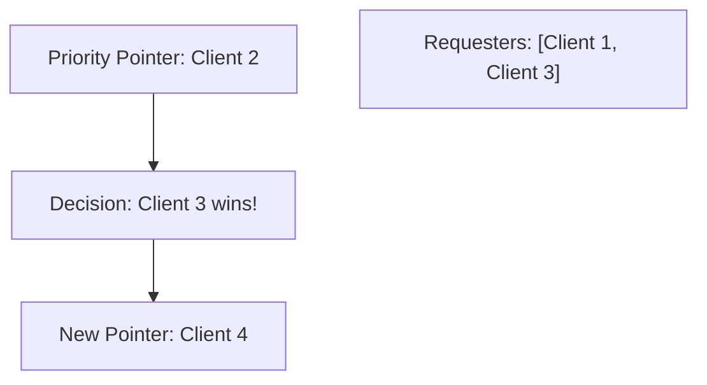
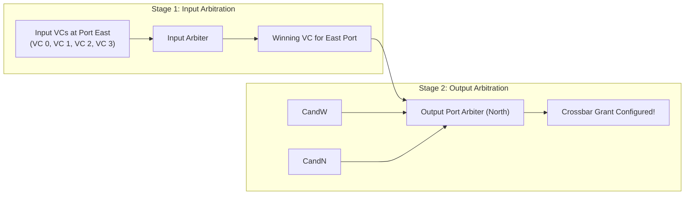
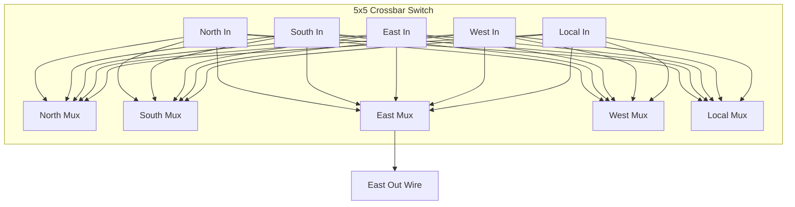

# 2.3 Arbitration & Crossbar Switching

When multiple input virtual channels demand the same output port simultaneously, the router must arbitrate. The arbiter must make decisions in **sub-nanosecond time** while guaranteeing strict fairness and preventing starvation.

---

## 1. Fast Silicon Arbiters

### A. Round-Robin Arbiter (RRA)
A Round-Robin Arbiter grants access to the highest-priority requester and then sets the priority pointer to the next requester in circular order:



While simple, traditional barrel-shifter or priority encoder implementations of RRA have relatively long carry chains that limit maximum operating frequency.

---

### B. Matrix Arbiter (Least Recently Used - LRU)
The **Matrix Arbiter** is the industry standard for high-frequency on-chip routers due to its clean, parallel AND-OR logic and lack of feedback delay lines.

For an $N$-client arbiter, an $N \times N$ triangular bit matrix $M$ is maintained:
- $M[i,j] = 1$ indicates that Client $i$ has higher priority than Client $j$.
- If $M[i,j] = 1$, then $M[j,i] = 0$. By definition, the diagonal $M[i,i] = 0$.

```
Matrix M (4 Clients):
      C0  C1  C2  C3
C0 [  0   1   0   1  ]
C1 [  0   0   0   1  ]
C2 [  1   1   0   1  ]  <-- C2 has 1s against C0, C1, C3! (Highest Priority)
C3 [  0   0   0   0  ]
```

#### Grant Logic:
Client $k$ receives a grant if it asserts a request $R[k]$ AND has higher priority than all other active requesters:

$$G[k] = R[k] \bigwedge_{j \ne k} \left( \overline{R[j]} \lor M[k,j] \right)$$

#### LRU Update Rule:
When Client $k$ wins the grant:
1. Row $k$ is cleared to 0s: $M[k, :] = 0$ (Client $k$ is now lowest priority).
2. Column $k$ is set to 1s: $M[:, k] = 1$ (All other clients now take priority over $k$).

Because the grant is computed purely with 2 levels of gate logic, the Matrix Arbiter executes in under 200 picoseconds in modern FinFET processes!

---

## 2. Switch Allocation: Separable Allocators

In a 5-port router with $V$ virtual channels per port, there are $5 \times V$ input VCs competing for 5 output ports. Finding the globally optimal matching is an $O(V^3)$ **Bipartite Maximum Matching problem**, which is far too complex to solve in a single clock cycle.

Instead, on-chip routers use **Separable Switch Allocators**:



1. **Input-First Allocation**:
   - Each input port selects **one winning VC** among its local candidates.
   - The winners from each input port then send requests to the respective output port arbiters.
2. **Output-First Allocation**:
   - Each output port arbitrates among all input VCs that requested it.

Separable allocation achieves over 95% of the throughput of an optimal maximum matching algorithm with tiny silicon area and single-cycle evaluation!

---

## 3. The Crossbar Datapath

The crossbar switch is the physical matrix of wires and multiplexers that routes flit bits from the 5 input ports to the 5 output ports:



### Design Considerations:
- **Multiplexer-Based Crossbars**: Built using standard static CMOS multiplexer trees. High noise margin, standard-cell friendly, and low static leakage.
- **Matrix Crossbars (Tristate / Pass-transistor)**: Use shared horizontal and vertical wires with bidirectional transmission gates at intersections. Smaller area, but higher parasitic wire capacitance.
- **Wiring Track Congestion**: For a 128-bit flit width, a 5-port crossbar has $5 \times 128 = 640$ input wires and 640 output wires traversing the switch block. Careful metal layer assignment (e.g., Metal 4 for horizontal, Metal 5 for vertical) is required during physical layout.

---

With the router microarchitecture mastered, we now turn to how routers are wired together across the die in [Track 3: Topologies & Interconnect Metrics](../track3-topologies/index.md).
