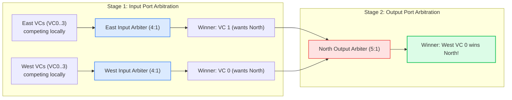
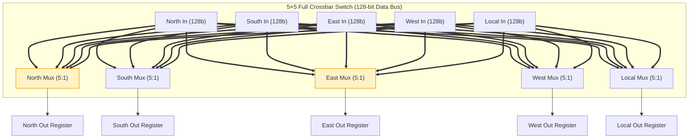

# 2.3 Fast Silicon Arbiters & Switch Allocation

<div class="noc-book-banner" style="background: linear-gradient(135deg, rgba(30, 58, 138, 0.25), rgba(15, 23, 42, 0.45)); border: 1px solid rgba(59, 130, 246, 0.4); border-radius: 10px; padding: 16px 20px; margin-bottom: 24px; display: flex; align-items: center; justify-content: space-between; flex-wrap: wrap; gap: 12px;">
  <div>
    <div style="font-weight: 700; color: #60a5fa; font-size: 1.05rem; display: flex; align-items: center; gap: 8px;">
      <span>📖 Companion Textbook Chapter Available</span>
    </div>
    <div style="font-size: 0.88rem; color: #cbd5e1; margin-top: 4px;">
      Read <strong>Chapter 3: High-Performance Router Microarchitecture & Arbitration</strong> in our open textbook, featuring complete mathematical derivations of Matrix Arbiter triangular updates, iSLIP iterative matching proofs, and synthesizable Verilog modules.
    </div>
  </div>
  <a href="https://github.com/network-on-chip/book/blob/main/chapters/ch03-router-microarchitecture/index.md" target="_blank" style="display: inline-flex; align-items: center; gap: 6px; background: #2563eb; color: #ffffff; padding: 8px 16px; border-radius: 6px; font-weight: 600; font-size: 0.85rem; text-decoration: none; transition: background 0.2s;">
    <span>Explore Chapter 3 →</span>
  </a>
</div>

When multiple input virtual channels demand the same output physical port simultaneously, the router must decide which flit gets to traverse the internal crossbar switch. 

This decision must be executed in **sub-nanosecond time** (typically within a single clock period of $300\text{–}600\text{ ps}$ in modern server silicon) while guaranteeing **strict fairness**, **zero starvation**, and **maximum crossbar utilization**.

In this lesson, we study fast silicon arbiters—focusing on the **Matrix Arbiter (LRU)**—and analyze **Separable Switch Allocators** and the physical layout of crossbar switches.

---

## 1. Fast Silicon Arbiters: Round-Robin vs. Matrix Arbiter

### A. The Round-Robin Arbiter (RRA)
A traditional Round-Robin Arbiter maintains a binary pointer indicating the highest-priority requester. While conceptually straightforward, classical RRA implementations using barrel shifters and priority encoders suffer from long combinational carry chains:

$$\text{Delay}_{RRA} \propto O(\log N) \text{ to } O(N)$$

As core counts and port counts grow, RRA carry chains become a timing bottleneck on the router's critical path.

---

### B. The Matrix Arbiter (Least Recently Used - LRU)
The **Matrix Arbiter** is the gold standard for high-frequency on-chip routers. It replaces carry chains with a parallel, triangular binary matrix evaluated using **only two levels of basic gates (AND-OR)**, achieving sub-200 picosecond evaluation in FinFET processes!

```
Matrix M for 4 Clients (C0, C1, C2, C3):
       C0   C1   C2   C3
C0  [  0    1    0    1  ]   --> C0 has priority over C1 and C3
C1  [  0    0    0    1  ]   --> C1 has priority over C3
C2  [  1    1    0    1  ]   --> C2 has 1s against C0, C1, C3! (HIGHEST PRIORITY)
C3  [  0    0    0    0  ]   --> C3 has priority over nobody (LOWEST PRIORITY)
```

#### Matrix Properties:
1. $M[i,j] = 1$ indicates that Client $i$ has higher priority than Client $j$.
2. **Skew-Symmetry:** $M[j,i] = \overline{M[i,j]}$ for all $i \ne j$.
3. **Diagonal Invariance:** $M[i,i] = 0$ by definition.
4. An $N$-client arbiter only needs to store $\frac{N(N-1)}{2}$ state flip-flops!

#### Fast Grant Logic:
Client $k$ receives a grant if it asserts request $R[k]$ AND has higher priority than every other active requester $j$:

$$G[k] = R[k] \bigwedge_{j \ne k} \left( \overline{R[j]} \lor M[k,j] \right)$$

This boolean expression synthesizes into a single wide AND-OR gate tree: **zero ripple carries, zero barrel shifters!**

#### The LRU Update Rule:
When Client $k$ wins the grant:
1. **Clear Row $k$ to 0:** $M[k, :] \leftarrow 0$ (Client $k$ now has priority over nobody—it becomes Least Recently Used).
2. **Set Column $k$ to 1:** $M[:, k] \leftarrow 1$ (All other active clients now take priority over Client $k$).

---

## 2. 🎛️ Interactive 4×4 Matrix Arbiter Simulator

Experience how the Matrix Arbiter operates in silicon hardware. Toggle the request inputs ($R_0, R_1, R_2, R_3$) and click **"Execute Arbitration"** to see how the grant is evaluated and how the priority matrix automatically updates under the LRU rule!

<div class="noc-sim-container" id="matrixSim">
  <div style="font-size:1.1rem; font-weight:700; color:var(--tcl-heading); margin-bottom:1rem; display:flex; align-items:center; justify-content:space-between; flex-wrap:wrap; gap:0.5rem;">
    <span>🔬 Live 4×4 Matrix Arbiter Hardware Simulator</span>
    <span id="matrixStepBadge" style="font-family:'JetBrains Mono', monospace; font-size:0.9rem; font-weight:700; color:var(--tcl-blue-600); background:rgba(37,99,235,0.1); padding:3px 10px; border-radius:6px;">
      Arb Cycle: 0
    </span>
  </div>

  <div class="noc-sim-controls">
    <div style="display:flex; align-items:center; gap:1rem; flex-wrap:wrap;">
      <span style="font-weight:700; font-size:0.9rem; color:var(--tcl-heading);">Assert Requests:</span>
      <label style="cursor:pointer; display:flex; align-items:center; gap:4px; font-weight:600; font-size:0.88rem;">
        <input type="checkbox" id="req_0" checked onchange="evalMatrixArb()"> R0 (Client 0)
      </label>
      <label style="cursor:pointer; display:flex; align-items:center; gap:4px; font-weight:600; font-size:0.88rem;">
        <input type="checkbox" id="req_1" checked onchange="evalMatrixArb()"> R1 (Client 1)
      </label>
      <label style="cursor:pointer; display:flex; align-items:center; gap:4px; font-weight:600; font-size:0.88rem;">
        <input type="checkbox" id="req_2" checked onchange="evalMatrixArb()"> R2 (Client 2)
      </label>
      <label style="cursor:pointer; display:flex; align-items:center; gap:4px; font-weight:600; font-size:0.88rem;">
        <input type="checkbox" id="req_3" onchange="evalMatrixArb()"> R3 (Client 3)
      </label>
    </div>

    <button class="noc-sim-btn" onclick="executeGrantStep()">⚡ Execute Arbitration &amp; Update Matrix</button>
    <button class="noc-sim-btn secondary" onclick="resetMatrixArb()">🔄 Reset Matrix to Default</button>
  </div>

  <!-- Interactive Matrix & Grant Display -->
  <div style="background:var(--noc-surface-subtle); border:1px solid var(--noc-border); border-radius:10px; padding:1.25rem; margin-bottom:1rem;">
    <div style="display:grid; grid-template-columns: 1fr 1fr; gap:1.5rem; align-items:center;">
      
      <!-- Triangular Priority Matrix Grid -->
      <div style="background:var(--noc-surface); border:2px solid var(--tcl-border); border-radius:8px; padding:1rem; text-align:center;">
        <div style="font-weight:700; font-size:0.9rem; margin-bottom:0.75rem; color:var(--tcl-heading);">
          Triangular Priority Matrix $M[i,j]$
        </div>
        <div style="display:inline-block;">
          <table style="border-collapse:collapse; margin:0 auto; font-family:'JetBrains Mono', monospace; font-size:0.88rem;">
            <thead>
              <tr style="color:var(--noc-text-muted);">
                <th style="padding:4px 8px;"></th>
                <th style="padding:4px 8px;">C0</th>
                <th style="padding:4px 8px;">C1</th>
                <th style="padding:4px 8px;">C2</th>
                <th style="padding:4px 8px;">C3</th>
              </tr>
            </thead>
            <tbody id="matrixTableBody"></tbody>
          </table>
        </div>
        <div style="font-size:0.75rem; color:var(--noc-text-muted); margin-top:8px;">
          $M[i,j] = 1$ indicates Client $i$ has higher priority than Client $j$
        </div>
      </div>

      <!-- Decision & Grant Display -->
      <div style="display:flex; flex-direction:column; gap:0.75rem;">
        <div style="background:var(--noc-surface); border:1.5px solid var(--tcl-border); border-radius:8px; padding:1rem;">
          <div style="font-weight:700; font-size:0.85rem; color:var(--noc-text-muted); text-transform:uppercase; margin-bottom:4px;">
            Current Arbitration Winner (Grant Vector)
          </div>
          <div id="dispWinnerCard" style="font-size:1.6rem; font-weight:900; color:var(--tcl-blue-600); margin:4px 0;">
            Client 2 (G[2] = 1)
          </div>
          <div id="dispGrantEquation" style="font-family:'JetBrains Mono', monospace; font-size:0.78rem; color:var(--md-default-fg-color--lighter); line-height:1.5;"></div>
        </div>

        <div style="background:var(--noc-surface); border:1px solid var(--noc-border); border-radius:8px; padding:0.75rem 1rem; font-size:0.82rem; color:var(--noc-text-muted);">
          <b>LRU Hardware Guarantee:</b> Notice that immediately after Client $k$ wins, Row $k$ drops to all 0s, preventing starvation by guaranteeing that all other active clients will win before $k$ can be granted again!
        </div>
      </div>

    </div>
  </div>

  <div id="matrixLog" style="font-size:0.85rem; padding:0.75rem 1rem; border-radius:8px; background:rgba(37,99,235,0.08); border:1px solid rgba(37,99,235,0.25); color:var(--tcl-heading); line-height:1.5;"></div>
</div>

<script>
let matState = {
  step: 0,
  // 4x4 matrix M[i][j]
  // Default state: C2 highest, then C0, C1, C3
  M: [
    [0, 1, 0, 1], // Row 0
    [0, 0, 0, 1], // Row 1
    [1, 1, 0, 1], // Row 2
    [0, 0, 0, 0]  // Row 3
  ],
  winner: -1
};

function resetMatrixArb() {
  matState.step = 0;
  matState.M = [
    [0, 1, 0, 1],
    [0, 0, 0, 1],
    [1, 1, 0, 1],
    [0, 0, 0, 0]
  ];
  evalMatrixArb();
}

function getRequests() {
  return [
    document.getElementById("req_0").checked,
    document.getElementById("req_1").checked,
    document.getElementById("req_2").checked,
    document.getElementById("req_3").checked
  ];
}

function evalMatrixArb() {
  const reqs = getRequests();
  let winner = -1;

  for (let k = 0; k < 4; k++) {
    if (!reqs[k]) continue;

    let hasPriorityOverAll = true;
    for (let j = 0; j < 4; j++) {
      if (j === k) continue;
      // Condition: !R[j] || M[k][j]
      if (reqs[j] && matState.M[k][j] !== 1) {
        hasPriorityOverAll = false;
        break;
      }
    }

    if (hasPriorityOverAll) {
      winner = k;
      break;
    }
  }

  matState.winner = winner;
  renderMatrixArb();
}

function executeGrantStep() {
  const reqs = getRequests();
  if (matState.winner === -1) {
    evalMatrixArb();
  }

  const k = matState.winner;
  if (k === -1) {
    document.getElementById("matrixLog").innerHTML = "<b>No requests active!</b> Check at least one request box.";
    return;
  }

  matState.step++;

  // Apply LRU update rule:
  // Row k = 0
  for (let j = 0; j < 4; j++) {
    matState.M[k][j] = 0;
  }
  // Col k = 1 (except diagonal)
  for (let i = 0; i < 4; i++) {
    if (i !== k) {
      matState.M[i][k] = 1;
    }
  }

  const prevWinner = k;
  evalMatrixArb();

  document.getElementById("matrixLog").innerHTML = `
    ⚡ <b>Arbitration Cycle ${matState.step} Complete:</b> Client ${prevWinner} was granted the resource.<br>
    Row ${prevWinner} was cleared to 0s, and Column ${prevWinner} was set to 1s. Next highest-priority requester is now <strong>Client ${matState.winner !== -1 ? matState.winner : 'None'}</strong>.
  `;
}

function renderMatrixArb() {
  document.getElementById("matrixStepBadge").textContent = `Arb Cycle: ${matState.step}`;

  // Render Table
  const tbody = document.getElementById("matrixTableBody");
  tbody.innerHTML = "";

  for (let i = 0; i < 4; i++) {
    const tr = document.createElement("tr");
    const th = document.createElement("td");
    th.style.fontWeight = "700";
    th.style.padding = "4px 8px";
    th.style.color = "var(--noc-text-muted)";
    th.textContent = `C${i}`;
    tr.appendChild(th);

    for (let j = 0; j < 4; j++) {
      const td = document.createElement("td");
      td.style.padding = "4px 10px";
      td.style.border = "1px solid var(--noc-border)";
      td.style.textAlign = "center";
      td.style.fontWeight = "700";

      if (i === j) {
        td.style.background = "var(--noc-surface-subtle)";
        td.style.color = "var(--noc-text-muted)";
        td.textContent = "0";
      } else {
        td.textContent = matState.M[i][j];
        if (matState.M[i][j] === 1) {
          td.style.background = "rgba(37,99,235,0.12)";
          td.style.color = "var(--tcl-blue-600)";
        } else {
          td.style.color = "var(--noc-text-muted)";
        }
      }
      tr.appendChild(td);
    }
    tbody.appendChild(tr);
  }

  // Display Winner
  const winEl = document.getElementById("dispWinnerCard");
  const eqEl = document.getElementById("dispGrantEquation");

  if (matState.winner !== -1) {
    winEl.textContent = `Client ${matState.winner} (G[${matState.winner}] = 1)`;
    winEl.style.color = "var(--tcl-blue-600)";
    eqEl.innerHTML = `G[${matState.winner}] = R[${matState.winner}] &amp; ` + [0,1,2,3].filter(j => j !== matState.winner).map(j => `(!R[${j}] | M[${matState.winner},${j}])`).join(" &amp; ");
  } else {
    winEl.textContent = "No Active Grants (All Idle)";
    winEl.style.color = "var(--noc-text-muted)";
    eqEl.textContent = "Grant Vector: 4'b0000";
  }
}

if (document.readyState === "loading") {
  document.addEventListener("DOMContentLoaded", resetMatrixArb);
} else {
  resetMatrixArb();
}
</script>

---

## 3. Synthesizable Verilog RTL: Parameterized Matrix Arbiter

Below is a production-grade, synthesizable Verilog implementation of an $N$-client Matrix Arbiter. Notice how the grant equation and priority matrix are mapped to standard flip-flops and combinatorial AND-OR trees:

```verilog
// Parameterized N-Client Matrix Arbiter (Least Recently Used)
// Clean 2-level gate delay; Zero ripple-carry paths.
module matrix_arbiter #(
    parameter N = 4
)(
    input  wire         clk,
    input  wire         rst_n,
    input  wire [N-1:0] req,      // Request vector from clients
    output reg  [N-1:0] grant     // 1-hot grant vector
);

    // Triangular Priority Matrix State
    reg [N-1:0] matrix [N-1:0];
    wire [N-1:0] grant_comb;

    genvar i, j;
    generate
        for (i = 0; i < N; i = i + 1) begin : gen_grants
            wire [N-1:0] priority_terms;
            for (j = 0; j < N; j = j + 1) begin : gen_terms
                if (i == j) begin
                    assign priority_terms[j] = 1'b1; // Ignore self
                end else begin
                    // Client i has priority if Client j is NOT requesting,
                    // OR if Matrix[i][j] is 1 (i has higher priority than j)
                    assign priority_terms[j] = ~req[j] | matrix[i][j];
                end
            end
            // Grant evaluated in a single wide AND reduction
            assign grant_comb[i] = req[i] & (&priority_terms);
        end
    endgenerate

    // Synchronous Matrix State Update
    integer r, c;
    always @(posedge clk or negedge rst_n) begin
        if (!rst_n) begin
            // Reset to default triangular priority (Client 0 > 1 > 2 > 3)
            for (r = 0; r < N; r = r + 1) begin
                for (c = 0; c < N; c = c + 1) begin
                    matrix[r][c] <= (r < c) ? 1'b1 : 1'b0;
                end
            end
            grant <= {N{1'b0}};
        end else begin
            grant <= grant_comb;
            
            // If a grant occurred, update the LRU row and column
            if (|grant_comb) begin
                for (r = 0; r < N; r = r + 1) begin
                    if (grant_comb[r]) begin
                        // Clear row r (Client r has priority over nobody)
                        matrix[r] <= {N{1'b0}};
                        // Set column r (All other clients have priority over r)
                        for (c = 0; c < N; c = c + 1) begin
                            if (c != r) matrix[c][r] <= 1'b1;
                        end
                    end
                end
            end
        end
    end

endmodule
```

---

## 4. Switch Allocation: Separable Allocators

In a standard 5-port on-chip router with $V = 4$ virtual channels per port, there are **$5 \times 4 = 20$ input VCs competing for 5 output ports**.

Finding the globally optimal assignment of input VCs to output ports is a **Bipartite Maximum Matching problem**. The classic algorithm (Hopcroft-Karp) has time complexity $O(V^{2.5})$, which is completely impossible to execute inside a 300 picosecond clock cycle.

Instead, silicon routers employ **Separable Switch Allocators**:



### Allocation Strategies:
1. **Input-First Separable Allocation (iSLIP):**
   - **Phase 1 (Input Arbitration):** Each of the 5 input ports selects **one winning candidate VC** among its active queues.
   - **Phase 2 (Output Arbitration):** The 5 winning candidates send their requests to the 5 output port arbiters. Each output port awards crossbar access to one winner.
2. **Output-First Separable Allocation:**
   - **Phase 1 (Output Arbitration):** Each output port arbitrates among all input VCs that requested it.
   - **Phase 2 (Input Arbitration):** If an input port receives multiple output grants, it picks one.

Separable allocation achieves **over 95% of the throughput of ideal bipartite maximum matching** while evaluating in just two pipelined arbiter stages!

---

## 5. Crossbar Switch Datapath & Physical Layout

The physical crossbar switch connects the 5 input ports to the 5 output ports:



### Physical Design Challenges:
1. **Wiring Congestion:**  
   For a 128-bit flit width, a 5-port crossbar has $5 \times 128 = 640\text{ input wires}$ and $640\text{ output wires}$ crisscrossing the switch core. In dense layouts, this requires dedicated metal layers (e.g., Metal 4 for horizontal tracks and Metal 5 for vertical tracks).
2. **Bit-Slicing (Area & Power Optimization):**  
   Rather than building one massive monolithic 128-bit crossbar, architects partition the crossbar into **four 32-bit crossbar slices**. All 4 slices share identical control signals from the Switch Allocator, significantly reducing wire congestion and capacitive cross-talk.

### Synthesizable Verilog RTL: 5×5 Crossbar Datapath (`crossbar_5x5.v`)

Below is a production-grade, synthesizable Verilog implementation of a 5×5 crossbar switch with 1-hot select lines and pipelined output registers:

```verilog
// Synthesizable 5x5 Crossbar Switch Datapath with 1-Hot Selectors
// Connects 5 input ports (N, S, E, W, L) to 5 output ports with
// parameterized data/flit width and parallel output multiplexers.
module crossbar_5x5 #(
    parameter integer DATA_WIDTH = 128
)(
    input  wire                    clk,
    input  wire                    rst_n,

    // Input Port Data Buses (128 bits each)
    input  wire [DATA_WIDTH-1:0]   in_north,
    input  wire [DATA_WIDTH-1:0]   in_south,
    input  wire [DATA_WIDTH-1:0]   in_east,
    input  wire [DATA_WIDTH-1:0]   in_west,
    input  wire [DATA_WIDTH-1:0]   in_local,

    // 1-Hot Switch Allocation Select Signals (from SA stage)
    // Bit mapping: [4]=Local, [3]=West, [2]=East, [1]=South, [0]=North
    input  wire [4:0]              sel_north,
    input  wire [4:0]              sel_south,
    input  wire [4:0]              sel_east,
    input  wire [4:0]              sel_west,
    input  wire [4:0]              sel_local,

    // Registered Output Port Data Buses
    output reg  [DATA_WIDTH-1:0]   out_north,
    output reg  [DATA_WIDTH-1:0]   out_south,
    output reg  [DATA_WIDTH-1:0]   out_east,
    output reg  [DATA_WIDTH-1:0]   out_west,
    output reg  [DATA_WIDTH-1:0]   out_local
);

    // Combinatorial 5:1 Multiplexing Function
    function [DATA_WIDTH-1:0] mux5(
        input [4:0]            sel,
        input [DATA_WIDTH-1:0] d_n,
        input [DATA_WIDTH-1:0] d_s,
        input [DATA_WIDTH-1:0] d_e,
        input [DATA_WIDTH-1:0] d_w,
        input [DATA_WIDTH-1:0] d_l
    );
        case (sel)
            5'b00001: mux5 = d_n;
            5'b00010: mux5 = d_s;
            5'b00100: mux5 = d_e;
            5'b01000: mux5 = d_w;
            5'b10000: mux5 = d_l;
            default:  mux5 = {DATA_WIDTH{1'b0}};
        endcase
    endfunction

    // Pipeline Traversal Stage (ST) Registers
    always @(posedge clk or negedge rst_n) begin
        if (!rst_n) begin
            out_north <= {DATA_WIDTH{1'b0}};
            out_south <= {DATA_WIDTH{1'b0}};
            out_east  <= {DATA_WIDTH{1'b0}};
            out_west  <= {DATA_WIDTH{1'b0}};
            out_local <= {DATA_WIDTH{1'b0}};
        end else begin
            out_north <= mux5(sel_north, in_north, in_south, in_east, in_west, in_local);
            out_south <= mux5(sel_south, in_north, in_south, in_east, in_west, in_local);
            out_east  <= mux5(sel_east,  in_north, in_south, in_east, in_west, in_local);
            out_west  <= mux5(sel_west,  in_north, in_south, in_east, in_west, in_local);
            out_local <= mux5(sel_local, in_north, in_south, in_east, in_west, in_local);
        end
    end

endmodule
```

---

## 6. Worked Numerical Example: Critical Path Timing Analysis

> [!TIP]
> **Problem Statement:**  
> A router Switch Allocator in a 7nm FinFET process uses a 2-phase Input-First Separable Allocator.  
> The gate delays are characterized as follows:
> - Input VC Arbiter (4:1 Matrix Arbiter): $t_{in\_arb} = 140\text{ ps}$
> - Wire traversal across allocator core: $t_{wire} = 45\text{ ps}$
> - Output Port Arbiter (5:1 Matrix Arbiter): $t_{out\_arb} = 160\text{ ps}$
> - Crossbar multiplexer select-to-out delay: $t_{xbar} = 110\text{ ps}$
> - Flip-flop setup time ($t_{setup}$) and clock-to-Q delay ($t_{cq}$): $t_{setup} = 25\text{ ps}$, $t_{cq} = 30\text{ ps}$.
> 
> 1. Calculate the critical path delay of the Switch Allocation (SA) stage.
> 2. What is the maximum operating clock frequency ($f_{max}$) of the router if SA is allocated 1 clock cycle?

### Step 1: Compute SA Critical Path Delay
The Switch Allocation stage must complete input arbitration, signal routing, and output arbitration:

$$t_{SA} = t_{cq} + t_{in\_arb} + t_{wire} + t_{out\_arb} + t_{setup}$$

$$t_{SA} = 30\text{ ps} + 140\text{ ps} + 45\text{ ps} + 160\text{ ps} + 25\text{ ps} = \mathbf{400\text{ ps}}$$

### Step 2: Compute Maximum Clock Frequency

$$f_{max} = \frac{1}{t_{SA}} = \frac{1}{400 \times 10^{-12}\text{ s}} = \frac{1}{0.400\text{ ns}} = \mathbf{2.50\text{ GHz}}$$

The router can comfortably sustain a **2.50 GHz clock frequency**, switching over $1.6\text{ Terabits/second}$ across its 5 physical ports!

---

## 7. 🎯 Knowledge Check: Lesson 2.3

Test your comprehension of matrix arbiters, separable allocators, and crossbar timing constraints.

<div class="noc-sim-container" id="quiz23" style="margin-top:1rem;">
  <div style="font-weight:700; font-size:1.05rem; margin-bottom:1rem; color:var(--tcl-heading);">
    📝 Concept Check: Arbiters, Matching &amp; Crossbars
  </div>

  <!-- Question 1 -->
  <div style="margin-bottom:1.5rem; padding-bottom:1.2rem; border-bottom:1px solid var(--tcl-border);">
    <p style="font-weight:600; font-size:0.95rem; margin-bottom:0.75rem;">
      <b>Question 1:</b> In an $N$-client Matrix Arbiter with triangular priority matrix $M$, what is the exact hardware state update performed when Client $k$ wins the grant?
    </p>

    <div style="display:flex; flex-direction:column; gap:0.5rem;" id="q23_options">
      <button class="noc-sim-select" style="text-align:left; padding:0.65rem 0.85rem; cursor:pointer;" onclick="checkQuiz23(0)">
        A. Row $k$ is cleared to all 0s ($M[k,:] = 0$) and Column $k$ is set to all 1s ($M[:,k] = 1$).
      </button>
      <button class="noc-sim-select" style="text-align:left; padding:0.65rem 0.85rem; cursor:pointer;" onclick="checkQuiz23(1)">
        B. The matrix is multiplied by its inverse ($M = M \times M^{-1}$).
      </button>
      <button class="noc-sim-select" style="text-align:left; padding:0.65rem 0.85rem; cursor:pointer;" onclick="checkQuiz23(2)">
        C. Diagonal elements $M[i,i]$ are toggled from 0 to 1.
      </button>
      <button class="noc-sim-select" style="text-align:left; padding:0.65rem 0.85rem; cursor:pointer;" onclick="checkQuiz23(3)">
        D. All elements in row $k$ are inverted.
      </button>
    </div>
    <div id="q23_feedback" style="display:none; margin-top:0.75rem; padding:0.85rem; border-radius:8px; font-size:0.9rem; line-height:1.5;"></div>
  </div>

  <!-- Question 2 -->
  <div style="margin-bottom:1.5rem; padding-bottom:1.2rem; border-bottom:1px solid var(--tcl-border);">
    <p style="font-weight:600; font-size:0.95rem; margin-bottom:0.75rem;">
      <b>Question 2:</b> Why do silicon routers decompose the $20 \to 5$ crossbar matching problem into Separable Input-First or Output-First allocators instead of executing optimal Bipartite Maximum Matching (Hopcroft-Karp)?
    </p>

    <div style="display:flex; flex-direction:column; gap:0.5rem;" id="q23_q2_options">
      <button class="noc-sim-select" style="text-align:left; padding:0.65rem 0.85rem; cursor:pointer;" onclick="checkQuiz23_Q2(0)">
        A. Hopcroft-Karp has $O(V^{2.5})$ time complexity that cannot converge within a sub-nanosecond clock period, whereas separable allocation achieves $>95\%$ matching efficiency in two fast, feedforward arbiter stages.
      </button>
      <button class="noc-sim-select" style="text-align:left; padding:0.65rem 0.85rem; cursor:pointer;" onclick="checkQuiz23_Q2(1)">
        B. Bipartite matching only works on analog signals.
      </button>
      <button class="noc-sim-select" style="text-align:left; padding:0.65rem 0.85rem; cursor:pointer;" onclick="checkQuiz23_Q2(2)">
        C. Crossbars cannot support more than 2 ports in digital CMOS.
      </button>
    </div>
    <div id="q23_q2_feedback" style="display:none; margin-top:0.75rem; padding:0.85rem; border-radius:8px; font-size:0.9rem; line-height:1.5;"></div>
  </div>

  <!-- Question 3 -->
  <div>
    <p style="font-weight:600; font-size:0.95rem; margin-bottom:0.75rem;">
      <b>Question 3:</b> When sizing a 7nm Switch Allocator with $t_{cq} = 30\text{ ps}$, $t_{in\_arb} = 140\text{ ps}$, $t_{wire} = 45\text{ ps}$, $t_{out\_arb} = 160\text{ ps}$, and $t_{setup} = 25\text{ ps}$, what is the maximum achievable clock frequency for the router pipeline?
    </p>

    <div style="display:flex; flex-direction:column; gap:0.5rem;" id="q23_q3_options">
      <button class="noc-sim-select" style="text-align:left; padding:0.65rem 0.85rem; cursor:pointer;" onclick="checkQuiz23_Q3(0)">
        A. 500 MHz.
      </button>
      <button class="noc-sim-select" style="text-align:left; padding:0.65rem 0.85rem; cursor:pointer;" onclick="checkQuiz23_Q3(1)">
        B. 2.50 GHz, because $t_{SA} = 30 + 140 + 45 + 160 + 25 = 400\text{ ps} \implies f_{max} = 1 / 400\text{ ps} = 2.50\text{ GHz}$.
      </button>
      <button class="noc-sim-select" style="text-align:left; padding:0.65rem 0.85rem; cursor:pointer;" onclick="checkQuiz23_Q3(2)">
        C. 10 GHz, because wire traversal delay is negligible.
      </button>
    </div>
    <div id="q23_q3_feedback" style="display:none; margin-top:0.75rem; padding:0.85rem; border-radius:8px; font-size:0.9rem; line-height:1.5;"></div>
  </div>
</div>

<script>
function checkQuiz23(idx) {
  const fb = document.getElementById("q23_feedback");
  fb.style.display = "block";
  const opts = document.getElementById("q23_options").children;
  for (let i = 0; i < opts.length; i++) { opts[i].onclick = null; opts[i].style.cursor = "default"; }

  if (idx === 0) {
    opts[0].style.background = "rgba(34,197,94,0.15)"; opts[0].style.borderColor = "#22c55e";
    fb.style.background = "rgba(34,197,94,0.1)"; fb.style.border = "1px solid rgba(34,197,94,0.3)"; fb.style.color = "#166534";
    fb.innerHTML = "<strong>✓ Correct!</strong> Setting Row k to 0 means Client k has lower priority than all other clients. Setting Column k to 1 gives all other clients priority over k. This cleanly implements Least Recently Used (LRU) fairness in 2 gate levels.";
  } else {
    opts[idx].style.background = "rgba(239,68,68,0.15)"; opts[idx].style.borderColor = "#ef4444";
    opts[0].style.background = "rgba(34,197,94,0.15)"; opts[0].style.borderColor = "#22c55e";
    fb.style.background = "rgba(239,68,68,0.1)"; fb.style.border = "1px solid rgba(239,68,68,0.3)"; fb.style.color = "#991b1b";
    fb.innerHTML = "<strong>✗ Incorrect.</strong> The correct answer is <strong>A</strong>. Clearing row k to 0 and setting column k to 1 enforces LRU priority update in hardware.";
  }
}

function checkQuiz23_Q2(idx) {
  const fb = document.getElementById("q23_q2_feedback");
  fb.style.display = "block";
  const opts = document.getElementById("q23_q2_options").children;
  for (let i = 0; i < opts.length; i++) { opts[i].onclick = null; opts[i].style.cursor = "default"; }

  if (idx === 0) {
    opts[0].style.background = "rgba(34,197,94,0.15)"; opts[0].style.borderColor = "#22c55e";
    fb.style.background = "rgba(34,197,94,0.1)"; fb.style.border = "1px solid rgba(34,197,94,0.3)"; fb.style.color = "#166534";
    fb.innerHTML = "<strong>✓ Correct!</strong> Separable allocation eliminates iterative matching loops, solving the matching problem via independent input and output arbiters in sub-nanosecond clock paths while retaining >95% throughput.";
  } else {
    opts[idx].style.background = "rgba(239,68,68,0.15)"; opts[idx].style.borderColor = "#ef4444";
    opts[0].style.background = "rgba(34,197,94,0.15)"; opts[0].style.borderColor = "#22c55e";
    fb.style.background = "rgba(239,68,68,0.1)"; fb.style.border = "1px solid rgba(239,68,68,0.3)"; fb.style.color = "#991b1b";
    fb.innerHTML = "<strong>✗ Incorrect.</strong> The correct answer is <strong>A</strong>. Separable allocation trades marginal matching perfection for deterministic 2-stage hardware latency.";
  }
}

function checkQuiz23_Q3(idx) {
  const fb = document.getElementById("q23_q3_feedback");
  fb.style.display = "block";
  const opts = document.getElementById("q23_q3_options").children;
  for (let i = 0; i < opts.length; i++) { opts[i].onclick = null; opts[i].style.cursor = "default"; }

  if (idx === 1) {
    opts[1].style.background = "rgba(34,197,94,0.15)"; opts[1].style.borderColor = "#22c55e";
    fb.style.background = "rgba(34,197,94,0.1)"; fb.style.border = "1px solid rgba(34,197,94,0.3)"; fb.style.color = "#166534";
    fb.innerHTML = "<strong>✓ Correct!</strong> Summing all components: $t_{SA} = 30 + 140 + 45 + 160 + 25 = 400\\text{ ps}$. Hence, $f_{max} = 1 / (400 \\times 10^{-12}) = 2.50\\text{ GHz}$.";
  } else {
    opts[idx].style.background = "rgba(239,68,68,0.15)"; opts[idx].style.borderColor = "#ef4444";
    opts[1].style.background = "rgba(34,197,94,0.15)"; opts[1].style.borderColor = "#22c55e";
    fb.style.background = "rgba(239,68,68,0.1)"; fb.style.border = "1px solid rgba(239,68,68,0.3)"; fb.style.color = "#991b1b";
    fb.innerHTML = "<strong>✗ Incorrect.</strong> The correct answer is <strong>B</strong>. $t_{SA} = 400\\text{ ps} \\implies f_{max} = 2.50\\text{ GHz}$.";
  }
}
</script>

---

## 8. Interactive Arcade & Lab Challenges

Test your crossbar scheduling and arbitration reflexes:
- ⚔️ **[Arbiter Arena: Crossbar Clash](../interactive/arbiter.md):** Test matrix arbitration and iSLIP scheduling under high injection rates and adversarial burst traffic.
- 🏭 **[Chiplet Tycoon: Multi-Die Architect](../interactive/chiplet.md):** Route crossbar links across high-density packaging substrates and UCIe D2D interfaces.

---

## Summary & Next Steps

In this lesson, we explored:
- Why **Matrix Arbiters** outperform Round-Robin arbiters in sub-nanosecond clock paths.
- Verilog RTL implementation of triangular LRU priority matrices (`matrix_arbiter.v`).
- How **Separable Switch Allocators** achieve near-optimal bipartite matching without $O(V^3)$ complexity.
- Crossbar datapath routing, bit-slicing techniques, and synthesizable RTL for a **5×5 Crossbar (`crossbar_5x5.v`)**.

In our final lesson of Track 2, we will explore the cutting edge of low-latency routers: **Single-Cycle, Lookahead, and SMART Multi-Hop Bypass Routers**.

👉 **Proceed to [Lesson 2.4: Low-Latency & Single-Cycle Routers](04-low-latency-bypass-routers.md)**

