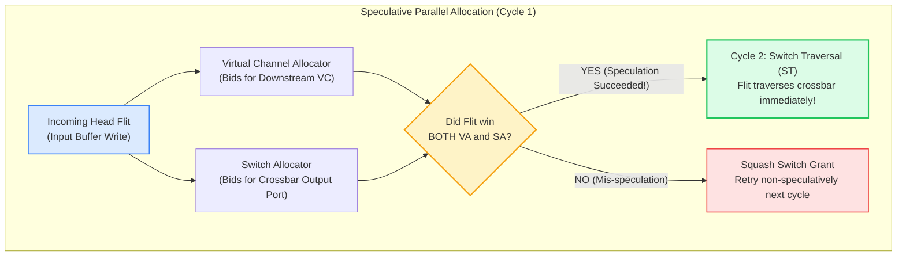
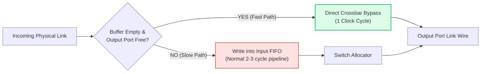
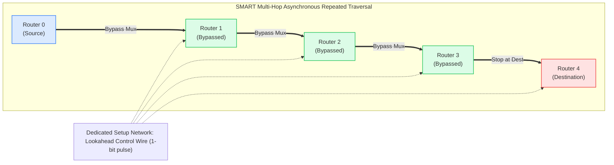

# 2.4 Low-Latency, Speculative & SMART Bypass Routers

In large-scale multicore processors and AI accelerators (such as 64-core AMD EPYC, Intel Xeon Scalable, and Google TPU chips), **uncontended network latency is the dominant performance bottleneck**. When a CPU core stalls on an L2 cache miss waiting for data from an off-die memory controller 8 hops away, every cycle of router delay translates directly into idle processor execution units.

A canonical 5-stage router would impose $8 \times 5 = 40\text{ clock cycles}$ of latency just for router control overhead!

In this lesson, we study the cutting edge of low-latency on-chip router microarchitecture: **Speculative Switch Allocation**, **1-Cycle Crossbar Bypassing**, and **SMART (Single-Cycle Multi-hop Asynchronous Repeated Traversal)**.

---

## 1. Speculative Switch Allocation (Peh & Dally)

In a classical router, a Head Flit must sequentially complete:
1. **Virtual Channel Allocation (VA)**: Win an available downstream VC.
2. **Switch Allocation (SA)**: Once a VC is guaranteed, compete for the physical crossbar switch.

In 2001, **Li-Shiuan Peh and William J. Dally** introduced **Speculative Switch Allocation** [[Peh2001](#ref-peh2001)]:



### The Priority Hierarchy:
To guarantee that speculation never degrades the performance of existing packets, the Switch Allocator enforces a **two-tier priority scheme**:
1. **Non-Speculative Requests (High Priority):** Flits that *already possess* a downstream VC (such as Body flits or Head flits that won VA in an earlier cycle).
2. **Speculative Requests (Low Priority):** Head flits bidding for the crossbar *before* securing a downstream VC.

A speculative request is granted access to the crossbar **only if no non-speculative request demands that output port**.

### Mis-Speculation Handling:
If a Head Flit wins the crossbar in the switch allocator but **fails to win a downstream VC in the VC allocator**:
- The speculative switch grant is instantly squashed.
- The crossbar port is either left idle or awarded to a secondary non-speculative candidate.
- The losing flit remains in its input buffer and bids non-speculatively on subsequent cycles.

> [!NOTE]
> Under low-to-medium network traffic, **over 85% to 95% of speculative attempts succeed**, cutting router delay from 3 cycles down to **2 cycles per hop**!

---

## 2. 1-Stage Speculative Crossbar Bypassing

Can we eliminate buffer delays altogether under uncontended conditions?

In a **1-Stage Bypass Router** (such as the Intel Skylake-SP / Ice Lake mesh architecture, and single-cycle architectures [[Matsutani2011](#ref-matsutani2011)], [[Mullins2006](#ref-mullins2006)]):
- When a flit arrives from an incoming inter-router link, the router checks two simple conditions:
  1. Is the local input buffer queue for this port **empty**?
  2. Is the desired output crossbar port **uncontended** (no buffered flits requesting it)?
- If both conditions are true, the flit **bypasses the input FIFO latch entirely**!
- The flit's signals are steered directly into the crossbar multiplexer datapath, exiting the router in the **very same clock cycle ($t_r = 1\text{ cycle}$)**.



---

## 3. SMART: Single-Cycle Multi-Hop Asynchronous Repeated Traversal

Even with a 1-cycle router, traversing an 8-hop path requires 8 clock cycles for router logic plus 8 clock cycles for wire links ($8 + 8 = 16\text{ cycles}$). 

In 2013, researchers from MIT and Stanford (Tushar Krishna et al., *HPCA 2013 / IEEE Micro Top Picks* [[Krishna2013](#ref-krishna2013)]) asked a radical question:  
**Can a packet traverse MULTIPLE routers within a SINGLE clock cycle?**

The result was **SMART (Single-Cycle Multi-hop Asynchronous Repeated Traversal)**:



### How SMART Operates:
1. **Asynchronous Bypass Datapath:**  
   Each router's crossbar input multiplexer is augmented with an asynchronous bypass multiplexer that directly couples the input link to the output link without latching into a clock register!
2. **Repeated Silicon Wires:**  
   The bypass path is treated as an asynchronous repeated wire line. In modern silicon, an electrical signal can propagate through repeated wire channels and multiplexers at roughly **$3\text{–}4\text{ mm per nanosecond}$**.
3. **Multi-Hop Hop Limit ($H_{max}$):**  
   Within a standard 1.0 GHz clock period ($1.0\text{ ns}$), an asynchronous signal can traverse **$H_{max} = 4\text{ to } 8\text{ routers}$ in a single clock cycle**!
4. **Dynamic Contention Stopping:**  
   If an intermediate router (e.g., Router 2) has locally buffered packets that demand the same outgoing link, the bypass multiplexer is disabled. The incoming SMART packet **drops into Router 2's local buffer**, latches, and arbitrates normally on the next cycle.

---

## 4. 🎛️ Interactive SMART Multi-Hop Bypass Simulator

Experiment with the interactive tool below. Send a packet across an 8-hop network path and compare the latency and energy profiles of a **Canonical 5-Stage Router**, a **1-Cycle Bypass Router**, and a **SMART ($H_{max} = 4$) Multi-Hop Router**.

<div class="noc-sim-container" id="smartSim">
  <div style="font-size:1.1rem; font-weight:700; color:var(--tcl-heading); margin-bottom:1rem; display:flex; align-items:center; justify-content:space-between; flex-wrap:wrap; gap:0.5rem;">
    <span>🔬 SMART Multi-Hop Asynchronous Bypass Visualizer</span>
    <span id="smartCycleBadge" style="font-family:'JetBrains Mono', monospace; font-size:0.9rem; font-weight:700; color:var(--tcl-blue-600); background:rgba(37,99,235,0.1); padding:3px 10px; border-radius:6px;">
      Cycle: 0
    </span>
  </div>

  <div class="noc-sim-controls">
    <label><b>Router Architecture:</b>
      <select id="selSmartArch" class="noc-sim-select" onchange="resetSmartSim()">
        <option value="canonical">Canonical 5-Stage (5 cycles/hop)</option>
        <option value="single">1-Cycle Speculative Bypass (1 cycle/hop)</option>
        <option value="smart4" selected>SMART Multi-Hop (H_max = 4 hops/cycle)</option>
        <option value="smart8">SMART Multi-Hop (H_max = 8 hops/cycle - Full Die)</option>
      </select>
    </label>

    <button class="noc-sim-btn" onclick="stepSmartSim()">⏭ Step 1 Cycle</button>
    <button class="noc-sim-btn" id="btnPlaySmart" onclick="togglePlaySmart()">▶ Auto Traversal</button>
    <button class="noc-sim-btn secondary" onclick="resetSmartSim()">🔄 Reset</button>

    <label style="margin-left:auto; display:flex; align-items:center; gap:4px; font-size:0.88rem; font-weight:600; cursor:pointer; color:#ea580c;">
      <input type="checkbox" id="checkIntCongest" onchange="resetSmartSim()"> ⚠️ Intercept Congestion at Router 4
    </label>
  </div>

  <!-- 8-Hop Network Mesh Representation -->
  <div style="background:var(--noc-surface-subtle); border:1px solid var(--noc-border); border-radius:10px; padding:1.25rem; margin-bottom:1rem; overflow-x:auto;">
    <div style="font-size:0.85rem; font-weight:700; margin-bottom:0.75rem; color:var(--tcl-heading);">
      8-Hop Linear Interconnect Path (Tile 0 ➔ Tile 7):
    </div>
    <div id="smartTilesRow" style="display:flex; justify-content:space-between; align-items:center; min-width:700px; gap:6px;"></div>
  </div>

  <!-- Real-Time Metrics Strip -->
  <div style="display:grid; grid-template-columns:repeat(auto-fit, minmax(200px, 1fr)); gap:1rem; margin-bottom:1rem;">
    <div style="background:var(--noc-surface); border:1px solid var(--noc-border); border-radius:8px; padding:0.75rem 1rem;">
      <div style="font-size:0.75rem; color:var(--noc-text-muted); text-transform:uppercase;">Current Packet Position</div>
      <div id="dispPktPos" style="font-size:1.4rem; font-weight:800; color:var(--tcl-blue-600);">Tile 0</div>
    </div>
    <div style="background:var(--noc-surface); border:1px solid var(--noc-border); border-radius:8px; padding:0.75rem 1rem;">
      <div style="font-size:0.75rem; color:var(--noc-text-muted); text-transform:uppercase;">Total Hops Cleared</div>
      <div id="dispHopsCleared" style="font-size:1.4rem; font-weight:800; color:#16a34a;">0 / 7 hops</div>
    </div>
    <div style="background:var(--noc-surface); border:1px solid var(--noc-border); border-radius:8px; padding:0.75rem 1rem;">
      <div style="font-size:0.75rem; color:var(--noc-text-muted); text-transform:uppercase;">Estimated Dynamic Energy</div>
      <div id="dispEnergy" style="font-size:1.4rem; font-weight:800; color:#ea580c;">-- pJ</div>
    </div>
  </div>

  <div id="smartAnalysis" style="font-size:0.88rem; padding:0.75rem 1rem; border-radius:8px; background:rgba(37,99,235,0.08); border:1px solid rgba(37,99,235,0.25); color:var(--tcl-heading); line-height:1.5;"></div>
</div>

<script>
let smartSim = {
  cycle: 0,
  arch: "smart4",
  pos: 0, // 0 to 7
  dest: 7,
  hasCongestion: false,
  isPlaying: false,
  timer: null,
  isFinished: false
};

function resetSmartSim() {
  clearInterval(smartSim.timer);
  smartSim.isPlaying = false;
  document.getElementById("btnPlaySmart").textContent = "▶ Auto Traversal";

  smartSim.cycle = 0;
  smartSim.pos = 0;
  smartSim.arch = document.getElementById("selSmartArch").value;
  smartSim.hasCongestion = document.getElementById("checkIntCongest").checked;
  smartSim.isFinished = false;

  renderSmartSim();
}

function togglePlaySmart() {
  if (smartSim.isPlaying) {
    clearInterval(smartSim.timer);
    smartSim.isPlaying = false;
    document.getElementById("btnPlaySmart").textContent = "▶ Auto Traversal";
  } else {
    smartSim.isPlaying = true;
    document.getElementById("btnPlaySmart").textContent = "⏸ Pause";
    smartSim.timer = setInterval(() => {
      stepSmartSim();
    }, 900);
  }
}

function stepSmartSim() {
  if (smartSim.isFinished) return;
  smartSim.cycle++;

  const arch = smartSim.arch;

  if (arch === "canonical") {
    // 5 cycles per hop + 1 cycle link wire = 6 cycles per hop
    if (smartSim.cycle % 6 === 0) {
      smartSim.pos = Math.min(7, smartSim.pos + 1);
    }
  } else if (arch === "single") {
    // 1 cycle per hop
    smartSim.pos = Math.min(7, smartSim.pos + 1);
  } else if (arch === "smart4") {
    // SMART H_max = 4 hops per cycle!
    // Check if stopped by congestion at Router 4
    if (smartSim.hasCongestion && smartSim.pos < 4 && smartSim.pos + 4 >= 4) {
      // Stopped at Router 4 by local contention!
      smartSim.pos = 4;
    } else {
      smartSim.pos = Math.min(7, smartSim.pos + 4);
    }
  } else if (arch === "smart8") {
    // SMART H_max = 8 (Traverses all 7 hops in a single cycle!)
    if (smartSim.hasCongestion && smartSim.pos < 4) {
      smartSim.pos = 4; // Stopped at Router 4
    } else {
      smartSim.pos = 7; // Shoots directly to destination!
    }
  }

  if (smartSim.pos === 7) {
    smartSim.isFinished = true;
    clearInterval(smartSim.timer);
    smartSim.isPlaying = false;
    document.getElementById("btnPlaySmart").textContent = "▶ Auto Traversal";
  }

  renderSmartSim();
}

function renderSmartSim() {
  document.getElementById("smartCycleBadge").textContent = `Cycle: ${smartSim.cycle}`;
  document.getElementById("dispPktPos").textContent = `Tile ${smartSim.pos}${smartSim.pos === 7 ? ' (DEST)' : (smartSim.pos === 0 ? ' (SRC)' : '')}`;
  document.getElementById("dispHopsCleared").textContent = `${smartSim.pos} / 7 hops`;

  // Energy estimate: SMART bypass saves ~50% energy by eliminating intermediate FIFO writes/reads
  const energyPerHop = (smartSim.arch.startsWith("smart")) ? 0.35 : 0.85;
  const totalEnergy = (smartSim.pos * energyPerHop).toFixed(2);
  document.getElementById("dispEnergy").textContent = `${totalEnergy} pJ`;

  // Render 8 Tiles
  const row = document.getElementById("smartTilesRow");
  row.innerHTML = "";

  for (let i = 0; i < 8; i++) {
    const tile = document.createElement("div");
    tile.style.flex = "1";
    tile.style.border = "1.5px solid var(--tcl-border)";
    tile.style.borderRadius = "8px";
    tile.style.padding = "8px 4px";
    tile.style.textAlign = "center";
    tile.style.background = "var(--noc-surface)";
    tile.style.transition = "all 0.25s ease";

    const label = document.createElement("div");
    label.style.fontSize = "0.78rem";
    label.style.fontWeight = "700";
    label.style.color = "var(--tcl-heading)";
    label.textContent = `R${i}`;
    tile.appendChild(label);

    const statusPill = document.createElement("div");
    statusPill.style.margin = "6px auto 0";
    statusPill.style.padding = "2px 4px";
    statusPill.style.borderRadius = "4px";
    statusPill.style.fontSize = "0.7rem";
    statusPill.style.fontWeight = "700";
    statusPill.style.fontFamily = "'JetBrains Mono', monospace";

    if (smartSim.pos === i) {
      tile.style.borderColor = "#2563eb";
      tile.style.background = "rgba(37,99,235,0.08)";
      statusPill.style.background = "#2563eb";
      statusPill.style.color = "#ffffff";
      statusPill.textContent = "FLIT HERE";
    } else if (i === 4 && smartSim.hasCongestion) {
      tile.style.borderColor = "#ef4444";
      statusPill.style.background = "#fee2e2";
      statusPill.style.color = "#991b1b";
      statusPill.textContent = "STOP (CONGEST)";
    } else if (i < smartSim.pos) {
      tile.style.borderColor = "#16a34a";
      statusPill.style.background = "#dcfce7";
      statusPill.style.color = "#166534";
      statusPill.textContent = "BYPASSED";
    } else {
      statusPill.style.background = "var(--noc-surface-subtle)";
      statusPill.style.color = "var(--noc-text-muted)";
      statusPill.textContent = "IDLE";
    }

    tile.appendChild(statusPill);
    row.appendChild(tile);

    if (i < 7) {
      const arr = document.createElement("div");
      arr.style.fontSize = "1rem";
      arr.style.fontWeight = "800";
      arr.style.color = (i < smartSim.pos) ? "#16a34a" : "var(--noc-text-muted)";
      arr.textContent = "➔";
      row.appendChild(arr);
    }
  }

  // Analysis description
  const analysisEl = document.getElementById("smartAnalysis");
  if (smartSim.isFinished) {
    analysisEl.innerHTML = `
      🎉 <b>Packet Reached Destination (Tile 7)!</b><br>
      Total Latency: <strong>${smartSim.cycle} clock cycle(s)</strong> across 7 hops! 
      Compare this to a canonical router which would have required <strong>42 clock cycles</strong>.
    `;
  } else if (smartSim.hasCongestion && smartSim.pos === 4) {
    analysisEl.innerHTML = `
      ⚠️ <b>SMART Bypass Interrupted at Router 4:</b><br>
      Because Router 4 has active local traffic contending for the outgoing link, the asynchronous bypass path was broken. 
      The flit dropped into Router 4's local buffer and will arbitrate normally.
    `;
  } else {
    analysisEl.innerHTML = `
      🚀 <b>Multi-Hop Traversal in Progress:</b> Flit at Tile ${smartSim.pos}. Advancing through asynchronous bypass multiplexers...
    `;
  }
}

if (document.readyState === "loading") {
  document.addEventListener("DOMContentLoaded", resetSmartSim);
} else {
  resetSmartSim();
}
</script>

---

## 5. Architectural Comparison Matrix

| Router Class | Per-Hop Uncontended Latency | Critical Path Delay | Buffer Dynamic Energy | Silicon Area Overhead |
| :--- | :--- | :--- | :--- | :--- |
| **Canonical 5-Stage** | 5 cycles / hop | Moderate (~300 ps) | High (Every hop writes/reads FIFO) | Baseline |
| **Lookahead Router** | 3 cycles / hop | Moderate (~350 ps) | High | Minimal (~5% logic overhead) |
| **Speculative Router** | 2 cycles / hop | Higher (~400 ps) | Moderate | ~10% (Speculation check logic) |
| **1-Stage Bypass** | 1 cycle / hop | Tight (~450 ps) | Low (Bypasses FIFOs on hit) | ~8% (Bypass multiplexers) |
| **SMART NoC** | **Sub-1 cycle ($H_{max}$ hops/cyc)** | Governed by $H_{max} \cdot t_{bypass}$ | **Lowest (~60% energy savings)** | ~15% (Setup wire network & repeaters) |

---

## 6. Worked Numerical Example: End-to-End Latency & Frequency Constraints

> [!TIP]
> **Problem Statement:**  
> A chip architect is evaluating an $8 \times 8$ 2D Mesh operating with a $1.5\text{ GHz}$ clock period ($T_{clk} = 667\text{ ps}$).  
> The average hop distance across the die for random uniform traffic is $H_{avg} = 5.33\text{ hops}$.  
> - In a 1-Stage Bypass Router, each hop takes 1 clock cycle for crossbar bypass + 1 cycle for wire traversal ($2\text{ cycles/hop}$).  
> - In a SMART Router with $H_{max} = 4$, each bypass multiplexer delay is $t_{bypass} = 65\text{ ps}$ and each tile link wire delay is $t_{link} = 75\text{ ps}$.  
> 
> 1. Verify whether $H_{max} = 4$ hops can fit within the $667\text{ ps}$ clock period.  
> 2. Compare the average packet delivery latency between the 1-Stage Bypass Router and the SMART Router.

### Step 1: Verify Clock Period Timing Feasibility for SMART
The electrical propagation delay across $H_{max} = 4\text{ hops}$ is:

$$t_{SMART} = H_{max} \times (t_{bypass} + t_{link}) = 4 \times (65\text{ ps} + 75\text{ ps}) = 4 \times 140\text{ ps} = \mathbf{560\text{ ps}}$$

Adding flip-flop setup and clock-to-Q overhead ($t_{setup} + t_{cq} \approx 60\text{ ps}$):

$$t_{total\_path} = 560\text{ ps} + 60\text{ ps} = \mathbf{620\text{ ps}} < T_{clk} = 667\text{ ps}$$

**Timing is verified!** 4 complete hops can be traversed in a single $1.5\text{ GHz}$ clock cycle without timing violations.

### Step 2: Compare Average Latency
For a 5.33-hop traversal:

$$\text{1-Stage Bypass Router: } T_{bypass} = 5.33\text{ hops} \times 2\text{ cycles/hop} \approx \mathbf{10.66\text{ clock cycles} = 7.11\text{ ns}}$$

For SMART ($H_{max} = 4$):

$$\text{Number of SMART Cycles: } \lceil 5.33 / 4 \rceil = 2\text{ clock cycles}$$

$$T_{SMART} = 2\text{ clock cycles} = \mathbf{1.33\text{ ns}}$$

### Conclusion:
SMART delivers an astonishing **$5.34\times$ latency reduction** ($1.33\text{ ns}$ vs $7.11\text{ ns}$) by allowing signals to flow asynchronously across silicon tiles!

---

## 7. Synthesizable Verilog RTL: SMART Asynchronous Bypass Unit (`smart_bypass_unit.v`)

Below is a production-grade, synthesizable Verilog implementation of a SMART bypass multiplexer unit. It establishes a zero-cycle combinational bypass path across the router tile when uncontended, prioritizes local flit transmissions to prevent buffer starvation, and diverts incoming bypass flits into local input FIFOs when downstream contention or packet termination occurs:

```verilog
// Synthesizable Single-Cycle SMART Bypass Multiplexer Unit
// Enables zero-cycle combinational crossbar bypassing when uncontended,
// and diverts incoming bypass flits into local FIFOs upon contention.
module smart_bypass_unit #(
    parameter integer DATA_WIDTH = 128
)(
    input  wire                  clk,
    input  wire                  rst_n,

    // Bypass Flit Ingress (From Adjacent Upstream Tile Link)
    input  wire                  bypass_in_val,   // Incoming bypass flit request
    input  wire [DATA_WIDTH-1:0] bypass_in_data,  // Incoming flit payload & header
    input  wire                  bypass_is_dest,  // 1 if this router is the target destination

    // Local Router Switch Contention
    input  wire                  local_tx_val,    // Local router buffered flit wants same output port
    input  wire [DATA_WIDTH-1:0] local_tx_data,   // Local buffered flit data

    // Forward Egress Link (To Adjacent Downstream Tile)
    output wire                  forward_val,     // Flit launched on forward wire link
    output wire [DATA_WIDTH-1:0] forward_data,    // Data sent across wire link

    // Local Ingress Buffering (When bypass is stopped or terminates)
    output wire                  divert_to_fifo,  // Divert incoming bypass flit to local input queue
    output wire [DATA_WIDTH-1:0] fifo_write_data, // Data written into local FIFO

    // Telemetry
    output reg                   bypass_success_pulse,
    output reg                   bypass_conflict_pulse
);

    // Contention Policy: Local flit has priority over bypass flit
    // (Prevents starvation of locally buffered flits)
    wire bypass_granted = bypass_in_val & ~bypass_is_dest & ~local_tx_val;
    wire divert_needed  = bypass_in_val & (bypass_is_dest | local_tx_val);

    // Combinational Forward Mux: Zero clock cycles added!
    assign forward_val  = local_tx_val | bypass_granted;
    assign forward_data = local_tx_val ? local_tx_data : bypass_in_data;

    // Divert path into local input buffer
    assign divert_to_fifo  = divert_needed;
    assign fifo_write_data = bypass_in_data;

    // Telemetry tracking
    always @(posedge clk or negedge rst_n) begin
        if (!rst_n) begin
            bypass_success_pulse  <= 1'b0;
            bypass_conflict_pulse <= 1'b0;
        end else begin
            bypass_success_pulse  <= bypass_granted;
            bypass_conflict_pulse <= bypass_in_val & local_tx_val;
        end
    end

endmodule
```

---

## 8. 🎯 Knowledge Check: Lesson 2.4

Test your comprehension of low-latency bypass mechanisms, speculative switch allocation, and SMART timing limits.

<div class="noc-sim-container" id="quiz24" style="margin-top:1rem;">
  <div style="font-weight:700; font-size:1.05rem; margin-bottom:1rem; color:var(--tcl-heading);">
    📝 Concept Check: Low-Latency &amp; SMART Bypass Microarchitecture
  </div>

  <!-- Question 1 -->
  <div style="margin-bottom:1.5rem; padding-bottom:1.2rem; border-bottom:1px solid var(--tcl-border);">
    <p style="font-weight:600; font-size:0.95rem; margin-bottom:0.75rem;">
      <b>Question 1:</b> How does the SMART (Single-cycle Multi-hop Asynchronous Repeated Traversal) architecture enable a packet to traverse up to 4–8 routers in a single clock cycle without violating digital synchronous clocking?
    </p>

    <div style="display:flex; flex-direction:column; gap:0.5rem;" id="q24_options">
      <button class="noc-sim-select" style="text-align:left; padding:0.65rem 0.85rem; cursor:pointer;" onclick="checkQuiz24(0)">
        A. By overclocking the entire processor to 100 GHz.
      </button>
      <button class="noc-sim-select" style="text-align:left; padding:0.65rem 0.85rem; cursor:pointer;" onclick="checkQuiz24(1)">
        B. By using asynchronous repeated wire bypass paths where signals propagate through combinational multiplexers across multiple intermediate tiles within a single long clock period, latching only at the destination or upon encountering contention.
      </button>
      <button class="noc-sim-select" style="text-align:left; padding:0.65rem 0.85rem; cursor:pointer;" onclick="checkQuiz24(2)">
        C. By predicting future cache misses with machine learning and pre-sending empty flits.
      </button>
      <button class="noc-sim-select" style="text-align:left; padding:0.65rem 0.85rem; cursor:pointer;" onclick="checkQuiz24(3)">
        D. By replacing copper wires with optical laser waveguides.
      </button>
    </div>
    <div id="q24_feedback" style="display:none; margin-top:0.75rem; padding:0.85rem; border-radius:8px; font-size:0.9rem; line-height:1.5;"></div>
  </div>

  <!-- Question 2 -->
  <div style="margin-bottom:1.5rem; padding-bottom:1.2rem; border-bottom:1px solid var(--tcl-border);">
    <p style="font-weight:600; font-size:0.95rem; margin-bottom:0.75rem;">
      <b>Question 2:</b> In a 1.5 GHz system ($T_{clk} = 667\text{ ps}$), each bypass multiplexer delay is $t_{bypass} = 65\text{ ps}$, link wire delay is $t_{link} = 75\text{ ps}$, and flip-flop overhead is $t_{setup} + t_{cq} = 60\text{ ps}$. What is the maximum number of hops $H_{max}$ that can be traversed within a single clock cycle?
    </p>

    <div style="display:flex; flex-direction:column; gap:0.5rem;" id="q24_q2_options">
      <button class="noc-sim-select" style="text-align:left; padding:0.65rem 0.85rem; cursor:pointer;" onclick="checkQuiz24_Q2(0)">
        A. $H_{max} = 1$ hop only.
      </button>
      <button class="noc-sim-select" style="text-align:left; padding:0.65rem 0.85rem; cursor:pointer;" onclick="checkQuiz24_Q2(1)">
        B. $H_{max} = 4$ hops, because $4 \times (65 + 75)\text{ ps} + 60\text{ ps} = 620\text{ ps} < 667\text{ ps}$.
      </button>
      <button class="noc-sim-select" style="text-align:left; padding:0.65rem 0.85rem; cursor:pointer;" onclick="checkQuiz24_Q2(2)">
        C. $H_{max} = 20$ hops.
      </button>
    </div>
    <div id="q24_q2_feedback" style="display:none; margin-top:0.75rem; padding:0.85rem; border-radius:8px; font-size:0.9rem; line-height:1.5;"></div>
  </div>

  <!-- Question 3 -->
  <div>
    <p style="font-weight:600; font-size:0.95rem; margin-bottom:0.75rem;">
      <b>Question 3:</b> In Speculative Switch Allocation (Peh &amp; Dally), what occurs when a flit's speculative request wins crossbar Switch Allocation (SA), but its simultaneous Virtual Channel Allocation (VA) request fails due to downstream VC exhaustion?
    </p>

    <div style="display:flex; flex-direction:column; gap:0.5rem;" id="q24_q3_options">
      <button class="noc-sim-select" style="text-align:left; padding:0.65rem 0.85rem; cursor:pointer;" onclick="checkQuiz24_Q3(0)">
        A. The crossbar switch melts due to excessive current.
      </button>
      <button class="noc-sim-select" style="text-align:left; padding:0.65rem 0.85rem; cursor:pointer;" onclick="checkQuiz24_Q3(1)">
        B. The speculative grant is cancelled (squashed), the crossbar traversal cycle becomes an idle bubble, the flit remains in its input buffer, and it re-attempts allocation next cycle.
      </button>
      <button class="noc-sim-select" style="text-align:left; padding:0.65rem 0.85rem; cursor:pointer;" onclick="checkQuiz24_Q3(2)">
        C. The packet is dropped immediately and an interrupt is fired to the CPU kernel.
      </button>
    </div>
    <div id="q24_q3_feedback" style="display:none; margin-top:0.75rem; padding:0.85rem; border-radius:8px; font-size:0.9rem; line-height:1.5;"></div>
  </div>
</div>

<script>
function checkQuiz24(idx) {
  const fb = document.getElementById("q24_feedback");
  fb.style.display = "block";
  const opts = document.getElementById("q24_options").children;
  for (let i = 0; i < opts.length; i++) { opts[i].onclick = null; opts[i].style.cursor = "default"; }

  if (idx === 1) {
    opts[1].style.background = "rgba(34,197,94,0.15)"; opts[1].style.borderColor = "#22c55e";
    fb.style.background = "rgba(34,197,94,0.1)"; fb.style.border = "1px solid rgba(34,197,94,0.3)"; fb.style.color = "#166534";
    fb.innerHTML = "<strong>✓ Correct!</strong> SMART exploits the fact that wire propagation and simple multiplexer traversal are fast (~140 ps/hop), allowing an electrical signal to traverse multiple physical tiles combinatorially within a single 600–1000 ps clock period.";
  } else {
    opts[idx].style.background = "rgba(239,68,68,0.15)"; opts[idx].style.borderColor = "#ef4444";
    opts[1].style.background = "rgba(34,197,94,0.15)"; opts[1].style.borderColor = "#22c55e";
    fb.style.background = "rgba(239,68,68,0.1)"; fb.style.border = "1px solid rgba(239,68,68,0.3)"; fb.style.color = "#991b1b";
    fb.innerHTML = "<strong>✗ Incorrect.</strong> The correct answer is <strong>B</strong>. SMART creates an asynchronous combinational bypass path across repeated tiles within a single clock cycle.";
  }
}

function checkQuiz24_Q2(idx) {
  const fb = document.getElementById("q24_q2_feedback");
  fb.style.display = "block";
  const opts = document.getElementById("q24_q2_options").children;
  for (let i = 0; i < opts.length; i++) { opts[i].onclick = null; opts[i].style.cursor = "default"; }

  if (idx === 1) {
    opts[1].style.background = "rgba(34,197,94,0.15)"; opts[1].style.borderColor = "#22c55e";
    fb.style.background = "rgba(34,197,94,0.1)"; fb.style.border = "1px solid rgba(34,197,94,0.3)"; fb.style.color = "#166534";
    fb.innerHTML = "<strong>✓ Correct!</strong> With $H = 4$, $4 \\times (65 + 75) + 60 = 620\\text{ ps} < 667\\text{ ps}$. However, $H = 5$ would require $5 \\times 140 + 60 = 760\\text{ ps} > 667\\text{ ps}$, causing timing violations. Therefore, $H_{max} = 4$.";
  } else {
    opts[idx].style.background = "rgba(239,68,68,0.15)"; opts[idx].style.borderColor = "#ef4444";
    opts[1].style.background = "rgba(34,197,94,0.15)"; opts[1].style.borderColor = "#22c55e";
    fb.style.background = "rgba(239,68,68,0.1)"; fb.style.border = "1px solid rgba(239,68,68,0.3)"; fb.style.color = "#991b1b";
    fb.innerHTML = "<strong>✗ Incorrect.</strong> The correct answer is <strong>B</strong>. $H_{max} = 4$ hops satisfies the 667 ps period constraint.";
  }
}

function checkQuiz24_Q3(idx) {
  const fb = document.getElementById("q24_q3_feedback");
  fb.style.display = "block";
  const opts = document.getElementById("q24_q3_options").children;
  for (let i = 0; i < opts.length; i++) { opts[i].onclick = null; opts[i].style.cursor = "default"; }

  if (idx === 1) {
    opts[1].style.background = "rgba(34,197,94,0.15)"; opts[1].style.borderColor = "#22c55e";
    fb.style.background = "rgba(34,197,94,0.1)"; fb.style.border = "1px solid rgba(34,197,94,0.3)"; fb.style.color = "#166534";
    fb.innerHTML = "<strong>✓ Correct!</strong> Speculative allocation prioritizes non-speculative flits. If a speculative request wins SA but fails VA, the SA grant is squashed and no flit is forwarded, introducing a 1-cycle bubble without data loss.";
  } else {
    opts[idx].style.background = "rgba(239,68,68,0.15)"; opts[idx].style.borderColor = "#ef4444";
    opts[1].style.background = "rgba(34,197,94,0.15)"; opts[1].style.borderColor = "#22c55e";
    fb.style.background = "rgba(239,68,68,0.1)"; fb.style.border = "1px solid rgba(239,68,68,0.3)"; fb.style.color = "#991b1b";
    fb.innerHTML = "<strong>✗ Incorrect.</strong> The correct answer is <strong>B</strong>. Mis-speculation results in a squashed grant and a benign pipeline bubble.";
  }
}
</script>

---

## 9. Interactive Arcade & Lab Challenges

Test your low-latency and bypass routing intuition in arcade simulations:
- ⚔️ **[Deflection Duel: Bufferless NoC](../interactive/deflection.md):** Experience extreme low-latency packet forwarding without input buffers using dynamic deflection routing.
- 🌡️ **[Hotspot Hero: Silicon Thermal Defender](../interactive/hotspot.md):** Balance dynamic frequency scaling (DVFS) and power gating when aggressive low-latency bypass routers create local thermal hotspots.

---

## References & Further Reading
<a id="ref-peh2001"></a>

1. **[Peh2001]** L.-S. Peh and W. J. Dally, "A Delay Model and Speculative Architecture for Pipelined Routers," in *Proceedings of the 7th IEEE International Symposium on High-Performance Computer Architecture (HPCA)*, 2001, pp. 255–266. [DOI: 10.1109/HPCA.2001.903268](https://doi.org/10.1109/HPCA.2001.903268).
2. <a id="ref-matsutani2011"></a>**[Matsutani2011]** H. Matsutani, M. Koibuchi, D. Wang, and H. Amano, "Ultra-Low-Latency Router Specially Designed for On-Chip Networks," *IEEE Transactions on Parallel and Distributed Systems*, vol. 22, no. 8, pp. 1336–1349, Aug. 2011. [DOI: 10.1109/TPDS.2010.204](https://doi.org/10.1109/TPDS.2010.204).
3. <a id="ref-mullins2006"></a>**[Mullins2006]** R. D. Mullins, A. West, and S. W. Moore, "Low-Latency Virtual-Channel Routers for On-Chip Networks," in *Proceedings of the 31st Annual International Symposium on Computer Architecture (ISCA)*, 2004, pp. 188–197. [DOI: 10.1109/ISCA.2004.1310773](https://doi.org/10.1109/ISCA.2004.1310773).
4. <a id="ref-krishna2013"></a>**[Krishna2013]** T. Krishna, C.-H. O. Chen, W. C. Kwon, and L.-S. Peh, "Single-Cycle Multihop Asynchronous Repeated Traversal: A Case Study for Designing Low-Latency On-Chip Networks," *IEEE Micro*, vol. 34, no. 3, pp. 8–20, May/Jun. 2014. [DOI: 10.1109/MM.2014.19](https://doi.org/10.1109/MM.2014.19).
5. <a id="ref-kumar2007"></a>**[Kumar2007]** A. Kumar, L.-S. Peh, P. Kundu, and N. K. Jha, "Express Virtual Channels: Towards the Ideal Interconnection Fabric," in *Proceedings of the 34th Annual International Symposium on Computer Architecture (ISCA)*, 2007, pp. 150–161. [DOI: 10.1145/1250662.1250681](https://doi.org/10.1145/1250662.1250681).
6. <a id="ref-fischer2025"></a>**[Fischer2025]** T. Fischer, M. Rogenmoser, T. Benz, F. K. Gürkaynak, and L. Benini, "FlooNoC: A 645-Gb/s/link 0.15-pJ/B/hop Open-Source NoC With Wide Physical Links and End-to-End AXI4 Parallel Multistream Support," *IEEE Transactions on Very Large Scale Integration (VLSI) Systems*, vol. 33, no. 4, pp. 1094–1107, Apr. 2025. [DOI: 10.1109/TVLSI.2024.3524673](https://doi.org/10.1109/TVLSI.2024.3524673).

---

## 🏁 Track 2 Mastery Summary

Congratulations! You have mastered the microarchitecture of silicon on-chip routers:

1. **Lesson 2.1:** You traced the **canonical 5-stage pipeline** (BW, RC, VA, SA, ST), implemented synthesizable **Lookahead Route Pre-Computation RTL (`lookahead_route_compute.v`)**, and eliminated RC from the critical path.
2. **Lesson 2.2:** You eliminated **Head-of-Line blocking** using **Virtual Channels**, implemented a synthesizable **VC FSM Controller (`vc_fsm_allocator.v`)**, and isolated coherence protocols with **Virtual Networks (VNETs)**.
3. **Lesson 2.3:** You implemented **sub-200ps Matrix Arbiters (`matrix_arbiter.v`)** with LRU triangular priority updates, resolved crossbar contention with **Separable Switch Allocators**, and implemented a synthesizable **5×5 Crossbar (`crossbar_5x5.v`)**.
4. **Lesson 2.4:** You explored the cutting edge of low-latency design: **Speculative Switch Allocation**, **1-Cycle Crossbar Bypassing**, implemented synthesizable **SMART Bypass RTL (`smart_bypass_unit.v`)**, and proved multi-hop timing feasibility.

---

### What's Next?
Now that we understand how individual routers function, how do we arrange and connect them across the chip to maximize bisection bandwidth and minimize hop diameter?

👉 **Advance to [Track 3: Topologies & Metrics](../track3-topologies/index.md)**

