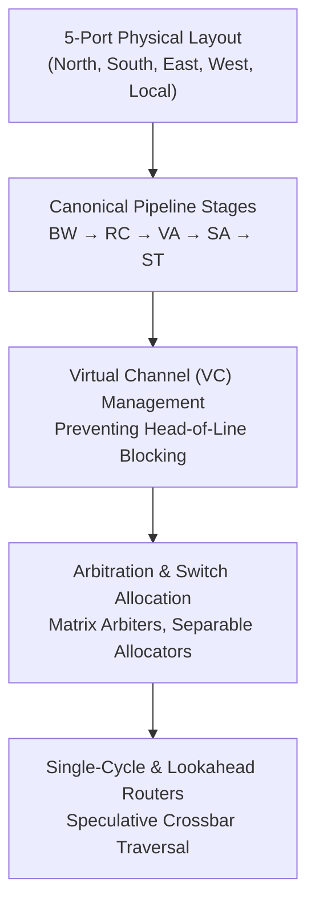

# Track 2: Router Microarchitecture

The router is the beating heart of a Network-on-Chip. A typical 2D mesh router contains 5 physical ports: **North, South, East, West, and Local** (connecting to the tile's CPU/cache network interface).

In this track, you will learn the internal datapath and control pipelines that allow modern routers to forward millions of flits per second with single-cycle latencies.

---

## 🗺️ Track Roadmap

---

## 📖 Lessons in this Track

1. **[2.1 Canonical Router Pipeline](01-pipeline-stages.md)**  
   Deconstructing the classical 5-stage router pipeline: Buffer Write (BW), Route Computation (RC), Virtual Channel Allocation (VA), Switch Allocation (SA), and Switch Traversal (ST). Lookahead routing optimization.
2. **[2.2 Virtual Channel (VC) Design](02-virtual-channels.md)**  
   Head-of-Line (HoL) blocking explained. Multiple virtual channels sharing one physical link. VC state machines and buffer partitioning.
3. **[2.3 Arbitration & Crossbar Switching](03-arbitration-crossbar.md)**  
   Designing fair and fast arbiters: Matrix arbiters, Round-Robin arbiters, separable input-first/output-first allocators, and crossbar multiplexer design.
