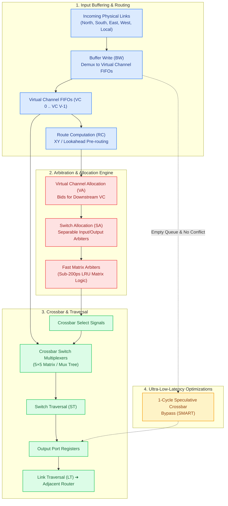

# Track 2: Router Microarchitecture

  
Silicon Microarchitecture • Module 02

  <h1>On-Chip Router Microarchitecture &amp; Pipeline Design</h1>
  

    Explore the internal anatomy of silicon on-chip routers. From the classic 5-stage canonical pipeline (BW-RC-VA-SA-ST) to 1-stage speculative bypass routers, matrix arbiters, and crossbar switches capable of switching terabits per second in sub-nanosecond cycle times.
  

  

    ⏱️ 4 In-Depth Lessons
    🔬 4 Interactive Simulators
    💾 5 Synthesizable Verilog Modules
    🎯 3-Question Quizzes
    🎮 Arcade Game Linkages
    📖 Aligned with Book Chapter 3
  

  

    

      📚 Aligned with Official Textbook Chapter 3
    

    

      Deep dive into <strong>Chapter 3: High-Performance Router Microarchitecture &amp; Arbitration</strong> for formal iSLIP matching proofs, sub-200ps matrix arbiters, single-cycle SMART traversal limits, and BuffeRS bypass scheduling.
    

  

  <a href="../textbook/ch03-router-microarchitecture/" style="display: inline-flex; align-items: center; gap: 6px; background: #2563eb; color: #ffffff; padding: 8px 16px; border-radius: 6px; font-weight: 600; font-size: 0.85rem; text-decoration: none; transition: background 0.2s;">
    Read Chapter 3 Online →
  </a>

---

## 🗺️ Microarchitecture Roadmap

The diagram below illustrates how flit datapaths and control logic interact within a standard 5-port on-chip router:

---

## 📚 Syllabus & Chapters in Track 2

  

    

      Lesson 2.1
      
Canonical Router Pipeline

      

        Deconstruct the classical 5-stage router pipeline: Buffer Write (BW), Route Computation (RC), Virtual Channel Allocation (VA), Switch Allocation (SA), and Switch Traversal (ST). Learn how Head flits carve the path while Body/Tail flits bypass RC and VA.
      

      

        ⚡ <strong>Features:</strong> Synthesizable Verilog <code>lookahead_route_compute.v</code>, Interactive Pipeline Stepper, 3-Question Quiz, Arcade links to <em>Packet Master</em> &amp; <em>Deadlock Buster</em>.
      

    

    <a href="01-pipeline-stages/" class="noc-track-link">Launch Lesson 2.1 →</a>
  

  

    

      Lesson 2.2
      
Virtual Channel (VC) Architecture

      

        Eliminate Head-of-Line (HoL) blocking by multiplexing multiple logical FIFOs onto a shared physical link. Understand the VC finite state machine (IDLE, ROUTING, WAITING_VC, ACTIVE), dynamic buffer allocation, and Virtual Networks (VNETs).
      

      

        ⚡ <strong>Features:</strong> Synthesizable Verilog <code>vc_fsm_allocator.v</code>, Interactive HoL Solver, 3-Question Quiz, Arcade links to <em>Arbiter Arena</em> &amp; <em>QoS Gladiator</em>.
      

    

    <a href="02-virtual-channels/" class="noc-track-link">Launch Lesson 2.2 →</a>
  

  

    

      Lesson 2.3
      
Arbitration &amp; Crossbar Switching

      

        Architect sub-nanosecond arbiters: Round-Robin vs Triangular Matrix Arbiters with Least Recently Used (LRU) updates. Solve the bipartite maximum matching bottleneck using Separable Input-First and Output-First Switch Allocators.
      

      

        ⚡ <strong>Features:</strong> Synthesizable Verilog <code>matrix_arbiter.v</code> &amp; <code>crossbar_5x5.v</code>, Interactive 4×4 Matrix Simulator, 3-Question Quiz, Arcade links to <em>Arbiter Arena</em> &amp; <em>Chiplet Tycoon</em>.
      

    

    <a href="03-arbitration-crossbar/" class="noc-track-link">Launch Lesson 2.3 →</a>
  

  

    

      Lesson 2.4
      
Low-Latency &amp; Single-Cycle Routers

      

        Explore aggressive microarchitectural optimizations: Speculative Switch Allocation (Peh &amp; Dally), 1-cycle direct crossbar bypass, and SMART (Single-cycle Multi-hop Asynchronous Repeated Traversal) for multi-hop zero-delay bypass.
      

      

        ⚡ <strong>Features:</strong> Synthesizable Verilog <code>smart_bypass_unit.v</code>, Interactive SMART Multi-Hop Simulator, 3-Question Quiz, Arcade links to <em>Deflection Duel</em> &amp; <em>Hotspot Hero</em>.
      

    

    <a href="04-low-latency-bypass-routers/" class="noc-track-link">Launch Lesson 2.4 →</a>
  

---

## 🎯 Track Learning Objectives

Upon completing Track 2, you will be able to:

1. **Trace the exact clock cycle timing** of Head, Body, and Tail flits through a pipelined router and compute the uncontended zero-load router latency.
2. **Design and configure Virtual Channel state machines** to completely eliminate Head-of-Line blocking and isolate cache coherence protocol traffic into independent Virtual Networks.
3. **Implement synthesizable Verilog RTL** for high-frequency Matrix Arbiters and explain how 2-gate-level triangular priority matrices enforce LRU fairness.
4. **Evaluate Separable Switch Allocators** (Input-First vs Output-First) and calculate bipartite matching efficiency under synthetic and real-world traffic patterns.
5. **Architect single-cycle speculative bypass routers** (SMART and lookahead routing) to compress per-hop traversal penalties from 5 clock cycles down to 1 clock cycle.

Ready to begin? Start with **[Lesson 2.1: Canonical Router Pipeline](01-pipeline-stages.md)**.
