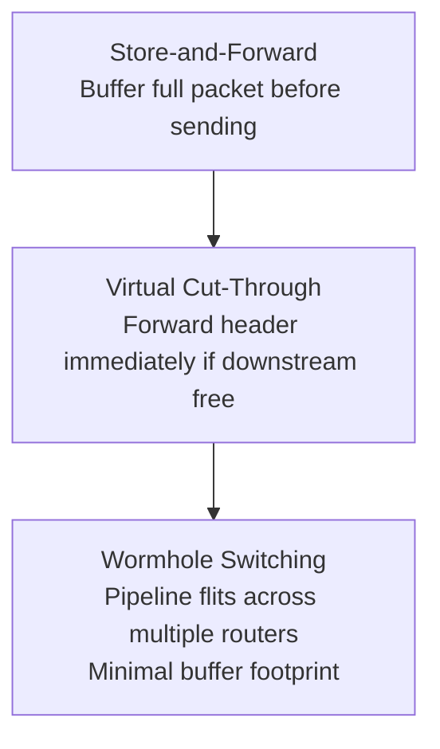

# Lesson 2.2: Switching Mechanisms: SAF, VCT & Wormhole

  
Track 02 • Lesson 02

  <h1>Switching Techniques: Store-and-Forward vs VCT vs Wormhole</h1>
  

    Contrast packet-level buffering against flit-level streaming, derive zero-load latency formulas, and understand why wormhole switching revolutionized on-chip router buffer sizing.
  

---

## 1. Taxonomic Hierarchy of Switching Techniques

On-chip interconnection networks transmit data by breaking variable-sized application messages into fixed-size **packets**, which are further subdivided into flow control units (**flits**):

| Switching Mechanism | Allocation Granularity | Buffer Sizing Requirement | Zero-Load Latency ($T_0$) |
|---|---|---|---|
| **Store-and-Forward (SAF)** | Entire Packet | $B \ge \text{Packet Size}$ (Large) | $H \cdot \left( \frac{L}{W} + t_r \right)$ |
| **Virtual Cut-Through (VCT)** | Entire Packet (Cut-through on header) | $B \ge \text{Packet Size}$ | $H \cdot t_r + \frac{L}{W}$ |
| **Wormhole Switching** | Flit-by-Flit | $B \ge \text{Flit Size}$ (Small, e.g., 2–4 flits) | $H \cdot t_r + \frac{L}{W}$ |

where $H$ is the number of router hops, $L/W$ is the packet serialization latency in cycles, and $t_r$ is the router pipeline latency per hop.

---

## 2. Wormhole Switching & Head-of-Line Blocking

In wormhole switching:
* The **HEAD flit** carries routing information and reserves the output virtual channel.
* **BODY flits** follow the exact path carved by the head flit without routing overhead.
* The **TAIL flit** releases channel and buffer allocations.

If the head flit is blocked due to downstream congestion, the trailing body flits stop in place across multiple routers, tying up physical links. This is known as **Head-of-Line (HoL) Blocking**, which is resolved using **Virtual Channels (VCs)**.

---

## 3. Self-Check Assessment

**Question 1:** Why is pure Store-and-Forward switching impractical for on-chip routers?  
*Answer:* It requires buffering full multi-kilobyte packets at every input port, which consumes excessive SRAM area and leakage power in silicon.

**Question 2:** In the absence of network congestion, how does the zero-load latency of Wormhole switching compare to Virtual Cut-Through?  
*Answer:* They are identical ($H \cdot t_r + L/W$), because the head flit immediately cuts through downstream routers without waiting for body flits.

**Question 3:** What flit is responsible for releasing virtual channel and buffer reservations in a wormhole router?  
*Answer:* The TAIL flit.

---

👉 **Next: [Lesson 2.3: Flow Control & The Credit Turnaround Loop](03-flow-control-credit.md)**
