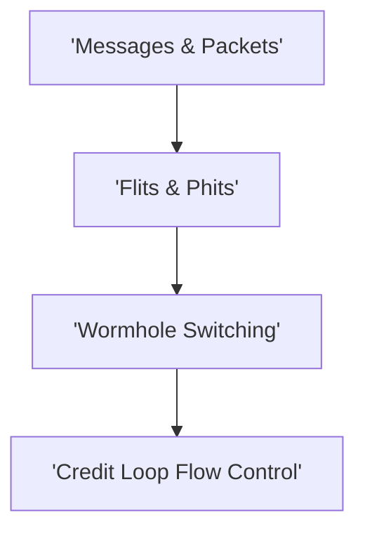

# Track 2: Switching, Flow Control & Buffers

  
Network Architecture • Module 02

  <h1>Switching, Flow Control & Buffers</h1>
  
Wormhole vs VCT switching, flits/phits, credit turnaround latency loops, Virtual Channel buffers, and AXI4/TileLink NI packetization.

  

    ⏱️ 4 In-Depth Lessons
    🔬 Interactive Simulators &amp; Tools
    💻 Synthesizable Verilog RTL
    📜 Grounded in Official Monograph
  

  

    

      📚 Aligned with Chapter 2 of Official 12-Chapter Textbook
    

    

      Explore complete theoretical derivations, physical scaling parameters, and microarchitectural proofs in <strong>Chapter 2</strong>.
    

  

  <a href="../textbook/ch02-switching-flow-control/" style="display: inline-flex; align-items: center; gap: 6px; background: #2563eb; color: #ffffff; padding: 8px 16px; border-radius: 6px; font-weight: 600; font-size: 0.85rem; text-decoration: none;">
    Read Chapter 2 in Textbook →
  </a>

---

## 🗺️ Architectural Learning Roadmap

The diagram below outlines how the core concepts in Track 2 connect across the physical and protocol layers:

---

## 📚 Syllabus & Lessons in Track 2

  

    

      Lesson 2.1
      
Packets, Flits & Phits

      
Hierarchy of data transmission: Messages, Packets, Flits, and physical wire Phits.

      

        ⚡ <strong>Features:</strong> Flit Packetization Simulator
      

    

    <a href="01-packet-switching-flits/" class="noc-track-link">Launch Lesson 2.1 →</a>
  

  

    

      Lesson 2.2
      
Switching Mechanisms: SAF, VCT & Wormhole

      
Deep dive into Store-and-Forward, Virtual Cut-Through, and Wormhole buffer allocation.

      

        ⚡ <strong>Features:</strong> Zero-Load Latency Equation Explorer
      

    

    <a href="02-switching-mechanisms/" class="noc-track-link">Launch Lesson 2.2 →</a>
  

  

    

      Lesson 2.3
      
Flow Control & Credit Turnaround Loops

      
Lossless backpressure, credit turnaround latency loops, and minimum buffer sizing B_min >= RTT.

      

        ⚡ <strong>Features:</strong> Credit Flow Control CAD Flow Control Simulator
      

    

    <a href="03-flow-control-credit/" class="noc-track-link">Launch Lesson 2.3 →</a>
  

  

    

      Lesson 2.4
      
Network Interfaces & AXI Packetization

      
Translating CPU memory requests (AXI4/TileLink) into on-chip flit streams.

      

        ⚡ <strong>Features:</strong> Synthesizable NI Verilog RTL
      

    

    <a href="04-network-interface-packetization/" class="noc-track-link">Launch Lesson 2.4 →</a>
  

---

## 💻 Web EDA Unix Workbench Quick Launch

Simulate, verify, and inspect the synthesizable SystemVerilog implementations for Track 2 using our integrated in-browser terminal:

  guest@noc:~$ run-sim --topo mesh4x4 --algo xy --inj 0.05 
  [SIM-EXEC] Progress: [========================================] 100% (Zero-load latency: 4.85 cyc)

👉 **[Launch Interactive Web EDA Unix Terminal &amp; Visualizer](../interactive/terminal/)**
