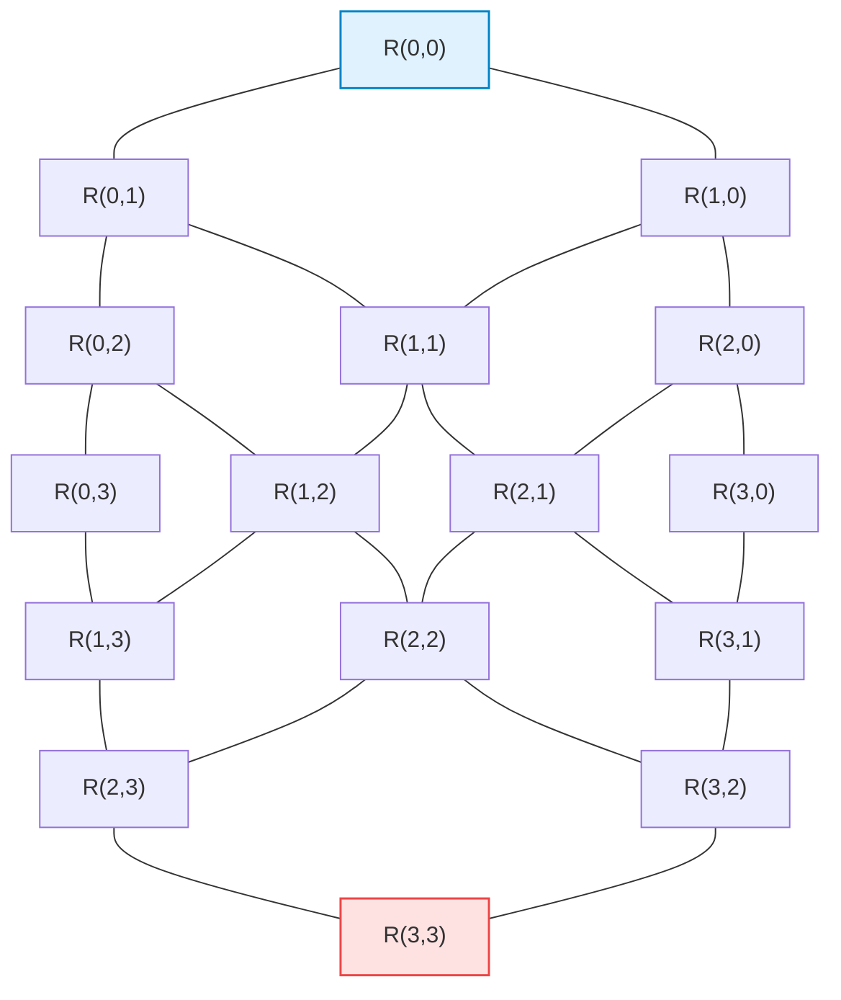
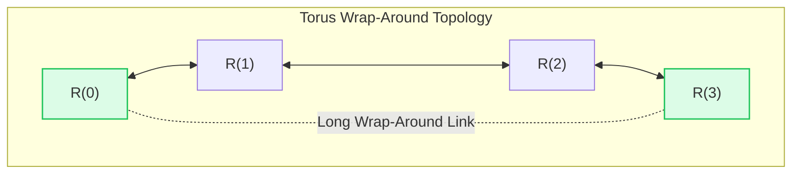
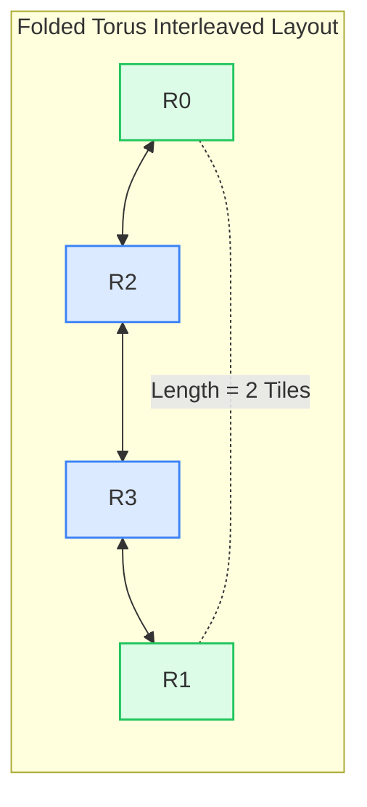

# 3.1 Direct Topologies: Mesh, Torus & Folded Torus

In a **Direct Topology**, every router is directly coupled with a processing node (CPU core, GPU compute unit, or memory controller). Direct topologies map naturally to the planar surface of a silicon die, providing regular physical tiling and predictable point-to-point wiring channels.

In this lesson, we derive the mathematical foundations of planar direct topologies—focusing on the **2D Mesh**, **2D Torus**, and **Folded Torus**—and examine how physical wire length constraints dictate topological selection.

<div class="noc-callout" style="background: rgba(15, 118, 110, 0.08); border-left: 4px solid #0f766e; padding: 1rem 1.25rem; margin: 1.5rem 0; border-radius: 0 8px 8px 0;">
  <div style="font-weight: 700; color: #0f766e; margin-bottom: 0.25rem;">📖 Textbook Reference</div>
  <div style="color: #334155; font-size: 0.95rem;">
    Dive deeper into first-principles bisection bandwidth derivations and folded torus Elmore delay invariance in <strong><a href="https://github.com/network-on-chip/book/blob/main/chapters/ch04-topologies-and-metrics/index.md#42-direct-topologies-2d-mesh-2d-torus--the-folded-torus" target="_blank" rel="noopener">Chapter 4.2: Direct Topologies</a></strong> of the companion textbook.
  </div>
</div>

---

## 1. Mathematical Framework for Network Topologies

Any interconnect network can be formally modeled as a graph $G = (V, E)$, where $V$ represents the set of router/processing nodes ($|V| = N$) and $E$ represents the set of bidirectional physical channels ($|E| = C$).

### Key Topological Metrics:

1. **Node Degree (Radix $\delta$):**  
   The number of physical channels connected to a single router. Higher radix increases router crossbar complexity but reduces network hop distance.
2. **Network Diameter ($D$):**  
   The maximum shortest-path distance between any pair of nodes in the network: $D = \max_{u, v \in V} \text{dist}(u, v)$. Diameter dictates the worst-case zero-load communication latency across the chip.
3. **Average Hop Distance ($H_{avg}$):**  
   The expected shortest-path distance averaged across all source-destination pairs under uniform random traffic:

$$H_{avg} = \frac{1}{N(N - 1)} \sum_{u \in V} \sum_{v \ne u} \text{dist}(u, v)$$

4. **Bisection Bandwidth ($B_b$):**  
   The minimum number of channel links that must be severed to partition the network into two equal halves ($N/2$ nodes each), multiplied by channel link width $w$:

$$B_b = \min_{A \subset V, |A| = N/2} \sum_{u \in A, v \in V \setminus A} \text{capacity}(u, v)$$

   Bisection bandwidth sets the absolute upper bound on global cross-chip data throughput.

---

## 2. The 2D Mesh

The **2D Mesh** is the most widely deployed topology in commercial multicore processors (including the Intel Xeon Scalable family, Tilera TILE64, and Google TPU v2/v3).



For a square $k \times k$ 2D mesh containing $N = k^2$ nodes:

### Mathematical Metric Derivations:

#### A. Node Degree (Asymmetric Boundary):
Unlike symmetric networks, a 2D mesh has open physical boundaries:
- **Corner Routers (4 nodes):** $\delta = 2$ network ports (+ 1 local port = 3-port switch).
- **Edge Routers ($4(k - 2)$ nodes):** $\delta = 3$ network ports (+ 1 local port = 4-port switch).
- **Interior Routers ($(k - 2)^2$ nodes):** $\delta = 4$ network ports (+ 1 local port = 5-port switch).

#### B. Network Diameter ($D_{mesh}$):
The worst-case path connects diagonally opposite corners (e.g., from Node $(0,0)$ to Node $(k-1, k-1)$):

$$D_{mesh} = (k - 1) + (k - 1) = 2(k - 1) = 2(\sqrt{N} - 1)$$

*Example:* For an $8 \times 8$ mesh ($N = 64$ cores), $D = 2 \times (8 - 1) = \mathbf{14\text{ hops}}$.

#### C. Average Hop Distance ($H_{avg, mesh}$):
In a 1D linear array of $k$ nodes, the average distance between any two nodes is:

$$H_{avg, 1D} = \frac{1}{k^2} \sum_{i=0}^{k-1} \sum_{j=0}^{k-1} |i - j| = \frac{k^2 - 1}{3k} \approx \frac{k}{3}$$

Because orthogonal dimensions in a 2D mesh are independent:

$$H_{avg, mesh} = 2 \times H_{avg, 1D} = \frac{2(k^2 - 1)}{3k} \approx \mathbf{\frac{2}{3} k = \frac{2}{3} \sqrt{N}}$$

*Example:* For $N = 64$ ($k = 8$), $H_{avg} \approx \frac{2}{3} \times 8 = \mathbf{5.33\text{ hops}}$.

#### D. Bisection Bandwidth ($B_{b, mesh}$):
Bisecting a $k \times k$ mesh vertically cuts through exactly $k$ horizontal bidirectional channels. Each channel carries $2$ unidirectional physical links of width $w$:

$$B_{b, mesh} = 2k \cdot w = \mathbf{2\sqrt{N} \cdot w}$$

*Example:* For $N = 64$ with $128\text{-bit}$ channels ($16\text{ Bytes}$), the bisection cut slices $2 \times 8 = 16\text{ links}$, yielding $B_b = 16 \times 16\text{ Bytes} = \mathbf{256\text{ Bytes/cycle}}$.

---

## 3. The 2D Torus (k-ary 2-cube)

The **2D Torus** adds periodic **wrap-around channels** connecting the boundary routers (Column 0 connects to Column $k-1$; Row 0 connects to Row $k-1$):



### Mathematical Metric Derivations:

#### A. Node Degree (Completely Symmetric):
Because of wrap-around links, boundary nodes no longer exist! **Every router in a 2D torus has an identical degree of $\delta = 4$** (+ 1 local port).

#### B. Network Diameter ($D_{torus}$):
In each dimension, a packet never needs to travel more than $\lfloor k/2 \rfloor$ hops:

$$D_{torus} = 2 \times \left\lfloor \frac{k}{2} \right\rfloor \approx \mathbf{k = \sqrt{N}}$$

*Example:* For an $8 \times 8$ torus, $D = 2 \times 4 = \mathbf{8\text{ hops}}$ (cutting diameter by **43%** compared to 14 hops in a mesh!).

#### C. Average Hop Distance ($H_{avg, torus}$):

$$H_{avg, torus} \approx \mathbf{\frac{1}{2} k = \frac{1}{2} \sqrt{N}}$$

*Example:* For $N = 64$ ($k = 8$), $H_{avg} \approx 4.0\text{ hops}$ (compared to $5.33$ in a mesh).

#### D. Bisection Bandwidth ($B_{b, torus}$):
Cutting a torus into two equal halves severs both the center channels AND the wrap-around channels:

$$B_{b, torus} = 4k \cdot w = \mathbf{4\sqrt{N} \cdot w} \quad \text{(Exactly DOUBLE the Mesh!)}$$

---

## 4. The Long Wrap-Around Wire Crisis & The Folded Torus

While the 2D Torus delivers **double the bisection bandwidth** and **half the diameter**, naive physical layout introduces a severe physical defect: **The wrap-around links span the entire length and width of the silicon die!**

```
Naive Torus Physical Layout:
[R0] === [R1] === [R2] === [R3]
 |                           |
 +===========================+  <-- Wrap-Around Wire Length = (k-1) * Tile_Width!
```

For an $8 \times 8$ torus on a $20\text{ mm}$ die, each wrap-around link spans over **$17.5\text{ mm}$**, creating massive capacitive RC delay and requiring repeaters. Because a network operates synchronously at the speed of its slowest link, long wrap-around wires would force the entire NoC clock frequency to drop by 50% or more!

---

### The Elegant Solution: The Folded Torus

To solve this, architects interleave physical node placement using a **Folded Layout** (Dally & Seitz, 1986):

```
Physical Ordering: Node 0 ➔ Node 2 ➔ Node 3 ➔ Node 1
```



In the folded layout:
- $R_0$ connects to $R_1$ (distance = $2\text{ tiles}$)
- $R_1$ connects to $R_2$ (distance = $2\text{ tiles}$)
- $R_2$ connects to $R_3$ (distance = $1\text{ tile}$)
- $R_3$ connects to $R_0$ (distance = $2\text{ tiles}$)

#### Mathematical Guarantee:
**Every single physical link in a Folded Torus has length at most $2 \times L_{tile}$!**
The $17.5\text{ mm}$ global wire is completely eliminated. All wires are short and uniform, allowing the Folded Torus to run at peak gigahertz clock frequencies while preserving the $2\times$ bisection bandwidth advantage of the torus!

---

## 5. 🎛️ Interactive Mesh vs. Torus Topology Explorer

Explore the topological properties of 2D Meshes and Tori below. Switch between topologies, select any Source and Destination node by clicking on the grid, and inspect the shortest path, hop count, and bisection cut in real time!

<div class="noc-sim-container" id="topoExplorer">
  <div style="font-size:1.1rem; font-weight:700; color:var(--tcl-heading); margin-bottom:1rem; display:flex; align-items:center; justify-content:space-between; flex-wrap:wrap; gap:0.5rem;">
    <span>🔬 Interactive Mesh vs. Torus Topology Explorer</span>
    <span id="topoBadge" style="font-family:'JetBrains Mono', monospace; font-size:0.9rem; font-weight:700; color:var(--tcl-blue-600); background:rgba(37,99,235,0.1); padding:3px 10px; border-radius:6px;">
      4×4 Grid (16 Tiles)
    </span>
  </div>

  <div class="noc-sim-controls">
    <label><b>Topology:</b>
      <select id="selTopoType" class="noc-sim-select" onchange="updateTopoSim()">
        <option value="mesh" selected>2D Mesh (Open Boundaries)</option>
        <option value="torus">2D Torus (Wrap-around Links)</option>
        <option value="folded">Folded 2D Torus (Interleaved Wires)</option>
      </select>
    </label>

    <label><b>Grid Dimension:</b>
      <select id="selGridK" class="noc-sim-select" onchange="updateTopoSim()">
        <option value="4" selected>4×4 (16 Nodes)</option>
        <option value="6">6×6 (36 Nodes)</option>
        <option value="8">8×8 (64 Nodes)</option>
      </select>
    </label>

    <button class="noc-sim-btn" onclick="randomizeEndpoints()">🎲 Random Endpoints</button>
    <button class="noc-sim-btn secondary" onclick="resetTopoEndpoints()">🔄 Reset</button>

    <div style="margin-left:auto; font-size:0.85rem; color:var(--noc-text-muted);">
      Click any tile on grid to set <b>Source (Cyan)</b> and <b>Dest (Orange)</b>
    </div>
  </div>

  <!-- Interactive Grid Canvas Display -->
  <div style="display:grid; grid-template-columns: 1fr 280px; gap:1.25rem; align-items:start;">
    <div style="background:var(--noc-surface-subtle); border:1px solid var(--noc-border); border-radius:10px; padding:1.25rem; text-align:center; overflow-x:auto;">
      <canvas id="topoCanvas" width="460" height="420" style="max-width:100%; border-radius:8px; cursor:pointer;" onclick="handleCanvasClick(event)"></canvas>
    </div>

    <!-- Live Topological Scoreboard -->
    <div style="display:flex; flex-direction:column; gap:0.75rem;">
      <div style="background:var(--noc-surface); border:1.5px solid var(--tcl-border); border-radius:8px; padding:1rem;">
        <div style="font-size:0.75rem; color:var(--noc-text-muted); text-transform:uppercase; font-weight:700;">Shortest Path Distance</div>
        <div id="dispPathHops" style="font-size:1.8rem; font-weight:900; color:var(--tcl-blue-600); margin:4px 0;">-- hops</div>
        <div id="dispPathCoords" style="font-family:'JetBrains Mono', monospace; font-size:0.8rem; color:var(--noc-text-muted);">From (0,0) to (3,3)</div>
      </div>

      <div style="background:var(--noc-surface); border:1px solid var(--noc-border); border-radius:8px; padding:1rem; font-size:0.85rem; line-height:1.6;">
        <div style="font-weight:700; color:var(--tcl-heading); margin-bottom:4px;">Theoretical Network Metrics:</div>
        • <b>Network Diameter:</b> <span id="dispDiameter" style="font-weight:700; color:var(--tcl-blue-600);">6 hops</span><br>
        • <b>Average Hop Distance:</b> <span id="dispAvgHops" style="font-weight:700;">2.67 hops</span><br>
        • <b>Bisection Channels:</b> <span id="dispBisectCh" style="font-weight:700; color:#16a34a;">8 channels</span><br>
        • <b>Max Wire Length:</b> <span id="dispMaxWire" style="font-weight:700;">1.0 tile width</span>
      </div>

      <div id="topoFeatureCallout" style="background:rgba(37,99,235,0.08); border:1px solid rgba(37,99,235,0.25); border-radius:8px; padding:0.75rem 1rem; font-size:0.82rem; color:var(--tcl-heading); line-height:1.5;"></div>
    </div>
  </div>
</div>

<script>
let topoState = {
  k: 4,
  type: "mesh",
  src: { x: 0, y: 0 },
  dst: { x: 3, y: 3 }
};

function updateTopoSim() {
  topoState.type = document.getElementById("selTopoType").value;
  topoState.k = parseInt(document.getElementById("selGridK").value, 10);
  
  if (topoState.src.x >= topoState.k) topoState.src.x = 0;
  if (topoState.src.y >= topoState.k) topoState.src.y = 0;
  if (topoState.dst.x >= topoState.k) topoState.dst.x = topoState.k - 1;
  if (topoState.dst.y >= topoState.k) topoState.dst.y = topoState.k - 1;

  document.getElementById("topoBadge").textContent = `${topoState.k}×${topoState.k} Grid (${topoState.k * topoState.k} Tiles)`;

  computeMetrics();
  drawTopoCanvas();
}

function randomizeEndpoints() {
  const k = topoState.k;
  topoState.src = { x: Math.floor(Math.random() * k), y: Math.floor(Math.random() * k) };
  let dx = Math.floor(Math.random() * k);
  let dy = Math.floor(Math.random() * k);
  while (dx === topoState.src.x && dy === topoState.src.y) {
    dx = Math.floor(Math.random() * k);
    dy = Math.floor(Math.random() * k);
  }
  topoState.dst = { x: dx, y: dy };
  computeMetrics();
  drawTopoCanvas();
}

function resetTopoEndpoints() {
  topoState.src = { x: 0, y: 0 };
  topoState.dst = { x: topoState.k - 1, y: topoState.k - 1 };
  computeMetrics();
  drawTopoCanvas();
}

function computeMetrics() {
  const k = topoState.k;
  const N = k * k;
  const isTorus = (topoState.type === "torus" || topoState.type === "folded");

  // Distance computation
  let dx = Math.abs(topoState.src.x - topoState.dst.x);
  let dy = Math.abs(topoState.src.y - topoState.dst.y);

  if (isTorus) {
    dx = Math.min(dx, k - dx);
    dy = Math.min(dy, k - dy);
  }
  const hops = dx + dy;

  document.getElementById("dispPathHops").textContent = `${hops} hop${hops === 1 ? '' : 's'}`;
  document.getElementById("dispPathCoords").textContent = `From (${topoState.src.x},${topoState.src.y}) to (${topoState.dst.x},${topoState.dst.y})`;

  // Theoretical Metrics
  const diam = isTorus ? (2 * Math.floor(k / 2)) : (2 * (k - 1));
  const avgHops = isTorus ? (0.5 * k).toFixed(2) : ((2 * (k*k - 1)) / (3 * k)).toFixed(2);
  const bisect = isTorus ? (4 * k) : (2 * k);
  const maxWire = (topoState.type === "torus") ? `${k - 1} tiles (LONG WIRE!)` : (topoState.type === "folded" ? "2.0 tiles (Uniform)" : "1.0 tile");

  document.getElementById("dispDiameter").textContent = `${diam} hops`;
  document.getElementById("dispAvgHops").textContent = `${avgHops} hops`;
  document.getElementById("dispBisectCh").textContent = `${bisect} channels (${bisect * 16} B/cyc)`;
  document.getElementById("dispMaxWire").textContent = maxWire;

  const callout = document.getElementById("topoFeatureCallout");
  if (topoState.type === "mesh") {
    callout.innerHTML = `
      <strong>2D Mesh Characteristics:</strong><br>
      • Maximum wire length is strictly 1.0 tile width.<br>
      • Open boundaries mean bisection is $2k$ channels, causing traffic congestion in central bisection rows.
    `;
  } else if (topoState.type === "torus") {
    callout.innerHTML = `
      <strong>2D Torus Characteristics:</strong><br>
      • Bisection bandwidth is <strong>doubled ($4k$ channels)</strong> and diameter is halved.<br>
      • ⚠️ <strong>Physical Defect:</strong> The wrap-around wires span <strong>${k-1} tiles (${(k-1)*2.2} mm)</strong> across the full chip!
    `;
  } else {
    callout.innerHTML = `
      <strong>Folded Torus Characteristics:</strong><br>
      • Interleaved layout preserves full $4k$ bisection and minimal torus diameter.<br>
      • 🟢 <strong>Physical Guarantee:</strong> All physical wires are bounded to at most <strong>2.0 tile widths</strong>!
    `;
  }
}

function drawTopoCanvas() {
  const canvas = document.getElementById("topoCanvas");
  const ctx = canvas.getContext("2d");
  const width = canvas.width;
  const height = canvas.height;
  const k = topoState.k;

  ctx.clearRect(0, 0, width, height);

  const margin = 50;
  const gridW = width - 2 * margin;
  const gridH = height - 2 * margin;
  const stepX = gridW / (k - 1);
  const stepY = gridH / (k - 1);

  // 1. Draw Links
  ctx.lineWidth = 2;
  ctx.strokeStyle = "#cbd5e1";

  for (let y = 0; y < k; y++) {
    for (let x = 0; x < k; x++) {
      const px = margin + x * stepX;
      const py = margin + y * stepY;

      // Horizontal mesh link
      if (x < k - 1) {
        ctx.beginPath();
        ctx.moveTo(px, py);
        ctx.lineTo(px + stepX, py);
        ctx.stroke();
      }
      // Vertical mesh link
      if (y < k - 1) {
        ctx.beginPath();
        ctx.moveTo(px, py);
        ctx.lineTo(px, py + stepY);
        ctx.stroke();
      }
    }
  }

  // 2. Draw Torus Wrap-around Links if active
  if (topoState.type === "torus") {
    ctx.strokeStyle = "rgba(234, 88, 12, 0.4)";
    ctx.setLineDash([4, 4]);
    for (let y = 0; y < k; y++) {
      const py = margin + y * stepY;
      ctx.beginPath();
      ctx.moveTo(margin, py);
      ctx.bezierCurveTo(margin - 40, py - 30, margin - 40, py + 30, margin, py);
      ctx.stroke();
      // Right wrap
      ctx.beginPath();
      ctx.moveTo(margin + (k-1)*stepX, py);
      ctx.bezierCurveTo(margin + (k-1)*stepX + 40, py - 30, margin + (k-1)*stepX + 40, py + 30, margin + (k-1)*stepX, py);
      ctx.stroke();
    }
    ctx.setLineDash([]);
  } else if (topoState.type === "folded") {
    ctx.strokeStyle = "rgba(22, 163, 74, 0.6)";
    ctx.setLineDash([2, 2]);
    // Indicate folded interleaving
    ctx.strokeRect(margin - 10, margin - 10, gridW + 20, gridH + 20);
    ctx.setLineDash([]);
  }

  // 3. Highlight Bisection Cut line
  const midX = margin + ((k - 1) / 2) * stepX;
  ctx.strokeStyle = "rgba(239, 68, 68, 0.6)";
  ctx.lineWidth = 2.5;
  ctx.setLineDash([6, 6]);
  ctx.beginPath();
  ctx.moveTo(midX, margin - 25);
  ctx.lineTo(midX, height - margin + 25);
  ctx.stroke();
  ctx.setLineDash([]);

  ctx.fillStyle = "#ef4444";
  ctx.font = "bold 11px 'Inter', sans-serif";
  ctx.fillText("BISECTION CUT", midX - 40, margin - 30);

  // 4. Highlight Shortest Path
  ctx.strokeStyle = "#2563eb";
  ctx.lineWidth = 4;
  ctx.beginPath();
  let currX = topoState.src.x;
  let currY = topoState.src.y;
  ctx.moveTo(margin + currX * stepX, margin + currY * stepY);

  // XY Routing progression
  while (currX !== topoState.dst.x) {
    if (topoState.type === "torus" || topoState.type === "folded") {
      const directDist = topoState.dst.x - currX;
      if (Math.abs(directDist) <= k / 2) {
        currX += Math.sign(directDist);
      } else {
        currX = (currX - Math.sign(directDist) + k) % k;
      }
    } else {
      currX += (topoState.dst.x > currX) ? 1 : -1;
    }
    ctx.lineTo(margin + currX * stepX, margin + currY * stepY);
  }
  while (currY !== topoState.dst.y) {
    if (topoState.type === "torus" || topoState.type === "folded") {
      const directDist = topoState.dst.y - currY;
      if (Math.abs(directDist) <= k / 2) {
        currY += Math.sign(directDist);
      } else {
        currY = (currY - Math.sign(directDist) + k) % k;
      }
    } else {
      currY += (topoState.dst.y > currY) ? 1 : -1;
    }
    ctx.lineTo(margin + currX * stepX, margin + currY * stepY);
  }
  ctx.stroke();

  // 5. Draw Nodes
  for (let y = 0; y < k; y++) {
    for (let x = 0; x < k; x++) {
      const px = margin + x * stepX;
      const py = margin + y * stepY;

      ctx.beginPath();
      ctx.arc(px, py, 10, 0, Math.PI * 2);

      if (x === topoState.src.x && y === topoState.src.y) {
        ctx.fillStyle = "#0284c7"; // Cyan source
      } else if (x === topoState.dst.x && y === topoState.dst.y) {
        ctx.fillStyle = "#ea580c"; // Orange dest
      } else {
        ctx.fillStyle = "#0f172a";
      }
      ctx.fill();
      ctx.strokeStyle = "#ffffff";
      ctx.lineWidth = 2;
      ctx.stroke();

      // Node text coordinate
      ctx.fillStyle = "#64748b";
      ctx.font = "9px 'JetBrains Mono', monospace";
      ctx.fillText(`${x},${y}`, px - 9, py + 18);
    }
  }
}

function handleCanvasClick(evt) {
  const canvas = document.getElementById("topoCanvas");
  const rect = canvas.getBoundingClientRect();
  const clickX = (evt.clientX - rect.left) * (canvas.width / rect.width);
  const clickY = (evt.clientY - rect.top) * (canvas.height / rect.height);

  const k = topoState.k;
  const margin = 50;
  const stepX = (canvas.width - 2 * margin) / (k - 1);
  const stepY = (canvas.height - 2 * margin) / (k - 1);

  // Find nearest node
  let nearest = null;
  let minD = 9999;
  for (let y = 0; y < k; y++) {
    for (let x = 0; x < k; x++) {
      const px = margin + x * stepX;
      const py = margin + y * stepY;
      const d = Math.hypot(clickX - px, clickY - py);
      if (d < minD && d < 25) {
        minD = d;
        nearest = { x, y };
      }
    }
  }

  if (nearest) {
    // If clicked source, reassign dest; else set dest
    if (nearest.x === topoState.src.x && nearest.y === topoState.src.y) {
      // do nothing
    } else {
      topoState.dst = nearest;
      computeMetrics();
      drawTopoCanvas();
    }
  }
}

if (document.readyState === "loading") {
  document.addEventListener("DOMContentLoaded", updateTopoSim);
} else {
  updateTopoSim();
}
</script>

---

## 6. Worked Numerical Example: Bisection Bandwidth & Latency Comparison

> [!TIP]
> **Problem Statement:**  
> An enterprise server processor integrates $N = 64\text{ compute cores}$ arranged in an $8 \times 8$ grid on a $16\text{ mm} \times 16\text{ mm}$ die ($L_{tile} = 2.0\text{ mm}$).  
> The on-chip network runs at $f = 2.0\text{ GHz}$ ($\tau = 0.5\text{ ns}$).  
> Channel width is $w = 128\text{ bits}$ ($16\text{ Bytes}$) bidirectional per link.  
> Router pipeline latency is $t_r = 1\text{ cycle}$ (speculative bypass), and link wire traversal is $t_{link} = 1\text{ cycle}$.  
> Packet length is $L = 5\text{ flits}$ ($64\text{ Bytes}$ cache line + header).  
> 
> Compare:
> 1. Bisection Bandwidth ($B_b$ in Terabytes/sec)
> 2. Average Zero-Load Packet Latency ($T_{avg}$ in nanoseconds)  
> between a **2D Mesh** and a **Folded 2D Torus**.

### Step 1: Bisection Bandwidth Comparison

In an $8 \times 8$ grid ($k = 8$):

- **2D Mesh:** Slices $2k = 16\text{ channels}$: $B_{b, mesh} = 16\text{ channels} \times 16\text{ Bytes/cycle} \times 2.0\text{ GHz} = \mathbf{512\text{ GB/s} = 0.512\text{ TB/s}}$
- **Folded 2D Torus:** Slices $4k = 32\text{ channels}$: $B_{b, torus} = 32\text{ channels} \times 16\text{ Bytes/cycle} \times 2.0\text{ GHz} = \mathbf{1,024\text{ GB/s} = 1.024\text{ TB/s}} \quad (\mathbf{2.0\times\text{ Higher!}})$

### Step 2: Average Zero-Load Latency Comparison

Under uniform random traffic:

$$T_{zero\_load} = H_{avg} \times (t_r + t_{link}) + \frac{L}{w}$$

- **2D Mesh ($H_{avg} = \frac{2}{3} \times 8 \approx 5.33\text{ hops}$):** $T_{mesh} = 5.33 \times (1 + 1) + 5 = 10.66 + 5 = \mathbf{15.66\text{ clock cycles} = 7.83\text{ ns}}$
- **Folded 2D Torus ($H_{avg} = \frac{1}{2} \times 8 = 4.0\text{ hops}$):** $T_{torus} = 4.0 \times (1 + 1) + 5 = 8.0 + 5 = \mathbf{13.0\text{ clock cycles} = 6.50\text{ ns}}$

### Conclusion:
The Folded Torus achieves **double the cross-chip bisection bandwidth** ($1.024\text{ TB/s}$ vs $0.512\text{ TB/s}$) and cuts average memory latency by **$17\%$**, with zero long-wire penalty due to folding!

---

---

## 7. 💻 Synthesizable Hardware: Folded Torus Coordinate & Link Mapper

In a physical silicon layout of a Folded Torus, routers must map logical 2D torus indices $(x, y)$ into interleaved physical tile locations on the die ($P(i) = 2i$ if $i < K/2$ else $2(K - 1 - i) + 1$) and compute output directions along the shortest wrap-around path.

The Verilog module below, `folded_torus_node_map.v`, provides a fully synthesizable coordinate mapper, Manhattan link direction generator, and physical wire pitch diagnostic unit:

```verilog
//=============================================================================
// Module: folded_torus_node_map
// Description: Synthesizable Folded Torus Physical Coordinate Mapper & Routing
//              Direction Generator for k-ary 2-cube networks.
//              Solves long wrap-around wire constraints by interleaving nodes:
//              P(i) = 2*i                if i < K/2
//              P(i) = 2*(K - 1 - i) + 1  if i >= K/2
//              Guarantees all physical inter-router links are <= 2 tile pitches.
//=============================================================================

module folded_torus_node_map #(
    parameter integer K        = 8, // Radix per dimension (8x8 = 64 nodes)
    parameter integer COORD_W  = 3, // log2(K) = 3 bits
    parameter integer DATA_W   = 64 // Packet payload width
)(
    input  wire                 clk,
    input  wire                 rst_n,

    // Current Router Configuration
    input  wire [COORD_W-1:0]   src_x,
    input  wire [COORD_W-1:0]   src_y,

    // Incoming Packet Header
    input  wire                 pkt_valid,
    input  wire [COORD_W-1:0]   dest_x,
    input  wire [COORD_W-1:0]   dest_y,
    input  wire [DATA_W-1:0]    pkt_data,

    // Computed Physical Coordinates & Wire Span Diagnostics
    output reg  [COORD_W-1:0]   phys_src_x,
    output reg  [COORD_W-1:0]   phys_src_y,
    output reg  [COORD_W-1:0]   phys_dest_x,
    output reg  [COORD_W-1:0]   phys_dest_y,
    output reg  [1:0]           max_wire_pitch, // Max wire span (strictly <= 2 pitches)

    // Decoded Output Direction (1-hot: [4]=LOCAL, [3]=NORTH, [2]=SOUTH, [1]=EAST, [0]=WEST)
    output reg  [4:0]           route_dir_1hot,
    output reg                  route_valid
);

    // Folded Physical Coordinate Mapping Function
    function automatic [COORD_W-1:0] fold_map;
        input [COORD_W-1:0] logical_coord;
        begin
            if (logical_coord < (K / 2)) begin
                fold_map = logical_coord << 1; // Even positions: 0, 2, 4, ...
            end else begin
                fold_map = (((K - 1) - logical_coord) << 1) + 1'b1; // Odd positions: ..., 5, 3, 1
            end
        end
    endfunction

    // Shortest Torus Direction Decoders
    wire [COORD_W-1:0] diff_x_fwd = (dest_x >= src_x) ? (dest_x - src_x) : (K + dest_x - src_x);
    wire [COORD_W-1:0] diff_x_rev = (src_x >= dest_x) ? (src_x - dest_x) : (K + src_x - dest_x);
    wire [COORD_W-1:0] diff_y_fwd = (dest_y >= src_y) ? (dest_y - src_y) : (K + dest_y - src_y);
    wire [COORD_W-1:0] diff_y_rev = (src_y >= dest_y) ? (src_y - dest_y) : (K + src_y - dest_y);

    always @(posedge clk or negedge rst_n) begin
        if (!rst_n) begin
            phys_src_x     <= {COORD_W{1'b0}};
            phys_src_y     <= {COORD_W{1'b0}};
            phys_dest_x    <= {COORD_W{1'b0}};
            phys_dest_y    <= {COORD_W{1'b0}};
            max_wire_pitch <= 2'd0;
            route_dir_1hot <= 5'b00000;
            route_valid    <= 1'b0;
        end else begin
            route_valid <= pkt_valid;
            if (pkt_valid) begin
                // Compute interleaved physical coordinates
                phys_src_x  <= fold_map(src_x);
                phys_src_y  <= fold_map(src_y);
                phys_dest_x <= fold_map(dest_x);
                phys_dest_y <= fold_map(dest_y);

                // Physical wire span is mathematically bounded to <= 2 tile pitches
                max_wire_pitch <= 2'd2;

                // Dimension-Order (DOR) Torus Routing: Resolve X first, then Y
                if (dest_x == src_x && dest_y == src_y) begin
                    route_dir_1hot <= 5'b10000; // LOCAL Core Ejection
                end else if (dest_x != src_x) begin
                    if (diff_x_fwd <= diff_x_rev) begin
                        route_dir_1hot <= 5'b00010; // EAST (Logical +X)
                    end else begin
                        route_dir_1hot <= 5'b00001; // WEST (Logical -X)
                    end
                end else begin
                    if (diff_y_fwd <= diff_y_rev) begin
                        route_dir_1hot <= 5'b00100; // SOUTH (Logical +Y)
                    end else begin
                        route_dir_1hot <= 5'b01000; // NORTH (Logical -Y)
                    end
                end
            end else begin
                route_dir_1hot <= 5'b00000;
            end
        end
    end

endmodule
```

---

## 8. 🕹️ Interactive Lab & Arcade Arena

Put your topological intuition to the test with hands-on silicon design challenges:

<div class="noc-tracks-grid" style="margin-top:1rem;">
  <div class="noc-track-card">
    <div>
      <span class="noc-track-badge" style="background:rgba(37,99,235,0.15); color:#2563eb;">Arcade Mission</span>
      <div class="noc-track-title">🌐 Topology Titans: Ring to Torus</div>
      <div class="noc-track-desc">
        Take a 16-node ring with diameter 8 hops and wire periodic shortcuts and wrap-around links to cut diameter to &le; 4 hops while keeping node radix bounded to 4 ports.
      </div>
    </div>
    <a href="../../interactive/topology/" class="noc-track-link">Play Topology Titans →</a>
  </div>

  <div class="noc-track-card">
    <div>
      <span class="noc-track-badge" style="background:rgba(16,185,129,0.15); color:#059669;">Silicon Visualizer</span>
      <div class="noc-track-title">🧭 Interactive NoC Visualizer</div>
      <div class="noc-track-desc">
        Observe flit-by-flit traffic flows across 2D Mesh and Torus networks under synthetic loads, monitoring bisection link saturation in real time.
      </div>
    </div>
    <a href="../../interactive/visualizer/" class="noc-track-link">Launch Visualizer →</a>
  </div>
</div>

---

## 9. 🎯 Comprehensive Self-Assessment Quiz

Test your understanding of direct network metrics, layout folding, and bisection bandwidth:

<div class="noc-sim-container" id="quiz31_container" style="margin-top:1rem;">
  <div style="display:flex; justify-content:space-between; align-items:center; margin-bottom:1rem; border-bottom:1px solid var(--tcl-border); padding-bottom:0.5rem;">
    <span style="font-weight:700; font-size:1.05rem; color:var(--tcl-heading);">📝 Lesson 3.1 Self-Check</span>
    <span id="quiz31_score" style="font-weight:700; font-size:0.9rem; color:#2563eb;">Score: 0 / 3</span>
  </div>

  <!-- Question 1 -->
  <div class="quiz-item" style="margin-bottom:1.5rem;">
    <p style="font-weight:600; font-size:0.95rem; margin-bottom:0.6rem;">
      <b>Q1:</b> What physical VLSI problem does the <strong>Folded Torus</strong> architecture eliminate compared to a naive 2D Torus layout?
    </p>
    <div style="display:flex; flex-direction:column; gap:0.45rem;" id="q31_1_options">
      <button class="noc-sim-select" style="text-align:left; padding:0.6rem 0.85rem; cursor:pointer;" onclick="answerQ31(1, 0)">A. It eliminates crossbar multiplexers from interior routers.</button>
      <button class="noc-sim-select" style="text-align:left; padding:0.6rem 0.85rem; cursor:pointer;" onclick="answerQ31(1, 1)">B. It interleaves physical node positions so that all wrap-around links are at most 2 tile widths long, eliminating long global wires that degrade clock frequency.</button>
      <button class="noc-sim-select" style="text-align:left; padding:0.6rem 0.85rem; cursor:pointer;" onclick="answerQ31(1, 2)">C. It converts 2D silicon into 3D through-silicon vias (TSVs).</button>
      <button class="noc-sim-select" style="text-align:left; padding:0.6rem 0.85rem; cursor:pointer;" onclick="answerQ31(1, 3)">D. It reduces router node degree from 4 down to 1.</button>
    </div>
    <div id="q31_1_feedback" style="display:none; margin-top:0.6rem; padding:0.75rem; border-radius:6px; font-size:0.88rem; line-height:1.5;"></div>
  </div>

  <!-- Question 2 -->
  <div class="quiz-item" style="margin-bottom:1.5rem;">
    <p style="font-weight:600; font-size:0.95rem; margin-bottom:0.6rem;">
      <b>Q2:</b> For an $8 \times 8$ network ($N = 64$ nodes, channel width $w$), how does the Bisection Bandwidth ($B_b$) of a 2D Torus compare to a 2D Mesh?
    </p>
    <div style="display:flex; flex-direction:column; gap:0.45rem;" id="q31_2_options">
      <button class="noc-sim-select" style="text-align:left; padding:0.6rem 0.85rem; cursor:pointer;" onclick="answerQ31(2, 0)">A. It is identical ($16 \cdot w$), because both networks have 64 nodes.</button>
      <button class="noc-sim-select" style="text-align:left; padding:0.6rem 0.85rem; cursor:pointer;" onclick="answerQ31(2, 1)">B. It is exactly double ($32 \cdot w$ vs $16 \cdot w$), because the vertical bisection cut severs both standard mesh links and wrap-around links in both directions.</button>
      <button class="noc-sim-select" style="text-align:left; padding:0.6rem 0.85rem; cursor:pointer;" onclick="answerQ31(2, 2)">C. It is $4\times$ higher ($64 \cdot w$), because torus routers have 8 network ports.</button>
      <button class="noc-sim-select" style="text-align:left; padding:0.6rem 0.85rem; cursor:pointer;" onclick="answerQ31(2, 3)">D. It is lower, because wrap-around channels steal bandwidth from local cores.</button>
    </div>
    <div id="q31_2_feedback" style="display:none; margin-top:0.6rem; padding:0.75rem; border-radius:6px; font-size:0.88rem; line-height:1.5;"></div>
  </div>

  <!-- Question 3 -->
  <div class="quiz-item" style="margin-bottom:1rem;">
    <p style="font-weight:600; font-size:0.95rem; margin-bottom:0.6rem;">
      <b>Q3:</b> Why does a 2D Torus achieve a lower average hop distance ($H_{avg} = \frac{1}{2} k$) than a 2D Mesh ($H_{avg} = \frac{2}{3} k$)?
    </p>
    <div style="display:flex; flex-direction:column; gap:0.45rem;" id="q31_3_options">
      <button class="noc-sim-select" style="text-align:left; padding:0.6rem 0.85rem; cursor:pointer;" onclick="answerQ31(3, 0)">A. Because Torus routers operate at double clock frequency.</button>
      <button class="noc-sim-select" style="text-align:left; padding:0.6rem 0.85rem; cursor:pointer;" onclick="answerQ31(3, 1)">B. Because wrap-around links make the network completely symmetric, capping the maximum distance in any dimension to $\lfloor k/2 \rfloor$ hops instead of $k-1$ hops.</button>
      <button class="noc-sim-select" style="text-align:left; padding:0.6rem 0.85rem; cursor:pointer;" onclick="answerQ31(3, 2)">C. Because flits skip intermediate routers asynchronously without buffering.</button>
      <button class="noc-sim-select" style="text-align:left; padding:0.6rem 0.85rem; cursor:pointer;" onclick="answerQ31(3, 3)">D. Because Torus topologies only route packets between adjacent tiles.</button>
    </div>
    <div id="q31_3_feedback" style="display:none; margin-top:0.6rem; padding:0.75rem; border-radius:6px; font-size:0.88rem; line-height:1.5;"></div>
  </div>
</div>

<script>
let q31Score = 0;
const answeredQ31 = {1: false, 2: false, 3: false};

function answerQ31(qNum, selected) {
  if (answeredQ31[qNum]) return;
  answeredQ31[qNum] = true;

  const correctAnswers = {1: 1, 2: 1, 3: 1};
  const isCorrect = (selected === correctAnswers[qNum]);
  const fb = document.getElementById("q31_" + qNum + "_feedback");
  const opts = document.getElementById("q31_" + qNum + "_options").children;

  for (let i = 0; i < opts.length; i++) {
    opts[i].style.cursor = "default";
    opts[i].onclick = null;
  }

  if (isCorrect) {
    q31Score++;
    opts[selected].style.background = "rgba(34, 197, 94, 0.15)";
    opts[selected].style.borderColor = "#22c55e";
    fb.style.display = "block";
    fb.style.background = "rgba(34, 197, 94, 0.1)";
    fb.style.border = "1px solid rgba(34, 197, 94, 0.3)";
    fb.style.color = "#166534";
    fb.innerHTML = "<strong>✓ Correct!</strong> " + getQ31Explanation(qNum, true);
  } else {
    opts[selected].style.background = "rgba(239, 68, 68, 0.15)";
    opts[selected].style.borderColor = "#ef4444";
    opts[correctAnswers[qNum]].style.background = "rgba(34, 197, 94, 0.15)";
    opts[correctAnswers[qNum]].style.borderColor = "#22c55e";
    fb.style.display = "block";
    fb.style.background = "rgba(239, 68, 68, 0.1)";
    fb.style.border = "1px solid rgba(239, 68, 68, 0.3)";
    fb.style.color = "#991b1b";
    fb.innerHTML = "<strong>✗ Incorrect.</strong> " + getQ31Explanation(qNum, false);
  }

  document.getElementById("quiz31_score").textContent = "Score: " + q31Score + " / 3";
}

function getQ31Explanation(qNum, wasCorrect) {
  if (qNum === 1) {
    return "Naive torus wrap-around wires span (k-1) tile widths across the chip. Folding interleaves even and odd nodes, guaranteeing that all physical wires are at most 2 tile pitches long.";
  } else if (qNum === 2) {
    return "Bisecting a 2D mesh cuts k bidirectional links (2k unidirectional channels = 16 links for k=8). In a 2D torus, wrap-around channels also cross the cut, slicing 4k channels (32 links), exactly doubling bisection bandwidth.";
  } else {
    return "In a 1D ring of k nodes, wrap-arounds cap shortest-path distance to k/2 hops (average k/4). In a 2D torus, independent dimensions yield H_avg = 2 * (k/4) = k/2 hops, compared to (2/3)k in a mesh.";
  }
}
</script>

---

## Summary & Next Steps

In this lesson, we established:
- Mathematical derivations of **Node Degree, Diameter, Average Hops, and Bisection Bandwidth** for $k$-ary 2-cube networks.
- Why the **2D Mesh** is favored for simple planar tiling, and why the **2D Torus** delivers $2\times$ bisection bandwidth.
- How the **Folded Torus** layout equalizes all link lengths to at most 2 tile pitches, eliminating long-wire RC latency degradation.
- Synthesizable Verilog implementation of the `folded_torus_node_map.v` module.

In the next lesson, we examine **Indirect Networks (Fat-Trees)** and **Concentrated Meshes (cMesh)**.

👉 **Proceed to [Lesson 3.2: Indirect & Concentrated Networks](02-indirect-hierarchical.md)**

