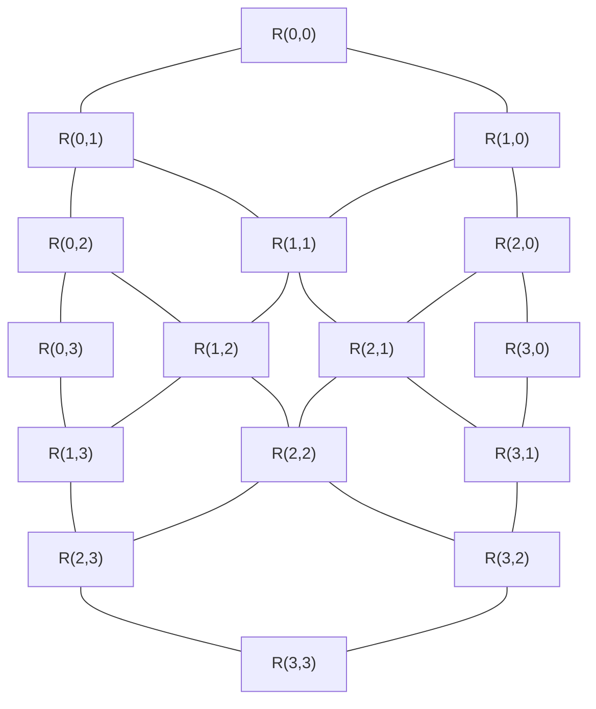
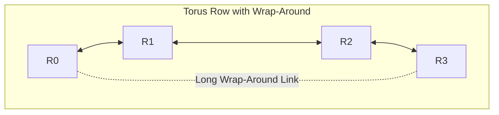
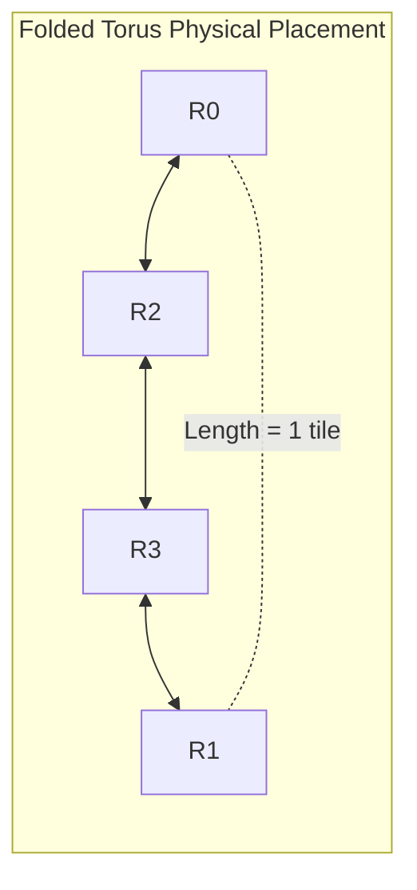

# 3.1 Direct Topologies: Mesh & Torus

In a **Direct Topology**, every router is directly paired with a processing node (CPU core, GPU compute unit, or memory controller). Direct topologies map naturally to the planar surface of a silicon die.

---

## 1. The 2D Mesh

The **2D Mesh** is the most widely manufactured topology in commercial multicore processors (including the Intel Xeon Scalable family and Tilera TILE64) due to its simplicity, planar layout, and short, uniform point-to-point wires.

For a square $k \times k$ mesh ($N = k^2$ nodes):

### Key Metrics:
- **Router Radix (Degree)**:
  - Corner routers: degree 2 (plus local port)
  - Edge routers: degree 3 (plus local port)
  - Interior routers: degree 4 (plus local port)
- **Network Diameter ($D$)**: The maximum shortest-path distance between any two nodes:
  $$D_{mesh} = (k - 1) + (k - 1) = 2(k - 1) = 2(\sqrt{N} - 1)$$
  *Example*: For an $8 \times 8$ mesh ($N = 64$), $D = 2 \times 7 = 14$ hops.
- **Average Hop Count ($H_{avg}$)**: Under uniform random traffic:
  $$H_{avg, mesh} \approx \frac{2}{3} k = \frac{2}{3} \sqrt{N}$$
  *Example*: For $8 \times 8$, $H_{avg} \approx 5.33$ hops.
- **Bisection Bandwidth ($B_b$)**: The minimum number of channel links that must be severed to partition the network into two equal halves. In a $k \times k$ mesh, a vertical cut slices through $k$ bidirectional channels:
  $$B_{b, mesh} = 2k \cdot w = 2\sqrt{N} \cdot w$$
  Where $w$ is the channel link width in bits.

---

## 2. The 2D Torus (k-ary 2-cube)

The **2D Torus** adds periodic wrap-around links connecting the outer boundary routers (e.g., Column 0 connects to Column $k-1$, and Row 0 connects to Row $k-1$).

### Key Metrics:
- **Node Symmetry**: Every single router has an identical degree of 4.
- **Network Diameter**: The wrap-around links cut diameter in half:
  $$D_{torus} = 2 \times \left\lfloor \frac{k}{2} \right\rfloor \approx k = \sqrt{N}$$
  *Example*: For an $8 \times 8$ torus, $D = 8$ hops (compared to 14 in a mesh!).
- **Average Hop Count**:
  $$H_{avg, torus} \approx \frac{1}{2} k = \frac{1}{2} \sqrt{N}$$
- **Bisection Bandwidth**: Severing the torus into two halves cuts both the middle channels and the wrap-around channels:
  $$B_{b, torus} = 4k \cdot w = 4\sqrt{N} \cdot w \quad \text{(Double the Mesh!)}$$

---

## 3. The Physical Challenge: Long Wrap-Around Wires & The Folded Torus

While the Torus provides double the bisection bandwidth and half the diameter, it has a serious physical VLSI drawback: **The wrap-around links span the entire width and height of the chip!**

A long global wire requires repeaters, increases RC delay, and can force the entire network clock frequency to drop.

### The Elegant Solution: The Folded Torus
By interleaving the physical layout of routers (folding the network like an accordion), all link lengths become uniform and equal to at most **two tile widths**:

In the folded layout:
- $R_0$ connects to $R_1$
- $R_1$ connects to $R_2$
- $R_2$ connects to $R_3$
- $R_3$ connects to $R_0$

Every single physical wire is identical in length, completely solving the long-wire problem while preserving all topological advantages of the torus!

---

## Metric Summary: $k \times k$ Mesh vs. Torus

| Metric | 2D Mesh | 2D Torus |
| :--- | :--- | :--- |
| **Node Degree** | 2 to 4 (asymmetric) | 4 (symmetric) |
| **Diameter ($D$)** | $2(k - 1)$ | $2 \lfloor k/2 \rfloor$ |
| **Average Distance** | $\frac{2}{3}k$ | $\frac{1}{2}k$ |
| **Bisection Channels** | $2k$ | $4k$ |
| **Deadlock Freedom** | Trivial (XY routing) | Requires $\ge 2$ VCs (wrap-around cycles) |
| **Physical Layout** | Extremely simple | Requires Folding |

In the next lesson, we will explore **Indirect Topologies** and **Concentrated Mesh (cMesh)**.
