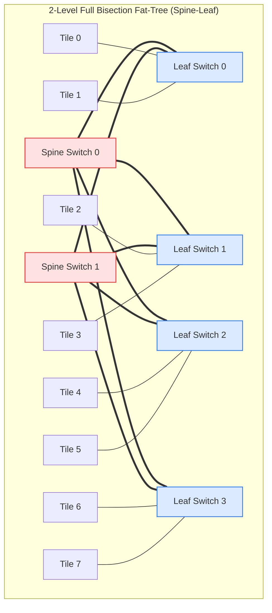
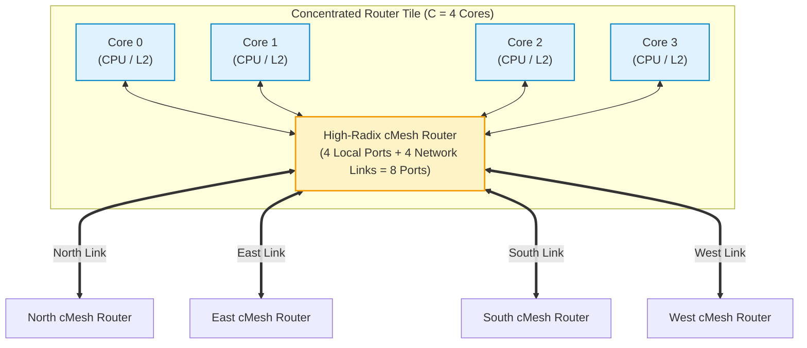
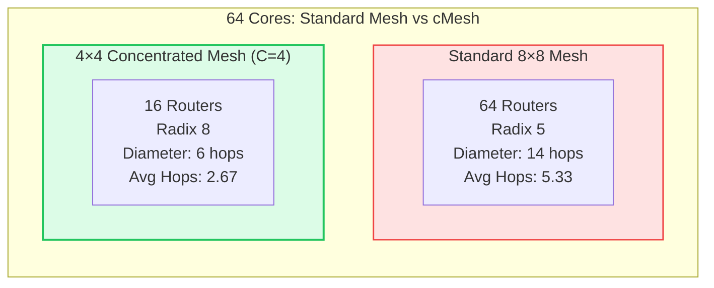

# 3.2 Indirect & Concentrated Networks: Fat-Trees & cMesh

While direct 2D meshes are standard for homogeneous multicore processors, large-scale chip multi-processors, heterogeneous AI accelerators, and high-bandwidth memory hierarchies often require higher bisection bandwidth, multi-path diversity, or significantly lower hop delays.

In this lesson, we study two primary architectural alternatives to planar direct meshes:
1. **Indirect Topologies (Fat-Trees & Clos Networks):** Dedicated switching elements separated from compute nodes.
2. **Concentrated Mesh (cMesh):** Clustering multiple compute cores around high-radix routers to slash network diameter and router silicon area.

---

## 1. Indirect Topologies: Butterfly, Clos, and Fat-Trees

In an **Indirect Topology**, routers are divided into dedicated intermediate switching elements. Compute cores, GPUs, and memory controllers connect exclusively to the periphery or leaf switches of the network:



### Architectural Classification of Multistage Networks:
1. **Butterfly Networks:**  
   A multistage interconnection network (MIN) where a single unique path connects each source to each destination. While hardware cost is minimal ($O(N \log N)$ switches), butterfly networks have **zero path diversity**—a single congested link blocks all communication sharing that path.
2. **Clos Networks (Charles Clos, 1953 [[Clos1953]](#ref-clos1953)):**  
   Multi-stage crossbar networks that provide multiple parallel middle-stage switches. A 3-stage Clos network is strictly non-blocking if the number of middle switches $m \ge 2n - 1$ (where $n$ is the number of inputs per first-stage switch).
3. **Fat-Trees (Charles Leiserson, 1985 [[Leiserson1985]](#ref-leiserson1985)):**  
   In a conventional tree, bandwidth constricts near the root, creating a massive throughput bottleneck. In a **Fat-Tree**, channel capacity increases monotonically as you ascend toward the root switches. In a **Full Bisection Fat-Tree**, the bisection bandwidth is identical at every tier, enabling full line-rate communication across arbitrary permutations.

---

## 2. Concentrated Mesh (cMesh)

In a conventional 2D mesh, every compute tile contains its own dedicated router:

$$\text{Standard 2D Mesh: } 1\text{ Tile} = 1\text{ Router} \quad (N\text{ Cores} = N\text{ Routers})$$

For a 64-core CMP, this demands **64 routers**, each with input FIFO buffers, matrix arbiters, and clock distribution networks consuming silicon area and leakage power.

In a **Concentrated Mesh (cMesh)** (introduced by James Balfour and William J. Dally at ICS 2006 [[Balfour2006]](#ref-balfour2006)), **$C = 4\text{ neighboring compute cores}$ share a single centralized high-radix router**:



---

### Why cMesh Outperforms Standard Meshes for Manycores:

#### A. 75% Reduction in Router Count
A 64-core processor requires **only 16 routers** in a $4 \times 4$ cMesh grid, compared to 64 routers in an $8 \times 8$ standard mesh!
- Slashes total buffer SRAM area by over **50%**.
- Significantly reduces clock tree synthesis complexity and dynamic clock power.

#### B. Network Diameter Slashed by 57%
- **Standard $8 \times 8$ Mesh Diameter:** $D = 2 \times (8 - 1) = \mathbf{14\text{ hops}}$
- **$4 \times 4$ cMesh Diameter:** $D = 2 \times (4 - 1) = \mathbf{6\text{ hops}}$ (a **$57\%$ reduction!**)

#### C. Halved Average Hop Distance ($H_{avg}$)
Under uniform random traffic, the average hop distance across the chip drops from **$5.33\text{ hops}$ down to just $2.67\text{ hops}$**.

#### D. Zero-Overhead Local Intra-Cluster Switching
If Core 0 communicates with Core 1, Core 2, or Core 3 within the same concentration tile, the packet is switched locally in **a single hop** without ever injecting onto the global inter-router network!



---

## 3. The Trade-Off: Router Radix vs. Hop Count

Why not concentrate 16 or 32 cores per router?  
Concentration trades **router crossbar radix** for **network hop count**:

$$\text{cMesh Router Radix } \delta = C + 4 \quad (\text{for a 2D grid})$$

- When $C = 1$ (Standard Mesh): Radix = $1 + 4 = 5\text{ ports}$ ($5 \times 5$ crossbar = 25 crosspoints).
- When $C = 4$ (Standard cMesh): Radix = $4 + 4 = 8\text{ ports}$ ($8 \times 8$ crossbar = 64 crosspoints).
- When $C = 8$: Radix = $8 + 4 = 12\text{ ports}$ ($12 \times 12$ crossbar = 144 crosspoints).

Beyond $C = 4$, the internal crossbar switch area and multiplexer fan-in delay grow quadratically ($O(\delta^2)$), eventually degrading the router's maximum operating clock frequency.

> [!NOTE]
> Extensive architectural research confirms that **$C = 4$ is the sweet spot in modern silicon processes**, delivering the optimal balance of minimal hop count, high clock frequency, and low buffer silicon area.

---

## 4. 🎛️ Interactive Mesh vs. cMesh Scalability & Area Calculator

Use the interactive tool below to evaluate the architectural trade-offs between standard 2D Meshes and Concentrated Meshes across varying core counts ($N = 16\text{ to } 256$ cores).

<div class="noc-sim-container" id="cmeshCalc">
  <div style="font-size:1.1rem; font-weight:700; color:var(--tcl-heading); margin-bottom:1rem; display:flex; align-items:center; justify-content:space-between; flex-wrap:wrap; gap:0.5rem;">
    <span>🔬 Mesh vs. Concentrated Mesh (cMesh) Trade-Off Calculator</span>
  </div>

  <div style="display:grid; grid-template-columns:repeat(auto-fit, minmax(220px, 1fr)); gap:1rem; margin-bottom:1.25rem;">
    <div>
      <label style="font-size:0.85rem; font-weight:600; display:block; margin-bottom:0.35rem;">Total Compute Cores ($N$):</label>
      <select id="selCoresCount" class="noc-sim-select" style="width:100%;" onchange="updateCmeshSim()">
        <option value="16">16 Cores (4×4 Mesh)</option>
        <option value="64" selected>64 Cores (8×8 Mesh / 4×4 cMesh)</option>
        <option value="128">128 Cores (Large Server CMP)</option>
        <option value="256">256 Cores (AI Accelerator Pod)</option>
      </select>
    </div>

    <div>
      <label style="font-size:0.85rem; font-weight:600; display:block; margin-bottom:0.35rem;">Per-Hop Router Delay ($t_r$):</label>
      <select id="selRouterLat" class="noc-sim-select" style="width:100%;" onchange="updateCmeshSim()">
        <option value="1">1 Cycle (Speculative Bypass)</option>
        <option value="2" selected>2 Cycles (Speculative Router)</option>
        <option value="3">3 Cycles (Lookahead Router)</option>
      </select>
    </div>

    <div>
      <label style="font-size:0.85rem; font-weight:600; display:block; margin-bottom:0.35rem;">Clock Frequency ($f$):</label>
      <select id="selClkFreq" class="noc-sim-select" style="width:100%;" onchange="updateCmeshSim()">
        <option value="1.5">1.5 GHz</option>
        <option value="2.0" selected>2.0 GHz</option>
        <option value="2.5">2.5 GHz</option>
      </select>
    </div>
  </div>

  <!-- Comparative Results Grid -->
  <div style="display:grid; grid-template-columns: 1fr 1fr; gap:1.25rem; margin-bottom:1rem;">
    
    <!-- Standard Mesh Card -->
    <div style="background:var(--noc-surface-subtle); border:1.5px solid #ef4444; border-radius:10px; padding:1.25rem;">
      <div style="display:flex; justify-content:space-between; align-items:center; margin-bottom:0.5rem;">
        <span style="font-weight:700; font-size:1.05rem; color:#991b1b;">Standard 2D Mesh (C = 1)</span>
        <span id="badgeMeshGrid" style="font-size:0.75rem; font-weight:700; background:rgba(239,68,68,0.15); color:#ef4444; padding:2px 8px; border-radius:4px;">8×8 Grid</span>
      </div>

      <div style="font-size:0.88rem; line-height:1.7; color:var(--md-default-fg-color--lighter);">
        • <b>Total Router Count:</b> <span id="m_routers" style="font-weight:700; color:var(--tcl-heading);">64 routers</span><br>
        • <b>Router Switch Radix:</b> <span id="m_radix" style="font-weight:700;">5 ports</span> (25 crosspoints)<br>
        • <b>Network Diameter:</b> <span id="m_diam" style="font-weight:700; color:#ef4444;">14 hops</span><br>
        • <b>Average Hop Distance:</b> <span id="m_avghops" style="font-weight:700;">5.33 hops</span><br>
        • <b>Average Zero-Load Latency:</b> <span id="m_lat" style="font-weight:800; color:#ef4444; font-size:1.1rem;">-- ns</span><br>
        • <b>Total Buffer Storage:</b> <span id="m_mem" style="font-weight:700;">-- KB</span>
      </div>
    </div>

    <!-- Concentrated Mesh Card -->
    <div style="background:var(--noc-surface-subtle); border:1.5px solid #16a34a; border-radius:10px; padding:1.25rem;">
      <div style="display:flex; justify-content:space-between; align-items:center; margin-bottom:0.5rem;">
        <span style="font-weight:700; font-size:1.05rem; color:#166534;">Concentrated Mesh (C = 4)</span>
        <span id="badgeCmeshGrid" style="font-size:0.75rem; font-weight:700; background:rgba(34,197,94,0.15); color:#16a34a; padding:2px 8px; border-radius:4px;">4×4 Grid</span>
      </div>

      <div style="font-size:0.88rem; line-height:1.7; color:var(--md-default-fg-color--lighter);">
        • <b>Total Router Count:</b> <span id="cm_routers" style="font-weight:700; color:#16a34a;">16 routers (75% savings!)</span><br>
        • <b>Router Switch Radix:</b> <span id="cm_radix" style="font-weight:700;">8 ports</span> (64 crosspoints)<br>
        • <b>Network Diameter:</b> <span id="cm_diam" style="font-weight:700; color:#16a34a;">6 hops (57% cut)</span><br>
        • <b>Average Hop Distance:</b> <span id="cm_avghops" style="font-weight:700;">2.67 hops</span><br>
        • <b>Average Zero-Load Latency:</b> <span id="cm_lat" style="font-weight:800; color:#16a34a; font-size:1.1rem;">-- ns</span><br>
        • <b>Total Buffer Storage:</b> <span id="cm_mem" style="font-weight:700;">-- KB</span>
      </div>
    </div>

  </div>

  <div id="cmeshTakeaway" style="font-size:0.88rem; padding:0.75rem 1rem; border-radius:8px; background:rgba(37,99,235,0.08); border:1px solid rgba(37,99,235,0.25); color:var(--tcl-heading); line-height:1.5;"></div>
</div>

<script>
function updateCmeshSim() {
  const N = parseInt(document.getElementById("selCoresCount").value, 10);
  const tr = parseInt(document.getElementById("selRouterLat").value, 10);
  const f_ghz = parseFloat(document.getElementById("selClkFreq").value);
  const tau_ns = 1.0 / f_ghz;

  // 1. Standard Mesh Calculations
  const k_mesh = Math.sqrt(N);
  const m_routers = N;
  const m_diam = 2 * (k_mesh - 1);
  const m_avghops = (2 * (k_mesh * k_mesh - 1)) / (3 * k_mesh);
  // Zero load latency = AvgHops * (tr + t_wire=1) + 4 flits serialization
  const m_lat_cyc = m_avghops * (tr + 1) + 4;
  const m_lat_ns = (m_lat_cyc * tau_ns).toFixed(2);
  const m_mem_kb = ((m_routers * 5 * 4 * 16 * 4) / 1024).toFixed(1); // 5 ports, 4 VCs, 4 flits of 16B

  document.getElementById("badgeMeshGrid").textContent = `${k_mesh}×${k_mesh} Grid`;
  document.getElementById("m_routers").textContent = `${m_routers} routers`;
  document.getElementById("m_diam").textContent = `${m_diam} hops`;
  document.getElementById("m_avghops").textContent = `${m_avghops.toFixed(2)} hops`;
  document.getElementById("m_lat").textContent = `${m_lat_ns} ns (${m_lat_cyc.toFixed(1)} cycles)`;
  document.getElementById("m_mem").textContent = `${m_mem_kb} KB`;

  // 2. Concentrated Mesh Calculations (C = 4)
  const cm_routers = N / 4;
  const k_cmesh = Math.sqrt(cm_routers);
  const cm_diam = 2 * (k_cmesh - 1);
  // Average hop count: (1/4 chance same tile = 0 net hops) + (3/4 chance inter-tile = avg cmesh hops)
  const cm_inter_avghops = (2 * (k_cmesh * k_cmesh - 1)) / (3 * k_cmesh);
  const cm_avghops = ((N - 4) / N) * cm_inter_avghops;
  const cm_lat_cyc = cm_avghops * (tr + 1) + 4;
  const cm_lat_ns = (cm_lat_cyc * tau_ns).toFixed(2);
  const cm_mem_kb = ((cm_routers * 8 * 4 * 16 * 4) / 1024).toFixed(1); // 8 ports, 4 VCs

  document.getElementById("badgeCmeshGrid").textContent = `${k_cmesh}×${k_cmesh} Grid`;
  document.getElementById("cm_routers").textContent = `${cm_routers} routers (75% fewer)`;
  document.getElementById("cm_diam").textContent = `${cm_diam} hops`;
  document.getElementById("cm_avghops").textContent = `${cm_avghops.toFixed(2)} hops`;
  document.getElementById("cm_lat").textContent = `${cm_lat_ns} ns (${cm_lat_cyc.toFixed(1)} cycles)`;
  document.getElementById("cm_mem").textContent = `${cm_mem_kb} KB`;

  // Dynamic Takeaway
  const latCut = Math.round(((parseFloat(m_lat_ns) - parseFloat(cm_lat_ns)) / parseFloat(m_lat_ns)) * 100);
  const memCut = Math.round(((parseFloat(m_mem_kb) - parseFloat(cm_mem_kb)) / parseFloat(m_mem_kb)) * 100);

  document.getElementById("cmeshTakeaway").innerHTML = `
    <strong>Architectural Synthesis for ${N} Cores:</strong><br>
    The Concentrated Mesh reduces overall communication latency by <strong>${latCut}%</strong> while eliminating <strong>${m_routers - cm_routers} routers</strong> from the silicon layout. 
    Total router buffer memory drops by <strong>${memCut}%</strong>, slashing static leakage power and freeing valuable die area for larger L2/L3 caches!
  `;
}

if (document.readyState === "loading") {
  document.addEventListener("DOMContentLoaded", updateCmeshSim);
} else {
  updateCmeshSim();
}
</script>

---

## 5. Architectural Comparison Summary: Topologies for Manycores

| Metric | 2D Mesh | 2D Torus | Full Fat-Tree | Concentrated Mesh (cMesh) |
| :--- | :--- | :--- | :--- | :--- |
| **Topology Type** | Direct | Direct | Indirect | Direct (Concentrated) |
| **Router Count ($N=64$)** | 64 routers | 64 routers | 48 switches | **16 routers ($75\%$ reduction)** |
| **Router Radix** | 5 ports | 5 ports | 4 to 8 ports | 8 ports (4 local, 4 network) |
| **Network Diameter** | $2(k - 1) = 14$ | $k = 8$ | $2 \log_2 N = 6$ | **$2(\sqrt{N}/2 - 1) = 6$** |
| **Bisection Bandwidth** | $2\sqrt{N} \cdot w$ | $4\sqrt{N} \cdot w$ | **$N/2 \cdot w$ (Highest)** | $2\sqrt{N/4} \cdot w$ |
| **Physical Wiring Complexity**| **Minimal (Planar)**| Requires Folding | High (Global Tree) | Moderate (Short local clusters) |
| **Zero-Load Latency** | High | Moderate | Low | **Lowest** |

---

## 6. Worked Numerical Example: Router Silicon Area & Power Analysis

> [!TIP]
> **Problem Statement:**  
> A chip designer is sizing the on-chip interconnect for a 64-core processor on a 5nm FinFET process.  
> Standard cell libraries yield the following area estimates:
> - A 5-port router (Mesh) occupies $A_5 = 0.045\text{ mm}^2$ and consumes $P_5 = 32\text{ mW}$ of static leakage.
> - An 8-port router (cMesh) occupies $A_8 = 0.082\text{ mm}^2$ and consumes $P_8 = 56\text{ mW}$ of static leakage.
> 
> Compare:
> 1. Total Router Silicon Area ($A_{total}$)
> 2. Total Static Leakage Power ($P_{static}$)  
> between the **Standard 2D Mesh (64 routers)** and the **Concentrated Mesh (16 routers)**.

### Step 1: Standard 2D Mesh Calculation (64 Routers)

$$A_{total, Mesh} = 64 \times 0.045\text{ mm}^2 = \mathbf{2.88\text{ mm}^2}$$

$$P_{static, Mesh} = 64 \times 32\text{ mW} = \mathbf{2,048\text{ mW} = 2.048\text{ Watts}}$$

### Step 2: Concentrated Mesh Calculation (16 Routers)

$$A_{total, cMesh} = 16 \times 0.082\text{ mm}^2 = \mathbf{1.312\text{ mm}^2} \quad (\mathbf{54.4\%\text{ Silicon Area Reduction!}})$$

$$P_{static, cMesh} = 16 \times 56\text{ mW} = \mathbf{896\text{ mW} = 0.896\text{ Watts}} \quad (\mathbf{56.2\%\text{ Power Reduction!}})$$

### Conclusion:
Even though an individual 8-port cMesh router is larger than a 5-port mesh router ($0.082\text{ mm}^2$ vs $0.045\text{ mm}^2$), using $75\%$ fewer routers saves **over $1.56\text{ mm}^2$ of silicon area** and **$1.15\text{ Watts}$ of static power**!

---

## 7. 💻 Synthesizable Hardware: 4:1 cMesh Concentrator & Ejection Unit

In a Concentrated Mesh (cMesh), four processing elements (cores, L2 cache slices, or memory controllers) share a single high-radix router switch. The network interface requires a **Concentrator / Ejection Switch** that:
1. Multiplexes packet injection requests from 4 cores into the router's local injection port using a fair round-robin arbiter with ready/valid flow control.
2. Demultiplexes incoming ejection flits to the targeted compute core using a 2-bit local sub-node identifier (`target_subnode = flit[1:0]`).

The synthesizable Verilog implementation below, `cmesh_concentrator.v`, realizes this architecture with zero-cycle combinatorial ejection routing and single-cycle round-robin injection arbitration:

```verilog
//=============================================================================
// Module: cmesh_concentrator
// Description: Synthesizable 4:1 Concentration & Ejection Switch for
//              Concentrated Mesh (cMesh) router interfaces.
//              - Multiplexes 4 local compute cores into 1 router injection FIFO
//                using fair round-robin arbitration with backpressure.
//              - Demultiplexes incoming router ejection flits to the target core
//                using the destination sub-node ID: dest_subnode[1:0].
//=============================================================================

module cmesh_concentrator #(
    parameter integer FLIT_WIDTH = 64,
    parameter integer SUBNODE_W  = 2   // 4 cores per router tile (2 bits)
)(
    input  wire                    clk,
    input  wire                    rst_n,

    // Core Injections (Cores 0..3 -> Router)
    input  wire [3:0]              core_inj_valid,
    input  wire [4*FLIT_WIDTH-1:0] core_inj_flit,
    output reg  [3:0]              core_inj_ready,

    // Concentrated Injection to Router
    output reg                     router_inj_valid,
    output reg  [FLIT_WIDTH-1:0]   router_inj_flit,
    input  wire                    router_inj_ready,

    // Ejection from Router -> Cores 0..3
    input  wire                    router_ej_valid,
    input  wire [FLIT_WIDTH-1:0]   router_ej_flit,
    output wire                    router_ej_ready,

    // Core Ejections (Router -> Cores 0..3)
    output reg  [3:0]              core_ej_valid,
    output wire [4*FLIT_WIDTH-1:0] core_ej_flit,
    input  wire [3:0]              core_ej_ready
);

    // Unpack Core Injection Flits
    wire [FLIT_WIDTH-1:0] flits_in [0:3];
    assign flits_in[0] = core_inj_flit[0*FLIT_WIDTH +: FLIT_WIDTH];
    assign flits_in[1] = core_inj_flit[1*FLIT_WIDTH +: FLIT_WIDTH];
    assign flits_in[2] = core_inj_flit[2*FLIT_WIDTH +: FLIT_WIDTH];
    assign flits_in[3] = core_inj_flit[3*FLIT_WIDTH +: FLIT_WIDTH];

    // Round-Robin Arbiter for 4:1 Injection
    reg [1:0] rr_ptr;
    reg [1:0] grant_idx;
    reg       grant_valid;

    always @(*) begin
        grant_valid = 1'b0;
        grant_idx   = 2'd0;
        case (rr_ptr)
            2'd0: begin
                if (core_inj_valid[0])      begin grant_idx = 2'd0; grant_valid = 1'b1; end
                else if (core_inj_valid[1]) begin grant_idx = 2'd1; grant_valid = 1'b1; end
                else if (core_inj_valid[2]) begin grant_idx = 2'd2; grant_valid = 1'b1; end
                else if (core_inj_valid[3]) begin grant_idx = 2'd3; grant_valid = 1'b1; end
            end
            2'd1: begin
                if (core_inj_valid[1])      begin grant_idx = 2'd1; grant_valid = 1'b1; end
                else if (core_inj_valid[2]) begin grant_idx = 2'd2; grant_valid = 1'b1; end
                else if (core_inj_valid[3]) begin grant_idx = 2'd3; grant_valid = 1'b1; end
                else if (core_inj_valid[0]) begin grant_idx = 2'd0; grant_valid = 1'b1; end
            end
            2'd2: begin
                if (core_inj_valid[2])      begin grant_idx = 2'd2; grant_valid = 1'b1; end
                else if (core_inj_valid[3]) begin grant_idx = 2'd3; grant_valid = 1'b1; end
                else if (core_inj_valid[0]) begin grant_idx = 2'd0; grant_valid = 1'b1; end
                else if (core_inj_valid[1]) begin grant_idx = 2'd1; grant_valid = 1'b1; end
            end
            2'd3: begin
                if (core_inj_valid[3])      begin grant_idx = 2'd3; grant_valid = 1'b1; end
                else if (core_inj_valid[0]) begin grant_idx = 2'd0; grant_valid = 1'b1; end
                else if (core_inj_valid[1]) begin grant_idx = 2'd1; grant_valid = 1'b1; end
                else if (core_inj_valid[2]) begin grant_idx = 2'd2; grant_valid = 1'b1; end
            end
        endcase
    end

    // Injection Datapath & Handshake
    always @(posedge clk or negedge rst_n) begin
        if (!rst_n) begin
            rr_ptr           <= 2'd0;
            router_inj_valid <= 1'b0;
            router_inj_flit  <= {FLIT_WIDTH{1'b0}};
            core_inj_ready   <= 4'b0000;
        end else begin
            core_inj_ready <= 4'b0000;
            if (grant_valid && router_inj_ready) begin
                router_inj_valid          <= 1'b1;
                router_inj_flit           <= flits_in[grant_idx];
                core_inj_ready[grant_idx] <= 1'b1;
                rr_ptr                    <= grant_idx + 1'b1;
            end else if (!router_inj_ready) begin
                // Hold valid if downstream stalled
                router_inj_valid <= router_inj_valid;
            end else begin
                router_inj_valid <= 1'b0;
            end
        end
    end

    // 1:4 Ejection Demultiplexing via Sub-node Index (flit bits [1:0])
    wire [1:0] target_subnode = router_ej_flit[1:0];

    always @(*) begin
        core_ej_valid = 4'b0000;
        if (router_ej_valid) begin
            core_ej_valid[target_subnode] = 1'b1;
        end
    end

    // Broadcast ejection payload to all 4 cores; valid qualifiers govern acceptance
    assign core_ej_flit = {4{router_ej_flit}};
    assign router_ej_ready = core_ej_ready[target_subnode];

endmodule
```

---

## 8. 🕹️ Interactive Lab & Arcade Arena

Explore multi-stage and hierarchical networks in interactive simulations:

<div class="noc-tracks-grid" style="margin-top:1rem;">
  <div class="noc-track-card">
    <div>
      <span class="noc-track-badge" style="background:rgba(37,99,235,0.15); color:#2563eb;">Arcade Mission</span>
      <div class="noc-track-title">🌐 Topology Titans: Fat-Tree Clos</div>
      <div class="noc-track-desc">
        Construct a 2-tier Fat-Tree interconnect for 16 compute nodes, balancing spine switch radix against leaf aggregation bandwidth.
      </div>
    </div>
    <a href="../../interactive/topology/" class="noc-track-link">Play Topology Titans →</a>
  </div>

  <div class="noc-track-card">
    <div>
      <span class="noc-track-badge" style="background:rgba(234,88,12,0.15); color:#ea580c;">System Architect</span>
      <div class="noc-track-title">🏗️ Chiplet Tycoon: Packaging Hub</div>
      <div class="noc-track-desc">
        Architect multi-die chiplet interconnects using concentrated switches and silicon interposers to maximize multi-core yield.
      </div>
    </div>
    <a href="../../interactive/chiplet/" class="noc-track-link">Launch Chiplet Tycoon →</a>
  </div>
</div>

---

## 9. 🎯 Comprehensive Self-Assessment Quiz

Test your mastery of indirect topologies, concentration ratios, and Fat-Tree scaling:

<div class="noc-sim-container" id="quiz32_container" style="margin-top:1rem;">
  <div style="display:flex; justify-content:space-between; align-items:center; margin-bottom:1rem; border-bottom:1px solid var(--tcl-border); padding-bottom:0.5rem;">
    <span style="font-weight:700; font-size:1.05rem; color:var(--tcl-heading);">📝 Lesson 3.2 Self-Check</span>
    <span id="quiz32_score" style="font-weight:700; font-size:0.9rem; color:#2563eb;">Score: 0 / 3</span>
  </div>

  <!-- Question 1 -->
  <div class="quiz-item" style="margin-bottom:1.5rem;">
    <p style="font-weight:600; font-size:0.95rem; margin-bottom:0.6rem;">
      <b>Q1:</b> Why does a 4×4 Concentrated Mesh (cMesh) achieve lower zero-load latency for a 64-core chip than a standard 8×8 2D Mesh?
    </p>
    <div style="display:flex; flex-direction:column; gap:0.45rem;" id="q32_1_options">
      <button class="noc-sim-select" style="text-align:left; padding:0.6rem 0.85rem; cursor:pointer;" onclick="answerQ32(1, 0)">A. Because cMesh replaces packet routers with wireless RF antennas.</button>
      <button class="noc-sim-select" style="text-align:left; padding:0.6rem 0.85rem; cursor:pointer;" onclick="answerQ32(1, 1)">B. By clustering 4 compute cores around each router, total routers decrease from 64 to 16, cutting network diameter from 14 hops to just 6 hops and halving average hop traversal stages.</button>
      <button class="noc-sim-select" style="text-align:left; padding:0.6rem 0.85rem; cursor:pointer;" onclick="answerQ32(1, 2)">C. Because cMesh routers operate at 100 GHz.</button>
      <button class="noc-sim-select" style="text-align:left; padding:0.6rem 0.85rem; cursor:pointer;" onclick="answerQ32(1, 3)">D. Because cMesh only allows communication between adjacent cores.</button>
    </div>
    <div id="q32_1_feedback" style="display:none; margin-top:0.6rem; padding:0.75rem; border-radius:6px; font-size:0.88rem; line-height:1.5;"></div>
  </div>

  <!-- Question 2 -->
  <div class="quiz-item" style="margin-bottom:1.5rem;">
    <p style="font-weight:600; font-size:0.95rem; margin-bottom:0.6rem;">
      <b>Q2:</b> In an indirect <strong>Fat-Tree</strong> network, why does link capacity or channel count increase as traffic moves upward toward the root?
    </p>
    <div style="display:flex; flex-direction:column; gap:0.45rem;" id="q32_2_options">
      <button class="noc-sim-select" style="text-align:left; padding:0.6rem 0.85rem; cursor:pointer;" onclick="answerQ32(2, 0)">A. To compensate for voltage drop across long cables.</button>
      <button class="noc-sim-select" style="text-align:left; padding:0.6rem 0.85rem; cursor:pointer;" onclick="answerQ32(2, 1)">B. To maintain constant bisection bandwidth and prevent bandwidth bottlenecks as traffic from all lower leaves aggregates toward the root.</button>
      <button class="noc-sim-select" style="text-align:left; padding:0.6rem 0.85rem; cursor:pointer;" onclick="answerQ32(2, 2)">C. To reduce the clock frequency of the root switches.</button>
      <button class="noc-sim-select" style="text-align:left; padding:0.6rem 0.85rem; cursor:pointer;" onclick="answerQ32(2, 3)">D. Because higher-layer switches have fewer input ports.</button>
    </div>
    <div id="q32_2_feedback" style="display:none; margin-top:0.6rem; padding:0.75rem; border-radius:6px; font-size:0.88rem; line-height:1.5;"></div>
  </div>

  <!-- Question 3 -->
  <div class="quiz-item" style="margin-bottom:1rem;">
    <p style="font-weight:600; font-size:0.95rem; margin-bottom:0.6rem;">
      <b>Q3:</b> What is the primary engineering trade-off of high node concentration ($C = 4$ or $C = 8$)?
    </p>
    <div style="display:flex; flex-direction:column; gap:0.45rem;" id="q32_3_options">
      <button class="noc-sim-select" style="text-align:left; padding:0.6rem 0.85rem; cursor:pointer;" onclick="answerQ32(3, 0)">A. It increases local injection contention and router crossbar radix in exchange for drastically fewer total routers, lower area/power, and fewer network hops.</button>
      <button class="noc-sim-select" style="text-align:left; padding:0.6rem 0.85rem; cursor:pointer;" onclick="answerQ32(3, 1)">B. It doubles the number of long global wires across the chip.</button>
      <button class="noc-sim-select" style="text-align:left; padding:0.6rem 0.85rem; cursor:pointer;" onclick="answerQ32(3, 2)">C. It forces all packets to use store-and-forward routing.</button>
      <button class="noc-sim-select" style="text-align:left; padding:0.6rem 0.85rem; cursor:pointer;" onclick="answerQ32(3, 3)">D. It makes deadlock avoidance mathematically impossible.</button>
    </div>
    <div id="q32_3_feedback" style="display:none; margin-top:0.6rem; padding:0.75rem; border-radius:6px; font-size:0.88rem; line-height:1.5;"></div>
  </div>
</div>

<script>
let q32Score = 0;
const answeredQ32 = {1: false, 2: false, 3: false};

function answerQ32(qNum, selected) {
  if (answeredQ32[qNum]) return;
  answeredQ32[qNum] = true;

  const correctAnswers = {1: 1, 2: 1, 3: 0};
  const isCorrect = (selected === correctAnswers[qNum]);
  const fb = document.getElementById("q32_" + qNum + "_feedback");
  const opts = document.getElementById("q32_" + qNum + "_options").children;

  for (let i = 0; i < opts.length; i++) {
    opts[i].style.cursor = "default";
    opts[i].onclick = null;
  }

  if (isCorrect) {
    q32Score++;
    opts[selected].style.background = "rgba(34, 197, 94, 0.15)";
    opts[selected].style.borderColor = "#22c55e";
    fb.style.display = "block";
    fb.style.background = "rgba(34, 197, 94, 0.1)";
    fb.style.border = "1px solid rgba(34, 197, 94, 0.3)";
    fb.style.color = "#166534";
    fb.innerHTML = "<strong>✓ Correct!</strong> " + getQ32Explanation(qNum, true);
  } else {
    opts[selected].style.background = "rgba(239, 68, 68, 0.15)";
    opts[selected].style.borderColor = "#ef4444";
    opts[correctAnswers[qNum]].style.background = "rgba(34, 197, 94, 0.15)";
    opts[correctAnswers[qNum]].style.borderColor = "#22c55e";
    fb.style.display = "block";
    fb.style.background = "rgba(239, 68, 68, 0.1)";
    fb.style.border = "1px solid rgba(239, 68, 68, 0.3)";
    fb.style.color = "#991b1b";
    fb.innerHTML = "<strong>✗ Incorrect.</strong> " + getQ32Explanation(qNum, false);
  }

  document.getElementById("quiz32_score").textContent = "Score: " + q32Score + " / 3";
}

function getQ32Explanation(qNum, wasCorrect) {
  if (qNum === 1) {
    return "Concentrating 4 cores per router reduces the grid to 4×4. Total routers drop from 64 to 16, cutting network diameter from 14 to 6 hops and slashing zero-load latency by over 30%.";
  } else if (qNum === 2) {
    return "In a traditional tree, the root channel is a severe bottleneck. A Fat-Tree widens links toward the root, ensuring constant bisection bandwidth (N/2 * w) at every level of the hierarchy.";
  } else {
    return "Concentration groups multiple cores onto one router, introducing local arbitration for the injection port. However, it saves immense area and power by eliminating 75% of network routers and their buffer FIFOs.";
  }
}
</script>

---

## References & Further Reading

1. <a id="ref-clos1953"></a>**[Clos1953]** C. Clos, "A Study of Non-Blocking Switching Networks," *The Bell System Technical Journal*, vol. 32, no. 2, pp. 406–424, Mar. 1953. [DOI: 10.1002/j.1538-7305.1953.tb01433.x](https://doi.org/10.1002/j.1538-7305.1953.tb01433.x).
2. <a id="ref-leiserson1985"></a>**[Leiserson1985]** C. E. Leiserson, "Fat-Trees: Universal Networks for Hardware-Efficient Supercomputing," *IEEE Transactions on Computers*, vol. C-34, no. 10, pp. 892–901, Oct. 1985. [DOI: 10.1109/TC.1985.6312192](https://doi.org/10.1109/TC.1985.6312192).
3. <a id="ref-balfour2006"></a>**[Balfour2006]** J. Balfour and W. J. Dally, "Design Tradeoffs for Tiled CMP On-Chip Networks," in *Proceedings of the 20th Annual International Conference on Supercomputing (ICS)*, 2006, pp. 187–198. [DOI: 10.1145/1183401.1183430](https://doi.org/10.1145/1183401.1183430).
4. <a id="ref-dallyprinciples"></a>**[DallyPrinciples]** W. J. Dally and B. Towles, *Principles and Practices of Interconnection Networks*, Morgan Kaufmann, 2004.

---

## Summary & Next Steps

In this lesson, we established:
- The distinction between **Direct** and **Indirect** topologies.
- Why **Fat-Trees** maintain constant bisection bandwidth in high-throughput clusters.
- How **Concentrated Mesh (cMesh)** delivers lower latency, $75\%$ fewer routers, and $>50\%$ lower silicon area and static leakage power.
- Synthesizable Verilog implementation of the `cmesh_concentrator.v` unit.

In the next lesson, we explore formal performance benchmarking: **Interconnect Metrics and Benchmark Traffic Patterns**.

👉 **Proceed to [Lesson 3.3: Interconnect Metrics & Traffic Patterns](03-metrics-traffic-patterns.md)**

