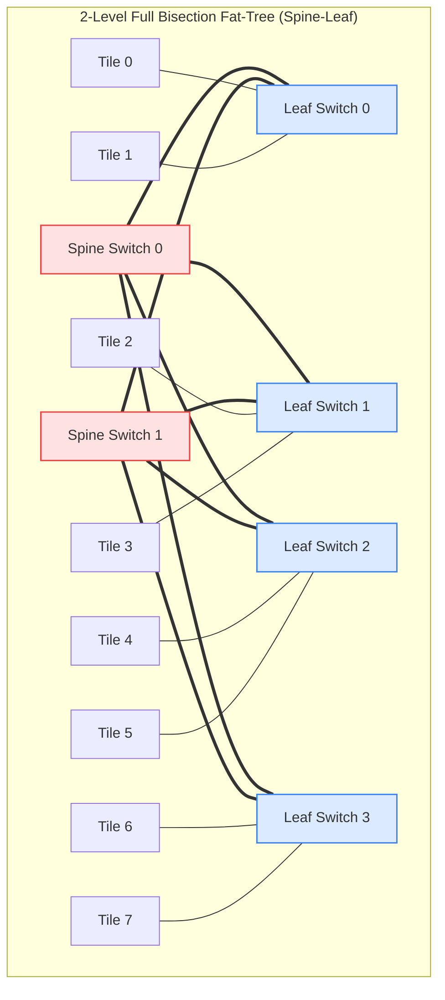
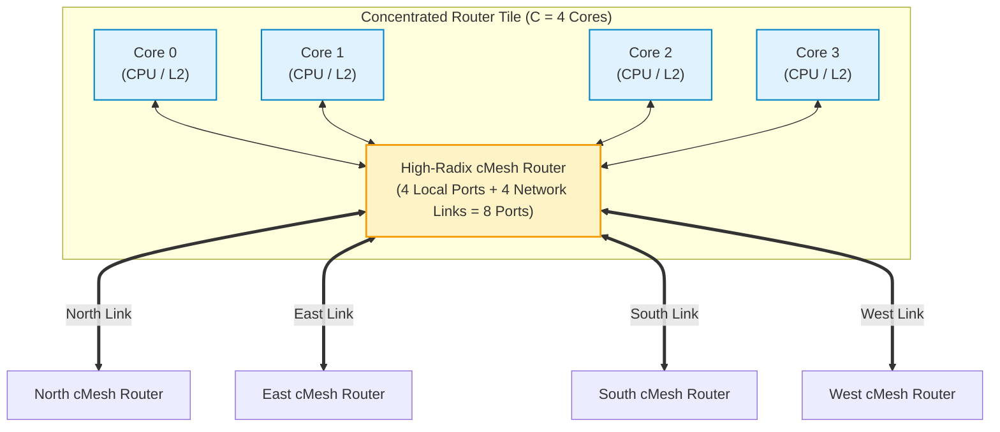
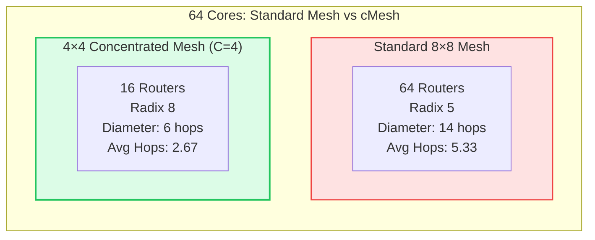

# 3.2 Indirect & Concentrated Networks: Fat-Trees & cMesh

While direct 2D meshes are standard for homogeneous multicore processors, large-scale chip multi-processors, heterogeneous AI accelerators, and high-bandwidth memory hierarchies often require higher bisection bandwidth, multi-path diversity, or significantly lower hop delays.

In this lesson, we study two primary architectural alternatives to planar direct meshes:
1. **Indirect Topologies (Fat-Trees & Clos Networks):** Dedicated switching elements separated from compute nodes.
2. **Concentrated Mesh (cMesh):** Clustering multiple compute cores around high-radix routers to slash network diameter and router silicon area.

---

## 1. Indirect Topologies: Butterfly, Clos, and Fat-Trees

In an **Indirect Topology**, routers are divided into dedicated intermediate switching elements. Compute cores, GPUs, and memory controllers connect exclusively to the periphery or leaf switches of the network:

### Architectural Classification of Multistage Networks:
1. **Butterfly Networks:**  
   A multistage interconnection network (MIN) where a single unique path connects each source to each destination. While hardware cost is minimal ($O(N \log N)$ switches), butterfly networks have **zero path diversity**—a single congested link blocks all communication sharing that path.
2. **Clos Networks (Charles Clos, 1953):**  
   Multi-stage crossbar networks that provide multiple parallel middle-stage switches. A 3-stage Clos network is strictly non-blocking if the number of middle switches $m \ge 2n - 1$ (where $n$ is the number of inputs per first-stage switch).
3. **Fat-Trees (Charles Leiserson, 1985):**  
   In a conventional tree, bandwidth constricts near the root, creating a massive throughput bottleneck. In a **Fat-Tree**, channel capacity increases monotonically as you ascend toward the root switches. In a **Full Bisection Fat-Tree**, the bisection bandwidth is identical at every tier, enabling full line-rate communication across arbitrary permutations.

---

## 2. Concentrated Mesh (cMesh)

In a conventional 2D mesh, every compute tile contains its own dedicated router:

$$\text{Standard 2D Mesh: } 1\text{ Tile} = 1\text{ Router} \quad (N\text{ Cores} = N\text{ Routers})$$

For a 64-core CMP, this demands **64 routers**, each with input FIFO buffers, matrix arbiters, and clock distribution networks consuming silicon area and leakage power.

In a **Concentrated Mesh (cMesh)** (introduced by James Balfour and William J. Dally at ASPLOS 2006), **$C = 4\text{ neighboring compute cores}$ share a single centralized high-radix router**:

---

### Why cMesh Outperforms Standard Meshes for Manycores:

#### A. 75% Reduction in Router Count
A 64-core processor requires **only 16 routers** in a $4 \times 4$ cMesh grid, compared to 64 routers in an $8 \times 8$ standard mesh!
- Slashes total buffer SRAM area by over **50%**.
- Significantly reduces clock tree synthesis complexity and dynamic clock power.

#### B. Network Diameter Slashed by 57%
- **Standard $8 \times 8$ Mesh Diameter:** $D = 2 \times (8 - 1) = \mathbf{14\text{ hops}}$
- **$4 \times 4$ cMesh Diameter:** $D = 2 \times (4 - 1) = \mathbf{6\text{ hops}}$ (a **$57\%$ reduction!**)

#### C. Halved Average Hop Distance ($H_{avg}$)
Under uniform random traffic, the average hop distance across the chip drops from **$5.33\text{ hops}$ down to just $2.67\text{ hops}$**.

#### D. Zero-Overhead Local Intra-Cluster Switching
If Core 0 communicates with Core 1, Core 2, or Core 3 within the same concentration tile, the packet is switched locally in **a single hop** without ever injecting onto the global inter-router network!

---

## 3. The Trade-Off: Router Radix vs. Hop Count

Why not concentrate 16 or 32 cores per router?  
Concentration trades **router crossbar radix** for **network hop count**:

$$\text{cMesh Router Radix } \delta = C + 4 \quad (\text{for a 2D grid})$$

- When $C = 1$ (Standard Mesh): Radix = $1 + 4 = 5\text{ ports}$ ($5 \times 5$ crossbar = 25 crosspoints).
- When $C = 4$ (Standard cMesh): Radix = $4 + 4 = 8\text{ ports}$ ($8 \times 8$ crossbar = 64 crosspoints).
- When $C = 8$: Radix = $8 + 4 = 12\text{ ports}$ ($12 \times 12$ crossbar = 144 crosspoints).

Beyond $C = 4$, the internal crossbar switch area and multiplexer fan-in delay grow quadratically ($O(\delta^2)$), eventually degrading the router's maximum operating clock frequency.

> [!NOTE]
> Extensive architectural research confirms that **$C = 4$ is the sweet spot in modern silicon processes**, delivering the optimal balance of minimal hop count, high clock frequency, and low buffer silicon area.

---

## 4. 🎛️ Interactive Mesh vs. cMesh Scalability & Area Calculator

Use the interactive tool below to evaluate the architectural trade-offs between standard 2D Meshes and Concentrated Meshes across varying core counts ($N = 16\text{ to } 256$ cores).

  

    🔬 Mesh vs. Concentrated Mesh (cMesh) Trade-Off Calculator
  

  

    

      <label style="font-size:0.85rem; font-weight:600; display:block; margin-bottom:0.35rem;">Total Compute Cores ($N$):</label>
      <select id="selCoresCount" class="noc-sim-select" style="width:100%;" onchange="updateCmeshSim()">
        <option value="16">16 Cores (4×4 Mesh)</option>
        <option value="64" selected>64 Cores (8×8 Mesh / 4×4 cMesh)</option>
        <option value="128">128 Cores (Large Server CMP)</option>
        <option value="256">256 Cores (AI Accelerator Pod)</option>
      </select>
    

    

      <label style="font-size:0.85rem; font-weight:600; display:block; margin-bottom:0.35rem;">Per-Hop Router Delay ($t_r$):</label>
      <select id="selRouterLat" class="noc-sim-select" style="width:100%;" onchange="updateCmeshSim()">
        <option value="1">1 Cycle (Speculative Bypass)</option>
        <option value="2" selected>2 Cycles (Speculative Router)</option>
        <option value="3">3 Cycles (Lookahead Router)</option>
      </select>
    

    

      <label style="font-size:0.85rem; font-weight:600; display:block; margin-bottom:0.35rem;">Clock Frequency ($f$):</label>
      <select id="selClkFreq" class="noc-sim-select" style="width:100%;" onchange="updateCmeshSim()">
        <option value="1.5">1.5 GHz</option>
        <option value="2.0" selected>2.0 GHz</option>
        <option value="2.5">2.5 GHz</option>
      </select>
    

  

  <!-- Comparative Results Grid -->
  

    
    <!-- Standard Mesh Card -->
    

      

        Standard 2D Mesh (C = 1)
        8×8 Grid
      

      

        • <b>Total Router Count:</b> 64 routers 
        • <b>Router Switch Radix:</b> 5 ports (25 crosspoints) 
        • <b>Network Diameter:</b> 14 hops 
        • <b>Average Hop Distance:</b> 5.33 hops 
        • <b>Average Zero-Load Latency:</b> -- ns 
        • <b>Total Buffer Storage:</b> -- KB
      

    

    <!-- Concentrated Mesh Card -->
    

      

        Concentrated Mesh (C = 4)
        4×4 Grid
      

      

        • <b>Total Router Count:</b> 16 routers (75% savings!) 
        • <b>Router Switch Radix:</b> 8 ports (64 crosspoints) 
        • <b>Network Diameter:</b> 6 hops (57% cut) 
        • <b>Average Hop Distance:</b> 2.67 hops 
        • <b>Average Zero-Load Latency:</b> -- ns 
        • <b>Total Buffer Storage:</b> -- KB
      

    

  

  

---

## 5. Architectural Comparison Summary: Topologies for Manycores

| Metric | 2D Mesh | 2D Torus | Full Fat-Tree | Concentrated Mesh (cMesh) |
| :--- | :--- | :--- | :--- | :--- |
| **Topology Type** | Direct | Direct | Indirect | Direct (Concentrated) |
| **Router Count ($N=64$)** | 64 routers | 64 routers | 48 switches | **16 routers ($75\%$ reduction)** |
| **Router Radix** | 5 ports | 5 ports | 4 to 8 ports | 8 ports (4 local, 4 network) |
| **Network Diameter** | $2(k - 1) = 14$ | $k = 8$ | $2 \log_2 N = 6$ | **$2(\sqrt{N}/2 - 1) = 6$** |
| **Bisection Bandwidth** | $2\sqrt{N} \cdot w$ | $4\sqrt{N} \cdot w$ | **$N/2 \cdot w$ (Highest)** | $2\sqrt{N/4} \cdot w$ |
| **Physical Wiring Complexity**| **Minimal (Planar)**| Requires Folding | High (Global Tree) | Moderate (Short local clusters) |
| **Zero-Load Latency** | High | Moderate | Low | **Lowest** |

---

## 6. Worked Numerical Example: Router Silicon Area & Power Analysis

> [!TIP]
> **Problem Statement:**  
> A chip designer is sizing the on-chip interconnect for a 64-core processor on a 5nm FinFET process.  
> Standard cell libraries yield the following area estimates:
> - A 5-port router (Mesh) occupies $A_5 = 0.045\text{ mm}^2$ and consumes $P_5 = 32\text{ mW}$ of static leakage.
> - An 8-port router (cMesh) occupies $A_8 = 0.082\text{ mm}^2$ and consumes $P_8 = 56\text{ mW}$ of static leakage.
> 
> Compare:
> 1. Total Router Silicon Area ($A_{total}$)
> 2. Total Static Leakage Power ($P_{static}$)  
> between the **Standard 2D Mesh (64 routers)** and the **Concentrated Mesh (16 routers)**.

### Step 1: Standard 2D Mesh Calculation (64 Routers)
$$A_{total, Mesh} = 64 \times 0.045\text{ mm}^2 = \mathbf{2.88\text{ mm}^2}$$
$$P_{static, Mesh} = 64 \times 32\text{ mW} = \mathbf{2,048\text{ mW} = 2.048\text{ Watts}}$$

### Step 2: Concentrated Mesh Calculation (16 Routers)
$$A_{total, cMesh} = 16 \times 0.082\text{ mm}^2 = \mathbf{1.312\text{ mm}^2} \quad (\mathbf{54.4\%\text{ Silicon Area Reduction!}})$$
$$P_{static, cMesh} = 16 \times 56\text{ mW} = \mathbf{896\text{ mW} = 0.896\text{ Watts}} \quad (\mathbf{56.2\%\text{ Power Reduction!}})$$

### Conclusion:
Even though an individual 8-port cMesh router is larger than a 5-port mesh router ($0.082\text{ mm}^2$ vs $0.045\text{ mm}^2$), using $75\%$ fewer routers saves **over $1.56\text{ mm}^2$ of silicon area** and **$1.15\text{ Watts}$ of static power**!

---

## 7. 🎯 Knowledge Check: Lesson 3.2

  

    📝 Concept Check: Indirect &amp; Concentrated Networks
  

  

    

      <b>Question:</b> Why does a 4×4 Concentrated Mesh (cMesh) achieve lower zero-load latency for a 64-core chip than a standard 8×8 2D Mesh?
    

    

      <button class="noc-sim-select" style="text-align:left; padding:0.65rem 0.85rem; cursor:pointer;" onclick="checkQuiz32(0)">
        A. Because cMesh replaces packet routers with wireless RF antennas.
      </button>
      <button class="noc-sim-select" style="text-align:left; padding:0.65rem 0.85rem; cursor:pointer;" onclick="checkQuiz32(1)">
        B. By clustering 4 compute cores around each router, total routers decrease from 64 to 16, cutting network diameter from 14 hops to just 6 hops and halving average hop traversal stages.
      </button>
      <button class="noc-sim-select" style="text-align:left; padding:0.65rem 0.85rem; cursor:pointer;" onclick="checkQuiz32(2)">
        C. Because cMesh routers operate at 100 GHz.
      </button>
      <button class="noc-sim-select" style="text-align:left; padding:0.65rem 0.85rem; cursor:pointer;" onclick="checkQuiz32(3)">
        D. Because cMesh only allows communication between adjacent cores.
      </button>
    

    

  

---

## Summary & Next Steps

In this lesson, we established:
- The distinction between **Direct** and **Indirect** topologies.
- Why **Fat-Trees** maintain constant bisection bandwidth in high-throughput clusters.
- How **Concentrated Mesh (cMesh)** delivers lower latency, $75\%$ fewer routers, and $>50\%$ lower silicon area and static leakage power.

In the next lesson, we explore formal performance benchmarking: **Interconnect Metrics and Benchmark Traffic Patterns**.

👉 **Proceed to [Lesson 3.3: Interconnect Metrics & Traffic Patterns](03-metrics-traffic-patterns.md)**
