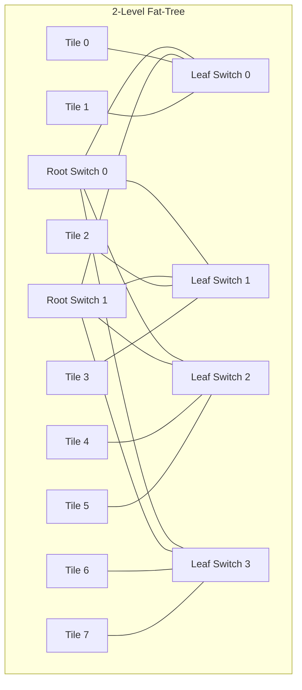
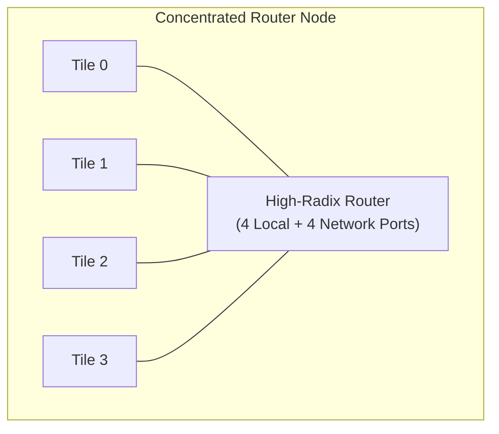
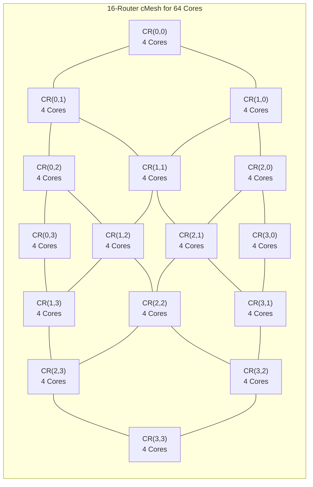

# 3.2 Indirect & Concentrated Networks

While direct 2D meshes are standard for homogeneous multicore processors, heterogeneous AI accelerators and large-scale chiplets often require higher path diversity or lower hop latency. This is achieved via **Indirect Networks** and **Concentrated Topologies**.

---

## 1. Indirect Topologies: Fat-Tree & Butterfly

In an **Indirect Topology**, routers are divided into dedicated intermediate switching elements, and compute/memory tiles are connected exclusively to the perimeter or leaves of the network.

### Advantages of Fat-Tree Networks:
1. **High Bisection Bandwidth**: Bandwidth expands as you ascend the tree (hence "Fat" tree), preventing root bottlenecks.
2. **Path Diversity**: Multiple root switches provide redundant shortest paths between any pair of leaves, enabling excellent multipath load balancing.
3. **Application**: Extensively used in large AI inference clusters and memory-centric SoCs where high-throughput memory streaming dominates.

---

## 2. Concentrated Mesh (cMesh)

In a standard 2D mesh, every single CPU tile has its own dedicated router ($1 \text{ Tile} = 1 \text{ Router}$). For an $8 \times 8$ system, this requires **64 routers**, each consuming silicon area and static leakage power.

In a **Concentrated Mesh (cMesh)** (Balfour & Dally, 2006), **4 neighboring compute tiles share a single centralized high-radix router**:

### Why cMesh Outperforms Standard Mesh for Manycores:
1. **$4\times$ Fewer Routers**: A 64-core chip requires only **16 routers** arranged in a $4 \times 4$ cMesh, slashing overall router silicon area and clock distribution power.
2. **Halved Network Diameter**: The maximum network distance drops from 14 hops to just **6 hops**!
3. **Lower Zero-Load Latency**: Fewer router hops means packets spend less time traversing pipeline stages.
4. **Local Cluster Speed**: If Tile 0 talks to Tile 1 in the same concentration cluster, the packet is switched locally in a single hop without ever injecting onto the global inter-router mesh!

---

## Architectural Comparison: Mesh vs. cMesh (64 Cores)

| Metric | Traditional 2D Mesh | Concentrated Mesh (cMesh) |
| :--- | :--- | :--- |
| **Number of Routers** | 64 routers | **16 routers** ($75\%$ reduction!) |
| **Router Radix** | 5 ports (1 local, 4 network) | 8 ports (4 local, 4 network) |
| **Network Grid** | $8 \times 8$ | $4 \times 4$ |
| **Max Diameter** | 14 hops | **6 hops** ($57\%$ reduction!) |
| **Average Hop Count** | 5.33 hops | **2.67 hops** |
| **Uncontended Latency** | High | **Extremely Low** |

cMesh demonstrates that optimizing the topology is one of the highest-leverage architectural decisions in chip design.

In [Track 4: Routing Algorithms & Deadlock Avoidance](../track4-routing-deadlock/index.md), we will investigate the algorithms that guide packets through these networks without deadlock.
