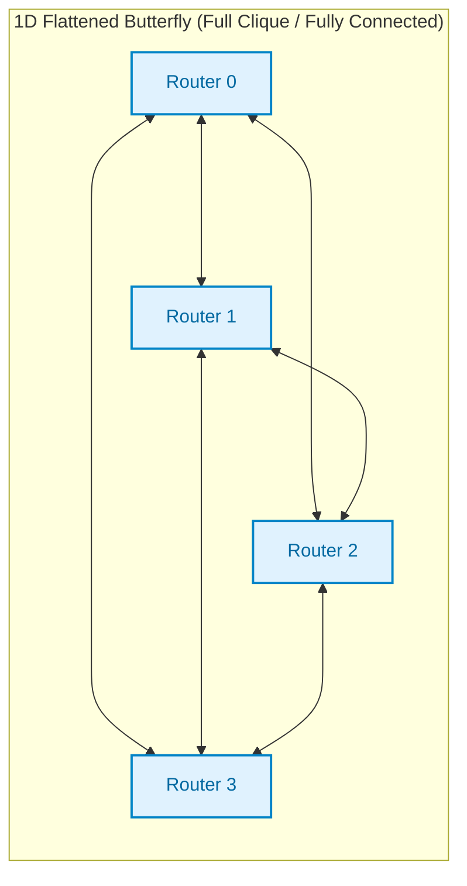

# 3.4 High-Radix Topologies: Dragonfly & Flattened Butterfly

For decades, on-chip and supercomputing interconnects were dominated by **low-radix networks**—such as 2D meshes, 2D tori, and binary hypercubes. In these networks, routers had few ports (typically degree $k_r = 4\text{–}6$), which kept the internal crossbar switch small and fast.

However, as systems scaled from dozens to thousands of cores, low-radix networks hit a brick wall: **network diameter and average hop count exploded ($\mathcal{O}(\sqrt{N})$)**. Packets spent dozens of cycles waiting in router FIFO queues, burning dynamic power on repeated buffer reads, arbitration cycles, and crossbar traversals.

The **High-Radix Revolution** (pioneered by John Dally, Changho Choi, and Steve Scott in the late 2000s) fundamentally altered network architecture: **trade router crossbar port count ($k_r \ge 16\text{–}64$) to compress network diameter down to just $2\text{–}3$ hops!**

In this lesson, we analyze the mathematics of high-radix architectures, examine the **Flattened Butterfly** and **Dragonfly** topologies, explore **UGAL adaptive routing**, and inspect modern silicon implementations from **NVIDIA NVSwitch** to **Cray Slingshot**.

---

## 1. The High-Radix Architectural Shift

### The Classical Dilemma: High Latency in Low-Radix Networks

In a traditional $k \times k$ 2D Mesh with $N = k^2$ nodes:
- Router radix is fixed: $k_r \le 5$ (North, South, East, West, Local Core).
- Network diameter scales as: $D = 2(k - 1) = 2(\sqrt{N} - 1)$.
- Average hops: $H_{avg} \approx \frac{2}{3} \sqrt{N}$.

When $N = 1024$ cores ($32 \times 32$ mesh):
- Maximum diameter $D = 62\text{ hops}$.
- Average hops $H_{avg} \approx 21.3\text{ hops}$.
- Assuming a 2-cycle router pipeline and 1-cycle wire delay, average zero-load latency is:
  $$T_0 \approx 21.3 \times (2 + 1) = \mathbf{64\text{ clock cycles}}!$$

Under medium load, queuing stalls multiply this figure by $3\times\text{–}5\times$, leading to hundreds of cycles of memory stalls!

```
Low-Radix (2D Mesh, Radix = 5):
  [Core]        [Core]        [Core]        [Core]
    |             |             |             |
[Router] <---> [Router] <---> [Router] <---> [Router] ... (62 hops maximum!)
    |             |             |             |

High-Radix (Flattened Butterfly / Dragonfly, Radix = 32–64):
  [Core][Core][Core][Core]
      \    |   /   /
       [Router A] <=====================================> [Router B]
      /    |   \   \                                      /   |   \   \
  [Core][Core][Core][Core]                             [Core][Core][Core][Core]
                 \___________ Only 1–2 Hops! ___________/
```

### Moore's Law & Pin Bandwidth Enable High Radix

Why couldn't early computer architects simply build 64-port routers?
1. **Area Scaling:** An $R \times R$ crossbar cross-point matrix requires $\mathcal{O}(R^2)$ silicon area.
2. **Arbiter Delay:** An $R \times R$ matrix arbiter scales quadratically in wire complexity.
3. **Packaging / Pin Limits:** Chip package bump pitch and PCB pinouts limited the number of high-speed differential SerDes pins.

By 2008, advances in deep-submicron CMOS (45nm, 28nm, 7nm) and high-speed SerDes (10 Gbps to 112 Gbps PAM4) changed the equation. Silicon area became abundant, while long-distance inter-chip wiring and off-chip packaging remained expensive. 

Architects realized that **spending silicon area on a large router crossbar to save hops yields massive net power and latency savings!**

---

## 2. The Flattened Butterfly Topology

The **Flattened Butterfly (FBfly)** (Kim, Dally et al., ISCA 2007) is derived by "flattening" the switching stages of a conventional multistage Bidirectional Butterfly (Clos network) into a single tier of high-radix routers.



### Derivation & Mathematical Properties
A $k$-ary $n$-flat Flattened Butterfly consists of $n$ dimensions with $k$ routers per dimension:
- **Total Routers:** $N_r = k^n$.
- **Concentration ($p$):** Each router connects to $p$ terminal nodes. Total compute nodes $N = p \cdot k^n$.
- **Interconnections:** Along each dimension, every router connects to all other $k - 1$ routers in that same dimension (forming a fully connected clique in each dimension).

| Metric | 2D Mesh ($k \times k$) | 2D Flattened Butterfly ($k$-ary 2-flat) |
| :--- | :--- | :--- |
| **Router Radix ($k_r$)** | $4 + p$ | $\mathbf{2(k - 1) + p}$ |
| **Network Diameter ($D$)** | $2(k - 1)$ | $\mathbf{n = 2\text{ hops}}$ (Independent of $k$!) |
| **Average Hop Count ($H_{avg}$)** | $\frac{2}{3} k$ | $\mathbf{2 \cdot \frac{k - 1}{k}} \approx \mathbf{2\text{ hops}}$ |
| **Bisection Bandwidth ($B_b$)** | $2 k \cdot w$ | $\mathbf{\frac{k^2}{4} \cdot w}$ (Quadratic scaling!) |

### Why Flattened Butterfly Outperforms 2D Mesh
In a $k$-ary 2-flat network:
1. **Any node can reach ANY other node in at most 2 hops** (1 hop along Dimension X, 1 hop along Dimension Y).
2. For $k = 8$ and $p = 1$ ($N = 64$ nodes):
   - 2D Mesh diameter: $D = 14\text{ hops}$.
   - Flattened Butterfly diameter: $D = \mathbf{2\text{ hops}}$.
   - Latency is cut by more than **$70\%$**!

---

## 3. The Dragonfly Topology

While the Flattened Butterfly works well on a single chip or backplane, scaling it across thousands of server racks requires millions of long, expensive cables.

To solve this, Kim, Dally, Scott, and Abts (ISCA 2008) introduced the **Dragonfly Topology**. The fundamental insight of Dragonfly is:
> **Cables have non-uniform cost.** Short electrical PCB traces within a router board are virtually free. Long optical cables across server racks are expensive and bulky. Dragonfly maximizes the utilization of long optical links by arranging routers into tightly connected local groups!

```
Dragonfly Hierarchical Architecture:
=============================================================================
+----------------- Group 0 -----------------+       +----------------- Group 1 -----------------+
|  [R0] <=========> [R1] <=========> [R2]  |       |  [R3] <=========> [R4] <=========> [R5]  |
|    | \           / | \           / |     |       |    | \           / | \           / |     |
|    |  \_________/  |  \_________/  |     |       |    |  \_________/  |  \_________/  |     |
|   (p)             (p)             (p)    |       |   (p)             (p)             (p)    |
+----|---------------|---------------|-----+       +----|---------------|---------------|-----+
     |               |               |                  |               |               |
     | (Global Link) |               \==================|===============/               |
     \===============|==================================/                               |
                     \==================================================================/
                                           Global Inter-Group Links
```

### The 4 Parameter Dimensions of Dragonfly: $(p, a, h, g)$

A canonical Dragonfly is defined by four integer parameters:
1. **$p$ (Terminal Concentration):** Number of compute nodes connected to each router.
2. **$a$ (Group Size):** Number of routers in each local group. Within a group, all $a$ routers form a fully connected clique using $a - 1$ local links per router.
3. **$h$ (Global Links):** Number of inter-group global channels leaving each router.
4. **$g$ (Number of Groups):** Total number of groups in the network.

### System Capacity Equations

- **Total global channels leaving a group:**
  $$\text{Global Channels per Group} = a \cdot h$$
- In a balanced Dragonfly, each group has exactly one direct global channel to every other group:
  $$g = a \cdot h + 1$$
- **Total Routers in System:**
  $$N_r = a \cdot g = a(a \cdot h + 1)$$
- **Total Compute Nodes in System:**
  $$\mathbf{N = p \cdot a \cdot g = p \cdot a (a \cdot h + 1)}$$
- **Total Router Radix:**
  $$\mathbf{k_r = p + (a - 1) + h}$$

### Network Diameter
The maximum diameter of a balanced Dragonfly is only **$3\text{ hops}$**!
1. **Hop 1 (Local):** Source router forwards packet locally to the router in its group that owns the global link to the destination group.
2. **Hop 2 (Global):** Packet traverses the single global channel to enter the destination group.
3. **Hop 3 (Local):** Gateway router in the destination group forwards packet locally to the target destination router.

---

## 4. Adaptive Routing in High-Radix Networks: UGAL

High-radix networks provide high path diversity, but naive routing can cause severe congestion.

### The Adversarial Traffic Pitfall of Minimal Routing (MIN)
Consider two groups in a Dragonfly: Group $A$ and Group $B$. There is exactly **one direct global link** connecting Group $A$ to Group $B$.

- If every node in Group $A$ sends traffic simultaneously to Group $B$ (adversarial permutation traffic), all packets are forced through that **single global link**!
- That link saturates immediately, throttling network throughput to $\Theta_{sat} = \frac{1}{a \cdot p}$!

```
Minimal Routing (MIN) - Vulnerable to Global Link Bottleneck:
  [Source in Group A] ---Local---> [Exit Router] ===== ONE GLOBAL LINK =====> [Entry Router] ---Local---> [Dest in Group B]

Valiant's Non-Minimal Routing (VAL) - Load-Balancing via Random Group R:
  [Source in Group A] === Global 1 ===> [Random Group R] === Global 2 ===> [Dest in Group B]
```

### Valiant's Randomized Routing (VAL)
To eliminate worst-case bottlenecks, Valiant's algorithm picks a **uniform random intermediate group $R$**:
1. Route from Source Group $A \to$ Random Intermediate Group $R$.
2. Route from Intermediate Group $R \to$ Destination Group $B$.

- **Benefit:** Completely balances traffic across all global links in the entire system, guaranteeing high throughput on any adversarial traffic pattern!
- **Penalty:** **Doubles global link usage!** Every packet now traverses $2$ global links instead of $1$, cutting network saturation throughput under benign Uniform Random traffic by $50\%$.

### UGAL: Universal Globally-Adaptive Link Routing
To get the best of both worlds, John Dally proposed **UGAL (Universal Globally-Adaptive Link)**:
For each packet, the source router estimates queue congestion along both the **Minimal path (MIN)** and the **Non-minimal path (VAL)**:

$$\text{Decision Rule: If } \mathbf{q_{MIN} \le 2 \cdot q_{VAL} + \Delta} \implies \text{Route Minimal (MIN)}$$
$$\text{Else } \implies \text{Route Non-Minimal via Random Intermediate (VAL)}$$

Where:
- $q_{MIN}$ is the queue depth on the direct global channel.
- $q_{VAL}$ is the queue depth on the non-minimal candidate link.
- The factor of $2$ reflects the physical reality that **non-minimal routing consumes twice as much global network bandwidth**! It is only worthwhile to take a 2-hop global detour if the minimal link is at least twice as congested.

---

## 5. 🔬 Interactive High-Radix vs. Low-Radix Architecture Explorer

Use this interactive tool to compare a **2D Mesh**, a **2D Torus**, a **Flattened Butterfly**, and a **Dragonfly** across scaling parameters:

<div class="noc-sim-container" id="highradix-sim">
  <div style="display:flex; justify-content:space-between; align-items:center; flex-wrap:wrap; gap:0.5rem; margin-bottom:1rem;">
    <div style="font-weight:700; font-size:1.05rem; color:var(--tcl-heading);">
      ⚡ High-Radix vs. Low-Radix Topology Comparator
    </div>
    <span class="noc-track-badge" style="background:rgba(37,99,235,0.1); color:#2563eb;">
      Interactive Architectural Trade-off Engine
    </span>
  </div>

  <div style="display:grid; grid-template-columns:repeat(auto-fit, minmax(200px, 1fr)); gap:1rem; margin-bottom:1.25rem;">
    <div>
      <label style="font-size:0.85rem; font-weight:600; display:block; margin-bottom:0.35rem;">
        Compute Nodes ($N$):
      </label>
      <select id="hr_nodes" class="noc-sim-select" onchange="calcHighRadix()">
        <option value="64">64 Nodes (8×8 System)</option>
        <option value="256" selected>256 Nodes (16×16 System)</option>
        <option value="1024">1,024 Nodes (32×32 Large Cluster)</option>
      </select>
    </div>

    <div>
      <label style="font-size:0.85rem; font-weight:600; display:block; margin-bottom:0.35rem;">
        Concentration Factor ($p$):
      </label>
      <select id="hr_conc" class="noc-sim-select" onchange="calcHighRadix()">
        <option value="1">p = 1 (1 Node per Router)</option>
        <option value="2">p = 2 (2 Nodes per Router)</option>
        <option value="4" selected>p = 4 (4 Nodes per Router / cMesh)</option>
      </select>
    </div>

    <div>
      <label style="font-size:0.85rem; font-weight:600; display:block; margin-bottom:0.35rem;">
        Per-Hop Router Delay ($t_r$):
      </label>
      <select id="hr_tr" class="noc-sim-select" onchange="calcHighRadix()">
        <option value="1">1 Cycle (Ultra-Low Latency Speculative)</option>
        <option value="2" selected>2 Cycles (Standard Lookahead NoC)</option>
        <option value="4">4 Cycles (High-Radix Server Switch)</option>
      </select>
    </div>
  </div>

  <div style="overflow-x:auto; margin-bottom:1.5rem;">
    <table style="width:100%; border-collapse:collapse; font-size:0.88rem; text-align:center;">
      <thead>
        <tr style="background:var(--md-default-fg-color--lightest); border-bottom:2px solid var(--tcl-border);">
          <th style="padding:0.6rem; text-align:left;">Topology Metric</th>
          <th style="padding:0.6rem; color:#2563eb;">2D Mesh</th>
          <th style="padding:0.6rem; color:#059669;">2D Torus</th>
          <th style="padding:0.6rem; color:#d97706;">Flattened Butterfly</th>
          <th style="padding:0.6rem; color:#9333ea;">Dragonfly</th>
        </tr>
      </thead>
      <tbody id="hr_tbody">
        <!-- Dynamically injected rows -->
      </tbody>
    </table>
  </div>

  <div style="background:var(--md-default-fg-color--lightest); border-radius:8px; padding:1rem; border:1px solid var(--tcl-border);">
    <div style="font-weight:700; font-size:0.9rem; margin-bottom:0.5rem; color:var(--tcl-heading);">
      📊 Comparative Architectural Insight:
    </div>
    <div id="hr_insight" style="font-size:0.85rem; line-height:1.6; color:var(--md-default-fg-color);">
      <!-- Dynamic text insight -->
    </div>
  </div>
</div>

<script>
function calcHighRadix() {
  const N = parseInt(document.getElementById("hr_nodes").value);
  const p = parseInt(document.getElementById("hr_conc").value);
  const tr = parseInt(document.getElementById("hr_tr").value);
  const tlink = 1;

  // Routers needed
  const Nr = Math.ceil(N / p);
  const k = Math.round(Math.sqrt(Nr));

  // 1. 2D Mesh
  const mesh_radix = 4 + p;
  const mesh_diam = 2 * (k - 1);
  const mesh_avg_hops = ((2 / 3) * k).toFixed(1);
  const mesh_latency = (parseFloat(mesh_avg_hops) * (tr + tlink)).toFixed(1);
  const mesh_xbar_area = Math.pow(mesh_radix, 2);

  // 2. 2D Torus
  const torus_radix = 4 + p;
  const torus_diam = k;
  const torus_avg_hops = (k / 2).toFixed(1);
  const torus_latency = (parseFloat(torus_avg_hops) * (tr + tlink)).toFixed(1);
  const torus_xbar_area = Math.pow(torus_radix, 2);

  // 3. Flattened Butterfly (2-flat, k per dim)
  const fbfly_radix = 2 * (k - 1) + p;
  const fbfly_diam = 2;
  const fbfly_avg_hops = (2 * (k - 1) / k).toFixed(2);
  const fbfly_latency = (parseFloat(fbfly_avg_hops) * (tr + tlink)).toFixed(1);
  const fbfly_xbar_area = Math.pow(fbfly_radix, 2);

  // 4. Dragonfly (approximate canonical sizing)
  // Let a = k, h = ceil(k / 2), g = a*h + 1
  const df_a = Math.max(4, Math.floor(Math.sqrt(Nr)));
  const df_h = Math.max(2, Math.ceil(df_a / 2));
  const df_g = df_a * df_h + 1;
  const df_radix = p + (df_a - 1) + df_h;
  const df_diam = 3;
  const df_avg_hops = (2.2).toFixed(1);
  const df_latency = (parseFloat(df_avg_hops) * (tr + tlink)).toFixed(1);
  const df_xbar_area = Math.pow(df_radix, 2);

  const tbody = document.getElementById("hr_tbody");
  tbody.innerHTML = `
    <tr style="border-bottom:1px solid var(--tcl-border);">
      <td style="padding:0.5rem; text-align:left; font-weight:600;">Total Routers ($N_r$)</td>
      <td>${Nr}</td><td>${Nr}</td><td>${Nr}</td><td>${df_a * df_g} (Scaled)</td>
    </tr>
    <tr style="border-bottom:1px solid var(--tcl-border);">
      <td style="padding:0.5rem; text-align:left; font-weight:600;">Router Radix ($k_r$)</td>
      <td><strong>${mesh_radix}</strong></td>
      <td><strong>${torus_radix}</strong></td>
      <td style="color:#d97706;"><strong>${fbfly_radix}</strong></td>
      <td style="color:#9333ea;"><strong>${df_radix}</strong></td>
    </tr>
    <tr style="border-bottom:1px solid var(--tcl-border);">
      <td style="padding:0.5rem; text-align:left; font-weight:600;">Network Diameter ($D$)</td>
      <td>${mesh_diam} hops</td>
      <td>${torus_diam} hops</td>
      <td style="color:#d97706; font-weight:700;">${fbfly_diam} hops</td>
      <td style="color:#9333ea; font-weight:700;">${df_diam} hops</td>
    </tr>
    <tr style="border-bottom:1px solid var(--tcl-border);">
      <td style="padding:0.5rem; text-align:left; font-weight:600;">Average Hops ($H_{avg}$)</td>
      <td>${mesh_avg_hops}</td>
      <td>${torus_avg_hops}</td>
      <td style="color:#d97706; font-weight:700;">${fbfly_avg_hops}</td>
      <td style="color:#9333ea; font-weight:700;">${df_avg_hops}</td>
    </tr>
    <tr style="border-bottom:1px solid var(--tcl-border);">
      <td style="padding:0.5rem; text-align:left; font-weight:600;">Zero-Load Latency ($T_0$)</td>
      <td>${mesh_latency} cyc</td>
      <td>${torus_latency} cyc</td>
      <td style="color:#d97706; font-weight:700;">${fbfly_latency} cyc</td>
      <td style="color:#9333ea; font-weight:700;">${df_latency} cyc</td>
    </tr>
    <tr>
      <td style="padding:0.5rem; text-align:left; font-weight:600;">Relative Crossbar Area ($\propto k_r^2$)</td>
      <td>1.0× (Baseline)</td>
      <td>1.0×</td>
      <td style="color:#d97706;">${(fbfly_xbar_area / mesh_xbar_area).toFixed(1)}×</td>
      <td style="color:#9333ea;">${(df_xbar_area / mesh_xbar_area).toFixed(1)}×</td>
    </tr>
  `;

  const latencyDrop = (((mesh_latency - fbfly_latency) / mesh_latency) * 100).toFixed(0);
  document.getElementById("hr_insight").innerHTML = `
    At <strong>${N} compute nodes</strong>, moving from a 2D Mesh to a High-Radix Flattened Butterfly or Dragonfly reduces average hop count from 
    <strong>${mesh_avg_hops} hops down to ~${fbfly_avg_hops} hops</strong>, slashing zero-load network latency by <strong>${latencyDrop}%</strong>! 
    In exchange, the router crossbar area grows by <strong>${(fbfly_xbar_area / mesh_xbar_area).toFixed(1)}×</strong>. Because crossbars occupy less than 
    10% of total SoC die area in modern processes, this is an overwhelmingly favorable architectural trade-off.
  `;
}

if (document.readyState === "loading") {
  document.addEventListener("DOMContentLoaded", calcHighRadix);
} else {
  calcHighRadix();
}
</script>

---

## 6. Real-World Silicon Case Studies

Where are high-radix topologies deployed in cutting-edge commercial computing?

### Case 1: Cray / HPE Slingshot-11 (Supercomputing Dragonfly)
Powers the world's top exascale supercomputers (**Frontier** at ORNL and **El Capitan** at LLNL):
- **Switch Architecture:** Single-chip high-radix ASIC with **64 ports of 200 Gbps Ethernet** ($12.8\text{ Tbps}$ bidirectional bandwidth).
- **Topology:** Balanced Dragonfly connecting up to $276,480$ endpoints in **at most 3 optical hops**.
- **Adaptive Routing:** Hardware-level dynamic packet inspection switching between minimal and non-minimal paths per packet with sub-microsecond congestion telemetry.

```
+----------------------------------------------------------------------------+
| Cray Slingshot-11 Switch: 64 Ports @ 200 Gbps (12.8 Tbps Total Switching)   |
| [Port 0] [Port 1] ... [Port 15]  ==> Local Compute Endpoints (p = 16)      |
| [Port 16] [Port 17] ... [Port 47] ==> Intra-Chassis Copper Links (a = 32)   |
| [Port 48] [Port 49] ... [Port 63] ==> Long-Distance Optical Fibers (h = 16)|
+----------------------------------------------------------------------------+
```

### Case 2: NVIDIA NVLink & NVSwitch (AI High-Radix Fabric)
In AI model training (e.g., GPT-4, Llama 3), all GPUs must exchange tensor activations simultaneously:
- **NVSwitch 3 (Hopper H100):** 64 ports of 400 Gbps NVLink 4 ($3.2\text{ TB/s}$ bisection).
- **NVSwitch 4 (Blackwell B200 / GB200 NVL72):** Connects 72 GPUs in a single liquid-cooled rack into a **single-hop high-radix crossbar domain ($D = 1$)**!
- All 72 GPUs communicate at a mind-boggling **130 TB/s aggregate all-to-all bandwidth**, behaving logically as one giant GPU without any multi-hop routing delay!

### Case 3: Google TPU v4 & v5p (Optical Circuit-Switched 3D Torus)
Google connects thousands of Tensor Processing Units using a **reconfigurable 3D Torus**:
- Features custom **Optical Circuit Switches (OCS)** that dynamically reroute optical fiber paths.
- Under all-to-all or ring-reduce collectives, the OCS physically reconfigures the links to skip dead nodes and flatten the torus into direct express channels, emulating a high-radix topology.

---

## 7. Worked Numerical Example: Dimensioning an Exascale Dragonfly

> [!TIP]
> **Problem Statement:**  
> A system architect is designing an exascale AI cluster using a balanced Dragonfly topology.  
> The switch ASIC has **Radix $k_r = 40\text{ ports}$**.  
> The architect sets:
> - Terminal nodes per router: $p = 8$
> - Intra-group routers: $a = 24$
> 
> Calculate:
> 1. The number of global links ($h$) per router.
> 2. The maximum number of groups ($g$) supported in a fully balanced system.
> 3. The maximum number of compute nodes ($N$) in the entire network.
> 4. The maximum network diameter ($D$) in router hops.

### Step 1: Calculate Global Links per Router ($h$)
The total router radix formula is:
$$k_r = p + (a - 1) + h$$
$$40 = 8 + (24 - 1) + h$$
$$40 = 8 + 23 + h = 31 + h$$
$$\mathbf{h = 40 - 31 = 9\text{ global channels per router}}$$

### Step 2: Calculate Maximum Balanced Groups ($g$)
In a balanced Dragonfly, the total number of global links leaving each group is $a \cdot h$.  
To provide exactly 1 global link from this group to every other group:
$$g = a \cdot h + 1 = 24 \times 9 + 1 = 216 + 1 = \mathbf{217\text{ groups}}$$

### Step 3: Compute Total Endpoints ($N$)
$$\text{Total Routers: } N_r = a \cdot g = 24 \times 217 = 5,208\text{ routers}$$
$$\text{Total Compute Nodes: } N = p \cdot N_r = 8 \times 5,208 = \mathbf{41,664\text{ compute nodes}}$$

### Step 4: Network Diameter ($D$)
A balanced Dragonfly maintains a strict maximum diameter of **$D = 3\text{ hops}$**!  
Even across **$41,664$ compute nodes**, any packet reaches its destination in at most **3 router traversals** (1 local + 1 global + 1 local).

---

## 8. 💻 Synthesizable Hardware: Dragonfly UGAL Adaptive Routing Arbiter

In a high-radix Dragonfly, adaptive routing requires comparing real-time queue congestion between the direct minimal route ($q_{MIN}$) and a randomized non-minimal Valiant detour ($q_{VAL}$).

Because non-minimal routing traverses **two global optical/copper channels** instead of one, the router must enforce the canonical **UGAL threshold**:
$$\text{Select Non-Minimal Path IF: } q_{MIN} > 2 \cdot q_{VAL} + \text{BIAS}$$

Furthermore, to prevent protocol deadlocks between minimal and non-minimal packets, the router dynamically steers non-minimal packets to an escape Virtual Channel (`VC1`).

The synthesizable Verilog module below, `dragonfly_ugal_arbiter.v`, implements this high-radix adaptive routing engine:

```verilog
//=============================================================================
// Module: dragonfly_ugal_arbiter
// Description: Synthesizable UGAL (Universal Globally-Adaptive Link) Routing
//              Arbiter for High-Radix Dragonfly Topologies.
//              - Evaluates local intra-group vs inter-group global routing.
//              - Measures Minimal queue depth (q_min) vs Non-Minimal intermediate
//                group queue depth (q_val).
//              - Evaluates the UGAL threshold:
//                  Use Non-Minimal (Valiant) IF: q_min > (2 * q_val + BIAS)
//              - Assigns separate Virtual Channels (VC0 for MIN, VC1 for VAL)
//                to prevent credit and routing deadlocks!
//=============================================================================

module dragonfly_ugal_arbiter #(
    parameter integer NUM_GROUPS   = 8,   // Total groups in Dragonfly
    parameter integer ROUTERS_GRP  = 4,   // Routers per group
    parameter integer GROUP_W      = 3,   // log2(NUM_GROUPS)
    parameter integer ROUTER_W     = 2,   // log2(ROUTERS_GRP)
    parameter integer QUEUE_W      = 6,   // Queue depth bitwidth (0..63 flits)
    parameter integer BIAS         = 2    // Hysteresis threshold bias
)(
    input  wire                   clk,
    input  wire                   rst_n,

    // Current Router ID
    input  wire [GROUP_W-1:0]     curr_group,
    input  wire [ROUTER_W-1:0]    curr_router,

    // Packet Header Request
    input  wire                   req_valid,
    input  wire [GROUP_W-1:0]     dest_group,
    input  wire [ROUTER_W-1:0]    dest_router,

    // Congestion Feedback from Port Queues
    input  wire [QUEUE_W-1:0]     min_queue_depth,  // Congestion on direct global port
    input  wire [QUEUE_W-1:0]     val_queue_depth,  // Congestion on intermediate detour port

    // Decision Outputs
    output reg                    route_valid,
    output reg                    use_non_minimal,  // 0 = MIN, 1 = VAL (Valiant detour)
    output reg  [GROUP_W-1:0]     intermediate_grp, // Random intermediate group for UGAL
    output reg                    assigned_vc,      // 0 = VC0 (MIN), 1 = VC1 (VAL)
    output reg  [ROUTERS_GRP:0]   out_port_select   // 1-hot port: [0]=Global, [1..ROUTERS_GRP]=Intra
);

    // Pseudorandom Intermediate Group Generator (6-bit Galois LFSR)
    reg [5:0] rand_reg;
    always @(posedge clk or negedge rst_n) begin
        if (!rst_n) begin
            rand_reg <= 6'b101101;
        end else begin
            rand_reg <= {rand_reg[4:0], rand_reg[5] ^ rand_reg[4]};
        end
    end

    // Compute Intermediate Group (Must NOT equal curr_group or dest_group)
    wire [GROUP_W-1:0] candidate_grp = rand_reg[GROUP_W-1:0];
    wire [GROUP_W-1:0] safe_int_grp = (candidate_grp == curr_group) ? (candidate_grp + 1'b1) :
                                      (candidate_grp == dest_group) ? (candidate_grp + 2'd2) :
                                      candidate_grp;

    // UGAL Threshold Comparator: q_min > 2 * q_val + BIAS
    wire [QUEUE_W:0] val_scaled = {val_queue_depth, 1'b0} + BIAS;
    wire choose_valiant = (min_queue_depth > val_scaled);

    always @(posedge clk or negedge rst_n) begin
        if (!rst_n) begin
            route_valid      <= 1'b0;
            use_non_minimal  <= 1'b0;
            intermediate_grp <= {GROUP_W{1'b0}};
            assigned_vc      <= 1'b0;
            out_port_select  <= {(ROUTERS_GRP+1){1'b0}};
        end else begin
            route_valid <= req_valid;
            if (req_valid) begin
                if (dest_group == curr_group) begin
                    // 1. Intra-group routing: Direct local crossbar link to target router
                    use_non_minimal  <= 1'b0;
                    intermediate_grp <= curr_group;
                    assigned_vc      <= 1'b0; // Base intra-group VC
                    out_port_select  <= (1'b1 << (dest_router + 1'b1));
                end else begin
                    // 2. Inter-group routing: Evaluate UGAL adaptive condition
                    intermediate_grp <= safe_int_grp;
                    if (choose_valiant) begin
                        // Detour via intermediate group to bypass global hotspot
                        use_non_minimal <= 1'b1;
                        assigned_vc     <= 1'b1; // VC1 escape to prevent deadlock
                        out_port_select <= 5'b00001; // Route to Valiant egress port
                    end else begin
                        // Direct minimal global channel
                        use_non_minimal <= 1'b0;
                        assigned_vc     <= 1'b0; // VC0 minimal channel
                        out_port_select <= 5'b00001; // Route to Minimal global port
                    end
                end
            end else begin
                out_port_select <= {(ROUTERS_GRP+1){1'b0}};
            end
        end
    end

endmodule
```

---

## 9. 🕹️ Interactive Lab & Arcade Arena

Test your high-radix interconnect intuition in exascale architectural challenges:

<div class="noc-tracks-grid" style="margin-top:1rem;">
  <div class="noc-track-card">
    <div>
      <span class="noc-track-badge" style="background:rgba(37,99,235,0.15); color:#2563eb;">Arcade Mission</span>
      <div class="noc-track-title">🌐 Topology Titans: Dragonfly Grouping</div>
      <div class="noc-track-desc">
        Mission 3: Wire a 16-node Dragonfly network organized into 4 hierarchical groups. Maximize bisection bandwidth while minimizing expensive optical inter-group links.
      </div>
    </div>
    <a href="../interactive/topology/" class="noc-track-link">Play Topology Titans →</a>
  </div>

  <div class="noc-track-card">
    <div>
      <span class="noc-track-badge" style="background:rgba(147,51,234,0.15); color:#9333ea;">Silicon Arena</span>
      <div class="noc-track-title">⚔️ Arbiter Arena: High-Radix Clash</div>
      <div class="noc-track-desc">
        Experience the timing bottlenecks of 64-port switch allocation, comparing separable matrix arbiters against iterative iSLIP matching.
      </div>
    </div>
    <a href="../interactive/arbiter/" class="noc-track-link">Launch Arbiter Arena →</a>
  </div>
</div>

---

## 10. 🎯 Comprehensive Self-Assessment Quiz

Test your mastery of high-radix scaling, Dragonfly packaging, and UGAL routing:

<div class="noc-sim-container" id="quiz34_container" style="margin-top:1rem;">
  <div style="display:flex; justify-content:space-between; align-items:center; margin-bottom:1rem; border-bottom:1px solid var(--tcl-border); padding-bottom:0.5rem;">
    <span style="font-weight:700; font-size:1.05rem; color:var(--tcl-heading);">📝 Lesson 3.4 Self-Check</span>
    <span id="quiz34_score" style="font-weight:700; font-size:0.9rem; color:#2563eb;">Score: 0 / 3</span>
  </div>

  <!-- Question 1 -->
  <div class="quiz-item" style="margin-bottom:1.5rem;">
    <p style="font-weight:600; font-size:0.95rem; margin-bottom:0.6rem;">
      <b>Q1:</b> In UGAL (Universal Globally-Adaptive Link) routing on a Dragonfly, why must the threshold condition require the direct minimal queue to be at least twice as congested ($q_{MIN} > 2 \cdot q_{VAL}$)?
    </p>
    <div style="display:flex; flex-direction:column; gap:0.45rem;" id="q34_1_options">
      <button class="noc-sim-select" style="text-align:left; padding:0.6rem 0.85rem; cursor:pointer;" onclick="answerQ34(1, 0)">A. Because non-minimal packets are always twice as large as minimal packets.</button>
      <button class="noc-sim-select" style="text-align:left; padding:0.6rem 0.85rem; cursor:pointer;" onclick="answerQ34(1, 1)">B. Because a non-minimal detour traverses two global inter-group channels instead of one, consuming twice as much scarce global network bandwidth.</button>
      <button class="noc-sim-select" style="text-align:left; padding:0.6rem 0.85rem; cursor:pointer;" onclick="answerQ34(1, 2)">C. Because non-minimal routing disables the router crossbar switch.</button>
      <button class="noc-sim-select" style="text-align:left; padding:0.6rem 0.85rem; cursor:pointer;" onclick="answerQ34(1, 3)">D. Because high-radix routers only have half-duplex links.</button>
    </div>
    <div id="q34_1_feedback" style="display:none; margin-top:0.6rem; padding:0.75rem; border-radius:6px; font-size:0.88rem; line-height:1.5;"></div>
  </div>

  <!-- Question 2 -->
  <div class="quiz-item" style="margin-bottom:1.5rem;">
    <p style="font-weight:600; font-size:0.95rem; margin-bottom:0.6rem;">
      <b>Q2:</b> How does the <strong>Flattened Butterfly (FBfly)</strong> achieve an ultra-low network diameter of strictly $D = 2$ hops regardless of node count?
    </p>
    <div style="display:flex; flex-direction:column; gap:0.45rem;" id="q34_2_options">
      <button class="noc-sim-select" style="text-align:left; padding:0.6rem 0.85rem; cursor:pointer;" onclick="answerQ34(2, 0)">A. By replacing wires with free-space laser beams.</button>
      <button class="noc-sim-select" style="text-align:left; padding:0.6rem 0.85rem; cursor:pointer;" onclick="answerQ34(2, 1)">B. By fully connecting all routers along each orthogonal dimension into cliques, allowing any source to reach any destination with at most 1 hop along Dimension X and 1 hop along Dimension Y.</button>
      <button class="noc-sim-select" style="text-align:left; padding:0.6rem 0.85rem; cursor:pointer;" onclick="answerQ34(2, 2)">C. By allowing only nearest-neighbor packet transfers.</button>
      <button class="noc-sim-select" style="text-align:left; padding:0.6rem 0.85rem; cursor:pointer;" onclick="answerQ34(2, 3)">D. By buffering all packets in an external central memory pool.</button>
    </div>
    <div id="q34_2_feedback" style="display:none; margin-top:0.6rem; padding:0.75rem; border-radius:6px; font-size:0.88rem; line-height:1.5;"></div>
  </div>

  <!-- Question 3 -->
  <div class="quiz-item" style="margin-bottom:1rem;">
    <p style="font-weight:600; font-size:0.95rem; margin-bottom:0.6rem;">
      <b>Q3:</b> In supercomputing fabrics like Cray Slingshot and NVIDIA NVSwitch, why is the Dragonfly topology partitioned into hierarchical intra-group and inter-group tiers?
    </p>
    <div style="display:flex; flex-direction:column; gap:0.45rem;" id="q34_3_options">
      <button class="noc-sim-select" style="text-align:left; padding:0.6rem 0.85rem; cursor:pointer;" onclick="answerQ34(3, 0)">A. To match physical packaging costs: high-density copper cables are used for cheap intra-cabinet wiring, while expensive optical links are reserved exclusively for sparse inter-cabinet connections.</button>
      <button class="noc-sim-select" style="text-align:left; padding:0.6rem 0.85rem; cursor:pointer;" onclick="answerQ34(3, 1)">B. Because optical links cannot transmit packet headers.</button>
      <button class="noc-sim-select" style="text-align:left; padding:0.6rem 0.85rem; cursor:pointer;" onclick="answerQ34(3, 2)">C. To force all compute nodes to run at identical temperatures.</button>
      <button class="noc-sim-select" style="text-align:left; padding:0.6rem 0.85rem; cursor:pointer;" onclick="answerQ34(3, 3)">D. Because intra-group links are unidirectional while inter-group links are bidirectional.</button>
    </div>
    <div id="q34_3_feedback" style="display:none; margin-top:0.6rem; padding:0.75rem; border-radius:6px; font-size:0.88rem; line-height:1.5;"></div>
  </div>
</div>

<script>
let q34Score = 0;
const answeredQ34 = {1: false, 2: false, 3: false};

function answerQ34(qNum, selected) {
  if (answeredQ34[qNum]) return;
  answeredQ34[qNum] = true;

  const correctAnswers = {1: 1, 2: 1, 3: 0};
  const isCorrect = (selected === correctAnswers[qNum]);
  const fb = document.getElementById("q34_" + qNum + "_feedback");
  const opts = document.getElementById("q34_" + qNum + "_options").children;

  for (let i = 0; i < opts.length; i++) {
    opts[i].style.cursor = "default";
    opts[i].onclick = null;
  }

  if (isCorrect) {
    q34Score++;
    opts[selected].style.background = "rgba(34, 197, 94, 0.15)";
    opts[selected].style.borderColor = "#22c55e";
    fb.style.display = "block";
    fb.style.background = "rgba(34, 197, 94, 0.1)";
    fb.style.border = "1px solid rgba(34, 197, 94, 0.3)";
    fb.style.color = "#166534";
    fb.innerHTML = "<strong>✓ Correct!</strong> " + getQ34Explanation(qNum, true);
  } else {
    opts[selected].style.background = "rgba(239, 68, 68, 0.15)";
    opts[selected].style.borderColor = "#ef4444";
    opts[correctAnswers[qNum]].style.background = "rgba(34, 197, 94, 0.15)";
    opts[correctAnswers[qNum]].style.borderColor = "#22c55e";
    fb.style.display = "block";
    fb.style.background = "rgba(239, 68, 68, 0.1)";
    fb.style.border = "1px solid rgba(239, 68, 68, 0.3)";
    fb.style.color = "#991b1b";
    fb.innerHTML = "<strong>✗ Incorrect.</strong> " + getQ34Explanation(qNum, false);
  }

  document.getElementById("quiz34_score").textContent = "Score: " + q34Score + " / 3";
}

function getQ34Explanation(qNum, wasCorrect) {
  if (qNum === 1) {
    return "A non-minimal detour traverses an intermediate group, using 2 long global links instead of 1. Because this doubles system-wide global channel bandwidth consumption, it is only worthwhile if the direct channel is more than twice as congested.";
  } else if (qNum === 2) {
    return "In a 2D Flattened Butterfly, each row and column is a fully connected clique. A packet hops at most once along X to reach the destination's column, and at most once along Y to reach the destination router, capping diameter strictly to D=2.";
  } else {
    return "The Dragonfly maps network topology directly to machine packaging hierarchy: dense, inexpensive electrical copper wires connect intra-chassis routers, while expensive optical cables span across server cabinets.";
  }
}
</script>

---

## Track 3 Summary: Interconnect Topologies Mastery

Congratulations! You have completed **Track 3: Topologies & Interconnect Metrics**.

Here is what you have mastered across this module:
1. **Direct Topologies (Lesson 3.1):** Derivations of degree, diameter, bisection bandwidth, the Folded Torus layout that prevents wire delay penalties, and [folded_torus_node_map.v](01-direct-topologies.md#7-synthesizable-hardware-folded-torus-coordinate-link-mapper).
2. **Indirect & Concentrated Networks (Lesson 3.2):** Multistage Clos networks, Fat-Trees, Balfour & Dally's Concentrated Mesh (cMesh) reducing router count by 75%, and [cmesh_concentrator.v](02-indirect-hierarchical.md#7-synthesizable-hardware-41-cmesh-concentrator-ejection-unit).
3. **Interconnect Metrics (Lesson 3.3):** Zero-load latency ($T_0$), saturation throughput ($\Theta_{sat} = 1/\gamma_{max}$), the mathematical proof of Bit-Complement's 50% saturation penalty, and [traffic_pattern_generator.v](03-metrics-traffic-patterns.md#6-synthesizable-hardware-synthetic-traffic-pattern-generator).
4. **High-Radix Topologies (Lesson 3.4):** Flattened Butterfly ($D=2$) and Dragonfly ($D=3$), UGAL adaptive routing, exascale silicon fabrics (NVIDIA NVSwitch & HPE Slingshot), and `dragonfly_ugal_arbiter.v`.

Ready to dive into routing algorithms, deadlock freedom, and the turn model?

👉 **Proceed to [Track 4: Routing Algorithms & Deadlock Avoidance](../track4-routing-deadlock/index.md)**

